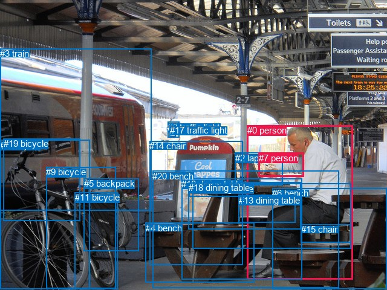
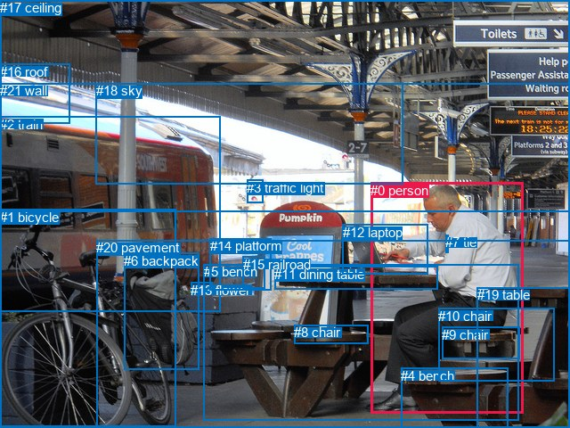

# 图片 0649：2344605.jpg

随机样本序号：95。图片 SHA256：`f4f730a011b99aaa7b9ee851b6ba4c77fe2e3c4c81d12d58b7221d0f1b199c01`。

红色框表示人，蓝色框表示其他物体。两个模式分别保留自身框编号，可依据位置比较对应对象。

## 自动检测框与输出

人的框编号：`[0, 7]`。状态：`ok`。

### 自动检测全部物体框

| 编号 | 类别 | 是否为人 | 检测分数 | 像素坐标 xyxy |
|---|---|---|---|---|
| 0 | person | True | 0.9991 | 408.5, 207.1, 583.7, 462.2 |
| 1 | bicycle | False | 0.9976 | 0.2, 231.6, 148.9, 478.9 |
| 2 | laptop | False | 0.9959 | 388.8, 252.8, 467.3, 306.2 |
| 3 | train | False | 0.9647 | 0.0, 80.0, 250.7, 348.7 |
| 4 | bench | False | 0.9612 | 240.7, 368.5, 420.4, 467.8 |
| 5 | backpack | False | 0.9536 | 138.7, 295.4, 229.0, 415.6 |
| 6 | bench | False | 0.7984 | 450.3, 311.1, 639.1, 478.6 |
| 7 | person | True | 0.7670 | 427.6, 252.7, 503.0, 292.6 |
| 8 | traffic light | False | 0.7109 | 277.4, 201.8, 296.6, 227.3 |
| 9 | bicycle | False | 0.6975 | 76.4, 276.1, 191.9, 477.7 |
| 10 | dining table | False | 0.6359 | 311.8, 301.2, 497.3, 379.2 |
| 11 | bicycle | False | 0.4761 | 124.0, 318.5, 194.6, 478.4 |
| 12 | dining table | False | 0.4503 | 318.0, 303.9, 580.8, 411.8 |
| 13 | dining table | False | 0.4433 | 394.5, 322.6, 488.4, 368.5 |
| 14 | chair | False | 0.4429 | 247.3, 233.5, 401.6, 438.1 |
| 15 | chair | False | 0.4213 | 497.8, 371.3, 580.8, 401.5 |
| 16 | dining table | False | 0.4202 | 300.1, 295.9, 499.8, 462.4 |
| 17 | traffic light | False | 0.4018 | 280.7, 206.8, 290.4, 226.4 |
| 18 | dining table | False | 0.4008 | 312.3, 302.4, 497.5, 325.2 |
| 19 | bicycle | False | 0.3947 | 5.9, 229.1, 132.8, 365.9 |
| 20 | bench | False | 0.3624 | 252.3, 282.6, 560.8, 476.3 |

### 自动检测 Top50 人相关候选

评分物体对：420；人相关物体对：78；输出关系：50。

| 排名 | 主语编号与类别 | 关系 | 宾语编号与类别 | 类型 | 人与人 | 排序分数 | 原始融合 logit |
|---|---|---|---|---|---|---|---|
| 1 | #0 person | sitting on | #6 bench | semantic | False | 0.97123 | 3.5193 |
| 2 | #0 person | sitting on | #12 dining table | semantic | False | 0.96255 | 3.2465 |
| 3 | #0 person | sitting on | #13 dining table | semantic | False | 0.95654 | 3.0916 |
| 4 | #0 person | sitting on | #20 bench | semantic | False | 0.95289 | 3.0070 |
| 5 | #0 person | sitting on | #15 chair | semantic | False | 0.95244 | 2.9969 |
| 6 | #0 person | on | #12 dining table | spatial | False | 0.93588 | 2.6807 |
| 7 | #0 person | looking at | #2 laptop | semantic | False | 0.93421 | 2.6533 |
| 8 | #0 person | sitting on | #16 dining table | semantic | False | 0.93298 | 2.6333 |
| 9 | #0 person | sitting on | #10 dining table | semantic | False | 0.92711 | 2.5431 |
| 10 | #0 person | on | #20 bench | spatial | False | 0.91552 | 2.3830 |
| 11 | #0 person | holding | #7 person | semantic | True | 0.91433 | 2.3676 |
| 12 | #0 person | on | #6 bench | spatial | False | 0.91022 | 2.3163 |
| 13 | #0 person | on | #13 dining table | spatial | False | 0.90457 | 2.2490 |
| 14 | #0 person | on | #7 person | spatial | True | 0.89450 | 2.1376 |
| 15 | #0 person | on | #10 dining table | spatial | False | 0.89014 | 2.0922 |
| 16 | #0 person | on | #2 laptop | spatial | False | 0.88473 | 2.0380 |
| 17 | #0 person | on | #16 dining table | spatial | False | 0.86470 | 1.8549 |
| 18 | #0 person | on | #18 dining table | spatial | False | 0.85634 | 1.7852 |
| 19 | #0 person | sitting on | #18 dining table | semantic | False | 0.85341 | 1.7616 |
| 20 | #0 person | on | #15 chair | spatial | False | 0.83504 | 1.6218 |
| 21 | #7 person | on | #2 laptop | spatial | False | 0.77438 | 1.2332 |
| 22 | #7 person | on | #18 dining table | spatial | False | 0.64665 | 0.6044 |
| 23 | #7 person | on | #20 bench | spatial | False | 0.50078 | 0.0031 |
| 24 | #7 person | holding | #2 laptop | semantic | False | 0.48277 | -0.0689 |
| 25 | #7 person | on | #12 dining table | spatial | False | 0.48219 | -0.0713 |
| 26 | #7 person | on | #10 dining table | spatial | False | 0.44944 | -0.2029 |
| 27 | #0 person | looking at | #14 chair | semantic | False | 0.42957 | -0.2836 |
| 28 | #0 person | on | #14 chair | spatial | False | 0.35115 | -0.6140 |
| 29 | #7 person | on | #16 dining table | spatial | False | 0.30437 | -0.8266 |
| 30 | #7 person | sitting on | #18 dining table | semantic | False | 0.28019 | -0.9435 |
| 31 | #7 person | on | #0 person | spatial | True | 0.27793 | -0.9547 |
| 32 | #7 person | sitting on | #20 bench | semantic | False | 0.26005 | -1.0457 |
| 33 | #0 person | sitting on | #4 bench | semantic | False | 0.25906 | -1.0508 |
| 34 | #7 person | on | #13 dining table | spatial | False | 0.24929 | -1.1024 |
| 35 | #2 laptop | in | #7 person | spatial | False | 0.24335 | -1.1344 |
| 36 | #0 person | on | #4 bench | spatial | False | 0.23661 | -1.1713 |
| 37 | #14 chair | beside | #0 person | spatial | False | 0.19700 | -1.4051 |
| 38 | #7 person | sitting on | #12 dining table | semantic | False | 0.19377 | -1.4257 |
| 39 | #0 person | looking at | #3 train | semantic | False | 0.17126 | -1.5767 |
| 40 | #7 person | sitting on | #10 dining table | semantic | False | 0.15042 | -1.7313 |
| 41 | #2 laptop | beside | #0 person | spatial | False | 0.13202 | -1.8832 |
| 42 | #13 dining table | on | #0 person | spatial | False | 0.13050 | -1.8966 |
| 43 | #7 person | sitting on | #16 dining table | semantic | False | 0.12980 | -1.9027 |
| 44 | #15 chair | in | #0 person | spatial | False | 0.12237 | -1.9702 |
| 45 | #7 person | sitting on | #13 dining table | semantic | False | 0.11089 | -2.0817 |
| 46 | #3 train | beside | #0 person | spatial | False | 0.10803 | -2.1111 |
| 47 | #7 person | holding | #0 person | semantic | True | 0.10189 | -2.1764 |
| 48 | #2 laptop | sitting on | #7 person | semantic | False | 0.07216 | -2.5539 |
| 49 | #12 dining table | in | #0 person | spatial | False | 0.05443 | -2.8549 |
| 50 | #13 dining table | holding | #0 person | semantic | False | 0.05318 | -2.8795 |

### 自动检测逐条人相关 GT 核验

R@50：25.00%；命中 1/4。

| GT 主语编号 | GT 关系 | GT 宾语编号 | 结果阶段 | 匹配预测主语编号 | 匹配预测宾语编号 |
|---|---|---|---|---|---|
| 0 | wearing | 7 | endpoint_missing_or_wrong_class | [0] | [] |
| 0 | sitting on | 9 | hit50 | [0] | [15] |
| 0 | touching | 12 | wrong_predicate | [0] | [2] |
| 12 | in front of | 0 | wrong_predicate | [2] | [0] |

## 真实框与输出

人的框编号：`[0]`。

### 真实框全部物体框

| 编号 | 类别 | 是否为人 | 检测分数 | 像素坐标 xyxy |
|---|---|---|---|---|
| 0 | person | True | GT | 416.0, 205.0, 587.0, 463.0 |
| 1 | bicycle | False | GT | 0.0, 235.0, 197.0, 479.0 |
| 2 | train | False | GT | 0.0, 131.0, 248.0, 350.0 |
| 3 | traffic light | False | GT | 277.0, 202.0, 295.0, 228.0 |
| 4 | bench | False | GT | 450.0, 413.0, 570.0, 480.0 |
| 5 | bench | False | GT | 229.0, 296.0, 583.0, 471.0 |
| 6 | backpack | False | GT | 139.0, 284.0, 223.0, 415.0 |
| 7 | tie | False | GT | 500.0, 263.0, 503.0, 283.0 |
| 8 | chair | False | GT | 330.0, 364.0, 413.0, 385.0 |
| 9 | chair | False | GT | 496.0, 367.0, 583.0, 403.0 |
| 10 | chair | False | GT | 492.0, 346.0, 622.0, 428.0 |
| 11 | dining table | False | GT | 308.0, 299.0, 492.0, 325.0 |
| 12 | laptop | False | GT | 385.0, 252.0, 481.0, 308.0 |
| 13 | flower | False | GT | 214.0, 317.0, 238.0, 328.0 |
| 14 | platform | False | GT | 236.0, 267.0, 305.0, 325.0 |
| 15 | railroad | False | GT | 273.0, 288.0, 298.0, 324.0 |
| 16 | roof | False | GT | 0.0, 72.0, 78.0, 138.0 |
| 17 | ceiling | False | GT | 0.0, 0.0, 640.0, 237.0 |
| 18 | sky | False | GT | 108.0, 93.0, 452.0, 207.0 |
| 19 | table | False | GT | 536.0, 322.0, 640.0, 480.0 |
| 20 | pavement | False | GT | 108.0, 269.0, 640.0, 480.0 |
| 21 | wall | False | GT | 0.0, 93.0, 640.0, 480.0 |

### 真实框 Top50 人相关候选

评分物体对：462；人相关物体对：42；输出关系：50。

| 排名 | 主语编号与类别 | 关系 | 宾语编号与类别 | 类型 | 人与人 | 排序分数 | 原始融合 logit |
|---|---|---|---|---|---|---|---|
| 1 | #0 person | wearing | #7 tie | semantic | False | 0.98874 | 4.4753 |
| 2 | #0 person | sitting on | #5 bench | semantic | False | 0.97438 | 3.6386 |
| 3 | #0 person | sitting on | #9 chair | semantic | False | 0.97266 | 3.5718 |
| 4 | #0 person | sitting on | #10 chair | semantic | False | 0.96946 | 3.4578 |
| 5 | #0 person | sitting on | #20 pavement | semantic | False | 0.94479 | 2.8399 |
| 6 | #0 person | looking at | #12 laptop | semantic | False | 0.94297 | 2.8055 |
| 7 | #0 person | sitting on | #4 bench | semantic | False | 0.94169 | 2.7819 |
| 8 | #0 person | on | #5 bench | spatial | False | 0.93884 | 2.7311 |
| 9 | #0 person | sitting on | #19 table | semantic | False | 0.91940 | 2.4342 |
| 10 | #0 person | sitting on | #11 dining table | semantic | False | 0.90186 | 2.2180 |
| 11 | #0 person | on | #11 dining table | spatial | False | 0.90143 | 2.2133 |
| 12 | #0 person | on | #12 laptop | spatial | False | 0.89836 | 2.1791 |
| 13 | #0 person | on | #10 chair | spatial | False | 0.89477 | 2.1404 |
| 14 | #0 person | on | #9 chair | spatial | False | 0.88955 | 2.0862 |
| 15 | #0 person | on | #20 pavement | spatial | False | 0.88723 | 2.0627 |
| 16 | #0 person | in | #21 wall | spatial | False | 0.87812 | 1.9748 |
| 17 | #0 person | in | #7 tie | spatial | False | 0.86289 | 1.8395 |
| 18 | #0 person | on | #4 bench | spatial | False | 0.84628 | 1.7057 |
| 19 | #0 person | on | #19 table | spatial | False | 0.77765 | 1.2521 |
| 20 | #7 tie | on | #0 person | spatial | False | 0.71255 | 0.9078 |
| 21 | #0 person | sitting on | #21 wall | semantic | False | 0.68869 | 0.7940 |
| 22 | #0 person | looking at | #2 train | semantic | False | 0.57577 | 0.3054 |
| 23 | #0 person | sitting on | #17 ceiling | semantic | False | 0.32210 | -0.7441 |
| 24 | #17 ceiling | over | #0 person | spatial | False | 0.28321 | -0.9286 |
| 25 | #12 laptop | beside | #0 person | spatial | False | 0.27646 | -0.9621 |
| 26 | #0 person | beside | #17 ceiling | spatial | False | 0.27210 | -0.9840 |
| 27 | #0 person | beside | #2 train | spatial | False | 0.21638 | -1.2869 |
| 28 | #2 train | beside | #0 person | spatial | False | 0.19773 | -1.4005 |
| 29 | #0 person | sitting on | #8 chair | semantic | False | 0.18137 | -1.5071 |
| 30 | #7 tie | wearing | #0 person | semantic | False | 0.17313 | -1.5636 |
| 31 | #0 person | looking at | #15 railroad | semantic | False | 0.17054 | -1.5818 |
| 32 | #0 person | looking at | #14 platform | semantic | False | 0.17028 | -1.5836 |
| 33 | #4 bench | in | #0 person | spatial | False | 0.16481 | -1.6229 |
| 34 | #0 person | on | #8 chair | spatial | False | 0.12868 | -1.9127 |
| 35 | #1 bicycle | beside | #0 person | spatial | False | 0.11505 | -2.0402 |
| 36 | #9 chair | in | #0 person | spatial | False | 0.11385 | -2.0520 |
| 37 | #19 table | beside | #0 person | spatial | False | 0.10489 | -2.1441 |
| 38 | #19 table | holding | #0 person | semantic | False | 0.10224 | -2.1726 |
| 39 | #5 bench | beside | #0 person | spatial | False | 0.09981 | -2.1993 |
| 40 | #12 laptop | looking at | #0 person | semantic | False | 0.09110 | -2.3002 |
| 41 | #4 bench | holding | #0 person | semantic | False | 0.08850 | -2.3321 |
| 42 | #0 person | on | #14 platform | spatial | False | 0.08678 | -2.3535 |
| 43 | #5 bench | holding | #0 person | semantic | False | 0.08045 | -2.4363 |
| 44 | #9 chair | holding | #0 person | semantic | False | 0.07522 | -2.5091 |
| 45 | #11 dining table | in front of | #0 person | spatial | False | 0.07512 | -2.5106 |
| 46 | #0 person | on | #1 bicycle | spatial | False | 0.07410 | -2.5253 |
| 47 | #20 pavement | beside | #0 person | spatial | False | 0.07287 | -2.5434 |
| 48 | #0 person | on | #15 railroad | spatial | False | 0.06966 | -2.5919 |
| 49 | #10 chair | in | #0 person | spatial | False | 0.06509 | -2.6646 |
| 50 | #0 person | wearing | #1 bicycle | semantic | False | 0.05647 | -2.8159 |

### 真实框逐条人相关 GT 核验

R@50：50.00%；命中 2/4。

| GT 主语编号 | GT 关系 | GT 宾语编号 | 结果阶段 | 匹配预测主语编号 | 匹配预测宾语编号 |
|---|---|---|---|---|---|
| 0 | wearing | 7 | hit50 | [0] | [7] |
| 0 | sitting on | 9 | hit50 | [0] | [9] |
| 0 | touching | 12 | wrong_predicate | [0] | [12] |
| 12 | in front of | 0 | wrong_predicate | [12] | [0] |

## 全部人相关 GT

| 主语编号与类别 | 关系 | 宾语编号与类别 |
|---|---|---|
| #0 person | wearing | #7 tie |
| #0 person | sitting on | #9 chair |
| #0 person | touching | #12 laptop |
| #12 laptop | in front of | #0 person |

原始记录、全部人相关物体对的两项预测与分项分数见 [逐图证据 JSON](../evidence/cases/0649.json)。全部56类 logits 保留于本机 HOR/output/random500/logits/。

<!-- HOR_COMPLETE_RESULTS -->

## 六组条件的完整输出对照

以下保留同一图片三种框与候选模式、两种谓词输出规则的全部 Top50。框编号各自在所属模式内解释。

### 自动检测框完整枚举：空间与语义各保留一个谓词

| 排名 | 主语编号与类别 | 谓词 | 宾语编号与类别 | 分组 | 排序分数 | predicate logit | pair logit |
|---|---|---|---|---|---|---|---|
| 1 | #0 person | sitting on | #6 bench | semantic | 0.9712333 | 3.3044019 | 0.2149467 |
| 2 | #0 person | sitting on | #12 dining table | semantic | 0.9625484 | 3.0184789 | 0.2280550 |
| 3 | #0 person | sitting on | #13 dining table | semantic | 0.9565436 | 2.8830600 | 0.2085088 |
| 4 | #0 person | sitting on | #20 bench | semantic | 0.9528911 | 2.8921056 | 0.1149321 |
| 5 | #0 person | sitting on | #15 chair | semantic | 0.9524352 | 3.0606351 | -0.0637067 |
| 6 | #0 person | on | #12 dining table | spatial | 0.9358776 | 2.4526367 | 0.2280550 |
| 7 | #0 person | looking at | #2 laptop | semantic | 0.9342113 | 2.4708800 | 0.1823734 |
| 8 | #0 person | sitting on | #16 dining table | semantic | 0.9329762 | 2.5972013 | 0.0361314 |
| 9 | #0 person | sitting on | #10 dining table | semantic | 0.9271082 | 2.5791435 | -0.0360487 |
| 10 | #0 person | on | #20 bench | spatial | 0.9155236 | 2.2680922 | 0.1149321 |
| 11 | #0 person | holding | #7 person | semantic | 0.9143264 | 2.0756874 | 0.2919554 |
| 12 | #0 person | on | #6 bench | spatial | 0.9102161 | 2.1013298 | 0.2149467 |
| 13 | #0 person | on | #13 dining table | spatial | 0.9045660 | 2.0405116 | 0.2085088 |
| 14 | #0 person | on | #7 person | spatial | 0.8945001 | 1.8455997 | 0.2919554 |
| 15 | #0 person | on | #10 dining table | spatial | 0.8901387 | 2.1282077 | -0.0360487 |
| 16 | #0 person | on | #2 laptop | spatial | 0.8847318 | 1.8556490 | 0.1823734 |
| 17 | #0 person | on | #16 dining table | spatial | 0.8646959 | 1.8187218 | 0.0361314 |
| 18 | #0 person | on | #18 dining table | spatial | 0.8563392 | 1.8926325 | -0.1074206 |
| 19 | #0 person | sitting on | #18 dining table | semantic | 0.8534076 | 1.8690023 | -0.1074206 |
| 20 | #0 person | on | #15 chair | spatial | 0.8350380 | 1.6854687 | -0.0637067 |
| 21 | #7 person | on | #2 laptop | spatial | 0.7743849 | 2.0474038 | -0.8141652 |
| 22 | #7 person | on | #18 dining table | spatial | 0.6466537 | 1.1344128 | -0.5300503 |
| 23 | #7 person | on | #20 bench | spatial | 0.5007848 | 0.6068168 | -0.6036775 |
| 24 | #7 person | holding | #2 laptop | semantic | 0.4827693 | 0.7452154 | -0.8141652 |
| 25 | #7 person | on | #12 dining table | spatial | 0.4821919 | 0.3060493 | -0.3773117 |
| 26 | #7 person | on | #10 dining table | spatial | 0.4494433 | 0.2482991 | -0.4512191 |
| 27 | #0 person | looking at | #14 chair | semantic | 0.4295673 | 0.2871180 | -0.5707348 |
| 28 | #0 person | on | #14 chair | spatial | 0.3511492 | -0.0432568 | -0.5707348 |
| 29 | #7 person | on | #16 dining table | spatial | 0.3043731 | -0.1617985 | -0.6647606 |
| 30 | #7 person | sitting on | #18 dining table | semantic | 0.2801891 | -0.4134736 | -0.5300503 |
| 31 | #7 person | on | #0 person | spatial | 0.2779336 | -0.3747826 | -0.5799525 |
| 32 | #7 person | sitting on | #20 bench | semantic | 0.2600501 | -0.4420309 | -0.6036775 |
| 33 | #0 person | sitting on | #4 bench | semantic | 0.2590626 | -0.4495735 | -0.6012732 |
| 34 | #7 person | on | #13 dining table | spatial | 0.2492921 | -0.9875853 | -0.1148058 |
| 35 | #2 laptop | in | #7 person | spatial | 0.2433523 | -0.2187552 | -0.9156322 |
| 36 | #0 person | on | #4 bench | spatial | 0.2366120 | -0.5700717 | -0.6012732 |
| 37 | #14 chair | beside | #0 person | spatial | 0.1970010 | -0.2556705 | -1.1494740 |
| 38 | #7 person | sitting on | #12 dining table | semantic | 0.1937737 | -1.0483620 | -0.3773117 |
| 39 | #0 person | looking at | #3 train | semantic | 0.1712594 | -0.9790344 | -0.5976936 |
| 40 | #7 person | sitting on | #10 dining table | semantic | 0.1504216 | -1.2800791 | -0.4512191 |
| 41 | #2 laptop | beside | #0 person | spatial | 0.1320249 | -1.1135168 | -0.7696553 |
| 42 | #13 dining table | on | #0 person | spatial | 0.1304978 | -0.9755940 | -0.9209706 |
| 43 | #7 person | sitting on | #16 dining table | semantic | 0.1298033 | -1.2379386 | -0.6647606 |
| 44 | #15 chair | in | #0 person | spatial | 0.1223652 | -0.9985070 | -0.9717137 |
| 45 | #7 person | sitting on | #13 dining table | semantic | 0.1108912 | -1.9668641 | -0.1148058 |
| 46 | #3 train | beside | #0 person | spatial | 0.1080258 | -1.0527706 | -1.0582967 |
| 47 | #7 person | holding | #0 person | semantic | 0.1018885 | -1.5964630 | -0.5799525 |
| 48 | #2 laptop | sitting on | #7 person | semantic | 0.0721629 | -1.6382976 | -0.9156322 |
| 49 | #12 dining table | in | #0 person | spatial | 0.0544304 | -1.7235351 | -1.1313289 |
| 50 | #13 dining table | holding | #0 person | semantic | 0.0531785 | -1.9584863 | -0.9209706 |

GT 命中：1/4，R@50=25.00%。

| GT主语 | GT谓词 | GT宾语 | 结果阶段 | 匹配主语框 | 匹配宾语框 |
|---|---|---|---|---|---|
| 0 | wearing | 7 | endpoint_missing_or_wrong_class | [0] | [] |
| 0 | sitting on | 9 | hit50 | [0] | [15] |
| 0 | touching | 12 | wrong_predicate | [0] | [2] |
| 12 | in front of | 0 | wrong_predicate | [2] | [0] |

### 自动检测框完整枚举：每对只保留一个谓词

| 排名 | 主语编号与类别 | 谓词 | 宾语编号与类别 | 分组 | 排序分数 | predicate logit | pair logit |
|---|---|---|---|---|---|---|---|
| 1 | #0 person | sitting on | #6 bench | single | 0.9712333 | 3.3044019 | 0.2149467 |
| 2 | #0 person | sitting on | #12 dining table | single | 0.9625484 | 3.0184789 | 0.2280550 |
| 3 | #0 person | sitting on | #13 dining table | single | 0.9565436 | 2.8830600 | 0.2085088 |
| 4 | #0 person | sitting on | #20 bench | single | 0.9528911 | 2.8921056 | 0.1149321 |
| 5 | #0 person | sitting on | #15 chair | single | 0.9524352 | 3.0606351 | -0.0637067 |
| 6 | #0 person | looking at | #2 laptop | single | 0.9342113 | 2.4708800 | 0.1823734 |
| 7 | #0 person | sitting on | #16 dining table | single | 0.9329762 | 2.5972013 | 0.0361314 |
| 8 | #0 person | sitting on | #10 dining table | single | 0.9271082 | 2.5791435 | -0.0360487 |
| 9 | #0 person | holding | #7 person | single | 0.9143264 | 2.0756874 | 0.2919554 |
| 10 | #0 person | on | #18 dining table | single | 0.8563392 | 1.8926325 | -0.1074206 |
| 11 | #7 person | on | #2 laptop | single | 0.7743849 | 2.0474038 | -0.8141652 |
| 12 | #7 person | on | #18 dining table | single | 0.6466537 | 1.1344128 | -0.5300503 |
| 13 | #7 person | on | #20 bench | single | 0.5007848 | 0.6068168 | -0.6036775 |
| 14 | #7 person | on | #12 dining table | single | 0.4821919 | 0.3060493 | -0.3773117 |
| 15 | #7 person | on | #10 dining table | single | 0.4494433 | 0.2482991 | -0.4512191 |
| 16 | #0 person | looking at | #14 chair | single | 0.4295673 | 0.2871180 | -0.5707348 |
| 17 | #7 person | on | #16 dining table | single | 0.3043731 | -0.1617985 | -0.6647606 |
| 18 | #7 person | on | #0 person | single | 0.2779336 | -0.3747826 | -0.5799525 |
| 19 | #0 person | sitting on | #4 bench | single | 0.2590626 | -0.4495735 | -0.6012732 |
| 20 | #7 person | on | #13 dining table | single | 0.2492921 | -0.9875853 | -0.1148058 |
| 21 | #2 laptop | in | #7 person | single | 0.2433523 | -0.2187552 | -0.9156322 |
| 22 | #14 chair | beside | #0 person | single | 0.1970010 | -0.2556705 | -1.1494740 |
| 23 | #0 person | looking at | #3 train | single | 0.1712594 | -0.9790344 | -0.5976936 |
| 24 | #2 laptop | beside | #0 person | single | 0.1320249 | -1.1135168 | -0.7696553 |
| 25 | #13 dining table | on | #0 person | single | 0.1304978 | -0.9755940 | -0.9209706 |
| 26 | #15 chair | in | #0 person | single | 0.1223652 | -0.9985070 | -0.9717137 |
| 27 | #3 train | beside | #0 person | single | 0.1080258 | -1.0527706 | -1.0582967 |
| 28 | #12 dining table | in | #0 person | single | 0.0544304 | -1.7235351 | -1.1313289 |
| 29 | #10 dining table | beside | #0 person | single | 0.0517150 | -1.7618229 | -1.1470846 |
| 30 | #6 bench | in | #0 person | single | 0.0452811 | -1.9868748 | -1.0616534 |
| 31 | #20 bench | in | #0 person | single | 0.0423385 | -2.1608143 | -0.9579843 |
| 32 | #16 dining table | beside | #0 person | single | 0.0387114 | -2.1497891 | -1.0623517 |
| 33 | #4 bench | in | #0 person | single | 0.0336940 | -2.3269839 | -1.0291774 |
| 34 | #0 person | on | #1 bicycle | single | 0.0326115 | -2.4290242 | -0.9609125 |
| 35 | #0 person | wearing | #5 backpack | single | 0.0291408 | -2.1884592 | -1.3175832 |
| 36 | #0 person | looking at | #8 traffic light | single | 0.0256545 | -1.7192993 | -1.9177465 |
| 37 | #18 dining table | in front of | #0 person | single | 0.0256345 | -2.6334453 | -1.0044034 |
| 38 | #0 person | in | #19 bicycle | single | 0.0256082 | -2.6830196 | -0.9558811 |
| 39 | #0 person | in | #9 bicycle | single | 0.0236285 | -2.6165338 | -1.1048560 |
| 40 | #0 person | looking at | #17 traffic light | single | 0.0236220 | -1.7805276 | -1.9411438 |
| 41 | #9 bicycle | beside | #0 person | single | 0.0232825 | -2.3587871 | -1.3777063 |
| 42 | #7 person | on | #15 chair | single | 0.0200126 | -2.5931945 | -1.2979825 |
| 43 | #7 person | on | #6 bench | single | 0.0181589 | -2.1355124 | -1.8547581 |
| 44 | #1 bicycle | beside | #0 person | single | 0.0178698 | -2.7475700 | -1.2590432 |
| 45 | #5 backpack | beside | #0 person | single | 0.0166582 | -2.8686595 | -1.2093937 |
| 46 | #7 person | on | #14 chair | single | 0.0162463 | -2.5412509 | -1.5622580 |
| 47 | #0 person | wearing | #11 bicycle | single | 0.0136939 | -2.7184386 | -1.5585749 |
| 48 | #19 bicycle | on | #0 person | single | 0.0097049 | -3.0150652 | -1.6103044 |
| 49 | #11 bicycle | beside | #0 person | single | 0.0083322 | -3.2857735 | -1.4934840 |
| 50 | #7 person | on | #4 bench | single | 0.0076996 | -3.0941312 | -1.7647303 |

GT 命中：1/4，R@50=25.00%。

| GT主语 | GT谓词 | GT宾语 | 结果阶段 | 匹配主语框 | 匹配宾语框 |
|---|---|---|---|---|---|
| 0 | wearing | 7 | endpoint_missing_or_wrong_class | [0] | [] |
| 0 | sitting on | 9 | hit50 | [0] | [15] |
| 0 | touching | 12 | wrong_predicate | [0] | [2] |
| 12 | in front of | 0 | wrong_predicate | [2] | [0] |

### 真实框完整枚举：空间与语义各保留一个谓词

| 排名 | 主语编号与类别 | 谓词 | 宾语编号与类别 | 分组 | 排序分数 | predicate logit | pair logit |
|---|---|---|---|---|---|---|---|
| 1 | #0 person | wearing | #7 tie | semantic | 0.9887412 | 4.0078416 | 0.4674429 |
| 2 | #0 person | sitting on | #5 bench | semantic | 0.9743838 | 3.4758725 | 0.1627039 |
| 3 | #0 person | sitting on | #9 chair | semantic | 0.9726633 | 3.6173310 | -0.0455245 |
| 4 | #0 person | sitting on | #10 chair | semantic | 0.9694639 | 3.4668918 | -0.0090582 |
| 5 | #0 person | sitting on | #20 pavement | semantic | 0.9447920 | 3.0996919 | -0.2598349 |
| 6 | #0 person | looking at | #12 laptop | semantic | 0.9429702 | 2.5908966 | 0.2145647 |
| 7 | #0 person | sitting on | #4 bench | semantic | 0.9416901 | 2.8198738 | -0.0379680 |
| 8 | #0 person | on | #5 bench | spatial | 0.9388388 | 2.5684257 | 0.1627039 |
| 9 | #0 person | sitting on | #19 table | semantic | 0.9193968 | 2.6062465 | -0.1720669 |
| 10 | #0 person | sitting on | #11 dining table | semantic | 0.9018553 | 2.3263960 | -0.1083844 |
| 11 | #0 person | on | #11 dining table | spatial | 0.9014338 | 2.3216424 | -0.1083844 |
| 12 | #0 person | on | #12 laptop | spatial | 0.8983577 | 1.9645452 | 0.2145647 |
| 13 | #0 person | on | #10 chair | spatial | 0.8947688 | 2.1494641 | -0.0090582 |
| 14 | #0 person | on | #9 chair | spatial | 0.8895504 | 2.1316819 | -0.0455245 |
| 15 | #0 person | on | #20 pavement | spatial | 0.8872252 | 2.3225398 | -0.2598349 |
| 16 | #0 person | in | #21 wall | spatial | 0.8781218 | 2.2372131 | -0.2624497 |
| 17 | #0 person | in | #7 tie | spatial | 0.8628916 | 1.3720746 | 0.4674429 |
| 18 | #0 person | on | #4 bench | spatial | 0.8462757 | 1.7436528 | -0.0379680 |
| 19 | #0 person | on | #19 table | spatial | 0.7776547 | 1.4241180 | -0.1720669 |
| 20 | #7 tie | on | #0 person | spatial | 0.7125515 | 1.3083291 | -0.4005205 |
| 21 | #0 person | sitting on | #21 wall | semantic | 0.6886917 | 1.0564594 | -0.2624497 |
| 22 | #0 person | looking at | #2 train | semantic | 0.5757685 | 0.9131079 | -0.6076814 |
| 23 | #0 person | sitting on | #17 ceiling | semantic | 0.3221022 | -0.1683488 | -0.5757791 |
| 24 | #17 ceiling | over | #0 person | spatial | 0.2832119 | 0.1317201 | -1.0603050 |
| 25 | #12 laptop | beside | #0 person | spatial | 0.2764611 | -0.1945343 | -0.7675501 |
| 26 | #0 person | beside | #17 ceiling | spatial | 0.2720984 | -0.4082232 | -0.5757791 |
| 27 | #0 person | beside | #2 train | spatial | 0.2163769 | -0.6792250 | -0.6076814 |
| 28 | #2 train | beside | #0 person | spatial | 0.1977296 | -0.3780160 | -1.0225294 |
| 29 | #0 person | sitting on | #8 chair | semantic | 0.1813679 | -0.7189088 | -0.7881982 |
| 30 | #7 tie | wearing | #0 person | semantic | 0.1731291 | -1.1630902 | -0.4005205 |
| 31 | #0 person | looking at | #15 railroad | semantic | 0.1705442 | -0.2527809 | -1.3289945 |
| 32 | #0 person | looking at | #14 platform | semantic | 0.1702842 | -0.2840919 | -1.2995225 |
| 33 | #4 bench | in | #0 person | spatial | 0.1648083 | -0.7244580 | -0.8984203 |
| 34 | #0 person | on | #8 chair | spatial | 0.1286796 | -1.1244862 | -0.7881982 |
| 35 | #1 bicycle | beside | #0 person | spatial | 0.1150461 | -0.7933805 | -1.2468226 |
| 36 | #9 chair | in | #0 person | spatial | 0.1138548 | -1.0954483 | -0.9565086 |
| 37 | #19 table | beside | #0 person | spatial | 0.1048876 | -1.2020702 | -0.9419895 |
| 38 | #19 table | holding | #0 person | semantic | 0.1022366 | -1.2306271 | -0.9419895 |
| 39 | #5 bench | beside | #0 person | spatial | 0.0998114 | -1.2325664 | -0.9667549 |
| 40 | #12 laptop | looking at | #0 person | semantic | 0.0911046 | -1.5326722 | -0.7675501 |
| 41 | #4 bench | holding | #0 person | semantic | 0.0884990 | -1.4336808 | -0.8984203 |
| 42 | #0 person | on | #14 platform | spatial | 0.0867845 | -1.0540218 | -1.2995225 |
| 43 | #5 bench | holding | #0 person | semantic | 0.0804495 | -1.4695008 | -0.9667549 |
| 44 | #9 chair | holding | #0 person | semantic | 0.0752243 | -1.5525687 | -0.9565086 |
| 45 | #11 dining table | in front of | #0 person | spatial | 0.0751185 | -1.5166640 | -0.9939341 |
| 46 | #0 person | on | #1 bicycle | spatial | 0.0741041 | -1.6161404 | -0.9091505 |
| 47 | #20 pavement | beside | #0 person | spatial | 0.0728688 | -1.3219872 | -1.2214468 |
| 48 | #0 person | on | #15 railroad | spatial | 0.0696586 | -1.2629511 | -1.3289945 |
| 49 | #10 chair | in | #0 person | spatial | 0.0650924 | -1.6320610 | -1.0325795 |
| 50 | #0 person | wearing | #1 bicycle | semantic | 0.0564722 | -1.9067268 | -0.9091505 |

GT 命中：2/4，R@50=50.00%。

| GT主语 | GT谓词 | GT宾语 | 结果阶段 | 匹配主语框 | 匹配宾语框 |
|---|---|---|---|---|---|
| 0 | wearing | 7 | hit50 | [0] | [7] |
| 0 | sitting on | 9 | hit50 | [0] | [9] |
| 0 | touching | 12 | wrong_predicate | [0] | [12] |
| 12 | in front of | 0 | wrong_predicate | [12] | [0] |

### 真实框完整枚举：每对只保留一个谓词

| 排名 | 主语编号与类别 | 谓词 | 宾语编号与类别 | 分组 | 排序分数 | predicate logit | pair logit |
|---|---|---|---|---|---|---|---|
| 1 | #0 person | wearing | #7 tie | single | 0.9887412 | 4.0078416 | 0.4674429 |
| 2 | #0 person | sitting on | #5 bench | single | 0.9743838 | 3.4758725 | 0.1627039 |
| 3 | #0 person | sitting on | #9 chair | single | 0.9726633 | 3.6173310 | -0.0455245 |
| 4 | #0 person | sitting on | #10 chair | single | 0.9694639 | 3.4668918 | -0.0090582 |
| 5 | #0 person | sitting on | #20 pavement | single | 0.9447920 | 3.0996919 | -0.2598349 |
| 6 | #0 person | looking at | #12 laptop | single | 0.9429702 | 2.5908966 | 0.2145647 |
| 7 | #0 person | sitting on | #4 bench | single | 0.9416901 | 2.8198738 | -0.0379680 |
| 8 | #0 person | sitting on | #19 table | single | 0.9193968 | 2.6062465 | -0.1720669 |
| 9 | #0 person | sitting on | #11 dining table | single | 0.9018553 | 2.3263960 | -0.1083844 |
| 10 | #0 person | in | #21 wall | single | 0.8781218 | 2.2372131 | -0.2624497 |
| 11 | #7 tie | on | #0 person | single | 0.7125515 | 1.3083291 | -0.4005205 |
| 12 | #0 person | looking at | #2 train | single | 0.5757685 | 0.9131079 | -0.6076814 |
| 13 | #0 person | sitting on | #17 ceiling | single | 0.3221022 | -0.1683488 | -0.5757791 |
| 14 | #17 ceiling | over | #0 person | single | 0.2832119 | 0.1317201 | -1.0603050 |
| 15 | #12 laptop | beside | #0 person | single | 0.2764611 | -0.1945343 | -0.7675501 |
| 16 | #2 train | beside | #0 person | single | 0.1977296 | -0.3780160 | -1.0225294 |
| 17 | #0 person | sitting on | #8 chair | single | 0.1813679 | -0.7189088 | -0.7881982 |
| 18 | #0 person | looking at | #15 railroad | single | 0.1705442 | -0.2527809 | -1.3289945 |
| 19 | #0 person | looking at | #14 platform | single | 0.1702842 | -0.2840919 | -1.2995225 |
| 20 | #4 bench | in | #0 person | single | 0.1648083 | -0.7244580 | -0.8984203 |
| 21 | #1 bicycle | beside | #0 person | single | 0.1150461 | -0.7933805 | -1.2468226 |
| 22 | #9 chair | in | #0 person | single | 0.1138548 | -1.0954483 | -0.9565086 |
| 23 | #19 table | beside | #0 person | single | 0.1048876 | -1.2020702 | -0.9419895 |
| 24 | #5 bench | beside | #0 person | single | 0.0998114 | -1.2325664 | -0.9667549 |
| 25 | #11 dining table | in front of | #0 person | single | 0.0751185 | -1.5166640 | -0.9939341 |
| 26 | #0 person | on | #1 bicycle | single | 0.0741041 | -1.6161404 | -0.9091505 |
| 27 | #20 pavement | beside | #0 person | single | 0.0728688 | -1.3219872 | -1.2214468 |
| 28 | #10 chair | in | #0 person | single | 0.0650924 | -1.6320610 | -1.0325795 |
| 29 | #6 backpack | beside | #0 person | single | 0.0549601 | -1.6127691 | -1.2318497 |
| 30 | #0 person | wearing | #6 backpack | single | 0.0500909 | -1.6912017 | -1.2513248 |
| 31 | #0 person | looking at | #3 traffic light | single | 0.0490789 | -1.0367007 | -1.9273010 |
| 32 | #18 sky | over | #0 person | single | 0.0429348 | -1.6709230 | -1.4332657 |
| 33 | #0 person | looking at | #18 sky | single | 0.0361443 | -2.0015268 | -1.2818952 |
| 34 | #14 platform | beside | #0 person | single | 0.0340104 | -2.0326443 | -1.3138421 |
| 35 | #21 wall | beside | #0 person | single | 0.0275645 | -2.1478195 | -1.4154549 |
| 36 | #8 chair | on | #0 person | single | 0.0244401 | -2.7668054 | -0.9199826 |
| 37 | #15 railroad | beside | #0 person | single | 0.0210967 | -2.5284269 | -1.3088895 |
| 38 | #13 flower | beside | #0 person | single | 0.0199774 | -2.5145090 | -1.3784659 |
| 39 | #3 traffic light | beside | #0 person | single | 0.0162701 | -2.4395413 | -1.6624827 |
| 40 | #0 person | on | #13 flower | single | 0.0134355 | -2.5515752 | -1.7447553 |
| 41 | #0 person | looking at | #16 roof | single | 0.0134319 | -2.9295619 | -1.3670413 |
| 42 | #16 roof | over | #0 person | single | 0.0120762 | -2.8014858 | -1.6028842 |

GT 命中：2/4，R@50=50.00%。

| GT主语 | GT谓词 | GT宾语 | 结果阶段 | 匹配主语框 | 匹配宾语框 |
|---|---|---|---|---|---|
| 0 | wearing | 7 | hit50 | [0] | [7] |
| 0 | sitting on | 9 | hit50 | [0] | [9] |
| 0 | touching | 12 | wrong_predicate | [0] | [12] |
| 12 | in front of | 0 | wrong_predicate | [12] | [0] |

### 真实框400候选：空间与语义各保留一个谓词

| 排名 | 主语编号与类别 | 谓词 | 宾语编号与类别 | 分组 | 排序分数 | predicate logit | pair logit |
|---|---|---|---|---|---|---|---|
| 1 | #0 person | wearing | #7 tie | semantic | 0.9888064 | 4.0137095 | 0.4674429 |
| 2 | #0 person | sitting on | #5 bench | semantic | 0.9753423 | 3.5149932 | 0.1627039 |
| 3 | #0 person | sitting on | #9 chair | semantic | 0.9720160 | 3.5932651 | -0.0455245 |
| 4 | #0 person | sitting on | #10 chair | semantic | 0.9681919 | 3.4247670 | -0.0090582 |
| 5 | #0 person | sitting on | #20 pavement | semantic | 0.9466458 | 3.1358070 | -0.2598349 |
| 6 | #0 person | looking at | #12 laptop | semantic | 0.9430453 | 2.5922914 | 0.2145647 |
| 7 | #0 person | sitting on | #4 bench | semantic | 0.9426739 | 2.8379316 | -0.0379680 |
| 8 | #0 person | on | #5 bench | spatial | 0.9352903 | 2.5082431 | 0.1627039 |
| 9 | #0 person | sitting on | #19 table | semantic | 0.9145885 | 2.5430593 | -0.1720669 |
| 10 | #0 person | sitting on | #11 dining table | semantic | 0.9034421 | 2.3444538 | -0.1083844 |
| 11 | #0 person | on | #11 dining table | spatial | 0.8969666 | 2.2723503 | -0.1083844 |
| 12 | #0 person | on | #12 laptop | spatial | 0.8955771 | 1.9344540 | 0.2145647 |
| 13 | #0 person | in | #21 wall | spatial | 0.8897795 | 2.3509402 | -0.2624497 |
| 14 | #0 person | on | #20 pavement | spatial | 0.8861309 | 2.3116503 | -0.2598349 |
| 15 | #0 person | on | #10 chair | spatial | 0.8828853 | 2.0290995 | -0.0090582 |
| 16 | #0 person | on | #9 chair | spatial | 0.8771585 | 2.0113173 | -0.0455245 |
| 17 | #0 person | on | #7 tie | spatial | 0.8538852 | 1.2979617 | 0.4674429 |
| 18 | #0 person | on | #4 bench | spatial | 0.8368006 | 1.6725807 | -0.0379680 |
| 19 | #0 person | on | #19 table | spatial | 0.7485145 | 1.2627721 | -0.1720669 |
| 20 | #0 person | sitting on | #21 wall | semantic | 0.7218174 | 1.2159443 | -0.2624497 |
| 21 | #7 tie | on | #0 person | spatial | 0.6663505 | 1.0922451 | -0.4005205 |
| 22 | #0 person | looking at | #2 train | semantic | 0.6194042 | 1.0947013 | -0.6076814 |
| 23 | #0 person | sitting on | #17 ceiling | semantic | 0.3084629 | -0.2315359 | -0.5757791 |
| 24 | #12 laptop | beside | #0 person | spatial | 0.3010513 | -0.0747466 | -0.7675501 |
| 25 | #17 ceiling | over | #0 person | spatial | 0.2896320 | 0.1631331 | -1.0603050 |
| 26 | #0 person | beside | #17 ceiling | spatial | 0.2603184 | -0.4685354 | -0.5757791 |
| 27 | #0 person | beside | #2 train | spatial | 0.2485193 | -0.4988437 | -0.6076814 |
| 28 | #2 train | beside | #0 person | spatial | 0.2124583 | -0.2876410 | -1.0225294 |
| 29 | #0 person | sitting on | #8 chair | semantic | 0.1914061 | -0.6527014 | -0.7881982 |
| 30 | #0 person | looking at | #15 railroad | semantic | 0.1884916 | -0.1308470 | -1.3289945 |
| 31 | #0 person | looking at | #14 platform | semantic | 0.1837604 | -0.1915526 | -1.2995225 |
| 32 | #7 tie | wearing | #0 person | semantic | 0.1656470 | -1.2162774 | -0.4005205 |
| 33 | #4 bench | in | #0 person | spatial | 0.1591475 | -0.7661645 | -0.8984203 |
| 34 | #1 bicycle | beside | #0 person | spatial | 0.1347296 | -0.6129494 | -1.2468226 |
| 35 | #0 person | on | #8 chair | spatial | 0.1241542 | -1.1654670 | -0.7881982 |
| 36 | #19 table | beside | #0 person | spatial | 0.1091805 | -1.1571503 | -0.9419895 |
| 37 | #9 chair | in | #0 person | spatial | 0.1072057 | -1.1630981 | -0.9565086 |
| 38 | #5 bench | beside | #0 person | spatial | 0.0997725 | -1.2330000 | -0.9667549 |
| 39 | #19 table | holding | #0 person | semantic | 0.0993092 | -1.2629340 | -0.9419895 |
| 40 | #0 person | on | #14 platform | spatial | 0.0977667 | -0.9227672 | -1.2995225 |
| 41 | #0 person | on | #1 bicycle | spatial | 0.0926140 | -1.3729775 | -0.9091505 |
| 42 | #12 laptop | looking at | #0 person | semantic | 0.0925629 | -1.5151861 | -0.7675501 |
| 43 | #4 bench | holding | #0 person | semantic | 0.0809658 | -1.5308762 | -0.8984203 |
| 44 | #0 person | on | #15 railroad | spatial | 0.0779672 | -1.1412978 | -1.3289945 |
| 45 | #11 dining table | in front of | #0 person | spatial | 0.0759983 | -1.5040689 | -0.9939341 |
| 46 | #5 bench | holding | #0 person | semantic | 0.0757972 | -1.5341148 | -0.9667549 |
| 47 | #0 person | wearing | #1 bicycle | semantic | 0.0746648 | -1.6079965 | -0.9091505 |
| 48 | #20 pavement | beside | #0 person | spatial | 0.0718435 | -1.3372641 | -1.2214468 |
| 49 | #9 chair | holding | #0 person | semantic | 0.0683176 | -1.6563160 | -0.9565086 |
| 50 | #6 backpack | beside | #0 person | spatial | 0.0615331 | -1.4928234 | -1.2318497 |

GT 命中：2/4，R@50=50.00%。

| GT主语 | GT谓词 | GT宾语 | 结果阶段 | 匹配主语框 | 匹配宾语框 |
|---|---|---|---|---|---|
| 0 | wearing | 7 | hit50 | [0] | [7] |
| 0 | sitting on | 9 | hit50 | [0] | [9] |
| 0 | touching | 12 | wrong_predicate | [0] | [12] |
| 12 | in front of | 0 | wrong_predicate | [12] | [0] |

### 真实框400候选：每对只保留一个谓词

| 排名 | 主语编号与类别 | 谓词 | 宾语编号与类别 | 分组 | 排序分数 | predicate logit | pair logit |
|---|---|---|---|---|---|---|---|
| 1 | #0 person | wearing | #7 tie | single | 0.9888064 | 4.0137095 | 0.4674429 |
| 2 | #0 person | sitting on | #5 bench | single | 0.9753423 | 3.5149932 | 0.1627039 |
| 3 | #0 person | sitting on | #9 chair | single | 0.9720160 | 3.5932651 | -0.0455245 |
| 4 | #0 person | sitting on | #10 chair | single | 0.9681919 | 3.4247670 | -0.0090582 |
| 5 | #0 person | sitting on | #20 pavement | single | 0.9466458 | 3.1358070 | -0.2598349 |
| 6 | #0 person | looking at | #12 laptop | single | 0.9430453 | 2.5922914 | 0.2145647 |
| 7 | #0 person | sitting on | #4 bench | single | 0.9426739 | 2.8379316 | -0.0379680 |
| 8 | #0 person | sitting on | #19 table | single | 0.9145885 | 2.5430593 | -0.1720669 |
| 9 | #0 person | sitting on | #11 dining table | single | 0.9034421 | 2.3444538 | -0.1083844 |
| 10 | #0 person | in | #21 wall | single | 0.8897795 | 2.3509402 | -0.2624497 |
| 11 | #7 tie | on | #0 person | single | 0.6663505 | 1.0922451 | -0.4005205 |
| 12 | #0 person | looking at | #2 train | single | 0.6194042 | 1.0947013 | -0.6076814 |
| 13 | #0 person | sitting on | #17 ceiling | single | 0.3084629 | -0.2315359 | -0.5757791 |
| 14 | #12 laptop | beside | #0 person | single | 0.3010513 | -0.0747466 | -0.7675501 |
| 15 | #17 ceiling | over | #0 person | single | 0.2896320 | 0.1631331 | -1.0603050 |
| 16 | #2 train | beside | #0 person | single | 0.2124583 | -0.2876410 | -1.0225294 |
| 17 | #0 person | sitting on | #8 chair | single | 0.1914061 | -0.6527014 | -0.7881982 |
| 18 | #0 person | looking at | #15 railroad | single | 0.1884916 | -0.1308470 | -1.3289945 |
| 19 | #0 person | looking at | #14 platform | single | 0.1837604 | -0.1915526 | -1.2995225 |
| 20 | #4 bench | in | #0 person | single | 0.1591475 | -0.7661645 | -0.8984203 |
| 21 | #1 bicycle | beside | #0 person | single | 0.1347296 | -0.6129494 | -1.2468226 |
| 22 | #19 table | beside | #0 person | single | 0.1091805 | -1.1571503 | -0.9419895 |
| 23 | #9 chair | in | #0 person | single | 0.1072057 | -1.1630981 | -0.9565086 |
| 24 | #5 bench | beside | #0 person | single | 0.0997725 | -1.2330000 | -0.9667549 |
| 25 | #0 person | on | #1 bicycle | single | 0.0926140 | -1.3729775 | -0.9091505 |
| 26 | #11 dining table | in front of | #0 person | single | 0.0759983 | -1.5040689 | -0.9939341 |
| 27 | #20 pavement | beside | #0 person | single | 0.0718435 | -1.3372641 | -1.2214468 |
| 28 | #6 backpack | beside | #0 person | single | 0.0615331 | -1.4928234 | -1.2318497 |
| 29 | #10 chair | in | #0 person | single | 0.0609491 | -1.7022514 | -1.0325795 |
| 30 | #0 person | wearing | #6 backpack | single | 0.0561582 | -1.5704608 | -1.2513248 |
| 31 | #0 person | looking at | #3 traffic light | single | 0.0526765 | -0.9621699 | -1.9273010 |
| 32 | #18 sky | over | #0 person | single | 0.0444337 | -1.6350405 | -1.4332657 |
| 33 | #0 person | looking at | #18 sky | single | 0.0389204 | -1.9246428 | -1.2818952 |
| 34 | #14 platform | beside | #0 person | single | 0.0350062 | -2.0027556 | -1.3138421 |
| 35 | #21 wall | beside | #0 person | single | 0.0283769 | -2.1179378 | -1.4154549 |
| 36 | #15 railroad | beside | #0 person | single | 0.0223704 | -2.4685049 | -1.3088895 |
| 37 | #13 flower | beside | #0 person | single | 0.0221395 | -2.4095366 | -1.3784659 |
| 38 | #8 chair | on | #0 person | single | 0.0214142 | -2.9020712 | -0.9199826 |
| 39 | #0 person | looking at | #16 roof | single | 0.0177789 | -2.6447625 | -1.3670413 |
| 40 | #0 person | on | #13 flower | single | 0.0162219 | -2.3602829 | -1.7447553 |
| 41 | #3 traffic light | beside | #0 person | single | 0.0148870 | -2.5297861 | -1.6624827 |
| 42 | #16 roof | over | #0 person | single | 0.0142816 | -2.6315145 | -1.6028842 |

GT 命中：2/4，R@50=50.00%。

| GT主语 | GT谓词 | GT宾语 | 结果阶段 | 匹配主语框 | 匹配宾语框 |
|---|---|---|---|---|---|
| 0 | wearing | 7 | hit50 | [0] | [7] |
| 0 | sitting on | 9 | hit50 | [0] | [9] |
| 0 | touching | 12 | wrong_predicate | [0] | [12] |
| 12 | in front of | 0 | wrong_predicate | [12] | [0] |
