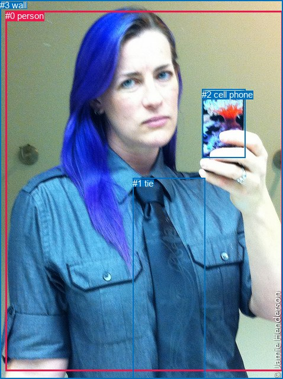

# 图片 0651：2344819.jpg

随机样本序号：362。图片 SHA256：`a794c8d8258774f04fcf04921d0daf10d60a35d038117279ff0880a2accd49b3`。

红色框表示人，蓝色框表示其他物体。两个模式分别保留自身框编号，可依据位置比较对应对象。

## 自动检测框与输出

人的框编号：`[1]`。状态：`ok`。

### 自动检测全部物体框

| 编号 | 类别 | 是否为人 | 检测分数 | 像素坐标 xyxy |
|---|---|---|---|---|
| 0 | cell phone | False | 0.9998 | 341.4, 148.7, 412.9, 271.2 |
| 1 | person | True | 0.9996 | 5.2, 13.8, 477.5, 640.0 |
| 2 | tie | False | 0.5960 | 223.7, 301.2, 344.5, 621.6 |

### 自动检测 Top50 人相关候选

评分物体对：6；人相关物体对：4；输出关系：8。

| 排名 | 主语编号与类别 | 关系 | 宾语编号与类别 | 类型 | 人与人 | 排序分数 | 原始融合 logit |
|---|---|---|---|---|---|---|---|
| 1 | #1 person | holding | #0 cell phone | semantic | False | 0.99395 | 5.1019 |
| 2 | #1 person | wearing | #2 tie | semantic | False | 0.99163 | 4.7748 |
| 3 | #2 tie | on | #1 person | spatial | False | 0.96183 | 3.2267 |
| 4 | #1 person | on | #0 cell phone | spatial | False | 0.83325 | 1.6088 |
| 5 | #1 person | in | #2 tie | spatial | False | 0.79492 | 1.3549 |
| 6 | #0 cell phone | on | #1 person | spatial | False | 0.72331 | 0.9609 |
| 7 | #2 tie | wearing | #1 person | semantic | False | 0.65594 | 0.6453 |
| 8 | #0 cell phone | holding | #1 person | semantic | False | 0.50356 | 0.0143 |

### 自动检测逐条人相关 GT 核验

R@50：66.67%；命中 2/3。

| GT 主语编号 | GT 关系 | GT 宾语编号 | 结果阶段 | 匹配预测主语编号 | 匹配预测宾语编号 |
|---|---|---|---|---|---|
| 0 | wearing | 1 | hit50 | [1] | [2] |
| 0 | holding | 2 | hit50 | [1] | [0] |
| 3 | in front of | 0 | endpoint_missing_or_wrong_class | [] | [1] |

## 真实框与输出

人的框编号：`[0]`。

### 真实框全部物体框

| 编号 | 类别 | 是否为人 | 检测分数 | 像素坐标 xyxy |
|---|---|---|---|---|
| 0 | person | True | GT | 9.0, 18.0, 478.0, 626.0 |
| 1 | tie | False | GT | 224.0, 301.0, 346.0, 640.0 |
| 2 | cell phone | False | GT | 341.0, 151.0, 414.0, 267.0 |
| 3 | wall | False | GT | 0.0, 0.0, 478.0, 640.0 |

### 真实框 Top50 人相关候选

评分物体对：12；人相关物体对：6；输出关系：12。

| 排名 | 主语编号与类别 | 关系 | 宾语编号与类别 | 类型 | 人与人 | 排序分数 | 原始融合 logit |
|---|---|---|---|---|---|---|---|
| 1 | #0 person | holding | #2 cell phone | semantic | False | 0.99315 | 4.9762 |
| 2 | #0 person | wearing | #1 tie | semantic | False | 0.99129 | 4.7350 |
| 3 | #1 tie | on | #0 person | spatial | False | 0.95980 | 3.1727 |
| 4 | #0 person | standing on | #3 wall | semantic | False | 0.93185 | 2.6155 |
| 5 | #0 person | in | #3 wall | spatial | False | 0.86800 | 1.8834 |
| 6 | #0 person | on | #2 cell phone | spatial | False | 0.78086 | 1.2707 |
| 7 | #0 person | in | #1 tie | spatial | False | 0.73666 | 1.0287 |
| 8 | #2 cell phone | in front of | #0 person | spatial | False | 0.66708 | 0.6950 |
| 9 | #3 wall | on | #0 person | spatial | False | 0.55240 | 0.2104 |
| 10 | #1 tie | wearing | #0 person | semantic | False | 0.52785 | 0.1115 |
| 11 | #2 cell phone | holding | #0 person | semantic | False | 0.45851 | -0.1664 |
| 12 | #3 wall | holding | #0 person | semantic | False | 0.28748 | -0.9077 |

### 真实框逐条人相关 GT 核验

R@50：66.67%；命中 2/3。

| GT 主语编号 | GT 关系 | GT 宾语编号 | 结果阶段 | 匹配预测主语编号 | 匹配预测宾语编号 |
|---|---|---|---|---|---|
| 0 | wearing | 1 | hit50 | [0] | [1] |
| 0 | holding | 2 | hit50 | [0] | [2] |
| 3 | in front of | 0 | wrong_predicate | [3] | [0] |

## 全部人相关 GT

| 主语编号与类别 | 关系 | 宾语编号与类别 |
|---|---|---|
| #0 person | wearing | #1 tie |
| #0 person | holding | #2 cell phone |
| #3 wall | in front of | #0 person |

原始记录、全部人相关物体对的两项预测与分项分数见 [逐图证据 JSON](../evidence/cases/0651.json)。全部56类 logits 保留于本机 HOR/output/random500/logits/。

<!-- HOR_COMPLETE_RESULTS -->

## 六组条件的完整输出对照

以下保留同一图片三种框与候选模式、两种谓词输出规则的全部 Top50。框编号各自在所属模式内解释。

### 自动检测框完整枚举：空间与语义各保留一个谓词

| 排名 | 主语编号与类别 | 谓词 | 宾语编号与类别 | 分组 | 排序分数 | predicate logit | pair logit |
|---|---|---|---|---|---|---|---|
| 1 | #1 person | holding | #0 cell phone | semantic | 0.9939517 | 4.8019652 | 0.2999556 |
| 2 | #1 person | wearing | #2 tie | semantic | 0.9916311 | 4.6391521 | 0.1356700 |
| 3 | #2 tie | on | #1 person | spatial | 0.9618250 | 3.9801927 | -0.7535397 |
| 4 | #1 person | on | #0 cell phone | spatial | 0.8332456 | 1.3088508 | 0.2999556 |
| 5 | #1 person | in | #2 tie | spatial | 0.7949230 | 1.2191896 | 0.1356700 |
| 6 | #0 cell phone | on | #1 person | spatial | 0.7233058 | 1.6341772 | -0.6732581 |
| 7 | #2 tie | wearing | #1 person | semantic | 0.6559415 | 1.3987999 | -0.7535397 |
| 8 | #0 cell phone | holding | #1 person | semantic | 0.5035648 | 0.6875176 | -0.6732581 |

GT 命中：2/3，R@50=66.67%。

| GT主语 | GT谓词 | GT宾语 | 结果阶段 | 匹配主语框 | 匹配宾语框 |
|---|---|---|---|---|---|
| 0 | wearing | 1 | hit50 | [1] | [2] |
| 0 | holding | 2 | hit50 | [1] | [0] |
| 3 | in front of | 0 | endpoint_missing_or_wrong_class | [] | [1] |

### 自动检测框完整枚举：每对只保留一个谓词

| 排名 | 主语编号与类别 | 谓词 | 宾语编号与类别 | 分组 | 排序分数 | predicate logit | pair logit |
|---|---|---|---|---|---|---|---|
| 1 | #1 person | holding | #0 cell phone | single | 0.9939517 | 4.8019652 | 0.2999556 |
| 2 | #1 person | wearing | #2 tie | single | 0.9916311 | 4.6391521 | 0.1356700 |
| 3 | #2 tie | on | #1 person | single | 0.9618250 | 3.9801927 | -0.7535397 |
| 4 | #0 cell phone | on | #1 person | single | 0.7233058 | 1.6341772 | -0.6732581 |

GT 命中：2/3，R@50=66.67%。

| GT主语 | GT谓词 | GT宾语 | 结果阶段 | 匹配主语框 | 匹配宾语框 |
|---|---|---|---|---|---|
| 0 | wearing | 1 | hit50 | [1] | [2] |
| 0 | holding | 2 | hit50 | [1] | [0] |
| 3 | in front of | 0 | endpoint_missing_or_wrong_class | [] | [1] |

### 真实框完整枚举：空间与语义各保留一个谓词

| 排名 | 主语编号与类别 | 谓词 | 宾语编号与类别 | 分组 | 排序分数 | predicate logit | pair logit |
|---|---|---|---|---|---|---|---|
| 1 | #0 person | holding | #2 cell phone | semantic | 0.9931473 | 4.7358737 | 0.2403615 |
| 2 | #0 person | wearing | #1 tie | semantic | 0.9912936 | 4.5672336 | 0.1677249 |
| 3 | #1 tie | on | #0 person | spatial | 0.9597954 | 3.8712974 | -0.6985571 |
| 4 | #0 person | standing on | #3 wall | semantic | 0.9318519 | 2.3732414 | 0.2422494 |
| 5 | #0 person | in | #3 wall | spatial | 0.8679994 | 1.6411347 | 0.2422494 |
| 6 | #0 person | on | #2 cell phone | spatial | 0.7808554 | 1.0302968 | 0.2403615 |
| 7 | #0 person | in | #1 tie | spatial | 0.7366625 | 0.8609686 | 0.1677249 |
| 8 | #2 cell phone | in front of | #0 person | spatial | 0.6670814 | 1.3618803 | -0.6668662 |
| 9 | #3 wall | on | #0 person | spatial | 0.5523978 | 0.5666475 | -0.3562841 |
| 10 | #1 tie | wearing | #0 person | semantic | 0.5278490 | 0.8100686 | -0.6985571 |
| 11 | #2 cell phone | holding | #0 person | semantic | 0.4585071 | 0.5005121 | -0.6668662 |
| 12 | #3 wall | holding | #0 person | semantic | 0.2874794 | -0.5513735 | -0.3562841 |

GT 命中：2/3，R@50=66.67%。

| GT主语 | GT谓词 | GT宾语 | 结果阶段 | 匹配主语框 | 匹配宾语框 |
|---|---|---|---|---|---|
| 0 | wearing | 1 | hit50 | [0] | [1] |
| 0 | holding | 2 | hit50 | [0] | [2] |
| 3 | in front of | 0 | wrong_predicate | [3] | [0] |

### 真实框完整枚举：每对只保留一个谓词

| 排名 | 主语编号与类别 | 谓词 | 宾语编号与类别 | 分组 | 排序分数 | predicate logit | pair logit |
|---|---|---|---|---|---|---|---|
| 1 | #0 person | holding | #2 cell phone | single | 0.9931473 | 4.7358737 | 0.2403615 |
| 2 | #0 person | wearing | #1 tie | single | 0.9912936 | 4.5672336 | 0.1677249 |
| 3 | #1 tie | on | #0 person | single | 0.9597954 | 3.8712974 | -0.6985571 |
| 4 | #0 person | standing on | #3 wall | single | 0.9318519 | 2.3732414 | 0.2422494 |
| 5 | #2 cell phone | in front of | #0 person | single | 0.6670814 | 1.3618803 | -0.6668662 |
| 6 | #3 wall | on | #0 person | single | 0.5523978 | 0.5666475 | -0.3562841 |

GT 命中：2/3，R@50=66.67%。

| GT主语 | GT谓词 | GT宾语 | 结果阶段 | 匹配主语框 | 匹配宾语框 |
|---|---|---|---|---|---|
| 0 | wearing | 1 | hit50 | [0] | [1] |
| 0 | holding | 2 | hit50 | [0] | [2] |
| 3 | in front of | 0 | wrong_predicate | [3] | [0] |

### 真实框400候选：空间与语义各保留一个谓词

| 排名 | 主语编号与类别 | 谓词 | 宾语编号与类别 | 分组 | 排序分数 | predicate logit | pair logit |
|---|---|---|---|---|---|---|---|
| 1 | #0 person | holding | #2 cell phone | semantic | 0.9931874 | 4.7417827 | 0.2403615 |
| 2 | #0 person | wearing | #1 tie | semantic | 0.9912936 | 4.5672336 | 0.1677249 |
| 3 | #1 tie | on | #0 person | spatial | 0.9597954 | 3.8712974 | -0.6985571 |
| 4 | #0 person | standing on | #3 wall | semantic | 0.9318519 | 2.3732414 | 0.2422494 |
| 5 | #0 person | in | #3 wall | spatial | 0.8649015 | 1.6143622 | 0.2422494 |
| 6 | #0 person | on | #2 cell phone | spatial | 0.7808554 | 1.0302968 | 0.2403615 |
| 7 | #0 person | in | #1 tie | spatial | 0.7366625 | 0.8609686 | 0.1677249 |
| 8 | #2 cell phone | in front of | #0 person | spatial | 0.6670814 | 1.3618803 | -0.6668662 |
| 9 | #3 wall | on | #0 person | spatial | 0.5523978 | 0.5666475 | -0.3562841 |
| 10 | #1 tie | wearing | #0 person | semantic | 0.5278490 | 0.8100686 | -0.6985571 |
| 11 | #2 cell phone | holding | #0 person | semantic | 0.4577738 | 0.4975581 | -0.6668662 |
| 12 | #3 wall | holding | #0 person | semantic | 0.2874794 | -0.5513735 | -0.3562841 |

GT 命中：2/3，R@50=66.67%。

| GT主语 | GT谓词 | GT宾语 | 结果阶段 | 匹配主语框 | 匹配宾语框 |
|---|---|---|---|---|---|
| 0 | wearing | 1 | hit50 | [0] | [1] |
| 0 | holding | 2 | hit50 | [0] | [2] |
| 3 | in front of | 0 | wrong_predicate | [3] | [0] |

### 真实框400候选：每对只保留一个谓词

| 排名 | 主语编号与类别 | 谓词 | 宾语编号与类别 | 分组 | 排序分数 | predicate logit | pair logit |
|---|---|---|---|---|---|---|---|
| 1 | #0 person | holding | #2 cell phone | single | 0.9931874 | 4.7417827 | 0.2403615 |
| 2 | #0 person | wearing | #1 tie | single | 0.9912936 | 4.5672336 | 0.1677249 |
| 3 | #1 tie | on | #0 person | single | 0.9597954 | 3.8712974 | -0.6985571 |
| 4 | #0 person | standing on | #3 wall | single | 0.9318519 | 2.3732414 | 0.2422494 |
| 5 | #2 cell phone | in front of | #0 person | single | 0.6670814 | 1.3618803 | -0.6668662 |
| 6 | #3 wall | on | #0 person | single | 0.5523978 | 0.5666475 | -0.3562841 |

GT 命中：2/3，R@50=66.67%。

| GT主语 | GT谓词 | GT宾语 | 结果阶段 | 匹配主语框 | 匹配宾语框 |
|---|---|---|---|---|---|
| 0 | wearing | 1 | hit50 | [0] | [1] |
| 0 | holding | 2 | hit50 | [0] | [2] |
| 3 | in front of | 0 | wrong_predicate | [3] | [0] |
