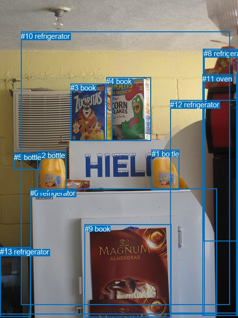
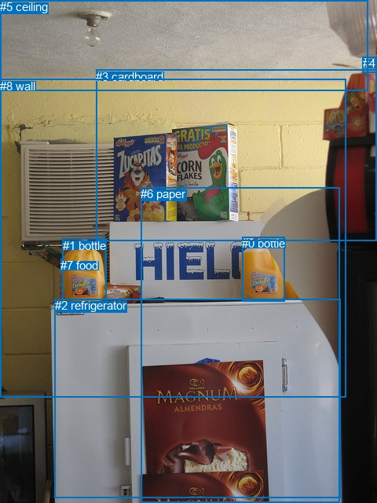

# 图片 0657：2345143.jpg

随机样本序号：444。图片 SHA256：`12f576eed10d3ee8885c075bbac45e654ab2511a2042898413f7928acf52b378`。

红色框表示人，蓝色框表示其他物体。两个模式分别保留自身框编号，可依据位置比较对应对象。

## 自动检测框与输出

人的框编号：`[]`。状态：`no_person`。

### 自动检测全部物体框

| 编号 | 类别 | 是否为人 | 检测分数 | 像素坐标 xyxy |
|---|---|---|---|---|
| 0 | refrigerator | False | 0.9878 | 61.5, 379.6, 437.5, 632.4 |
| 1 | bottle | False | 0.9698 | 305.9, 301.4, 361.8, 382.5 |
| 2 | bottle | False | 0.9516 | 75.8, 304.5, 133.7, 387.5 |
| 3 | book | False | 0.9426 | 142.3, 168.2, 226.1, 283.5 |
| 4 | book | False | 0.9055 | 214.4, 155.5, 304.7, 283.3 |
| 5 | bottle | False | 0.7810 | 28.1, 307.8, 83.3, 341.2 |
| 6 | tv | False | 0.7444 | 0.2, 497.4, 61.5, 632.5 |
| 7 | parking meter | False | 0.6233 | 409.6, 98.2, 479.9, 485.2 |
| 8 | refrigerator | False | 0.5267 | 411.2, 98.6, 479.2, 635.1 |
| 9 | book | False | 0.4797 | 170.6, 451.9, 345.5, 638.5 |
| 10 | refrigerator | False | 0.4426 | 42.3, 63.7, 463.3, 613.9 |
| 11 | oven | False | 0.4309 | 408.4, 149.6, 477.8, 635.2 |
| 12 | refrigerator | False | 0.4128 | 343.4, 201.6, 480.0, 630.5 |
| 13 | refrigerator | False | 0.3932 | 0.4, 498.1, 61.2, 637.7 |

### 自动检测 Top50 人相关候选

评分物体对：0；人相关物体对：0；输出关系：0。

| 排名 | 主语编号与类别 | 关系 | 宾语编号与类别 | 类型 | 人与人 | 排序分数 | 原始融合 logit |
|---|---|---|---|---|---|---|---|

### 自动检测逐条人相关 GT 核验

本图没有人相关 GT，R@50 无分母；预测候选继续展示。

## 真实框与输出

人的框编号：`[]`。

### 真实框全部物体框

| 编号 | 类别 | 是否为人 | 检测分数 | 像素坐标 xyxy |
|---|---|---|---|---|
| 0 | bottle | False | GT | 308.0, 301.0, 362.0, 383.0 |
| 1 | bottle | False | GT | 80.0, 304.0, 136.0, 387.0 |
| 2 | refrigerator | False | GT | 70.0, 380.0, 434.0, 633.0 |
| 3 | cardboard | False | GT | 122.0, 89.0, 480.0, 307.0 |
| 4 | roof | False | GT | 462.0, 72.0, 480.0, 93.0 |
| 5 | ceiling | False | GT | 0.0, 0.0, 469.0, 115.0 |
| 6 | paper | False | GT | 179.0, 238.0, 433.0, 640.0 |
| 7 | food | False | GT | 77.0, 329.0, 81.0, 345.0 |
| 8 | wall | False | GT | 0.0, 101.0, 440.0, 505.0 |

### 真实框 Top50 人相关候选

评分物体对：0；人相关物体对：0；输出关系：0。

| 排名 | 主语编号与类别 | 关系 | 宾语编号与类别 | 类型 | 人与人 | 排序分数 | 原始融合 logit |
|---|---|---|---|---|---|---|---|

### 真实框逐条人相关 GT 核验

本图没有人相关 GT，R@50 无分母；预测候选继续展示。

## 全部人相关 GT

| 主语编号与类别 | 关系 | 宾语编号与类别 |
|---|---|---|

原始记录、全部人相关物体对的两项预测与分项分数见 [逐图证据 JSON](../evidence/cases/0657.json)。全部56类 logits 保留于本机 HOR/output/random500/logits/。

<!-- HOR_COMPLETE_RESULTS -->

## 六组条件的完整输出对照

以下保留同一图片三种框与候选模式、两种谓词输出规则的全部 Top50。框编号各自在所属模式内解释。

### 自动检测框完整枚举：空间与语义各保留一个谓词

| 排名 | 主语编号与类别 | 谓词 | 宾语编号与类别 | 分组 | 排序分数 | predicate logit | pair logit |
|---|---|---|---|---|---|---|---|

没有人相关 GT，本条件的召回率无分母。

### 自动检测框完整枚举：每对只保留一个谓词

| 排名 | 主语编号与类别 | 谓词 | 宾语编号与类别 | 分组 | 排序分数 | predicate logit | pair logit |
|---|---|---|---|---|---|---|---|

没有人相关 GT，本条件的召回率无分母。

### 真实框完整枚举：空间与语义各保留一个谓词

| 排名 | 主语编号与类别 | 谓词 | 宾语编号与类别 | 分组 | 排序分数 | predicate logit | pair logit |
|---|---|---|---|---|---|---|---|

没有人相关 GT，本条件的召回率无分母。

### 真实框完整枚举：每对只保留一个谓词

| 排名 | 主语编号与类别 | 谓词 | 宾语编号与类别 | 分组 | 排序分数 | predicate logit | pair logit |
|---|---|---|---|---|---|---|---|

没有人相关 GT，本条件的召回率无分母。

### 真实框400候选：空间与语义各保留一个谓词

| 排名 | 主语编号与类别 | 谓词 | 宾语编号与类别 | 分组 | 排序分数 | predicate logit | pair logit |
|---|---|---|---|---|---|---|---|

没有人相关 GT，本条件的召回率无分母。

### 真实框400候选：每对只保留一个谓词

| 排名 | 主语编号与类别 | 谓词 | 宾语编号与类别 | 分组 | 排序分数 | predicate logit | pair logit |
|---|---|---|---|---|---|---|---|

没有人相关 GT，本条件的召回率无分母。
