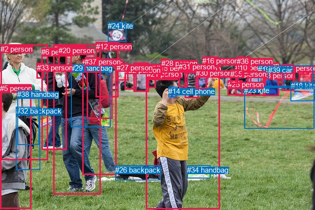
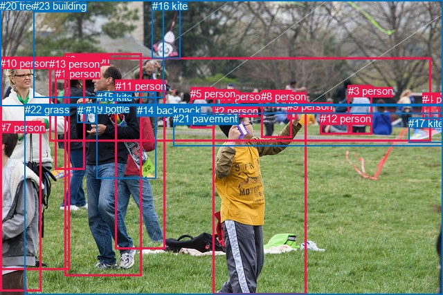

# 图片 0658：2345182.jpg

随机样本序号：170。图片 SHA256：`fd42d2c70d5e4ecbc39e760da41f2d32013003dc7383a4aafa2212f58ca0ef17`。

红色框表示人，蓝色框表示其他物体。两个模式分别保留自身框编号，可依据位置比较对应对象。

## 自动检测框与输出

人的框编号：`[0, 1, 2, 3, 4, 5, 6, 7, 8, 9, 10, 11, 12, 13, 15, 16, 17, 20, 21, 22, 25, 27, 28, 30, 31, 33, 35, 36, 37]`。状态：`ok`。

### 自动检测全部物体框

| 编号 | 类别 | 是否为人 | 检测分数 | 像素坐标 xyxy |
|---|---|---|---|---|
| 0 | person | True | 0.9990 | 296.5, 145.4, 447.0, 425.3 |
| 1 | person | True | 0.9971 | 108.9, 90.6, 204.1, 395.1 |
| 2 | person | True | 0.9936 | 1.1, 90.6, 97.9, 325.2 |
| 3 | person | True | 0.9928 | 534.1, 144.8, 566.6, 195.2 |
| 4 | person | True | 0.9906 | 502.2, 124.2, 539.6, 194.8 |
| 5 | person | True | 0.9905 | 0.2, 171.4, 63.1, 424.1 |
| 6 | person | True | 0.9839 | 84.4, 97.3, 135.4, 304.3 |
| 7 | person | True | 0.9805 | 167.2, 120.4, 236.8, 355.6 |
| 8 | person | True | 0.9770 | 607.9, 134.9, 633.3, 178.2 |
| 9 | person | True | 0.9661 | 271.1, 127.7, 302.3, 186.1 |
| 10 | person | True | 0.9438 | 478.2, 129.1, 510.6, 194.0 |
| 11 | person | True | 0.9390 | 572.5, 130.2, 597.8, 184.5 |
| 12 | person | True | 0.9301 | 194.6, 85.6, 240.9, 197.7 |
| 13 | person | True | 0.9270 | 375.9, 131.1, 403.0, 199.8 |
| 14 | cell phone | False | 0.9225 | 342.3, 176.5, 359.0, 197.6 |
| 15 | person | True | 0.9094 | 316.8, 130.5, 340.7, 161.4 |
| 16 | person | True | 0.7547 | 411.0, 115.4, 444.3, 155.0 |
| 17 | person | True | 0.7458 | 176.3, 120.1, 228.9, 241.1 |
| 18 | kite | False | 0.7270 | 590.9, 166.3, 639.6, 205.7 |
| 19 | car | False | 0.6635 | 524.3, 133.2, 577.1, 177.8 |
| 20 | person | True | 0.6527 | 118.6, 94.2, 145.4, 137.1 |
| 21 | person | True | 0.6475 | 297.8, 141.8, 316.6, 178.0 |
| 22 | person | True | 0.6389 | 253.2, 134.0, 277.4, 182.0 |
| 23 | kite | False | 0.6213 | 496.1, 174.6, 638.1, 262.0 |
| 24 | kite | False | 0.5992 | 219.3, 44.1, 256.9, 84.6 |
| 25 | person | True | 0.5954 | 462.9, 163.0, 492.0, 193.4 |
| 26 | backpack | False | 0.5872 | 234.1, 336.9, 325.7, 367.0 |
| 27 | person | True | 0.5869 | 236.7, 128.8, 260.7, 163.1 |
| 28 | person | True | 0.5590 | 327.7, 119.8, 342.9, 153.8 |
| 29 | handbag | False | 0.5466 | 144.3, 130.1, 224.2, 258.6 |
| 30 | person | True | 0.5423 | 397.5, 140.0, 420.7, 180.3 |
| 31 | person | True | 0.5275 | 363.2, 127.2, 381.8, 176.3 |
| 32 | backpack | False | 0.5166 | 32.9, 217.4, 81.7, 346.0 |
| 33 | person | True | 0.5136 | 74.6, 128.6, 88.4, 159.9 |
| 34 | handbag | False | 0.5033 | 380.2, 336.9, 427.3, 362.2 |
| 35 | person | True | 0.4963 | 467.7, 141.8, 483.7, 170.7 |
| 36 | person | True | 0.4538 | 481.2, 115.7, 508.2, 152.6 |
| 37 | person | True | 0.4421 | 172.5, 116.9, 204.8, 147.7 |
| 38 | handbag | False | 0.4325 | 35.3, 183.2, 80.0, 294.9 |
| 39 | car | False | 0.4075 | 544.8, 133.5, 635.1, 178.4 |

### 自动检测 Top50 人相关候选

评分物体对：1560；人相关物体对：1450；输出关系：50。

| 排名 | 主语编号与类别 | 关系 | 宾语编号与类别 | 类型 | 人与人 | 排序分数 | 原始融合 logit |
|---|---|---|---|---|---|---|---|
| 1 | #0 person | holding | #14 cell phone | semantic | False | 0.99232 | 4.8616 |
| 2 | #1 person | wearing | #29 handbag | semantic | False | 0.98271 | 4.0399 |
| 3 | #7 person | wearing | #17 person | semantic | True | 0.98118 | 3.9536 |
| 4 | #0 person | holding | #30 person | semantic | True | 0.97786 | 3.7881 |
| 5 | #2 person | wearing | #33 person | semantic | True | 0.97771 | 3.7812 |
| 6 | #7 person | wearing | #37 person | semantic | True | 0.97736 | 3.7650 |
| 7 | #1 person | wearing | #37 person | semantic | True | 0.97732 | 3.7634 |
| 8 | #7 person | wearing | #29 handbag | semantic | False | 0.96597 | 3.3458 |
| 9 | #5 person | holding | #32 backpack | semantic | False | 0.96511 | 3.3200 |
| 10 | #2 person | wearing | #38 handbag | semantic | False | 0.96131 | 3.2126 |
| 11 | #2 person | holding | #32 backpack | semantic | False | 0.95283 | 3.0058 |
| 12 | #28 person | wearing | #15 person | semantic | True | 0.94786 | 2.9002 |
| 13 | #5 person | holding | #38 handbag | semantic | False | 0.94482 | 2.8405 |
| 14 | #11 person | holding | #18 kite | semantic | False | 0.94429 | 2.8302 |
| 15 | #7 person | in | #17 person | spatial | True | 0.94269 | 2.8003 |
| 16 | #1 person | in | #29 handbag | spatial | False | 0.94228 | 2.7928 |
| 17 | #13 person | holding | #30 person | semantic | True | 0.93749 | 2.7079 |
| 18 | #10 person | holding | #35 person | semantic | True | 0.92627 | 2.5307 |
| 19 | #7 person | in | #29 handbag | spatial | False | 0.92309 | 2.4852 |
| 20 | #1 person | wearing | #17 person | semantic | True | 0.92191 | 2.4686 |
| 21 | #8 person | holding | #18 kite | semantic | False | 0.90550 | 2.2599 |
| 22 | #2 person | in | #33 person | spatial | True | 0.90371 | 2.2392 |
| 23 | #0 person | holding | #13 person | semantic | True | 0.89039 | 2.0947 |
| 24 | #5 person | in | #32 backpack | spatial | False | 0.88243 | 2.0156 |
| 25 | #2 person | in | #38 handbag | spatial | False | 0.87872 | 1.9803 |
| 26 | #7 person | in | #37 person | spatial | True | 0.86088 | 1.8226 |
| 27 | #28 person | in | #15 person | spatial | True | 0.85951 | 1.8112 |
| 28 | #0 person | flying over | #23 kite | semantic | False | 0.85532 | 1.7769 |
| 29 | #1 person | in | #37 person | spatial | True | 0.85317 | 1.7596 |
| 30 | #5 person | in | #38 handbag | spatial | False | 0.85251 | 1.7544 |
| 31 | #12 person | holding | #24 kite | semantic | False | 0.85201 | 1.7505 |
| 32 | #1 person | in | #20 person | spatial | True | 0.84219 | 1.6746 |
| 33 | #15 person | wearing | #28 person | semantic | True | 0.83503 | 1.6217 |
| 34 | #10 person | holding | #25 person | semantic | True | 0.83340 | 1.6099 |
| 35 | #0 person | on | #14 cell phone | spatial | False | 0.82406 | 1.5441 |
| 36 | #3 person | wearing | #19 car | semantic | False | 0.81966 | 1.5140 |
| 37 | #2 person | in | #32 backpack | spatial | False | 0.81723 | 1.4977 |
| 38 | #1 person | holding | #24 kite | semantic | False | 0.78648 | 1.3039 |
| 39 | #10 person | in | #36 person | spatial | True | 0.78489 | 1.2944 |
| 40 | #15 person | in | #28 person | spatial | True | 0.77736 | 1.2504 |
| 41 | #9 person | holding | #21 person | semantic | True | 0.77176 | 1.2183 |
| 42 | #6 person | wearing | #33 person | semantic | True | 0.77059 | 1.2116 |
| 43 | #3 person | in | #19 car | spatial | False | 0.76993 | 1.2079 |
| 44 | #0 person | flying over | #24 kite | semantic | False | 0.76441 | 1.1770 |
| 45 | #1 person | in | #17 person | spatial | True | 0.75483 | 1.1245 |
| 46 | #22 person | holding | #27 person | semantic | True | 0.75432 | 1.1218 |
| 47 | #10 person | holding | #36 person | semantic | True | 0.74187 | 1.0557 |
| 48 | #4 person | wearing | #19 car | semantic | False | 0.73805 | 1.0359 |
| 49 | #4 person | looking at | #23 kite | semantic | False | 0.72740 | 0.9815 |
| 50 | #36 person | holding | #35 person | semantic | True | 0.72053 | 0.9471 |

### 自动检测逐条人相关 GT 核验

R@50：0.00%；命中 0/7。

| GT 主语编号 | GT 关系 | GT 宾语编号 | 结果阶段 | 匹配预测主语编号 | 匹配预测宾语编号 |
|---|---|---|---|---|---|
| 2 | standing on | 22 | endpoint_missing_or_wrong_class | [0] | [] |
| 6 | touching | 15 | endpoint_missing_or_wrong_class | [1] | [] |
| 6 | holding | 18 | endpoint_missing_or_wrong_class | [1] | [] |
| 6 | holding | 19 | endpoint_missing_or_wrong_class | [1] | [] |
| 6 | walking on | 22 | endpoint_missing_or_wrong_class | [1] | [] |
| 7 | in front of | 10 | wrong_predicate | [5] | [2] |
| 10 | beside | 6 | rank_below50 | [2] | [1] |

## 真实框与输出

人的框编号：`[0, 1, 2, 3, 4, 5, 6, 7, 8, 9, 10, 11, 12, 13]`。

### 真实框全部物体框

| 编号 | 类别 | 是否为人 | 检测分数 | 像素坐标 xyxy |
|---|---|---|---|---|
| 0 | person | True | GT | 319.0, 131.0, 346.0, 161.0 |
| 1 | person | True | GT | 80.0, 98.0, 123.0, 245.0 |
| 2 | person | True | GT | 308.0, 152.0, 443.0, 427.0 |
| 3 | person | True | GT | 503.0, 123.0, 538.0, 194.0 |
| 4 | person | True | GT | 610.0, 135.0, 635.0, 175.0 |
| 5 | person | True | GT | 275.0, 127.0, 310.0, 185.0 |
| 6 | person | True | GT | 93.0, 78.0, 204.0, 400.0 |
| 7 | person | True | GT | 0.0, 176.0, 59.0, 422.0 |
| 8 | person | True | GT | 377.0, 131.0, 421.0, 200.0 |
| 9 | person | True | GT | 415.0, 145.0, 428.0, 172.0 |
| 10 | person | True | GT | 0.0, 83.0, 100.0, 391.0 |
| 11 | person | True | GT | 167.0, 116.0, 239.0, 360.0 |
| 12 | person | True | GT | 463.0, 163.0, 509.0, 194.0 |
| 13 | person | True | GT | 71.0, 84.0, 622.0, 205.0 |
| 14 | backpack | False | GT | 198.0, 151.0, 210.0, 163.0 |
| 15 | kite | False | GT | 140.0, 132.0, 226.0, 258.0 |
| 16 | kite | False | GT | 220.0, 0.0, 261.0, 84.0 |
| 17 | kite | False | GT | 590.0, 170.0, 640.0, 206.0 |
| 18 | bottle | False | GT | 112.0, 151.0, 126.0, 178.0 |
| 19 | bottle | False | GT | 124.0, 149.0, 139.0, 178.0 |
| 20 | tree | False | GT | 0.0, 0.0, 640.0, 154.0 |
| 21 | pavement | False | GT | 250.0, 163.0, 640.0, 212.0 |
| 22 | grass | False | GT | 36.0, 150.0, 640.0, 427.0 |
| 23 | building | False | GT | 48.0, 0.0, 237.0, 141.0 |

### 真实框 Top50 人相关候选

评分物体对：552；人相关物体对：462；输出关系：50。

| 排名 | 主语编号与类别 | 关系 | 宾语编号与类别 | 类型 | 人与人 | 排序分数 | 原始融合 logit |
|---|---|---|---|---|---|---|---|
| 1 | #2 person | holding | #9 person | semantic | True | 0.99106 | 4.7082 |
| 2 | #6 person | holding | #19 bottle | semantic | False | 0.98795 | 4.4064 |
| 3 | #8 person | holding | #9 person | semantic | True | 0.98778 | 4.3925 |
| 4 | #6 person | wearing | #15 kite | semantic | False | 0.98532 | 4.2062 |
| 5 | #11 person | wearing | #15 kite | semantic | False | 0.98431 | 4.1386 |
| 6 | #11 person | wearing | #14 backpack | semantic | False | 0.98279 | 4.0452 |
| 7 | #6 person | holding | #18 bottle | semantic | False | 0.98143 | 3.9677 |
| 8 | #2 person | holding | #8 person | semantic | True | 0.98099 | 3.9436 |
| 9 | #6 person | standing on | #22 grass | semantic | False | 0.96996 | 3.4749 |
| 10 | #2 person | standing on | #22 grass | semantic | False | 0.96973 | 3.4670 |
| 11 | #3 person | standing on | #21 pavement | semantic | False | 0.96218 | 3.2364 |
| 12 | #1 person | holding | #18 bottle | semantic | False | 0.95941 | 3.1628 |
| 13 | #10 person | standing on | #22 grass | semantic | False | 0.95249 | 2.9981 |
| 14 | #13 person | standing on | #21 pavement | semantic | False | 0.95074 | 2.9602 |
| 15 | #5 person | standing on | #21 pavement | semantic | False | 0.94802 | 2.9034 |
| 16 | #11 person | standing on | #22 grass | semantic | False | 0.94652 | 2.8735 |
| 17 | #4 person | holding | #17 kite | semantic | False | 0.94610 | 2.8652 |
| 18 | #13 person | holding | #9 person | semantic | True | 0.94596 | 2.8625 |
| 19 | #11 person | in | #15 kite | spatial | False | 0.94342 | 2.8139 |
| 20 | #13 person | standing on | #22 grass | semantic | False | 0.93686 | 2.6972 |
| 21 | #7 person | standing on | #22 grass | semantic | False | 0.93483 | 2.6634 |
| 22 | #6 person | in | #15 kite | spatial | False | 0.92210 | 2.4713 |
| 23 | #3 person | standing on | #22 grass | semantic | False | 0.91776 | 2.4123 |
| 24 | #6 person | wearing | #14 backpack | semantic | False | 0.91011 | 2.3150 |
| 25 | #13 person | on | #21 pavement | spatial | False | 0.90682 | 2.2754 |
| 26 | #2 person | flying over | #16 kite | semantic | False | 0.90633 | 2.2696 |
| 27 | #13 person | in | #22 grass | spatial | False | 0.90281 | 2.2288 |
| 28 | #2 person | on | #22 grass | spatial | False | 0.89904 | 2.1866 |
| 29 | #5 person | standing on | #22 grass | semantic | False | 0.89015 | 2.0922 |
| 30 | #4 person | standing on | #21 pavement | semantic | False | 0.88907 | 2.0813 |
| 31 | #6 person | holding | #16 kite | semantic | False | 0.88236 | 2.0150 |
| 32 | #1 person | standing on | #22 grass | semantic | False | 0.86977 | 1.8989 |
| 33 | #6 person | on | #22 grass | spatial | False | 0.86936 | 1.8953 |
| 34 | #3 person | on | #21 pavement | spatial | False | 0.86745 | 1.8786 |
| 35 | #3 person | wearing | #12 person | semantic | True | 0.84883 | 1.7255 |
| 36 | #5 person | on | #21 pavement | spatial | False | 0.84079 | 1.6641 |
| 37 | #7 person | standing on | #10 person | semantic | True | 0.81587 | 1.4886 |
| 38 | #13 person | holding | #16 kite | semantic | False | 0.81140 | 1.4591 |
| 39 | #11 person | in | #14 backpack | spatial | False | 0.80599 | 1.4242 |
| 40 | #3 person | in | #12 person | spatial | True | 0.79813 | 1.3747 |
| 41 | #10 person | on | #22 grass | spatial | False | 0.79147 | 1.3338 |
| 42 | #4 person | standing on | #22 grass | semantic | False | 0.78874 | 1.3174 |
| 43 | #5 person | on | #22 grass | spatial | False | 0.78313 | 1.2840 |
| 44 | #11 person | holding | #16 kite | semantic | False | 0.75128 | 1.1054 |
| 45 | #3 person | in | #22 grass | spatial | False | 0.74603 | 1.0776 |
| 46 | #13 person | wearing | #0 person | semantic | True | 0.74175 | 1.0551 |
| 47 | #2 person | on | #9 person | spatial | True | 0.73996 | 1.0458 |
| 48 | #11 person | on | #22 grass | spatial | False | 0.73421 | 1.0161 |
| 49 | #13 person | holding | #8 person | semantic | True | 0.73282 | 1.0090 |
| 50 | #4 person | on | #21 pavement | spatial | False | 0.72868 | 0.9880 |

### 真实框逐条人相关 GT 核验

R@50：42.86%；命中 3/7。

| GT 主语编号 | GT 关系 | GT 宾语编号 | 结果阶段 | 匹配预测主语编号 | 匹配预测宾语编号 |
|---|---|---|---|---|---|
| 2 | standing on | 22 | hit50 | [2] | [22] |
| 6 | touching | 15 | wrong_predicate | [6] | [15] |
| 6 | holding | 18 | hit50 | [6] | [18] |
| 6 | holding | 19 | hit50 | [6] | [19] |
| 6 | walking on | 22 | wrong_predicate | [6] | [22] |
| 7 | in front of | 10 | wrong_predicate | [7] | [10] |
| 10 | beside | 6 | rank_below50 | [10] | [6] |

## 全部人相关 GT

| 主语编号与类别 | 关系 | 宾语编号与类别 |
|---|---|---|
| #2 person | standing on | #22 grass |
| #6 person | touching | #15 kite |
| #6 person | holding | #18 bottle |
| #6 person | holding | #19 bottle |
| #6 person | walking on | #22 grass |
| #7 person | in front of | #10 person |
| #10 person | beside | #6 person |

原始记录、全部人相关物体对的两项预测与分项分数见 [逐图证据 JSON](../evidence/cases/0658.json)。全部56类 logits 保留于本机 HOR/output/random500/logits/。

<!-- HOR_COMPLETE_RESULTS -->

## 六组条件的完整输出对照

以下保留同一图片三种框与候选模式、两种谓词输出规则的全部 Top50。框编号各自在所属模式内解释。

### 自动检测框完整枚举：空间与语义各保留一个谓词

| 排名 | 主语编号与类别 | 谓词 | 宾语编号与类别 | 分组 | 排序分数 | predicate logit | pair logit |
|---|---|---|---|---|---|---|---|
| 1 | #0 person | holding | #14 cell phone | semantic | 0.9923216 | 4.2478261 | 0.6138021 |
| 2 | #1 person | wearing | #29 handbag | semantic | 0.9827055 | 3.8126979 | 0.2272227 |
| 3 | #7 person | wearing | #17 person | semantic | 0.9811760 | 4.0534272 | -0.0998099 |
| 4 | #0 person | holding | #30 person | semantic | 0.9778631 | 3.6862626 | 0.1018568 |
| 5 | #2 person | wearing | #33 person | semantic | 0.9777129 | 3.5645967 | 0.2166072 |
| 6 | #7 person | wearing | #37 person | semantic | 0.9773563 | 3.7642503 | 0.0007215 |
| 7 | #1 person | wearing | #37 person | semantic | 0.9773217 | 3.7818542 | -0.0184497 |
| 8 | #7 person | wearing | #29 handbag | semantic | 0.9659662 | 3.6071744 | -0.2614009 |
| 9 | #5 person | holding | #32 backpack | semantic | 0.9651101 | 3.1205678 | 0.1994780 |
| 10 | #2 person | wearing | #38 handbag | semantic | 0.9613065 | 3.0477834 | 0.1648377 |
| 11 | #2 person | holding | #32 backpack | semantic | 0.9528349 | 2.8156033 | 0.1901832 |
| 12 | #28 person | wearing | #15 person | semantic | 0.9478568 | 3.1416698 | -0.2414591 |
| 13 | #5 person | holding | #38 handbag | semantic | 0.9448243 | 2.9152884 | -0.0748118 |
| 14 | #11 person | holding | #18 kite | semantic | 0.9442874 | 3.1009865 | -0.2707623 |
| 15 | #7 person | in | #17 person | spatial | 0.9426921 | 2.9001107 | -0.0998099 |
| 16 | #1 person | in | #29 handbag | spatial | 0.9422849 | 2.5655656 | 0.2272227 |
| 17 | #13 person | holding | #30 person | semantic | 0.9374899 | 2.6454349 | 0.0624435 |
| 18 | #10 person | holding | #35 person | semantic | 0.9262658 | 2.3803124 | 0.1503824 |
| 19 | #7 person | in | #29 handbag | spatial | 0.9230947 | 2.7465587 | -0.2614009 |
| 20 | #1 person | wearing | #17 person | semantic | 0.9219081 | 2.2837658 | 0.1847945 |
| 21 | #8 person | holding | #18 kite | semantic | 0.9055020 | 2.6224804 | -0.3625691 |
| 22 | #2 person | in | #33 person | spatial | 0.9037144 | 2.0225878 | 0.2166072 |
| 23 | #0 person | holding | #13 person | semantic | 0.8903867 | 2.2953987 | -0.2007023 |
| 24 | #5 person | in | #32 backpack | spatial | 0.8824289 | 1.8161578 | 0.1994780 |
| 25 | #2 person | in | #38 handbag | spatial | 0.8787162 | 1.8154907 | 0.1648377 |
| 26 | #7 person | in | #37 person | spatial | 0.8608810 | 1.8219056 | 0.0007215 |
| 27 | #28 person | in | #15 person | spatial | 0.8595092 | 2.0526791 | -0.2414591 |
| 28 | #0 person | flying over | #23 kite | semantic | 0.8553194 | 2.1822419 | -0.4052951 |
| 29 | #1 person | in | #37 person | spatial | 0.8531650 | 1.7780938 | -0.0184497 |
| 30 | #5 person | in | #38 handbag | spatial | 0.8525068 | 1.8292108 | -0.0748118 |
| 31 | #12 person | holding | #24 kite | semantic | 0.8520116 | 2.2864561 | -0.5359895 |
| 32 | #1 person | in | #20 person | spatial | 0.8421947 | 1.6198869 | 0.0547627 |
| 33 | #15 person | wearing | #28 person | semantic | 0.8350264 | 1.6721683 | -0.0504900 |
| 34 | #10 person | holding | #25 person | semantic | 0.8334023 | 1.5683980 | 0.0415365 |
| 35 | #0 person | on | #14 cell phone | spatial | 0.8240591 | 0.9302917 | 0.6138021 |
| 36 | #3 person | wearing | #19 car | semantic | 0.8196567 | 1.8220191 | -0.3079960 |
| 37 | #2 person | in | #32 backpack | spatial | 0.8172258 | 1.3074803 | 0.1901832 |
| 38 | #1 person | holding | #24 kite | semantic | 0.7864848 | 1.6602793 | -0.3564135 |
| 39 | #10 person | in | #36 person | spatial | 0.7848855 | 1.2397699 | 0.0545974 |
| 40 | #15 person | in | #28 person | spatial | 0.7773609 | 1.3008428 | -0.0504900 |
| 41 | #9 person | holding | #21 person | semantic | 0.7717555 | 1.0216055 | 0.1966446 |
| 42 | #6 person | wearing | #33 person | semantic | 0.7705882 | 1.2129688 | -0.0013332 |
| 43 | #3 person | in | #19 car | spatial | 0.7699302 | 1.5159135 | -0.3079960 |
| 44 | #0 person | flying over | #24 kite | semantic | 0.7644105 | 1.7000451 | -0.5230311 |
| 45 | #1 person | in | #17 person | spatial | 0.7548304 | 0.9397483 | 0.1847945 |
| 46 | #22 person | holding | #27 person | semantic | 0.7543180 | 1.1903358 | -0.0685598 |
| 47 | #10 person | holding | #36 person | semantic | 0.7418742 | 1.0011353 | 0.0545974 |
| 48 | #4 person | wearing | #19 car | semantic | 0.7380549 | 1.1562529 | -0.1203698 |
| 49 | #4 person | looking at | #23 kite | semantic | 0.7274042 | 1.8194399 | -0.8379481 |
| 50 | #36 person | holding | #35 person | semantic | 0.7205256 | 1.1959052 | -0.2488352 |

GT 命中：0/7，R@50=0.00%。

| GT主语 | GT谓词 | GT宾语 | 结果阶段 | 匹配主语框 | 匹配宾语框 |
|---|---|---|---|---|---|
| 2 | standing on | 22 | endpoint_missing_or_wrong_class | [0] | [] |
| 6 | touching | 15 | endpoint_missing_or_wrong_class | [1] | [] |
| 6 | holding | 18 | endpoint_missing_or_wrong_class | [1] | [] |
| 6 | holding | 19 | endpoint_missing_or_wrong_class | [1] | [] |
| 6 | walking on | 22 | endpoint_missing_or_wrong_class | [1] | [] |
| 7 | in front of | 10 | wrong_predicate | [5] | [2] |
| 10 | beside | 6 | rank_below50 | [2] | [1] |

### 自动检测框完整枚举：每对只保留一个谓词

| 排名 | 主语编号与类别 | 谓词 | 宾语编号与类别 | 分组 | 排序分数 | predicate logit | pair logit |
|---|---|---|---|---|---|---|---|
| 1 | #0 person | holding | #14 cell phone | single | 0.9923216 | 4.2478261 | 0.6138021 |
| 2 | #1 person | wearing | #29 handbag | single | 0.9827055 | 3.8126979 | 0.2272227 |
| 3 | #7 person | wearing | #17 person | single | 0.9811760 | 4.0534272 | -0.0998099 |
| 4 | #0 person | holding | #30 person | single | 0.9778631 | 3.6862626 | 0.1018568 |
| 5 | #2 person | wearing | #33 person | single | 0.9777129 | 3.5645967 | 0.2166072 |
| 6 | #7 person | wearing | #37 person | single | 0.9773563 | 3.7642503 | 0.0007215 |
| 7 | #1 person | wearing | #37 person | single | 0.9773217 | 3.7818542 | -0.0184497 |
| 8 | #7 person | wearing | #29 handbag | single | 0.9659662 | 3.6071744 | -0.2614009 |
| 9 | #5 person | holding | #32 backpack | single | 0.9651101 | 3.1205678 | 0.1994780 |
| 10 | #2 person | wearing | #38 handbag | single | 0.9613065 | 3.0477834 | 0.1648377 |
| 11 | #2 person | holding | #32 backpack | single | 0.9528349 | 2.8156033 | 0.1901832 |
| 12 | #28 person | wearing | #15 person | single | 0.9478568 | 3.1416698 | -0.2414591 |
| 13 | #5 person | holding | #38 handbag | single | 0.9448243 | 2.9152884 | -0.0748118 |
| 14 | #11 person | holding | #18 kite | single | 0.9442874 | 3.1009865 | -0.2707623 |
| 15 | #13 person | holding | #30 person | single | 0.9374899 | 2.6454349 | 0.0624435 |
| 16 | #10 person | holding | #35 person | single | 0.9262658 | 2.3803124 | 0.1503824 |
| 17 | #1 person | wearing | #17 person | single | 0.9219081 | 2.2837658 | 0.1847945 |
| 18 | #8 person | holding | #18 kite | single | 0.9055020 | 2.6224804 | -0.3625691 |
| 19 | #0 person | holding | #13 person | single | 0.8903867 | 2.2953987 | -0.2007023 |
| 20 | #0 person | flying over | #23 kite | single | 0.8553194 | 2.1822419 | -0.4052951 |
| 21 | #12 person | holding | #24 kite | single | 0.8520116 | 2.2864561 | -0.5359895 |
| 22 | #1 person | in | #20 person | single | 0.8421947 | 1.6198869 | 0.0547627 |
| 23 | #15 person | wearing | #28 person | single | 0.8350264 | 1.6721683 | -0.0504900 |
| 24 | #10 person | holding | #25 person | single | 0.8334023 | 1.5683980 | 0.0415365 |
| 25 | #3 person | wearing | #19 car | single | 0.8196567 | 1.8220191 | -0.3079960 |
| 26 | #1 person | holding | #24 kite | single | 0.7864848 | 1.6602793 | -0.3564135 |
| 27 | #10 person | in | #36 person | single | 0.7848855 | 1.2397699 | 0.0545974 |
| 28 | #9 person | holding | #21 person | single | 0.7717555 | 1.0216055 | 0.1966446 |
| 29 | #6 person | wearing | #33 person | single | 0.7705882 | 1.2129688 | -0.0013332 |
| 30 | #0 person | flying over | #24 kite | single | 0.7644105 | 1.7000451 | -0.5230311 |
| 31 | #22 person | holding | #27 person | single | 0.7543180 | 1.1903358 | -0.0685598 |
| 32 | #4 person | wearing | #19 car | single | 0.7380549 | 1.1562529 | -0.1203698 |
| 33 | #4 person | looking at | #23 kite | single | 0.7274042 | 1.8194399 | -0.8379481 |
| 34 | #36 person | holding | #35 person | single | 0.7205256 | 1.1959052 | -0.2488352 |
| 35 | #12 person | holding | #27 person | single | 0.7129833 | 1.0876961 | -0.1777784 |
| 36 | #6 person | in | #20 person | single | 0.7070651 | 0.9784598 | -0.0972872 |
| 37 | #8 person | in | #39 car | single | 0.7060781 | 1.1149936 | -0.2385821 |
| 38 | #11 person | looking at | #23 kite | single | 0.6924197 | 1.2781463 | -0.4666901 |
| 39 | #17 person | wearing | #37 person | single | 0.6863871 | 1.4622817 | -0.6789995 |
| 40 | #0 person | standing on | #34 handbag | single | 0.6855544 | 1.6089315 | -0.8295146 |
| 41 | #11 person | looking at | #39 car | single | 0.6610052 | 0.7588167 | -0.0910398 |
| 42 | #0 person | holding | #16 person | single | 0.6606535 | 1.5683980 | -0.9021901 |
| 43 | #12 person | wearing | #37 person | single | 0.6515664 | 0.7490392 | -0.1231078 |
| 44 | #5 person | looking at | #0 person | single | 0.6277440 | 1.4119992 | -0.8894486 |
| 45 | #4 person | holding | #36 person | single | 0.6061533 | 0.4629965 | -0.0318251 |
| 46 | #4 person | carrying | #3 person | single | 0.5950404 | 0.8025842 | -0.4177424 |
| 47 | #30 person | holding | #16 person | single | 0.5925726 | 1.0699711 | -0.6953607 |
| 48 | #10 person | looking at | #23 kite | single | 0.5889924 | 1.1626620 | -0.8028606 |
| 49 | #7 person | holding | #18 kite | single | 0.5624627 | 0.6744342 | -0.4232711 |
| 50 | #3 person | looking at | #23 kite | single | 0.5610334 | 0.8528595 | -0.6075025 |

GT 命中：0/7，R@50=0.00%。

| GT主语 | GT谓词 | GT宾语 | 结果阶段 | 匹配主语框 | 匹配宾语框 |
|---|---|---|---|---|---|
| 2 | standing on | 22 | endpoint_missing_or_wrong_class | [0] | [] |
| 6 | touching | 15 | endpoint_missing_or_wrong_class | [1] | [] |
| 6 | holding | 18 | endpoint_missing_or_wrong_class | [1] | [] |
| 6 | holding | 19 | endpoint_missing_or_wrong_class | [1] | [] |
| 6 | walking on | 22 | endpoint_missing_or_wrong_class | [1] | [] |
| 7 | in front of | 10 | wrong_predicate | [5] | [2] |
| 10 | beside | 6 | wrong_predicate | [2] | [1] |

### 真实框完整枚举：空间与语义各保留一个谓词

| 排名 | 主语编号与类别 | 谓词 | 宾语编号与类别 | 分组 | 排序分数 | predicate logit | pair logit |
|---|---|---|---|---|---|---|---|
| 1 | #2 person | holding | #9 person | semantic | 0.9910598 | 4.4686351 | 0.2395823 |
| 2 | #6 person | holding | #19 bottle | semantic | 0.9879481 | 4.3659949 | 0.0404133 |
| 3 | #8 person | holding | #9 person | semantic | 0.9877813 | 4.3084283 | 0.0840606 |
| 4 | #6 person | wearing | #15 kite | semantic | 0.9853167 | 4.1033769 | 0.1028720 |
| 5 | #11 person | wearing | #15 kite | semantic | 0.9843054 | 4.2120070 | -0.0733846 |
| 6 | #11 person | wearing | #14 backpack | semantic | 0.9827943 | 3.8831124 | 0.1620413 |
| 7 | #6 person | holding | #18 bottle | semantic | 0.9814349 | 3.9447188 | 0.0230163 |
| 8 | #2 person | holding | #8 person | semantic | 0.9809898 | 4.0000901 | -0.0565049 |
| 9 | #6 person | standing on | #22 grass | semantic | 0.9699640 | 3.7456098 | -0.2707505 |
| 10 | #2 person | standing on | #22 grass | semantic | 0.9697341 | 3.9055524 | -0.4385540 |
| 11 | #3 person | standing on | #21 pavement | semantic | 0.9621807 | 3.6591067 | -0.4227244 |
| 12 | #1 person | holding | #18 bottle | semantic | 0.9594116 | 3.5588918 | -0.3960523 |
| 13 | #10 person | standing on | #22 grass | semantic | 0.9524898 | 3.3271899 | -0.3290555 |
| 14 | #13 person | standing on | #21 pavement | semantic | 0.9507439 | 2.8061504 | 0.1540613 |
| 15 | #5 person | standing on | #21 pavement | semantic | 0.9480159 | 3.1027756 | -0.1993424 |
| 16 | #11 person | standing on | #22 grass | semantic | 0.9465206 | 3.2141695 | -0.3406736 |
| 17 | #4 person | holding | #17 kite | semantic | 0.9460976 | 3.3354678 | -0.4702982 |
| 18 | #13 person | holding | #9 person | semantic | 0.9459612 | 3.0157323 | -0.1532334 |
| 19 | #11 person | in | #15 kite | spatial | 0.9434221 | 2.8872814 | -0.0733846 |
| 20 | #13 person | standing on | #22 grass | semantic | 0.9368613 | 2.9250865 | -0.2278857 |
| 21 | #7 person | standing on | #22 grass | semantic | 0.9348292 | 3.1627593 | -0.4994064 |
| 22 | #6 person | in | #15 kite | spatial | 0.9221050 | 2.3684244 | 0.1028720 |
| 23 | #3 person | standing on | #22 grass | semantic | 0.9177622 | 3.0542240 | -0.6419008 |
| 24 | #6 person | wearing | #14 backpack | semantic | 0.9101124 | 2.5928011 | -0.2777935 |
| 25 | #13 person | on | #21 pavement | spatial | 0.9068218 | 2.1213717 | 0.1540613 |
| 26 | #2 person | flying over | #16 kite | semantic | 0.9063313 | 2.6323514 | -0.3627104 |
| 27 | #13 person | in | #22 grass | spatial | 0.9028070 | 2.4566951 | -0.2278857 |
| 28 | #2 person | on | #22 grass | spatial | 0.8990430 | 2.6251903 | -0.4385540 |
| 29 | #5 person | standing on | #22 grass | semantic | 0.8901473 | 2.5258412 | -0.4335954 |
| 30 | #4 person | standing on | #21 pavement | semantic | 0.8890690 | 2.3225470 | -0.2412804 |
| 31 | #6 person | holding | #16 kite | semantic | 0.8823629 | 2.3791351 | -0.3641365 |
| 32 | #1 person | standing on | #22 grass | semantic | 0.8697688 | 2.1924958 | -0.2935794 |
| 33 | #6 person | on | #22 grass | spatial | 0.8693630 | 2.1660886 | -0.2707505 |
| 34 | #3 person | on | #21 pavement | spatial | 0.8674520 | 2.3013401 | -0.4227244 |
| 35 | #3 person | wearing | #12 person | semantic | 0.8488298 | 1.8277407 | -0.1022882 |
| 36 | #5 person | on | #21 pavement | spatial | 0.8407871 | 1.8634391 | -0.1993424 |
| 37 | #7 person | standing on | #10 person | semantic | 0.8158738 | 2.0671287 | -0.5784904 |
| 38 | #13 person | holding | #16 kite | semantic | 0.8113956 | 2.0929937 | -0.6338893 |
| 39 | #11 person | in | #14 backpack | spatial | 0.8059885 | 1.2621107 | 0.1620413 |
| 40 | #3 person | in | #12 person | spatial | 0.7981337 | 1.4769588 | -0.1022882 |
| 41 | #10 person | on | #22 grass | spatial | 0.7914675 | 1.6628494 | -0.3290555 |
| 42 | #4 person | standing on | #22 grass | semantic | 0.7887450 | 1.8380303 | -0.5206535 |
| 43 | #5 person | on | #22 grass | spatial | 0.7831284 | 1.7175870 | -0.4335954 |
| 44 | #11 person | holding | #16 kite | semantic | 0.7512794 | 1.7703042 | -0.6648569 |
| 45 | #3 person | in | #22 grass | spatial | 0.7460336 | 1.7194695 | -0.6419008 |
| 46 | #13 person | wearing | #0 person | semantic | 0.7417520 | 1.2951918 | -0.2400974 |
| 47 | #2 person | on | #9 person | spatial | 0.7399625 | 0.8061910 | 0.2395823 |
| 48 | #11 person | on | #22 grass | spatial | 0.7342138 | 1.3567815 | -0.3406736 |
| 49 | #13 person | holding | #8 person | semantic | 0.7328211 | 1.3341250 | -0.3251421 |
| 50 | #4 person | on | #21 pavement | spatial | 0.7286835 | 1.2292342 | -0.2412804 |

GT 命中：3/7，R@50=42.86%。

| GT主语 | GT谓词 | GT宾语 | 结果阶段 | 匹配主语框 | 匹配宾语框 |
|---|---|---|---|---|---|
| 2 | standing on | 22 | hit50 | [2] | [22] |
| 6 | touching | 15 | wrong_predicate | [6] | [15] |
| 6 | holding | 18 | hit50 | [6] | [18] |
| 6 | holding | 19 | hit50 | [6] | [19] |
| 6 | walking on | 22 | wrong_predicate | [6] | [22] |
| 7 | in front of | 10 | wrong_predicate | [7] | [10] |
| 10 | beside | 6 | rank_below50 | [10] | [6] |

### 真实框完整枚举：每对只保留一个谓词

| 排名 | 主语编号与类别 | 谓词 | 宾语编号与类别 | 分组 | 排序分数 | predicate logit | pair logit |
|---|---|---|---|---|---|---|---|
| 1 | #2 person | holding | #9 person | single | 0.9910598 | 4.4686351 | 0.2395823 |
| 2 | #6 person | holding | #19 bottle | single | 0.9879481 | 4.3659949 | 0.0404133 |
| 3 | #8 person | holding | #9 person | single | 0.9877813 | 4.3084283 | 0.0840606 |
| 4 | #6 person | wearing | #15 kite | single | 0.9853167 | 4.1033769 | 0.1028720 |
| 5 | #11 person | wearing | #15 kite | single | 0.9843054 | 4.2120070 | -0.0733846 |
| 6 | #11 person | wearing | #14 backpack | single | 0.9827943 | 3.8831124 | 0.1620413 |
| 7 | #6 person | holding | #18 bottle | single | 0.9814349 | 3.9447188 | 0.0230163 |
| 8 | #2 person | holding | #8 person | single | 0.9809898 | 4.0000901 | -0.0565049 |
| 9 | #6 person | standing on | #22 grass | single | 0.9699640 | 3.7456098 | -0.2707505 |
| 10 | #2 person | standing on | #22 grass | single | 0.9697341 | 3.9055524 | -0.4385540 |
| 11 | #3 person | standing on | #21 pavement | single | 0.9621807 | 3.6591067 | -0.4227244 |
| 12 | #1 person | holding | #18 bottle | single | 0.9594116 | 3.5588918 | -0.3960523 |
| 13 | #10 person | standing on | #22 grass | single | 0.9524898 | 3.3271899 | -0.3290555 |
| 14 | #13 person | standing on | #21 pavement | single | 0.9507439 | 2.8061504 | 0.1540613 |
| 15 | #5 person | standing on | #21 pavement | single | 0.9480159 | 3.1027756 | -0.1993424 |
| 16 | #11 person | standing on | #22 grass | single | 0.9465206 | 3.2141695 | -0.3406736 |
| 17 | #4 person | holding | #17 kite | single | 0.9460976 | 3.3354678 | -0.4702982 |
| 18 | #13 person | holding | #9 person | single | 0.9459612 | 3.0157323 | -0.1532334 |
| 19 | #13 person | standing on | #22 grass | single | 0.9368613 | 2.9250865 | -0.2278857 |
| 20 | #7 person | standing on | #22 grass | single | 0.9348292 | 3.1627593 | -0.4994064 |
| 21 | #3 person | standing on | #22 grass | single | 0.9177622 | 3.0542240 | -0.6419008 |
| 22 | #6 person | wearing | #14 backpack | single | 0.9101124 | 2.5928011 | -0.2777935 |
| 23 | #2 person | flying over | #16 kite | single | 0.9063313 | 2.6323514 | -0.3627104 |
| 24 | #5 person | standing on | #22 grass | single | 0.8901473 | 2.5258412 | -0.4335954 |
| 25 | #4 person | standing on | #21 pavement | single | 0.8890690 | 2.3225470 | -0.2412804 |
| 26 | #6 person | holding | #16 kite | single | 0.8823629 | 2.3791351 | -0.3641365 |
| 27 | #1 person | standing on | #22 grass | single | 0.8697688 | 2.1924958 | -0.2935794 |
| 28 | #3 person | wearing | #12 person | single | 0.8488298 | 1.8277407 | -0.1022882 |
| 29 | #7 person | standing on | #10 person | single | 0.8158738 | 2.0671287 | -0.5784904 |
| 30 | #13 person | holding | #16 kite | single | 0.8113956 | 2.0929937 | -0.6338893 |
| 31 | #4 person | standing on | #22 grass | single | 0.7887450 | 1.8380303 | -0.5206535 |
| 32 | #11 person | holding | #16 kite | single | 0.7512794 | 1.7703042 | -0.6648569 |
| 33 | #13 person | wearing | #0 person | single | 0.7417520 | 1.2951918 | -0.2400974 |
| 34 | #13 person | holding | #8 person | single | 0.7328211 | 1.3341250 | -0.3251421 |
| 35 | #12 person | in | #21 pavement | single | 0.7238732 | 1.7196918 | -0.7559358 |
| 36 | #2 person | flying over | #17 kite | single | 0.7178420 | 2.0627060 | -1.1289237 |
| 37 | #13 person | wearing | #12 person | single | 0.6892778 | 0.9310169 | -0.1342722 |
| 38 | #7 person | looking at | #2 person | single | 0.6791332 | 1.6348405 | -0.8850494 |
| 39 | #13 person | holding | #17 kite | single | 0.6736608 | 1.4084907 | -0.6837013 |
| 40 | #11 person | holding | #17 kite | single | 0.6228805 | 0.7931471 | -0.2913548 |
| 41 | #6 person | holding | #17 kite | single | 0.6105313 | 1.0444212 | -0.5948752 |
| 42 | #12 person | on | #22 grass | single | 0.5988876 | 1.4014983 | -1.0006659 |
| 43 | #1 person | holding | #19 bottle | single | 0.5839114 | 0.8174243 | -0.4785733 |
| 44 | #8 person | holding | #16 kite | single | 0.5598602 | 1.1092248 | -0.8686301 |
| 45 | #10 person | holding | #18 bottle | single | 0.5495071 | 0.5390077 | -0.3403281 |
| 46 | #1 person | holding | #16 kite | single | 0.5464056 | 0.8171749 | -0.6310169 |
| 47 | #11 person | holding | #19 bottle | single | 0.5461126 | 0.5530605 | -0.3680845 |
| 48 | #13 person | in | #20 tree | single | 0.5359777 | 0.5948014 | -0.4506417 |
| 49 | #8 person | standing on | #21 pavement | single | 0.5322616 | 1.0079207 | -0.8786950 |
| 50 | #10 person | holding | #16 kite | single | 0.5259724 | 0.8542628 | -0.7502795 |

GT 命中：3/7，R@50=42.86%。

| GT主语 | GT谓词 | GT宾语 | 结果阶段 | 匹配主语框 | 匹配宾语框 |
|---|---|---|---|---|---|
| 2 | standing on | 22 | hit50 | [2] | [22] |
| 6 | touching | 15 | wrong_predicate | [6] | [15] |
| 6 | holding | 18 | hit50 | [6] | [18] |
| 6 | holding | 19 | hit50 | [6] | [19] |
| 6 | walking on | 22 | wrong_predicate | [6] | [22] |
| 7 | in front of | 10 | wrong_predicate | [7] | [10] |
| 10 | beside | 6 | wrong_predicate | [10] | [6] |

### 真实框400候选：空间与语义各保留一个谓词

| 排名 | 主语编号与类别 | 谓词 | 宾语编号与类别 | 分组 | 排序分数 | predicate logit | pair logit |
|---|---|---|---|---|---|---|---|
| 1 | #2 person | holding | #9 person | semantic | 0.9910598 | 4.4686351 | 0.2395823 |
| 2 | #6 person | holding | #19 bottle | semantic | 0.9874320 | 4.3235383 | 0.0404133 |
| 3 | #8 person | holding | #9 person | semantic | 0.9872580 | 4.2659707 | 0.0840606 |
| 4 | #6 person | wearing | #15 kite | semantic | 0.9850597 | 4.0857730 | 0.1028720 |
| 5 | #11 person | wearing | #15 kite | semantic | 0.9833481 | 4.1518235 | -0.0733846 |
| 6 | #2 person | holding | #8 person | semantic | 0.9814255 | 4.0237241 | -0.0565049 |
| 7 | #11 person | wearing | #14 backpack | semantic | 0.9809675 | 3.7803512 | 0.1620413 |
| 8 | #6 person | holding | #18 bottle | semantic | 0.9793503 | 3.8361707 | 0.0230163 |
| 9 | #2 person | standing on | #22 grass | semantic | 0.9714514 | 3.9657350 | -0.4385540 |
| 10 | #6 person | standing on | #22 grass | semantic | 0.9705992 | 3.7676415 | -0.2707505 |
| 11 | #3 person | standing on | #21 pavement | semantic | 0.9607677 | 3.6209569 | -0.4227244 |
| 12 | #10 person | standing on | #22 grass | semantic | 0.9585339 | 3.4695868 | -0.3290555 |
| 13 | #13 person | standing on | #21 pavement | semantic | 0.9554027 | 2.9103980 | 0.1540613 |
| 14 | #1 person | holding | #18 bottle | semantic | 0.9536797 | 3.4208016 | -0.3960523 |
| 15 | #11 person | standing on | #22 grass | semantic | 0.9505327 | 3.2963839 | -0.3406736 |
| 16 | #7 person | standing on | #22 grass | semantic | 0.9494759 | 3.4328666 | -0.4994064 |
| 17 | #5 person | standing on | #21 pavement | semantic | 0.9487351 | 3.1174645 | -0.1993424 |
| 18 | #11 person | in | #15 kite | spatial | 0.9401227 | 2.8270984 | -0.0733846 |
| 19 | #13 person | standing on | #22 grass | semantic | 0.9372943 | 2.9324307 | -0.2278857 |
| 20 | #4 person | holding | #17 kite | semantic | 0.9361131 | 3.1549206 | -0.4702982 |
| 21 | #3 person | standing on | #22 grass | semantic | 0.9242738 | 3.1437845 | -0.6419008 |
| 22 | #2 person | flying over | #16 kite | semantic | 0.9205607 | 2.8126993 | -0.3627104 |
| 23 | #6 person | in | #15 kite | spatial | 0.9145768 | 2.2679720 | 0.1028720 |
| 24 | #13 person | on | #21 pavement | spatial | 0.9113217 | 2.1758199 | 0.1540613 |
| 25 | #13 person | in | #22 grass | spatial | 0.9056804 | 2.4898825 | -0.2278857 |
| 26 | #5 person | standing on | #22 grass | semantic | 0.8999342 | 2.6300888 | -0.4335954 |
| 27 | #2 person | on | #22 grass | spatial | 0.8965181 | 2.5976763 | -0.4385540 |
| 28 | #6 person | holding | #16 kite | semantic | 0.8910750 | 2.4659057 | -0.3641365 |
| 29 | #6 person | wearing | #14 backpack | semantic | 0.8846853 | 2.3153601 | -0.2777935 |
| 30 | #1 person | standing on | #22 grass | semantic | 0.8835644 | 2.3202047 | -0.2935794 |
| 31 | #4 person | standing on | #21 pavement | semantic | 0.8789936 | 2.2242146 | -0.2412804 |
| 32 | #6 person | on | #22 grass | spatial | 0.8662063 | 2.1385746 | -0.2707505 |
| 33 | #3 person | on | #21 pavement | spatial | 0.8603780 | 2.2411575 | -0.4227244 |
| 34 | #13 person | holding | #16 kite | semantic | 0.8312120 | 2.2281303 | -0.6338893 |
| 35 | #7 person | standing on | #10 person | semantic | 0.8258024 | 2.1346555 | -0.5784904 |
| 36 | #5 person | on | #21 pavement | spatial | 0.8255801 | 1.7539630 | -0.1993424 |
| 37 | #4 person | standing on | #22 grass | semantic | 0.8103722 | 1.9730835 | -0.5206535 |
| 38 | #10 person | on | #22 grass | spatial | 0.7994398 | 1.7118526 | -0.3290555 |
| 39 | #3 person | holding | #12 person | semantic | 0.7976472 | 1.4739418 | -0.1022882 |
| 40 | #5 person | on | #22 grass | spatial | 0.7849234 | 1.7281871 | -0.4335954 |
| 41 | #11 person | in | #14 backpack | spatial | 0.7841962 | 1.1282482 | 0.1620413 |
| 42 | #11 person | holding | #16 kite | semantic | 0.7606449 | 1.8210750 | -0.6648569 |
| 43 | #13 person | holding | #8 person | semantic | 0.7506743 | 1.4273539 | -0.3251421 |
| 44 | #2 person | catching | #17 kite | semantic | 0.7484511 | 2.2192917 | -1.1289237 |
| 45 | #3 person | in | #22 grass | spatial | 0.7441003 | 1.7092910 | -0.6419008 |
| 46 | #3 person | in | #12 person | spatial | 0.7376776 | 1.1362209 | -0.1022882 |
| 47 | #11 person | on | #22 grass | spatial | 0.7341573 | 1.3564920 | -0.3406736 |
| 48 | #13 person | holding | #17 kite | semantic | 0.7221556 | 1.6388807 | -0.6837013 |
| 49 | #2 person | on | #9 person | spatial | 0.7183512 | 0.6967158 | 0.2395823 |
| 50 | #7 person | looking at | #2 person | semantic | 0.7175682 | 1.8174801 | -0.8850494 |

GT 命中：3/7，R@50=42.86%。

| GT主语 | GT谓词 | GT宾语 | 结果阶段 | 匹配主语框 | 匹配宾语框 |
|---|---|---|---|---|---|
| 2 | standing on | 22 | hit50 | [2] | [22] |
| 6 | touching | 15 | wrong_predicate | [6] | [15] |
| 6 | holding | 18 | hit50 | [6] | [18] |
| 6 | holding | 19 | hit50 | [6] | [19] |
| 6 | walking on | 22 | wrong_predicate | [6] | [22] |
| 7 | in front of | 10 | wrong_predicate | [7] | [10] |
| 10 | beside | 6 | rank_below50 | [10] | [6] |

### 真实框400候选：每对只保留一个谓词

| 排名 | 主语编号与类别 | 谓词 | 宾语编号与类别 | 分组 | 排序分数 | predicate logit | pair logit |
|---|---|---|---|---|---|---|---|
| 1 | #2 person | holding | #9 person | single | 0.9910598 | 4.4686351 | 0.2395823 |
| 2 | #6 person | holding | #19 bottle | single | 0.9874320 | 4.3235383 | 0.0404133 |
| 3 | #8 person | holding | #9 person | single | 0.9872580 | 4.2659707 | 0.0840606 |
| 4 | #6 person | wearing | #15 kite | single | 0.9850597 | 4.0857730 | 0.1028720 |
| 5 | #11 person | wearing | #15 kite | single | 0.9833481 | 4.1518235 | -0.0733846 |
| 6 | #2 person | holding | #8 person | single | 0.9814255 | 4.0237241 | -0.0565049 |
| 7 | #11 person | wearing | #14 backpack | single | 0.9809675 | 3.7803512 | 0.1620413 |
| 8 | #6 person | holding | #18 bottle | single | 0.9793503 | 3.8361707 | 0.0230163 |
| 9 | #2 person | standing on | #22 grass | single | 0.9714514 | 3.9657350 | -0.4385540 |
| 10 | #6 person | standing on | #22 grass | single | 0.9705992 | 3.7676415 | -0.2707505 |
| 11 | #3 person | standing on | #21 pavement | single | 0.9607677 | 3.6209569 | -0.4227244 |
| 12 | #10 person | standing on | #22 grass | single | 0.9585339 | 3.4695868 | -0.3290555 |
| 13 | #13 person | standing on | #21 pavement | single | 0.9554027 | 2.9103980 | 0.1540613 |
| 14 | #1 person | holding | #18 bottle | single | 0.9536797 | 3.4208016 | -0.3960523 |
| 15 | #11 person | standing on | #22 grass | single | 0.9505327 | 3.2963839 | -0.3406736 |
| 16 | #7 person | standing on | #22 grass | single | 0.9494759 | 3.4328666 | -0.4994064 |
| 17 | #5 person | standing on | #21 pavement | single | 0.9487351 | 3.1174645 | -0.1993424 |
| 18 | #13 person | standing on | #22 grass | single | 0.9372943 | 2.9324307 | -0.2278857 |
| 19 | #4 person | holding | #17 kite | single | 0.9361131 | 3.1549206 | -0.4702982 |
| 20 | #3 person | standing on | #22 grass | single | 0.9242738 | 3.1437845 | -0.6419008 |
| 21 | #2 person | flying over | #16 kite | single | 0.9205607 | 2.8126993 | -0.3627104 |
| 22 | #5 person | standing on | #22 grass | single | 0.8999342 | 2.6300888 | -0.4335954 |
| 23 | #6 person | holding | #16 kite | single | 0.8910750 | 2.4659057 | -0.3641365 |
| 24 | #6 person | wearing | #14 backpack | single | 0.8846853 | 2.3153601 | -0.2777935 |
| 25 | #1 person | standing on | #22 grass | single | 0.8835644 | 2.3202047 | -0.2935794 |
| 26 | #4 person | standing on | #21 pavement | single | 0.8789936 | 2.2242146 | -0.2412804 |
| 27 | #13 person | holding | #16 kite | single | 0.8312120 | 2.2281303 | -0.6338893 |
| 28 | #7 person | standing on | #10 person | single | 0.8258024 | 2.1346555 | -0.5784904 |
| 29 | #4 person | standing on | #22 grass | single | 0.8103722 | 1.9730835 | -0.5206535 |
| 30 | #3 person | holding | #12 person | single | 0.7976472 | 1.4739418 | -0.1022882 |
| 31 | #11 person | holding | #16 kite | single | 0.7606449 | 1.8210750 | -0.6648569 |
| 32 | #13 person | holding | #8 person | single | 0.7506743 | 1.4273539 | -0.3251421 |
| 33 | #2 person | catching | #17 kite | single | 0.7484511 | 2.2192917 | -1.1289237 |
| 34 | #13 person | holding | #17 kite | single | 0.7221556 | 1.6388807 | -0.6837013 |
| 35 | #7 person | looking at | #2 person | single | 0.7175682 | 1.8174801 | -0.8850494 |
| 36 | #12 person | in | #21 pavement | single | 0.6949744 | 1.5794148 | -0.7559358 |
| 37 | #13 person | wearing | #0 person | single | 0.6686420 | 0.9421468 | -0.2400974 |
| 38 | #13 person | wearing | #12 person | single | 0.6226823 | 0.6352210 | -0.1342722 |
| 39 | #2 person | playing | #19 bottle | single | 0.6188292 | 1.4138088 | -0.9292272 |
| 40 | #12 person | on | #22 grass | single | 0.5843483 | 1.3413157 | -1.0006659 |
| 41 | #1 person | holding | #16 kite | single | 0.5814381 | 0.9596968 | -0.6310169 |
| 42 | #10 person | holding | #16 kite | single | 0.5809826 | 1.0770879 | -0.7502795 |
| 43 | #11 person | holding | #19 bottle | single | 0.5593934 | 0.6067853 | -0.3680845 |
| 44 | #1 person | holding | #19 bottle | single | 0.5580512 | 0.7118301 | -0.4785733 |
| 45 | #10 person | holding | #18 bottle | single | 0.5519298 | 0.5487990 | -0.3403281 |
| 46 | #13 person | in | #20 tree | single | 0.5492107 | 0.6481237 | -0.4506417 |
| 47 | #11 person | holding | #18 bottle | single | 0.5418431 | 0.5761452 | -0.4083805 |
| 48 | #16 kite | attached to | #13 person | single | 0.5341556 | 1.1133375 | -0.9765021 |
| 49 | #8 person | standing on | #21 pavement | single | 0.5267727 | 0.9858880 | -0.8786950 |
| 50 | #6 person | holding | #17 kite | single | 0.5227457 | 0.6859207 | -0.5948752 |

GT 命中：3/7，R@50=42.86%。

| GT主语 | GT谓词 | GT宾语 | 结果阶段 | 匹配主语框 | 匹配宾语框 |
|---|---|---|---|---|---|
| 2 | standing on | 22 | hit50 | [2] | [22] |
| 6 | touching | 15 | wrong_predicate | [6] | [15] |
| 6 | holding | 18 | hit50 | [6] | [18] |
| 6 | holding | 19 | hit50 | [6] | [19] |
| 6 | walking on | 22 | wrong_predicate | [6] | [22] |
| 7 | in front of | 10 | wrong_predicate | [7] | [10] |
| 10 | beside | 6 | wrong_predicate | [10] | [6] |
