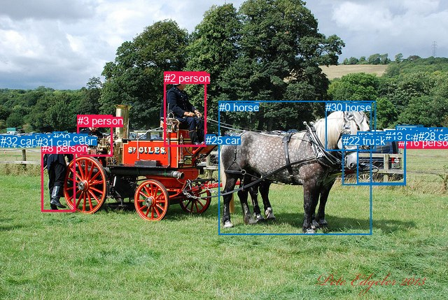
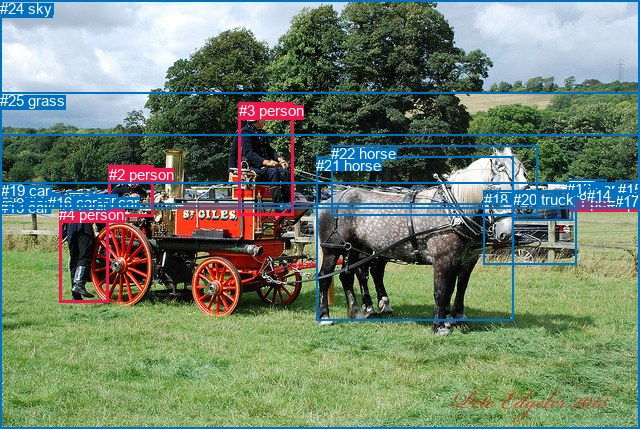

# 图片 0663：2345356.jpg

随机样本序号：351。图片 SHA256：`63c1eeacec4fc367dc318672c0ac8aeb487c91abfe250ddea45d8ad25582c038`。

红色框表示人，蓝色框表示其他物体。两个模式分别保留自身框编号，可依据位置比较对应对象。

## 自动检测框与输出

人的框编号：`[2, 3, 7, 8, 12, 16]`。状态：`ok`。

### 自动检测全部物体框

| 编号 | 类别 | 是否为人 | 检测分数 | 像素坐标 xyxy |
|---|---|---|---|---|
| 0 | horse | False | 0.9989 | 312.5, 144.7, 530.0, 335.6 |
| 1 | car | False | 0.9960 | 615.7, 191.9, 639.9, 206.8 |
| 2 | person | True | 0.9959 | 234.9, 102.8, 294.5, 209.9 |
| 3 | person | True | 0.9776 | 110.8, 164.4, 160.6, 223.3 |
| 4 | car | False | 0.9097 | 617.7, 182.5, 638.7, 191.2 |
| 5 | car | False | 0.8985 | 64.8, 193.4, 83.0, 203.6 |
| 6 | car | False | 0.8691 | 96.3, 193.4, 109.7, 201.6 |
| 7 | person | True | 0.8645 | 606.9, 194.9, 613.0, 210.3 |
| 8 | person | True | 0.8543 | 59.9, 202.8, 107.7, 302.8 |
| 9 | truck | False | 0.8525 | 565.5, 179.9, 604.4, 197.0 |
| 10 | car | False | 0.8455 | 567.8, 186.3, 593.8, 199.4 |
| 11 | car | False | 0.7948 | 0.3, 196.9, 15.3, 209.1 |
| 12 | person | True | 0.7931 | 569.4, 194.8, 575.9, 209.4 |
| 13 | car | False | 0.7627 | 510.2, 188.2, 578.5, 262.5 |
| 14 | car | False | 0.7512 | 579.2, 187.4, 597.9, 198.8 |
| 15 | car | False | 0.7440 | 30.5, 194.1, 46.8, 204.8 |
| 16 | person | True | 0.6645 | 575.3, 195.0, 582.5, 210.1 |
| 17 | car | False | 0.6591 | 68.1, 192.6, 93.2, 202.8 |
| 18 | car | False | 0.6292 | 46.4, 192.0, 65.6, 203.1 |
| 19 | car | False | 0.6287 | 551.1, 186.2, 590.2, 201.6 |
| 20 | car | False | 0.6052 | 84.8, 192.9, 101.4, 202.5 |
| 21 | car | False | 0.5888 | 57.5, 193.4, 76.2, 202.7 |
| 22 | truck | False | 0.5835 | 489.8, 193.3, 579.6, 264.1 |
| 23 | car | False | 0.5606 | 589.5, 187.6, 604.9, 197.9 |
| 24 | car | False | 0.5144 | 604.9, 186.8, 613.8, 194.1 |
| 25 | car | False | 0.5027 | 293.9, 192.4, 307.3, 200.9 |
| 26 | car | False | 0.4953 | 8.2, 194.6, 24.9, 204.8 |
| 27 | car | False | 0.4450 | 47.6, 191.3, 63.8, 198.7 |
| 28 | car | False | 0.4352 | 597.6, 185.7, 612.2, 194.4 |
| 29 | car | False | 0.4095 | 75.7, 188.9, 90.6, 195.3 |
| 30 | horse | False | 0.3744 | 465.1, 144.9, 536.5, 215.1 |
| 31 | car | False | 0.3711 | 53.1, 194.7, 67.6, 203.4 |
| 32 | car | False | 0.3597 | 0.5, 193.4, 17.1, 204.1 |

### 自动检测 Top50 人相关候选

评分物体对：1056；人相关物体对：354；输出关系：50。

| 排名 | 主语编号与类别 | 关系 | 宾语编号与类别 | 类型 | 人与人 | 排序分数 | 原始融合 logit |
|---|---|---|---|---|---|---|---|
| 1 | #2 person | driving | #0 horse | semantic | False | 0.99067 | 4.6654 |
| 2 | #0 horse | pulling | #2 person | semantic | False | 0.97368 | 3.6107 |
| 3 | #8 person | guiding | #0 horse | semantic | False | 0.94428 | 2.8302 |
| 4 | #2 person | driving on | #25 car | semantic | False | 0.93889 | 2.7320 |
| 5 | #3 person | driving | #0 horse | semantic | False | 0.93750 | 2.7081 |
| 6 | #0 horse | pulling | #3 person | semantic | False | 0.92317 | 2.4863 |
| 7 | #8 person | pushing | #3 person | semantic | True | 0.90940 | 2.3064 |
| 8 | #2 person | on | #25 car | spatial | False | 0.90087 | 2.2069 |
| 9 | #0 horse | pulling | #8 person | semantic | False | 0.89558 | 2.1491 |
| 10 | #12 person | walking on | #19 car | semantic | False | 0.87951 | 1.9878 |
| 11 | #16 person | walking on | #19 car | semantic | False | 0.87572 | 1.9525 |
| 12 | #16 person | walking on | #10 car | semantic | False | 0.87474 | 1.9435 |
| 13 | #12 person | walking on | #10 car | semantic | False | 0.84098 | 1.6655 |
| 14 | #2 person | on | #0 horse | spatial | False | 0.83830 | 1.6457 |
| 15 | #8 person | pushing | #22 truck | semantic | False | 0.83014 | 1.5866 |
| 16 | #16 person | walking on | #14 car | semantic | False | 0.82992 | 1.5851 |
| 17 | #16 person | walking on | #9 truck | semantic | False | 0.79498 | 1.3552 |
| 18 | #2 person | driving on | #22 truck | semantic | False | 0.78476 | 1.2936 |
| 19 | #8 person | pushing | #13 car | semantic | False | 0.74483 | 1.0712 |
| 20 | #8 person | beside | #0 horse | spatial | False | 0.73579 | 1.0242 |
| 21 | #12 person | walking on | #9 truck | semantic | False | 0.71749 | 0.9321 |
| 22 | #3 person | driving on | #2 person | semantic | True | 0.70063 | 0.8503 |
| 23 | #12 person | on | #19 car | spatial | False | 0.69147 | 0.8070 |
| 24 | #3 person | pushing | #22 truck | semantic | False | 0.68687 | 0.7855 |
| 25 | #3 person | pushing | #8 person | semantic | True | 0.68053 | 0.7562 |
| 26 | #2 person | driving on | #13 car | semantic | False | 0.67945 | 0.7513 |
| 27 | #2 person | driving on | #3 person | semantic | True | 0.66568 | 0.6887 |
| 28 | #16 person | in | #10 car | spatial | False | 0.64713 | 0.6065 |
| 29 | #24 car | parked on | #7 person | semantic | False | 0.63788 | 0.5662 |
| 30 | #16 person | in | #19 car | spatial | False | 0.63734 | 0.5639 |
| 31 | #8 person | pushing | #25 car | semantic | False | 0.62358 | 0.5048 |
| 32 | #12 person | walking on | #14 car | semantic | False | 0.62321 | 0.5032 |
| 33 | #12 person | on | #10 car | spatial | False | 0.61303 | 0.4601 |
| 34 | #16 person | walking on | #23 car | semantic | False | 0.60835 | 0.4404 |
| 35 | #3 person | pushing | #13 car | semantic | False | 0.60826 | 0.4400 |
| 36 | #16 person | looking at | #0 horse | semantic | False | 0.60727 | 0.4358 |
| 37 | #12 person | pushing | #16 person | semantic | True | 0.60154 | 0.4119 |
| 38 | #3 person | on | #0 horse | spatial | False | 0.58722 | 0.3525 |
| 39 | #3 person | in | #6 car | spatial | False | 0.57499 | 0.3022 |
| 40 | #16 person | in | #9 truck | spatial | False | 0.57384 | 0.2976 |
| 41 | #16 person | walking on | #12 person | semantic | True | 0.57377 | 0.2973 |
| 42 | #16 person | on | #14 car | spatial | False | 0.55535 | 0.2223 |
| 43 | #12 person | looking at | #13 car | semantic | False | 0.55419 | 0.2176 |
| 44 | #28 car | parked on | #7 person | semantic | False | 0.55406 | 0.2171 |
| 45 | #3 person | driving on | #25 car | semantic | False | 0.54562 | 0.1830 |
| 46 | #2 person | driving | #30 horse | semantic | False | 0.53534 | 0.1416 |
| 47 | #2 person | driving on | #6 car | semantic | False | 0.53359 | 0.1346 |
| 48 | #12 person | looking at | #0 horse | semantic | False | 0.53252 | 0.1303 |
| 49 | #2 person | driving | #20 car | semantic | False | 0.51406 | 0.0562 |
| 50 | #7 person | looking at | #0 horse | semantic | False | 0.50427 | 0.0171 |

### 自动检测逐条人相关 GT 核验

R@50：0.00%；命中 0/1。

| GT 主语编号 | GT 关系 | GT 宾语编号 | 结果阶段 | 匹配预测主语编号 | 匹配预测宾语编号 |
|---|---|---|---|---|---|
| 3 | riding | 21 | wrong_predicate | [2] | [0] |

## 真实框与输出

人的框编号：`[0, 1, 2, 3, 4, 5]`。

### 真实框全部物体框

| 编号 | 类别 | 是否为人 | 检测分数 | 像素坐标 xyxy |
|---|---|---|---|---|
| 0 | person | True | GT | 575.0, 194.0, 583.0, 210.0 |
| 1 | person | True | GT | 570.0, 194.0, 576.0, 210.0 |
| 2 | person | True | GT | 109.0, 166.0, 154.0, 217.0 |
| 3 | person | True | GT | 239.0, 102.0, 294.0, 216.0 |
| 4 | person | True | GT | 59.0, 206.0, 108.0, 303.0 |
| 5 | person | True | GT | 607.0, 195.0, 613.0, 210.0 |
| 6 | car | False | GT | 98.0, 194.0, 111.0, 203.0 |
| 7 | car | False | GT | 28.0, 193.0, 54.0, 205.0 |
| 8 | car | False | GT | 571.0, 186.0, 593.0, 200.0 |
| 9 | car | False | GT | 8.0, 195.0, 24.0, 201.0 |
| 10 | car | False | GT | 67.0, 192.0, 93.0, 203.0 |
| 11 | car | False | GT | 59.0, 196.0, 64.0, 204.0 |
| 12 | car | False | GT | 567.0, 180.0, 606.0, 192.0 |
| 13 | car | False | GT | 0.0, 199.0, 14.0, 209.0 |
| 14 | car | False | GT | 587.0, 187.0, 605.0, 197.0 |
| 15 | car | False | GT | 618.0, 181.0, 638.0, 191.0 |
| 16 | car | False | GT | 48.0, 194.0, 61.0, 201.0 |
| 17 | car | False | GT | 615.0, 193.0, 640.0, 207.0 |
| 18 | car | False | GT | 484.0, 191.0, 577.0, 265.0 |
| 19 | car | False | GT | 1.0, 182.0, 617.0, 204.0 |
| 20 | truck | False | GT | 513.0, 191.0, 572.0, 220.0 |
| 21 | horse | False | GT | 316.0, 157.0, 513.0, 321.0 |
| 22 | horse | False | GT | 331.0, 145.0, 537.0, 215.0 |
| 23 | tree | False | GT | 0.0, 0.0, 640.0, 208.0 |
| 24 | sky | False | GT | 0.0, 0.0, 640.0, 135.0 |
| 25 | grass | False | GT | 0.0, 92.0, 640.0, 429.0 |

### 真实框 Top50 人相关候选

评分物体对：650；人相关物体对：270；输出关系：50。

| 排名 | 主语编号与类别 | 关系 | 宾语编号与类别 | 类型 | 人与人 | 排序分数 | 原始融合 logit |
|---|---|---|---|---|---|---|---|
| 1 | #3 person | driving on | #21 horse | semantic | False | 0.99107 | 4.7088 |
| 2 | #21 horse | pulling | #3 person | semantic | False | 0.98324 | 4.0716 |
| 3 | #3 person | driving on | #19 car | semantic | False | 0.97615 | 3.7120 |
| 4 | #3 person | driving | #22 horse | semantic | False | 0.96766 | 3.3986 |
| 5 | #4 person | guiding | #21 horse | semantic | False | 0.96131 | 3.2126 |
| 6 | #3 person | driving on | #25 grass | semantic | False | 0.94533 | 2.8502 |
| 7 | #4 person | in | #25 grass | spatial | False | 0.92971 | 2.5823 |
| 8 | #3 person | in | #25 grass | spatial | False | 0.91786 | 2.4136 |
| 9 | #2 person | in | #25 grass | spatial | False | 0.91515 | 2.3782 |
| 10 | #5 person | in | #25 grass | spatial | False | 0.90639 | 2.2704 |
| 11 | #2 person | driving | #21 horse | semantic | False | 0.90030 | 2.2006 |
| 12 | #4 person | standing on | #25 grass | semantic | False | 0.88060 | 1.9981 |
| 13 | #21 horse | pulling | #4 person | semantic | False | 0.87812 | 1.9748 |
| 14 | #2 person | wearing | #6 car | semantic | False | 0.87037 | 1.9043 |
| 15 | #0 person | in | #25 grass | spatial | False | 0.85916 | 1.8083 |
| 16 | #2 person | driving on | #19 car | semantic | False | 0.84704 | 1.7115 |
| 17 | #4 person | pushing | #2 person | semantic | True | 0.84120 | 1.6672 |
| 18 | #1 person | in | #25 grass | spatial | False | 0.83756 | 1.6402 |
| 19 | #21 horse | pulling | #2 person | semantic | False | 0.82642 | 1.5605 |
| 20 | #2 person | on | #6 car | spatial | False | 0.82309 | 1.5374 |
| 21 | #3 person | on | #21 horse | spatial | False | 0.81084 | 1.4555 |
| 22 | #4 person | beside | #21 horse | spatial | False | 0.79390 | 1.3486 |
| 23 | #4 person | pushing | #22 horse | semantic | False | 0.78573 | 1.2994 |
| 24 | #0 person | standing on | #8 car | semantic | False | 0.76434 | 1.1766 |
| 25 | #2 person | driving on | #25 grass | semantic | False | 0.74687 | 1.0820 |
| 26 | #2 person | pushing | #4 person | semantic | True | 0.74275 | 1.0603 |
| 27 | #1 person | standing on | #8 car | semantic | False | 0.73611 | 1.0258 |
| 28 | #1 person | parked on | #25 grass | semantic | False | 0.68604 | 0.7817 |
| 29 | #4 person | pushing | #18 car | semantic | False | 0.67610 | 0.7359 |
| 30 | #1 person | pushing | #0 person | semantic | True | 0.64749 | 0.6080 |
| 31 | #1 person | on | #8 car | spatial | False | 0.64569 | 0.6001 |
| 32 | #3 person | driving on | #18 car | semantic | False | 0.63844 | 0.5686 |
| 33 | #0 person | looking at | #21 horse | semantic | False | 0.62314 | 0.5029 |
| 34 | #3 person | in | #19 car | spatial | False | 0.61222 | 0.4566 |
| 35 | #5 person | in | #19 car | spatial | False | 0.60285 | 0.4173 |
| 36 | #0 person | parked on | #25 grass | semantic | False | 0.60012 | 0.4060 |
| 37 | #5 person | looking at | #21 horse | semantic | False | 0.59596 | 0.3887 |
| 38 | #0 person | in | #8 car | spatial | False | 0.59585 | 0.3882 |
| 39 | #0 person | in | #19 car | spatial | False | 0.59368 | 0.3792 |
| 40 | #1 person | in | #19 car | spatial | False | 0.58527 | 0.3444 |
| 41 | #2 person | driving | #22 horse | semantic | False | 0.58267 | 0.3337 |
| 42 | #2 person | in | #19 car | spatial | False | 0.56904 | 0.2779 |
| 43 | #5 person | walking on | #25 grass | semantic | False | 0.56380 | 0.2566 |
| 44 | #3 person | on | #22 horse | spatial | False | 0.55501 | 0.2209 |
| 45 | #2 person | on | #21 horse | spatial | False | 0.52884 | 0.1155 |
| 46 | #0 person | standing on | #12 car | semantic | False | 0.52139 | 0.0856 |
| 47 | #1 person | looking at | #21 horse | semantic | False | 0.51499 | 0.0600 |
| 48 | #1 person | on | #20 truck | spatial | False | 0.50417 | 0.0167 |
| 49 | #3 person | in | #23 tree | spatial | False | 0.48858 | -0.0457 |
| 50 | #1 person | standing on | #20 truck | semantic | False | 0.46155 | -0.1541 |

### 真实框逐条人相关 GT 核验

R@50：0.00%；命中 0/1。

| GT 主语编号 | GT 关系 | GT 宾语编号 | 结果阶段 | 匹配预测主语编号 | 匹配预测宾语编号 |
|---|---|---|---|---|---|
| 3 | riding | 21 | wrong_predicate | [3] | [21] |

## 全部人相关 GT

| 主语编号与类别 | 关系 | 宾语编号与类别 |
|---|---|---|
| #3 person | riding | #21 horse |

原始记录、全部人相关物体对的两项预测与分项分数见 [逐图证据 JSON](../evidence/cases/0663.json)。全部56类 logits 保留于本机 HOR/output/random500/logits/。

<!-- HOR_COMPLETE_RESULTS -->

## 六组条件的完整输出对照

以下保留同一图片三种框与候选模式、两种谓词输出规则的全部 Top50。框编号各自在所属模式内解释。

### 自动检测框完整枚举：空间与语义各保留一个谓词

| 排名 | 主语编号与类别 | 谓词 | 宾语编号与类别 | 分组 | 排序分数 | predicate logit | pair logit |
|---|---|---|---|---|---|---|---|
| 1 | #2 person | driving | #0 horse | semantic | 0.9906725 | 4.8110223 | -0.1455979 |
| 2 | #0 horse | pulling | #2 person | semantic | 0.9736777 | 4.6898675 | -1.0792063 |
| 3 | #8 person | guiding | #0 horse | semantic | 0.9442844 | 3.4151597 | -0.5849930 |
| 4 | #2 person | driving on | #25 car | semantic | 0.9388880 | 3.0035772 | -0.2715896 |
| 5 | #3 person | driving | #0 horse | semantic | 0.9375032 | 3.2463937 | -0.5382886 |
| 6 | #0 horse | pulling | #3 person | semantic | 0.9231748 | 4.0279155 | -1.5416297 |
| 7 | #8 person | pushing | #3 person | semantic | 0.9094017 | 2.9741511 | -0.6678007 |
| 8 | #2 person | on | #25 car | spatial | 0.9008657 | 2.4784703 | -0.2715896 |
| 9 | #0 horse | pulling | #8 person | semantic | 0.8955832 | 3.3059173 | -1.1568326 |
| 10 | #12 person | walking on | #19 car | semantic | 0.8795102 | 2.1365929 | -0.1487932 |
| 11 | #16 person | walking on | #19 car | semantic | 0.8757156 | 2.1305575 | -0.1780890 |
| 12 | #16 person | walking on | #10 car | semantic | 0.8747405 | 2.1456242 | -0.2020844 |
| 13 | #12 person | walking on | #10 car | semantic | 0.8409772 | 1.8597498 | -0.1942329 |
| 14 | #2 person | on | #0 horse | spatial | 0.8383046 | 1.7912650 | -0.1455979 |
| 15 | #8 person | pushing | #22 truck | semantic | 0.8301395 | 2.7034349 | -1.1168185 |
| 16 | #16 person | walking on | #14 car | semantic | 0.8299214 | 1.7815180 | -0.1964478 |
| 17 | #16 person | walking on | #9 truck | semantic | 0.7949798 | 1.6190481 | -0.2638401 |
| 18 | #2 person | driving on | #22 truck | semantic | 0.7847601 | 2.3111534 | -1.0175287 |
| 19 | #8 person | pushing | #13 car | semantic | 0.7448336 | 2.2822561 | -1.2110113 |
| 20 | #8 person | beside | #0 horse | spatial | 0.7357868 | 1.6091771 | -0.5849930 |
| 21 | #12 person | walking on | #9 truck | semantic | 0.7174919 | 1.1917496 | -0.2596953 |
| 22 | #3 person | driving on | #2 person | semantic | 0.7006267 | 1.7998595 | -0.9495757 |
| 23 | #12 person | on | #19 car | spatial | 0.6914727 | 0.9558067 | -0.1487932 |
| 24 | #3 person | pushing | #22 truck | semantic | 0.6868750 | 1.5007110 | -0.7151610 |
| 25 | #3 person | pushing | #8 person | semantic | 0.6805339 | 1.2597365 | -0.5035098 |
| 26 | #2 person | driving on | #13 car | semantic | 0.6794512 | 1.8298335 | -1.0785828 |
| 27 | #2 person | driving on | #3 person | semantic | 0.6656754 | 1.6492453 | -0.9605554 |
| 28 | #16 person | in | #10 car | spatial | 0.6471310 | 0.8085361 | -0.2020844 |
| 29 | #24 car | parked on | #7 person | semantic | 0.6378847 | 0.4739580 | 0.0922371 |
| 30 | #16 person | in | #19 car | spatial | 0.6373429 | 0.7419391 | -0.1780890 |
| 31 | #8 person | pushing | #25 car | semantic | 0.6235759 | 2.1013856 | -1.5966319 |
| 32 | #12 person | walking on | #14 car | semantic | 0.6232106 | 0.7102757 | -0.2070776 |
| 33 | #12 person | on | #10 car | spatial | 0.6130338 | 0.6543159 | -0.1942329 |
| 34 | #16 person | walking on | #23 car | semantic | 0.6083477 | 0.6771741 | -0.2368019 |
| 35 | #3 person | pushing | #13 car | semantic | 0.6082581 | 1.1696901 | -0.7296939 |
| 36 | #16 person | looking at | #0 horse | semantic | 0.6072677 | 1.0282431 | -0.5924015 |
| 37 | #12 person | pushing | #16 person | semantic | 0.6015375 | 0.4776902 | -0.0658150 |
| 38 | #3 person | on | #0 horse | spatial | 0.5872234 | 0.8907871 | -0.5382886 |
| 39 | #3 person | in | #6 car | spatial | 0.5749891 | 0.1879120 | 0.1143241 |
| 40 | #16 person | in | #9 truck | spatial | 0.5738438 | 0.5613914 | -0.2638401 |
| 41 | #16 person | walking on | #12 person | semantic | 0.5737731 | 0.4017949 | -0.1045326 |
| 42 | #16 person | on | #14 car | spatial | 0.5553454 | 0.4187403 | -0.1964478 |
| 43 | #12 person | looking at | #13 car | semantic | 0.5541874 | 0.4502344 | -0.2326302 |
| 44 | #28 car | parked on | #7 person | semantic | 0.5540625 | 0.1425600 | 0.0745389 |
| 45 | #3 person | driving on | #25 car | semantic | 0.5456242 | 1.4387102 | -1.2557044 |
| 46 | #2 person | driving | #30 horse | semantic | 0.5353444 | 1.5313411 | -1.3897275 |
| 47 | #2 person | driving on | #6 car | semantic | 0.5335913 | 0.8064837 | -0.6719157 |
| 48 | #12 person | looking at | #0 horse | semantic | 0.5325173 | 0.6958451 | -0.5655921 |
| 49 | #2 person | driving | #20 car | semantic | 0.5140554 | 1.4106517 | -1.3544152 |
| 50 | #7 person | looking at | #0 horse | semantic | 0.5042664 | 0.7774029 | -0.7603371 |

GT 命中：0/1，R@50=0.00%。

| GT主语 | GT谓词 | GT宾语 | 结果阶段 | 匹配主语框 | 匹配宾语框 |
|---|---|---|---|---|---|
| 3 | riding | 21 | wrong_predicate | [2] | [0] |

### 自动检测框完整枚举：每对只保留一个谓词

| 排名 | 主语编号与类别 | 谓词 | 宾语编号与类别 | 分组 | 排序分数 | predicate logit | pair logit |
|---|---|---|---|---|---|---|---|
| 1 | #2 person | driving | #0 horse | single | 0.9906725 | 4.8110223 | -0.1455979 |
| 2 | #0 horse | pulling | #2 person | single | 0.9736777 | 4.6898675 | -1.0792063 |
| 3 | #8 person | guiding | #0 horse | single | 0.9442844 | 3.4151597 | -0.5849930 |
| 4 | #2 person | driving on | #25 car | single | 0.9388880 | 3.0035772 | -0.2715896 |
| 5 | #3 person | driving | #0 horse | single | 0.9375032 | 3.2463937 | -0.5382886 |
| 6 | #0 horse | pulling | #3 person | single | 0.9231748 | 4.0279155 | -1.5416297 |
| 7 | #8 person | pushing | #3 person | single | 0.9094017 | 2.9741511 | -0.6678007 |
| 8 | #0 horse | pulling | #8 person | single | 0.8955832 | 3.3059173 | -1.1568326 |
| 9 | #12 person | walking on | #19 car | single | 0.8795102 | 2.1365929 | -0.1487932 |
| 10 | #16 person | walking on | #19 car | single | 0.8757156 | 2.1305575 | -0.1780890 |
| 11 | #16 person | walking on | #10 car | single | 0.8747405 | 2.1456242 | -0.2020844 |
| 12 | #12 person | walking on | #10 car | single | 0.8409772 | 1.8597498 | -0.1942329 |
| 13 | #8 person | pushing | #22 truck | single | 0.8301395 | 2.7034349 | -1.1168185 |
| 14 | #16 person | walking on | #14 car | single | 0.8299214 | 1.7815180 | -0.1964478 |
| 15 | #16 person | walking on | #9 truck | single | 0.7949798 | 1.6190481 | -0.2638401 |
| 16 | #2 person | driving on | #22 truck | single | 0.7847601 | 2.3111534 | -1.0175287 |
| 17 | #8 person | pushing | #13 car | single | 0.7448336 | 2.2822561 | -1.2110113 |
| 18 | #12 person | walking on | #9 truck | single | 0.7174919 | 1.1917496 | -0.2596953 |
| 19 | #3 person | driving on | #2 person | single | 0.7006267 | 1.7998595 | -0.9495757 |
| 20 | #3 person | pushing | #22 truck | single | 0.6868750 | 1.5007110 | -0.7151610 |
| 21 | #3 person | pushing | #8 person | single | 0.6805339 | 1.2597365 | -0.5035098 |
| 22 | #2 person | driving on | #13 car | single | 0.6794512 | 1.8298335 | -1.0785828 |
| 23 | #2 person | driving on | #3 person | single | 0.6656754 | 1.6492453 | -0.9605554 |
| 24 | #24 car | parked on | #7 person | single | 0.6378847 | 0.4739580 | 0.0922371 |
| 25 | #8 person | pushing | #25 car | single | 0.6235759 | 2.1013856 | -1.5966319 |
| 26 | #12 person | walking on | #14 car | single | 0.6232106 | 0.7102757 | -0.2070776 |
| 27 | #16 person | walking on | #23 car | single | 0.6083477 | 0.6771741 | -0.2368019 |
| 28 | #3 person | pushing | #13 car | single | 0.6082581 | 1.1696901 | -0.7296939 |
| 29 | #16 person | looking at | #0 horse | single | 0.6072677 | 1.0282431 | -0.5924015 |
| 30 | #12 person | pushing | #16 person | single | 0.6015375 | 0.4776902 | -0.0658150 |
| 31 | #3 person | in | #6 car | single | 0.5749891 | 0.1879120 | 0.1143241 |
| 32 | #16 person | walking on | #12 person | single | 0.5737731 | 0.4017949 | -0.1045326 |
| 33 | #12 person | looking at | #13 car | single | 0.5541874 | 0.4502344 | -0.2326302 |
| 34 | #28 car | parked on | #7 person | single | 0.5540625 | 0.1425600 | 0.0745389 |
| 35 | #3 person | driving on | #25 car | single | 0.5456242 | 1.4387102 | -1.2557044 |
| 36 | #2 person | driving | #30 horse | single | 0.5353444 | 1.5313411 | -1.3897275 |
| 37 | #2 person | driving on | #6 car | single | 0.5335913 | 0.8064837 | -0.6719157 |
| 38 | #12 person | looking at | #0 horse | single | 0.5325173 | 0.6958451 | -0.5655921 |
| 39 | #2 person | driving | #20 car | single | 0.5140554 | 1.4106517 | -1.3544152 |
| 40 | #7 person | looking at | #0 horse | single | 0.5042664 | 0.7774029 | -0.7603371 |
| 41 | #23 car | parked on | #7 person | single | 0.5003425 | -0.0380602 | 0.0394301 |
| 42 | #7 person | walking on | #1 car | single | 0.4973625 | 0.0061626 | -0.0167125 |
| 43 | #2 person | driving | #1 car | single | 0.4954801 | 1.4107208 | -1.4288013 |
| 44 | #2 person | driving | #17 car | single | 0.4824102 | 1.7115173 | -1.7819054 |
| 45 | #3 person | driving on | #17 car | single | 0.4801483 | 0.8666601 | -0.9461085 |
| 46 | #3 person | driving on | #20 car | single | 0.4788591 | 0.4157166 | -0.5003306 |
| 47 | #2 person | driving | #19 car | single | 0.4672918 | 1.3204517 | -1.4514716 |
| 48 | #14 car | parked on | #16 person | single | 0.4587639 | -0.1580682 | -0.0072518 |
| 49 | #16 person | walking on | #28 car | single | 0.4539696 | 0.0904012 | -0.2750455 |
| 50 | #7 person | walking on | #28 car | single | 0.4486720 | -0.0148692 | -0.1911688 |

GT 命中：0/1，R@50=0.00%。

| GT主语 | GT谓词 | GT宾语 | 结果阶段 | 匹配主语框 | 匹配宾语框 |
|---|---|---|---|---|---|
| 3 | riding | 21 | wrong_predicate | [2] | [0] |

### 真实框完整枚举：空间与语义各保留一个谓词

| 排名 | 主语编号与类别 | 谓词 | 宾语编号与类别 | 分组 | 排序分数 | predicate logit | pair logit |
|---|---|---|---|---|---|---|---|
| 1 | #3 person | driving on | #21 horse | semantic | 0.9910651 | 4.8689084 | -0.1600910 |
| 2 | #21 horse | pulling | #3 person | semantic | 0.9832365 | 5.1111798 | -1.0395370 |
| 3 | #3 person | driving on | #19 car | semantic | 0.9761534 | 4.9276824 | -1.2157044 |
| 4 | #3 person | driving | #22 horse | semantic | 0.9676608 | 4.3295360 | -0.9309347 |
| 5 | #4 person | guiding | #21 horse | semantic | 0.9613065 | 3.9553094 | -0.7426897 |
| 6 | #3 person | driving on | #25 grass | semantic | 0.9453287 | 3.6646190 | -0.8144252 |
| 7 | #4 person | in | #25 grass | spatial | 0.9297122 | 3.1784396 | -0.5961625 |
| 8 | #3 person | in | #25 grass | spatial | 0.9178580 | 3.2280183 | -0.8144252 |
| 9 | #2 person | in | #25 grass | spatial | 0.9151517 | 3.1262307 | -0.7480054 |
| 10 | #5 person | in | #25 grass | spatial | 0.9063917 | 2.3509402 | -0.0805880 |
| 11 | #2 person | driving | #21 horse | semantic | 0.9003042 | 2.9154439 | -0.7148348 |
| 12 | #4 person | standing on | #25 grass | semantic | 0.8805994 | 2.5942817 | -0.5961625 |
| 13 | #21 horse | pulling | #4 person | semantic | 0.8781218 | 3.0652671 | -1.0905042 |
| 14 | #2 person | wearing | #6 car | semantic | 0.8703739 | 1.8886752 | 0.0155939 |
| 15 | #0 person | in | #25 grass | spatial | 0.8591574 | 2.0281324 | -0.2198235 |
| 16 | #2 person | driving on | #19 car | semantic | 0.8470358 | 2.9725194 | -1.2609806 |
| 17 | #4 person | pushing | #2 person | semantic | 0.8411994 | 2.4025226 | -0.7353430 |
| 18 | #1 person | in | #25 grass | spatial | 0.8375607 | 1.9048939 | -0.2647049 |
| 19 | #21 horse | pulling | #2 person | semantic | 0.8264224 | 3.1855197 | -1.6250383 |
| 20 | #2 person | on | #6 car | spatial | 0.8230865 | 1.5218067 | 0.0155939 |
| 21 | #3 person | on | #21 horse | spatial | 0.8108424 | 1.6155839 | -0.1600910 |
| 22 | #4 person | beside | #21 horse | spatial | 0.7938979 | 2.0912728 | -0.7426897 |
| 23 | #4 person | pushing | #22 horse | semantic | 0.7857314 | 2.6737804 | -1.3743961 |
| 24 | #0 person | standing on | #8 car | semantic | 0.7643414 | 1.3562527 | -0.1796222 |
| 25 | #2 person | driving on | #25 grass | semantic | 0.7468731 | 1.8300095 | -0.7480054 |
| 26 | #2 person | pushing | #4 person | semantic | 0.7427521 | 1.6206565 | -0.5603345 |
| 27 | #1 person | standing on | #8 car | semantic | 0.7361076 | 1.2138553 | -0.1880201 |
| 28 | #1 person | parked on | #25 grass | semantic | 0.6860397 | 1.0463738 | -0.2647049 |
| 29 | #4 person | pushing | #18 car | semantic | 0.6761001 | 1.9814777 | -1.2455714 |
| 30 | #1 person | pushing | #0 person | semantic | 0.6474869 | 0.6882882 | -0.0802777 |
| 31 | #1 person | on | #8 car | spatial | 0.6456855 | 0.7881479 | -0.1880201 |
| 32 | #3 person | driving on | #18 car | semantic | 0.6384447 | 1.5896144 | -1.0209942 |
| 33 | #0 person | looking at | #21 horse | semantic | 0.6231444 | 1.1853232 | -0.6824069 |
| 34 | #3 person | in | #19 car | spatial | 0.6122155 | 1.6723390 | -1.2157044 |
| 35 | #5 person | in | #19 car | spatial | 0.6028466 | 0.5959144 | -0.1785741 |
| 36 | #0 person | parked on | #25 grass | semantic | 0.6001185 | 0.6257825 | -0.2198235 |
| 37 | #5 person | looking at | #21 horse | semantic | 0.5959637 | 1.2357440 | -0.8470690 |
| 38 | #0 person | in | #8 car | spatial | 0.5958455 | 0.5678062 | -0.1796222 |
| 39 | #0 person | in | #19 car | spatial | 0.5936796 | 0.5454659 | -0.1662681 |
| 40 | #1 person | in | #19 car | spatial | 0.5852661 | 0.5352864 | -0.1908572 |
| 41 | #2 person | driving | #22 horse | semantic | 0.5826703 | 1.6215301 | -1.2877851 |
| 42 | #2 person | in | #19 car | spatial | 0.5690416 | 1.5389223 | -1.2609806 |
| 43 | #5 person | walking on | #25 grass | semantic | 0.5638018 | 0.3371940 | -0.0805880 |
| 44 | #3 person | on | #22 horse | spatial | 0.5550121 | 1.1518774 | -0.9309347 |
| 45 | #2 person | on | #21 horse | spatial | 0.5288382 | 0.8303156 | -0.7148348 |
| 46 | #0 person | standing on | #12 car | semantic | 0.5213939 | 0.3713007 | -0.2856728 |
| 47 | #1 person | looking at | #21 horse | semantic | 0.5149918 | 0.7014232 | -0.6414382 |
| 48 | #1 person | on | #20 truck | spatial | 0.5041656 | 0.1333227 | -0.1166599 |
| 49 | #3 person | in | #23 tree | spatial | 0.4885843 | 1.0559039 | -1.1015744 |
| 50 | #1 person | standing on | #20 truck | semantic | 0.4615530 | -0.0374322 | -0.1166599 |

GT 命中：0/1，R@50=0.00%。

| GT主语 | GT谓词 | GT宾语 | 结果阶段 | 匹配主语框 | 匹配宾语框 |
|---|---|---|---|---|---|
| 3 | riding | 21 | wrong_predicate | [3] | [21] |

### 真实框完整枚举：每对只保留一个谓词

| 排名 | 主语编号与类别 | 谓词 | 宾语编号与类别 | 分组 | 排序分数 | predicate logit | pair logit |
|---|---|---|---|---|---|---|---|
| 1 | #3 person | driving on | #21 horse | single | 0.9910651 | 4.8689084 | -0.1600910 |
| 2 | #21 horse | pulling | #3 person | single | 0.9832365 | 5.1111798 | -1.0395370 |
| 3 | #3 person | driving on | #19 car | single | 0.9761534 | 4.9276824 | -1.2157044 |
| 4 | #3 person | driving | #22 horse | single | 0.9676608 | 4.3295360 | -0.9309347 |
| 5 | #4 person | guiding | #21 horse | single | 0.9613065 | 3.9553094 | -0.7426897 |
| 6 | #3 person | driving on | #25 grass | single | 0.9453287 | 3.6646190 | -0.8144252 |
| 7 | #4 person | in | #25 grass | single | 0.9297122 | 3.1784396 | -0.5961625 |
| 8 | #2 person | in | #25 grass | single | 0.9151517 | 3.1262307 | -0.7480054 |
| 9 | #5 person | in | #25 grass | single | 0.9063917 | 2.3509402 | -0.0805880 |
| 10 | #2 person | driving | #21 horse | single | 0.9003042 | 2.9154439 | -0.7148348 |
| 11 | #21 horse | pulling | #4 person | single | 0.8781218 | 3.0652671 | -1.0905042 |
| 12 | #2 person | wearing | #6 car | single | 0.8703739 | 1.8886752 | 0.0155939 |
| 13 | #0 person | in | #25 grass | single | 0.8591574 | 2.0281324 | -0.2198235 |
| 14 | #2 person | driving on | #19 car | single | 0.8470358 | 2.9725194 | -1.2609806 |
| 15 | #4 person | pushing | #2 person | single | 0.8411994 | 2.4025226 | -0.7353430 |
| 16 | #1 person | in | #25 grass | single | 0.8375607 | 1.9048939 | -0.2647049 |
| 17 | #21 horse | pulling | #2 person | single | 0.8264224 | 3.1855197 | -1.6250383 |
| 18 | #4 person | pushing | #22 horse | single | 0.7857314 | 2.6737804 | -1.3743961 |
| 19 | #0 person | standing on | #8 car | single | 0.7643414 | 1.3562527 | -0.1796222 |
| 20 | #2 person | pushing | #4 person | single | 0.7427521 | 1.6206565 | -0.5603345 |
| 21 | #1 person | standing on | #8 car | single | 0.7361076 | 1.2138553 | -0.1880201 |
| 22 | #4 person | pushing | #18 car | single | 0.6761001 | 1.9814777 | -1.2455714 |
| 23 | #1 person | pushing | #0 person | single | 0.6474869 | 0.6882882 | -0.0802777 |
| 24 | #3 person | driving on | #18 car | single | 0.6384447 | 1.5896144 | -1.0209942 |
| 25 | #0 person | looking at | #21 horse | single | 0.6231444 | 1.1853232 | -0.6824069 |
| 26 | #5 person | in | #19 car | single | 0.6028466 | 0.5959144 | -0.1785741 |
| 27 | #5 person | looking at | #21 horse | single | 0.5959637 | 1.2357440 | -0.8470690 |
| 28 | #0 person | in | #19 car | single | 0.5936796 | 0.5454659 | -0.1662681 |
| 29 | #1 person | in | #19 car | single | 0.5852661 | 0.5352864 | -0.1908572 |
| 30 | #2 person | driving | #22 horse | single | 0.5826703 | 1.6215301 | -1.2877851 |
| 31 | #0 person | standing on | #12 car | single | 0.5213939 | 0.3713007 | -0.2856728 |
| 32 | #1 person | looking at | #21 horse | single | 0.5149918 | 0.7014232 | -0.6414382 |
| 33 | #1 person | on | #20 truck | single | 0.5041656 | 0.1333227 | -0.1166599 |
| 34 | #3 person | in | #23 tree | single | 0.4885843 | 1.0559039 | -1.1015744 |
| 35 | #0 person | looking at | #22 horse | single | 0.4521790 | 1.2364416 | -1.4283122 |
| 36 | #0 person | pushing | #1 person | single | 0.4298601 | -0.1839619 | -0.0984602 |
| 37 | #1 person | looking at | #22 horse | single | 0.4144617 | 0.9859500 | -1.3315010 |
| 38 | #1 person | standing on | #18 car | single | 0.4091955 | 0.0711026 | -0.4383947 |
| 39 | #1 person | standing on | #12 car | single | 0.3967346 | -0.1277061 | -0.2913839 |
| 40 | #3 person | driving on | #2 person | single | 0.3957338 | 0.4160557 | -0.8393286 |
| 41 | #5 person | in | #23 tree | single | 0.3712813 | -0.4349384 | -0.0917855 |
| 42 | #8 car | parked on | #0 person | single | 0.3642418 | -0.5181460 | -0.0388544 |
| 43 | #2 person | driving on | #3 person | single | 0.3631792 | 0.4765587 | -1.0381504 |
| 44 | #0 person | in | #23 tree | single | 0.3612829 | -0.2904520 | -0.2793481 |
| 45 | #4 person | pushing | #20 truck | single | 0.3421421 | 0.7178030 | -1.3715657 |
| 46 | #3 person | driving on | #20 truck | single | 0.3223834 | 0.4459119 | -1.1887519 |
| 47 | #3 person | looking at | #24 sky | single | 0.3170151 | 0.4455934 | -1.2131166 |
| 48 | #2 person | pushing | #18 car | single | 0.3083971 | 0.0868483 | -0.8944721 |
| 49 | #5 person | in | #17 car | single | 0.3049755 | -0.8350894 | 0.0113739 |
| 50 | #4 person | wearing | #6 car | single | 0.3047560 | -0.3262682 | -0.4984831 |

GT 命中：0/1，R@50=0.00%。

| GT主语 | GT谓词 | GT宾语 | 结果阶段 | 匹配主语框 | 匹配宾语框 |
|---|---|---|---|---|---|
| 3 | riding | 21 | wrong_predicate | [3] | [21] |

### 真实框400候选：空间与语义各保留一个谓词

| 排名 | 主语编号与类别 | 谓词 | 宾语编号与类别 | 分组 | 排序分数 | predicate logit | pair logit |
|---|---|---|---|---|---|---|---|
| 1 | #3 person | driving on | #21 horse | semantic | 0.9915822 | 4.9290385 | -0.1600910 |
| 2 | #21 horse | pulling | #3 person | semantic | 0.9832365 | 5.1111836 | -1.0395370 |
| 3 | #3 person | driving | #22 horse | semantic | 0.9744020 | 4.5702434 | -0.9309347 |
| 4 | #3 person | driving on | #19 car | semantic | 0.9731845 | 4.8072991 | -1.2157044 |
| 5 | #4 person | guiding | #21 horse | semantic | 0.9693342 | 4.1961541 | -0.7426897 |
| 6 | #3 person | driving on | #25 grass | semantic | 0.9512211 | 3.7848744 | -0.8144252 |
| 7 | #4 person | in | #25 grass | spatial | 0.9394866 | 3.3386302 | -0.5961625 |
| 8 | #5 person | in | #25 grass | spatial | 0.9352831 | 2.7514148 | -0.0805880 |
| 9 | #2 person | in | #25 grass | spatial | 0.9341429 | 3.4001479 | -0.7480054 |
| 10 | #3 person | in | #25 grass | spatial | 0.9193469 | 3.2479310 | -0.8144252 |
| 11 | #2 person | driving | #21 horse | semantic | 0.9081184 | 3.0057096 | -0.7148348 |
| 12 | #0 person | in | #25 grass | spatial | 0.9025445 | 2.4456458 | -0.2198235 |
| 13 | #21 horse | pulling | #4 person | semantic | 0.9016293 | 3.3059649 | -1.0905042 |
| 14 | #4 person | pushing | #18 car | semantic | 0.8984476 | 3.4256654 | -1.2455714 |
| 15 | #4 person | standing on | #25 grass | semantic | 0.8948465 | 2.7373939 | -0.5961625 |
| 16 | #2 person | sitting on | #6 car | semantic | 0.8941932 | 2.1187134 | 0.0155939 |
| 17 | #1 person | in | #25 grass | spatial | 0.8913504 | 2.3693151 | -0.2647049 |
| 18 | #4 person | pushing | #22 horse | semantic | 0.8861164 | 3.4260678 | -1.3743961 |
| 19 | #21 horse | pulling | #2 person | semantic | 0.8508142 | 3.3660388 | -1.6250383 |
| 20 | #2 person | driving on | #19 car | semantic | 0.8470316 | 2.9724874 | -1.2609806 |
| 21 | #1 person | parked on | #25 grass | semantic | 0.8311304 | 1.8583651 | -0.2647049 |
| 22 | #4 person | pushing | #2 person | semantic | 0.8287675 | 2.3122602 | -0.7353430 |
| 23 | #2 person | on | #6 car | spatial | 0.8246666 | 1.5326958 | 0.0155939 |
| 24 | #2 person | driving | #22 horse | semantic | 0.8141424 | 2.7649393 | -1.2877851 |
| 25 | #4 person | beside | #21 horse | spatial | 0.7890174 | 2.0617023 | -0.7426897 |
| 26 | #3 person | on | #21 horse | spatial | 0.7815386 | 1.4347463 | -0.1600910 |
| 27 | #2 person | driving on | #25 grass | semantic | 0.7742364 | 1.9803939 | -0.7480054 |
| 28 | #0 person | parked on | #25 grass | semantic | 0.7663579 | 1.4076824 | -0.2198235 |
| 29 | #0 person | standing on | #8 car | semantic | 0.7447784 | 1.2505765 | -0.1796222 |
| 30 | #2 person | pushing | #4 person | semantic | 0.7427509 | 1.6206503 | -0.5603345 |
| 31 | #3 person | driving on | #18 car | semantic | 0.7170045 | 1.9506454 | -1.0209942 |
| 32 | #0 person | looking at | #22 horse | semantic | 0.7051888 | 2.3004427 | -1.4283122 |
| 33 | #1 person | standing on | #8 car | semantic | 0.6961796 | 1.0171909 | -0.1880201 |
| 34 | #4 person | pushing | #20 truck | semantic | 0.6879288 | 2.1620197 | -1.3715657 |
| 35 | #5 person | walking on | #25 grass | semantic | 0.6863686 | 0.8637843 | -0.0805880 |
| 36 | #1 person | looking at | #22 horse | semantic | 0.6794686 | 2.0828319 | -1.3315010 |
| 37 | #0 person | looking at | #21 horse | semantic | 0.6519936 | 1.3102207 | -0.6824069 |
| 38 | #5 person | looking at | #21 horse | semantic | 0.6180758 | 1.3284583 | -0.8470690 |
| 39 | #2 person | pushing | #18 car | semantic | 0.5976961 | 1.2903466 | -0.8944721 |
| 40 | #2 person | in | #19 car | spatial | 0.5690416 | 1.5389223 | -1.2609806 |
| 41 | #3 person | in | #19 car | spatial | 0.5636410 | 1.4716568 | -1.2157044 |
| 42 | #1 person | looking at | #21 horse | semantic | 0.5605321 | 0.8847599 | -0.6414382 |
| 43 | #3 person | in | #23 tree | spatial | 0.5593256 | 1.3399997 | -1.1015744 |
| 44 | #3 person | on | #22 horse | spatial | 0.5584069 | 1.1656337 | -0.9309347 |
| 45 | #2 person | on | #21 horse | spatial | 0.5281236 | 0.8274479 | -0.7148348 |
| 46 | #1 person | on | #8 car | spatial | 0.5104638 | 0.2298813 | -0.1880201 |
| 47 | #5 person | looking at | #22 horse | semantic | 0.5096656 | 1.8669634 | -1.8282962 |
| 48 | #0 person | in | #8 car | spatial | 0.5083753 | 0.2131267 | -0.1796222 |
| 49 | #1 person | standing on | #20 truck | semantic | 0.5047777 | 0.1357713 | -0.1166599 |
| 50 | #1 person | standing on | #18 car | semantic | 0.4946002 | 0.4167948 | -0.4383947 |

GT 命中：0/1，R@50=0.00%。

| GT主语 | GT谓词 | GT宾语 | 结果阶段 | 匹配主语框 | 匹配宾语框 |
|---|---|---|---|---|---|
| 3 | riding | 21 | wrong_predicate | [3] | [21] |

### 真实框400候选：每对只保留一个谓词

| 排名 | 主语编号与类别 | 谓词 | 宾语编号与类别 | 分组 | 排序分数 | predicate logit | pair logit |
|---|---|---|---|---|---|---|---|
| 1 | #3 person | driving on | #21 horse | single | 0.9915822 | 4.9290385 | -0.1600910 |
| 2 | #21 horse | pulling | #3 person | single | 0.9832365 | 5.1111836 | -1.0395370 |
| 3 | #3 person | driving | #22 horse | single | 0.9744020 | 4.5702434 | -0.9309347 |
| 4 | #3 person | driving on | #19 car | single | 0.9731845 | 4.8072991 | -1.2157044 |
| 5 | #4 person | guiding | #21 horse | single | 0.9693342 | 4.1961541 | -0.7426897 |
| 6 | #3 person | driving on | #25 grass | single | 0.9512211 | 3.7848744 | -0.8144252 |
| 7 | #4 person | in | #25 grass | single | 0.9394866 | 3.3386302 | -0.5961625 |
| 8 | #5 person | in | #25 grass | single | 0.9352831 | 2.7514148 | -0.0805880 |
| 9 | #2 person | in | #25 grass | single | 0.9341429 | 3.4001479 | -0.7480054 |
| 10 | #2 person | driving | #21 horse | single | 0.9081184 | 3.0057096 | -0.7148348 |
| 11 | #0 person | in | #25 grass | single | 0.9025445 | 2.4456458 | -0.2198235 |
| 12 | #21 horse | pulling | #4 person | single | 0.9016293 | 3.3059649 | -1.0905042 |
| 13 | #4 person | pushing | #18 car | single | 0.8984476 | 3.4256654 | -1.2455714 |
| 14 | #2 person | sitting on | #6 car | single | 0.8941932 | 2.1187134 | 0.0155939 |
| 15 | #1 person | in | #25 grass | single | 0.8913504 | 2.3693151 | -0.2647049 |
| 16 | #4 person | pushing | #22 horse | single | 0.8861164 | 3.4260678 | -1.3743961 |
| 17 | #21 horse | pulling | #2 person | single | 0.8508142 | 3.3660388 | -1.6250383 |
| 18 | #2 person | driving on | #19 car | single | 0.8470316 | 2.9724874 | -1.2609806 |
| 19 | #4 person | pushing | #2 person | single | 0.8287675 | 2.3122602 | -0.7353430 |
| 20 | #2 person | driving | #22 horse | single | 0.8141424 | 2.7649393 | -1.2877851 |
| 21 | #0 person | standing on | #8 car | single | 0.7447784 | 1.2505765 | -0.1796222 |
| 22 | #2 person | pushing | #4 person | single | 0.7427509 | 1.6206503 | -0.5603345 |
| 23 | #3 person | driving on | #18 car | single | 0.7170045 | 1.9506454 | -1.0209942 |
| 24 | #0 person | looking at | #22 horse | single | 0.7051888 | 2.3004427 | -1.4283122 |
| 25 | #1 person | standing on | #8 car | single | 0.6961796 | 1.0171909 | -0.1880201 |
| 26 | #4 person | pushing | #20 truck | single | 0.6879288 | 2.1620197 | -1.3715657 |
| 27 | #1 person | looking at | #22 horse | single | 0.6794686 | 2.0828319 | -1.3315010 |
| 28 | #0 person | looking at | #21 horse | single | 0.6519936 | 1.3102207 | -0.6824069 |
| 29 | #5 person | looking at | #21 horse | single | 0.6180758 | 1.3284583 | -0.8470690 |
| 30 | #2 person | pushing | #18 car | single | 0.5976961 | 1.2903466 | -0.8944721 |
| 31 | #1 person | looking at | #21 horse | single | 0.5605321 | 0.8847599 | -0.6414382 |
| 32 | #3 person | in | #23 tree | single | 0.5593256 | 1.3399997 | -1.1015744 |
| 33 | #5 person | looking at | #22 horse | single | 0.5096656 | 1.8669634 | -1.8282962 |
| 34 | #1 person | standing on | #20 truck | single | 0.5047777 | 0.1357713 | -0.1166599 |
| 35 | #1 person | standing on | #18 car | single | 0.4946002 | 0.4167948 | -0.4383947 |
| 36 | #0 person | standing on | #12 car | single | 0.4931521 | 0.2582793 | -0.2856728 |
| 37 | #3 person | driving on | #2 person | single | 0.4619415 | 0.6867995 | -0.8393286 |
| 38 | #5 person | in | #23 tree | single | 0.4561057 | -0.0842447 | -0.0917855 |
| 39 | #3 person | driving on | #20 truck | single | 0.4498326 | 0.9874048 | -1.1887519 |
| 40 | #1 person | pushing | #0 person | single | 0.4490913 | -0.1240649 | -0.0802777 |
| 41 | #0 person | in | #23 tree | single | 0.4188166 | -0.0482850 | -0.2793481 |
| 42 | #2 person | driving on | #3 person | single | 0.4058588 | 0.6570387 | -1.0381504 |
| 43 | #4 person | wearing | #6 car | single | 0.3941551 | 0.0686035 | -0.4984831 |
| 44 | #1 person | standing on | #12 car | single | 0.3806910 | -0.1952324 | -0.2913839 |
| 45 | #22 horse | pulling | #3 person | single | 0.3728126 | 1.0499315 | -1.5701010 |
| 46 | #1 person | in | #19 car | single | 0.3608203 | -0.3809485 | -0.1908572 |
| 47 | #1 person | in | #23 tree | single | 0.3494219 | -0.2705393 | -0.3510423 |
| 48 | #0 person | in | #19 car | single | 0.3245934 | -0.5664735 | -0.1662681 |
| 49 | #3 person | looking at | #24 sky | single | 0.3245586 | 0.4802165 | -1.2131166 |
| 50 | #4 person | pushing | #3 person | single | 0.3004723 | 0.5072279 | -1.3522775 |

GT 命中：0/1，R@50=0.00%。

| GT主语 | GT谓词 | GT宾语 | 结果阶段 | 匹配主语框 | 匹配宾语框 |
|---|---|---|---|---|---|
| 3 | riding | 21 | wrong_predicate | [3] | [21] |
