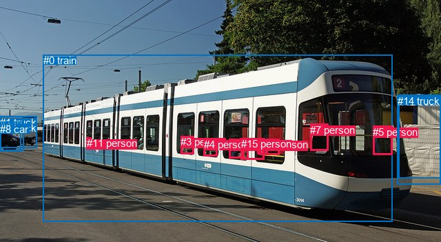
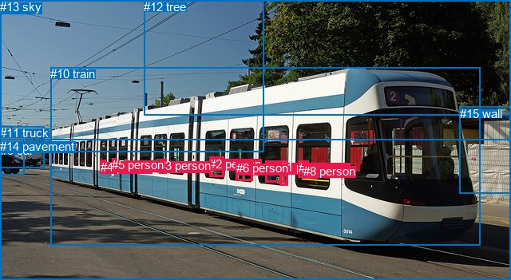

# 图片 0664：2345357.jpg

随机样本序号：94。图片 SHA256：`ac74264bbc3356e0cb87cdc2edac2e2f7e519ae2c16b0a4e2b943a695163ebf6`。

红色框表示人，蓝色框表示其他物体。两个模式分别保留自身框编号，可依据位置比较对应对象。

## 自动检测框与输出

人的框编号：`[2, 3, 4, 5, 7, 9, 10, 11, 13, 15]`。状态：`ok`。

### 自动检测全部物体框

| 编号 | 类别 | 是否为人 | 检测分数 | 像素坐标 xyxy |
|---|---|---|---|---|
| 0 | train | False | 0.9961 | 62.8, 79.2, 569.2, 321.1 |
| 1 | truck | False | 0.9916 | 0.0, 168.7, 53.2, 214.1 |
| 2 | person | True | 0.9733 | 332.1, 201.5, 354.8, 229.6 |
| 3 | person | True | 0.9717 | 262.1, 197.4, 281.0, 223.6 |
| 4 | person | True | 0.9125 | 295.6, 200.9, 315.6, 226.6 |
| 5 | person | True | 0.8427 | 541.1, 182.6, 569.9, 224.9 |
| 6 | truck | False | 0.8423 | 0.0, 176.5, 34.3, 218.9 |
| 7 | person | True | 0.8220 | 450.2, 179.6, 476.4, 218.6 |
| 8 | car | False | 0.7401 | 0.1, 179.4, 30.6, 219.7 |
| 9 | person | True | 0.7067 | 376.7, 201.1, 406.0, 224.2 |
| 10 | person | True | 0.5760 | 373.9, 201.3, 388.4, 223.4 |
| 11 | person | True | 0.4807 | 125.8, 199.5, 132.9, 210.6 |
| 12 | boat | False | 0.4351 | 578.7, 139.0, 640.0, 258.3 |
| 13 | person | True | 0.4223 | 350.0, 200.9, 360.5, 231.6 |
| 14 | truck | False | 0.4011 | 577.0, 137.9, 640.0, 267.3 |
| 15 | person | True | 0.3925 | 350.1, 200.3, 383.2, 231.6 |

### 自动检测 Top50 人相关候选

评分物体对：240；人相关物体对：210；输出关系：50。

| 排名 | 主语编号与类别 | 关系 | 宾语编号与类别 | 类型 | 人与人 | 排序分数 | 原始融合 logit |
|---|---|---|---|---|---|---|---|
| 1 | #10 person | riding | #0 train | semantic | False | 0.98532 | 4.2062 |
| 2 | #13 person | in | #0 train | spatial | False | 0.98455 | 4.1548 |
| 3 | #9 person | in | #0 train | spatial | False | 0.98444 | 4.1477 |
| 4 | #2 person | in | #0 train | spatial | False | 0.98424 | 4.1343 |
| 5 | #15 person | in | #0 train | spatial | False | 0.98413 | 4.1272 |
| 6 | #10 person | in | #0 train | spatial | False | 0.98337 | 4.0795 |
| 7 | #4 person | in | #0 train | spatial | False | 0.98280 | 4.0454 |
| 8 | #13 person | riding | #0 train | semantic | False | 0.98242 | 4.0231 |
| 9 | #3 person | in | #0 train | spatial | False | 0.98115 | 3.9521 |
| 10 | #7 person | in | #0 train | spatial | False | 0.98102 | 3.9451 |
| 11 | #11 person | riding | #0 train | semantic | False | 0.97939 | 3.8614 |
| 12 | #3 person | riding | #0 train | semantic | False | 0.97877 | 3.8306 |
| 13 | #15 person | riding | #0 train | semantic | False | 0.97790 | 3.7896 |
| 14 | #4 person | riding | #0 train | semantic | False | 0.97777 | 3.7839 |
| 15 | #7 person | driving on | #0 train | semantic | False | 0.97709 | 3.7529 |
| 16 | #9 person | riding | #0 train | semantic | False | 0.97658 | 3.7305 |
| 17 | #2 person | riding | #0 train | semantic | False | 0.97626 | 3.7167 |
| 18 | #5 person | riding | #0 train | semantic | False | 0.97009 | 3.4791 |
| 19 | #5 person | in | #0 train | spatial | False | 0.96844 | 3.4237 |
| 20 | #11 person | on | #0 train | spatial | False | 0.94886 | 2.9207 |
| 21 | #0 train | carrying | #9 person | semantic | False | 0.89076 | 2.0986 |
| 22 | #0 train | carrying | #10 person | semantic | False | 0.86891 | 1.8913 |
| 23 | #0 train | carrying | #7 person | semantic | False | 0.85413 | 1.7674 |
| 24 | #0 train | carrying | #3 person | semantic | False | 0.83671 | 1.6339 |
| 25 | #0 train | carrying | #2 person | semantic | False | 0.83329 | 1.6092 |
| 26 | #0 train | carrying | #15 person | semantic | False | 0.83272 | 1.6050 |
| 27 | #10 person | sitting on | #9 person | semantic | True | 0.81262 | 1.4671 |
| 28 | #0 train | carrying | #13 person | semantic | False | 0.80800 | 1.4371 |
| 29 | #0 train | carrying | #5 person | semantic | False | 0.80565 | 1.4220 |
| 30 | #0 train | carrying | #4 person | semantic | False | 0.77912 | 1.2605 |
| 31 | #9 person | sitting on | #10 person | semantic | True | 0.69228 | 0.8108 |
| 32 | #13 person | sitting on | #15 person | semantic | True | 0.62726 | 0.5205 |
| 33 | #15 person | sitting on | #10 person | semantic | True | 0.62513 | 0.5114 |
| 34 | #10 person | sitting on | #15 person | semantic | True | 0.54532 | 0.1818 |
| 35 | #9 person | on | #10 person | spatial | True | 0.51644 | 0.0658 |
| 36 | #10 person | in | #9 person | spatial | True | 0.48777 | -0.0489 |
| 37 | #13 person | in | #15 person | spatial | True | 0.43908 | -0.2449 |
| 38 | #15 person | sitting on | #13 person | semantic | True | 0.43533 | -0.2601 |
| 39 | #0 train | carrying | #11 person | semantic | False | 0.42098 | -0.3187 |
| 40 | #15 person | on | #10 person | spatial | True | 0.41801 | -0.3309 |
| 41 | #15 person | on | #13 person | spatial | True | 0.38822 | -0.4548 |
| 42 | #0 train | on | #11 person | spatial | False | 0.35594 | -0.5930 |
| 43 | #10 person | in | #15 person | spatial | True | 0.34743 | -0.6304 |
| 44 | #0 train | on | #5 person | spatial | False | 0.30435 | -0.8266 |
| 45 | #0 train | on | #3 person | spatial | False | 0.27419 | -0.9735 |
| 46 | #9 person | sitting on | #15 person | semantic | True | 0.26363 | -1.0272 |
| 47 | #15 person | sitting on | #9 person | semantic | True | 0.25840 | -1.0543 |
| 48 | #0 train | on | #7 person | spatial | False | 0.25525 | -1.0708 |
| 49 | #15 person | sitting on | #2 person | semantic | True | 0.23224 | -1.1957 |
| 50 | #13 person | sitting on | #2 person | semantic | True | 0.21267 | -1.3089 |

### 自动检测逐条人相关 GT 核验

R@50：100.00%；命中 2/2。

| GT 主语编号 | GT 关系 | GT 宾语编号 | 结果阶段 | 匹配预测主语编号 | 匹配预测宾语编号 |
|---|---|---|---|---|---|
| 0 | in | 10 | hit50 | [2] | [0] |
| 1 | in | 10 | hit50 | [13] | [0] |

## 真实框与输出

人的框编号：`[0, 1, 2, 3, 4, 5, 6, 7, 8]`。

### 真实框全部物体框

| 编号 | 类别 | 是否为人 | 检测分数 | 像素坐标 xyxy |
|---|---|---|---|---|
| 0 | person | True | GT | 332.0, 202.0, 356.0, 229.0 |
| 1 | person | True | GT | 351.0, 201.0, 361.0, 232.0 |
| 2 | person | True | GT | 262.0, 197.0, 280.0, 222.0 |
| 3 | person | True | GT | 199.0, 199.0, 208.0, 217.0 |
| 4 | person | True | GT | 126.0, 201.0, 133.0, 210.0 |
| 5 | person | True | GT | 140.0, 198.0, 146.0, 211.0 |
| 6 | person | True | GT | 296.0, 202.0, 317.0, 226.0 |
| 7 | person | True | GT | 374.0, 202.0, 387.0, 223.0 |
| 8 | person | True | GT | 380.0, 206.0, 398.0, 224.0 |
| 9 | car | False | GT | 1.0, 180.0, 30.0, 220.0 |
| 10 | train | False | GT | 63.0, 84.0, 601.0, 307.0 |
| 11 | truck | False | GT | 0.0, 158.0, 55.0, 211.0 |
| 12 | tree | False | GT | 180.0, 0.0, 640.0, 145.0 |
| 13 | sky | False | GT | 0.0, 0.0, 330.0, 191.0 |
| 14 | pavement | False | GT | 0.0, 175.0, 640.0, 351.0 |
| 15 | wall | False | GT | 576.0, 134.0, 640.0, 243.0 |

### 真实框 Top50 人相关候选

评分物体对：240；人相关物体对：198；输出关系：50。

| 排名 | 主语编号与类别 | 关系 | 宾语编号与类别 | 类型 | 人与人 | 排序分数 | 原始融合 logit |
|---|---|---|---|---|---|---|---|
| 1 | #8 person | in | #10 train | spatial | False | 0.98401 | 4.1194 |
| 2 | #0 person | in | #10 train | spatial | False | 0.98393 | 4.1148 |
| 3 | #1 person | in | #10 train | spatial | False | 0.98254 | 4.0301 |
| 4 | #6 person | in | #10 train | spatial | False | 0.98103 | 3.9456 |
| 5 | #7 person | in | #10 train | spatial | False | 0.98025 | 3.9048 |
| 6 | #7 person | riding | #10 train | semantic | False | 0.98001 | 3.8925 |
| 7 | #2 person | in | #10 train | spatial | False | 0.97801 | 3.7947 |
| 8 | #3 person | riding | #10 train | semantic | False | 0.97736 | 3.7649 |
| 9 | #5 person | riding | #10 train | semantic | False | 0.97720 | 3.7579 |
| 10 | #1 person | riding | #10 train | semantic | False | 0.97602 | 3.7062 |
| 11 | #3 person | in | #10 train | spatial | False | 0.97586 | 3.6993 |
| 12 | #8 person | riding | #10 train | semantic | False | 0.97242 | 3.5627 |
| 13 | #2 person | riding | #10 train | semantic | False | 0.97069 | 3.5001 |
| 14 | #4 person | riding | #10 train | semantic | False | 0.97056 | 3.4956 |
| 15 | #6 person | riding | #10 train | semantic | False | 0.96984 | 3.4707 |
| 16 | #0 person | riding | #10 train | semantic | False | 0.96593 | 3.3446 |
| 17 | #5 person | in | #10 train | spatial | False | 0.93716 | 2.7022 |
| 18 | #4 person | on | #10 train | spatial | False | 0.91071 | 2.3223 |
| 19 | #10 train | carrying | #8 person | semantic | False | 0.73428 | 1.0164 |
| 20 | #10 train | carrying | #7 person | semantic | False | 0.72534 | 0.9711 |
| 21 | #7 person | sitting on | #8 person | semantic | True | 0.68144 | 0.7604 |
| 22 | #10 train | carrying | #0 person | semantic | False | 0.65969 | 0.6619 |
| 23 | #10 train | carrying | #2 person | semantic | False | 0.63271 | 0.5438 |
| 24 | #10 train | carrying | #1 person | semantic | False | 0.63097 | 0.5364 |
| 25 | #10 train | carrying | #6 person | semantic | False | 0.53335 | 0.1336 |
| 26 | #10 train | carrying | #3 person | semantic | False | 0.42228 | -0.3134 |
| 27 | #8 person | sitting on | #7 person | semantic | True | 0.41861 | -0.3285 |
| 28 | #8 person | in front of | #7 person | spatial | True | 0.37137 | -0.5264 |
| 29 | #10 train | on | #4 person | spatial | False | 0.35110 | -0.6142 |
| 30 | #10 train | on | #5 person | spatial | False | 0.30442 | -0.8264 |
| 31 | #7 person | on | #8 person | spatial | True | 0.27787 | -0.9550 |
| 32 | #10 train | carrying | #5 person | semantic | False | 0.26984 | -0.9954 |
| 33 | #10 train | carrying | #4 person | semantic | False | 0.24346 | -1.1338 |
| 34 | #10 train | on | #3 person | spatial | False | 0.22779 | -1.2209 |
| 35 | #1 person | sitting on | #0 person | semantic | True | 0.21490 | -1.2957 |
| 36 | #10 train | on | #2 person | spatial | False | 0.19277 | -1.4321 |
| 37 | #0 person | sitting on | #1 person | semantic | True | 0.15641 | -1.6852 |
| 38 | #10 train | on | #6 person | spatial | False | 0.14818 | -1.7490 |
| 39 | #10 train | on | #0 person | spatial | False | 0.12564 | -1.9400 |
| 40 | #10 train | on | #8 person | spatial | False | 0.11504 | -2.0402 |
| 41 | #0 person | driving on | #14 pavement | semantic | False | 0.11446 | -2.0459 |
| 42 | #10 train | on | #7 person | spatial | False | 0.10070 | -2.1894 |
| 43 | #10 train | on | #1 person | spatial | False | 0.09892 | -2.2093 |
| 44 | #0 person | on | #14 pavement | spatial | False | 0.09107 | -2.3007 |
| 45 | #1 person | in | #0 person | spatial | True | 0.09000 | -2.3137 |
| 46 | #0 person | on | #1 person | spatial | True | 0.08776 | -2.3413 |
| 47 | #6 person | on | #14 pavement | spatial | False | 0.07445 | -2.5203 |
| 48 | #7 person | riding | #14 pavement | semantic | False | 0.06466 | -2.6718 |
| 49 | #8 person | riding | #14 pavement | semantic | False | 0.05570 | -2.8305 |
| 50 | #6 person | riding | #14 pavement | semantic | False | 0.05526 | -2.8389 |

### 真实框逐条人相关 GT 核验

R@50：100.00%；命中 2/2。

| GT 主语编号 | GT 关系 | GT 宾语编号 | 结果阶段 | 匹配预测主语编号 | 匹配预测宾语编号 |
|---|---|---|---|---|---|
| 0 | in | 10 | hit50 | [0] | [10] |
| 1 | in | 10 | hit50 | [1] | [10] |

## 全部人相关 GT

| 主语编号与类别 | 关系 | 宾语编号与类别 |
|---|---|---|
| #0 person | in | #10 train |
| #1 person | in | #10 train |

原始记录、全部人相关物体对的两项预测与分项分数见 [逐图证据 JSON](../evidence/cases/0664.json)。全部56类 logits 保留于本机 HOR/output/random500/logits/。

<!-- HOR_COMPLETE_RESULTS -->

## 六组条件的完整输出对照

以下保留同一图片三种框与候选模式、两种谓词输出规则的全部 Top50。框编号各自在所属模式内解释。

### 自动检测框完整枚举：空间与语义各保留一个谓词

| 排名 | 主语编号与类别 | 谓词 | 宾语编号与类别 | 分组 | 排序分数 | predicate logit | pair logit |
|---|---|---|---|---|---|---|---|
| 1 | #10 person | riding | #0 train | semantic | 0.9853165 | 3.8229241 | 0.3833143 |
| 2 | #13 person | in | #0 train | spatial | 0.9845540 | 3.7762980 | 0.3785437 |
| 3 | #9 person | in | #0 train | spatial | 0.9844444 | 3.7630229 | 0.3846285 |
| 4 | #2 person | in | #0 train | spatial | 0.9842392 | 3.7630229 | 0.3713246 |
| 5 | #15 person | in | #0 train | spatial | 0.9841276 | 3.7431111 | 0.3840632 |
| 6 | #10 person | in | #0 train | spatial | 0.9833658 | 3.6962037 | 0.3833143 |
| 7 | #4 person | in | #0 train | spatial | 0.9827979 | 3.7293906 | 0.3159805 |
| 8 | #13 person | riding | #0 train | semantic | 0.9824176 | 3.6445756 | 0.3785437 |
| 9 | #3 person | in | #0 train | spatial | 0.9811482 | 3.6488519 | 0.3032606 |
| 10 | #7 person | in | #0 train | spatial | 0.9810172 | 3.7364736 | 0.2085828 |
| 11 | #11 person | riding | #0 train | semantic | 0.9793945 | 3.6438432 | 0.2175367 |
| 12 | #3 person | riding | #0 train | semantic | 0.9787651 | 3.5273871 | 0.3032606 |
| 13 | #15 person | riding | #0 train | semantic | 0.9778954 | 3.4055552 | 0.3840632 |
| 14 | #4 person | riding | #0 train | semantic | 0.9777719 | 3.4679379 | 0.3159805 |
| 15 | #7 person | driving on | #0 train | semantic | 0.9770871 | 3.5442891 | 0.2085828 |
| 16 | #9 person | riding | #0 train | semantic | 0.9765805 | 3.3458619 | 0.3846285 |
| 17 | #2 person | riding | #0 train | semantic | 0.9762630 | 3.3453736 | 0.3713246 |
| 18 | #5 person | riding | #0 train | semantic | 0.9700875 | 3.5237212 | -0.0446086 |
| 19 | #5 person | in | #0 train | spatial | 0.9684369 | 3.4683042 | -0.0446086 |
| 20 | #11 person | on | #0 train | spatial | 0.9488599 | 2.7031550 | 0.2175367 |
| 21 | #0 train | carrying | #9 person | semantic | 0.8907639 | 2.7274246 | -0.6288567 |
| 22 | #0 train | carrying | #10 person | semantic | 0.8689064 | 2.5561972 | -0.6648726 |
| 23 | #0 train | carrying | #7 person | semantic | 0.8541328 | 2.3075113 | -0.5401213 |
| 24 | #0 train | carrying | #3 person | semantic | 0.8367084 | 2.0844574 | -0.4505190 |
| 25 | #0 train | carrying | #2 person | semantic | 0.8332950 | 2.3226571 | -0.7134953 |
| 26 | #0 train | carrying | #15 person | semantic | 0.8327178 | 2.2995563 | -0.6945432 |
| 27 | #10 person | sitting on | #9 person | semantic | 0.8126195 | 1.9201078 | -0.4529862 |
| 28 | #0 train | carrying | #13 person | semantic | 0.8080031 | 2.1710358 | -0.7339492 |
| 29 | #0 train | carrying | #5 person | semantic | 0.8056510 | 1.9965134 | -0.5745184 |
| 30 | #0 train | carrying | #4 person | semantic | 0.7791178 | 1.9062395 | -0.6457069 |
| 31 | #9 person | sitting on | #10 person | semantic | 0.6922848 | 1.2580686 | -0.4472456 |
| 32 | #13 person | sitting on | #15 person | semantic | 0.6272569 | 0.8909812 | -0.3705143 |
| 33 | #15 person | sitting on | #10 person | semantic | 0.6251349 | 0.9361100 | -0.4247085 |
| 34 | #10 person | sitting on | #15 person | semantic | 0.5453151 | 0.5870485 | -0.4052894 |
| 35 | #9 person | on | #10 person | spatial | 0.5164427 | 0.5130401 | -0.4472456 |
| 36 | #10 person | in | #9 person | spatial | 0.4877746 | 0.4040751 | -0.4529862 |
| 37 | #13 person | in | #15 person | spatial | 0.4390817 | 0.1256247 | -0.3705143 |
| 38 | #15 person | sitting on | #13 person | semantic | 0.4353306 | 0.1356635 | -0.3957983 |
| 39 | #0 train | carrying | #11 person | semantic | 0.4209807 | 0.0439119 | -0.3626608 |
| 40 | #15 person | on | #10 person | spatial | 0.4180100 | 0.0937605 | -0.4247085 |
| 41 | #15 person | on | #13 person | spatial | 0.3882245 | -0.0589833 | -0.3957983 |
| 42 | #0 train | on | #11 person | spatial | 0.3559443 | -0.2303500 | -0.3626608 |
| 43 | #10 person | in | #15 person | spatial | 0.3474293 | -0.2250686 | -0.4052894 |
| 44 | #0 train | on | #5 person | spatial | 0.3043543 | -0.2521296 | -0.5745184 |
| 45 | #0 train | on | #3 person | spatial | 0.2741895 | -0.5229506 | -0.4505190 |
| 46 | #9 person | sitting on | #15 person | semantic | 0.2636317 | -0.6016116 | -0.4255659 |
| 47 | #15 person | sitting on | #9 person | semantic | 0.2584039 | -0.6076202 | -0.4466606 |
| 48 | #0 train | on | #7 person | spatial | 0.2552501 | -0.5306835 | -0.5401213 |
| 49 | #15 person | sitting on | #2 person | semantic | 0.2322407 | -0.7746325 | -0.4210695 |
| 50 | #13 person | sitting on | #2 person | semantic | 0.2126741 | -0.9190640 | -0.3898176 |

GT 命中：2/2，R@50=100.00%。

| GT主语 | GT谓词 | GT宾语 | 结果阶段 | 匹配主语框 | 匹配宾语框 |
|---|---|---|---|---|---|
| 0 | in | 10 | hit50 | [2] | [0] |
| 1 | in | 10 | hit50 | [13] | [0] |

### 自动检测框完整枚举：每对只保留一个谓词

| 排名 | 主语编号与类别 | 谓词 | 宾语编号与类别 | 分组 | 排序分数 | predicate logit | pair logit |
|---|---|---|---|---|---|---|---|
| 1 | #10 person | riding | #0 train | single | 0.9853165 | 3.8229241 | 0.3833143 |
| 2 | #13 person | in | #0 train | single | 0.9845540 | 3.7762980 | 0.3785437 |
| 3 | #9 person | in | #0 train | single | 0.9844444 | 3.7630229 | 0.3846285 |
| 4 | #2 person | in | #0 train | single | 0.9842392 | 3.7630229 | 0.3713246 |
| 5 | #15 person | in | #0 train | single | 0.9841276 | 3.7431111 | 0.3840632 |
| 6 | #4 person | in | #0 train | single | 0.9827979 | 3.7293906 | 0.3159805 |
| 7 | #3 person | in | #0 train | single | 0.9811482 | 3.6488519 | 0.3032606 |
| 8 | #7 person | in | #0 train | single | 0.9810172 | 3.7364736 | 0.2085828 |
| 9 | #11 person | riding | #0 train | single | 0.9793945 | 3.6438432 | 0.2175367 |
| 10 | #5 person | riding | #0 train | single | 0.9700875 | 3.5237212 | -0.0446086 |
| 11 | #0 train | carrying | #9 person | single | 0.8907639 | 2.7274246 | -0.6288567 |
| 12 | #0 train | carrying | #10 person | single | 0.8689064 | 2.5561972 | -0.6648726 |
| 13 | #0 train | carrying | #7 person | single | 0.8541328 | 2.3075113 | -0.5401213 |
| 14 | #0 train | carrying | #3 person | single | 0.8367084 | 2.0844574 | -0.4505190 |
| 15 | #0 train | carrying | #2 person | single | 0.8332950 | 2.3226571 | -0.7134953 |
| 16 | #0 train | carrying | #15 person | single | 0.8327178 | 2.2995563 | -0.6945432 |
| 17 | #10 person | sitting on | #9 person | single | 0.8126195 | 1.9201078 | -0.4529862 |
| 18 | #0 train | carrying | #13 person | single | 0.8080031 | 2.1710358 | -0.7339492 |
| 19 | #0 train | carrying | #5 person | single | 0.8056510 | 1.9965134 | -0.5745184 |
| 20 | #0 train | carrying | #4 person | single | 0.7791178 | 1.9062395 | -0.6457069 |
| 21 | #9 person | sitting on | #10 person | single | 0.6922848 | 1.2580686 | -0.4472456 |
| 22 | #13 person | sitting on | #15 person | single | 0.6272569 | 0.8909812 | -0.3705143 |
| 23 | #15 person | sitting on | #10 person | single | 0.6251349 | 0.9361100 | -0.4247085 |
| 24 | #10 person | sitting on | #15 person | single | 0.5453151 | 0.5870485 | -0.4052894 |
| 25 | #15 person | sitting on | #13 person | single | 0.4353306 | 0.1356635 | -0.3957983 |
| 26 | #0 train | carrying | #11 person | single | 0.4209807 | 0.0439119 | -0.3626608 |
| 27 | #9 person | sitting on | #15 person | single | 0.2636317 | -0.6016116 | -0.4255659 |
| 28 | #15 person | sitting on | #9 person | single | 0.2584039 | -0.6076202 | -0.4466606 |
| 29 | #15 person | sitting on | #2 person | single | 0.2322407 | -0.7746325 | -0.4210695 |
| 30 | #13 person | sitting on | #2 person | single | 0.2126741 | -0.9190640 | -0.3898176 |
| 31 | #5 person | beside | #12 boat | single | 0.1933036 | -0.4704008 | -0.9582843 |
| 32 | #5 person | in | #14 truck | single | 0.1899841 | -0.4898186 | -0.9602947 |
| 33 | #2 person | sitting on | #13 person | single | 0.1873572 | -1.0619934 | -0.4052812 |
| 34 | #2 person | sitting on | #15 person | single | 0.1149310 | -1.6292448 | -0.4120890 |
| 35 | #9 person | sitting on | #2 person | single | 0.0718562 | -2.0671020 | -0.4914184 |
| 36 | #10 person | sitting on | #2 person | single | 0.0603574 | -2.2852435 | -0.4599729 |
| 37 | #9 person | sitting on | #13 person | single | 0.0537251 | -2.4161954 | -0.4524565 |
| 38 | #13 person | sitting on | #10 person | single | 0.0489745 | -2.5440395 | -0.4222014 |
| 39 | #13 person | sitting on | #9 person | single | 0.0484368 | -2.5282187 | -0.4496269 |
| 40 | #10 person | sitting on | #13 person | single | 0.0468841 | -2.5861797 | -0.4258774 |
| 41 | #4 person | sitting on | #2 person | single | 0.0454459 | -2.4875882 | -0.5571334 |
| 42 | #10 person | riding | #8 car | single | 0.0451268 | -1.9376748 | -1.1144284 |
| 43 | #10 person | riding | #6 truck | single | 0.0423352 | -2.0118032 | -1.1070769 |
| 44 | #2 person | sitting on | #9 person | single | 0.0423092 | -2.6147609 | -0.5047582 |
| 45 | #2 person | sitting on | #10 person | single | 0.0415502 | -2.6674407 | -0.4709745 |
| 46 | #10 person | sitting on | #3 person | single | 0.0403117 | -2.2566144 | -0.9133528 |
| 47 | #15 person | sitting on | #4 person | single | 0.0327582 | -2.7088339 | -0.6764611 |
| 48 | #15 person | sitting on | #3 person | single | 0.0311067 | -2.5922124 | -0.8465178 |
| 49 | #4 person | sitting on | #15 person | single | 0.0306537 | -2.8118243 | -0.6420437 |
| 50 | #10 person | sitting on | #7 person | single | 0.0299092 | -2.7433319 | -0.7358924 |

GT 命中：2/2，R@50=100.00%。

| GT主语 | GT谓词 | GT宾语 | 结果阶段 | 匹配主语框 | 匹配宾语框 |
|---|---|---|---|---|---|
| 0 | in | 10 | hit50 | [2] | [0] |
| 1 | in | 10 | hit50 | [13] | [0] |

### 真实框完整枚举：空间与语义各保留一个谓词

| 排名 | 主语编号与类别 | 谓词 | 宾语编号与类别 | 分组 | 排序分数 | predicate logit | pair logit |
|---|---|---|---|---|---|---|---|
| 1 | #8 person | in | #10 train | spatial | 0.9840062 | 3.6621261 | 0.4573084 |
| 2 | #0 person | in | #10 train | spatial | 0.9839325 | 3.6957583 | 0.4189977 |
| 3 | #1 person | in | #10 train | spatial | 0.9825373 | 3.6085811 | 0.4214932 |
| 4 | #6 person | in | #10 train | spatial | 0.9810278 | 3.5820308 | 0.3635951 |
| 5 | #7 person | in | #10 train | spatial | 0.9802537 | 3.4749408 | 0.4299039 |
| 6 | #7 person | riding | #10 train | semantic | 0.9800126 | 3.4625621 | 0.4299039 |
| 7 | #2 person | in | #10 train | spatial | 0.9780058 | 3.4612203 | 0.3335165 |
| 8 | #3 person | riding | #10 train | semantic | 0.9773557 | 3.4065328 | 0.3584095 |
| 9 | #5 person | riding | #10 train | semantic | 0.9771987 | 3.4650054 | 0.2928659 |
| 10 | #1 person | riding | #10 train | semantic | 0.9760184 | 3.2847023 | 0.4214932 |
| 11 | #3 person | in | #10 train | spatial | 0.9758557 | 3.3408561 | 0.3584095 |
| 12 | #8 person | riding | #10 train | semantic | 0.9724196 | 3.1053758 | 0.4573084 |
| 13 | #2 person | riding | #10 train | semantic | 0.9706892 | 3.1665363 | 0.3335165 |
| 14 | #4 person | riding | #10 train | semantic | 0.9705622 | 3.2250080 | 0.2705894 |
| 15 | #6 person | riding | #10 train | semantic | 0.9698420 | 3.1070867 | 0.3635951 |
| 16 | #0 person | riding | #10 train | semantic | 0.9659263 | 2.9255619 | 0.4189977 |
| 17 | #5 person | in | #10 train | spatial | 0.9371569 | 2.4093423 | 0.2928659 |
| 18 | #4 person | on | #10 train | spatial | 0.9107101 | 2.0517473 | 0.2705894 |
| 19 | #10 train | carrying | #8 person | semantic | 0.7342802 | 1.6004672 | -0.5840187 |
| 20 | #10 train | carrying | #7 person | semantic | 0.7253441 | 1.6004672 | -0.6293397 |
| 21 | #7 person | sitting on | #8 person | semantic | 0.6814354 | 1.2340021 | -0.4736260 |
| 22 | #10 train | carrying | #0 person | semantic | 0.6596886 | 1.3403311 | -0.6784242 |
| 23 | #10 train | carrying | #2 person | semantic | 0.6327056 | 0.9575000 | -0.4136584 |
| 24 | #10 train | carrying | #1 person | semantic | 0.6309696 | 1.2188015 | -0.6824229 |
| 25 | #10 train | carrying | #6 person | semantic | 0.5333452 | 0.7354112 | -0.6018322 |
| 26 | #10 train | carrying | #3 person | semantic | 0.4222791 | -0.0453968 | -0.2680278 |
| 27 | #8 person | sitting on | #7 person | semantic | 0.4186117 | 0.0904546 | -0.4189298 |
| 28 | #8 person | in front of | #7 person | spatial | 0.3713670 | -0.1074271 | -0.4189298 |
| 29 | #10 train | on | #4 person | spatial | 0.3510957 | -0.3157582 | -0.2984682 |
| 30 | #10 train | on | #5 person | spatial | 0.3044170 | -0.5344195 | -0.2919323 |
| 31 | #7 person | on | #8 person | spatial | 0.2778713 | -0.4814196 | -0.4736260 |
| 32 | #10 train | carrying | #5 person | semantic | 0.2698387 | -0.7035091 | -0.2919323 |
| 33 | #10 train | carrying | #4 person | semantic | 0.2434618 | -0.8353245 | -0.2984682 |
| 34 | #10 train | on | #3 person | spatial | 0.2277856 | -0.9528296 | -0.2680278 |
| 35 | #1 person | sitting on | #0 person | semantic | 0.2148971 | -0.8965158 | -0.3991399 |
| 36 | #10 train | on | #2 person | spatial | 0.1927693 | -1.0184569 | -0.4136584 |
| 37 | #0 person | sitting on | #1 person | semantic | 0.1564084 | -1.2801912 | -0.4050065 |
| 38 | #10 train | on | #6 person | spatial | 0.1481776 | -1.1471341 | -0.6018322 |
| 39 | #10 train | on | #0 person | spatial | 0.1256430 | -1.2616200 | -0.6784242 |
| 40 | #10 train | on | #8 person | spatial | 0.1150431 | -1.4562140 | -0.5840187 |
| 41 | #0 person | driving on | #14 pavement | semantic | 0.1144646 | -0.5772429 | -1.4686842 |
| 42 | #10 train | on | #7 person | spatial | 0.1007029 | -1.5600996 | -0.6293397 |
| 43 | #10 train | on | #1 person | spatial | 0.0989207 | -1.5268517 | -0.6824229 |
| 44 | #0 person | on | #14 pavement | spatial | 0.0910661 | -0.8320022 | -1.4686842 |
| 45 | #1 person | in | #0 person | spatial | 0.0899972 | -1.9145293 | -0.3991399 |
| 46 | #0 person | on | #1 person | spatial | 0.0877629 | -1.9362543 | -0.4050065 |
| 47 | #6 person | on | #14 pavement | spatial | 0.0744490 | -0.9565954 | -1.5636790 |
| 48 | #7 person | riding | #14 pavement | semantic | 0.0646572 | -1.1466887 | -1.5251253 |
| 49 | #8 person | riding | #14 pavement | semantic | 0.0556994 | -1.2777011 | -1.5527735 |
| 50 | #6 person | riding | #14 pavement | semantic | 0.0552560 | -1.2752578 | -1.5636790 |

GT 命中：2/2，R@50=100.00%。

| GT主语 | GT谓词 | GT宾语 | 结果阶段 | 匹配主语框 | 匹配宾语框 |
|---|---|---|---|---|---|
| 0 | in | 10 | hit50 | [0] | [10] |
| 1 | in | 10 | hit50 | [1] | [10] |

### 真实框完整枚举：每对只保留一个谓词

| 排名 | 主语编号与类别 | 谓词 | 宾语编号与类别 | 分组 | 排序分数 | predicate logit | pair logit |
|---|---|---|---|---|---|---|---|
| 1 | #8 person | in | #10 train | single | 0.9840062 | 3.6621261 | 0.4573084 |
| 2 | #0 person | in | #10 train | single | 0.9839325 | 3.6957583 | 0.4189977 |
| 3 | #1 person | in | #10 train | single | 0.9825373 | 3.6085811 | 0.4214932 |
| 4 | #6 person | in | #10 train | single | 0.9810278 | 3.5820308 | 0.3635951 |
| 5 | #7 person | in | #10 train | single | 0.9802537 | 3.4749408 | 0.4299039 |
| 6 | #2 person | in | #10 train | single | 0.9780058 | 3.4612203 | 0.3335165 |
| 7 | #3 person | riding | #10 train | single | 0.9773557 | 3.4065328 | 0.3584095 |
| 8 | #5 person | riding | #10 train | single | 0.9771987 | 3.4650054 | 0.2928659 |
| 9 | #4 person | riding | #10 train | single | 0.9705622 | 3.2250080 | 0.2705894 |
| 10 | #10 train | carrying | #8 person | single | 0.7342802 | 1.6004672 | -0.5840187 |
| 11 | #10 train | carrying | #7 person | single | 0.7253441 | 1.6004672 | -0.6293397 |
| 12 | #7 person | sitting on | #8 person | single | 0.6814354 | 1.2340021 | -0.4736260 |
| 13 | #10 train | carrying | #0 person | single | 0.6596886 | 1.3403311 | -0.6784242 |
| 14 | #10 train | carrying | #2 person | single | 0.6327056 | 0.9575000 | -0.4136584 |
| 15 | #10 train | carrying | #1 person | single | 0.6309696 | 1.2188015 | -0.6824229 |
| 16 | #10 train | carrying | #6 person | single | 0.5333452 | 0.7354112 | -0.6018322 |
| 17 | #10 train | carrying | #3 person | single | 0.4222791 | -0.0453968 | -0.2680278 |
| 18 | #8 person | sitting on | #7 person | single | 0.4186117 | 0.0904546 | -0.4189298 |
| 19 | #10 train | on | #4 person | single | 0.3510957 | -0.3157582 | -0.2984682 |
| 20 | #10 train | on | #5 person | single | 0.3044170 | -0.5344195 | -0.2919323 |
| 21 | #1 person | sitting on | #0 person | single | 0.2148971 | -0.8965158 | -0.3991399 |
| 22 | #0 person | sitting on | #1 person | single | 0.1564084 | -1.2801912 | -0.4050065 |
| 23 | #0 person | driving on | #14 pavement | single | 0.1144646 | -0.5772429 | -1.4686842 |
| 24 | #6 person | on | #14 pavement | single | 0.0744490 | -0.9565954 | -1.5636790 |
| 25 | #7 person | riding | #14 pavement | single | 0.0646572 | -1.1466887 | -1.5251253 |
| 26 | #8 person | riding | #14 pavement | single | 0.0556994 | -1.2777011 | -1.5527735 |
| 27 | #1 person | riding | #14 pavement | single | 0.0466727 | -1.5324993 | -1.4842998 |
| 28 | #7 person | sitting on | #0 person | single | 0.0430039 | -2.6463542 | -0.4561546 |
| 29 | #7 person | sitting on | #2 person | single | 0.0342929 | -2.4371538 | -0.9007671 |
| 30 | #1 person | sitting on | #7 person | single | 0.0317787 | -2.9931629 | -0.4235014 |
| 31 | #7 person | sitting on | #1 person | single | 0.0291252 | -3.0924773 | -0.4141172 |
| 32 | #0 person | sitting on | #8 person | single | 0.0289092 | -2.9818885 | -0.5323699 |
| 33 | #0 person | sitting on | #7 person | single | 0.0288814 | -3.0473566 | -0.4678948 |
| 34 | #6 person | sitting on | #0 person | single | 0.0275822 | -2.9999225 | -0.5626924 |
| 35 | #7 person | sitting on | #6 person | single | 0.0264753 | -2.8810596 | -0.7236513 |
| 36 | #1 person | sitting on | #8 person | single | 0.0259112 | -3.1458564 | -0.4809689 |
| 37 | #8 person | sitting on | #0 person | single | 0.0251311 | -3.1857634 | -0.4724336 |
| 38 | #2 person | on | #14 pavement | single | 0.0203853 | -2.2336922 | -1.6386509 |
| 39 | #8 person | sitting on | #1 person | single | 0.0185015 | -3.5465169 | -0.4247132 |
| 40 | #0 person | beside | #6 person | single | 0.0175797 | -3.4344029 | -0.5888704 |
| 41 | #3 person | riding | #14 pavement | single | 0.0162728 | -2.4151821 | -1.6866705 |
| 42 | #8 person | sitting on | #2 person | single | 0.0160889 | -3.1962628 | -0.9171461 |
| 43 | #8 person | sitting on | #6 person | single | 0.0159582 | -3.3761070 | -0.7455902 |
| 44 | #1 person | sitting on | #2 person | single | 0.0159501 | -3.3512216 | -0.7709875 |
| 45 | #6 person | sitting on | #2 person | single | 0.0148048 | -3.6431570 | -0.5547348 |
| 46 | #2 person | beside | #6 person | single | 0.0147405 | -3.4703689 | -0.7319391 |
| 47 | #6 person | sitting on | #8 person | single | 0.0147070 | -3.4091430 | -0.7954700 |
| 48 | #7 person | sitting on | #3 person | single | 0.0145589 | -2.7892039 | -1.4256805 |
| 49 | #6 person | sitting on | #7 person | single | 0.0124017 | -3.6626852 | -0.7147566 |
| 50 | #6 person | sitting on | #1 person | single | 0.0123576 | -3.7838192 | -0.5972276 |

GT 命中：2/2，R@50=100.00%。

| GT主语 | GT谓词 | GT宾语 | 结果阶段 | 匹配主语框 | 匹配宾语框 |
|---|---|---|---|---|---|
| 0 | in | 10 | hit50 | [0] | [10] |
| 1 | in | 10 | hit50 | [1] | [10] |

### 真实框400候选：空间与语义各保留一个谓词

| 排名 | 主语编号与类别 | 谓词 | 宾语编号与类别 | 分组 | 排序分数 | predicate logit | pair logit |
|---|---|---|---|---|---|---|---|
| 1 | #8 person | in | #10 train | spatial | 0.9840062 | 3.6621261 | 0.4573084 |
| 2 | #0 person | in | #10 train | spatial | 0.9839325 | 3.6957583 | 0.4189977 |
| 3 | #1 person | in | #10 train | spatial | 0.9825373 | 3.6085811 | 0.4214932 |
| 4 | #6 person | in | #10 train | spatial | 0.9811509 | 3.5886683 | 0.3635951 |
| 5 | #7 person | in | #10 train | spatial | 0.9802537 | 3.4749408 | 0.4299039 |
| 6 | #7 person | riding | #10 train | semantic | 0.9800126 | 3.4625621 | 0.4299039 |
| 7 | #2 person | in | #10 train | spatial | 0.9780058 | 3.4612203 | 0.3335165 |
| 8 | #3 person | riding | #10 train | semantic | 0.9773502 | 3.4062886 | 0.3584095 |
| 9 | #5 person | riding | #10 train | semantic | 0.9771932 | 3.4647613 | 0.2928659 |
| 10 | #1 person | riding | #10 train | semantic | 0.9760184 | 3.2847023 | 0.4214932 |
| 11 | #3 person | in | #10 train | spatial | 0.9758557 | 3.3408561 | 0.3584095 |
| 12 | #8 person | riding | #10 train | semantic | 0.9724131 | 3.1051316 | 0.4573084 |
| 13 | #2 person | riding | #10 train | semantic | 0.9706892 | 3.1665363 | 0.3335165 |
| 14 | #4 person | riding | #10 train | semantic | 0.9705552 | 3.2247639 | 0.2705894 |
| 15 | #6 person | riding | #10 train | semantic | 0.9698420 | 3.1070867 | 0.3635951 |
| 16 | #0 person | riding | #10 train | semantic | 0.9659263 | 2.9255619 | 0.4189977 |
| 17 | #5 person | in | #10 train | spatial | 0.9371569 | 2.4093423 | 0.2928659 |
| 18 | #4 person | on | #10 train | spatial | 0.9107101 | 2.0517473 | 0.2705894 |
| 19 | #10 train | carrying | #8 person | semantic | 0.7285982 | 1.5715408 | -0.5840187 |
| 20 | #10 train | carrying | #7 person | semantic | 0.7253441 | 1.6004672 | -0.6293397 |
| 21 | #7 person | sitting on | #8 person | semantic | 0.6859900 | 1.2550645 | -0.4736260 |
| 22 | #10 train | carrying | #0 person | semantic | 0.6536928 | 1.3137355 | -0.6784242 |
| 23 | #10 train | carrying | #1 person | semantic | 0.6376790 | 1.2477274 | -0.6824229 |
| 24 | #10 train | carrying | #2 person | semantic | 0.6329763 | 0.9586649 | -0.4136584 |
| 25 | #10 train | carrying | #6 person | semantic | 0.5402477 | 0.7631721 | -0.6018322 |
| 26 | #8 person | sitting on | #7 person | semantic | 0.4186117 | 0.0904546 | -0.4189298 |
| 27 | #10 train | carrying | #3 person | semantic | 0.4155215 | -0.0731578 | -0.2680278 |
| 28 | #8 person | in front of | #7 person | spatial | 0.3713402 | -0.1075420 | -0.4189298 |
| 29 | #10 train | on | #4 person | spatial | 0.3567312 | -0.2911119 | -0.2984682 |
| 30 | #10 train | on | #5 person | spatial | 0.3055712 | -0.5289745 | -0.2919323 |
| 31 | #7 person | on | #8 person | spatial | 0.2828438 | -0.4567728 | -0.4736260 |
| 32 | #10 train | carrying | #5 person | semantic | 0.2698387 | -0.7035091 | -0.2919323 |
| 33 | #10 train | carrying | #4 person | semantic | 0.2488292 | -0.8063982 | -0.2984682 |
| 34 | #10 train | on | #3 person | spatial | 0.2297067 | -0.9419401 | -0.2680278 |
| 35 | #1 person | sitting on | #0 person | semantic | 0.2148971 | -0.8965158 | -0.3991399 |
| 36 | #10 train | on | #2 person | spatial | 0.1974951 | -0.9883659 | -0.4136584 |
| 37 | #0 person | sitting on | #1 person | semantic | 0.1578030 | -1.2696600 | -0.4050065 |
| 38 | #10 train | on | #6 person | spatial | 0.1488662 | -1.1416895 | -0.6018322 |
| 39 | #10 train | on | #0 person | spatial | 0.1259423 | -1.2588978 | -0.6784242 |
| 40 | #10 train | on | #8 person | spatial | 0.1147662 | -1.4589365 | -0.5840187 |
| 41 | #0 person | driving on | #14 pavement | semantic | 0.1144646 | -0.5772429 | -1.4686842 |
| 42 | #10 train | on | #7 person | spatial | 0.1024552 | -1.5408978 | -0.6293397 |
| 43 | #10 train | on | #1 person | spatial | 0.1011394 | -1.5022051 | -0.6824229 |
| 44 | #0 person | on | #14 pavement | spatial | 0.0917444 | -0.8238347 | -1.4686842 |
| 45 | #1 person | in | #0 person | spatial | 0.0901162 | -1.9130774 | -0.3991399 |
| 46 | #0 person | on | #1 person | spatial | 0.0896392 | -1.9130418 | -0.4050065 |
| 47 | #6 person | on | #14 pavement | spatial | 0.0745429 | -0.9552343 | -1.5636790 |
| 48 | #7 person | riding | #14 pavement | semantic | 0.0674258 | -1.1017964 | -1.5251253 |
| 49 | #8 person | riding | #14 pavement | semantic | 0.0564896 | -1.2627776 | -1.5527735 |
| 50 | #6 person | riding | #14 pavement | semantic | 0.0552560 | -1.2752578 | -1.5636790 |

GT 命中：2/2，R@50=100.00%。

| GT主语 | GT谓词 | GT宾语 | 结果阶段 | 匹配主语框 | 匹配宾语框 |
|---|---|---|---|---|---|
| 0 | in | 10 | hit50 | [0] | [10] |
| 1 | in | 10 | hit50 | [1] | [10] |

### 真实框400候选：每对只保留一个谓词

| 排名 | 主语编号与类别 | 谓词 | 宾语编号与类别 | 分组 | 排序分数 | predicate logit | pair logit |
|---|---|---|---|---|---|---|---|
| 1 | #8 person | in | #10 train | single | 0.9840062 | 3.6621261 | 0.4573084 |
| 2 | #0 person | in | #10 train | single | 0.9839325 | 3.6957583 | 0.4189977 |
| 3 | #1 person | in | #10 train | single | 0.9825373 | 3.6085811 | 0.4214932 |
| 4 | #6 person | in | #10 train | single | 0.9811509 | 3.5886683 | 0.3635951 |
| 5 | #7 person | in | #10 train | single | 0.9802537 | 3.4749408 | 0.4299039 |
| 6 | #2 person | in | #10 train | single | 0.9780058 | 3.4612203 | 0.3335165 |
| 7 | #3 person | riding | #10 train | single | 0.9773502 | 3.4062886 | 0.3584095 |
| 8 | #5 person | riding | #10 train | single | 0.9771932 | 3.4647613 | 0.2928659 |
| 9 | #4 person | riding | #10 train | single | 0.9705552 | 3.2247639 | 0.2705894 |
| 10 | #10 train | carrying | #8 person | single | 0.7285982 | 1.5715408 | -0.5840187 |
| 11 | #10 train | carrying | #7 person | single | 0.7253441 | 1.6004672 | -0.6293397 |
| 12 | #7 person | sitting on | #8 person | single | 0.6859900 | 1.2550645 | -0.4736260 |
| 13 | #10 train | carrying | #0 person | single | 0.6536928 | 1.3137355 | -0.6784242 |
| 14 | #10 train | carrying | #1 person | single | 0.6376790 | 1.2477274 | -0.6824229 |
| 15 | #10 train | carrying | #2 person | single | 0.6329763 | 0.9586649 | -0.4136584 |
| 16 | #10 train | carrying | #6 person | single | 0.5402477 | 0.7631721 | -0.6018322 |
| 17 | #8 person | sitting on | #7 person | single | 0.4186117 | 0.0904546 | -0.4189298 |
| 18 | #10 train | carrying | #3 person | single | 0.4155215 | -0.0731578 | -0.2680278 |
| 19 | #10 train | on | #4 person | single | 0.3567312 | -0.2911119 | -0.2984682 |
| 20 | #10 train | on | #5 person | single | 0.3055712 | -0.5289745 | -0.2919323 |
| 21 | #1 person | sitting on | #0 person | single | 0.2148971 | -0.8965158 | -0.3991399 |
| 22 | #0 person | sitting on | #1 person | single | 0.1578030 | -1.2696600 | -0.4050065 |
| 23 | #0 person | driving on | #14 pavement | single | 0.1144646 | -0.5772429 | -1.4686842 |
| 24 | #6 person | on | #14 pavement | single | 0.0745429 | -0.9552343 | -1.5636790 |
| 25 | #7 person | riding | #14 pavement | single | 0.0674258 | -1.1017964 | -1.5251253 |
| 26 | #8 person | riding | #14 pavement | single | 0.0564896 | -1.2627776 | -1.5527735 |
| 27 | #1 person | riding | #14 pavement | single | 0.0460078 | -1.5475450 | -1.4842998 |
| 28 | #7 person | sitting on | #0 person | single | 0.0425726 | -2.6568854 | -0.4561546 |
| 29 | #7 person | sitting on | #2 person | single | 0.0346434 | -2.4266229 | -0.9007671 |
| 30 | #1 person | sitting on | #7 person | single | 0.0307983 | -3.0255113 | -0.4235014 |
| 31 | #7 person | sitting on | #1 person | single | 0.0287867 | -3.1045146 | -0.4141172 |
| 32 | #0 person | sitting on | #7 person | single | 0.0284831 | -3.0616512 | -0.4678948 |
| 33 | #6 person | sitting on | #0 person | single | 0.0278457 | -2.9901426 | -0.5626924 |
| 34 | #0 person | sitting on | #8 person | single | 0.0277904 | -3.0225110 | -0.5323699 |
| 35 | #7 person | sitting on | #6 person | single | 0.0264753 | -2.8810596 | -0.7236513 |
| 36 | #1 person | sitting on | #8 person | single | 0.0256843 | -3.1548853 | -0.4809689 |
| 37 | #8 person | sitting on | #0 person | single | 0.0253161 | -3.1782408 | -0.4724336 |
| 38 | #2 person | on | #14 pavement | single | 0.0201388 | -2.2461131 | -1.6386509 |
| 39 | #8 person | sitting on | #1 person | single | 0.0185083 | -3.5461435 | -0.4247132 |
| 40 | #0 person | beside | #6 person | single | 0.0174508 | -3.4418969 | -0.5888704 |
| 41 | #3 person | riding | #14 pavement | single | 0.0170073 | -2.3702896 | -1.6866705 |
| 42 | #8 person | sitting on | #2 person | single | 0.0161605 | -3.1917481 | -0.9171461 |
| 43 | #1 person | sitting on | #2 person | single | 0.0157974 | -3.3610015 | -0.7709875 |
| 44 | #8 person | sitting on | #6 person | single | 0.0157702 | -3.3881445 | -0.7455902 |
| 45 | #2 person | beside | #6 person | single | 0.0148497 | -3.4628749 | -0.7319391 |
| 46 | #6 person | sitting on | #2 person | single | 0.0147828 | -3.6446631 | -0.5547348 |
| 47 | #7 person | sitting on | #3 person | single | 0.0146999 | -2.7794240 | -1.4256805 |
| 48 | #6 person | sitting on | #8 person | single | 0.0145984 | -3.4166656 | -0.7954700 |
| 49 | #6 person | sitting on | #1 person | single | 0.0125893 | -3.7650120 | -0.5972276 |
| 50 | #6 person | sitting on | #7 person | single | 0.0125221 | -3.6529050 | -0.7147566 |

GT 命中：2/2，R@50=100.00%。

| GT主语 | GT谓词 | GT宾语 | 结果阶段 | 匹配主语框 | 匹配宾语框 |
|---|---|---|---|---|---|
| 0 | in | 10 | hit50 | [0] | [10] |
| 1 | in | 10 | hit50 | [1] | [10] |
