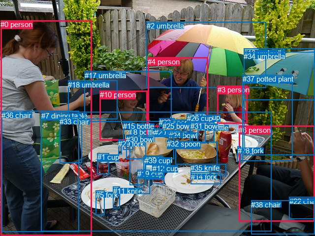
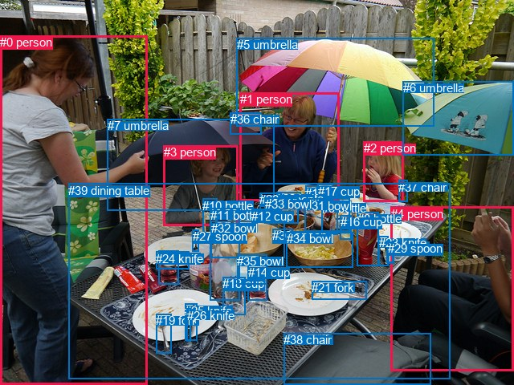

# 图片 0673：2345745.jpg

随机样本序号：283。图片 SHA256：`c34482da7ff6fc53d5e78dc433cc673ab601757761e07948f15450cc8214a483`。

红色框表示人，蓝色框表示其他物体。两个模式分别保留自身框编号，可依据位置比较对应对象。

## 自动检测框与输出

人的框编号：`[0, 3, 4, 6, 10]`。状态：`ok`。

### 自动检测全部物体框

| 编号 | 类别 | 是否为人 | 检测分数 | 像素坐标 xyxy |
|---|---|---|---|---|
| 0 | person | True | 0.9995 | 1.1, 41.4, 186.0, 480.0 |
| 1 | cup | False | 0.9978 | 197.6, 311.5, 221.1, 354.2 |
| 2 | umbrella | False | 0.9955 | 297.6, 44.5, 540.3, 178.1 |
| 3 | person | True | 0.9942 | 441.7, 174.2, 502.9, 251.1 |
| 4 | person | True | 0.9939 | 300.1, 116.7, 422.4, 257.8 |
| 5 | fork | False | 0.9936 | 194.9, 387.8, 212.3, 438.0 |
| 6 | person | True | 0.9907 | 485.2, 255.9, 639.2, 450.2 |
| 7 | dining table | False | 0.9906 | 84.0, 227.4, 551.3, 470.0 |
| 8 | bottle | False | 0.9891 | 263.4, 260.4, 296.2, 376.7 |
| 9 | bowl | False | 0.9880 | 356.4, 288.0, 441.4, 334.8 |
| 10 | person | True | 0.9879 | 203.0, 184.2, 299.9, 285.7 |
| 11 | knife | False | 0.9785 | 229.9, 379.6, 243.8, 423.6 |
| 12 | cup | False | 0.9775 | 309.8, 333.5, 333.8, 374.9 |
| 13 | umbrella | False | 0.9741 | 495.4, 98.7, 640.0, 203.2 |
| 14 | fork | False | 0.9521 | 387.8, 350.8, 448.3, 374.6 |
| 15 | bottle | False | 0.9399 | 250.0, 248.4, 269.9, 304.1 |
| 16 | cup | False | 0.9295 | 395.4, 230.2, 415.7, 248.9 |
| 17 | umbrella | False | 0.9275 | 171.7, 144.8, 348.3, 247.1 |
| 18 | umbrella | False | 0.9194 | 138.4, 163.6, 238.5, 242.8 |
| 19 | cup | False | 0.9160 | 279.5, 345.3, 304.4, 394.2 |
| 20 | cup | False | 0.8997 | 313.2, 261.1, 331.5, 278.7 |
| 21 | bottle | False | 0.8844 | 401.3, 251.3, 417.0, 291.2 |
| 22 | chair | False | 0.8773 | 587.5, 400.6, 640.0, 445.2 |
| 23 | spoon | False | 0.8330 | 323.1, 240.5, 354.1, 266.1 |
| 24 | bowl | False | 0.8027 | 342.7, 266.6, 391.7, 293.0 |
| 25 | bowl | False | 0.7959 | 330.1, 247.7, 374.1, 278.8 |
| 26 | cup | False | 0.7913 | 379.7, 232.3, 395.8, 253.8 |
| 27 | bowl | False | 0.7897 | 291.7, 317.1, 332.0, 357.0 |
| 28 | fork | False | 0.7822 | 482.7, 297.8, 489.5, 328.1 |
| 29 | fork | False | 0.7627 | 240.1, 283.5, 247.9, 313.6 |
| 30 | bowl | False | 0.7299 | 256.0, 274.9, 353.3, 324.0 |
| 31 | bowl | False | 0.7296 | 386.6, 248.4, 435.2, 289.6 |
| 32 | spoon | False | 0.6760 | 339.2, 284.1, 363.0, 302.8 |
| 33 | chair | False | 0.6591 | 121.3, 238.8, 166.7, 331.7 |
| 34 | umbrella | False | 0.6543 | 495.4, 105.7, 639.7, 315.9 |
| 35 | knife | False | 0.6448 | 387.3, 333.1, 459.9, 356.8 |
| 36 | chair | False | 0.6366 | 3.2, 225.7, 160.8, 471.3 |
| 37 | potted plant | False | 0.6206 | 492.7, 152.3, 594.5, 327.2 |
| 38 | chair | False | 0.6108 | 510.0, 407.9, 639.6, 476.7 |
| 39 | cup | False | 0.5532 | 294.2, 318.1, 331.8, 364.1 |

### 自动检测 Top50 人相关候选

评分物体对：1560；人相关物体对：370；输出关系：50。

| 排名 | 主语编号与类别 | 关系 | 宾语编号与类别 | 类型 | 人与人 | 排序分数 | 原始融合 logit |
|---|---|---|---|---|---|---|---|
| 1 | #0 person | holding | #18 umbrella | semantic | False | 0.99445 | 5.1892 |
| 2 | #0 person | wearing | #36 chair | semantic | False | 0.99425 | 5.1525 |
| 3 | #4 person | holding | #2 umbrella | semantic | False | 0.99025 | 4.6202 |
| 4 | #6 person | sitting on | #22 chair | semantic | False | 0.98974 | 4.5690 |
| 5 | #0 person | holding | #17 umbrella | semantic | False | 0.98733 | 4.3561 |
| 6 | #6 person | sitting on | #38 chair | semantic | False | 0.98714 | 4.3409 |
| 7 | #4 person | holding | #17 umbrella | semantic | False | 0.98061 | 3.9234 |
| 8 | #0 person | in | #36 chair | spatial | False | 0.97794 | 3.7915 |
| 9 | #10 person | holding | #17 umbrella | semantic | False | 0.97740 | 3.7667 |
| 10 | #10 person | holding | #18 umbrella | semantic | False | 0.97676 | 3.7385 |
| 11 | #4 person | holding | #23 spoon | semantic | False | 0.96070 | 3.1963 |
| 12 | #0 person | leaning on | #33 chair | spatial | False | 0.95047 | 2.9543 |
| 13 | #3 person | holding | #13 umbrella | semantic | False | 0.94540 | 2.8515 |
| 14 | #10 person | holding | #15 bottle | semantic | False | 0.94235 | 2.7940 |
| 15 | #6 person | on | #38 chair | spatial | False | 0.94068 | 2.7636 |
| 16 | #3 person | holding | #2 umbrella | semantic | False | 0.93414 | 2.6520 |
| 17 | #6 person | on | #22 chair | spatial | False | 0.92878 | 2.5681 |
| 18 | #3 person | eating | #34 umbrella | semantic | False | 0.92588 | 2.5251 |
| 19 | #10 person | sitting on | #7 dining table | semantic | False | 0.92238 | 2.4751 |
| 20 | #6 person | sitting on | #7 dining table | semantic | False | 0.92064 | 2.4511 |
| 21 | #0 person | standing on | #7 dining table | semantic | False | 0.91584 | 2.3872 |
| 22 | #3 person | sitting on | #7 dining table | semantic | False | 0.89959 | 2.1927 |
| 23 | #4 person | eating | #7 dining table | semantic | False | 0.88888 | 2.0794 |
| 24 | #4 person | in | #7 dining table | spatial | False | 0.87484 | 1.9444 |
| 25 | #10 person | in | #7 dining table | spatial | False | 0.85864 | 1.8040 |
| 26 | #3 person | eating | #37 potted plant | semantic | False | 0.85436 | 1.7692 |
| 27 | #0 person | sitting on | #33 chair | semantic | False | 0.84770 | 1.7167 |
| 28 | #6 person | holding | #34 umbrella | semantic | False | 0.84499 | 1.6958 |
| 29 | #6 person | holding | #28 fork | semantic | False | 0.83427 | 1.6162 |
| 30 | #4 person | holding | #18 umbrella | semantic | False | 0.82334 | 1.5391 |
| 31 | #4 person | talking to | #10 person | semantic | True | 0.82063 | 1.5206 |
| 32 | #6 person | holding | #13 umbrella | semantic | False | 0.79864 | 1.3778 |
| 33 | #3 person | on | #7 dining table | spatial | False | 0.79570 | 1.3596 |
| 34 | #10 person | sitting on | #33 chair | semantic | False | 0.79284 | 1.3421 |
| 35 | #6 person | beside | #7 dining table | spatial | False | 0.78191 | 1.2768 |
| 36 | #4 person | holding | #16 cup | semantic | False | 0.78018 | 1.2667 |
| 37 | #4 person | holding | #13 umbrella | semantic | False | 0.77027 | 1.2098 |
| 38 | #0 person | on | #7 dining table | spatial | False | 0.76972 | 1.2068 |
| 39 | #0 person | on | #18 umbrella | spatial | False | 0.75890 | 1.1466 |
| 40 | #4 person | talking to | #3 person | semantic | True | 0.74875 | 1.0919 |
| 41 | #0 person | holding | #2 umbrella | semantic | False | 0.68769 | 0.7893 |
| 42 | #4 person | eating | #25 bowl | semantic | False | 0.68553 | 0.7793 |
| 43 | #4 person | in | #2 umbrella | spatial | False | 0.66571 | 0.6889 |
| 44 | #4 person | holding | #26 cup | semantic | False | 0.64610 | 0.6019 |
| 45 | #10 person | in | #17 umbrella | spatial | False | 0.59668 | 0.3916 |
| 46 | #3 person | looking at | #4 person | semantic | True | 0.59609 | 0.3892 |
| 47 | #0 person | holding | #13 umbrella | semantic | False | 0.59175 | 0.3712 |
| 48 | #10 person | in | #15 bottle | spatial | False | 0.56962 | 0.2803 |
| 49 | #3 person | in | #34 umbrella | spatial | False | 0.56842 | 0.2754 |
| 50 | #3 person | beside | #37 potted plant | spatial | False | 0.55840 | 0.2347 |

### 自动检测逐条人相关 GT 核验

R@50：50.00%；命中 3/6。

| GT 主语编号 | GT 关系 | GT 宾语编号 | 结果阶段 | 匹配预测主语编号 | 匹配预测宾语编号 |
|---|---|---|---|---|---|
| 0 | looking at | 3 | rank_below50 | [0] | [10] |
| 0 | holding | 7 | hit50 | [0] | [17] |
| 1 | looking at | 3 | wrong_predicate | [4] | [10] |
| 1 | holding | 5 | hit50 | [4] | [2] |
| 2 | looking at | 3 | rank_below50 | [3] | [10] |
| 3 | holding | 7 | hit50 | [10] | [17] |

## 真实框与输出

人的框编号：`[0, 1, 2, 3, 4]`。

### 真实框全部物体框

| 编号 | 类别 | 是否为人 | 检测分数 | 像素坐标 xyxy |
|---|---|---|---|---|
| 0 | person | True | GT | 0.0, 44.0, 184.0, 480.0 |
| 1 | person | True | GT | 299.0, 115.0, 423.0, 250.0 |
| 2 | person | True | GT | 453.0, 176.0, 502.0, 251.0 |
| 3 | person | True | GT | 204.0, 181.0, 297.0, 282.0 |
| 4 | person | True | GT | 487.0, 258.0, 640.0, 463.0 |
| 5 | umbrella | False | GT | 295.0, 47.0, 541.0, 157.0 |
| 6 | umbrella | False | GT | 502.0, 101.0, 640.0, 193.0 |
| 7 | umbrella | False | GT | 134.0, 148.0, 341.0, 262.0 |
| 8 | bottle | False | GT | 445.0, 264.0, 472.0, 331.0 |
| 9 | bottle | False | GT | 401.0, 251.0, 421.0, 293.0 |
| 10 | bottle | False | GT | 252.0, 248.0, 270.0, 301.0 |
| 11 | bottle | False | GT | 262.0, 260.0, 299.0, 375.0 |
| 12 | cup | False | GT | 313.0, 261.0, 331.0, 277.0 |
| 13 | cup | False | GT | 198.0, 313.0, 222.0, 355.0 |
| 14 | cup | False | GT | 309.0, 331.0, 333.0, 375.0 |
| 15 | cup | False | GT | 380.0, 232.0, 395.0, 252.0 |
| 16 | cup | False | GT | 424.0, 268.0, 438.0, 298.0 |
| 17 | cup | False | GT | 396.0, 230.0, 415.0, 250.0 |
| 18 | cup | False | GT | 277.0, 345.0, 305.0, 392.0 |
| 19 | fork | False | GT | 194.0, 391.0, 213.0, 440.0 |
| 20 | fork | False | GT | 482.0, 299.0, 490.0, 328.0 |
| 21 | fork | False | GT | 388.0, 350.0, 456.0, 373.0 |
| 22 | knife | False | GT | 344.0, 239.0, 374.0, 248.0 |
| 23 | knife | False | GT | 472.0, 294.0, 483.0, 331.0 |
| 24 | knife | False | GT | 194.0, 314.0, 236.0, 336.0 |
| 25 | knife | False | GT | 230.0, 379.0, 245.0, 425.0 |
| 26 | knife | False | GT | 233.0, 385.0, 238.0, 426.0 |
| 27 | spoon | False | GT | 240.0, 286.0, 248.0, 313.0 |
| 28 | spoon | False | GT | 323.0, 240.0, 350.0, 262.0 |
| 29 | spoon | False | GT | 483.0, 301.0, 490.0, 328.0 |
| 30 | spoon | False | GT | 339.0, 285.0, 364.0, 303.0 |
| 31 | bowl | False | GT | 380.0, 248.0, 436.0, 289.0 |
| 32 | bowl | False | GT | 263.0, 276.0, 355.0, 322.0 |
| 33 | bowl | False | GT | 330.0, 246.0, 372.0, 278.0 |
| 34 | bowl | False | GT | 357.0, 289.0, 440.0, 333.0 |
| 35 | bowl | False | GT | 295.0, 317.0, 332.0, 354.0 |
| 36 | chair | False | GT | 287.0, 140.0, 326.0, 167.0 |
| 37 | chair | False | GT | 496.0, 225.0, 507.0, 252.0 |
| 38 | chair | False | GT | 353.0, 415.0, 536.0, 480.0 |
| 39 | dining table | False | GT | 85.0, 229.0, 561.0, 472.0 |

### 真实框 Top50 人相关候选

评分物体对：1560；人相关物体对：370；输出关系：50。

| 排名 | 主语编号与类别 | 关系 | 宾语编号与类别 | 类型 | 人与人 | 排序分数 | 原始融合 logit |
|---|---|---|---|---|---|---|---|
| 1 | #0 person | holding | #7 umbrella | semantic | False | 0.99372 | 5.0645 |
| 2 | #2 person | wearing | #37 chair | semantic | False | 0.99065 | 4.6635 |
| 3 | #1 person | holding | #5 umbrella | semantic | False | 0.98893 | 4.4923 |
| 4 | #1 person | holding | #7 umbrella | semantic | False | 0.98302 | 4.0584 |
| 5 | #4 person | sitting on | #38 chair | semantic | False | 0.97248 | 3.5648 |
| 6 | #3 person | holding | #7 umbrella | semantic | False | 0.97041 | 3.4905 |
| 7 | #2 person | in | #37 chair | spatial | False | 0.95354 | 3.0216 |
| 8 | #4 person | sitting on | #39 dining table | semantic | False | 0.93872 | 2.7290 |
| 9 | #3 person | holding | #10 bottle | semantic | False | 0.93855 | 2.7260 |
| 10 | #1 person | holding | #28 spoon | semantic | False | 0.93565 | 2.6769 |
| 11 | #3 person | sitting on | #39 dining table | semantic | False | 0.92493 | 2.5112 |
| 12 | #0 person | standing on | #39 dining table | semantic | False | 0.92444 | 2.5043 |
| 13 | #2 person | holding | #6 umbrella | semantic | False | 0.91991 | 2.4412 |
| 14 | #1 person | holding | #36 chair | semantic | False | 0.91604 | 2.3897 |
| 15 | #2 person | holding | #5 umbrella | semantic | False | 0.91363 | 2.3588 |
| 16 | #2 person | sitting on | #39 dining table | semantic | False | 0.89712 | 2.1656 |
| 17 | #1 person | eating | #39 dining table | semantic | False | 0.89661 | 2.1602 |
| 18 | #4 person | holding | #6 umbrella | semantic | False | 0.88970 | 2.0877 |
| 19 | #4 person | on | #38 chair | spatial | False | 0.88874 | 2.0780 |
| 20 | #1 person | in | #39 dining table | spatial | False | 0.87520 | 1.9477 |
| 21 | #3 person | in | #39 dining table | spatial | False | 0.86694 | 1.8742 |
| 22 | #1 person | eating | #22 knife | semantic | False | 0.86063 | 1.8206 |
| 23 | #4 person | beside | #39 dining table | spatial | False | 0.85220 | 1.7519 |
| 24 | #0 person | in | #39 dining table | spatial | False | 0.83121 | 1.5942 |
| 25 | #1 person | talking to | #3 person | semantic | True | 0.81884 | 1.5085 |
| 26 | #0 person | holding | #5 umbrella | semantic | False | 0.81162 | 1.4606 |
| 27 | #1 person | holding | #6 umbrella | semantic | False | 0.79672 | 1.3659 |
| 28 | #4 person | holding | #29 spoon | semantic | False | 0.77466 | 1.2348 |
| 29 | #4 person | holding | #20 fork | semantic | False | 0.77248 | 1.2224 |
| 30 | #2 person | on | #39 dining table | spatial | False | 0.76883 | 1.2017 |
| 31 | #1 person | holding | #17 cup | semantic | False | 0.73298 | 1.0098 |
| 32 | #1 person | in | #5 umbrella | spatial | False | 0.69263 | 0.8124 |
| 33 | #0 person | holding | #6 umbrella | semantic | False | 0.66486 | 0.6850 |
| 34 | #1 person | talking to | #2 person | semantic | True | 0.66178 | 0.6712 |
| 35 | #0 person | in | #7 umbrella | spatial | False | 0.65157 | 0.6260 |
| 36 | #4 person | wearing | #37 chair | semantic | False | 0.63784 | 0.5660 |
| 37 | #1 person | wearing | #37 chair | semantic | False | 0.62750 | 0.5215 |
| 38 | #3 person | in | #10 bottle | spatial | False | 0.59605 | 0.3890 |
| 39 | #3 person | in | #7 umbrella | spatial | False | 0.57755 | 0.3127 |
| 40 | #1 person | holding | #33 bowl | semantic | False | 0.56769 | 0.2724 |
| 41 | #3 person | holding | #5 umbrella | semantic | False | 0.56277 | 0.2524 |
| 42 | #1 person | drinking | #15 cup | semantic | False | 0.54448 | 0.1784 |
| 43 | #1 person | in | #7 umbrella | spatial | False | 0.53880 | 0.1555 |
| 44 | #2 person | looking at | #1 person | semantic | True | 0.52883 | 0.1154 |
| 45 | #3 person | talking to | #1 person | semantic | True | 0.49955 | -0.0018 |
| 46 | #37 chair | on | #2 person | spatial | False | 0.48676 | -0.0530 |
| 47 | #2 person | in | #6 umbrella | spatial | False | 0.40458 | -0.3864 |
| 48 | #2 person | beside | #1 person | spatial | True | 0.40016 | -0.4048 |
| 49 | #3 person | eating | #32 bowl | semantic | False | 0.39696 | -0.4181 |
| 50 | #7 umbrella | over | #3 person | spatial | False | 0.39562 | -0.4238 |

### 真实框逐条人相关 GT 核验

R@50：50.00%；命中 3/6。

| GT 主语编号 | GT 关系 | GT 宾语编号 | 结果阶段 | 匹配预测主语编号 | 匹配预测宾语编号 |
|---|---|---|---|---|---|
| 0 | looking at | 3 | wrong_predicate | [0] | [3] |
| 0 | holding | 7 | hit50 | [0] | [7] |
| 1 | looking at | 3 | wrong_predicate | [1] | [3] |
| 1 | holding | 5 | hit50 | [1] | [5] |
| 2 | looking at | 3 | rank_below50 | [2] | [3] |
| 3 | holding | 7 | hit50 | [3] | [7] |

## 全部人相关 GT

| 主语编号与类别 | 关系 | 宾语编号与类别 |
|---|---|---|
| #0 person | looking at | #3 person |
| #0 person | holding | #7 umbrella |
| #1 person | looking at | #3 person |
| #1 person | holding | #5 umbrella |
| #2 person | looking at | #3 person |
| #3 person | holding | #7 umbrella |

原始记录、全部人相关物体对的两项预测与分项分数见 [逐图证据 JSON](../evidence/cases/0673.json)。全部56类 logits 保留于本机 HOR/output/random500/logits/。

<!-- HOR_COMPLETE_RESULTS -->

## 六组条件的完整输出对照

以下保留同一图片三种框与候选模式、两种谓词输出规则的全部 Top50。框编号各自在所属模式内解释。

### 自动检测框完整枚举：空间与语义各保留一个谓词

| 排名 | 主语编号与类别 | 谓词 | 宾语编号与类别 | 分组 | 排序分数 | predicate logit | pair logit |
|---|---|---|---|---|---|---|---|
| 1 | #0 person | holding | #18 umbrella | semantic | 0.9944547 | 5.0172839 | 0.1719585 |
| 2 | #0 person | wearing | #36 chair | semantic | 0.9942482 | 4.8093209 | 0.3431541 |
| 3 | #4 person | holding | #2 umbrella | semantic | 0.9902451 | 4.3327403 | 0.2874472 |
| 4 | #6 person | sitting on | #22 chair | semantic | 0.9897380 | 4.0506577 | 0.5183408 |
| 5 | #0 person | holding | #17 umbrella | semantic | 0.9873339 | 4.7362924 | -0.3802147 |
| 6 | #6 person | sitting on | #38 chair | semantic | 0.9871429 | 3.9904761 | 0.3504412 |
| 7 | #4 person | holding | #17 umbrella | semantic | 0.9806094 | 4.2064672 | -0.2830854 |
| 8 | #0 person | in | #36 chair | spatial | 0.9779370 | 3.4483914 | 0.3431541 |
| 9 | #10 person | holding | #17 umbrella | semantic | 0.9773951 | 3.7722754 | -0.0055506 |
| 10 | #10 person | holding | #18 umbrella | semantic | 0.9767630 | 3.9576325 | -0.2191370 |
| 11 | #4 person | holding | #23 spoon | semantic | 0.9606966 | 3.3715987 | -0.1752491 |
| 12 | #0 person | leaning on | #33 chair | spatial | 0.9504678 | 3.4917750 | -0.5374440 |
| 13 | #3 person | holding | #13 umbrella | semantic | 0.9453971 | 3.1209865 | -0.2694688 |
| 14 | #10 person | holding | #15 bottle | semantic | 0.9423503 | 2.7210674 | 0.0729251 |
| 15 | #6 person | on | #38 chair | spatial | 0.9406754 | 2.4131322 | 0.3504412 |
| 16 | #3 person | holding | #2 umbrella | semantic | 0.9341360 | 3.0855360 | -0.4335048 |
| 17 | #6 person | on | #22 chair | spatial | 0.9287775 | 2.0497203 | 0.5183408 |
| 18 | #3 person | eating | #34 umbrella | semantic | 0.9258848 | 2.9863176 | -0.4611890 |
| 19 | #10 person | sitting on | #7 dining table | semantic | 0.9223773 | 2.8228774 | -0.3477831 |
| 20 | #6 person | sitting on | #7 dining table | semantic | 0.9206395 | 2.7807212 | -0.3296545 |
| 21 | #0 person | standing on | #7 dining table | semantic | 0.9158436 | 2.7386241 | -0.3514558 |
| 22 | #3 person | sitting on | #7 dining table | semantic | 0.8995895 | 2.7145615 | -0.5218900 |
| 23 | #4 person | eating | #7 dining table | semantic | 0.8888817 | 2.4398470 | -0.3604775 |
| 24 | #4 person | in | #7 dining table | spatial | 0.8748398 | 2.3049235 | -0.3604775 |
| 25 | #10 person | in | #7 dining table | spatial | 0.8586391 | 2.1518159 | -0.3477831 |
| 26 | #3 person | eating | #37 potted plant | semantic | 0.8543563 | 2.3989749 | -0.6297904 |
| 27 | #0 person | sitting on | #33 chair | semantic | 0.8477018 | 2.2541323 | -0.5374440 |
| 28 | #6 person | holding | #34 umbrella | semantic | 0.8449914 | 2.4578810 | -0.7620354 |
| 29 | #6 person | holding | #28 fork | semantic | 0.8342713 | 2.3584561 | -0.7422498 |
| 30 | #4 person | holding | #18 umbrella | semantic | 0.8233352 | 2.3625875 | -0.8234781 |
| 31 | #4 person | talking to | #10 person | semantic | 0.8206275 | 2.6017818 | -1.0811775 |
| 32 | #6 person | holding | #13 umbrella | semantic | 0.7986383 | 1.8010235 | -0.4232177 |
| 33 | #3 person | on | #7 dining table | spatial | 0.7956980 | 1.8815103 | -0.5218900 |
| 34 | #10 person | sitting on | #33 chair | semantic | 0.7928377 | 1.6042056 | -0.2620900 |
| 35 | #6 person | beside | #7 dining table | spatial | 0.7819054 | 1.6064591 | -0.3296545 |
| 36 | #4 person | holding | #16 cup | semantic | 0.7801800 | 1.7841868 | -0.5174711 |
| 37 | #4 person | holding | #13 umbrella | semantic | 0.7702700 | 1.7543049 | -0.5444684 |
| 38 | #0 person | on | #7 dining table | spatial | 0.7697243 | 1.5582108 | -0.3514558 |
| 39 | #0 person | on | #18 umbrella | spatial | 0.7588983 | 0.9746904 | 0.1719585 |
| 40 | #4 person | talking to | #3 person | semantic | 0.7487469 | 1.8935981 | -0.8016577 |
| 41 | #0 person | holding | #2 umbrella | semantic | 0.6876892 | 1.3642163 | -0.5748780 |
| 42 | #4 person | eating | #25 bowl | semantic | 0.6855298 | 1.1509118 | -0.3716093 |
| 43 | #4 person | in | #2 umbrella | spatial | 0.6657113 | 0.4014039 | 0.2874472 |
| 44 | #4 person | holding | #26 cup | semantic | 0.6460994 | 1.1116695 | -0.5097319 |
| 45 | #10 person | in | #17 umbrella | spatial | 0.5966784 | 0.3971949 | -0.0055506 |
| 46 | #3 person | looking at | #4 person | semantic | 0.5960886 | 1.3480911 | -0.9588972 |
| 47 | #0 person | holding | #13 umbrella | semantic | 0.5917544 | 1.1766233 | -0.8054007 |
| 48 | #10 person | in | #15 bottle | spatial | 0.5696207 | 0.2073789 | 0.0729251 |
| 49 | #3 person | in | #34 umbrella | spatial | 0.5684250 | 0.7366171 | -0.4611890 |
| 50 | #3 person | beside | #37 potted plant | spatial | 0.5584024 | 0.8644710 | -0.6297904 |

GT 命中：3/6，R@50=50.00%。

| GT主语 | GT谓词 | GT宾语 | 结果阶段 | 匹配主语框 | 匹配宾语框 |
|---|---|---|---|---|---|
| 0 | looking at | 3 | rank_below50 | [0] | [10] |
| 0 | holding | 7 | hit50 | [0] | [17] |
| 1 | looking at | 3 | wrong_predicate | [4] | [10] |
| 1 | holding | 5 | hit50 | [4] | [2] |
| 2 | looking at | 3 | rank_below50 | [3] | [10] |
| 3 | holding | 7 | hit50 | [10] | [17] |

### 自动检测框完整枚举：每对只保留一个谓词

| 排名 | 主语编号与类别 | 谓词 | 宾语编号与类别 | 分组 | 排序分数 | predicate logit | pair logit |
|---|---|---|---|---|---|---|---|
| 1 | #0 person | holding | #18 umbrella | single | 0.9944547 | 5.0172839 | 0.1719585 |
| 2 | #0 person | wearing | #36 chair | single | 0.9942482 | 4.8093209 | 0.3431541 |
| 3 | #4 person | holding | #2 umbrella | single | 0.9902451 | 4.3327403 | 0.2874472 |
| 4 | #6 person | sitting on | #22 chair | single | 0.9897380 | 4.0506577 | 0.5183408 |
| 5 | #0 person | holding | #17 umbrella | single | 0.9873339 | 4.7362924 | -0.3802147 |
| 6 | #6 person | sitting on | #38 chair | single | 0.9871429 | 3.9904761 | 0.3504412 |
| 7 | #4 person | holding | #17 umbrella | single | 0.9806094 | 4.2064672 | -0.2830854 |
| 8 | #10 person | holding | #17 umbrella | single | 0.9773951 | 3.7722754 | -0.0055506 |
| 9 | #10 person | holding | #18 umbrella | single | 0.9767630 | 3.9576325 | -0.2191370 |
| 10 | #4 person | holding | #23 spoon | single | 0.9606966 | 3.3715987 | -0.1752491 |
| 11 | #0 person | leaning on | #33 chair | single | 0.9504678 | 3.4917750 | -0.5374440 |
| 12 | #3 person | holding | #13 umbrella | single | 0.9453971 | 3.1209865 | -0.2694688 |
| 13 | #10 person | holding | #15 bottle | single | 0.9423503 | 2.7210674 | 0.0729251 |
| 14 | #3 person | holding | #2 umbrella | single | 0.9341360 | 3.0855360 | -0.4335048 |
| 15 | #3 person | eating | #34 umbrella | single | 0.9258848 | 2.9863176 | -0.4611890 |
| 16 | #10 person | sitting on | #7 dining table | single | 0.9223773 | 2.8228774 | -0.3477831 |
| 17 | #6 person | sitting on | #7 dining table | single | 0.9206395 | 2.7807212 | -0.3296545 |
| 18 | #0 person | standing on | #7 dining table | single | 0.9158436 | 2.7386241 | -0.3514558 |
| 19 | #3 person | sitting on | #7 dining table | single | 0.8995895 | 2.7145615 | -0.5218900 |
| 20 | #4 person | eating | #7 dining table | single | 0.8888817 | 2.4398470 | -0.3604775 |
| 21 | #3 person | eating | #37 potted plant | single | 0.8543563 | 2.3989749 | -0.6297904 |
| 22 | #6 person | holding | #34 umbrella | single | 0.8449914 | 2.4578810 | -0.7620354 |
| 23 | #6 person | holding | #28 fork | single | 0.8342713 | 2.3584561 | -0.7422498 |
| 24 | #4 person | holding | #18 umbrella | single | 0.8233352 | 2.3625875 | -0.8234781 |
| 25 | #4 person | talking to | #10 person | single | 0.8206275 | 2.6017818 | -1.0811775 |
| 26 | #6 person | holding | #13 umbrella | single | 0.7986383 | 1.8010235 | -0.4232177 |
| 27 | #10 person | sitting on | #33 chair | single | 0.7928377 | 1.6042056 | -0.2620900 |
| 28 | #4 person | holding | #16 cup | single | 0.7801800 | 1.7841868 | -0.5174711 |
| 29 | #4 person | holding | #13 umbrella | single | 0.7702700 | 1.7543049 | -0.5444684 |
| 30 | #4 person | talking to | #3 person | single | 0.7487469 | 1.8935981 | -0.8016577 |
| 31 | #0 person | holding | #2 umbrella | single | 0.6876892 | 1.3642163 | -0.5748780 |
| 32 | #4 person | eating | #25 bowl | single | 0.6855298 | 1.1509118 | -0.3716093 |
| 33 | #4 person | holding | #26 cup | single | 0.6460994 | 1.1116695 | -0.5097319 |
| 34 | #3 person | looking at | #4 person | single | 0.5960886 | 1.3480911 | -0.9588972 |
| 35 | #0 person | holding | #13 umbrella | single | 0.5917544 | 1.1766233 | -0.8054007 |
| 36 | #10 person | eating | #30 bowl | single | 0.5115359 | 0.9187098 | -0.8725578 |
| 37 | #10 person | holding | #2 umbrella | single | 0.4999684 | 0.8561692 | -0.8562956 |
| 38 | #10 person | talking to | #4 person | single | 0.4754688 | 1.1381903 | -1.2363940 |
| 39 | #36 chair | on | #0 person | single | 0.4729190 | 0.7813120 | -0.8897419 |
| 40 | #10 person | holding | #29 fork | single | 0.4612210 | 0.4985371 | -0.6539652 |
| 41 | #4 person | holding | #34 umbrella | single | 0.4524095 | 0.7604055 | -0.9513454 |
| 42 | #3 person | sitting on | #22 chair | single | 0.4261263 | 0.4908462 | -0.7885196 |
| 43 | #17 umbrella | over | #10 person | single | 0.4090081 | 0.7106352 | -1.0787028 |
| 44 | #33 chair | beside | #0 person | single | 0.3831612 | 0.1946864 | -0.6708385 |
| 45 | #3 person | sitting on | #38 chair | single | 0.3796950 | 0.4547143 | -0.9455574 |
| 46 | #4 person | eating | #31 bowl | single | 0.3535740 | 0.1471190 | -0.7504849 |
| 47 | #10 person | sitting on | #38 chair | single | 0.3498821 | 0.3855343 | -1.0050917 |
| 48 | #6 person | holding | #14 fork | single | 0.3325290 | 0.3702374 | -1.0670061 |
| 49 | #2 umbrella | over | #4 person | single | 0.3302725 | 0.4989896 | -1.2059423 |
| 50 | #15 bottle | on | #10 person | single | 0.3241989 | -0.1529651 | -0.5815765 |

GT 命中：3/6，R@50=50.00%。

| GT主语 | GT谓词 | GT宾语 | 结果阶段 | 匹配主语框 | 匹配宾语框 |
|---|---|---|---|---|---|
| 0 | looking at | 3 | rank_below50 | [0] | [10] |
| 0 | holding | 7 | hit50 | [0] | [17] |
| 1 | looking at | 3 | wrong_predicate | [4] | [10] |
| 1 | holding | 5 | hit50 | [4] | [2] |
| 2 | looking at | 3 | rank_below50 | [3] | [10] |
| 3 | holding | 7 | hit50 | [10] | [17] |

### 真实框完整枚举：空间与语义各保留一个谓词

| 排名 | 主语编号与类别 | 谓词 | 宾语编号与类别 | 分组 | 排序分数 | predicate logit | pair logit |
|---|---|---|---|---|---|---|---|
| 1 | #0 person | holding | #7 umbrella | semantic | 0.9937225 | 5.2295699 | -0.1650786 |
| 2 | #2 person | wearing | #37 chair | semantic | 0.9906546 | 3.9359231 | 0.7275703 |
| 3 | #1 person | holding | #5 umbrella | semantic | 0.9889296 | 4.2182841 | 0.2740586 |
| 4 | #1 person | holding | #7 umbrella | semantic | 0.9830173 | 4.4412885 | -0.3828547 |
| 5 | #4 person | sitting on | #38 chair | semantic | 0.9724753 | 3.8339953 | -0.2692347 |
| 6 | #3 person | holding | #7 umbrella | semantic | 0.9704150 | 3.5315442 | -0.0410888 |
| 7 | #2 person | in | #37 chair | spatial | 0.9535425 | 2.2940769 | 0.7275703 |
| 8 | #4 person | sitting on | #39 dining table | semantic | 0.9387159 | 3.0335007 | -0.3045073 |
| 9 | #3 person | holding | #10 bottle | semantic | 0.9385455 | 2.6213818 | 0.1046522 |
| 10 | #1 person | holding | #28 spoon | semantic | 0.9356507 | 2.8369617 | -0.1600462 |
| 11 | #3 person | sitting on | #39 dining table | semantic | 0.9249264 | 2.8589935 | -0.3477479 |
| 12 | #0 person | standing on | #39 dining table | semantic | 0.9244444 | 2.8561311 | -0.3518072 |
| 13 | #2 person | holding | #6 umbrella | semantic | 0.9199131 | 2.6572518 | -0.2160850 |
| 14 | #1 person | holding | #36 chair | semantic | 0.9160377 | 3.3687234 | -0.9790332 |
| 15 | #2 person | holding | #5 umbrella | semantic | 0.9136300 | 2.8340864 | -0.4753007 |
| 16 | #2 person | sitting on | #39 dining table | semantic | 0.8971188 | 2.6754417 | -0.5098287 |
| 17 | #1 person | eating | #39 dining table | semantic | 0.8966145 | 2.5505571 | -0.3903956 |
| 18 | #4 person | holding | #6 umbrella | semantic | 0.8896994 | 2.5616188 | -0.4739448 |
| 19 | #4 person | on | #38 chair | spatial | 0.8887444 | 2.3472147 | -0.2692347 |
| 20 | #1 person | in | #39 dining table | spatial | 0.8751974 | 2.3381109 | -0.3903956 |
| 21 | #3 person | in | #39 dining table | spatial | 0.8669443 | 2.2219553 | -0.3477479 |
| 22 | #1 person | eating | #22 knife | semantic | 0.8606323 | 2.1265445 | -0.3059931 |
| 23 | #4 person | beside | #39 dining table | spatial | 0.8521965 | 2.0564404 | -0.3045073 |
| 24 | #0 person | in | #39 dining table | spatial | 0.8312100 | 1.9460340 | -0.3518072 |
| 25 | #1 person | talking to | #3 person | semantic | 0.8188437 | 2.6326241 | -1.1240910 |
| 26 | #0 person | holding | #5 umbrella | semantic | 0.8116238 | 2.0409951 | -0.5803994 |
| 27 | #1 person | holding | #6 umbrella | semantic | 0.7967182 | 1.9224868 | -0.5565785 |
| 28 | #4 person | holding | #29 spoon | semantic | 0.7746559 | 1.9781580 | -0.7433680 |
| 29 | #4 person | holding | #20 fork | semantic | 0.7724812 | 1.9722495 | -0.7498747 |
| 30 | #2 person | on | #39 dining table | spatial | 0.7688332 | 1.7115631 | -0.5098287 |
| 31 | #1 person | holding | #17 cup | semantic | 0.7329832 | 1.5257311 | -0.5159203 |
| 32 | #1 person | in | #5 umbrella | spatial | 0.6926253 | 0.5383630 | 0.2740586 |
| 33 | #0 person | holding | #6 umbrella | semantic | 0.6648552 | 1.5268292 | -0.8418227 |
| 34 | #1 person | talking to | #2 person | semantic | 0.6617779 | 1.5347543 | -0.8635271 |
| 35 | #0 person | in | #7 umbrella | spatial | 0.6515714 | 0.7910323 | -0.1650786 |
| 36 | #4 person | wearing | #37 chair | semantic | 0.6378401 | 1.1219435 | -0.5559418 |
| 37 | #1 person | wearing | #37 chair | semantic | 0.6275045 | 0.7226338 | -0.2011078 |
| 38 | #3 person | in | #10 bottle | spatial | 0.5960492 | 0.2843781 | 0.1046522 |
| 39 | #3 person | in | #7 umbrella | spatial | 0.5775539 | 0.3538284 | -0.0410888 |
| 40 | #1 person | holding | #33 bowl | semantic | 0.5676863 | 0.6314774 | -0.3590598 |
| 41 | #3 person | holding | #5 umbrella | semantic | 0.5627716 | 1.0987549 | -0.8463366 |
| 42 | #1 person | drinking | #15 cup | semantic | 0.5444809 | 0.6904597 | -0.5120646 |
| 43 | #1 person | in | #7 umbrella | spatial | 0.5387989 | 0.5383630 | -0.3828547 |
| 44 | #2 person | looking at | #1 person | semantic | 0.5288253 | 1.0835447 | -0.9681156 |
| 45 | #3 person | talking to | #1 person | semantic | 0.4995514 | 1.2297149 | -1.2315094 |
| 46 | #37 chair | on | #2 person | spatial | 0.4867570 | 0.8853426 | -0.9383270 |
| 47 | #2 person | in | #6 umbrella | spatial | 0.4045807 | -0.1703296 | -0.2160850 |
| 48 | #2 person | beside | #1 person | spatial | 0.4001626 | 0.5633278 | -0.9681156 |
| 49 | #3 person | eating | #32 bowl | semantic | 0.3969642 | 0.4187450 | -0.8368754 |
| 50 | #7 umbrella | over | #3 person | spatial | 0.3956195 | 0.6193552 | -1.0431062 |

GT 命中：3/6，R@50=50.00%。

| GT主语 | GT谓词 | GT宾语 | 结果阶段 | 匹配主语框 | 匹配宾语框 |
|---|---|---|---|---|---|
| 0 | looking at | 3 | wrong_predicate | [0] | [3] |
| 0 | holding | 7 | hit50 | [0] | [7] |
| 1 | looking at | 3 | wrong_predicate | [1] | [3] |
| 1 | holding | 5 | hit50 | [1] | [5] |
| 2 | looking at | 3 | rank_below50 | [2] | [3] |
| 3 | holding | 7 | hit50 | [3] | [7] |

### 真实框完整枚举：每对只保留一个谓词

| 排名 | 主语编号与类别 | 谓词 | 宾语编号与类别 | 分组 | 排序分数 | predicate logit | pair logit |
|---|---|---|---|---|---|---|---|
| 1 | #0 person | holding | #7 umbrella | single | 0.9937225 | 5.2295699 | -0.1650786 |
| 2 | #2 person | wearing | #37 chair | single | 0.9906546 | 3.9359231 | 0.7275703 |
| 3 | #1 person | holding | #5 umbrella | single | 0.9889296 | 4.2182841 | 0.2740586 |
| 4 | #1 person | holding | #7 umbrella | single | 0.9830173 | 4.4412885 | -0.3828547 |
| 5 | #4 person | sitting on | #38 chair | single | 0.9724753 | 3.8339953 | -0.2692347 |
| 6 | #3 person | holding | #7 umbrella | single | 0.9704150 | 3.5315442 | -0.0410888 |
| 7 | #4 person | sitting on | #39 dining table | single | 0.9387159 | 3.0335007 | -0.3045073 |
| 8 | #3 person | holding | #10 bottle | single | 0.9385455 | 2.6213818 | 0.1046522 |
| 9 | #1 person | holding | #28 spoon | single | 0.9356507 | 2.8369617 | -0.1600462 |
| 10 | #3 person | sitting on | #39 dining table | single | 0.9249264 | 2.8589935 | -0.3477479 |
| 11 | #0 person | standing on | #39 dining table | single | 0.9244444 | 2.8561311 | -0.3518072 |
| 12 | #2 person | holding | #6 umbrella | single | 0.9199131 | 2.6572518 | -0.2160850 |
| 13 | #1 person | holding | #36 chair | single | 0.9160377 | 3.3687234 | -0.9790332 |
| 14 | #2 person | holding | #5 umbrella | single | 0.9136300 | 2.8340864 | -0.4753007 |
| 15 | #2 person | sitting on | #39 dining table | single | 0.8971188 | 2.6754417 | -0.5098287 |
| 16 | #1 person | eating | #39 dining table | single | 0.8966145 | 2.5505571 | -0.3903956 |
| 17 | #4 person | holding | #6 umbrella | single | 0.8896994 | 2.5616188 | -0.4739448 |
| 18 | #1 person | eating | #22 knife | single | 0.8606323 | 2.1265445 | -0.3059931 |
| 19 | #1 person | talking to | #3 person | single | 0.8188437 | 2.6326241 | -1.1240910 |
| 20 | #0 person | holding | #5 umbrella | single | 0.8116238 | 2.0409951 | -0.5803994 |
| 21 | #1 person | holding | #6 umbrella | single | 0.7967182 | 1.9224868 | -0.5565785 |
| 22 | #4 person | holding | #29 spoon | single | 0.7746559 | 1.9781580 | -0.7433680 |
| 23 | #4 person | holding | #20 fork | single | 0.7724812 | 1.9722495 | -0.7498747 |
| 24 | #1 person | holding | #17 cup | single | 0.7329832 | 1.5257311 | -0.5159203 |
| 25 | #0 person | holding | #6 umbrella | single | 0.6648552 | 1.5268292 | -0.8418227 |
| 26 | #1 person | talking to | #2 person | single | 0.6617779 | 1.5347543 | -0.8635271 |
| 27 | #4 person | wearing | #37 chair | single | 0.6378401 | 1.1219435 | -0.5559418 |
| 28 | #1 person | wearing | #37 chair | single | 0.6275045 | 0.7226338 | -0.2011078 |
| 29 | #1 person | holding | #33 bowl | single | 0.5676863 | 0.6314774 | -0.3590598 |
| 30 | #3 person | holding | #5 umbrella | single | 0.5627716 | 1.0987549 | -0.8463366 |
| 31 | #1 person | drinking | #15 cup | single | 0.5444809 | 0.6904597 | -0.5120646 |
| 32 | #2 person | looking at | #1 person | single | 0.5288253 | 1.0835447 | -0.9681156 |
| 33 | #3 person | talking to | #1 person | single | 0.4995514 | 1.2297149 | -1.2315094 |
| 34 | #37 chair | on | #2 person | single | 0.4867570 | 0.8853426 | -0.9383270 |
| 35 | #3 person | eating | #32 bowl | single | 0.3969642 | 0.4187450 | -0.8368754 |
| 36 | #7 umbrella | over | #3 person | single | 0.3956195 | 0.6193552 | -1.0431062 |
| 37 | #5 umbrella | over | #1 person | single | 0.3888847 | 0.7803879 | -1.2323906 |
| 38 | #4 person | holding | #21 fork | single | 0.3742020 | 0.5631514 | -1.0773835 |
| 39 | #3 person | sitting on | #38 chair | single | 0.3631515 | 0.4456854 | -1.0073972 |
| 40 | #1 person | eating | #31 bowl | single | 0.3202627 | -0.0266700 | -0.7258949 |
| 41 | #4 person | holding | #5 umbrella | single | 0.3157162 | 0.0459404 | -0.8194693 |
| 42 | #6 umbrella | over | #4 person | single | 0.3126530 | 0.0119863 | -0.7997317 |
| 43 | #10 bottle | on | #3 person | single | 0.3117687 | -0.2406611 | -0.5512023 |
| 44 | #36 chair | beside | #1 person | single | 0.2881238 | 0.0474391 | -0.9519531 |
| 45 | #3 person | holding | #6 umbrella | single | 0.2603600 | 0.0865216 | -1.1306198 |
| 46 | #2 person | sitting on | #38 chair | single | 0.2508746 | 0.0800676 | -1.1740209 |
| 47 | #2 person | drinking | #17 cup | single | 0.2318217 | -0.4730301 | -0.7250231 |
| 48 | #2 person | eating | #31 bowl | single | 0.2305912 | -0.3605700 | -0.8444059 |
| 49 | #2 person | holding | #20 fork | single | 0.2094873 | -0.8494709 | -0.4785478 |
| 50 | #6 umbrella | over | #2 person | single | 0.2046880 | 0.0953341 | -1.4525819 |

GT 命中：3/6，R@50=50.00%。

| GT主语 | GT谓词 | GT宾语 | 结果阶段 | 匹配主语框 | 匹配宾语框 |
|---|---|---|---|---|---|
| 0 | looking at | 3 | wrong_predicate | [0] | [3] |
| 0 | holding | 7 | hit50 | [0] | [7] |
| 1 | looking at | 3 | wrong_predicate | [1] | [3] |
| 1 | holding | 5 | hit50 | [1] | [5] |
| 2 | looking at | 3 | rank_below50 | [2] | [3] |
| 3 | holding | 7 | hit50 | [3] | [7] |

### 真实框400候选：空间与语义各保留一个谓词

| 排名 | 主语编号与类别 | 谓词 | 宾语编号与类别 | 分组 | 排序分数 | predicate logit | pair logit |
|---|---|---|---|---|---|---|---|
| 1 | #0 person | holding | #7 umbrella | semantic | 0.9935734 | 5.2059360 | -0.1650786 |
| 2 | #1 person | holding | #5 umbrella | semantic | 0.9889941 | 4.2241921 | 0.2740586 |
| 3 | #1 person | holding | #7 umbrella | semantic | 0.9807756 | 4.3150153 | -0.3828547 |
| 4 | #4 person | sitting on | #38 chair | semantic | 0.9717413 | 3.8069234 | -0.2692347 |
| 5 | #3 person | holding | #7 umbrella | semantic | 0.9695550 | 3.5020022 | -0.0410888 |
| 6 | #2 person | wearing | #37 chair | semantic | 0.9693898 | 2.7277632 | 0.7275703 |
| 7 | #1 person | eating | #22 knife | semantic | 0.9445447 | 3.1411185 | -0.3059931 |
| 8 | #4 person | sitting on | #39 dining table | semantic | 0.9435492 | 3.1207862 | -0.3045073 |
| 9 | #1 person | eating | #39 dining table | semantic | 0.9428301 | 3.1932549 | -0.3903956 |
| 10 | #3 person | sitting on | #39 dining table | semantic | 0.9347296 | 3.0094657 | -0.3477479 |
| 11 | #0 person | standing on | #39 dining table | semantic | 0.9340731 | 3.0028152 | -0.3518072 |
| 12 | #1 person | holding | #28 spoon | semantic | 0.9318129 | 2.7749228 | -0.1600462 |
| 13 | #2 person | sitting on | #39 dining table | semantic | 0.9077117 | 2.7958388 | -0.5098287 |
| 14 | #0 person | holding | #6 umbrella | semantic | 0.8992592 | 3.0308433 | -0.8418227 |
| 15 | #3 person | holding | #10 bottle | semantic | 0.8956725 | 2.0453873 | 0.1046522 |
| 16 | #2 person | holding | #6 umbrella | semantic | 0.8764191 | 2.1750336 | -0.2160850 |
| 17 | #2 person | in | #37 chair | spatial | 0.8744878 | 1.2136650 | 0.7275703 |
| 18 | #4 person | holding | #6 umbrella | semantic | 0.8722654 | 2.3950839 | -0.4739448 |
| 19 | #0 person | holding | #5 umbrella | semantic | 0.8626599 | 2.4179592 | -0.5803994 |
| 20 | #1 person | drinking | #17 cup | semantic | 0.8513834 | 2.2614131 | -0.5159203 |
| 21 | #1 person | holding | #6 umbrella | semantic | 0.8351406 | 2.1790857 | -0.5565785 |
| 22 | #1 person | holding | #36 chair | semantic | 0.8280495 | 2.5508995 | -0.9790332 |
| 23 | #4 person | on | #38 chair | spatial | 0.8244711 | 1.8161726 | -0.2692347 |
| 24 | #0 person | beside | #39 dining table | spatial | 0.8172564 | 1.8496757 | -0.3518072 |
| 25 | #4 person | beside | #39 dining table | spatial | 0.8147230 | 1.7855034 | -0.3045073 |
| 26 | #1 person | in | #39 dining table | spatial | 0.8119814 | 1.8533320 | -0.3903956 |
| 27 | #3 person | in | #39 dining table | spatial | 0.8042201 | 1.7606301 | -0.3477479 |
| 28 | #2 person | holding | #5 umbrella | semantic | 0.7653186 | 1.6573644 | -0.4753007 |
| 29 | #1 person | eating | #15 cup | semantic | 0.7440343 | 1.5791082 | -0.5120646 |
| 30 | #1 person | eating | #33 bowl | semantic | 0.6882288 | 1.1509118 | -0.3590598 |
| 31 | #1 person | talking to | #3 person | semantic | 0.6879052 | 1.9144349 | -1.1240910 |
| 32 | #2 person | on | #39 dining table | spatial | 0.6822482 | 1.2739515 | -0.5098287 |
| 33 | #3 person | holding | #6 umbrella | semantic | 0.6497901 | 1.7487364 | -1.1306198 |
| 34 | #1 person | in | #5 umbrella | spatial | 0.6283696 | 0.2511702 | 0.2740586 |
| 35 | #0 person | in | #7 umbrella | spatial | 0.6159518 | 0.6374793 | -0.1650786 |
| 36 | #1 person | eating | #31 bowl | semantic | 0.5324287 | 0.8557920 | -0.7258949 |
| 37 | #3 person | holding | #5 umbrella | semantic | 0.5205834 | 0.9287167 | -0.8463366 |
| 38 | #1 person | holding | #2 person | semantic | 0.5142351 | 0.9204831 | -0.8635271 |
| 39 | #3 person | in | #7 umbrella | spatial | 0.5130771 | 0.0934091 | -0.0410888 |
| 40 | #1 person | in | #7 umbrella | spatial | 0.4521799 | 0.1909881 | -0.3828547 |
| 41 | #4 person | holding | #5 umbrella | semantic | 0.4223515 | 0.5063419 | -0.8194693 |
| 42 | #2 person | looking at | #1 person | semantic | 0.3908469 | 0.5243621 | -0.9681156 |
| 43 | #7 umbrella | over | #3 person | spatial | 0.3846856 | 0.5733991 | -1.0431062 |
| 44 | #3 person | in | #10 bottle | spatial | 0.3801724 | -0.5934687 | 0.1046522 |
| 45 | #5 umbrella | over | #1 person | spatial | 0.3722067 | 0.7096291 | -1.2323906 |
| 46 | #4 person | holding | #7 umbrella | semantic | 0.3337547 | 0.7069802 | -1.3982317 |
| 47 | #2 person | beside | #1 person | spatial | 0.3166692 | 0.1989942 | -0.9681156 |
| 48 | #0 person | picking | #33 bowl | semantic | 0.2991843 | 0.8084359 | -1.6596212 |
| 49 | #4 person | holding | #21 fork | semantic | 0.2947022 | 0.2047286 | -1.0773835 |
| 50 | #3 person | talking to | #1 person | semantic | 0.2892499 | 0.3324795 | -1.2315094 |

GT 命中：3/6，R@50=50.00%。

| GT主语 | GT谓词 | GT宾语 | 结果阶段 | 匹配主语框 | 匹配宾语框 |
|---|---|---|---|---|---|
| 0 | looking at | 3 | wrong_predicate | [0] | [3] |
| 0 | holding | 7 | hit50 | [0] | [7] |
| 1 | looking at | 3 | wrong_predicate | [1] | [3] |
| 1 | holding | 5 | hit50 | [1] | [5] |
| 2 | looking at | 3 | rank_below50 | [2] | [3] |
| 3 | holding | 7 | hit50 | [3] | [7] |

### 真实框400候选：每对只保留一个谓词

| 排名 | 主语编号与类别 | 谓词 | 宾语编号与类别 | 分组 | 排序分数 | predicate logit | pair logit |
|---|---|---|---|---|---|---|---|
| 1 | #0 person | holding | #7 umbrella | single | 0.9935734 | 5.2059360 | -0.1650786 |
| 2 | #1 person | holding | #5 umbrella | single | 0.9889941 | 4.2241921 | 0.2740586 |
| 3 | #1 person | holding | #7 umbrella | single | 0.9807756 | 4.3150153 | -0.3828547 |
| 4 | #4 person | sitting on | #38 chair | single | 0.9717413 | 3.8069234 | -0.2692347 |
| 5 | #3 person | holding | #7 umbrella | single | 0.9695550 | 3.5020022 | -0.0410888 |
| 6 | #2 person | wearing | #37 chair | single | 0.9693898 | 2.7277632 | 0.7275703 |
| 7 | #1 person | eating | #22 knife | single | 0.9445447 | 3.1411185 | -0.3059931 |
| 8 | #4 person | sitting on | #39 dining table | single | 0.9435492 | 3.1207862 | -0.3045073 |
| 9 | #1 person | eating | #39 dining table | single | 0.9428301 | 3.1932549 | -0.3903956 |
| 10 | #3 person | sitting on | #39 dining table | single | 0.9347296 | 3.0094657 | -0.3477479 |
| 11 | #0 person | standing on | #39 dining table | single | 0.9340731 | 3.0028152 | -0.3518072 |
| 12 | #1 person | holding | #28 spoon | single | 0.9318129 | 2.7749228 | -0.1600462 |
| 13 | #2 person | sitting on | #39 dining table | single | 0.9077117 | 2.7958388 | -0.5098287 |
| 14 | #0 person | holding | #6 umbrella | single | 0.8992592 | 3.0308433 | -0.8418227 |
| 15 | #3 person | holding | #10 bottle | single | 0.8956725 | 2.0453873 | 0.1046522 |
| 16 | #2 person | holding | #6 umbrella | single | 0.8764191 | 2.1750336 | -0.2160850 |
| 17 | #4 person | holding | #6 umbrella | single | 0.8722654 | 2.3950839 | -0.4739448 |
| 18 | #0 person | holding | #5 umbrella | single | 0.8626599 | 2.4179592 | -0.5803994 |
| 19 | #1 person | drinking | #17 cup | single | 0.8513834 | 2.2614131 | -0.5159203 |
| 20 | #1 person | holding | #6 umbrella | single | 0.8351406 | 2.1790857 | -0.5565785 |
| 21 | #1 person | holding | #36 chair | single | 0.8280495 | 2.5508995 | -0.9790332 |
| 22 | #2 person | holding | #5 umbrella | single | 0.7653186 | 1.6573644 | -0.4753007 |
| 23 | #1 person | eating | #15 cup | single | 0.7440343 | 1.5791082 | -0.5120646 |
| 24 | #1 person | eating | #33 bowl | single | 0.6882288 | 1.1509118 | -0.3590598 |
| 25 | #1 person | talking to | #3 person | single | 0.6879052 | 1.9144349 | -1.1240910 |
| 26 | #3 person | holding | #6 umbrella | single | 0.6497901 | 1.7487364 | -1.1306198 |
| 27 | #1 person | eating | #31 bowl | single | 0.5324287 | 0.8557920 | -0.7258949 |
| 28 | #3 person | holding | #5 umbrella | single | 0.5205834 | 0.9287167 | -0.8463366 |
| 29 | #1 person | holding | #2 person | single | 0.5142351 | 0.9204831 | -0.8635271 |
| 30 | #4 person | holding | #5 umbrella | single | 0.4223515 | 0.5063419 | -0.8194693 |
| 31 | #2 person | looking at | #1 person | single | 0.3908469 | 0.5243621 | -0.9681156 |
| 32 | #7 umbrella | over | #3 person | single | 0.3846856 | 0.5733991 | -1.0431062 |
| 33 | #5 umbrella | over | #1 person | single | 0.3722067 | 0.7096291 | -1.2323906 |
| 34 | #4 person | holding | #7 umbrella | single | 0.3337547 | 0.7069802 | -1.3982317 |
| 35 | #0 person | picking | #33 bowl | single | 0.2991843 | 0.8084359 | -1.6596212 |
| 36 | #4 person | holding | #21 fork | single | 0.2947022 | 0.2047286 | -1.0773835 |
| 37 | #3 person | talking to | #1 person | single | 0.2892499 | 0.3324795 | -1.2315094 |
| 38 | #1 person | sitting on | #38 chair | single | 0.2731446 | 0.3734374 | -1.3521636 |
| 39 | #2 person | holding | #7 umbrella | single | 0.2703411 | 0.6275749 | -1.6204678 |
| 40 | #0 person | holding | #11 bottle | single | 0.2571268 | 0.5102239 | -1.5711796 |
| 41 | #0 person | wearing | #38 chair | single | 0.2552479 | -0.1423273 | -0.9284889 |
| 42 | #3 person | holding | #11 bottle | single | 0.2415558 | -0.0811214 | -1.0630472 |
| 43 | #6 umbrella | over | #4 person | single | 0.2402865 | -0.3513780 | -0.7997317 |
| 44 | #0 person | holding | #19 fork | single | 0.2304681 | -0.4026618 | -0.8030082 |
| 45 | #0 person | picking | #31 bowl | single | 0.2245078 | 0.5982280 | -1.8378155 |
| 46 | #0 person | holding | #25 knife | single | 0.2245039 | -0.3831315 | -0.8564783 |
| 47 | #1 person | holding | #11 bottle | single | 0.2160335 | -0.0181642 | -1.2707686 |
| 48 | #0 person | eating | #34 bowl | single | 0.1940342 | 0.0782471 | -1.5022541 |
| 49 | #2 person | eating | #31 bowl | single | 0.1839763 | -0.6452303 | -0.8444059 |
| 50 | #2 person | drinking | #8 bottle | single | 0.1712238 | -0.6680570 | -0.9089216 |

GT 命中：3/6，R@50=50.00%。

| GT主语 | GT谓词 | GT宾语 | 结果阶段 | 匹配主语框 | 匹配宾语框 |
|---|---|---|---|---|---|
| 0 | looking at | 3 | wrong_predicate | [0] | [3] |
| 0 | holding | 7 | hit50 | [0] | [7] |
| 1 | looking at | 3 | wrong_predicate | [1] | [3] |
| 1 | holding | 5 | hit50 | [1] | [5] |
| 2 | looking at | 3 | rank_below50 | [2] | [3] |
| 3 | holding | 7 | hit50 | [3] | [7] |
