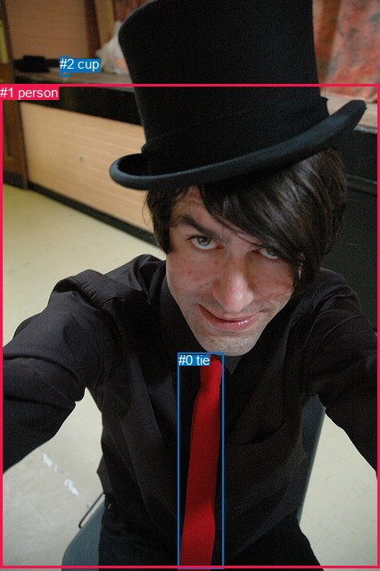
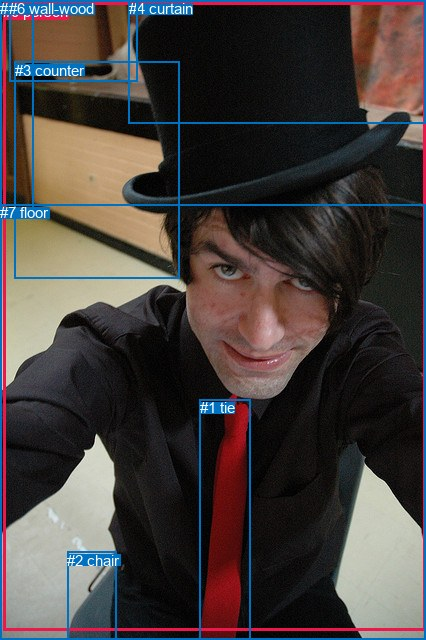

# 图片 0674：2345802.jpg

随机样本序号：46。图片 SHA256：`b616500911130fcd278f76b0ec968778c9ac790489d852f972c14f5ac1b0ba0c`。

红色框表示人，蓝色框表示其他物体。两个模式分别保留自身框编号，可依据位置比较对应对象。

## 自动检测框与输出

人的框编号：`[1]`。状态：`ok`。

### 自动检测全部物体框

| 编号 | 类别 | 是否为人 | 检测分数 | 像素坐标 xyxy |
|---|---|---|---|---|
| 0 | tie | False | 0.9990 | 199.7, 395.3, 250.2, 637.0 |
| 1 | person | True | 0.9985 | 0.0, 94.7, 426.0, 636.6 |
| 2 | cup | False | 0.4016 | 67.0, 63.1, 78.4, 85.8 |

### 自动检测 Top50 人相关候选

评分物体对：6；人相关物体对：4；输出关系：8。

| 排名 | 主语编号与类别 | 关系 | 宾语编号与类别 | 类型 | 人与人 | 排序分数 | 原始融合 logit |
|---|---|---|---|---|---|---|---|
| 1 | #1 person | wearing | #0 tie | semantic | False | 0.98655 | 4.2951 |
| 2 | #2 cup | on | #1 person | spatial | False | 0.94994 | 2.9431 |
| 3 | #0 tie | on | #1 person | spatial | False | 0.93386 | 2.6476 |
| 4 | #1 person | in | #0 tie | spatial | False | 0.81844 | 1.5058 |
| 5 | #2 cup | sitting on | #1 person | semantic | False | 0.76772 | 1.1955 |
| 6 | #1 person | wearing | #2 cup | semantic | False | 0.54895 | 0.1964 |
| 7 | #1 person | beside | #2 cup | spatial | False | 0.48128 | -0.0749 |
| 8 | #0 tie | wearing | #1 person | semantic | False | 0.34560 | -0.6384 |

### 自动检测逐条人相关 GT 核验

R@50：33.33%；命中 1/3。

| GT 主语编号 | GT 关系 | GT 宾语编号 | 结果阶段 | 匹配预测主语编号 | 匹配预测宾语编号 |
|---|---|---|---|---|---|
| 0 | wearing | 1 | hit50 | [1] | [0] |
| 0 | sitting on | 2 | endpoint_missing_or_wrong_class | [1] | [] |
| 0 | in front of | 3 | endpoint_missing_or_wrong_class | [1] | [] |

## 真实框与输出

人的框编号：`[0]`。

### 真实框全部物体框

| 编号 | 类别 | 是否为人 | 检测分数 | 像素坐标 xyxy |
|---|---|---|---|---|
| 0 | person | True | GT | 3.0, 3.0, 426.0, 630.0 |
| 1 | tie | False | GT | 200.0, 399.0, 251.0, 639.0 |
| 2 | chair | False | GT | 67.0, 552.0, 116.0, 640.0 |
| 3 | counter | False | GT | 15.0, 62.0, 179.0, 278.0 |
| 4 | curtain | False | GT | 129.0, 0.0, 426.0, 124.0 |
| 5 | door | False | GT | 0.0, 0.0, 34.0, 210.0 |
| 6 | wall-wood | False | GT | 9.0, 0.0, 138.0, 82.0 |
| 7 | floor | False | GT | 0.0, 204.0, 426.0, 640.0 |

### 真实框 Top50 人相关候选

评分物体对：56；人相关物体对：14；输出关系：28。

| 排名 | 主语编号与类别 | 关系 | 宾语编号与类别 | 类型 | 人与人 | 排序分数 | 原始融合 logit |
|---|---|---|---|---|---|---|---|
| 1 | #0 person | wearing | #1 tie | semantic | False | 0.97590 | 3.7010 |
| 2 | #0 person | wearing | #7 floor | semantic | False | 0.97423 | 3.6323 |
| 3 | #0 person | in | #7 floor | spatial | False | 0.95346 | 3.0198 |
| 4 | #0 person | wearing | #4 curtain | semantic | False | 0.95105 | 2.9667 |
| 5 | #4 curtain | on | #0 person | spatial | False | 0.93075 | 2.5983 |
| 6 | #5 door | in | #0 person | spatial | False | 0.91689 | 2.4009 |
| 7 | #0 person | sitting on | #2 chair | semantic | False | 0.91453 | 2.3702 |
| 8 | #1 tie | on | #0 person | spatial | False | 0.91160 | 2.3333 |
| 9 | #2 chair | in | #0 person | spatial | False | 0.84626 | 1.7056 |
| 10 | #7 floor | on | #0 person | spatial | False | 0.81134 | 1.4588 |
| 11 | #3 counter | in | #0 person | spatial | False | 0.81065 | 1.4542 |
| 12 | #0 person | on | #2 chair | spatial | False | 0.78858 | 1.3164 |
| 13 | #0 person | in | #1 tie | spatial | False | 0.75565 | 1.1290 |
| 14 | #0 person | in | #4 curtain | spatial | False | 0.72753 | 0.9821 |
| 15 | #6 wall-wood | in | #0 person | spatial | False | 0.63764 | 0.5651 |
| 16 | #4 curtain | wearing | #0 person | semantic | False | 0.57505 | 0.3025 |
| 17 | #1 tie | wearing | #0 person | semantic | False | 0.55906 | 0.2374 |
| 18 | #2 chair | holding | #0 person | semantic | False | 0.53911 | 0.1568 |
| 19 | #0 person | in | #3 counter | spatial | False | 0.37319 | -0.5185 |
| 20 | #7 floor | wearing | #0 person | semantic | False | 0.36713 | -0.5446 |
| 21 | #5 door | holding | #0 person | semantic | False | 0.31891 | -0.7588 |
| 22 | #0 person | in | #5 door | spatial | False | 0.29586 | -0.8671 |
| 23 | #0 person | looking at | #3 counter | semantic | False | 0.28364 | -0.9265 |
| 24 | #3 counter | holding | #0 person | semantic | False | 0.27818 | -0.9535 |
| 25 | #0 person | looking at | #5 door | semantic | False | 0.27074 | -0.9909 |
| 26 | #0 person | in | #6 wall-wood | spatial | False | 0.19870 | -1.3944 |
| 27 | #0 person | looking at | #6 wall-wood | semantic | False | 0.16986 | -1.5866 |
| 28 | #6 wall-wood | holding | #0 person | semantic | False | 0.13406 | -1.8655 |

### 真实框逐条人相关 GT 核验

R@50：66.67%；命中 2/3。

| GT 主语编号 | GT 关系 | GT 宾语编号 | 结果阶段 | 匹配预测主语编号 | 匹配预测宾语编号 |
|---|---|---|---|---|---|
| 0 | wearing | 1 | hit50 | [0] | [1] |
| 0 | sitting on | 2 | hit50 | [0] | [2] |
| 0 | in front of | 3 | wrong_predicate | [0] | [3] |

## 全部人相关 GT

| 主语编号与类别 | 关系 | 宾语编号与类别 |
|---|---|---|
| #0 person | wearing | #1 tie |
| #0 person | sitting on | #2 chair |
| #0 person | in front of | #3 counter |

原始记录、全部人相关物体对的两项预测与分项分数见 [逐图证据 JSON](../evidence/cases/0674.json)。全部56类 logits 保留于本机 HOR/output/random500/logits/。

<!-- HOR_COMPLETE_RESULTS -->

## 六组条件的完整输出对照

以下保留同一图片三种框与候选模式、两种谓词输出规则的全部 Top50。框编号各自在所属模式内解释。

### 自动检测框完整枚举：空间与语义各保留一个谓词

| 排名 | 主语编号与类别 | 谓词 | 宾语编号与类别 | 分组 | 排序分数 | predicate logit | pair logit |
|---|---|---|---|---|---|---|---|
| 1 | #1 person | wearing | #0 tie | semantic | 0.9865484 | 4.2852817 | 0.0098305 |
| 2 | #2 cup | on | #1 person | spatial | 0.9499365 | 3.4752173 | -0.5321149 |
| 3 | #0 tie | on | #1 person | spatial | 0.9338629 | 3.4560437 | -0.8084446 |
| 4 | #1 person | in | #0 tie | spatial | 0.8184395 | 1.4959803 | 0.0098305 |
| 5 | #2 cup | sitting on | #1 person | semantic | 0.7677162 | 1.7275753 | -0.5321149 |
| 6 | #1 person | wearing | #2 cup | semantic | 0.5489537 | 1.4263220 | -1.2298778 |
| 7 | #1 person | beside | #2 cup | spatial | 0.4812759 | 1.1549463 | -1.2298778 |
| 8 | #0 tie | wearing | #1 person | semantic | 0.3456049 | 0.1700296 | -0.8084446 |

GT 命中：1/3，R@50=33.33%。

| GT主语 | GT谓词 | GT宾语 | 结果阶段 | 匹配主语框 | 匹配宾语框 |
|---|---|---|---|---|---|
| 0 | wearing | 1 | hit50 | [1] | [0] |
| 0 | sitting on | 2 | endpoint_missing_or_wrong_class | [1] | [] |
| 0 | in front of | 3 | endpoint_missing_or_wrong_class | [1] | [] |

### 自动检测框完整枚举：每对只保留一个谓词

| 排名 | 主语编号与类别 | 谓词 | 宾语编号与类别 | 分组 | 排序分数 | predicate logit | pair logit |
|---|---|---|---|---|---|---|---|
| 1 | #1 person | wearing | #0 tie | single | 0.9865484 | 4.2852817 | 0.0098305 |
| 2 | #2 cup | on | #1 person | single | 0.9499365 | 3.4752173 | -0.5321149 |
| 3 | #0 tie | on | #1 person | single | 0.9338629 | 3.4560437 | -0.8084446 |
| 4 | #1 person | wearing | #2 cup | single | 0.5489537 | 1.4263220 | -1.2298778 |

GT 命中：1/3，R@50=33.33%。

| GT主语 | GT谓词 | GT宾语 | 结果阶段 | 匹配主语框 | 匹配宾语框 |
|---|---|---|---|---|---|
| 0 | wearing | 1 | hit50 | [1] | [0] |
| 0 | sitting on | 2 | endpoint_missing_or_wrong_class | [1] | [] |
| 0 | in front of | 3 | endpoint_missing_or_wrong_class | [1] | [] |

### 真实框完整枚举：空间与语义各保留一个谓词

| 排名 | 主语编号与类别 | 谓词 | 宾语编号与类别 | 分组 | 排序分数 | predicate logit | pair logit |
|---|---|---|---|---|---|---|---|
| 1 | #0 person | wearing | #1 tie | semantic | 0.9758966 | 3.9608989 | -0.2598945 |
| 2 | #0 person | wearing | #7 floor | semantic | 0.9742272 | 3.5188642 | 0.1134635 |
| 3 | #0 person | in | #7 floor | spatial | 0.9534591 | 2.9063034 | 0.1134635 |
| 4 | #0 person | wearing | #4 curtain | semantic | 0.9510481 | 3.4412236 | -0.4744970 |
| 5 | #4 curtain | on | #0 person | spatial | 0.9307498 | 3.1353221 | -0.5370576 |
| 6 | #5 door | in | #0 person | spatial | 0.9168938 | 2.7921305 | -0.3912588 |
| 7 | #0 person | sitting on | #2 chair | semantic | 0.9145284 | 2.4828129 | -0.1125882 |
| 8 | #1 tie | on | #0 person | spatial | 0.9115964 | 3.1152802 | -0.7819947 |
| 9 | #2 chair | in | #0 person | spatial | 0.8462640 | 2.2695098 | -0.5639150 |
| 10 | #7 floor | on | #0 person | spatial | 0.8113446 | 1.9818330 | -0.5230626 |
| 11 | #3 counter | in | #0 person | spatial | 0.8106468 | 1.8101683 | -0.3559499 |
| 12 | #0 person | on | #2 chair | spatial | 0.7885766 | 1.4289551 | -0.1125882 |
| 13 | #0 person | in | #1 tie | spatial | 0.7556537 | 1.3888912 | -0.2598945 |
| 14 | #0 person | in | #4 curtain | spatial | 0.7275255 | 1.4566011 | -0.4744970 |
| 15 | #6 wall-wood | in | #0 person | spatial | 0.6376389 | 1.1521473 | -0.5870165 |
| 16 | #4 curtain | wearing | #0 person | semantic | 0.5750526 | 0.8395538 | -0.5370576 |
| 17 | #1 tie | wearing | #0 person | semantic | 0.5590617 | 1.0193496 | -0.7819947 |
| 18 | #2 chair | holding | #0 person | semantic | 0.5391143 | 0.7206926 | -0.5639150 |
| 19 | #0 person | in | #3 counter | spatial | 0.3731931 | 0.2365804 | -0.7551228 |
| 20 | #7 floor | wearing | #0 person | semantic | 0.3671263 | -0.0215020 | -0.5230626 |
| 21 | #5 door | holding | #0 person | semantic | 0.3189088 | -0.3675323 | -0.3912588 |
| 22 | #0 person | in | #5 door | spatial | 0.2958565 | -0.2732105 | -0.5938971 |
| 23 | #0 person | looking at | #3 counter | semantic | 0.2836445 | -0.1713319 | -0.7551228 |
| 24 | #3 counter | holding | #0 person | semantic | 0.2781828 | -0.5975437 | -0.3559499 |
| 25 | #0 person | looking at | #5 door | semantic | 0.2707425 | -0.3969617 | -0.5938971 |
| 26 | #0 person | in | #6 wall-wood | spatial | 0.1986984 | -0.5580759 | -0.8363736 |
| 27 | #0 person | looking at | #6 wall-wood | semantic | 0.1698647 | -0.7502127 | -0.8363736 |
| 28 | #6 wall-wood | holding | #0 person | semantic | 0.1340638 | -1.2784789 | -0.5870165 |

GT 命中：2/3，R@50=66.67%。

| GT主语 | GT谓词 | GT宾语 | 结果阶段 | 匹配主语框 | 匹配宾语框 |
|---|---|---|---|---|---|
| 0 | wearing | 1 | hit50 | [0] | [1] |
| 0 | sitting on | 2 | hit50 | [0] | [2] |
| 0 | in front of | 3 | wrong_predicate | [0] | [3] |

### 真实框完整枚举：每对只保留一个谓词

| 排名 | 主语编号与类别 | 谓词 | 宾语编号与类别 | 分组 | 排序分数 | predicate logit | pair logit |
|---|---|---|---|---|---|---|---|
| 1 | #0 person | wearing | #1 tie | single | 0.9758966 | 3.9608989 | -0.2598945 |
| 2 | #0 person | wearing | #7 floor | single | 0.9742272 | 3.5188642 | 0.1134635 |
| 3 | #0 person | wearing | #4 curtain | single | 0.9510481 | 3.4412236 | -0.4744970 |
| 4 | #4 curtain | on | #0 person | single | 0.9307498 | 3.1353221 | -0.5370576 |
| 5 | #5 door | in | #0 person | single | 0.9168938 | 2.7921305 | -0.3912588 |
| 6 | #0 person | sitting on | #2 chair | single | 0.9145284 | 2.4828129 | -0.1125882 |
| 7 | #1 tie | on | #0 person | single | 0.9115964 | 3.1152802 | -0.7819947 |
| 8 | #2 chair | in | #0 person | single | 0.8462640 | 2.2695098 | -0.5639150 |
| 9 | #7 floor | on | #0 person | single | 0.8113446 | 1.9818330 | -0.5230626 |
| 10 | #3 counter | in | #0 person | single | 0.8106468 | 1.8101683 | -0.3559499 |
| 11 | #6 wall-wood | in | #0 person | single | 0.6376389 | 1.1521473 | -0.5870165 |
| 12 | #0 person | in | #3 counter | single | 0.3731931 | 0.2365804 | -0.7551228 |
| 13 | #0 person | in | #5 door | single | 0.2958565 | -0.2732105 | -0.5938971 |
| 14 | #0 person | in | #6 wall-wood | single | 0.1986984 | -0.5580759 | -0.8363736 |

GT 命中：2/3，R@50=66.67%。

| GT主语 | GT谓词 | GT宾语 | 结果阶段 | 匹配主语框 | 匹配宾语框 |
|---|---|---|---|---|---|
| 0 | wearing | 1 | hit50 | [0] | [1] |
| 0 | sitting on | 2 | hit50 | [0] | [2] |
| 0 | in front of | 3 | wrong_predicate | [0] | [3] |

### 真实框400候选：空间与语义各保留一个谓词

| 排名 | 主语编号与类别 | 谓词 | 宾语编号与类别 | 分组 | 排序分数 | predicate logit | pair logit |
|---|---|---|---|---|---|---|---|
| 1 | #0 person | wearing | #1 tie | semantic | 0.9758966 | 3.9608989 | -0.2598945 |
| 2 | #0 person | wearing | #7 floor | semantic | 0.9754161 | 3.5673108 | 0.1134635 |
| 3 | #0 person | in | #7 floor | spatial | 0.9513329 | 2.8593960 | 0.1134635 |
| 4 | #0 person | wearing | #4 curtain | semantic | 0.9510481 | 3.4412236 | -0.4744970 |
| 5 | #4 curtain | on | #0 person | spatial | 0.9307498 | 3.1353221 | -0.5370576 |
| 6 | #5 door | in | #0 person | spatial | 0.9203990 | 2.8390379 | -0.3912588 |
| 7 | #0 person | sitting on | #2 chair | semantic | 0.9128676 | 2.4617505 | -0.1125882 |
| 8 | #1 tie | on | #0 person | spatial | 0.9124701 | 3.1261702 | -0.7819947 |
| 9 | #2 chair | in | #0 person | spatial | 0.8462640 | 2.2695098 | -0.5639150 |
| 10 | #7 floor | on | #0 person | spatial | 0.8113446 | 1.9818330 | -0.5230626 |
| 11 | #3 counter | in | #0 person | spatial | 0.8106468 | 1.8101683 | -0.3559499 |
| 12 | #0 person | on | #2 chair | spatial | 0.7885766 | 1.4289551 | -0.1125882 |
| 13 | #0 person | in | #1 tie | spatial | 0.7599582 | 1.4123449 | -0.2598945 |
| 14 | #0 person | in | #4 curtain | spatial | 0.7275255 | 1.4566011 | -0.4744970 |
| 15 | #6 wall-wood | in | #0 person | spatial | 0.6430403 | 1.1756010 | -0.5870165 |
| 16 | #4 curtain | wearing | #0 person | semantic | 0.5691229 | 0.8153310 | -0.5370576 |
| 17 | #1 tie | wearing | #0 person | semantic | 0.5545321 | 1.0009942 | -0.7819947 |
| 18 | #2 chair | holding | #0 person | semantic | 0.5323650 | 0.6935563 | -0.5639150 |
| 19 | #0 person | in | #3 counter | spatial | 0.3786955 | 0.2600341 | -0.7551228 |
| 20 | #7 floor | wearing | #0 person | semantic | 0.3671263 | -0.0215020 | -0.5230626 |
| 21 | #5 door | holding | #0 person | semantic | 0.3189088 | -0.3675323 | -0.3912588 |
| 22 | #0 person | in | #5 door | spatial | 0.2958565 | -0.2732105 | -0.5938971 |
| 23 | #0 person | looking at | #3 counter | semantic | 0.2836445 | -0.1713319 | -0.7551228 |
| 24 | #3 counter | holding | #0 person | semantic | 0.2781828 | -0.5975437 | -0.3559499 |
| 25 | #0 person | looking at | #5 door | semantic | 0.2649442 | -0.4265299 | -0.5938971 |
| 26 | #0 person | in | #6 wall-wood | spatial | 0.1947302 | -0.5831890 | -0.8363736 |
| 27 | #0 person | looking at | #6 wall-wood | semantic | 0.1698402 | -0.7503867 | -0.8363736 |
| 28 | #6 wall-wood | holding | #0 person | semantic | 0.1326663 | -1.2905703 | -0.5870165 |

GT 命中：2/3，R@50=66.67%。

| GT主语 | GT谓词 | GT宾语 | 结果阶段 | 匹配主语框 | 匹配宾语框 |
|---|---|---|---|---|---|
| 0 | wearing | 1 | hit50 | [0] | [1] |
| 0 | sitting on | 2 | hit50 | [0] | [2] |
| 0 | in front of | 3 | wrong_predicate | [0] | [3] |

### 真实框400候选：每对只保留一个谓词

| 排名 | 主语编号与类别 | 谓词 | 宾语编号与类别 | 分组 | 排序分数 | predicate logit | pair logit |
|---|---|---|---|---|---|---|---|
| 1 | #0 person | wearing | #1 tie | single | 0.9758966 | 3.9608989 | -0.2598945 |
| 2 | #0 person | wearing | #7 floor | single | 0.9754161 | 3.5673108 | 0.1134635 |
| 3 | #0 person | wearing | #4 curtain | single | 0.9510481 | 3.4412236 | -0.4744970 |
| 4 | #4 curtain | on | #0 person | single | 0.9307498 | 3.1353221 | -0.5370576 |
| 5 | #5 door | in | #0 person | single | 0.9203990 | 2.8390379 | -0.3912588 |
| 6 | #0 person | sitting on | #2 chair | single | 0.9128676 | 2.4617505 | -0.1125882 |
| 7 | #1 tie | on | #0 person | single | 0.9124701 | 3.1261702 | -0.7819947 |
| 8 | #2 chair | in | #0 person | single | 0.8462640 | 2.2695098 | -0.5639150 |
| 9 | #7 floor | on | #0 person | single | 0.8113446 | 1.9818330 | -0.5230626 |
| 10 | #3 counter | in | #0 person | single | 0.8106468 | 1.8101683 | -0.3559499 |
| 11 | #6 wall-wood | in | #0 person | single | 0.6430403 | 1.1756010 | -0.5870165 |
| 12 | #0 person | in | #3 counter | single | 0.3786955 | 0.2600341 | -0.7551228 |
| 13 | #0 person | in | #5 door | single | 0.2958565 | -0.2732105 | -0.5938971 |
| 14 | #0 person | in | #6 wall-wood | single | 0.1947302 | -0.5831890 | -0.8363736 |

GT 命中：2/3，R@50=66.67%。

| GT主语 | GT谓词 | GT宾语 | 结果阶段 | 匹配主语框 | 匹配宾语框 |
|---|---|---|---|---|---|
| 0 | wearing | 1 | hit50 | [0] | [1] |
| 0 | sitting on | 2 | hit50 | [0] | [2] |
| 0 | in front of | 3 | wrong_predicate | [0] | [3] |
