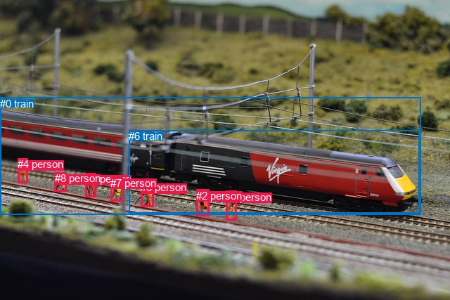
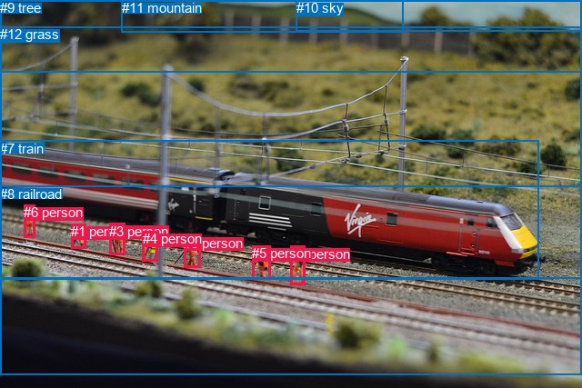

# 图片 0703：2347159.jpg

随机样本序号：325。图片 SHA256：`1b0fad3e8260366a27f9cb20fdd0f9d7c669bb40a535f6364b8c2e1c03d7b5c2`。

红色框表示人，蓝色框表示其他物体。两个模式分别保留自身框编号，可依据位置比较对应对象。

## 自动检测框与输出

人的框编号：`[1, 2, 3, 4, 5, 7, 8]`。状态：`ok`。

### 自动检测全部物体框

| 编号 | 类别 | 是否为人 | 检测分数 | 像素坐标 xyxy |
|---|---|---|---|---|
| 0 | train | False | 0.9986 | 0.0, 138.8, 598.7, 305.9 |
| 1 | person | True | 0.9981 | 321.2, 271.8, 336.8, 313.5 |
| 2 | person | True | 0.9969 | 279.2, 269.9, 297.8, 307.8 |
| 3 | person | True | 0.9884 | 200.3, 258.0, 218.9, 294.5 |
| 4 | person | True | 0.9877 | 25.5, 225.4, 39.5, 260.8 |
| 5 | person | True | 0.9874 | 121.5, 246.3, 136.9, 280.1 |
| 6 | train | False | 0.9854 | 183.1, 185.2, 596.3, 303.2 |
| 7 | person | True | 0.9568 | 157.3, 251.9, 174.8, 286.4 |
| 8 | person | True | 0.9318 | 77.7, 245.4, 94.4, 272.5 |

### 自动检测 Top50 人相关候选

评分物体对：72；人相关物体对：70；输出关系：50。

| 排名 | 主语编号与类别 | 关系 | 宾语编号与类别 | 类型 | 人与人 | 排序分数 | 原始融合 logit |
|---|---|---|---|---|---|---|---|
| 1 | #8 person | beside | #0 train | spatial | False | 0.96246 | 3.2441 |
| 2 | #4 person | beside | #0 train | spatial | False | 0.95028 | 2.9504 |
| 3 | #7 person | beside | #0 train | spatial | False | 0.94847 | 2.9128 |
| 4 | #5 person | beside | #0 train | spatial | False | 0.94552 | 2.8538 |
| 5 | #3 person | beside | #6 train | spatial | False | 0.93921 | 2.7377 |
| 6 | #3 person | looking at | #0 train | semantic | False | 0.93659 | 2.6926 |
| 7 | #4 person | beside | #6 train | spatial | False | 0.93279 | 2.6304 |
| 8 | #7 person | looking at | #0 train | semantic | False | 0.92799 | 2.5563 |
| 9 | #3 person | beside | #0 train | spatial | False | 0.92516 | 2.5147 |
| 10 | #8 person | beside | #6 train | spatial | False | 0.92332 | 2.4883 |
| 11 | #3 person | looking at | #6 train | semantic | False | 0.91726 | 2.4057 |
| 12 | #7 person | beside | #6 train | spatial | False | 0.91697 | 2.4018 |
| 13 | #1 person | beside | #6 train | spatial | False | 0.91565 | 2.3846 |
| 14 | #2 person | beside | #6 train | spatial | False | 0.91448 | 2.3696 |
| 15 | #5 person | looking at | #0 train | semantic | False | 0.91308 | 2.3518 |
| 16 | #1 person | walking on | #0 train | semantic | False | 0.90926 | 2.3046 |
| 17 | #5 person | beside | #6 train | spatial | False | 0.90603 | 2.2661 |
| 18 | #8 person | looking at | #0 train | semantic | False | 0.90516 | 2.2559 |
| 19 | #4 person | looking at | #6 train | semantic | False | 0.90449 | 2.2481 |
| 20 | #1 person | beside | #0 train | spatial | False | 0.89706 | 2.1649 |
| 21 | #4 person | looking at | #0 train | semantic | False | 0.89580 | 2.1514 |
| 22 | #1 person | looking at | #6 train | semantic | False | 0.88755 | 2.0659 |
| 23 | #2 person | looking at | #6 train | semantic | False | 0.88609 | 2.0514 |
| 24 | #2 person | on | #0 train | spatial | False | 0.88036 | 1.9959 |
| 25 | #7 person | looking at | #6 train | semantic | False | 0.85519 | 1.7759 |
| 26 | #5 person | looking at | #6 train | semantic | False | 0.85410 | 1.7672 |
| 27 | #2 person | looking at | #0 train | semantic | False | 0.83549 | 1.6250 |
| 28 | #5 person | beside | #7 person | spatial | True | 0.82988 | 1.5848 |
| 29 | #8 person | looking at | #6 train | semantic | False | 0.80971 | 1.4482 |
| 30 | #7 person | beside | #5 person | spatial | True | 0.75046 | 1.1011 |
| 31 | #7 person | beside | #3 person | spatial | True | 0.71958 | 0.9424 |
| 32 | #8 person | beside | #5 person | spatial | True | 0.71822 | 0.9357 |
| 33 | #3 person | beside | #7 person | spatial | True | 0.68294 | 0.7673 |
| 34 | #0 train | on | #8 person | spatial | False | 0.59598 | 0.3887 |
| 35 | #2 person | beside | #1 person | spatial | True | 0.59072 | 0.3669 |
| 36 | #5 person | beside | #8 person | spatial | True | 0.54979 | 0.1998 |
| 37 | #1 person | beside | #2 person | spatial | True | 0.49153 | -0.0339 |
| 38 | #0 train | carrying | #8 person | semantic | False | 0.48591 | -0.0564 |
| 39 | #0 train | carrying | #5 person | semantic | False | 0.45339 | -0.1870 |
| 40 | #0 train | beside | #5 person | spatial | False | 0.44434 | -0.2236 |
| 41 | #4 person | beside | #8 person | spatial | True | 0.36893 | -0.5368 |
| 42 | #8 person | beside | #4 person | spatial | True | 0.36584 | -0.5501 |
| 43 | #0 train | beside | #7 person | spatial | False | 0.33701 | -0.6766 |
| 44 | #0 train | carrying | #4 person | semantic | False | 0.32558 | -0.7282 |
| 45 | #0 train | carrying | #7 person | semantic | False | 0.31931 | -0.7569 |
| 46 | #0 train | beside | #3 person | spatial | False | 0.31906 | -0.7581 |
| 47 | #0 train | carrying | #3 person | semantic | False | 0.31240 | -0.7889 |
| 48 | #0 train | beside | #4 person | spatial | False | 0.25593 | -1.0672 |
| 49 | #0 train | beside | #2 person | spatial | False | 0.20232 | -1.3719 |
| 50 | #0 train | carrying | #2 person | semantic | False | 0.17978 | -1.5178 |

### 自动检测逐条人相关 GT 核验

R@50：0.00%；命中 0/3。

| GT 主语编号 | GT 关系 | GT 宾语编号 | 结果阶段 | 匹配预测主语编号 | 匹配预测宾语编号 |
|---|---|---|---|---|---|
| 1 | looking at | 8 | endpoint_missing_or_wrong_class | [8] | [] |
| 2 | walking on | 8 | endpoint_missing_or_wrong_class | [1] | [] |
| 6 | standing on | 8 | endpoint_missing_or_wrong_class | [4] | [] |

## 真实框与输出

人的框编号：`[0, 1, 2, 3, 4, 5, 6]`。

### 真实框全部物体框

| 编号 | 类别 | 是否为人 | 检测分数 | 像素坐标 xyxy |
|---|---|---|---|---|
| 0 | person | True | GT | 202.0, 259.0, 220.0, 295.0 |
| 1 | person | True | GT | 78.0, 246.0, 94.0, 273.0 |
| 2 | person | True | GT | 320.0, 271.0, 336.0, 314.0 |
| 3 | person | True | GT | 120.0, 246.0, 137.0, 281.0 |
| 4 | person | True | GT | 157.0, 254.0, 173.0, 287.0 |
| 5 | person | True | GT | 277.0, 270.0, 298.0, 307.0 |
| 6 | person | True | GT | 26.0, 225.0, 39.0, 261.0 |
| 7 | train | False | GT | 0.0, 155.0, 593.0, 308.0 |
| 8 | railroad | False | GT | 0.0, 205.0, 640.0, 413.0 |
| 9 | tree | False | GT | 0.0, 0.0, 640.0, 79.0 |
| 10 | sky | False | GT | 326.0, 0.0, 640.0, 35.0 |
| 11 | mountain | False | GT | 134.0, 0.0, 444.0, 36.0 |
| 12 | grass | False | GT | 0.0, 29.0, 640.0, 307.0 |

### 真实框 Top50 人相关候选

评分物体对：156；人相关物体对：126；输出关系：50。

| 排名 | 主语编号与类别 | 关系 | 宾语编号与类别 | 类型 | 人与人 | 排序分数 | 原始融合 logit |
|---|---|---|---|---|---|---|---|
| 1 | #5 person | on | #8 railroad | spatial | False | 0.96387 | 3.2840 |
| 2 | #2 person | on | #8 railroad | spatial | False | 0.95957 | 3.1668 |
| 3 | #1 person | on | #8 railroad | spatial | False | 0.95938 | 3.1620 |
| 4 | #6 person | on | #8 railroad | spatial | False | 0.95842 | 3.1377 |
| 5 | #3 person | on | #8 railroad | spatial | False | 0.95826 | 3.1337 |
| 6 | #0 person | on | #8 railroad | spatial | False | 0.95614 | 3.0818 |
| 7 | #4 person | on | #8 railroad | spatial | False | 0.94771 | 2.8972 |
| 8 | #4 person | beside | #7 train | spatial | False | 0.94477 | 2.8395 |
| 9 | #1 person | beside | #7 train | spatial | False | 0.94050 | 2.7604 |
| 10 | #6 person | looking at | #7 train | semantic | False | 0.94024 | 2.7558 |
| 11 | #3 person | beside | #7 train | spatial | False | 0.93925 | 2.7384 |
| 12 | #6 person | beside | #7 train | spatial | False | 0.93634 | 2.6885 |
| 13 | #0 person | looking at | #7 train | semantic | False | 0.92820 | 2.5594 |
| 14 | #0 person | beside | #7 train | spatial | False | 0.92568 | 2.5222 |
| 15 | #6 person | standing on | #8 railroad | semantic | False | 0.92065 | 2.4512 |
| 16 | #4 person | looking at | #7 train | semantic | False | 0.91681 | 2.3997 |
| 17 | #3 person | looking at | #7 train | semantic | False | 0.91600 | 2.3892 |
| 18 | #1 person | looking at | #7 train | semantic | False | 0.91476 | 2.3732 |
| 19 | #2 person | standing on | #8 railroad | semantic | False | 0.89617 | 2.1554 |
| 20 | #3 person | standing on | #8 railroad | semantic | False | 0.89422 | 2.1346 |
| 21 | #2 person | beside | #7 train | spatial | False | 0.89271 | 2.1187 |
| 22 | #0 person | standing on | #8 railroad | semantic | False | 0.88801 | 2.0706 |
| 23 | #5 person | beside | #7 train | spatial | False | 0.88658 | 2.0562 |
| 24 | #5 person | standing on | #8 railroad | semantic | False | 0.88221 | 2.0135 |
| 25 | #4 person | standing on | #8 railroad | semantic | False | 0.85437 | 1.7693 |
| 26 | #1 person | standing on | #8 railroad | semantic | False | 0.85201 | 1.7504 |
| 27 | #2 person | looking at | #7 train | semantic | False | 0.83721 | 1.6376 |
| 28 | #5 person | looking at | #7 train | semantic | False | 0.82444 | 1.5467 |
| 29 | #6 person | on | #12 grass | spatial | False | 0.72093 | 0.9491 |
| 30 | #1 person | on | #12 grass | spatial | False | 0.52320 | 0.0929 |
| 31 | #6 person | standing on | #12 grass | semantic | False | 0.49319 | -0.0272 |
| 32 | #7 train | pulling | #1 person | semantic | False | 0.46951 | -0.1221 |
| 33 | #3 person | in | #12 grass | spatial | False | 0.45374 | -0.1856 |
| 34 | #1 person | beside | #3 person | spatial | True | 0.34443 | -0.6436 |
| 35 | #4 person | on | #12 grass | spatial | False | 0.33460 | -0.6874 |
| 36 | #7 train | on | #1 person | spatial | False | 0.30893 | -0.8051 |
| 37 | #0 person | on | #12 grass | spatial | False | 0.28419 | -0.9238 |
| 38 | #7 train | pulling | #3 person | semantic | False | 0.27882 | -0.9503 |
| 39 | #3 person | beside | #4 person | spatial | True | 0.26867 | -1.0014 |
| 40 | #1 person | looking at | #12 grass | semantic | False | 0.23973 | -1.1542 |
| 41 | #5 person | in | #12 grass | spatial | False | 0.23853 | -1.1607 |
| 42 | #4 person | beside | #3 person | spatial | True | 0.21771 | -1.2791 |
| 43 | #2 person | in | #12 grass | spatial | False | 0.21002 | -1.3248 |
| 44 | #6 person | beside | #1 person | spatial | True | 0.20466 | -1.3574 |
| 45 | #7 train | pulling | #6 person | semantic | False | 0.19614 | -1.4106 |
| 46 | #6 person | wearing | #4 person | semantic | True | 0.18787 | -1.4639 |
| 47 | #3 person | looking at | #12 grass | semantic | False | 0.17797 | -1.5301 |
| 48 | #3 person | beside | #1 person | spatial | True | 0.17209 | -1.5709 |
| 49 | #7 train | on | #3 person | spatial | False | 0.15599 | -1.6884 |
| 50 | #4 person | standing on | #12 grass | semantic | False | 0.15500 | -1.6959 |

### 真实框逐条人相关 GT 核验

R@50：33.33%；命中 1/3。

| GT 主语编号 | GT 关系 | GT 宾语编号 | 结果阶段 | 匹配预测主语编号 | 匹配预测宾语编号 |
|---|---|---|---|---|---|
| 1 | looking at | 8 | wrong_predicate | [1] | [8] |
| 2 | walking on | 8 | wrong_predicate | [2] | [8] |
| 6 | standing on | 8 | hit50 | [6] | [8] |

## 全部人相关 GT

| 主语编号与类别 | 关系 | 宾语编号与类别 |
|---|---|---|
| #1 person | looking at | #8 railroad |
| #2 person | walking on | #8 railroad |
| #6 person | standing on | #8 railroad |

原始记录、全部人相关物体对的两项预测与分项分数见 [逐图证据 JSON](../evidence/cases/0703.json)。全部56类 logits 保留于本机 HOR/output/random500/logits/。

<!-- HOR_COMPLETE_RESULTS -->

## 六组条件的完整输出对照

以下保留同一图片三种框与候选模式、两种谓词输出规则的全部 Top50。框编号各自在所属模式内解释。

### 自动检测框完整枚举：空间与语义各保留一个谓词

| 排名 | 主语编号与类别 | 谓词 | 宾语编号与类别 | 分组 | 排序分数 | predicate logit | pair logit |
|---|---|---|---|---|---|---|---|
| 1 | #8 person | beside | #0 train | spatial | 0.9624602 | 3.2935352 | -0.0494445 |
| 2 | #4 person | beside | #0 train | spatial | 0.9502803 | 2.9929700 | -0.0426135 |
| 3 | #7 person | beside | #0 train | spatial | 0.9484745 | 2.9032750 | 0.0095032 |
| 4 | #5 person | beside | #0 train | spatial | 0.9455159 | 2.8135786 | 0.0402446 |
| 5 | #3 person | beside | #6 train | spatial | 0.9392137 | 2.9354472 | -0.1977679 |
| 6 | #3 person | looking at | #0 train | semantic | 0.9365874 | 2.7826004 | -0.0900203 |
| 7 | #4 person | beside | #6 train | spatial | 0.9327930 | 2.8422823 | -0.2118779 |
| 8 | #7 person | looking at | #0 train | semantic | 0.9279925 | 2.5467510 | 0.0095032 |
| 9 | #3 person | beside | #0 train | spatial | 0.9251627 | 2.6046748 | -0.0900203 |
| 10 | #8 person | beside | #6 train | spatial | 0.9233161 | 2.7246928 | -0.2364134 |
| 11 | #3 person | looking at | #6 train | semantic | 0.9172593 | 2.6034474 | -0.1977679 |
| 12 | #7 person | beside | #6 train | spatial | 0.9169679 | 2.5442610 | -0.1424147 |
| 13 | #1 person | beside | #6 train | spatial | 0.9156492 | 2.5162516 | -0.1316034 |
| 14 | #2 person | beside | #6 train | spatial | 0.9144787 | 2.5163674 | -0.1467791 |
| 15 | #5 person | looking at | #0 train | semantic | 0.9130806 | 2.3115993 | 0.0402446 |
| 16 | #1 person | walking on | #0 train | semantic | 0.9092579 | 2.5037227 | -0.1991150 |
| 17 | #5 person | beside | #6 train | spatial | 0.9060316 | 2.3941522 | -0.1280362 |
| 18 | #8 person | looking at | #0 train | semantic | 0.9051564 | 2.3053236 | -0.0494445 |
| 19 | #4 person | looking at | #6 train | semantic | 0.9044853 | 2.4599638 | -0.2118779 |
| 20 | #1 person | beside | #0 train | spatial | 0.8970571 | 2.3640604 | -0.1991150 |
| 21 | #4 person | looking at | #0 train | semantic | 0.8958005 | 2.1940236 | -0.0426135 |
| 22 | #1 person | looking at | #6 train | semantic | 0.8875450 | 2.1975098 | -0.1316034 |
| 23 | #2 person | looking at | #6 train | semantic | 0.8860919 | 2.1982074 | -0.1467791 |
| 24 | #2 person | on | #0 train | spatial | 0.8803629 | 2.1540403 | -0.1581692 |
| 25 | #7 person | looking at | #6 train | semantic | 0.8551907 | 1.9183211 | -0.1424147 |
| 26 | #5 person | looking at | #6 train | semantic | 0.8541049 | 1.8952026 | -0.1280362 |
| 27 | #2 person | looking at | #0 train | semantic | 0.8354884 | 1.7832050 | -0.1581692 |
| 28 | #5 person | beside | #7 person | spatial | 0.8298836 | 1.5129189 | 0.0718838 |
| 29 | #8 person | looking at | #6 train | semantic | 0.8097137 | 1.6845641 | -0.2364134 |
| 30 | #7 person | beside | #5 person | spatial | 0.7504596 | 1.2691526 | -0.1680878 |
| 31 | #7 person | beside | #3 person | spatial | 0.7195849 | 0.8506508 | 0.0917526 |
| 32 | #8 person | beside | #5 person | spatial | 0.7182233 | 1.4228187 | -0.4871528 |
| 33 | #3 person | beside | #7 person | spatial | 0.6829432 | 0.8480630 | -0.0807323 |
| 34 | #0 train | on | #8 person | spatial | 0.5959802 | 1.1894403 | -0.8006965 |
| 35 | #2 person | beside | #1 person | spatial | 0.5907167 | 0.5790782 | -0.2121494 |
| 36 | #5 person | beside | #8 person | spatial | 0.5497947 | 0.4268947 | -0.2270534 |
| 37 | #1 person | beside | #2 person | spatial | 0.4915347 | 0.3069124 | -0.3407769 |
| 38 | #0 train | carrying | #8 person | semantic | 0.4859082 | 0.7443142 | -0.8006965 |
| 39 | #0 train | carrying | #5 person | semantic | 0.4533944 | 0.7968159 | -0.9837812 |
| 40 | #0 train | beside | #5 person | spatial | 0.4443355 | 0.7601962 | -0.9837812 |
| 41 | #4 person | beside | #8 person | spatial | 0.3689263 | -0.3512135 | -0.1856123 |
| 42 | #8 person | beside | #4 person | spatial | 0.3658381 | 0.0963888 | -0.6465023 |
| 43 | #0 train | beside | #7 person | spatial | 0.3370112 | 0.4604044 | -1.1370461 |
| 44 | #0 train | carrying | #4 person | semantic | 0.3255824 | 0.4669771 | -1.1952109 |
| 45 | #0 train | carrying | #7 person | semantic | 0.3193111 | 0.3801064 | -1.1370461 |
| 46 | #0 train | beside | #3 person | spatial | 0.3190611 | 0.3714457 | -1.1295357 |
| 47 | #0 train | carrying | #3 person | semantic | 0.3123981 | 0.3406038 | -1.1295357 |
| 48 | #0 train | beside | #4 person | spatial | 0.2559321 | 0.1279907 | -1.1952109 |
| 49 | #0 train | beside | #2 person | spatial | 0.2023184 | -0.1989212 | -1.1729457 |
| 50 | #0 train | carrying | #2 person | semantic | 0.1797808 | -0.3448873 | -1.1729457 |

GT 命中：0/3，R@50=0.00%。

| GT主语 | GT谓词 | GT宾语 | 结果阶段 | 匹配主语框 | 匹配宾语框 |
|---|---|---|---|---|---|
| 1 | looking at | 8 | endpoint_missing_or_wrong_class | [8] | [] |
| 2 | walking on | 8 | endpoint_missing_or_wrong_class | [1] | [] |
| 6 | standing on | 8 | endpoint_missing_or_wrong_class | [4] | [] |

### 自动检测框完整枚举：每对只保留一个谓词

| 排名 | 主语编号与类别 | 谓词 | 宾语编号与类别 | 分组 | 排序分数 | predicate logit | pair logit |
|---|---|---|---|---|---|---|---|
| 1 | #8 person | beside | #0 train | single | 0.9624602 | 3.2935352 | -0.0494445 |
| 2 | #4 person | beside | #0 train | single | 0.9502803 | 2.9929700 | -0.0426135 |
| 3 | #7 person | beside | #0 train | single | 0.9484745 | 2.9032750 | 0.0095032 |
| 4 | #5 person | beside | #0 train | single | 0.9455159 | 2.8135786 | 0.0402446 |
| 5 | #3 person | beside | #6 train | single | 0.9392137 | 2.9354472 | -0.1977679 |
| 6 | #3 person | looking at | #0 train | single | 0.9365874 | 2.7826004 | -0.0900203 |
| 7 | #4 person | beside | #6 train | single | 0.9327930 | 2.8422823 | -0.2118779 |
| 8 | #8 person | beside | #6 train | single | 0.9233161 | 2.7246928 | -0.2364134 |
| 9 | #7 person | beside | #6 train | single | 0.9169679 | 2.5442610 | -0.1424147 |
| 10 | #1 person | beside | #6 train | single | 0.9156492 | 2.5162516 | -0.1316034 |
| 11 | #2 person | beside | #6 train | single | 0.9144787 | 2.5163674 | -0.1467791 |
| 12 | #1 person | walking on | #0 train | single | 0.9092579 | 2.5037227 | -0.1991150 |
| 13 | #5 person | beside | #6 train | single | 0.9060316 | 2.3941522 | -0.1280362 |
| 14 | #2 person | on | #0 train | single | 0.8803629 | 2.1540403 | -0.1581692 |
| 15 | #5 person | beside | #7 person | single | 0.8298836 | 1.5129189 | 0.0718838 |
| 16 | #7 person | beside | #5 person | single | 0.7504596 | 1.2691526 | -0.1680878 |
| 17 | #7 person | beside | #3 person | single | 0.7195849 | 0.8506508 | 0.0917526 |
| 18 | #8 person | beside | #5 person | single | 0.7182233 | 1.4228187 | -0.4871528 |
| 19 | #3 person | beside | #7 person | single | 0.6829432 | 0.8480630 | -0.0807323 |
| 20 | #0 train | on | #8 person | single | 0.5959802 | 1.1894403 | -0.8006965 |
| 21 | #2 person | beside | #1 person | single | 0.5907167 | 0.5790782 | -0.2121494 |
| 22 | #5 person | beside | #8 person | single | 0.5497947 | 0.4268947 | -0.2270534 |
| 23 | #1 person | beside | #2 person | single | 0.4915347 | 0.3069124 | -0.3407769 |
| 24 | #0 train | carrying | #5 person | single | 0.4533944 | 0.7968159 | -0.9837812 |
| 25 | #4 person | beside | #8 person | single | 0.3689263 | -0.3512135 | -0.1856123 |
| 26 | #8 person | beside | #4 person | single | 0.3658381 | 0.0963888 | -0.6465023 |
| 27 | #0 train | beside | #7 person | single | 0.3370112 | 0.4604044 | -1.1370461 |
| 28 | #0 train | carrying | #4 person | single | 0.3255824 | 0.4669771 | -1.1952109 |
| 29 | #0 train | beside | #3 person | single | 0.3190611 | 0.3714457 | -1.1295357 |
| 30 | #0 train | beside | #2 person | single | 0.2023184 | -0.1989212 | -1.1729457 |
| 31 | #0 train | beside | #1 person | single | 0.1586773 | -0.6197653 | -1.0483371 |
| 32 | #6 train | pulling | #8 person | single | 0.1366416 | -0.8458698 | -0.9975989 |
| 33 | #6 train | beside | #3 person | single | 0.1293745 | -0.5915456 | -1.3149548 |
| 34 | #6 train | beside | #2 person | single | 0.0884578 | -1.0255036 | -1.3071084 |
| 35 | #3 person | beside | #2 person | single | 0.0685181 | -2.3364193 | -0.2732590 |
| 36 | #2 person | beside | #3 person | single | 0.0683202 | -2.2926126 | -0.3201704 |
| 37 | #6 train | beside | #5 person | single | 0.0670928 | -1.4337108 | -1.1985179 |
| 38 | #6 train | pulling | #4 person | single | 0.0670281 | -1.2070873 | -1.4261763 |
| 39 | #6 train | beside | #7 person | single | 0.0650857 | -1.3287094 | -1.3360401 |
| 40 | #3 person | beside | #5 person | single | 0.0647029 | -2.2318516 | -0.4392066 |
| 41 | #6 train | beside | #1 person | single | 0.0622314 | -1.5362833 | -1.1763607 |
| 42 | #8 person | beside | #7 person | single | 0.0548872 | -2.4248428 | -0.4211822 |
| 43 | #5 person | beside | #3 person | single | 0.0540455 | -2.8093443 | -0.0530232 |
| 44 | #4 person | walking on | #7 person | single | 0.0471767 | -2.6358740 | -0.3696550 |
| 45 | #7 person | beside | #8 person | single | 0.0470187 | -2.6524930 | -0.3565559 |
| 46 | #4 person | walking on | #5 person | single | 0.0321808 | -2.9819131 | -0.4217623 |
| 47 | #4 person | walking on | #3 person | single | 0.0309167 | -2.7855778 | -0.6594753 |
| 48 | #3 person | walking on | #1 person | single | 0.0297958 | -3.1540318 | -0.3291066 |
| 49 | #1 person | walking on | #3 person | single | 0.0290573 | -3.0003209 | -0.5086778 |
| 50 | #1 person | walking on | #7 person | single | 0.0216072 | -3.0199766 | -0.7929095 |

GT 命中：0/3，R@50=0.00%。

| GT主语 | GT谓词 | GT宾语 | 结果阶段 | 匹配主语框 | 匹配宾语框 |
|---|---|---|---|---|---|
| 1 | looking at | 8 | endpoint_missing_or_wrong_class | [8] | [] |
| 2 | walking on | 8 | endpoint_missing_or_wrong_class | [1] | [] |
| 6 | standing on | 8 | endpoint_missing_or_wrong_class | [4] | [] |

### 真实框完整枚举：空间与语义各保留一个谓词

| 排名 | 主语编号与类别 | 谓词 | 宾语编号与类别 | 分组 | 排序分数 | predicate logit | pair logit |
|---|---|---|---|---|---|---|---|
| 1 | #5 person | on | #8 railroad | spatial | 0.9638743 | 3.4081416 | -0.1241829 |
| 2 | #2 person | on | #8 railroad | spatial | 0.9595675 | 3.3972526 | -0.2304048 |
| 3 | #1 person | on | #8 railroad | spatial | 0.9593801 | 3.1507874 | 0.0112439 |
| 4 | #6 person | on | #8 railroad | spatial | 0.9584225 | 3.2711525 | -0.1334249 |
| 5 | #3 person | on | #8 railroad | spatial | 0.9582605 | 3.1616778 | -0.0280052 |
| 6 | #0 person | on | #8 railroad | spatial | 0.9561354 | 3.1783009 | -0.0965093 |
| 7 | #4 person | on | #8 railroad | spatial | 0.9477056 | 3.0034885 | -0.1063350 |
| 8 | #4 person | beside | #7 train | spatial | 0.9447709 | 2.7827935 | 0.0566607 |
| 9 | #1 person | beside | #7 train | spatial | 0.9404972 | 2.7820997 | -0.0217146 |
| 10 | #6 person | looking at | #7 train | semantic | 0.9402380 | 2.7902699 | -0.0345060 |
| 11 | #3 person | beside | #7 train | spatial | 0.9392529 | 2.6635857 | 0.0747793 |
| 12 | #6 person | beside | #7 train | spatial | 0.9363418 | 2.7229581 | -0.0345060 |
| 13 | #0 person | looking at | #7 train | semantic | 0.9282042 | 2.6111174 | -0.0516904 |
| 14 | #0 person | beside | #7 train | spatial | 0.9256835 | 2.5738897 | -0.0516904 |
| 15 | #6 person | standing on | #8 railroad | semantic | 0.9206469 | 2.5845947 | -0.1334249 |
| 16 | #4 person | looking at | #7 train | semantic | 0.9168079 | 2.3430853 | 0.0566607 |
| 17 | #3 person | looking at | #7 train | semantic | 0.9159975 | 2.3143878 | 0.0747793 |
| 18 | #1 person | looking at | #7 train | semantic | 0.9147596 | 2.3949003 | -0.0217146 |
| 19 | #2 person | standing on | #8 railroad | semantic | 0.8961706 | 2.3857865 | -0.2304048 |
| 20 | #3 person | standing on | #8 railroad | semantic | 0.8942208 | 2.1626034 | -0.0280052 |
| 21 | #2 person | beside | #7 train | spatial | 0.8927072 | 2.2432332 | -0.1245362 |
| 22 | #0 person | standing on | #8 railroad | semantic | 0.8880106 | 2.1670890 | -0.0965093 |
| 23 | #5 person | beside | #7 train | spatial | 0.8865759 | 2.1541157 | -0.0978830 |
| 24 | #5 person | standing on | #8 railroad | semantic | 0.8822103 | 2.1377120 | -0.1241829 |
| 25 | #4 person | standing on | #8 railroad | semantic | 0.8543742 | 1.8756642 | -0.1063350 |
| 26 | #1 person | standing on | #8 railroad | semantic | 0.8520065 | 1.7391820 | 0.0112439 |
| 27 | #2 person | looking at | #7 train | semantic | 0.8372138 | 1.7621784 | -0.1245362 |
| 28 | #5 person | looking at | #7 train | semantic | 0.8244394 | 1.6446023 | -0.0978830 |
| 29 | #6 person | on | #12 grass | spatial | 0.7209343 | 1.7379184 | -0.7888176 |
| 30 | #1 person | on | #12 grass | spatial | 0.5231982 | 0.8678498 | -0.7749902 |
| 31 | #6 person | standing on | #12 grass | semantic | 0.4931895 | 0.7615738 | -0.7888176 |
| 32 | #7 train | pulling | #1 person | semantic | 0.4695055 | 0.6890578 | -0.8111871 |
| 33 | #3 person | in | #12 grass | spatial | 0.4537414 | 0.6091895 | -0.7947546 |
| 34 | #1 person | beside | #3 person | spatial | 0.3444304 | -0.1606555 | -0.4829569 |
| 35 | #4 person | on | #12 grass | spatial | 0.3346027 | 0.1737528 | -0.8611933 |
| 36 | #7 train | on | #1 person | spatial | 0.3089308 | 0.0060644 | -0.8111871 |
| 37 | #0 person | on | #12 grass | spatial | 0.2841866 | 0.0998135 | -1.0236021 |
| 38 | #7 train | pulling | #3 person | semantic | 0.2788216 | 0.0271020 | -0.9774165 |
| 39 | #3 person | beside | #4 person | spatial | 0.2686671 | -1.0340819 | 0.0326865 |
| 40 | #1 person | looking at | #12 grass | semantic | 0.2397280 | -0.3791809 | -0.7749902 |
| 41 | #5 person | in | #12 grass | spatial | 0.2385342 | 0.0142250 | -1.1749578 |
| 42 | #4 person | beside | #3 person | spatial | 0.2177066 | -1.1115797 | -0.1675020 |
| 43 | #2 person | in | #12 grass | spatial | 0.2100158 | -0.0542550 | -1.2705754 |
| 44 | #6 person | beside | #1 person | spatial | 0.2046568 | -1.1714730 | -0.1859660 |
| 45 | #7 train | pulling | #6 person | semantic | 0.1961392 | -0.1835308 | -1.2270708 |
| 46 | #6 person | wearing | #4 person | semantic | 0.1878658 | -1.0860672 | -0.3778706 |
| 47 | #3 person | looking at | #12 grass | semantic | 0.1779718 | -0.7353952 | -0.7947546 |
| 48 | #3 person | beside | #1 person | spatial | 0.1720932 | -1.3217990 | -0.2490652 |
| 49 | #7 train | on | #3 person | spatial | 0.1559882 | -0.7109699 | -0.9774165 |
| 50 | #4 person | standing on | #12 grass | semantic | 0.1550035 | -0.8346913 | -0.8611933 |

GT 命中：1/3，R@50=33.33%。

| GT主语 | GT谓词 | GT宾语 | 结果阶段 | 匹配主语框 | 匹配宾语框 |
|---|---|---|---|---|---|
| 1 | looking at | 8 | wrong_predicate | [1] | [8] |
| 2 | walking on | 8 | wrong_predicate | [2] | [8] |
| 6 | standing on | 8 | hit50 | [6] | [8] |

### 真实框完整枚举：每对只保留一个谓词

| 排名 | 主语编号与类别 | 谓词 | 宾语编号与类别 | 分组 | 排序分数 | predicate logit | pair logit |
|---|---|---|---|---|---|---|---|
| 1 | #5 person | on | #8 railroad | single | 0.9638743 | 3.4081416 | -0.1241829 |
| 2 | #2 person | on | #8 railroad | single | 0.9595675 | 3.3972526 | -0.2304048 |
| 3 | #1 person | on | #8 railroad | single | 0.9593801 | 3.1507874 | 0.0112439 |
| 4 | #6 person | on | #8 railroad | single | 0.9584225 | 3.2711525 | -0.1334249 |
| 5 | #3 person | on | #8 railroad | single | 0.9582605 | 3.1616778 | -0.0280052 |
| 6 | #0 person | on | #8 railroad | single | 0.9561354 | 3.1783009 | -0.0965093 |
| 7 | #4 person | on | #8 railroad | single | 0.9477056 | 3.0034885 | -0.1063350 |
| 8 | #4 person | beside | #7 train | single | 0.9447709 | 2.7827935 | 0.0566607 |
| 9 | #1 person | beside | #7 train | single | 0.9404972 | 2.7820997 | -0.0217146 |
| 10 | #6 person | looking at | #7 train | single | 0.9402380 | 2.7902699 | -0.0345060 |
| 11 | #3 person | beside | #7 train | single | 0.9392529 | 2.6635857 | 0.0747793 |
| 12 | #0 person | looking at | #7 train | single | 0.9282042 | 2.6111174 | -0.0516904 |
| 13 | #2 person | beside | #7 train | single | 0.8927072 | 2.2432332 | -0.1245362 |
| 14 | #5 person | beside | #7 train | single | 0.8865759 | 2.1541157 | -0.0978830 |
| 15 | #6 person | on | #12 grass | single | 0.7209343 | 1.7379184 | -0.7888176 |
| 16 | #1 person | on | #12 grass | single | 0.5231982 | 0.8678498 | -0.7749902 |
| 17 | #7 train | pulling | #1 person | single | 0.4695055 | 0.6890578 | -0.8111871 |
| 18 | #3 person | in | #12 grass | single | 0.4537414 | 0.6091895 | -0.7947546 |
| 19 | #1 person | beside | #3 person | single | 0.3444304 | -0.1606555 | -0.4829569 |
| 20 | #4 person | on | #12 grass | single | 0.3346027 | 0.1737528 | -0.8611933 |
| 21 | #0 person | on | #12 grass | single | 0.2841866 | 0.0998135 | -1.0236021 |
| 22 | #7 train | pulling | #3 person | single | 0.2788216 | 0.0271020 | -0.9774165 |
| 23 | #3 person | beside | #4 person | single | 0.2686671 | -1.0340819 | 0.0326865 |
| 24 | #5 person | in | #12 grass | single | 0.2385342 | 0.0142250 | -1.1749578 |
| 25 | #4 person | beside | #3 person | single | 0.2177066 | -1.1115797 | -0.1675020 |
| 26 | #2 person | in | #12 grass | single | 0.2100158 | -0.0542550 | -1.2705754 |
| 27 | #6 person | beside | #1 person | single | 0.2046568 | -1.1714730 | -0.1859660 |
| 28 | #7 train | pulling | #6 person | single | 0.1961392 | -0.1835308 | -1.2270708 |
| 29 | #6 person | wearing | #4 person | single | 0.1878658 | -1.0860672 | -0.3778706 |
| 30 | #3 person | beside | #1 person | single | 0.1720932 | -1.3217990 | -0.2490652 |
| 31 | #5 person | beside | #2 person | single | 0.1460558 | -1.5456331 | -0.2202442 |
| 32 | #2 person | beside | #5 person | single | 0.1442410 | -1.4563279 | -0.3241754 |
| 33 | #1 person | beside | #6 person | single | 0.1318749 | -1.2483854 | -0.6360965 |
| 34 | #4 person | beside | #0 person | single | 0.1308531 | -1.9828165 | 0.0893793 |
| 35 | #7 train | on | #5 person | single | 0.1258083 | -0.7301719 | -1.2083688 |
| 36 | #7 train | on | #0 person | single | 0.1099356 | -0.9187415 | -1.1726580 |
| 37 | #7 train | on | #2 person | single | 0.1081493 | -1.0199051 | -1.0898815 |
| 38 | #7 train | on | #4 person | single | 0.0974185 | -1.0499961 | -1.1762470 |
| 39 | #6 person | wearing | #0 person | single | 0.0923869 | -1.6112335 | -0.6735994 |
| 40 | #0 person | beside | #4 person | single | 0.0837828 | -2.2837181 | -0.1083076 |
| 41 | #1 person | in | #4 person | single | 0.0660631 | -2.2208803 | -0.4279187 |
| 42 | #6 person | in | #3 person | single | 0.0645944 | -2.2562456 | -0.4166074 |
| 43 | #3 person | in | #0 person | single | 0.0593114 | -2.6778493 | -0.0859618 |
| 44 | #1 person | in | #0 person | single | 0.0493593 | -2.3575127 | -0.6004971 |
| 45 | #2 person | wearing | #4 person | single | 0.0483263 | -2.2068145 | -0.7734311 |
| 46 | #2 person | wearing | #0 person | single | 0.0456142 | -2.5723469 | -0.4685019 |
| 47 | #0 person | on | #5 person | single | 0.0454529 | -2.7722204 | -0.2723410 |
| 48 | #8 railroad | holding | #1 person | single | 0.0448617 | -1.8012729 | -1.2569995 |
| 49 | #4 person | on | #1 person | single | 0.0426010 | -2.7563062 | -0.3560363 |
| 50 | #8 railroad | holding | #3 person | single | 0.0400449 | -1.7956388 | -1.3812456 |

GT 命中：0/3，R@50=0.00%。

| GT主语 | GT谓词 | GT宾语 | 结果阶段 | 匹配主语框 | 匹配宾语框 |
|---|---|---|---|---|---|
| 1 | looking at | 8 | wrong_predicate | [1] | [8] |
| 2 | walking on | 8 | wrong_predicate | [2] | [8] |
| 6 | standing on | 8 | wrong_predicate | [6] | [8] |

### 真实框400候选：空间与语义各保留一个谓词

| 排名 | 主语编号与类别 | 谓词 | 宾语编号与类别 | 分组 | 排序分数 | predicate logit | pair logit |
|---|---|---|---|---|---|---|---|
| 1 | #5 person | on | #8 railroad | spatial | 0.9638743 | 3.4081416 | -0.1241829 |
| 2 | #1 person | on | #8 railroad | spatial | 0.9598024 | 3.1616778 | 0.0112439 |
| 3 | #2 person | on | #8 railroad | spatial | 0.9595675 | 3.3972526 | -0.2304048 |
| 4 | #6 person | on | #8 railroad | spatial | 0.9584225 | 3.2711525 | -0.1334249 |
| 5 | #3 person | on | #8 railroad | spatial | 0.9582605 | 3.1616778 | -0.0280052 |
| 6 | #0 person | on | #8 railroad | spatial | 0.9561354 | 3.1783009 | -0.0965093 |
| 7 | #4 person | on | #8 railroad | spatial | 0.9477056 | 3.0034885 | -0.1063350 |
| 8 | #4 person | beside | #7 train | spatial | 0.9447650 | 2.7826781 | 0.0566607 |
| 9 | #1 person | beside | #7 train | spatial | 0.9421527 | 2.8120756 | -0.0217146 |
| 10 | #6 person | looking at | #7 train | semantic | 0.9418685 | 2.8196640 | -0.0345060 |
| 11 | #3 person | beside | #7 train | spatial | 0.9392529 | 2.6635857 | 0.0747793 |
| 12 | #6 person | beside | #7 train | spatial | 0.9363418 | 2.7229581 | -0.0345060 |
| 13 | #0 person | looking at | #7 train | semantic | 0.9282042 | 2.6111174 | -0.0516904 |
| 14 | #0 person | beside | #7 train | spatial | 0.9256835 | 2.5738897 | -0.0516904 |
| 15 | #6 person | standing on | #8 railroad | semantic | 0.9206469 | 2.5845947 | -0.1334249 |
| 16 | #4 person | looking at | #7 train | semantic | 0.9168079 | 2.3430853 | 0.0566607 |
| 17 | #1 person | looking at | #7 train | semantic | 0.9147596 | 2.3949003 | -0.0217146 |
| 18 | #3 person | looking at | #7 train | semantic | 0.9137079 | 2.2849941 | 0.0747793 |
| 19 | #3 person | standing on | #8 railroad | semantic | 0.8963532 | 2.1853504 | -0.0280052 |
| 20 | #2 person | standing on | #8 railroad | semantic | 0.8940349 | 2.3630395 | -0.2304048 |
| 21 | #2 person | beside | #7 train | spatial | 0.8927072 | 2.2432332 | -0.1245362 |
| 22 | #0 person | standing on | #8 railroad | semantic | 0.8880106 | 2.1670890 | -0.0965093 |
| 23 | #5 person | beside | #7 train | spatial | 0.8865759 | 2.1541157 | -0.0978830 |
| 24 | #5 person | standing on | #8 railroad | semantic | 0.8822103 | 2.1377120 | -0.1241829 |
| 25 | #1 person | standing on | #8 railroad | semantic | 0.8548518 | 1.7619290 | 0.0112439 |
| 26 | #4 person | standing on | #8 railroad | semantic | 0.8543742 | 1.8756642 | -0.1063350 |
| 27 | #2 person | looking at | #7 train | semantic | 0.8331680 | 1.7327843 | -0.1245362 |
| 28 | #5 person | looking at | #7 train | semantic | 0.8244394 | 1.6446023 | -0.0978830 |
| 29 | #6 person | on | #12 grass | spatial | 0.7231199 | 1.7488079 | -0.7888176 |
| 30 | #1 person | on | #12 grass | spatial | 0.5231982 | 0.8678498 | -0.7749902 |
| 31 | #6 person | standing on | #12 grass | semantic | 0.4988758 | 0.7843208 | -0.7888176 |
| 32 | #7 train | pulling | #1 person | semantic | 0.4770051 | 0.7191424 | -0.8111871 |
| 33 | #3 person | in | #12 grass | spatial | 0.4603851 | 0.6359620 | -0.7947546 |
| 34 | #1 person | beside | #3 person | spatial | 0.3444566 | -0.1605396 | -0.4829569 |
| 35 | #4 person | on | #12 grass | spatial | 0.3358160 | 0.1791973 | -0.8611933 |
| 36 | #7 train | on | #1 person | spatial | 0.3066109 | -0.0048246 | -0.8111871 |
| 37 | #0 person | on | #12 grass | spatial | 0.2852954 | 0.1052580 | -1.0236021 |
| 38 | #7 train | pulling | #3 person | semantic | 0.2788216 | 0.0271020 | -0.9774165 |
| 39 | #3 person | beside | #4 person | spatial | 0.2686671 | -1.0340819 | 0.0326865 |
| 40 | #1 person | looking at | #12 grass | semantic | 0.2344117 | -0.4085751 | -0.7749902 |
| 41 | #5 person | in | #12 grass | spatial | 0.2331116 | -0.0158663 | -1.1749578 |
| 42 | #4 person | beside | #3 person | spatial | 0.2176943 | -1.1116519 | -0.1675020 |
| 43 | #2 person | in | #12 grass | spatial | 0.2094658 | -0.0575733 | -1.2705754 |
| 44 | #6 person | beside | #1 person | spatial | 0.2022094 | -1.1865766 | -0.1859660 |
| 45 | #7 train | pulling | #6 person | semantic | 0.1961381 | -0.1835375 | -1.2270708 |
| 46 | #6 person | wearing | #4 person | semantic | 0.1860249 | -1.0981786 | -0.3778706 |
| 47 | #3 person | looking at | #12 grass | semantic | 0.1780738 | -0.7346981 | -0.7947546 |
| 48 | #3 person | beside | #1 person | spatial | 0.1742412 | -1.3067970 | -0.2490652 |
| 49 | #7 train | on | #3 person | spatial | 0.1559882 | -0.7109699 | -0.9774165 |
| 50 | #4 person | standing on | #12 grass | semantic | 0.1554851 | -0.8310194 | -0.8611933 |

GT 命中：1/3，R@50=33.33%。

| GT主语 | GT谓词 | GT宾语 | 结果阶段 | 匹配主语框 | 匹配宾语框 |
|---|---|---|---|---|---|
| 1 | looking at | 8 | wrong_predicate | [1] | [8] |
| 2 | walking on | 8 | wrong_predicate | [2] | [8] |
| 6 | standing on | 8 | hit50 | [6] | [8] |

### 真实框400候选：每对只保留一个谓词

| 排名 | 主语编号与类别 | 谓词 | 宾语编号与类别 | 分组 | 排序分数 | predicate logit | pair logit |
|---|---|---|---|---|---|---|---|
| 1 | #5 person | on | #8 railroad | single | 0.9638743 | 3.4081416 | -0.1241829 |
| 2 | #1 person | on | #8 railroad | single | 0.9598024 | 3.1616778 | 0.0112439 |
| 3 | #2 person | on | #8 railroad | single | 0.9595675 | 3.3972526 | -0.2304048 |
| 4 | #6 person | on | #8 railroad | single | 0.9584225 | 3.2711525 | -0.1334249 |
| 5 | #3 person | on | #8 railroad | single | 0.9582605 | 3.1616778 | -0.0280052 |
| 6 | #0 person | on | #8 railroad | single | 0.9561354 | 3.1783009 | -0.0965093 |
| 7 | #4 person | on | #8 railroad | single | 0.9477056 | 3.0034885 | -0.1063350 |
| 8 | #4 person | beside | #7 train | single | 0.9447650 | 2.7826781 | 0.0566607 |
| 9 | #1 person | beside | #7 train | single | 0.9421527 | 2.8120756 | -0.0217146 |
| 10 | #6 person | looking at | #7 train | single | 0.9418685 | 2.8196640 | -0.0345060 |
| 11 | #3 person | beside | #7 train | single | 0.9392529 | 2.6635857 | 0.0747793 |
| 12 | #0 person | looking at | #7 train | single | 0.9282042 | 2.6111174 | -0.0516904 |
| 13 | #2 person | beside | #7 train | single | 0.8927072 | 2.2432332 | -0.1245362 |
| 14 | #5 person | beside | #7 train | single | 0.8865759 | 2.1541157 | -0.0978830 |
| 15 | #6 person | on | #12 grass | single | 0.7231199 | 1.7488079 | -0.7888176 |
| 16 | #1 person | on | #12 grass | single | 0.5231982 | 0.8678498 | -0.7749902 |
| 17 | #7 train | pulling | #1 person | single | 0.4770051 | 0.7191424 | -0.8111871 |
| 18 | #3 person | in | #12 grass | single | 0.4603851 | 0.6359620 | -0.7947546 |
| 19 | #1 person | beside | #3 person | single | 0.3444566 | -0.1605396 | -0.4829569 |
| 20 | #4 person | on | #12 grass | single | 0.3358160 | 0.1791973 | -0.8611933 |
| 21 | #0 person | on | #12 grass | single | 0.2852954 | 0.1052580 | -1.0236021 |
| 22 | #7 train | pulling | #3 person | single | 0.2788216 | 0.0271020 | -0.9774165 |
| 23 | #3 person | beside | #4 person | single | 0.2686671 | -1.0340819 | 0.0326865 |
| 24 | #5 person | in | #12 grass | single | 0.2331116 | -0.0158663 | -1.1749578 |
| 25 | #4 person | beside | #3 person | single | 0.2176943 | -1.1116519 | -0.1675020 |
| 26 | #2 person | in | #12 grass | single | 0.2094658 | -0.0575733 | -1.2705754 |
| 27 | #6 person | beside | #1 person | single | 0.2022094 | -1.1865766 | -0.1859660 |
| 28 | #7 train | pulling | #6 person | single | 0.1961381 | -0.1835375 | -1.2270708 |
| 29 | #6 person | wearing | #4 person | single | 0.1860249 | -1.0981786 | -0.3778706 |
| 30 | #3 person | beside | #1 person | single | 0.1742412 | -1.3067970 | -0.2490652 |
| 31 | #5 person | beside | #2 person | single | 0.1479423 | -1.5305874 | -0.2202442 |
| 32 | #2 person | beside | #5 person | single | 0.1405750 | -1.4863470 | -0.3241754 |
| 33 | #1 person | beside | #6 person | single | 0.1318716 | -1.2484143 | -0.6360965 |
| 34 | #4 person | beside | #0 person | single | 0.1291490 | -1.9978836 | 0.0893793 |
| 35 | #7 train | on | #5 person | single | 0.1264084 | -0.7247267 | -1.2083688 |
| 36 | #7 train | on | #0 person | single | 0.1099356 | -0.9187415 | -1.1726580 |
| 37 | #7 train | on | #2 person | single | 0.1076252 | -1.0253499 | -1.0898815 |
| 38 | #7 train | on | #4 person | single | 0.0964651 | -1.0608859 | -1.1762470 |
| 39 | #6 person | wearing | #0 person | single | 0.0916202 | -1.6204112 | -0.6735994 |
| 40 | #0 person | beside | #4 person | single | 0.0803761 | -2.3289404 | -0.1083076 |
| 41 | #1 person | in | #4 person | single | 0.0658331 | -2.2246139 | -0.4279187 |
| 42 | #6 person | in | #3 person | single | 0.0654079 | -2.2428594 | -0.4166074 |
| 43 | #3 person | in | #0 person | single | 0.0591265 | -2.6811681 | -0.0859618 |
| 44 | #1 person | in | #0 person | single | 0.0488264 | -2.3689284 | -0.6004971 |
| 45 | #2 person | wearing | #4 person | single | 0.0470926 | -2.2339718 | -0.7734311 |
| 46 | #0 person | on | #5 person | single | 0.0452172 | -2.7776654 | -0.2723410 |
| 47 | #8 railroad | holding | #1 person | single | 0.0448933 | -1.8005342 | -1.2569995 |
| 48 | #2 person | wearing | #0 person | single | 0.0444464 | -2.5995040 | -0.4685019 |
| 49 | #4 person | on | #1 person | single | 0.0426010 | -2.7563062 | -0.3560363 |
| 50 | #8 railroad | holding | #3 person | single | 0.0401018 | -1.7941616 | -1.3812456 |

GT 命中：0/3，R@50=0.00%。

| GT主语 | GT谓词 | GT宾语 | 结果阶段 | 匹配主语框 | 匹配宾语框 |
|---|---|---|---|---|---|
| 1 | looking at | 8 | wrong_predicate | [1] | [8] |
| 2 | walking on | 8 | wrong_predicate | [2] | [8] |
| 6 | standing on | 8 | wrong_predicate | [6] | [8] |
