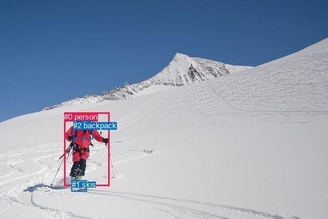
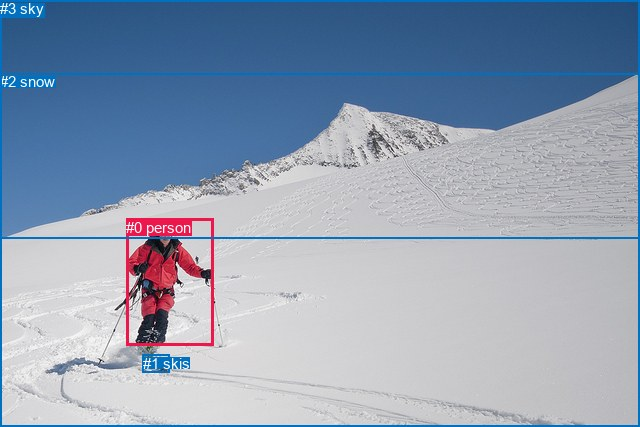

# 图片 0712：2347578.jpg

随机样本序号：446。图片 SHA256：`ea735adca70a80e2d2e55495563e5c09d90cb44a0bd1458f54daa9a7eddca040`。

红色框表示人，蓝色框表示其他物体。两个模式分别保留自身框编号，可依据位置比较对应对象。

## 自动检测框与输出

人的框编号：`[0]`。状态：`ok`。

### 自动检测全部物体框

| 编号 | 类别 | 是否为人 | 检测分数 | 像素坐标 xyxy |
|---|---|---|---|---|
| 0 | person | True | 0.9997 | 125.1, 219.2, 213.6, 362.8 |
| 1 | skis | False | 0.9256 | 139.8, 351.2, 169.8, 373.4 |
| 2 | backpack | False | 0.4516 | 143.3, 235.9, 181.3, 271.4 |

### 自动检测 Top50 人相关候选

评分物体对：6；人相关物体对：4；输出关系：8。

| 排名 | 主语编号与类别 | 关系 | 宾语编号与类别 | 类型 | 人与人 | 排序分数 | 原始融合 logit |
|---|---|---|---|---|---|---|---|
| 1 | #0 person | wearing | #2 backpack | semantic | False | 0.98913 | 4.5104 |
| 2 | #0 person | wearing | #1 skis | semantic | False | 0.98330 | 4.0754 |
| 3 | #0 person | on | #1 skis | spatial | False | 0.97748 | 3.7706 |
| 4 | #2 backpack | on | #0 person | spatial | False | 0.93832 | 2.7221 |
| 5 | #0 person | in | #2 backpack | spatial | False | 0.89940 | 2.1906 |
| 6 | #1 skis | on | #0 person | spatial | False | 0.87561 | 1.9515 |
| 7 | #2 backpack | wearing | #0 person | semantic | False | 0.33211 | -0.6986 |
| 8 | #1 skis | wearing | #0 person | semantic | False | 0.24057 | -1.1496 |

### 自动检测逐条人相关 GT 核验

R@50：0.00%；命中 0/3。

| GT 主语编号 | GT 关系 | GT 宾语编号 | 结果阶段 | 匹配预测主语编号 | 匹配预测宾语编号 |
|---|---|---|---|---|---|
| 0 | riding | 1 | wrong_predicate | [0] | [1] |
| 0 | going down | 2 | endpoint_missing_or_wrong_class | [0] | [] |
| 3 | over | 0 | endpoint_missing_or_wrong_class | [] | [0] |

## 真实框与输出

人的框编号：`[0]`。

### 真实框全部物体框

| 编号 | 类别 | 是否为人 | 检测分数 | 像素坐标 xyxy |
|---|---|---|---|---|
| 0 | person | True | GT | 126.0, 219.0, 213.0, 346.0 |
| 1 | skis | False | GT | 143.0, 355.0, 170.0, 373.0 |
| 2 | snow | False | GT | 0.0, 73.0, 640.0, 427.0 |
| 3 | sky | False | GT | 0.0, 0.0, 640.0, 239.0 |

### 真实框 Top50 人相关候选

评分物体对：12；人相关物体对：6；输出关系：12。

| 排名 | 主语编号与类别 | 关系 | 宾语编号与类别 | 类型 | 人与人 | 排序分数 | 原始融合 logit |
|---|---|---|---|---|---|---|---|
| 1 | #0 person | on | #2 snow | spatial | False | 0.97849 | 3.8174 |
| 2 | #0 person | on | #1 skis | spatial | False | 0.97494 | 3.6611 |
| 3 | #0 person | wearing | #1 skis | semantic | False | 0.96290 | 3.2564 |
| 4 | #0 person | going down | #2 snow | semantic | False | 0.94002 | 2.7518 |
| 5 | #3 sky | over | #0 person | spatial | False | 0.91263 | 2.3462 |
| 6 | #2 snow | beside | #0 person | spatial | False | 0.83150 | 1.5963 |
| 7 | #1 skis | on | #0 person | spatial | False | 0.78507 | 1.2954 |
| 8 | #0 person | looking at | #3 sky | semantic | False | 0.60064 | 0.4081 |
| 9 | #0 person | in | #3 sky | spatial | False | 0.46787 | -0.1287 |
| 10 | #1 skis | wearing | #0 person | semantic | False | 0.26193 | -1.0359 |
| 11 | #3 sky | flying over | #0 person | semantic | False | 0.25880 | -1.0522 |
| 12 | #2 snow | holding | #0 person | semantic | False | 0.15826 | -1.6712 |

### 真实框逐条人相关 GT 核验

R@50：66.67%；命中 2/3。

| GT 主语编号 | GT 关系 | GT 宾语编号 | 结果阶段 | 匹配预测主语编号 | 匹配预测宾语编号 |
|---|---|---|---|---|---|
| 0 | riding | 1 | wrong_predicate | [0] | [1] |
| 0 | going down | 2 | hit50 | [0] | [2] |
| 3 | over | 0 | hit50 | [3] | [0] |

## 全部人相关 GT

| 主语编号与类别 | 关系 | 宾语编号与类别 |
|---|---|---|
| #0 person | riding | #1 skis |
| #0 person | going down | #2 snow |
| #3 sky | over | #0 person |

原始记录、全部人相关物体对的两项预测与分项分数见 [逐图证据 JSON](../evidence/cases/0712.json)。全部56类 logits 保留于本机 HOR/output/random500/logits/。

<!-- HOR_COMPLETE_RESULTS -->

## 六组条件的完整输出对照

以下保留同一图片三种框与候选模式、两种谓词输出规则的全部 Top50。框编号各自在所属模式内解释。

### 自动检测框完整枚举：空间与语义各保留一个谓词

| 排名 | 主语编号与类别 | 谓词 | 宾语编号与类别 | 分组 | 排序分数 | predicate logit | pair logit |
|---|---|---|---|---|---|---|---|
| 1 | #0 person | wearing | #2 backpack | semantic | 0.9891251 | 4.3660750 | 0.1442890 |
| 2 | #0 person | wearing | #1 skis | semantic | 0.9832979 | 3.8137631 | 0.2616180 |
| 3 | #0 person | on | #1 skis | spatial | 0.9774806 | 3.5089869 | 0.2616180 |
| 4 | #2 backpack | on | #0 person | spatial | 0.9383190 | 2.8292542 | -0.1071412 |
| 5 | #0 person | in | #2 backpack | spatial | 0.8993979 | 2.0462637 | 0.1442890 |
| 6 | #1 skis | on | #0 person | spatial | 0.8756061 | 2.5839477 | -0.6324844 |
| 7 | #2 backpack | wearing | #0 person | semantic | 0.3321131 | -0.5915022 | -0.1071412 |
| 8 | #1 skis | wearing | #0 person | semantic | 0.2405652 | -0.5170989 | -0.6324844 |

GT 命中：0/3，R@50=0.00%。

| GT主语 | GT谓词 | GT宾语 | 结果阶段 | 匹配主语框 | 匹配宾语框 |
|---|---|---|---|---|---|
| 0 | riding | 1 | wrong_predicate | [0] | [1] |
| 0 | going down | 2 | endpoint_missing_or_wrong_class | [0] | [] |
| 3 | over | 0 | endpoint_missing_or_wrong_class | [] | [0] |

### 自动检测框完整枚举：每对只保留一个谓词

| 排名 | 主语编号与类别 | 谓词 | 宾语编号与类别 | 分组 | 排序分数 | predicate logit | pair logit |
|---|---|---|---|---|---|---|---|
| 1 | #0 person | wearing | #2 backpack | single | 0.9891251 | 4.3660750 | 0.1442890 |
| 2 | #0 person | wearing | #1 skis | single | 0.9832979 | 3.8137631 | 0.2616180 |
| 3 | #2 backpack | on | #0 person | single | 0.9383190 | 2.8292542 | -0.1071412 |
| 4 | #1 skis | on | #0 person | single | 0.8756061 | 2.5839477 | -0.6324844 |

GT 命中：0/3，R@50=0.00%。

| GT主语 | GT谓词 | GT宾语 | 结果阶段 | 匹配主语框 | 匹配宾语框 |
|---|---|---|---|---|---|
| 0 | riding | 1 | wrong_predicate | [0] | [1] |
| 0 | going down | 2 | endpoint_missing_or_wrong_class | [0] | [] |
| 3 | over | 0 | endpoint_missing_or_wrong_class | [] | [0] |

### 真实框完整枚举：空间与语义各保留一个谓词

| 排名 | 主语编号与类别 | 谓词 | 宾语编号与类别 | 分组 | 排序分数 | predicate logit | pair logit |
|---|---|---|---|---|---|---|---|
| 1 | #0 person | on | #2 snow | spatial | 0.9784887 | 3.7480369 | 0.0693948 |
| 2 | #0 person | on | #1 skis | spatial | 0.9749399 | 3.6224589 | 0.0386405 |
| 3 | #0 person | wearing | #1 skis | semantic | 0.9629040 | 3.2178059 | 0.0386405 |
| 4 | #0 person | going down | #2 snow | semantic | 0.9400162 | 2.6824274 | 0.0693948 |
| 5 | #3 sky | over | #0 person | spatial | 0.9126322 | 3.1273851 | -0.7811794 |
| 6 | #2 snow | beside | #0 person | spatial | 0.8315015 | 2.4475112 | -0.8512051 |
| 7 | #1 skis | on | #0 person | spatial | 0.7850682 | 1.9531617 | -0.6577122 |
| 8 | #0 person | looking at | #3 sky | semantic | 0.6006382 | 1.2902398 | -0.8821149 |
| 9 | #0 person | in | #3 sky | spatial | 0.4678688 | 0.7534127 | -0.8821149 |
| 10 | #1 skis | wearing | #0 person | semantic | 0.2619332 | -0.3782325 | -0.6577122 |
| 11 | #3 sky | flying over | #0 person | semantic | 0.2588001 | -0.2710347 | -0.7811794 |
| 12 | #2 snow | holding | #0 person | semantic | 0.1582637 | -0.8199992 | -0.8512051 |

GT 命中：2/3，R@50=66.67%。

| GT主语 | GT谓词 | GT宾语 | 结果阶段 | 匹配主语框 | 匹配宾语框 |
|---|---|---|---|---|---|
| 0 | riding | 1 | wrong_predicate | [0] | [1] |
| 0 | going down | 2 | hit50 | [0] | [2] |
| 3 | over | 0 | hit50 | [3] | [0] |

### 真实框完整枚举：每对只保留一个谓词

| 排名 | 主语编号与类别 | 谓词 | 宾语编号与类别 | 分组 | 排序分数 | predicate logit | pair logit |
|---|---|---|---|---|---|---|---|
| 1 | #0 person | on | #2 snow | single | 0.9784887 | 3.7480369 | 0.0693948 |
| 2 | #0 person | on | #1 skis | single | 0.9749399 | 3.6224589 | 0.0386405 |
| 3 | #3 sky | over | #0 person | single | 0.9126322 | 3.1273851 | -0.7811794 |
| 4 | #2 snow | beside | #0 person | single | 0.8315015 | 2.4475112 | -0.8512051 |
| 5 | #1 skis | on | #0 person | single | 0.7850682 | 1.9531617 | -0.6577122 |
| 6 | #0 person | looking at | #3 sky | single | 0.6006382 | 1.2902398 | -0.8821149 |

GT 命中：1/3，R@50=33.33%。

| GT主语 | GT谓词 | GT宾语 | 结果阶段 | 匹配主语框 | 匹配宾语框 |
|---|---|---|---|---|---|
| 0 | riding | 1 | wrong_predicate | [0] | [1] |
| 0 | going down | 2 | wrong_predicate | [0] | [2] |
| 3 | over | 0 | hit50 | [3] | [0] |

### 真实框400候选：空间与语义各保留一个谓词

| 排名 | 主语编号与类别 | 谓词 | 宾语编号与类别 | 分组 | 排序分数 | predicate logit | pair logit |
|---|---|---|---|---|---|---|---|
| 1 | #0 person | on | #2 snow | spatial | 0.9784887 | 3.7480369 | 0.0693948 |
| 2 | #0 person | on | #1 skis | spatial | 0.9749399 | 3.6224589 | 0.0386405 |
| 3 | #0 person | wearing | #1 skis | semantic | 0.9626939 | 3.2119389 | 0.0386405 |
| 4 | #0 person | going down | #2 snow | semantic | 0.9400162 | 2.6824274 | 0.0693948 |
| 5 | #3 sky | over | #0 person | spatial | 0.9126322 | 3.1273851 | -0.7811794 |
| 6 | #2 snow | beside | #0 person | spatial | 0.8272516 | 2.4174776 | -0.8512051 |
| 7 | #1 skis | on | #0 person | spatial | 0.7850682 | 1.9531617 | -0.6577122 |
| 8 | #0 person | looking at | #3 sky | semantic | 0.6075846 | 1.3192854 | -0.8821149 |
| 9 | #0 person | in | #3 sky | spatial | 0.4662166 | 0.7467752 | -0.8821149 |
| 10 | #1 skis | wearing | #0 person | semantic | 0.2666431 | -0.3540092 | -0.6577122 |
| 11 | #3 sky | flying over | #0 person | semantic | 0.2588001 | -0.2710347 | -0.7811794 |
| 12 | #2 snow | holding | #0 person | semantic | 0.1582637 | -0.8199992 | -0.8512051 |

GT 命中：2/3，R@50=66.67%。

| GT主语 | GT谓词 | GT宾语 | 结果阶段 | 匹配主语框 | 匹配宾语框 |
|---|---|---|---|---|---|
| 0 | riding | 1 | wrong_predicate | [0] | [1] |
| 0 | going down | 2 | hit50 | [0] | [2] |
| 3 | over | 0 | hit50 | [3] | [0] |

### 真实框400候选：每对只保留一个谓词

| 排名 | 主语编号与类别 | 谓词 | 宾语编号与类别 | 分组 | 排序分数 | predicate logit | pair logit |
|---|---|---|---|---|---|---|---|
| 1 | #0 person | on | #2 snow | single | 0.9784887 | 3.7480369 | 0.0693948 |
| 2 | #0 person | on | #1 skis | single | 0.9749399 | 3.6224589 | 0.0386405 |
| 3 | #3 sky | over | #0 person | single | 0.9126322 | 3.1273851 | -0.7811794 |
| 4 | #2 snow | beside | #0 person | single | 0.8272516 | 2.4174776 | -0.8512051 |
| 5 | #1 skis | on | #0 person | single | 0.7850682 | 1.9531617 | -0.6577122 |
| 6 | #0 person | looking at | #3 sky | single | 0.6075846 | 1.3192854 | -0.8821149 |

GT 命中：1/3，R@50=33.33%。

| GT主语 | GT谓词 | GT宾语 | 结果阶段 | 匹配主语框 | 匹配宾语框 |
|---|---|---|---|---|---|
| 0 | riding | 1 | wrong_predicate | [0] | [1] |
| 0 | going down | 2 | wrong_predicate | [0] | [2] |
| 3 | over | 0 | hit50 | [3] | [0] |
