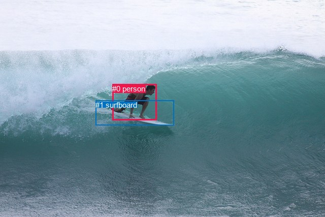
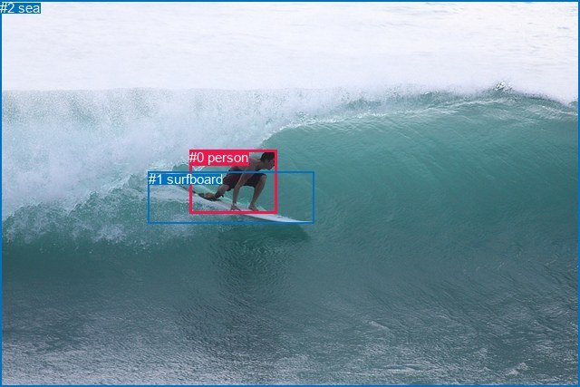

# 图片 0714：2347722.jpg

随机样本序号：70。图片 SHA256：`da6dc5bbfa9e31edf7b4f86d4ac27329484ea2e3bfd472e1f13853ebb0c127e7`。

红色框表示人，蓝色框表示其他物体。两个模式分别保留自身框编号，可依据位置比较对应对象。

## 自动检测框与输出

人的框编号：`[0]`。状态：`ok`。

### 自动检测全部物体框

| 编号 | 类别 | 是否为人 | 检测分数 | 像素坐标 xyxy |
|---|---|---|---|---|
| 0 | person | True | 0.9997 | 221.1, 165.6, 308.4, 236.5 |
| 1 | surfboard | False | 0.9783 | 188.1, 197.5, 342.6, 246.8 |

### 自动检测 Top50 人相关候选

评分物体对：2；人相关物体对：2；输出关系：4。

| 排名 | 主语编号与类别 | 关系 | 宾语编号与类别 | 类型 | 人与人 | 排序分数 | 原始融合 logit |
|---|---|---|---|---|---|---|---|
| 1 | #0 person | riding | #1 surfboard | semantic | False | 0.98383 | 4.1080 |
| 2 | #0 person | on | #1 surfboard | spatial | False | 0.48191 | -0.0724 |
| 3 | #1 surfboard | in | #0 person | spatial | False | 0.00223 | -6.1026 |
| 4 | #1 surfboard | wearing | #0 person | semantic | False | 0.00065 | -7.3319 |

### 自动检测逐条人相关 GT 核验

R@50：20.00%；命中 1/5。

| GT 主语编号 | GT 关系 | GT 宾语编号 | 结果阶段 | 匹配预测主语编号 | 匹配预测宾语编号 |
|---|---|---|---|---|---|
| 0 | on | 1 | hit50 | [0] | [1] |
| 0 | attached to | 1 | wrong_predicate | [0] | [1] |
| 0 | playing | 1 | wrong_predicate | [0] | [1] |
| 0 | touching | 1 | wrong_predicate | [0] | [1] |
| 0 | looking at | 2 | endpoint_missing_or_wrong_class | [0] | [] |

## 真实框与输出

人的框编号：`[0]`。

### 真实框全部物体框

| 编号 | 类别 | 是否为人 | 检测分数 | 像素坐标 xyxy |
|---|---|---|---|---|
| 0 | person | True | GT | 209.0, 165.0, 306.0, 235.0 |
| 1 | surfboard | False | GT | 164.0, 189.0, 346.0, 246.0 |
| 2 | sea | False | GT | 0.0, 0.0, 640.0, 427.0 |

### 真实框 Top50 人相关候选

评分物体对：6；人相关物体对：4；输出关系：8。

| 排名 | 主语编号与类别 | 关系 | 宾语编号与类别 | 类型 | 人与人 | 排序分数 | 原始融合 logit |
|---|---|---|---|---|---|---|---|
| 1 | #0 person | riding | #1 surfboard | semantic | False | 0.98763 | 4.3799 |
| 2 | #0 person | in | #2 sea | spatial | False | 0.98572 | 4.2345 |
| 3 | #0 person | on | #1 surfboard | spatial | False | 0.98020 | 3.9021 |
| 4 | #0 person | riding | #2 sea | semantic | False | 0.95458 | 3.0454 |
| 5 | #2 sea | beside | #0 person | spatial | False | 0.60082 | 0.4089 |
| 6 | #1 surfboard | in | #0 person | spatial | False | 0.16188 | -1.6443 |
| 7 | #2 sea | catching | #0 person | semantic | False | 0.15041 | -1.7314 |
| 8 | #1 surfboard | holding | #0 person | semantic | False | 0.10084 | -2.1880 |

### 真实框逐条人相关 GT 核验

R@50：20.00%；命中 1/5。

| GT 主语编号 | GT 关系 | GT 宾语编号 | 结果阶段 | 匹配预测主语编号 | 匹配预测宾语编号 |
|---|---|---|---|---|---|
| 0 | on | 1 | hit50 | [0] | [1] |
| 0 | attached to | 1 | wrong_predicate | [0] | [1] |
| 0 | playing | 1 | wrong_predicate | [0] | [1] |
| 0 | touching | 1 | wrong_predicate | [0] | [1] |
| 0 | looking at | 2 | wrong_predicate | [0] | [2] |

## 全部人相关 GT

| 主语编号与类别 | 关系 | 宾语编号与类别 |
|---|---|---|
| #0 person | on | #1 surfboard |
| #0 person | attached to | #1 surfboard |
| #0 person | playing | #1 surfboard |
| #0 person | touching | #1 surfboard |
| #0 person | looking at | #2 sea |

原始记录、全部人相关物体对的两项预测与分项分数见 [逐图证据 JSON](../evidence/cases/0714.json)。全部56类 logits 保留于本机 HOR/output/random500/logits/。

<!-- HOR_COMPLETE_RESULTS -->

## 六组条件的完整输出对照

以下保留同一图片三种框与候选模式、两种谓词输出规则的全部 Top50。框编号各自在所属模式内解释。

### 自动检测框完整枚举：空间与语义各保留一个谓词

| 排名 | 主语编号与类别 | 谓词 | 宾语编号与类别 | 分组 | 排序分数 | predicate logit | pair logit |
|---|---|---|---|---|---|---|---|
| 1 | #0 person | riding | #1 surfboard | semantic | 0.9838252 | 3.9852681 | 0.1227251 |
| 2 | #0 person | on | #1 surfboard | spatial | 0.4819061 | -0.1951323 | 0.1227251 |
| 3 | #1 surfboard | in | #0 person | spatial | 0.0022321 | -5.2215462 | -0.8810234 |
| 4 | #1 surfboard | wearing | #0 person | semantic | 0.0006539 | -6.4508514 | -0.8810234 |

GT 命中：1/5，R@50=20.00%。

| GT主语 | GT谓词 | GT宾语 | 结果阶段 | 匹配主语框 | 匹配宾语框 |
|---|---|---|---|---|---|
| 0 | on | 1 | hit50 | [0] | [1] |
| 0 | attached to | 1 | wrong_predicate | [0] | [1] |
| 0 | playing | 1 | wrong_predicate | [0] | [1] |
| 0 | touching | 1 | wrong_predicate | [0] | [1] |
| 0 | looking at | 2 | endpoint_missing_or_wrong_class | [0] | [] |

### 自动检测框完整枚举：每对只保留一个谓词

| 排名 | 主语编号与类别 | 谓词 | 宾语编号与类别 | 分组 | 排序分数 | predicate logit | pair logit |
|---|---|---|---|---|---|---|---|
| 1 | #0 person | riding | #1 surfboard | single | 0.9838252 | 3.9852681 | 0.1227251 |
| 2 | #1 surfboard | in | #0 person | single | 0.0022321 | -5.2215462 | -0.8810234 |

GT 命中：0/5，R@50=0.00%。

| GT主语 | GT谓词 | GT宾语 | 结果阶段 | 匹配主语框 | 匹配宾语框 |
|---|---|---|---|---|---|
| 0 | on | 1 | wrong_predicate | [0] | [1] |
| 0 | attached to | 1 | wrong_predicate | [0] | [1] |
| 0 | playing | 1 | wrong_predicate | [0] | [1] |
| 0 | touching | 1 | wrong_predicate | [0] | [1] |
| 0 | looking at | 2 | endpoint_missing_or_wrong_class | [0] | [] |

### 真实框完整枚举：空间与语义各保留一个谓词

| 排名 | 主语编号与类别 | 谓词 | 宾语编号与类别 | 分组 | 排序分数 | predicate logit | pair logit |
|---|---|---|---|---|---|---|---|
| 1 | #0 person | riding | #1 surfboard | semantic | 0.9876279 | 4.2476220 | 0.1322387 |
| 2 | #0 person | in | #2 sea | spatial | 0.9857194 | 4.1050963 | 0.1293702 |
| 3 | #0 person | on | #1 surfboard | spatial | 0.9801996 | 3.7698159 | 0.1322387 |
| 4 | #0 person | riding | #2 sea | semantic | 0.9545836 | 2.9160318 | 0.1293702 |
| 5 | #2 sea | beside | #0 person | spatial | 0.6008177 | 1.3388186 | -0.9299451 |
| 6 | #1 surfboard | in | #0 person | spatial | 0.1618780 | -0.6869602 | -0.9573604 |
| 7 | #2 sea | catching | #0 person | semantic | 0.1504060 | -0.8014755 | -0.9299451 |
| 8 | #1 surfboard | holding | #0 person | semantic | 0.1008353 | -1.2306173 | -0.9573604 |

GT 命中：1/5，R@50=20.00%。

| GT主语 | GT谓词 | GT宾语 | 结果阶段 | 匹配主语框 | 匹配宾语框 |
|---|---|---|---|---|---|
| 0 | on | 1 | hit50 | [0] | [1] |
| 0 | attached to | 1 | wrong_predicate | [0] | [1] |
| 0 | playing | 1 | wrong_predicate | [0] | [1] |
| 0 | touching | 1 | wrong_predicate | [0] | [1] |
| 0 | looking at | 2 | wrong_predicate | [0] | [2] |

### 真实框完整枚举：每对只保留一个谓词

| 排名 | 主语编号与类别 | 谓词 | 宾语编号与类别 | 分组 | 排序分数 | predicate logit | pair logit |
|---|---|---|---|---|---|---|---|
| 1 | #0 person | riding | #1 surfboard | single | 0.9876279 | 4.2476220 | 0.1322387 |
| 2 | #0 person | in | #2 sea | single | 0.9857194 | 4.1050963 | 0.1293702 |
| 3 | #2 sea | beside | #0 person | single | 0.6008177 | 1.3388186 | -0.9299451 |
| 4 | #1 surfboard | in | #0 person | single | 0.1618780 | -0.6869602 | -0.9573604 |

GT 命中：0/5，R@50=0.00%。

| GT主语 | GT谓词 | GT宾语 | 结果阶段 | 匹配主语框 | 匹配宾语框 |
|---|---|---|---|---|---|
| 0 | on | 1 | wrong_predicate | [0] | [1] |
| 0 | attached to | 1 | wrong_predicate | [0] | [1] |
| 0 | playing | 1 | wrong_predicate | [0] | [1] |
| 0 | touching | 1 | wrong_predicate | [0] | [1] |
| 0 | looking at | 2 | wrong_predicate | [0] | [2] |

### 真实框400候选：空间与语义各保留一个谓词

| 排名 | 主语编号与类别 | 谓词 | 宾语编号与类别 | 分组 | 排序分数 | predicate logit | pair logit |
|---|---|---|---|---|---|---|---|
| 1 | #0 person | riding | #1 surfboard | semantic | 0.9876279 | 4.2476220 | 0.1322387 |
| 2 | #0 person | in | #2 sea | spatial | 0.9857194 | 4.1050963 | 0.1293702 |
| 3 | #0 person | on | #1 surfboard | spatial | 0.9801996 | 3.7698159 | 0.1322387 |
| 4 | #0 person | riding | #2 sea | semantic | 0.9558704 | 2.9461231 | 0.1293702 |
| 5 | #2 sea | beside | #0 person | spatial | 0.5936073 | 1.3088431 | -0.9299451 |
| 6 | #1 surfboard | in | #0 person | spatial | 0.1614282 | -0.6902790 | -0.9573604 |
| 7 | #2 sea | catching | #0 person | semantic | 0.1504060 | -0.8014755 | -0.9299451 |
| 8 | #1 surfboard | holding | #0 person | semantic | 0.1011035 | -1.2276630 | -0.9573604 |

GT 命中：1/5，R@50=20.00%。

| GT主语 | GT谓词 | GT宾语 | 结果阶段 | 匹配主语框 | 匹配宾语框 |
|---|---|---|---|---|---|
| 0 | on | 1 | hit50 | [0] | [1] |
| 0 | attached to | 1 | wrong_predicate | [0] | [1] |
| 0 | playing | 1 | wrong_predicate | [0] | [1] |
| 0 | touching | 1 | wrong_predicate | [0] | [1] |
| 0 | looking at | 2 | wrong_predicate | [0] | [2] |

### 真实框400候选：每对只保留一个谓词

| 排名 | 主语编号与类别 | 谓词 | 宾语编号与类别 | 分组 | 排序分数 | predicate logit | pair logit |
|---|---|---|---|---|---|---|---|
| 1 | #0 person | riding | #1 surfboard | single | 0.9876279 | 4.2476220 | 0.1322387 |
| 2 | #0 person | in | #2 sea | single | 0.9857194 | 4.1050963 | 0.1293702 |
| 3 | #2 sea | beside | #0 person | single | 0.5936073 | 1.3088431 | -0.9299451 |
| 4 | #1 surfboard | in | #0 person | single | 0.1614282 | -0.6902790 | -0.9573604 |

GT 命中：0/5，R@50=0.00%。

| GT主语 | GT谓词 | GT宾语 | 结果阶段 | 匹配主语框 | 匹配宾语框 |
|---|---|---|---|---|---|
| 0 | on | 1 | wrong_predicate | [0] | [1] |
| 0 | attached to | 1 | wrong_predicate | [0] | [1] |
| 0 | playing | 1 | wrong_predicate | [0] | [1] |
| 0 | touching | 1 | wrong_predicate | [0] | [1] |
| 0 | looking at | 2 | wrong_predicate | [0] | [2] |
