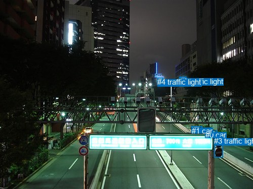
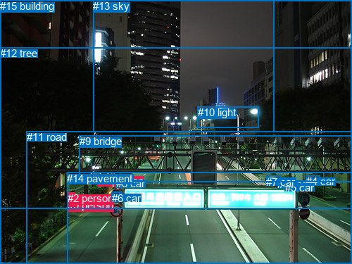

# 图片 0716：2347794.jpg

随机样本序号：464。图片 SHA256：`3485f9355b88cddf7a0a0f8a3aa1ea6301cd613a80731323c3cb83253459bdea`。

红色框表示人，蓝色框表示其他物体。两个模式分别保留自身框编号，可依据位置比较对应对象。

## 自动检测框与输出

人的框编号：`[]`。状态：`no_person`。

### 自动检测全部物体框

| 编号 | 类别 | 是否为人 | 检测分数 | 像素坐标 xyxy |
|---|---|---|---|---|
| 0 | car | False | 0.7744 | 405.7, 259.5, 429.7, 271.4 |
| 1 | car | False | 0.6758 | 378.5, 250.5, 399.5, 262.2 |
| 2 | traffic light | False | 0.4423 | 354.5, 152.6, 368.1, 163.9 |
| 3 | traffic light | False | 0.4313 | 423.3, 271.4, 440.8, 313.0 |
| 4 | traffic light | False | 0.3537 | 311.0, 154.4, 322.6, 163.8 |

### 自动检测 Top50 人相关候选

评分物体对：0；人相关物体对：0；输出关系：0。

| 排名 | 主语编号与类别 | 关系 | 宾语编号与类别 | 类型 | 人与人 | 排序分数 | 原始融合 logit |
|---|---|---|---|---|---|---|---|

### 自动检测逐条人相关 GT 核验

本图没有人相关 GT，R@50 无分母；预测候选继续展示。

## 真实框与输出

人的框编号：`[0, 1, 2]`。

### 真实框全部物体框

| 编号 | 类别 | 是否为人 | 检测分数 | 像素坐标 xyxy |
|---|---|---|---|---|
| 0 | person | True | GT | 96.0, 283.0, 103.0, 298.0 |
| 1 | person | True | GT | 139.0, 248.0, 144.0, 259.0 |
| 2 | person | True | GT | 96.0, 273.0, 106.0, 293.0 |
| 3 | car | False | GT | 394.0, 253.0, 397.0, 257.0 |
| 4 | car | False | GT | 435.0, 249.0, 455.0, 262.0 |
| 5 | car | False | GT | 405.0, 258.0, 429.0, 269.0 |
| 6 | car | False | GT | 159.0, 273.0, 172.0, 283.0 |
| 7 | car | False | GT | 378.0, 250.0, 399.0, 262.0 |
| 8 | car | False | GT | 165.0, 252.0, 185.0, 266.0 |
| 9 | bridge | False | GT | 113.0, 192.0, 500.0, 258.0 |
| 10 | light | False | GT | 281.0, 151.0, 367.0, 181.0 |
| 11 | road | False | GT | 38.0, 186.0, 500.0, 375.0 |
| 12 | tree | False | GT | 0.0, 67.0, 500.0, 375.0 |
| 13 | sky | False | GT | 132.0, 0.0, 389.0, 187.0 |
| 14 | pavement | False | GT | 95.0, 245.0, 500.0, 375.0 |
| 15 | building | False | GT | 0.0, 0.0, 500.0, 296.0 |

### 真实框 Top50 人相关候选

评分物体对：240；人相关物体对：84；输出关系：50。

| 排名 | 主语编号与类别 | 关系 | 宾语编号与类别 | 类型 | 人与人 | 排序分数 | 原始融合 logit |
|---|---|---|---|---|---|---|---|
| 1 | #2 person | walking on | #11 road | semantic | False | 0.98586 | 4.2448 |
| 2 | #2 person | crossing | #14 pavement | semantic | False | 0.98569 | 4.2322 |
| 3 | #0 person | walking on | #11 road | semantic | False | 0.98258 | 4.0327 |
| 4 | #0 person | walking on | #14 pavement | semantic | False | 0.98010 | 3.8968 |
| 5 | #2 person | wearing | #0 person | semantic | True | 0.97062 | 3.4977 |
| 6 | #1 person | crossing | #14 pavement | semantic | False | 0.95988 | 3.1749 |
| 7 | #1 person | crossing | #11 road | semantic | False | 0.95666 | 3.0943 |
| 8 | #2 person | walking on | #12 tree | semantic | False | 0.95085 | 2.9625 |
| 9 | #1 person | on | #14 pavement | spatial | False | 0.95013 | 2.9472 |
| 10 | #1 person | on | #11 road | spatial | False | 0.94722 | 2.8875 |
| 11 | #1 person | in | #12 tree | spatial | False | 0.92715 | 2.5437 |
| 12 | #0 person | walking on | #12 tree | semantic | False | 0.92344 | 2.4901 |
| 13 | #0 person | pushing | #2 person | semantic | True | 0.90730 | 2.2812 |
| 14 | #2 person | on | #14 pavement | spatial | False | 0.90407 | 2.2433 |
| 15 | #2 person | on | #11 road | spatial | False | 0.89962 | 2.1930 |
| 16 | #0 person | on | #14 pavement | spatial | False | 0.89245 | 2.1160 |
| 17 | #2 person | in | #0 person | spatial | True | 0.88852 | 2.0757 |
| 18 | #0 person | on | #11 road | spatial | False | 0.88403 | 2.0311 |
| 19 | #2 person | in | #12 tree | spatial | False | 0.88311 | 2.0223 |
| 20 | #0 person | in | #2 person | spatial | True | 0.85843 | 1.8023 |
| 21 | #0 person | in | #12 tree | spatial | False | 0.84496 | 1.6956 |
| 22 | #1 person | on | #9 bridge | spatial | False | 0.66727 | 0.6959 |
| 23 | #1 person | in | #15 building | spatial | False | 0.64524 | 0.5982 |
| 24 | #1 person | standing on | #9 bridge | semantic | False | 0.58209 | 0.3314 |
| 25 | #1 person | walking on | #12 tree | semantic | False | 0.55637 | 0.2265 |
| 26 | #2 person | walking on | #9 bridge | semantic | False | 0.52195 | 0.0879 |
| 27 | #2 person | in | #15 building | spatial | False | 0.38030 | -0.4883 |
| 28 | #0 person | walking on | #9 bridge | semantic | False | 0.26094 | -1.0411 |
| 29 | #2 person | walking on | #15 building | semantic | False | 0.22482 | -1.2378 |
| 30 | #2 person | walking on | #1 person | semantic | True | 0.19297 | -1.4308 |
| 31 | #0 person | in | #15 building | spatial | False | 0.15353 | -1.7072 |
| 32 | #0 person | walking on | #1 person | semantic | True | 0.11457 | -2.0448 |
| 33 | #2 person | in | #9 bridge | spatial | False | 0.10434 | -2.1499 |
| 34 | #8 car | on | #1 person | spatial | False | 0.10274 | -2.1672 |
| 35 | #0 person | walking on | #15 building | semantic | False | 0.07837 | -2.4647 |
| 36 | #2 person | beside | #1 person | spatial | True | 0.06311 | -2.6976 |
| 37 | #0 person | beside | #9 bridge | spatial | False | 0.05506 | -2.8428 |
| 38 | #12 tree | on | #1 person | spatial | False | 0.05457 | -2.8521 |
| 39 | #2 person | looking at | #8 car | semantic | False | 0.05207 | -2.9017 |
| 40 | #14 pavement | in | #1 person | spatial | False | 0.05072 | -2.9294 |
| 41 | #11 road | on | #1 person | spatial | False | 0.04962 | -2.9525 |
| 42 | #1 person | on | #2 person | spatial | True | 0.04933 | -2.9587 |
| 43 | #6 car | on | #1 person | spatial | False | 0.04880 | -2.9699 |
| 44 | #0 person | in | #1 person | spatial | True | 0.04847 | -2.9772 |
| 45 | #1 person | in | #13 sky | spatial | False | 0.03860 | -3.2153 |
| 46 | #1 person | on | #0 person | spatial | True | 0.03761 | -3.2421 |
| 47 | #9 bridge | over | #1 person | spatial | False | 0.03717 | -3.2543 |
| 48 | #1 person | standing on | #15 building | semantic | False | 0.03716 | -3.2545 |
| 49 | #1 person | on | #8 car | spatial | False | 0.03701 | -3.2590 |
| 50 | #0 person | looking at | #8 car | semantic | False | 0.03542 | -3.3045 |

### 真实框逐条人相关 GT 核验

本图没有人相关 GT，R@50 无分母；预测候选继续展示。

## 全部人相关 GT

| 主语编号与类别 | 关系 | 宾语编号与类别 |
|---|---|---|

原始记录、全部人相关物体对的两项预测与分项分数见 [逐图证据 JSON](../evidence/cases/0716.json)。全部56类 logits 保留于本机 HOR/output/random500/logits/。

<!-- HOR_COMPLETE_RESULTS -->

## 六组条件的完整输出对照

以下保留同一图片三种框与候选模式、两种谓词输出规则的全部 Top50。框编号各自在所属模式内解释。

### 自动检测框完整枚举：空间与语义各保留一个谓词

| 排名 | 主语编号与类别 | 谓词 | 宾语编号与类别 | 分组 | 排序分数 | predicate logit | pair logit |
|---|---|---|---|---|---|---|---|

没有人相关 GT，本条件的召回率无分母。

### 自动检测框完整枚举：每对只保留一个谓词

| 排名 | 主语编号与类别 | 谓词 | 宾语编号与类别 | 分组 | 排序分数 | predicate logit | pair logit |
|---|---|---|---|---|---|---|---|

没有人相关 GT，本条件的召回率无分母。

### 真实框完整枚举：空间与语义各保留一个谓词

| 排名 | 主语编号与类别 | 谓词 | 宾语编号与类别 | 分组 | 排序分数 | predicate logit | pair logit |
|---|---|---|---|---|---|---|---|
| 1 | #2 person | walking on | #11 road | semantic | 0.9858635 | 4.4625525 | -0.2177929 |
| 2 | #2 person | crossing | #14 pavement | semantic | 0.9856873 | 4.4271932 | -0.1949998 |
| 3 | #0 person | walking on | #11 road | semantic | 0.9825828 | 4.3241239 | -0.2913951 |
| 4 | #0 person | walking on | #14 pavement | semantic | 0.9800964 | 4.1526084 | -0.2558575 |
| 5 | #2 person | wearing | #0 person | semantic | 0.9706217 | 3.5512109 | -0.0535308 |
| 6 | #1 person | crossing | #14 pavement | semantic | 0.9598794 | 3.3521543 | -0.1772368 |
| 7 | #1 person | crossing | #11 road | semantic | 0.9566560 | 3.2332106 | -0.1389349 |
| 8 | #2 person | walking on | #12 tree | semantic | 0.9508520 | 3.7253098 | -0.7627863 |
| 9 | #1 person | on | #14 pavement | spatial | 0.9501308 | 3.1244321 | -0.1772368 |
| 10 | #1 person | on | #11 road | spatial | 0.9472246 | 3.0264258 | -0.1389349 |
| 11 | #1 person | in | #12 tree | spatial | 0.9271465 | 3.1598630 | -0.6162028 |
| 12 | #0 person | walking on | #12 tree | semantic | 0.9234442 | 3.3251061 | -0.8350155 |
| 13 | #0 person | pushing | #2 person | semantic | 0.9073038 | 2.5541205 | -0.2729704 |
| 14 | #2 person | on | #14 pavement | spatial | 0.9040735 | 2.4383287 | -0.1949998 |
| 15 | #2 person | on | #11 road | spatial | 0.8996211 | 2.4108152 | -0.2177929 |
| 16 | #0 person | on | #14 pavement | spatial | 0.8924462 | 2.3718328 | -0.2558575 |
| 17 | #2 person | in | #0 person | spatial | 0.8885190 | 2.1292324 | -0.0535308 |
| 18 | #0 person | on | #11 road | spatial | 0.8840285 | 2.3225398 | -0.2913951 |
| 19 | #2 person | in | #12 tree | spatial | 0.8831146 | 2.7850480 | -0.7627863 |
| 20 | #0 person | in | #2 person | spatial | 0.8584253 | 2.0752425 | -0.2729704 |
| 21 | #0 person | in | #12 tree | spatial | 0.8449568 | 2.5305977 | -0.8350155 |
| 22 | #1 person | on | #9 bridge | spatial | 0.6672725 | 1.1366730 | -0.4407985 |
| 23 | #1 person | in | #15 building | spatial | 0.6452354 | 1.1426358 | -0.5444754 |
| 24 | #1 person | standing on | #9 bridge | semantic | 0.5820938 | 0.7721734 | -0.4407985 |
| 25 | #1 person | walking on | #12 tree | semantic | 0.5563722 | 0.8426547 | -0.6162028 |
| 26 | #2 person | walking on | #9 bridge | semantic | 0.5219515 | 0.4047775 | -0.3169152 |
| 27 | #2 person | in | #15 building | spatial | 0.3802994 | 0.2576056 | -0.7458831 |
| 28 | #0 person | walking on | #9 bridge | semantic | 0.2609400 | -0.6484022 | -0.3926866 |
| 29 | #2 person | walking on | #15 building | semantic | 0.2248226 | -0.4918971 | -0.7458831 |
| 30 | #2 person | walking on | #1 person | semantic | 0.1929667 | -1.0485990 | -0.3822485 |
| 31 | #0 person | in | #15 building | spatial | 0.1535260 | -0.8267319 | -0.8804777 |
| 32 | #0 person | walking on | #1 person | semantic | 0.1145744 | -1.5285468 | -0.5162976 |
| 33 | #2 person | in | #9 bridge | spatial | 0.1043416 | -1.8329737 | -0.3169152 |
| 34 | #8 car | on | #1 person | spatial | 0.1027381 | -1.8370030 | -0.3301618 |
| 35 | #0 person | walking on | #15 building | semantic | 0.0783723 | -1.5841925 | -0.8804777 |
| 36 | #2 person | beside | #1 person | spatial | 0.0631134 | -2.3153815 | -0.3822485 |
| 37 | #0 person | beside | #9 bridge | spatial | 0.0550566 | -2.4500766 | -0.3926866 |
| 38 | #12 tree | on | #1 person | spatial | 0.0545742 | -1.8306596 | -1.0214140 |
| 39 | #2 person | looking at | #8 car | semantic | 0.0520672 | -1.5672083 | -1.3345392 |
| 40 | #14 pavement | in | #1 person | spatial | 0.0507193 | -1.5466046 | -1.3827932 |
| 41 | #11 road | on | #1 person | spatial | 0.0496169 | -1.7193022 | -1.2332306 |
| 42 | #1 person | on | #2 person | spatial | 0.0493260 | -2.1911612 | -0.7675579 |
| 43 | #6 car | on | #1 person | spatial | 0.0488043 | -2.3867185 | -0.5831835 |
| 44 | #0 person | in | #1 person | spatial | 0.0484687 | -2.4608564 | -0.5162976 |
| 45 | #1 person | in | #13 sky | spatial | 0.0385956 | -2.2987442 | -0.9165125 |
| 46 | #1 person | on | #0 person | spatial | 0.0376128 | -2.4591877 | -0.7828834 |
| 47 | #9 bridge | over | #1 person | spatial | 0.0371715 | -2.2945836 | -0.9597498 |
| 48 | #1 person | standing on | #15 building | semantic | 0.0371648 | -2.7100453 | -0.5444754 |
| 49 | #1 person | on | #8 car | spatial | 0.0370062 | -2.4562049 | -0.8027567 |
| 50 | #0 person | looking at | #8 car | semantic | 0.0354187 | -1.9291751 | -1.3752789 |

没有人相关 GT，本条件的召回率无分母。

### 真实框完整枚举：每对只保留一个谓词

| 排名 | 主语编号与类别 | 谓词 | 宾语编号与类别 | 分组 | 排序分数 | predicate logit | pair logit |
|---|---|---|---|---|---|---|---|
| 1 | #2 person | walking on | #11 road | single | 0.9858635 | 4.4625525 | -0.2177929 |
| 2 | #2 person | crossing | #14 pavement | single | 0.9856873 | 4.4271932 | -0.1949998 |
| 3 | #0 person | walking on | #11 road | single | 0.9825828 | 4.3241239 | -0.2913951 |
| 4 | #0 person | walking on | #14 pavement | single | 0.9800964 | 4.1526084 | -0.2558575 |
| 5 | #2 person | wearing | #0 person | single | 0.9706217 | 3.5512109 | -0.0535308 |
| 6 | #1 person | crossing | #14 pavement | single | 0.9598794 | 3.3521543 | -0.1772368 |
| 7 | #1 person | crossing | #11 road | single | 0.9566560 | 3.2332106 | -0.1389349 |
| 8 | #2 person | walking on | #12 tree | single | 0.9508520 | 3.7253098 | -0.7627863 |
| 9 | #1 person | in | #12 tree | single | 0.9271465 | 3.1598630 | -0.6162028 |
| 10 | #0 person | walking on | #12 tree | single | 0.9234442 | 3.3251061 | -0.8350155 |
| 11 | #0 person | pushing | #2 person | single | 0.9073038 | 2.5541205 | -0.2729704 |
| 12 | #1 person | on | #9 bridge | single | 0.6672725 | 1.1366730 | -0.4407985 |
| 13 | #1 person | in | #15 building | single | 0.6452354 | 1.1426358 | -0.5444754 |
| 14 | #2 person | walking on | #9 bridge | single | 0.5219515 | 0.4047775 | -0.3169152 |
| 15 | #2 person | in | #15 building | single | 0.3802994 | 0.2576056 | -0.7458831 |
| 16 | #0 person | walking on | #9 bridge | single | 0.2609400 | -0.6484022 | -0.3926866 |
| 17 | #2 person | walking on | #1 person | single | 0.1929667 | -1.0485990 | -0.3822485 |
| 18 | #0 person | in | #15 building | single | 0.1535260 | -0.8267319 | -0.8804777 |
| 19 | #0 person | walking on | #1 person | single | 0.1145744 | -1.5285468 | -0.5162976 |
| 20 | #8 car | on | #1 person | single | 0.1027381 | -1.8370030 | -0.3301618 |
| 21 | #12 tree | on | #1 person | single | 0.0545742 | -1.8306596 | -1.0214140 |
| 22 | #2 person | looking at | #8 car | single | 0.0520672 | -1.5672083 | -1.3345392 |
| 23 | #14 pavement | in | #1 person | single | 0.0507193 | -1.5466046 | -1.3827932 |
| 24 | #11 road | on | #1 person | single | 0.0496169 | -1.7193022 | -1.2332306 |
| 25 | #1 person | on | #2 person | single | 0.0493260 | -2.1911612 | -0.7675579 |
| 26 | #6 car | on | #1 person | single | 0.0488043 | -2.3867185 | -0.5831835 |
| 27 | #1 person | in | #13 sky | single | 0.0385956 | -2.2987442 | -0.9165125 |
| 28 | #1 person | on | #0 person | single | 0.0376128 | -2.4591877 | -0.7828834 |
| 29 | #9 bridge | over | #1 person | single | 0.0371715 | -2.2945836 | -0.9597498 |
| 30 | #1 person | on | #8 car | single | 0.0370062 | -2.4562049 | -0.8027567 |
| 31 | #0 person | looking at | #8 car | single | 0.0354187 | -1.9291751 | -1.3752789 |
| 32 | #2 person | walking on | #7 car | single | 0.0344473 | -2.2710369 | -1.0622331 |
| 33 | #2 person | looking at | #6 car | single | 0.0313238 | -1.7185361 | -1.7130173 |
| 34 | #0 person | walking on | #7 car | single | 0.0275131 | -2.3959107 | -1.1692853 |
| 35 | #2 person | walking on | #5 car | single | 0.0271895 | -2.2454612 | -1.3318983 |
| 36 | #0 person | walking on | #5 car | single | 0.0226256 | -2.3402436 | -1.4255451 |
| 37 | #0 person | looking at | #6 car | single | 0.0212934 | -2.0807221 | -1.7471148 |
| 38 | #2 person | looking at | #13 sky | single | 0.0201913 | -2.7445364 | -1.1375678 |
| 39 | #2 person | walking on | #3 car | single | 0.0201763 | -2.7810688 | -1.1017969 |
| 40 | #1 person | on | #6 car | single | 0.0175684 | -2.9476566 | -1.0762702 |
| 41 | #2 person | walking on | #4 car | single | 0.0170649 | -2.7946162 | -1.2589021 |
| 42 | #12 tree | on | #2 person | single | 0.0152926 | -2.9338851 | -1.2310901 |
| 43 | #1 person | on | #7 car | single | 0.0151522 | -3.1847234 | -0.9896200 |
| 44 | #0 person | walking on | #3 car | single | 0.0146231 | -3.0037394 | -1.2066799 |
| 45 | #0 person | looking at | #13 sky | single | 0.0145789 | -2.9644465 | -1.2490497 |
| 46 | #9 bridge | over | #2 person | single | 0.0137886 | -3.0628653 | -1.2071669 |
| 47 | #12 tree | on | #0 person | single | 0.0137033 | -3.0450404 | -1.2312795 |
| 48 | #1 person | on | #5 car | single | 0.0131993 | -3.2011299 | -1.1131780 |
| 49 | #0 person | walking on | #4 car | single | 0.0125209 | -3.0007322 | -1.3670201 |
| 50 | #9 bridge | over | #0 person | single | 0.0118283 | -3.2647529 | -1.1606061 |

没有人相关 GT，本条件的召回率无分母。

### 真实框400候选：空间与语义各保留一个谓词

| 排名 | 主语编号与类别 | 谓词 | 宾语编号与类别 | 分组 | 排序分数 | predicate logit | pair logit |
|---|---|---|---|---|---|---|---|
| 1 | #2 person | walking on | #11 road | semantic | 0.9858635 | 4.4625525 | -0.2177929 |
| 2 | #2 person | crossing | #14 pavement | semantic | 0.9856873 | 4.4271932 | -0.1949998 |
| 3 | #0 person | walking on | #11 road | semantic | 0.9825828 | 4.3241239 | -0.2913951 |
| 4 | #0 person | walking on | #14 pavement | semantic | 0.9800964 | 4.1526084 | -0.2558575 |
| 5 | #2 person | wearing | #0 person | semantic | 0.9704539 | 3.5453429 | -0.0535308 |
| 6 | #1 person | crossing | #14 pavement | semantic | 0.9598794 | 3.3521543 | -0.1772368 |
| 7 | #1 person | crossing | #11 road | semantic | 0.9566560 | 3.2332106 | -0.1389349 |
| 8 | #1 person | on | #14 pavement | spatial | 0.9519193 | 3.1628356 | -0.1772368 |
| 9 | #2 person | walking on | #12 tree | semantic | 0.9508520 | 3.7253098 | -0.7627863 |
| 10 | #1 person | on | #11 road | spatial | 0.9472246 | 3.0264258 | -0.1389349 |
| 11 | #1 person | in | #12 tree | spatial | 0.9275935 | 3.1665006 | -0.6162028 |
| 12 | #0 person | walking on | #12 tree | semantic | 0.9234442 | 3.3251061 | -0.8350155 |
| 13 | #2 person | on | #14 pavement | spatial | 0.9073528 | 2.4767323 | -0.1949998 |
| 14 | #0 person | pushing | #2 person | semantic | 0.9073028 | 2.5541091 | -0.2729704 |
| 15 | #2 person | on | #11 road | spatial | 0.8996211 | 2.4108152 | -0.2177929 |
| 16 | #0 person | on | #14 pavement | spatial | 0.8924462 | 2.3718328 | -0.2558575 |
| 17 | #2 person | in | #0 person | spatial | 0.8868424 | 2.1124163 | -0.0535308 |
| 18 | #2 person | in | #12 tree | spatial | 0.8831146 | 2.7850480 | -0.7627863 |
| 19 | #0 person | on | #11 road | spatial | 0.8800329 | 2.2841368 | -0.2913951 |
| 20 | #0 person | in | #2 person | spatial | 0.8584253 | 2.0752425 | -0.2729704 |
| 21 | #0 person | in | #12 tree | spatial | 0.8440853 | 2.5239606 | -0.8350155 |
| 22 | #1 person | on | #9 bridge | spatial | 0.6593362 | 1.1011362 | -0.4407985 |
| 23 | #1 person | in | #15 building | spatial | 0.6390833 | 1.1158633 | -0.5444754 |
| 24 | #1 person | standing on | #9 bridge | semantic | 0.5747563 | 0.7420821 | -0.4407985 |
| 25 | #1 person | walking on | #12 tree | semantic | 0.5630459 | 0.8697357 | -0.6162028 |
| 26 | #2 person | walking on | #9 bridge | semantic | 0.5219515 | 0.4047775 | -0.3169152 |
| 27 | #2 person | in | #15 building | spatial | 0.3810819 | 0.2609243 | -0.7458831 |
| 28 | #0 person | walking on | #9 bridge | semantic | 0.2664903 | -0.6198163 | -0.3926866 |
| 29 | #2 person | walking on | #15 building | semantic | 0.2298437 | -0.4633107 | -0.7458831 |
| 30 | #2 person | walking on | #1 person | semantic | 0.1953206 | -1.0335534 | -0.3822485 |
| 31 | #0 person | in | #15 building | spatial | 0.1499732 | -0.8543339 | -0.8804777 |
| 32 | #0 person | walking on | #1 person | semantic | 0.1159552 | -1.5150065 | -0.5162976 |
| 33 | #8 car | on | #1 person | spatial | 0.1049046 | -1.8137176 | -0.3301618 |
| 34 | #2 person | in | #9 bridge | spatial | 0.1042012 | -1.8344774 | -0.3169152 |
| 35 | #0 person | walking on | #15 building | semantic | 0.0771852 | -1.6007435 | -0.8804777 |
| 36 | #2 person | beside | #1 person | spatial | 0.0640063 | -2.3003793 | -0.3822485 |
| 37 | #12 tree | on | #1 person | spatial | 0.0550717 | -1.8210590 | -1.0214140 |
| 38 | #0 person | beside | #9 bridge | spatial | 0.0550574 | -2.4500620 | -0.3926866 |
| 39 | #14 pavement | in | #1 person | spatial | 0.0514082 | -1.5323887 | -1.3827932 |
| 40 | #2 person | looking at | #8 car | semantic | 0.0513381 | -1.5820796 | -1.3345392 |
| 41 | #11 road | on | #1 person | spatial | 0.0503998 | -1.7028229 | -1.2332306 |
| 42 | #6 car | on | #1 person | spatial | 0.0490735 | -2.3809335 | -0.5831835 |
| 43 | #0 person | in | #1 person | spatial | 0.0484687 | -2.4608564 | -0.5162976 |
| 44 | #1 person | on | #2 person | spatial | 0.0481830 | -2.2158079 | -0.7675579 |
| 45 | #1 person | in | #13 sky | spatial | 0.0389088 | -2.2903359 | -0.9165125 |
| 46 | #1 person | on | #0 person | spatial | 0.0376128 | -2.4591877 | -0.7828834 |
| 47 | #9 bridge | over | #1 person | spatial | 0.0370976 | -2.2966495 | -0.9597498 |
| 48 | #1 person | standing on | #15 building | semantic | 0.0366950 | -2.7232547 | -0.5444754 |
| 49 | #1 person | on | #8 car | spatial | 0.0364259 | -2.4726117 | -0.8027567 |
| 50 | #0 person | looking at | #8 car | semantic | 0.0348987 | -1.9445038 | -1.3752789 |

没有人相关 GT，本条件的召回率无分母。

### 真实框400候选：每对只保留一个谓词

| 排名 | 主语编号与类别 | 谓词 | 宾语编号与类别 | 分组 | 排序分数 | predicate logit | pair logit |
|---|---|---|---|---|---|---|---|
| 1 | #2 person | walking on | #11 road | single | 0.9858635 | 4.4625525 | -0.2177929 |
| 2 | #2 person | crossing | #14 pavement | single | 0.9856873 | 4.4271932 | -0.1949998 |
| 3 | #0 person | walking on | #11 road | single | 0.9825828 | 4.3241239 | -0.2913951 |
| 4 | #0 person | walking on | #14 pavement | single | 0.9800964 | 4.1526084 | -0.2558575 |
| 5 | #2 person | wearing | #0 person | single | 0.9704539 | 3.5453429 | -0.0535308 |
| 6 | #1 person | crossing | #14 pavement | single | 0.9598794 | 3.3521543 | -0.1772368 |
| 7 | #1 person | crossing | #11 road | single | 0.9566560 | 3.2332106 | -0.1389349 |
| 8 | #2 person | walking on | #12 tree | single | 0.9508520 | 3.7253098 | -0.7627863 |
| 9 | #1 person | in | #12 tree | single | 0.9275935 | 3.1665006 | -0.6162028 |
| 10 | #0 person | walking on | #12 tree | single | 0.9234442 | 3.3251061 | -0.8350155 |
| 11 | #0 person | pushing | #2 person | single | 0.9073028 | 2.5541091 | -0.2729704 |
| 12 | #1 person | on | #9 bridge | single | 0.6593362 | 1.1011362 | -0.4407985 |
| 13 | #1 person | in | #15 building | single | 0.6390833 | 1.1158633 | -0.5444754 |
| 14 | #2 person | walking on | #9 bridge | single | 0.5219515 | 0.4047775 | -0.3169152 |
| 15 | #2 person | in | #15 building | single | 0.3810819 | 0.2609243 | -0.7458831 |
| 16 | #0 person | walking on | #9 bridge | single | 0.2664903 | -0.6198163 | -0.3926866 |
| 17 | #2 person | walking on | #1 person | single | 0.1953206 | -1.0335534 | -0.3822485 |
| 18 | #0 person | in | #15 building | single | 0.1499732 | -0.8543339 | -0.8804777 |
| 19 | #0 person | walking on | #1 person | single | 0.1159552 | -1.5150065 | -0.5162976 |
| 20 | #8 car | on | #1 person | single | 0.1049046 | -1.8137176 | -0.3301618 |
| 21 | #12 tree | on | #1 person | single | 0.0550717 | -1.8210590 | -1.0214140 |
| 22 | #14 pavement | in | #1 person | single | 0.0514082 | -1.5323887 | -1.3827932 |
| 23 | #2 person | looking at | #8 car | single | 0.0513381 | -1.5820796 | -1.3345392 |
| 24 | #11 road | on | #1 person | single | 0.0503998 | -1.7028229 | -1.2332306 |
| 25 | #6 car | on | #1 person | single | 0.0490735 | -2.3809335 | -0.5831835 |
| 26 | #1 person | on | #2 person | single | 0.0481830 | -2.2158079 | -0.7675579 |
| 27 | #1 person | in | #13 sky | single | 0.0389088 | -2.2903359 | -0.9165125 |
| 28 | #1 person | on | #0 person | single | 0.0376128 | -2.4591877 | -0.7828834 |
| 29 | #9 bridge | over | #1 person | single | 0.0370976 | -2.2966495 | -0.9597498 |
| 30 | #1 person | on | #8 car | single | 0.0364259 | -2.4726117 | -0.8027567 |
| 31 | #0 person | looking at | #8 car | single | 0.0348987 | -1.9445038 | -1.3752789 |
| 32 | #2 person | walking on | #7 car | single | 0.0344473 | -2.2710369 | -1.0622331 |
| 33 | #2 person | looking at | #6 car | single | 0.0317795 | -1.7036214 | -1.7130173 |
| 34 | #0 person | walking on | #7 car | single | 0.0275332 | -2.3951581 | -1.1692853 |
| 35 | #2 person | walking on | #5 car | single | 0.0271895 | -2.2454612 | -1.3318983 |
| 36 | #0 person | walking on | #5 car | single | 0.0229607 | -2.3251984 | -1.4255451 |
| 37 | #0 person | looking at | #6 car | single | 0.0209840 | -2.0956750 | -1.7471148 |
| 38 | #2 person | walking on | #3 car | single | 0.0207339 | -2.7532353 | -1.1017969 |
| 39 | #2 person | looking at | #13 sky | single | 0.0204841 | -2.7298393 | -1.1375678 |
| 40 | #1 person | on | #6 car | single | 0.0178837 | -2.9295483 | -1.0762702 |
| 41 | #2 person | walking on | #4 car | single | 0.0163846 | -2.8359900 | -1.2589021 |
| 42 | #1 person | on | #7 car | single | 0.0156287 | -3.1532707 | -0.9896200 |
| 43 | #12 tree | on | #2 person | single | 0.0151905 | -2.9406910 | -1.2310901 |
| 44 | #0 person | walking on | #3 car | single | 0.0149519 | -2.9811709 | -1.2066799 |
| 45 | #0 person | looking at | #13 sky | single | 0.0146907 | -2.9566896 | -1.2490497 |
| 46 | #12 tree | on | #0 person | single | 0.0137217 | -3.0436792 | -1.2312795 |
| 47 | #9 bridge | over | #2 person | single | 0.0135501 | -3.0805550 | -1.2071669 |
| 48 | #1 person | on | #5 car | single | 0.0131285 | -3.2065749 | -1.1131780 |
| 49 | #0 person | walking on | #4 car | single | 0.0121905 | -3.0278130 | -1.3670201 |
| 50 | #9 bridge | over | #0 person | single | 0.0117667 | -3.2700410 | -1.1606061 |

没有人相关 GT，本条件的召回率无分母。
