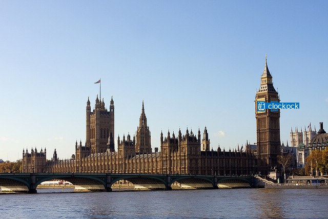
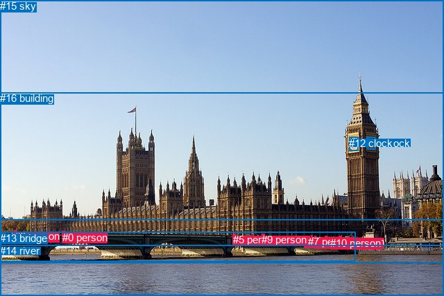

# 图片 0723：2348265.jpg

随机样本序号：230。图片 SHA256：`f4e6671d9be6d7bb897365eaad70051c1eaa4e292947f7e547e53fa4ddb3b55d`。

红色框表示人，蓝色框表示其他物体。两个模式分别保留自身框编号，可依据位置比较对应对象。

## 自动检测框与输出

人的框编号：`[]`。状态：`no_person`。

### 自动检测全部物体框

| 编号 | 类别 | 是否为人 | 检测分数 | 像素坐标 xyxy |
|---|---|---|---|---|
| 0 | clock | False | 0.9986 | 528.4, 197.8, 541.4, 216.1 |
| 1 | clock | False | 0.9983 | 502.6, 197.7, 516.8, 217.0 |

### 自动检测 Top50 人相关候选

评分物体对：0；人相关物体对：0；输出关系：0。

| 排名 | 主语编号与类别 | 关系 | 宾语编号与类别 | 类型 | 人与人 | 排序分数 | 原始融合 logit |
|---|---|---|---|---|---|---|---|

### 自动检测逐条人相关 GT 核验

R@50：0.00%；命中 0/2。

| GT 主语编号 | GT 关系 | GT 宾语编号 | 结果阶段 | 匹配预测主语编号 | 匹配预测宾语编号 |
|---|---|---|---|---|---|
| 5 | on | 13 | endpoint_missing_or_wrong_class | [] | [] |
| 6 | over | 14 | endpoint_missing_or_wrong_class | [] | [] |

## 真实框与输出

人的框编号：`[0, 1, 2, 3, 4, 5, 6, 7, 8, 9, 10]`。

### 真实框全部物体框

| 编号 | 类别 | 是否为人 | 检测分数 | 像素坐标 xyxy |
|---|---|---|---|---|
| 0 | person | True | GT | 90.0, 334.0, 94.0, 337.0 |
| 1 | person | True | GT | 448.0, 339.0, 450.0, 342.0 |
| 2 | person | True | GT | 453.0, 341.0, 455.0, 342.0 |
| 3 | person | True | GT | 469.0, 341.0, 471.0, 345.0 |
| 4 | person | True | GT | 438.0, 340.0, 440.0, 343.0 |
| 5 | person | True | GT | 336.0, 337.0, 339.0, 340.0 |
| 6 | person | True | GT | 489.0, 340.0, 492.0, 348.0 |
| 7 | person | True | GT | 444.0, 340.0, 446.0, 343.0 |
| 8 | person | True | GT | 21.0, 332.0, 24.0, 338.0 |
| 9 | person | True | GT | 377.0, 337.0, 381.0, 340.0 |
| 10 | person | True | GT | 476.0, 342.0, 478.0, 346.0 |
| 11 | clock | False | GT | 528.0, 198.0, 541.0, 216.0 |
| 12 | clock | False | GT | 503.0, 198.0, 517.0, 218.0 |
| 13 | bridge | False | GT | 0.0, 335.0, 513.0, 378.0 |
| 14 | river | False | GT | 0.0, 353.0, 640.0, 427.0 |
| 15 | sky | False | GT | 0.0, 0.0, 640.0, 318.0 |
| 16 | building | False | GT | 0.0, 133.0, 640.0, 380.0 |

### 真实框 Top50 人相关候选

评分物体对：272；人相关物体对：242；输出关系：50。

| 排名 | 主语编号与类别 | 关系 | 宾语编号与类别 | 类型 | 人与人 | 排序分数 | 原始融合 logit |
|---|---|---|---|---|---|---|---|
| 1 | #6 person | walking on | #13 bridge | semantic | False | 0.98174 | 3.9849 |
| 2 | #8 person | in | #16 building | spatial | False | 0.97092 | 3.5081 |
| 3 | #10 person | walking on | #13 bridge | semantic | False | 0.96836 | 3.4213 |
| 4 | #0 person | attached to | #13 bridge | spatial | False | 0.95932 | 3.1605 |
| 5 | #3 person | walking on | #13 bridge | semantic | False | 0.95499 | 3.0547 |
| 6 | #0 person | in | #16 building | spatial | False | 0.95016 | 2.9478 |
| 7 | #0 person | over | #14 river | spatial | False | 0.94472 | 2.8384 |
| 8 | #1 person | walking on | #13 bridge | semantic | False | 0.94414 | 2.8274 |
| 9 | #9 person | over | #14 river | spatial | False | 0.94110 | 2.7712 |
| 10 | #1 person | on | #13 bridge | spatial | False | 0.93896 | 2.7332 |
| 11 | #2 person | on | #13 bridge | spatial | False | 0.93887 | 2.7317 |
| 12 | #2 person | walking on | #13 bridge | semantic | False | 0.93783 | 2.7137 |
| 13 | #7 person | on | #13 bridge | spatial | False | 0.93730 | 2.7047 |
| 14 | #4 person | on | #13 bridge | spatial | False | 0.93545 | 2.6736 |
| 15 | #3 person | on | #13 bridge | spatial | False | 0.93452 | 2.6584 |
| 16 | #7 person | walking on | #13 bridge | semantic | False | 0.93414 | 2.6521 |
| 17 | #8 person | beside | #14 river | spatial | False | 0.93094 | 2.6012 |
| 18 | #10 person | on | #13 bridge | spatial | False | 0.92964 | 2.5811 |
| 19 | #5 person | on | #13 bridge | spatial | False | 0.92374 | 2.4943 |
| 20 | #6 person | on | #13 bridge | spatial | False | 0.91708 | 2.4033 |
| 21 | #4 person | walking on | #13 bridge | semantic | False | 0.91203 | 2.3387 |
| 22 | #9 person | attached to | #13 bridge | spatial | False | 0.90497 | 2.2537 |
| 23 | #5 person | holding | #13 bridge | semantic | False | 0.89546 | 2.1477 |
| 24 | #9 person | in | #16 building | spatial | False | 0.86648 | 1.8702 |
| 25 | #9 person | crossing | #13 bridge | semantic | False | 0.84927 | 1.7289 |
| 26 | #8 person | beside | #13 bridge | spatial | False | 0.84327 | 1.6828 |
| 27 | #9 person | crossing | #14 river | semantic | False | 0.83250 | 1.6035 |
| 28 | #5 person | over | #14 river | spatial | False | 0.82202 | 1.5301 |
| 29 | #0 person | crossing | #13 bridge | semantic | False | 0.79333 | 1.3451 |
| 30 | #5 person | in | #16 building | spatial | False | 0.75094 | 1.1036 |
| 31 | #6 person | crossing | #14 river | semantic | False | 0.74983 | 1.0977 |
| 32 | #0 person | crossing | #16 building | semantic | False | 0.71582 | 0.9238 |
| 33 | #8 person | crossing | #14 river | semantic | False | 0.67816 | 0.7453 |
| 34 | #0 person | crossing | #14 river | semantic | False | 0.65875 | 0.6577 |
| 35 | #4 person | over | #14 river | spatial | False | 0.65814 | 0.6550 |
| 36 | #8 person | crossing | #13 bridge | semantic | False | 0.65355 | 0.6347 |
| 37 | #9 person | crossing | #16 building | semantic | False | 0.64707 | 0.6062 |
| 38 | #10 person | over | #14 river | spatial | False | 0.63968 | 0.5740 |
| 39 | #7 person | over | #14 river | spatial | False | 0.63564 | 0.5565 |
| 40 | #2 person | over | #14 river | spatial | False | 0.62822 | 0.5246 |
| 41 | #3 person | over | #14 river | spatial | False | 0.62777 | 0.5227 |
| 42 | #10 person | crossing | #14 river | semantic | False | 0.62769 | 0.5223 |
| 43 | #8 person | holding | #16 building | semantic | False | 0.61774 | 0.4800 |
| 44 | #4 person | in | #16 building | spatial | False | 0.61677 | 0.4759 |
| 45 | #13 bridge | in | #9 person | spatial | False | 0.57792 | 0.3142 |
| 46 | #7 person | in | #16 building | spatial | False | 0.56931 | 0.2790 |
| 47 | #6 person | over | #14 river | spatial | False | 0.56140 | 0.2468 |
| 48 | #13 bridge | in | #5 person | spatial | False | 0.55681 | 0.2282 |
| 49 | #1 person | over | #14 river | spatial | False | 0.53979 | 0.1595 |
| 50 | #1 person | in | #16 building | spatial | False | 0.53605 | 0.1445 |

### 真实框逐条人相关 GT 核验

R@50：100.00%；命中 2/2。

| GT 主语编号 | GT 关系 | GT 宾语编号 | 结果阶段 | 匹配预测主语编号 | 匹配预测宾语编号 |
|---|---|---|---|---|---|
| 5 | on | 13 | hit50 | [5] | [13] |
| 6 | over | 14 | hit50 | [6] | [14] |

## 全部人相关 GT

| 主语编号与类别 | 关系 | 宾语编号与类别 |
|---|---|---|
| #5 person | on | #13 bridge |
| #6 person | over | #14 river |

原始记录、全部人相关物体对的两项预测与分项分数见 [逐图证据 JSON](../evidence/cases/0723.json)。全部56类 logits 保留于本机 HOR/output/random500/logits/。

<!-- HOR_COMPLETE_RESULTS -->

## 六组条件的完整输出对照

以下保留同一图片三种框与候选模式、两种谓词输出规则的全部 Top50。框编号各自在所属模式内解释。

### 自动检测框完整枚举：空间与语义各保留一个谓词

| 排名 | 主语编号与类别 | 谓词 | 宾语编号与类别 | 分组 | 排序分数 | predicate logit | pair logit |
|---|---|---|---|---|---|---|---|

GT 命中：0/2，R@50=0.00%。

| GT主语 | GT谓词 | GT宾语 | 结果阶段 | 匹配主语框 | 匹配宾语框 |
|---|---|---|---|---|---|
| 5 | on | 13 | endpoint_missing_or_wrong_class | [] | [] |
| 6 | over | 14 | endpoint_missing_or_wrong_class | [] | [] |

### 自动检测框完整枚举：每对只保留一个谓词

| 排名 | 主语编号与类别 | 谓词 | 宾语编号与类别 | 分组 | 排序分数 | predicate logit | pair logit |
|---|---|---|---|---|---|---|---|

GT 命中：0/2，R@50=0.00%。

| GT主语 | GT谓词 | GT宾语 | 结果阶段 | 匹配主语框 | 匹配宾语框 |
|---|---|---|---|---|---|
| 5 | on | 13 | endpoint_missing_or_wrong_class | [] | [] |
| 6 | over | 14 | endpoint_missing_or_wrong_class | [] | [] |

### 真实框完整枚举：空间与语义各保留一个谓词

| 排名 | 主语编号与类别 | 谓词 | 宾语编号与类别 | 分组 | 排序分数 | predicate logit | pair logit |
|---|---|---|---|---|---|---|---|
| 1 | #6 person | walking on | #13 bridge | semantic | 0.9817443 | 4.2970290 | -0.3121749 |
| 2 | #8 person | in | #16 building | spatial | 0.9709166 | 3.8347001 | -0.3266245 |
| 3 | #10 person | walking on | #13 bridge | semantic | 0.9683627 | 3.6651273 | -0.2438569 |
| 4 | #0 person | attached to | #13 bridge | spatial | 0.9593191 | 3.3410306 | -0.1805681 |
| 5 | #3 person | walking on | #13 bridge | semantic | 0.9549870 | 3.2709451 | -0.2161982 |
| 6 | #0 person | in | #16 building | spatial | 0.9501587 | 3.4877706 | -0.5399857 |
| 7 | #0 person | over | #14 river | spatial | 0.9447179 | 3.0110459 | -0.1726069 |
| 8 | #1 person | walking on | #13 bridge | semantic | 0.9441397 | 3.0452671 | -0.2178459 |
| 9 | #9 person | over | #14 river | spatial | 0.9411004 | 3.0765171 | -0.3053015 |
| 10 | #1 person | on | #13 bridge | spatial | 0.9389587 | 2.9510670 | -0.2178459 |
| 11 | #2 person | on | #13 bridge | spatial | 0.9388700 | 2.9459114 | -0.2142369 |
| 12 | #2 person | walking on | #13 bridge | semantic | 0.9378288 | 2.9279127 | -0.2142369 |
| 13 | #7 person | on | #13 bridge | spatial | 0.9373007 | 2.9232635 | -0.2186089 |
| 14 | #4 person | on | #13 bridge | spatial | 0.9354533 | 2.8957500 | -0.2221087 |
| 15 | #3 person | on | #13 bridge | spatial | 0.9345239 | 2.8745499 | -0.2161982 |
| 16 | #7 person | walking on | #13 bridge | semantic | 0.9341423 | 2.8707404 | -0.2186089 |
| 17 | #8 person | beside | #14 river | spatial | 0.9309391 | 2.6626606 | -0.0614550 |
| 18 | #10 person | on | #13 bridge | spatial | 0.9296359 | 2.8249674 | -0.2438569 |
| 19 | #5 person | on | #13 bridge | spatial | 0.9237428 | 2.5443864 | -0.0500647 |
| 20 | #6 person | on | #13 bridge | spatial | 0.9170799 | 2.7154918 | -0.3121749 |
| 21 | #4 person | walking on | #13 bridge | semantic | 0.9120319 | 2.5608106 | -0.2221087 |
| 22 | #9 person | attached to | #13 bridge | spatial | 0.9049733 | 2.4382935 | -0.1845460 |
| 23 | #5 person | holding | #13 bridge | semantic | 0.8954550 | 2.1977787 | -0.0500647 |
| 24 | #9 person | in | #16 building | spatial | 0.8664806 | 2.3053689 | -0.4351756 |
| 25 | #9 person | crossing | #13 bridge | semantic | 0.8492735 | 1.9134603 | -0.1845460 |
| 26 | #8 person | beside | #13 bridge | spatial | 0.8432747 | 1.9736843 | -0.2908860 |
| 27 | #9 person | crossing | #14 river | semantic | 0.8325024 | 1.9087687 | -0.3053015 |
| 28 | #5 person | over | #14 river | spatial | 0.8220157 | 1.8491898 | -0.3191254 |
| 29 | #0 person | crossing | #13 bridge | semantic | 0.7933303 | 1.5256858 | -0.1805681 |
| 30 | #5 person | in | #16 building | spatial | 0.7509422 | 1.5233402 | -0.4196965 |
| 31 | #6 person | crossing | #14 river | semantic | 0.7498343 | 1.4016247 | -0.3038958 |
| 32 | #0 person | crossing | #16 building | semantic | 0.7158181 | 1.4637971 | -0.5399857 |
| 33 | #8 person | crossing | #14 river | semantic | 0.6781561 | 0.8067656 | -0.0614550 |
| 34 | #0 person | crossing | #14 river | semantic | 0.6587458 | 0.8303170 | -0.1726069 |
| 35 | #4 person | over | #14 river | spatial | 0.6581435 | 1.0179620 | -0.3629298 |
| 36 | #8 person | crossing | #13 bridge | semantic | 0.6535500 | 0.9255667 | -0.2908860 |
| 37 | #9 person | crossing | #16 building | semantic | 0.6470750 | 1.0413823 | -0.4351756 |
| 38 | #10 person | over | #14 river | spatial | 0.6396756 | 0.8823633 | -0.3084069 |
| 39 | #7 person | over | #14 river | spatial | 0.6356448 | 0.9065356 | -0.3500251 |
| 40 | #2 person | over | #14 river | spatial | 0.6282202 | 0.8780818 | -0.3534927 |
| 41 | #3 person | over | #14 river | spatial | 0.6277747 | 0.8443403 | -0.3216583 |
| 42 | #10 person | crossing | #14 river | semantic | 0.6276941 | 0.8307438 | -0.3084069 |
| 43 | #8 person | holding | #16 building | semantic | 0.6177362 | 0.8065753 | -0.3266245 |
| 44 | #4 person | in | #16 building | spatial | 0.6167682 | 0.8969479 | -0.4210946 |
| 45 | #13 bridge | in | #9 person | spatial | 0.5779157 | 0.7094197 | -0.3951969 |
| 46 | #7 person | in | #16 building | spatial | 0.5693070 | 0.7078815 | -0.4288571 |
| 47 | #6 person | over | #14 river | spatial | 0.5613967 | 0.5507283 | -0.3038958 |
| 48 | #13 bridge | in | #5 person | spatial | 0.5568115 | 0.6158271 | -0.3875957 |
| 49 | #1 person | over | #14 river | spatial | 0.5397912 | 0.5295758 | -0.3700740 |
| 50 | #1 person | in | #16 building | spatial | 0.5360538 | 0.5707002 | -0.4262341 |

GT 命中：2/2，R@50=100.00%。

| GT主语 | GT谓词 | GT宾语 | 结果阶段 | 匹配主语框 | 匹配宾语框 |
|---|---|---|---|---|---|
| 5 | on | 13 | hit50 | [5] | [13] |
| 6 | over | 14 | hit50 | [6] | [14] |

### 真实框完整枚举：每对只保留一个谓词

| 排名 | 主语编号与类别 | 谓词 | 宾语编号与类别 | 分组 | 排序分数 | predicate logit | pair logit |
|---|---|---|---|---|---|---|---|
| 1 | #6 person | walking on | #13 bridge | single | 0.9817443 | 4.2970290 | -0.3121749 |
| 2 | #8 person | in | #16 building | single | 0.9709166 | 3.8347001 | -0.3266245 |
| 3 | #10 person | walking on | #13 bridge | single | 0.9683627 | 3.6651273 | -0.2438569 |
| 4 | #0 person | attached to | #13 bridge | single | 0.9593191 | 3.3410306 | -0.1805681 |
| 5 | #3 person | walking on | #13 bridge | single | 0.9549870 | 3.2709451 | -0.2161982 |
| 6 | #0 person | in | #16 building | single | 0.9501587 | 3.4877706 | -0.5399857 |
| 7 | #0 person | over | #14 river | single | 0.9447179 | 3.0110459 | -0.1726069 |
| 8 | #1 person | walking on | #13 bridge | single | 0.9441397 | 3.0452671 | -0.2178459 |
| 9 | #9 person | over | #14 river | single | 0.9411004 | 3.0765171 | -0.3053015 |
| 10 | #2 person | on | #13 bridge | single | 0.9388700 | 2.9459114 | -0.2142369 |
| 11 | #7 person | on | #13 bridge | single | 0.9373007 | 2.9232635 | -0.2186089 |
| 12 | #4 person | on | #13 bridge | single | 0.9354533 | 2.8957500 | -0.2221087 |
| 13 | #8 person | beside | #14 river | single | 0.9309391 | 2.6626606 | -0.0614550 |
| 14 | #5 person | on | #13 bridge | single | 0.9237428 | 2.5443864 | -0.0500647 |
| 15 | #9 person | attached to | #13 bridge | single | 0.9049733 | 2.4382935 | -0.1845460 |
| 16 | #9 person | in | #16 building | single | 0.8664806 | 2.3053689 | -0.4351756 |
| 17 | #8 person | beside | #13 bridge | single | 0.8432747 | 1.9736843 | -0.2908860 |
| 18 | #5 person | over | #14 river | single | 0.8220157 | 1.8491898 | -0.3191254 |
| 19 | #5 person | in | #16 building | single | 0.7509422 | 1.5233402 | -0.4196965 |
| 20 | #6 person | crossing | #14 river | single | 0.7498343 | 1.4016247 | -0.3038958 |
| 21 | #4 person | over | #14 river | single | 0.6581435 | 1.0179620 | -0.3629298 |
| 22 | #10 person | over | #14 river | single | 0.6396756 | 0.8823633 | -0.3084069 |
| 23 | #7 person | over | #14 river | single | 0.6356448 | 0.9065356 | -0.3500251 |
| 24 | #2 person | over | #14 river | single | 0.6282202 | 0.8780818 | -0.3534927 |
| 25 | #3 person | over | #14 river | single | 0.6277747 | 0.8443403 | -0.3216583 |
| 26 | #4 person | in | #16 building | single | 0.6167682 | 0.8969479 | -0.4210946 |
| 27 | #13 bridge | in | #9 person | single | 0.5779157 | 0.7094197 | -0.3951969 |
| 28 | #7 person | in | #16 building | single | 0.5693070 | 0.7078815 | -0.4288571 |
| 29 | #13 bridge | in | #5 person | single | 0.5568115 | 0.6158271 | -0.3875957 |
| 30 | #1 person | over | #14 river | single | 0.5397912 | 0.5295758 | -0.3700740 |
| 31 | #1 person | in | #16 building | single | 0.5360538 | 0.5707002 | -0.4262341 |
| 32 | #13 bridge | in | #0 person | single | 0.5029968 | 0.5629497 | -0.5509623 |
| 33 | #13 bridge | in | #4 person | single | 0.4762408 | 0.3248706 | -0.4199792 |
| 34 | #13 bridge | in | #2 person | single | 0.4739497 | 0.3333907 | -0.4376862 |
| 35 | #13 bridge | in | #7 person | single | 0.4691521 | 0.2964387 | -0.4199872 |
| 36 | #13 bridge | in | #10 person | single | 0.4673959 | 0.3651409 | -0.4957426 |
| 37 | #13 bridge | in | #3 person | single | 0.4672391 | 0.3367090 | -0.4679403 |
| 38 | #13 bridge | in | #1 person | single | 0.4622203 | 0.2898011 | -0.4412086 |
| 39 | #13 bridge | on | #6 person | single | 0.4117510 | 0.2307782 | -0.5875099 |
| 40 | #6 person | walking on | #16 building | single | 0.3992220 | -0.0149250 | -0.3937828 |
| 41 | #2 person | in | #16 building | single | 0.3969605 | 0.0116343 | -0.4297805 |
| 42 | #3 person | in | #16 building | single | 0.3006557 | -0.3932719 | -0.4509055 |
| 43 | #10 person | in | #16 building | single | 0.2829033 | -0.4868951 | -0.4432106 |
| 44 | #7 person | beside | #1 person | single | 0.2689127 | -0.8253512 | -0.1747950 |
| 45 | #13 bridge | in | #8 person | single | 0.1943381 | -0.3989787 | -1.0230858 |
| 46 | #8 person | beside | #0 person | single | 0.1820288 | -1.0857856 | -0.4168767 |
| 47 | #1 person | beside | #2 person | single | 0.1719726 | -1.3839440 | -0.1877671 |
| 48 | #16 building | on | #5 person | single | 0.1481451 | -1.0822022 | -0.6670220 |
| 49 | #4 person | beside | #7 person | single | 0.1458271 | -1.5791361 | -0.1885762 |
| 50 | #16 building | on | #9 person | single | 0.1448983 | -1.1204605 | -0.6547277 |

GT 命中：1/2，R@50=50.00%。

| GT主语 | GT谓词 | GT宾语 | 结果阶段 | 匹配主语框 | 匹配宾语框 |
|---|---|---|---|---|---|
| 5 | on | 13 | hit50 | [5] | [13] |
| 6 | over | 14 | wrong_predicate | [6] | [14] |

### 真实框400候选：空间与语义各保留一个谓词

| 排名 | 主语编号与类别 | 谓词 | 宾语编号与类别 | 分组 | 排序分数 | predicate logit | pair logit |
|---|---|---|---|---|---|---|---|
| 1 | #6 person | walking on | #13 bridge | semantic | 0.9817443 | 4.2970290 | -0.3121749 |
| 2 | #8 person | in | #16 building | spatial | 0.9709166 | 3.8347001 | -0.3266245 |
| 3 | #10 person | walking on | #13 bridge | semantic | 0.9683627 | 3.6651273 | -0.2438569 |
| 4 | #0 person | attached to | #13 bridge | spatial | 0.9613850 | 3.3953023 | -0.1805681 |
| 5 | #3 person | walking on | #13 bridge | semantic | 0.9549870 | 3.2709451 | -0.2161982 |
| 6 | #0 person | in | #16 building | spatial | 0.9501587 | 3.4877706 | -0.5399857 |
| 7 | #1 person | walking on | #13 bridge | semantic | 0.9442983 | 3.0482783 | -0.2178459 |
| 8 | #0 person | over | #14 river | spatial | 0.9417801 | 2.9561520 | -0.1726069 |
| 9 | #9 person | over | #14 river | spatial | 0.9411004 | 3.0765171 | -0.3053015 |
| 10 | #1 person | on | #13 bridge | spatial | 0.9389587 | 2.9510670 | -0.2178459 |
| 11 | #2 person | on | #13 bridge | spatial | 0.9388700 | 2.9459114 | -0.2142369 |
| 12 | #2 person | walking on | #13 bridge | semantic | 0.9378288 | 2.9279127 | -0.2142369 |
| 13 | #7 person | on | #13 bridge | spatial | 0.9373007 | 2.9232635 | -0.2186089 |
| 14 | #4 person | on | #13 bridge | spatial | 0.9354533 | 2.8957500 | -0.2221087 |
| 15 | #3 person | on | #13 bridge | spatial | 0.9345239 | 2.8745499 | -0.2161982 |
| 16 | #7 person | walking on | #13 bridge | semantic | 0.9343272 | 2.8737512 | -0.2186089 |
| 17 | #10 person | on | #13 bridge | spatial | 0.9324507 | 2.8688159 | -0.2438569 |
| 18 | #8 person | beside | #14 river | spatial | 0.9309391 | 2.6626606 | -0.0614550 |
| 19 | #5 person | on | #13 bridge | spatial | 0.9237428 | 2.5443864 | -0.0500647 |
| 20 | #6 person | on | #13 bridge | spatial | 0.9170799 | 2.7154918 | -0.3121749 |
| 21 | #4 person | walking on | #13 bridge | semantic | 0.9120319 | 2.5608106 | -0.2221087 |
| 22 | #9 person | attached to | #13 bridge | spatial | 0.9049733 | 2.4382935 | -0.1845460 |
| 23 | #5 person | holding | #13 bridge | semantic | 0.8954550 | 2.1977787 | -0.0500647 |
| 24 | #9 person | in | #16 building | spatial | 0.8668641 | 2.3086872 | -0.4351756 |
| 25 | #9 person | crossing | #13 bridge | semantic | 0.8492735 | 1.9134603 | -0.1845460 |
| 26 | #8 person | beside | #13 bridge | spatial | 0.8432747 | 1.9736843 | -0.2908860 |
| 27 | #9 person | crossing | #14 river | semantic | 0.8282846 | 1.8788195 | -0.3053015 |
| 28 | #5 person | over | #14 river | spatial | 0.8212407 | 1.8439016 | -0.3191254 |
| 29 | #0 person | crossing | #13 bridge | semantic | 0.7933303 | 1.5256858 | -0.1805681 |
| 30 | #5 person | in | #16 building | spatial | 0.7518721 | 1.5283184 | -0.4196965 |
| 31 | #6 person | crossing | #14 river | semantic | 0.7498343 | 1.4016247 | -0.3038958 |
| 32 | #0 person | crossing | #16 building | semantic | 0.7158181 | 1.4637971 | -0.5399857 |
| 33 | #8 person | crossing | #14 river | semantic | 0.6715847 | 0.7768164 | -0.0614550 |
| 34 | #4 person | over | #14 river | spatial | 0.6581435 | 1.0179620 | -0.3629298 |
| 35 | #8 person | crossing | #13 bridge | semantic | 0.6535500 | 0.9255667 | -0.2908860 |
| 36 | #0 person | crossing | #14 river | semantic | 0.6519495 | 0.8002262 | -0.1726069 |
| 37 | #9 person | crossing | #16 building | semantic | 0.6470750 | 1.0413823 | -0.4351756 |
| 38 | #10 person | over | #14 river | spatial | 0.6453725 | 0.9071665 | -0.3084069 |
| 39 | #10 person | crossing | #14 river | semantic | 0.6346824 | 0.8607645 | -0.3084069 |
| 40 | #2 person | over | #14 river | spatial | 0.6288376 | 0.8807259 | -0.3534927 |
| 41 | #7 person | over | #14 river | spatial | 0.6286476 | 0.8764443 | -0.3500251 |
| 42 | #3 person | over | #14 river | spatial | 0.6277747 | 0.8443403 | -0.3216583 |
| 43 | #4 person | in | #16 building | spatial | 0.6163759 | 0.8952885 | -0.4210946 |
| 44 | #8 person | holding | #16 building | semantic | 0.6113080 | 0.7794380 | -0.3266245 |
| 45 | #13 bridge | in | #9 person | spatial | 0.5844323 | 0.7361922 | -0.3951969 |
| 46 | #7 person | in | #16 building | spatial | 0.5684931 | 0.7045627 | -0.4288571 |
| 47 | #6 person | over | #14 river | spatial | 0.5613967 | 0.5507283 | -0.3038958 |
| 48 | #13 bridge | in | #5 person | spatial | 0.5568115 | 0.6158271 | -0.3875957 |
| 49 | #1 person | in | #16 building | spatial | 0.5505738 | 0.6292233 | -0.4262341 |
| 50 | #1 person | over | #14 river | spatial | 0.5394627 | 0.5282540 | -0.3700740 |

GT 命中：2/2，R@50=100.00%。

| GT主语 | GT谓词 | GT宾语 | 结果阶段 | 匹配主语框 | 匹配宾语框 |
|---|---|---|---|---|---|
| 5 | on | 13 | hit50 | [5] | [13] |
| 6 | over | 14 | hit50 | [6] | [14] |

### 真实框400候选：每对只保留一个谓词

| 排名 | 主语编号与类别 | 谓词 | 宾语编号与类别 | 分组 | 排序分数 | predicate logit | pair logit |
|---|---|---|---|---|---|---|---|
| 1 | #6 person | walking on | #13 bridge | single | 0.9817443 | 4.2970290 | -0.3121749 |
| 2 | #8 person | in | #16 building | single | 0.9709166 | 3.8347001 | -0.3266245 |
| 3 | #10 person | walking on | #13 bridge | single | 0.9683627 | 3.6651273 | -0.2438569 |
| 4 | #0 person | attached to | #13 bridge | single | 0.9613850 | 3.3953023 | -0.1805681 |
| 5 | #3 person | walking on | #13 bridge | single | 0.9549870 | 3.2709451 | -0.2161982 |
| 6 | #0 person | in | #16 building | single | 0.9501587 | 3.4877706 | -0.5399857 |
| 7 | #1 person | walking on | #13 bridge | single | 0.9442983 | 3.0482783 | -0.2178459 |
| 8 | #0 person | over | #14 river | single | 0.9417801 | 2.9561520 | -0.1726069 |
| 9 | #9 person | over | #14 river | single | 0.9411004 | 3.0765171 | -0.3053015 |
| 10 | #2 person | on | #13 bridge | single | 0.9388700 | 2.9459114 | -0.2142369 |
| 11 | #7 person | on | #13 bridge | single | 0.9373007 | 2.9232635 | -0.2186089 |
| 12 | #4 person | on | #13 bridge | single | 0.9354533 | 2.8957500 | -0.2221087 |
| 13 | #8 person | beside | #14 river | single | 0.9309391 | 2.6626606 | -0.0614550 |
| 14 | #5 person | on | #13 bridge | single | 0.9237428 | 2.5443864 | -0.0500647 |
| 15 | #9 person | attached to | #13 bridge | single | 0.9049733 | 2.4382935 | -0.1845460 |
| 16 | #9 person | in | #16 building | single | 0.8668641 | 2.3086872 | -0.4351756 |
| 17 | #8 person | beside | #13 bridge | single | 0.8432747 | 1.9736843 | -0.2908860 |
| 18 | #5 person | over | #14 river | single | 0.8212407 | 1.8439016 | -0.3191254 |
| 19 | #5 person | in | #16 building | single | 0.7518721 | 1.5283184 | -0.4196965 |
| 20 | #6 person | crossing | #14 river | single | 0.7498343 | 1.4016247 | -0.3038958 |
| 21 | #4 person | over | #14 river | single | 0.6581435 | 1.0179620 | -0.3629298 |
| 22 | #10 person | over | #14 river | single | 0.6453725 | 0.9071665 | -0.3084069 |
| 23 | #2 person | over | #14 river | single | 0.6288376 | 0.8807259 | -0.3534927 |
| 24 | #7 person | over | #14 river | single | 0.6286476 | 0.8764443 | -0.3500251 |
| 25 | #3 person | over | #14 river | single | 0.6277747 | 0.8443403 | -0.3216583 |
| 26 | #4 person | in | #16 building | single | 0.6163759 | 0.8952885 | -0.4210946 |
| 27 | #13 bridge | in | #9 person | single | 0.5844323 | 0.7361922 | -0.3951969 |
| 28 | #7 person | in | #16 building | single | 0.5684931 | 0.7045627 | -0.4288571 |
| 29 | #13 bridge | in | #5 person | single | 0.5568115 | 0.6158271 | -0.3875957 |
| 30 | #1 person | in | #16 building | single | 0.5505738 | 0.6292233 | -0.4262341 |
| 31 | #1 person | over | #14 river | single | 0.5394627 | 0.5282540 | -0.3700740 |
| 32 | #13 bridge | in | #0 person | single | 0.5034117 | 0.5646091 | -0.5509623 |
| 33 | #13 bridge | in | #2 person | single | 0.4802147 | 0.3585038 | -0.4376862 |
| 34 | #13 bridge | in | #4 person | single | 0.4774826 | 0.3298488 | -0.4199792 |
| 35 | #13 bridge | in | #7 person | single | 0.4691521 | 0.2964387 | -0.4199872 |
| 36 | #13 bridge | in | #10 person | single | 0.4686353 | 0.3701191 | -0.4957426 |
| 37 | #13 bridge | in | #1 person | single | 0.4622203 | 0.2898011 | -0.4412086 |
| 38 | #13 bridge | in | #3 person | single | 0.4605810 | 0.3099365 | -0.4679403 |
| 39 | #13 bridge | in | #6 person | single | 0.4103729 | 0.2250857 | -0.5875099 |
| 40 | #6 person | walking on | #16 building | single | 0.4064606 | 0.0151663 | -0.3937828 |
| 41 | #2 person | in | #16 building | single | 0.4031870 | 0.0375772 | -0.4297805 |
| 42 | #3 person | in | #16 building | single | 0.2940223 | -0.4250226 | -0.4509055 |
| 43 | #10 person | in | #16 building | single | 0.2831558 | -0.4856505 | -0.4432106 |
| 44 | #7 person | beside | #1 person | single | 0.2689241 | -0.8252933 | -0.1747950 |
| 45 | #13 bridge | in | #8 person | single | 0.1943381 | -0.3989787 | -1.0230858 |
| 46 | #8 person | beside | #0 person | single | 0.1797966 | -1.1008494 | -0.4168767 |
| 47 | #1 person | beside | #2 person | single | 0.1719582 | -1.3840454 | -0.1877671 |
| 48 | #16 building | on | #5 person | single | 0.1478019 | -1.0849245 | -0.6670220 |
| 49 | #4 person | beside | #7 person | single | 0.1477048 | -1.5641413 | -0.1885762 |
| 50 | #16 building | on | #9 person | single | 0.1452359 | -1.1177382 | -0.6547277 |

GT 命中：1/2，R@50=50.00%。

| GT主语 | GT谓词 | GT宾语 | 结果阶段 | 匹配主语框 | 匹配宾语框 |
|---|---|---|---|---|---|
| 5 | on | 13 | hit50 | [5] | [13] |
| 6 | over | 14 | wrong_predicate | [6] | [14] |
