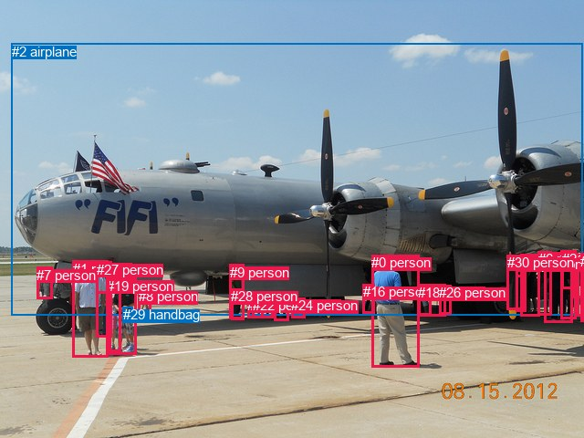
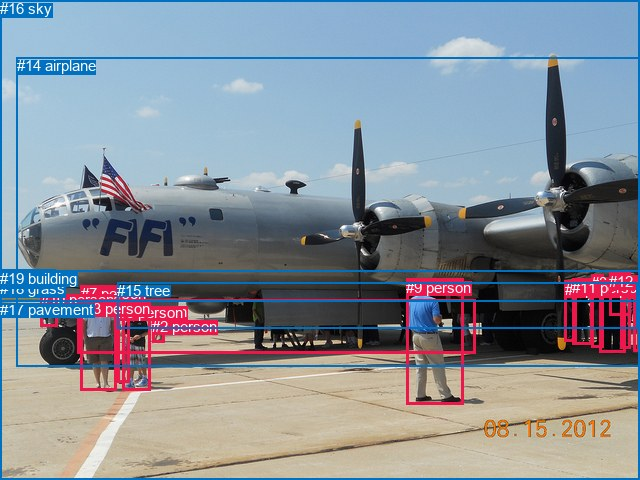

# 图片 0726：2348363.jpg

随机样本序号：357。图片 SHA256：`78d97eb62d51e45b115154d82a6e56bf5dcfe4f967c74277f20df5e1532c0fba`。

红色框表示人，蓝色框表示其他物体。两个模式分别保留自身框编号，可依据位置比较对应对象。

## 自动检测框与输出

人的框编号：`[0, 1, 3, 4, 5, 6, 7, 8, 9, 10, 11, 12, 13, 14, 15, 16, 17, 18, 19, 20, 21, 22, 23, 24, 25, 26, 27, 28, 30]`。状态：`ok`。

### 自动检测全部物体框

| 编号 | 类别 | 是否为人 | 检测分数 | 像素坐标 xyxy |
|---|---|---|---|---|
| 0 | person | True | 0.9996 | 407.1, 279.3, 459.5, 402.5 |
| 1 | person | True | 0.9982 | 79.5, 285.6, 118.6, 391.7 |
| 2 | airplane | False | 0.9980 | 13.0, 47.9, 638.5, 345.7 |
| 3 | person | True | 0.9979 | 119.7, 304.3, 149.5, 388.2 |
| 4 | person | True | 0.9952 | 596.5, 276.5, 627.5, 353.7 |
| 5 | person | True | 0.9936 | 570.6, 278.9, 591.7, 346.3 |
| 6 | person | True | 0.9873 | 589.7, 275.0, 604.8, 345.8 |
| 7 | person | True | 0.9838 | 40.3, 292.8, 57.7, 327.4 |
| 8 | person | True | 0.9821 | 151.9, 316.1, 165.0, 342.6 |
| 9 | person | True | 0.9811 | 251.8, 289.6, 267.7, 349.8 |
| 10 | person | True | 0.9676 | 300.6, 325.2, 316.1, 351.5 |
| 11 | person | True | 0.9352 | 614.2, 274.4, 631.9, 349.3 |
| 12 | person | True | 0.9330 | 271.2, 326.0, 288.3, 348.7 |
| 13 | person | True | 0.8994 | 105.6, 286.1, 122.5, 369.2 |
| 14 | person | True | 0.8936 | 565.3, 280.4, 576.7, 341.7 |
| 15 | person | True | 0.7988 | 457.4, 313.0, 472.9, 345.4 |
| 16 | person | True | 0.7914 | 397.8, 311.2, 410.1, 343.3 |
| 17 | person | True | 0.7754 | 632.9, 279.1, 640.0, 346.3 |
| 18 | person | True | 0.7254 | 458.3, 311.8, 488.7, 346.4 |
| 19 | person | True | 0.6913 | 117.1, 304.8, 132.8, 385.9 |
| 20 | person | True | 0.6632 | 628.3, 279.9, 639.7, 326.2 |
| 21 | person | True | 0.6453 | 615.9, 275.5, 630.5, 316.3 |
| 22 | person | True | 0.6104 | 277.0, 325.8, 299.9, 348.7 |
| 23 | person | True | 0.5916 | 565.4, 280.8, 574.4, 303.4 |
| 24 | person | True | 0.5895 | 319.2, 326.3, 334.3, 348.7 |
| 25 | person | True | 0.5143 | 636.2, 278.2, 639.9, 352.9 |
| 26 | person | True | 0.4937 | 481.1, 312.3, 494.2, 344.7 |
| 27 | person | True | 0.4403 | 105.7, 286.7, 119.7, 321.5 |
| 28 | person | True | 0.3946 | 253.4, 316.3, 267.5, 350.3 |
| 29 | handbag | False | 0.3867 | 134.7, 336.4, 145.7, 346.1 |
| 30 | person | True | 0.3532 | 555.8, 279.1, 573.9, 339.8 |

### 自动检测 Top50 人相关候选

评分物体对：930；人相关物体对：928；输出关系：50。

| 排名 | 主语编号与类别 | 关系 | 宾语编号与类别 | 类型 | 人与人 | 排序分数 | 原始融合 logit |
|---|---|---|---|---|---|---|---|
| 1 | #9 person | wearing | #28 person | semantic | True | 0.98179 | 3.9873 |
| 2 | #14 person | wearing | #23 person | semantic | True | 0.98148 | 3.9700 |
| 3 | #0 person | looking at | #2 airplane | semantic | False | 0.98103 | 3.9460 |
| 4 | #13 person | wearing | #27 person | semantic | True | 0.97658 | 3.7304 |
| 5 | #11 person | wearing | #21 person | semantic | True | 0.97577 | 3.6954 |
| 6 | #3 person | wearing | #29 handbag | semantic | False | 0.97196 | 3.5459 |
| 7 | #12 person | pushing | #22 person | semantic | True | 0.96975 | 3.4674 |
| 8 | #11 person | looking at | #2 airplane | semantic | False | 0.96738 | 3.3897 |
| 9 | #4 person | looking at | #2 airplane | semantic | False | 0.96651 | 3.3624 |
| 10 | #25 person | looking at | #2 airplane | semantic | False | 0.96094 | 3.2029 |
| 11 | #3 person | looking at | #2 airplane | semantic | False | 0.95979 | 3.1727 |
| 12 | #14 person | in | #23 person | spatial | True | 0.95918 | 3.1570 |
| 13 | #17 person | looking at | #2 airplane | semantic | False | 0.95840 | 3.1373 |
| 14 | #6 person | looking at | #2 airplane | semantic | False | 0.95769 | 3.1195 |
| 15 | #26 person | looking at | #2 airplane | semantic | False | 0.95628 | 3.0853 |
| 16 | #1 person | looking at | #2 airplane | semantic | False | 0.95594 | 3.0770 |
| 17 | #13 person | looking at | #2 airplane | semantic | False | 0.95135 | 2.9731 |
| 18 | #8 person | looking at | #2 airplane | semantic | False | 0.94977 | 2.9395 |
| 19 | #5 person | looking at | #2 airplane | semantic | False | 0.94842 | 2.9116 |
| 20 | #30 person | wearing | #23 person | semantic | True | 0.94645 | 2.8722 |
| 21 | #15 person | looking at | #2 airplane | semantic | False | 0.94533 | 2.8502 |
| 22 | #18 person | looking at | #2 airplane | semantic | False | 0.94424 | 2.8294 |
| 23 | #7 person | looking at | #2 airplane | semantic | False | 0.94408 | 2.8264 |
| 24 | #19 person | looking at | #2 airplane | semantic | False | 0.94232 | 2.7934 |
| 25 | #9 person | entering | #2 airplane | semantic | False | 0.93873 | 2.7293 |
| 26 | #11 person | in | #21 person | spatial | True | 0.93783 | 2.7138 |
| 27 | #30 person | in | #23 person | spatial | True | 0.93691 | 2.6981 |
| 28 | #9 person | in | #28 person | spatial | True | 0.93541 | 2.6729 |
| 29 | #21 person | looking at | #2 airplane | semantic | False | 0.93294 | 2.6328 |
| 30 | #13 person | in | #27 person | spatial | True | 0.93153 | 2.6104 |
| 31 | #20 person | looking at | #2 airplane | semantic | False | 0.92960 | 2.5805 |
| 32 | #14 person | looking at | #2 airplane | semantic | False | 0.92424 | 2.5014 |
| 33 | #9 person | pushing | #22 person | semantic | True | 0.91936 | 2.4337 |
| 34 | #23 person | looking at | #2 airplane | semantic | False | 0.91862 | 2.4237 |
| 35 | #30 person | on | #2 airplane | spatial | False | 0.91427 | 2.3669 |
| 36 | #27 person | looking at | #2 airplane | semantic | False | 0.90968 | 2.3097 |
| 37 | #22 person | pushing | #12 person | semantic | True | 0.90808 | 2.2904 |
| 38 | #0 person | holding | #16 person | semantic | True | 0.90519 | 2.2563 |
| 39 | #28 person | looking at | #2 airplane | semantic | False | 0.90295 | 2.2304 |
| 40 | #30 person | looking at | #2 airplane | semantic | False | 0.89619 | 2.1555 |
| 41 | #10 person | entering | #2 airplane | semantic | False | 0.89217 | 2.1131 |
| 42 | #7 person | beside | #2 airplane | spatial | False | 0.88796 | 2.0701 |
| 43 | #3 person | in | #29 handbag | spatial | False | 0.88242 | 2.0155 |
| 44 | #9 person | pushing | #12 person | semantic | True | 0.87948 | 1.9875 |
| 45 | #0 person | beside | #2 airplane | spatial | False | 0.87942 | 1.9870 |
| 46 | #24 person | entering | #2 airplane | semantic | False | 0.87388 | 1.9357 |
| 47 | #28 person | pushing | #12 person | semantic | True | 0.87361 | 1.9333 |
| 48 | #1 person | wearing | #27 person | semantic | True | 0.87073 | 1.9074 |
| 49 | #28 person | pushing | #22 person | semantic | True | 0.86905 | 1.8926 |
| 50 | #22 person | entering | #2 airplane | semantic | False | 0.86647 | 1.8701 |

### 自动检测逐条人相关 GT 核验

R@50：33.33%；命中 1/3。

| GT 主语编号 | GT 关系 | GT 宾语编号 | 结果阶段 | 匹配预测主语编号 | 匹配预测宾语编号 |
|---|---|---|---|---|---|
| 5 | in front of | 14 | wrong_predicate | [3] | [2] |
| 7 | looking at | 11 | wrong_predicate | [1] | [5] |
| 9 | looking at | 14 | hit50 | [0] | [2] |

## 真实框与输出

人的框编号：`[0, 1, 2, 3, 4, 5, 6, 7, 8, 9, 10, 11, 12, 13]`。

### 真实框全部物体框

| 编号 | 类别 | 是否为人 | 检测分数 | 像素坐标 xyxy |
|---|---|---|---|---|
| 0 | person | True | GT | 633.0, 279.0, 640.0, 351.0 |
| 1 | person | True | GT | 565.0, 281.0, 577.0, 342.0 |
| 2 | person | True | GT | 152.0, 318.0, 164.0, 342.0 |
| 3 | person | True | GT | 591.0, 274.0, 604.0, 347.0 |
| 4 | person | True | GT | 620.0, 275.0, 630.0, 349.0 |
| 5 | person | True | GT | 122.0, 303.0, 150.0, 390.0 |
| 6 | person | True | GT | 118.0, 304.0, 130.0, 383.0 |
| 7 | person | True | GT | 81.0, 285.0, 117.0, 390.0 |
| 8 | person | True | GT | 599.0, 281.0, 625.0, 353.0 |
| 9 | person | True | GT | 406.0, 279.0, 463.0, 405.0 |
| 10 | person | True | GT | 41.0, 291.0, 58.0, 326.0 |
| 11 | person | True | GT | 572.0, 279.0, 592.0, 345.0 |
| 12 | person | True | GT | 609.0, 273.0, 630.0, 316.0 |
| 13 | person | True | GT | 77.0, 300.0, 475.0, 354.0 |
| 14 | airplane | False | GT | 17.0, 57.0, 640.0, 367.0 |
| 15 | tree | False | GT | 117.0, 282.0, 638.0, 328.0 |
| 16 | sky | False | GT | 0.0, 0.0, 640.0, 272.0 |
| 17 | pavement | False | GT | 0.0, 301.0, 640.0, 480.0 |
| 18 | grass | False | GT | 0.0, 280.0, 62.0, 304.0 |
| 19 | building | False | GT | 0.0, 270.0, 56.0, 289.0 |

### 真实框 Top50 人相关候选

评分物体对：380；人相关物体对：350；输出关系：50。

| 排名 | 主语编号与类别 | 关系 | 宾语编号与类别 | 类型 | 人与人 | 排序分数 | 原始融合 logit |
|---|---|---|---|---|---|---|---|
| 1 | #9 person | standing on | #17 pavement | semantic | False | 0.98525 | 4.2019 |
| 2 | #7 person | standing on | #17 pavement | semantic | False | 0.98076 | 3.9312 |
| 3 | #5 person | standing on | #17 pavement | semantic | False | 0.97556 | 3.6868 |
| 4 | #0 person | standing on | #17 pavement | semantic | False | 0.97344 | 3.6016 |
| 5 | #4 person | standing on | #17 pavement | semantic | False | 0.97179 | 3.5396 |
| 6 | #9 person | looking at | #14 airplane | semantic | False | 0.97083 | 3.5050 |
| 7 | #4 person | looking at | #14 airplane | semantic | False | 0.96409 | 3.2900 |
| 8 | #8 person | standing on | #17 pavement | semantic | False | 0.96286 | 3.2553 |
| 9 | #5 person | looking at | #14 airplane | semantic | False | 0.96208 | 3.2336 |
| 10 | #0 person | looking at | #14 airplane | semantic | False | 0.96198 | 3.2308 |
| 11 | #8 person | looking at | #14 airplane | semantic | False | 0.96093 | 3.2027 |
| 12 | #6 person | looking at | #14 airplane | semantic | False | 0.95721 | 3.1078 |
| 13 | #6 person | standing on | #17 pavement | semantic | False | 0.95713 | 3.1057 |
| 14 | #7 person | looking at | #14 airplane | semantic | False | 0.95689 | 3.1000 |
| 15 | #3 person | standing on | #17 pavement | semantic | False | 0.95565 | 3.0702 |
| 16 | #3 person | looking at | #14 airplane | semantic | False | 0.95234 | 2.9949 |
| 17 | #13 person | on | #17 pavement | spatial | False | 0.95076 | 2.9605 |
| 18 | #2 person | looking at | #14 airplane | semantic | False | 0.94599 | 2.8631 |
| 19 | #5 person | talking to | #6 person | semantic | True | 0.94439 | 2.8322 |
| 20 | #10 person | standing on | #14 airplane | semantic | False | 0.94307 | 2.8074 |
| 21 | #10 person | standing on | #17 pavement | semantic | False | 0.94292 | 2.8046 |
| 22 | #12 person | looking at | #14 airplane | semantic | False | 0.93830 | 2.7217 |
| 23 | #6 person | talking to | #5 person | semantic | True | 0.93722 | 2.7033 |
| 24 | #4 person | wearing | #12 person | semantic | True | 0.93534 | 2.6717 |
| 25 | #11 person | looking at | #14 airplane | semantic | False | 0.93316 | 2.6363 |
| 26 | #9 person | on | #17 pavement | spatial | False | 0.93190 | 2.6162 |
| 27 | #11 person | standing on | #17 pavement | semantic | False | 0.92662 | 2.5359 |
| 28 | #2 person | standing on | #17 pavement | semantic | False | 0.92395 | 2.4972 |
| 29 | #1 person | looking at | #14 airplane | semantic | False | 0.91172 | 2.3348 |
| 30 | #7 person | beside | #14 airplane | spatial | False | 0.90032 | 2.2008 |
| 31 | #9 person | beside | #14 airplane | spatial | False | 0.89938 | 2.1903 |
| 32 | #10 person | beside | #14 airplane | spatial | False | 0.89921 | 2.1884 |
| 33 | #5 person | beside | #14 airplane | spatial | False | 0.88949 | 2.0856 |
| 34 | #13 person | on | #14 airplane | spatial | False | 0.86725 | 1.8769 |
| 35 | #6 person | beside | #14 airplane | spatial | False | 0.86669 | 1.8720 |
| 36 | #2 person | beside | #14 airplane | spatial | False | 0.86400 | 1.8489 |
| 37 | #8 person | wearing | #12 person | semantic | True | 0.86089 | 1.8227 |
| 38 | #8 person | beside | #14 airplane | spatial | False | 0.85515 | 1.7756 |
| 39 | #3 person | beside | #14 airplane | spatial | False | 0.84678 | 1.7095 |
| 40 | #10 person | standing on | #18 grass | semantic | False | 0.84661 | 1.7083 |
| 41 | #12 person | standing on | #17 pavement | semantic | False | 0.84507 | 1.6965 |
| 42 | #4 person | beside | #14 airplane | spatial | False | 0.83903 | 1.6511 |
| 43 | #7 person | on | #17 pavement | spatial | False | 0.83374 | 1.6124 |
| 44 | #0 person | beside | #14 airplane | spatial | False | 0.83100 | 1.5927 |
| 45 | #11 person | beside | #14 airplane | spatial | False | 0.83028 | 1.5876 |
| 46 | #13 person | parked on | #17 pavement | semantic | False | 0.81966 | 1.5140 |
| 47 | #1 person | beside | #14 airplane | spatial | False | 0.81841 | 1.5056 |
| 48 | #14 airplane | on | #13 person | spatial | False | 0.80414 | 1.4124 |
| 49 | #5 person | on | #17 pavement | spatial | False | 0.80345 | 1.4080 |
| 50 | #12 person | standing on | #15 tree | semantic | False | 0.79750 | 1.3708 |

### 真实框逐条人相关 GT 核验

R@50：33.33%；命中 1/3。

| GT 主语编号 | GT 关系 | GT 宾语编号 | 结果阶段 | 匹配预测主语编号 | 匹配预测宾语编号 |
|---|---|---|---|---|---|
| 5 | in front of | 14 | wrong_predicate | [5] | [14] |
| 7 | looking at | 11 | wrong_predicate | [7] | [11] |
| 9 | looking at | 14 | hit50 | [9] | [14] |

## 全部人相关 GT

| 主语编号与类别 | 关系 | 宾语编号与类别 |
|---|---|---|
| #5 person | in front of | #14 airplane |
| #7 person | looking at | #11 person |
| #9 person | looking at | #14 airplane |

原始记录、全部人相关物体对的两项预测与分项分数见 [逐图证据 JSON](../evidence/cases/0726.json)。全部56类 logits 保留于本机 HOR/output/random500/logits/。

<!-- HOR_COMPLETE_RESULTS -->

## 六组条件的完整输出对照

以下保留同一图片三种框与候选模式、两种谓词输出规则的全部 Top50。框编号各自在所属模式内解释。

### 自动检测框完整枚举：空间与语义各保留一个谓词

| 排名 | 主语编号与类别 | 谓词 | 宾语编号与类别 | 分组 | 排序分数 | predicate logit | pair logit |
|---|---|---|---|---|---|---|---|
| 1 | #9 person | wearing | #28 person | semantic | 0.9817884 | 4.1737914 | -0.1864777 |
| 2 | #14 person | wearing | #23 person | semantic | 0.9814770 | 3.9932446 | -0.0232007 |
| 3 | #0 person | looking at | #2 airplane | semantic | 0.9810345 | 3.9631314 | -0.0171477 |
| 4 | #13 person | wearing | #27 person | semantic | 0.9765793 | 3.6643510 | 0.0660852 |
| 5 | #11 person | wearing | #21 person | semantic | 0.9757650 | 3.6410251 | 0.0544005 |
| 6 | #3 person | wearing | #29 handbag | semantic | 0.9719648 | 3.2885132 | 0.2573462 |
| 7 | #12 person | pushing | #22 person | semantic | 0.9697455 | 3.9069571 | -0.4395673 |
| 8 | #11 person | looking at | #2 airplane | semantic | 0.9673809 | 3.4180026 | -0.0283070 |
| 9 | #4 person | looking at | #2 airplane | semantic | 0.9665087 | 3.4186997 | -0.0562956 |
| 10 | #25 person | looking at | #2 airplane | semantic | 0.9609447 | 3.2913618 | -0.0884229 |
| 11 | #3 person | looking at | #2 airplane | semantic | 0.9597948 | 3.1310353 | 0.0416859 |
| 12 | #14 person | in | #23 person | spatial | 0.9591845 | 3.1802201 | -0.0232007 |
| 13 | #17 person | looking at | #2 airplane | semantic | 0.9584034 | 3.2878757 | -0.1506236 |
| 14 | #6 person | looking at | #2 airplane | semantic | 0.9576905 | 3.1793652 | -0.0598531 |
| 15 | #26 person | looking at | #2 airplane | semantic | 0.9562821 | 3.2221155 | -0.1368201 |
| 16 | #1 person | looking at | #2 airplane | semantic | 0.9559358 | 3.1205769 | -0.0435343 |
| 17 | #13 person | looking at | #2 airplane | semantic | 0.9513453 | 3.0708528 | -0.0977235 |
| 18 | #8 person | looking at | #2 airplane | semantic | 0.9497665 | 3.0478439 | -0.1083117 |
| 19 | #5 person | looking at | #2 airplane | semantic | 0.9484169 | 2.9421206 | -0.0305200 |
| 20 | #30 person | wearing | #23 person | semantic | 0.9464527 | 3.0932221 | -0.2210674 |
| 21 | #15 person | looking at | #2 airplane | semantic | 0.9453304 | 3.2976375 | -0.4474097 |
| 22 | #18 person | looking at | #2 airplane | semantic | 0.9442449 | 3.0555134 | -0.2260982 |
| 23 | #7 person | looking at | #2 airplane | semantic | 0.9440836 | 2.8189669 | 0.0073911 |
| 24 | #19 person | looking at | #2 airplane | semantic | 0.9423170 | 2.8301229 | -0.0367426 |
| 25 | #9 person | entering | #2 airplane | semantic | 0.9387317 | 2.5870795 | 0.1421888 |
| 26 | #11 person | in | #21 person | spatial | 0.9378349 | 2.6593809 | 0.0544005 |
| 27 | #30 person | in | #23 person | spatial | 0.9369124 | 2.9191332 | -0.2210674 |
| 28 | #9 person | in | #28 person | spatial | 0.9354095 | 2.8593960 | -0.1864777 |
| 29 | #21 person | looking at | #2 airplane | semantic | 0.9329434 | 3.0492377 | -0.4164300 |
| 30 | #13 person | in | #27 person | spatial | 0.9315281 | 2.5443177 | 0.0660852 |
| 31 | #20 person | looking at | #2 airplane | semantic | 0.9295987 | 2.9806881 | -0.4001453 |
| 32 | #14 person | looking at | #2 airplane | semantic | 0.9242376 | 2.4743667 | 0.0270005 |
| 33 | #9 person | pushing | #22 person | semantic | 0.9193587 | 2.7333860 | -0.2997203 |
| 34 | #23 person | looking at | #2 airplane | semantic | 0.9186169 | 2.5369897 | -0.1132890 |
| 35 | #30 person | on | #2 airplane | spatial | 0.9142668 | 2.2910295 | 0.0758528 |
| 36 | #27 person | looking at | #2 airplane | semantic | 0.9096774 | 2.7034826 | -0.3937794 |
| 37 | #22 person | pushing | #12 person | semantic | 0.9080767 | 2.6436138 | -0.3532403 |
| 38 | #0 person | holding | #16 person | semantic | 0.9051893 | 1.7545147 | 0.5017470 |
| 39 | #28 person | looking at | #2 airplane | semantic | 0.9029459 | 2.2647734 | -0.0343786 |
| 40 | #30 person | looking at | #2 airplane | semantic | 0.8961859 | 2.0796938 | 0.0758528 |
| 41 | #10 person | entering | #2 airplane | semantic | 0.8921743 | 1.9612298 | 0.1519153 |
| 42 | #7 person | beside | #2 airplane | spatial | 0.8879606 | 2.0626855 | 0.0073911 |
| 43 | #3 person | in | #29 handbag | spatial | 0.8824177 | 1.7581816 | 0.2573462 |
| 44 | #9 person | pushing | #12 person | semantic | 0.8794830 | 2.2221208 | -0.2345768 |
| 45 | #0 person | beside | #2 airplane | spatial | 0.8794227 | 2.0041223 | -0.0171477 |
| 46 | #24 person | entering | #2 airplane | semantic | 0.8738809 | 1.8180056 | 0.1177121 |
| 47 | #28 person | pushing | #12 person | semantic | 0.8736104 | 2.3123360 | -0.3790703 |
| 48 | #1 person | wearing | #27 person | semantic | 0.8707276 | 1.7874174 | 0.1199898 |
| 49 | #28 person | pushing | #22 person | semantic | 0.8690476 | 2.3423047 | -0.4497405 |
| 50 | #22 person | entering | #2 airplane | semantic | 0.8664681 | 1.7782717 | 0.0918133 |

GT 命中：1/3，R@50=33.33%。

| GT主语 | GT谓词 | GT宾语 | 结果阶段 | 匹配主语框 | 匹配宾语框 |
|---|---|---|---|---|---|
| 5 | in front of | 14 | wrong_predicate | [3] | [2] |
| 7 | looking at | 11 | wrong_predicate | [1] | [5] |
| 9 | looking at | 14 | hit50 | [0] | [2] |

### 自动检测框完整枚举：每对只保留一个谓词

| 排名 | 主语编号与类别 | 谓词 | 宾语编号与类别 | 分组 | 排序分数 | predicate logit | pair logit |
|---|---|---|---|---|---|---|---|
| 1 | #9 person | wearing | #28 person | single | 0.9817884 | 4.1737914 | -0.1864777 |
| 2 | #14 person | wearing | #23 person | single | 0.9814770 | 3.9932446 | -0.0232007 |
| 3 | #0 person | looking at | #2 airplane | single | 0.9810345 | 3.9631314 | -0.0171477 |
| 4 | #13 person | wearing | #27 person | single | 0.9765793 | 3.6643510 | 0.0660852 |
| 5 | #11 person | wearing | #21 person | single | 0.9757650 | 3.6410251 | 0.0544005 |
| 6 | #3 person | wearing | #29 handbag | single | 0.9719648 | 3.2885132 | 0.2573462 |
| 7 | #12 person | pushing | #22 person | single | 0.9697455 | 3.9069571 | -0.4395673 |
| 8 | #11 person | looking at | #2 airplane | single | 0.9673809 | 3.4180026 | -0.0283070 |
| 9 | #4 person | looking at | #2 airplane | single | 0.9665087 | 3.4186997 | -0.0562956 |
| 10 | #25 person | looking at | #2 airplane | single | 0.9609447 | 3.2913618 | -0.0884229 |
| 11 | #3 person | looking at | #2 airplane | single | 0.9597948 | 3.1310353 | 0.0416859 |
| 12 | #17 person | looking at | #2 airplane | single | 0.9584034 | 3.2878757 | -0.1506236 |
| 13 | #6 person | looking at | #2 airplane | single | 0.9576905 | 3.1793652 | -0.0598531 |
| 14 | #26 person | looking at | #2 airplane | single | 0.9562821 | 3.2221155 | -0.1368201 |
| 15 | #1 person | looking at | #2 airplane | single | 0.9559358 | 3.1205769 | -0.0435343 |
| 16 | #13 person | looking at | #2 airplane | single | 0.9513453 | 3.0708528 | -0.0977235 |
| 17 | #8 person | looking at | #2 airplane | single | 0.9497665 | 3.0478439 | -0.1083117 |
| 18 | #5 person | looking at | #2 airplane | single | 0.9484169 | 2.9421206 | -0.0305200 |
| 19 | #30 person | wearing | #23 person | single | 0.9464527 | 3.0932221 | -0.2210674 |
| 20 | #15 person | looking at | #2 airplane | single | 0.9453304 | 3.2976375 | -0.4474097 |
| 21 | #18 person | looking at | #2 airplane | single | 0.9442449 | 3.0555134 | -0.2260982 |
| 22 | #7 person | looking at | #2 airplane | single | 0.9440836 | 2.8189669 | 0.0073911 |
| 23 | #19 person | looking at | #2 airplane | single | 0.9423170 | 2.8301229 | -0.0367426 |
| 24 | #9 person | entering | #2 airplane | single | 0.9387317 | 2.5870795 | 0.1421888 |
| 25 | #21 person | looking at | #2 airplane | single | 0.9329434 | 3.0492377 | -0.4164300 |
| 26 | #20 person | looking at | #2 airplane | single | 0.9295987 | 2.9806881 | -0.4001453 |
| 27 | #14 person | looking at | #2 airplane | single | 0.9242376 | 2.4743667 | 0.0270005 |
| 28 | #9 person | pushing | #22 person | single | 0.9193587 | 2.7333860 | -0.2997203 |
| 29 | #23 person | looking at | #2 airplane | single | 0.9186169 | 2.5369897 | -0.1132890 |
| 30 | #30 person | on | #2 airplane | single | 0.9142668 | 2.2910295 | 0.0758528 |
| 31 | #27 person | looking at | #2 airplane | single | 0.9096774 | 2.7034826 | -0.3937794 |
| 32 | #22 person | pushing | #12 person | single | 0.9080767 | 2.6436138 | -0.3532403 |
| 33 | #0 person | holding | #16 person | single | 0.9051893 | 1.7545147 | 0.5017470 |
| 34 | #28 person | looking at | #2 airplane | single | 0.9029459 | 2.2647734 | -0.0343786 |
| 35 | #10 person | entering | #2 airplane | single | 0.8921743 | 1.9612298 | 0.1519153 |
| 36 | #9 person | pushing | #12 person | single | 0.8794830 | 2.2221208 | -0.2345768 |
| 37 | #24 person | entering | #2 airplane | single | 0.8738809 | 1.8180056 | 0.1177121 |
| 38 | #28 person | pushing | #12 person | single | 0.8736104 | 2.3123360 | -0.3790703 |
| 39 | #1 person | wearing | #27 person | single | 0.8707276 | 1.7874174 | 0.1199898 |
| 40 | #28 person | pushing | #22 person | single | 0.8690476 | 2.3423047 | -0.4497405 |
| 41 | #22 person | entering | #2 airplane | single | 0.8664681 | 1.7782717 | 0.0918133 |
| 42 | #13 person | talking to | #3 person | single | 0.8603545 | 2.6648412 | -0.8466038 |
| 43 | #17 person | wearing | #20 person | single | 0.8569518 | 1.9762335 | -0.1860334 |
| 44 | #12 person | entering | #2 airplane | single | 0.8546872 | 1.7433596 | 0.0284865 |
| 45 | #10 person | pushing | #24 person | single | 0.8513974 | 2.1618161 | -0.4162131 |
| 46 | #10 person | pushing | #22 person | single | 0.8375758 | 2.0115461 | -0.3712457 |
| 47 | #5 person | holding | #23 person | single | 0.8306449 | 1.4885039 | 0.1017008 |
| 48 | #13 person | talking to | #19 person | single | 0.7924195 | 2.0331750 | -0.6936035 |
| 49 | #19 person | talking to | #13 person | single | 0.7700124 | 1.5844321 | -0.3760508 |
| 50 | #14 person | pushing | #30 person | single | 0.7343901 | 1.1396799 | -0.1226684 |

GT 命中：1/3，R@50=33.33%。

| GT主语 | GT谓词 | GT宾语 | 结果阶段 | 匹配主语框 | 匹配宾语框 |
|---|---|---|---|---|---|
| 5 | in front of | 14 | wrong_predicate | [3] | [2] |
| 7 | looking at | 11 | wrong_predicate | [1] | [5] |
| 9 | looking at | 14 | hit50 | [0] | [2] |

### 真实框完整枚举：空间与语义各保留一个谓词

| 排名 | 主语编号与类别 | 谓词 | 宾语编号与类别 | 分组 | 排序分数 | predicate logit | pair logit |
|---|---|---|---|---|---|---|---|
| 1 | #9 person | standing on | #17 pavement | semantic | 0.9852538 | 4.3094821 | -0.1075760 |
| 2 | #7 person | standing on | #17 pavement | semantic | 0.9807574 | 4.0304036 | -0.0992078 |
| 3 | #5 person | standing on | #17 pavement | semantic | 0.9755598 | 3.8645444 | -0.1777620 |
| 4 | #0 person | standing on | #17 pavement | semantic | 0.9734433 | 3.7837586 | -0.1821992 |
| 5 | #4 person | standing on | #17 pavement | semantic | 0.9717933 | 3.6780820 | -0.1384987 |
| 6 | #9 person | looking at | #14 airplane | semantic | 0.9708290 | 3.4984059 | 0.0065670 |
| 7 | #4 person | looking at | #14 airplane | semantic | 0.9640855 | 3.3108859 | -0.0208468 |
| 8 | #8 person | standing on | #17 pavement | semantic | 0.9628618 | 3.5650611 | -0.3097987 |
| 9 | #5 person | looking at | #14 airplane | semantic | 0.9620806 | 3.1512566 | 0.0823804 |
| 10 | #0 person | looking at | #14 airplane | semantic | 0.9619767 | 3.3101878 | -0.0793978 |
| 11 | #8 person | looking at | #14 airplane | semantic | 0.9609348 | 3.3094907 | -0.1068158 |
| 12 | #6 person | looking at | #14 airplane | semantic | 0.9572129 | 3.1484671 | -0.0406778 |
| 13 | #6 person | standing on | #17 pavement | semantic | 0.9571282 | 3.3331046 | -0.2273817 |
| 14 | #7 person | looking at | #14 airplane | semantic | 0.9568923 | 3.1428890 | -0.0428988 |
| 15 | #3 person | standing on | #17 pavement | semantic | 0.9556472 | 3.3624816 | -0.2922685 |
| 16 | #3 person | looking at | #14 airplane | semantic | 0.9523440 | 2.9567637 | 0.0381540 |
| 17 | #13 person | on | #17 pavement | spatial | 0.9507591 | 3.2474041 | -0.2868698 |
| 18 | #2 person | looking at | #14 airplane | semantic | 0.9459937 | 2.9567637 | -0.0936306 |
| 19 | #5 person | talking to | #6 person | semantic | 0.9443933 | 3.3225961 | -0.4903555 |
| 20 | #10 person | standing on | #14 airplane | semantic | 0.9430721 | 2.7104778 | 0.0968803 |
| 21 | #10 person | standing on | #17 pavement | semantic | 0.9429246 | 3.1731610 | -0.3685474 |
| 22 | #12 person | looking at | #14 airplane | semantic | 0.9382951 | 3.0764318 | -0.3547302 |
| 23 | #6 person | talking to | #5 person | semantic | 0.9372204 | 3.4410863 | -0.7377973 |
| 24 | #4 person | wearing | #12 person | semantic | 0.9353357 | 2.6823230 | -0.0106261 |
| 25 | #11 person | looking at | #14 airplane | semantic | 0.9331605 | 2.6901259 | -0.0538423 |
| 26 | #9 person | on | #17 pavement | spatial | 0.9318969 | 2.7237754 | -0.1075760 |
| 27 | #11 person | standing on | #17 pavement | semantic | 0.9266186 | 3.0542240 | -0.5183527 |
| 28 | #2 person | standing on | #17 pavement | semantic | 0.9239487 | 2.7753448 | -0.2780967 |
| 29 | #1 person | looking at | #14 airplane | semantic | 0.9117178 | 2.2618761 | 0.0729157 |
| 30 | #7 person | beside | #14 airplane | spatial | 0.9003210 | 2.2436957 | -0.0428988 |
| 31 | #9 person | beside | #14 airplane | spatial | 0.8993762 | 2.1837449 | 0.0065670 |
| 32 | #10 person | beside | #14 airplane | spatial | 0.8992068 | 2.0915623 | 0.0968803 |
| 33 | #5 person | beside | #14 airplane | spatial | 0.8894935 | 2.0031972 | 0.0823804 |
| 34 | #13 person | on | #14 airplane | spatial | 0.8672509 | 1.8519702 | 0.0248973 |
| 35 | #6 person | beside | #14 airplane | spatial | 0.8666912 | 1.9126921 | -0.0406778 |
| 36 | #2 person | beside | #14 airplane | spatial | 0.8640004 | 1.9425521 | -0.0936306 |
| 37 | #8 person | wearing | #12 person | semantic | 0.8608949 | 1.9028115 | -0.0800689 |
| 38 | #8 person | beside | #14 airplane | spatial | 0.8551471 | 1.8823700 | -0.1068158 |
| 39 | #3 person | beside | #14 airplane | spatial | 0.8467763 | 1.6713839 | 0.0381540 |
| 40 | #10 person | standing on | #18 grass | semantic | 0.8466146 | 2.3630395 | -0.6547474 |
| 41 | #12 person | standing on | #17 pavement | semantic | 0.8450743 | 2.6035709 | -0.9070921 |
| 42 | #4 person | beside | #14 airplane | spatial | 0.8390339 | 1.6719041 | -0.0208468 |
| 43 | #7 person | on | #17 pavement | spatial | 0.8337381 | 1.7115631 | -0.0992078 |
| 44 | #0 person | beside | #14 airplane | spatial | 0.8310009 | 1.6721358 | -0.0793978 |
| 45 | #11 person | beside | #14 airplane | spatial | 0.8302815 | 1.6414661 | -0.0538423 |
| 46 | #13 person | parked on | #17 pavement | semantic | 0.8196595 | 1.8009124 | -0.2868698 |
| 47 | #1 person | beside | #14 airplane | spatial | 0.8184074 | 1.4326782 | 0.0729157 |
| 48 | #14 airplane | on | #13 person | spatial | 0.8041376 | 1.6556387 | -0.2432801 |
| 49 | #5 person | on | #17 pavement | spatial | 0.8034490 | 1.5857534 | -0.1777620 |
| 50 | #12 person | standing on | #15 tree | semantic | 0.7975044 | 2.3877311 | -1.0169621 |

GT 命中：1/3，R@50=33.33%。

| GT主语 | GT谓词 | GT宾语 | 结果阶段 | 匹配主语框 | 匹配宾语框 |
|---|---|---|---|---|---|
| 5 | in front of | 14 | wrong_predicate | [5] | [14] |
| 7 | looking at | 11 | wrong_predicate | [7] | [11] |
| 9 | looking at | 14 | hit50 | [9] | [14] |

### 真实框完整枚举：每对只保留一个谓词

| 排名 | 主语编号与类别 | 谓词 | 宾语编号与类别 | 分组 | 排序分数 | predicate logit | pair logit |
|---|---|---|---|---|---|---|---|
| 1 | #9 person | standing on | #17 pavement | single | 0.9852538 | 4.3094821 | -0.1075760 |
| 2 | #7 person | standing on | #17 pavement | single | 0.9807574 | 4.0304036 | -0.0992078 |
| 3 | #5 person | standing on | #17 pavement | single | 0.9755598 | 3.8645444 | -0.1777620 |
| 4 | #0 person | standing on | #17 pavement | single | 0.9734433 | 3.7837586 | -0.1821992 |
| 5 | #4 person | standing on | #17 pavement | single | 0.9717933 | 3.6780820 | -0.1384987 |
| 6 | #9 person | looking at | #14 airplane | single | 0.9708290 | 3.4984059 | 0.0065670 |
| 7 | #4 person | looking at | #14 airplane | single | 0.9640855 | 3.3108859 | -0.0208468 |
| 8 | #8 person | standing on | #17 pavement | single | 0.9628618 | 3.5650611 | -0.3097987 |
| 9 | #5 person | looking at | #14 airplane | single | 0.9620806 | 3.1512566 | 0.0823804 |
| 10 | #0 person | looking at | #14 airplane | single | 0.9619767 | 3.3101878 | -0.0793978 |
| 11 | #8 person | looking at | #14 airplane | single | 0.9609348 | 3.3094907 | -0.1068158 |
| 12 | #6 person | looking at | #14 airplane | single | 0.9572129 | 3.1484671 | -0.0406778 |
| 13 | #6 person | standing on | #17 pavement | single | 0.9571282 | 3.3331046 | -0.2273817 |
| 14 | #7 person | looking at | #14 airplane | single | 0.9568923 | 3.1428890 | -0.0428988 |
| 15 | #3 person | standing on | #17 pavement | single | 0.9556472 | 3.3624816 | -0.2922685 |
| 16 | #3 person | looking at | #14 airplane | single | 0.9523440 | 2.9567637 | 0.0381540 |
| 17 | #13 person | on | #17 pavement | single | 0.9507591 | 3.2474041 | -0.2868698 |
| 18 | #2 person | looking at | #14 airplane | single | 0.9459937 | 2.9567637 | -0.0936306 |
| 19 | #5 person | talking to | #6 person | single | 0.9443933 | 3.3225961 | -0.4903555 |
| 20 | #10 person | standing on | #14 airplane | single | 0.9430721 | 2.7104778 | 0.0968803 |
| 21 | #10 person | standing on | #17 pavement | single | 0.9429246 | 3.1731610 | -0.3685474 |
| 22 | #12 person | looking at | #14 airplane | single | 0.9382951 | 3.0764318 | -0.3547302 |
| 23 | #6 person | talking to | #5 person | single | 0.9372204 | 3.4410863 | -0.7377973 |
| 24 | #4 person | wearing | #12 person | single | 0.9353357 | 2.6823230 | -0.0106261 |
| 25 | #11 person | looking at | #14 airplane | single | 0.9331605 | 2.6901259 | -0.0538423 |
| 26 | #11 person | standing on | #17 pavement | single | 0.9266186 | 3.0542240 | -0.5183527 |
| 27 | #2 person | standing on | #17 pavement | single | 0.9239487 | 2.7753448 | -0.2780967 |
| 28 | #1 person | looking at | #14 airplane | single | 0.9117178 | 2.2618761 | 0.0729157 |
| 29 | #13 person | on | #14 airplane | single | 0.8672509 | 1.8519702 | 0.0248973 |
| 30 | #8 person | wearing | #12 person | single | 0.8608949 | 1.9028115 | -0.0800689 |
| 31 | #10 person | standing on | #18 grass | single | 0.8466146 | 2.3630395 | -0.6547474 |
| 32 | #12 person | standing on | #17 pavement | single | 0.8450743 | 2.6035709 | -0.9070921 |
| 33 | #14 airplane | on | #13 person | single | 0.8041376 | 1.6556387 | -0.2432801 |
| 34 | #12 person | standing on | #15 tree | single | 0.7975044 | 2.3877311 | -1.0169621 |
| 35 | #1 person | standing on | #17 pavement | single | 0.7953884 | 1.9635954 | -0.6058786 |
| 36 | #7 person | talking to | #5 person | single | 0.7869532 | 2.1555405 | -0.8488838 |
| 37 | #11 person | standing on | #15 tree | single | 0.7568085 | 1.8226271 | -0.6873658 |
| 38 | #7 person | talking to | #6 person | single | 0.7454563 | 1.6735806 | -0.5990568 |
| 39 | #1 person | standing on | #15 tree | single | 0.7428427 | 1.7155218 | -0.6547257 |
| 40 | #3 person | standing on | #15 tree | single | 0.6503743 | 1.1606197 | -0.5399349 |
| 41 | #5 person | talking to | #2 person | single | 0.6365805 | 0.7416897 | -0.1811366 |
| 42 | #1 person | standing on | #11 person | single | 0.6329715 | 0.9532371 | -0.4082510 |
| 43 | #4 person | standing on | #15 tree | single | 0.6088328 | 1.0549431 | -0.6125343 |
| 44 | #6 person | talking to | #7 person | single | 0.5934561 | 1.0449781 | -0.6667067 |
| 45 | #8 person | standing on | #15 tree | single | 0.5835359 | 1.0131216 | -0.6758161 |
| 46 | #2 person | standing on | #13 person | single | 0.5824653 | 1.1415448 | -0.8086428 |
| 47 | #5 person | talking to | #7 person | single | 0.5711834 | 0.9557672 | -0.6690859 |
| 48 | #11 person | pushing | #1 person | single | 0.5629758 | 0.5076008 | -0.2543528 |
| 49 | #2 person | standing on | #15 tree | single | 0.5111467 | 1.0344391 | -0.9898450 |
| 50 | #10 person | standing on | #19 building | single | 0.4913722 | 0.8343010 | -0.8688156 |

GT 命中：1/3，R@50=33.33%。

| GT主语 | GT谓词 | GT宾语 | 结果阶段 | 匹配主语框 | 匹配宾语框 |
|---|---|---|---|---|---|
| 5 | in front of | 14 | wrong_predicate | [5] | [14] |
| 7 | looking at | 11 | wrong_predicate | [7] | [11] |
| 9 | looking at | 14 | hit50 | [9] | [14] |

### 真实框400候选：空间与语义各保留一个谓词

| 排名 | 主语编号与类别 | 谓词 | 宾语编号与类别 | 分组 | 排序分数 | predicate logit | pair logit |
|---|---|---|---|---|---|---|---|
| 1 | #9 person | standing on | #17 pavement | semantic | 0.9852538 | 4.3094821 | -0.1075760 |
| 2 | #7 person | standing on | #17 pavement | semantic | 0.9807574 | 4.0304036 | -0.0992078 |
| 3 | #5 person | standing on | #17 pavement | semantic | 0.9755598 | 3.8645444 | -0.1777620 |
| 4 | #0 person | standing on | #17 pavement | semantic | 0.9734433 | 3.7837586 | -0.1821992 |
| 5 | #4 person | standing on | #17 pavement | semantic | 0.9717933 | 3.6780820 | -0.1384987 |
| 6 | #9 person | looking at | #14 airplane | semantic | 0.9708290 | 3.4984059 | 0.0065670 |
| 7 | #4 person | looking at | #14 airplane | semantic | 0.9640855 | 3.3108859 | -0.0208468 |
| 8 | #8 person | standing on | #17 pavement | semantic | 0.9628618 | 3.5650611 | -0.3097987 |
| 9 | #5 person | looking at | #14 airplane | semantic | 0.9620806 | 3.1512566 | 0.0823804 |
| 10 | #0 person | looking at | #14 airplane | semantic | 0.9619767 | 3.3101878 | -0.0793978 |
| 11 | #8 person | looking at | #14 airplane | semantic | 0.9609348 | 3.3094907 | -0.1068158 |
| 12 | #6 person | looking at | #14 airplane | semantic | 0.9572129 | 3.1484671 | -0.0406778 |
| 13 | #6 person | standing on | #17 pavement | semantic | 0.9571282 | 3.3331046 | -0.2273817 |
| 14 | #7 person | looking at | #14 airplane | semantic | 0.9568923 | 3.1428890 | -0.0428988 |
| 15 | #3 person | standing on | #17 pavement | semantic | 0.9556472 | 3.3624816 | -0.2922685 |
| 16 | #3 person | looking at | #14 airplane | semantic | 0.9523440 | 2.9567637 | 0.0381540 |
| 17 | #13 person | on | #17 pavement | spatial | 0.9507591 | 3.2474041 | -0.2868698 |
| 18 | #2 person | looking at | #14 airplane | semantic | 0.9459937 | 2.9567637 | -0.0936306 |
| 19 | #5 person | talking to | #6 person | semantic | 0.9443933 | 3.3225961 | -0.4903555 |
| 20 | #10 person | standing on | #14 airplane | semantic | 0.9430721 | 2.7104778 | 0.0968803 |
| 21 | #10 person | standing on | #17 pavement | semantic | 0.9429246 | 3.1731610 | -0.3685474 |
| 22 | #12 person | looking at | #14 airplane | semantic | 0.9382951 | 3.0764318 | -0.3547302 |
| 23 | #6 person | talking to | #5 person | semantic | 0.9372204 | 3.4410863 | -0.7377973 |
| 24 | #4 person | wearing | #12 person | semantic | 0.9353357 | 2.6823230 | -0.0106261 |
| 25 | #11 person | looking at | #14 airplane | semantic | 0.9331605 | 2.6901259 | -0.0538423 |
| 26 | #9 person | on | #17 pavement | spatial | 0.9318969 | 2.7237754 | -0.1075760 |
| 27 | #11 person | standing on | #17 pavement | semantic | 0.9266186 | 3.0542240 | -0.5183527 |
| 28 | #2 person | standing on | #17 pavement | semantic | 0.9239487 | 2.7753448 | -0.2780967 |
| 29 | #1 person | looking at | #14 airplane | semantic | 0.9117178 | 2.2618761 | 0.0729157 |
| 30 | #7 person | beside | #14 airplane | spatial | 0.9003210 | 2.2436957 | -0.0428988 |
| 31 | #9 person | beside | #14 airplane | spatial | 0.8993762 | 2.1837449 | 0.0065670 |
| 32 | #10 person | beside | #14 airplane | spatial | 0.8992068 | 2.0915623 | 0.0968803 |
| 33 | #5 person | beside | #14 airplane | spatial | 0.8894935 | 2.0031972 | 0.0823804 |
| 34 | #13 person | on | #14 airplane | spatial | 0.8672509 | 1.8519702 | 0.0248973 |
| 35 | #6 person | beside | #14 airplane | spatial | 0.8666912 | 1.9126921 | -0.0406778 |
| 36 | #2 person | beside | #14 airplane | spatial | 0.8640004 | 1.9425521 | -0.0936306 |
| 37 | #8 person | wearing | #12 person | semantic | 0.8608949 | 1.9028115 | -0.0800689 |
| 38 | #8 person | beside | #14 airplane | spatial | 0.8551471 | 1.8823700 | -0.1068158 |
| 39 | #3 person | beside | #14 airplane | spatial | 0.8467763 | 1.6713839 | 0.0381540 |
| 40 | #10 person | standing on | #18 grass | semantic | 0.8466146 | 2.3630395 | -0.6547474 |
| 41 | #12 person | standing on | #17 pavement | semantic | 0.8450743 | 2.6035709 | -0.9070921 |
| 42 | #4 person | beside | #14 airplane | spatial | 0.8390339 | 1.6719041 | -0.0208468 |
| 43 | #7 person | on | #17 pavement | spatial | 0.8337381 | 1.7115631 | -0.0992078 |
| 44 | #0 person | beside | #14 airplane | spatial | 0.8310009 | 1.6721358 | -0.0793978 |
| 45 | #11 person | beside | #14 airplane | spatial | 0.8302815 | 1.6414661 | -0.0538423 |
| 46 | #13 person | parked on | #17 pavement | semantic | 0.8196595 | 1.8009124 | -0.2868698 |
| 47 | #1 person | beside | #14 airplane | spatial | 0.8184074 | 1.4326782 | 0.0729157 |
| 48 | #14 airplane | on | #13 person | spatial | 0.8041376 | 1.6556387 | -0.2432801 |
| 49 | #5 person | on | #17 pavement | spatial | 0.8034490 | 1.5857534 | -0.1777620 |
| 50 | #12 person | standing on | #15 tree | semantic | 0.7975044 | 2.3877311 | -1.0169621 |

GT 命中：1/3，R@50=33.33%。

| GT主语 | GT谓词 | GT宾语 | 结果阶段 | 匹配主语框 | 匹配宾语框 |
|---|---|---|---|---|---|
| 5 | in front of | 14 | wrong_predicate | [5] | [14] |
| 7 | looking at | 11 | wrong_predicate | [7] | [11] |
| 9 | looking at | 14 | hit50 | [9] | [14] |

### 真实框400候选：每对只保留一个谓词

| 排名 | 主语编号与类别 | 谓词 | 宾语编号与类别 | 分组 | 排序分数 | predicate logit | pair logit |
|---|---|---|---|---|---|---|---|
| 1 | #9 person | standing on | #17 pavement | single | 0.9852538 | 4.3094821 | -0.1075760 |
| 2 | #7 person | standing on | #17 pavement | single | 0.9807574 | 4.0304036 | -0.0992078 |
| 3 | #5 person | standing on | #17 pavement | single | 0.9755598 | 3.8645444 | -0.1777620 |
| 4 | #0 person | standing on | #17 pavement | single | 0.9734433 | 3.7837586 | -0.1821992 |
| 5 | #4 person | standing on | #17 pavement | single | 0.9717933 | 3.6780820 | -0.1384987 |
| 6 | #9 person | looking at | #14 airplane | single | 0.9708290 | 3.4984059 | 0.0065670 |
| 7 | #4 person | looking at | #14 airplane | single | 0.9640855 | 3.3108859 | -0.0208468 |
| 8 | #8 person | standing on | #17 pavement | single | 0.9628618 | 3.5650611 | -0.3097987 |
| 9 | #5 person | looking at | #14 airplane | single | 0.9620806 | 3.1512566 | 0.0823804 |
| 10 | #0 person | looking at | #14 airplane | single | 0.9619767 | 3.3101878 | -0.0793978 |
| 11 | #8 person | looking at | #14 airplane | single | 0.9609348 | 3.3094907 | -0.1068158 |
| 12 | #6 person | looking at | #14 airplane | single | 0.9572129 | 3.1484671 | -0.0406778 |
| 13 | #6 person | standing on | #17 pavement | single | 0.9571282 | 3.3331046 | -0.2273817 |
| 14 | #7 person | looking at | #14 airplane | single | 0.9568923 | 3.1428890 | -0.0428988 |
| 15 | #3 person | standing on | #17 pavement | single | 0.9556472 | 3.3624816 | -0.2922685 |
| 16 | #3 person | looking at | #14 airplane | single | 0.9523440 | 2.9567637 | 0.0381540 |
| 17 | #13 person | on | #17 pavement | single | 0.9507591 | 3.2474041 | -0.2868698 |
| 18 | #2 person | looking at | #14 airplane | single | 0.9459937 | 2.9567637 | -0.0936306 |
| 19 | #5 person | talking to | #6 person | single | 0.9443933 | 3.3225961 | -0.4903555 |
| 20 | #10 person | standing on | #14 airplane | single | 0.9430721 | 2.7104778 | 0.0968803 |
| 21 | #10 person | standing on | #17 pavement | single | 0.9429246 | 3.1731610 | -0.3685474 |
| 22 | #12 person | looking at | #14 airplane | single | 0.9382951 | 3.0764318 | -0.3547302 |
| 23 | #6 person | talking to | #5 person | single | 0.9372204 | 3.4410863 | -0.7377973 |
| 24 | #4 person | wearing | #12 person | single | 0.9353357 | 2.6823230 | -0.0106261 |
| 25 | #11 person | looking at | #14 airplane | single | 0.9331605 | 2.6901259 | -0.0538423 |
| 26 | #11 person | standing on | #17 pavement | single | 0.9266186 | 3.0542240 | -0.5183527 |
| 27 | #2 person | standing on | #17 pavement | single | 0.9239487 | 2.7753448 | -0.2780967 |
| 28 | #1 person | looking at | #14 airplane | single | 0.9117178 | 2.2618761 | 0.0729157 |
| 29 | #13 person | on | #14 airplane | single | 0.8672509 | 1.8519702 | 0.0248973 |
| 30 | #8 person | wearing | #12 person | single | 0.8608949 | 1.9028115 | -0.0800689 |
| 31 | #10 person | standing on | #18 grass | single | 0.8466146 | 2.3630395 | -0.6547474 |
| 32 | #12 person | standing on | #17 pavement | single | 0.8450743 | 2.6035709 | -0.9070921 |
| 33 | #14 airplane | on | #13 person | single | 0.8041376 | 1.6556387 | -0.2432801 |
| 34 | #12 person | standing on | #15 tree | single | 0.7975044 | 2.3877311 | -1.0169621 |
| 35 | #1 person | standing on | #17 pavement | single | 0.7953884 | 1.9635954 | -0.6058786 |
| 36 | #7 person | talking to | #5 person | single | 0.7869532 | 2.1555405 | -0.8488838 |
| 37 | #11 person | standing on | #15 tree | single | 0.7568085 | 1.8226271 | -0.6873658 |
| 38 | #7 person | talking to | #6 person | single | 0.7454563 | 1.6735806 | -0.5990568 |
| 39 | #1 person | standing on | #15 tree | single | 0.7428427 | 1.7155218 | -0.6547257 |
| 40 | #3 person | standing on | #15 tree | single | 0.6503743 | 1.1606197 | -0.5399349 |
| 41 | #5 person | talking to | #2 person | single | 0.6365805 | 0.7416897 | -0.1811366 |
| 42 | #1 person | standing on | #11 person | single | 0.6329715 | 0.9532371 | -0.4082510 |
| 43 | #4 person | standing on | #15 tree | single | 0.6088328 | 1.0549431 | -0.6125343 |
| 44 | #6 person | talking to | #7 person | single | 0.5934561 | 1.0449781 | -0.6667067 |
| 45 | #8 person | standing on | #15 tree | single | 0.5835359 | 1.0131216 | -0.6758161 |
| 46 | #2 person | standing on | #13 person | single | 0.5824653 | 1.1415448 | -0.8086428 |
| 47 | #5 person | talking to | #7 person | single | 0.5711834 | 0.9557672 | -0.6690859 |
| 48 | #11 person | pushing | #1 person | single | 0.5629758 | 0.5076008 | -0.2543528 |
| 49 | #2 person | standing on | #15 tree | single | 0.5111467 | 1.0344391 | -0.9898450 |
| 50 | #10 person | standing on | #19 building | single | 0.4913722 | 0.8343010 | -0.8688156 |

GT 命中：1/3，R@50=33.33%。

| GT主语 | GT谓词 | GT宾语 | 结果阶段 | 匹配主语框 | 匹配宾语框 |
|---|---|---|---|---|---|
| 5 | in front of | 14 | wrong_predicate | [5] | [14] |
| 7 | looking at | 11 | wrong_predicate | [7] | [11] |
| 9 | looking at | 14 | hit50 | [9] | [14] |
