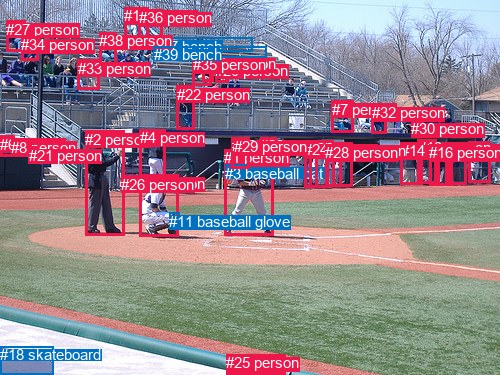
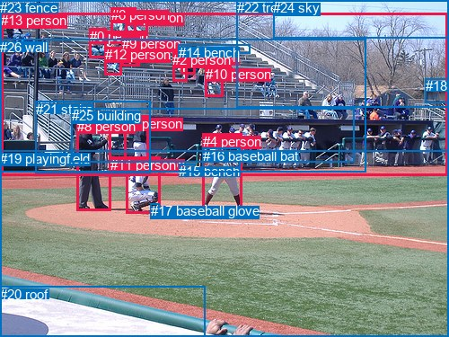

# 图片 0731：2348722.jpg

随机样本序号：400。图片 SHA256：`ef09a69222facfee2905f08af5233533b42a91cf75a4f4ef80f1b3e68a9921aa`。

红色框表示人，蓝色框表示其他物体。两个模式分别保留自身框编号，可依据位置比较对应对象。

## 自动检测框与输出

人的框编号：`[0, 1, 2, 4, 5, 6, 7, 8, 9, 10, 12, 13, 14, 15, 16, 17, 19, 20, 21, 22, 23, 24, 25, 26, 27, 28, 29, 30, 31, 32, 33, 34, 35, 36, 38]`。状态：`ok`。

### 自动检测全部物体框

| 编号 | 类别 | 是否为人 | 检测分数 | 像素坐标 xyxy |
|---|---|---|---|---|
| 0 | person | True | 0.9991 | 139.7, 174.7, 179.0, 236.5 |
| 1 | person | True | 0.9988 | 224.1, 149.0, 273.9, 235.8 |
| 2 | person | True | 0.9971 | 85.2, 130.6, 124.3, 235.3 |
| 3 | baseball bat | False | 0.9450 | 225.4, 164.9, 247.6, 176.9 |
| 4 | person | True | 0.9432 | 139.8, 129.4, 166.0, 189.6 |
| 5 | person | True | 0.8459 | 468.9, 141.3, 490.3, 182.6 |
| 6 | person | True | 0.8312 | 0.1, 135.7, 14.8, 156.0 |
| 7 | person | True | 0.8140 | 331.6, 100.7, 353.6, 132.9 |
| 8 | person | True | 0.7768 | 11.4, 138.6, 27.0, 156.3 |
| 9 | person | True | 0.7740 | 309.8, 141.4, 328.7, 187.4 |
| 10 | person | True | 0.7621 | 437.1, 144.3, 452.6, 185.4 |
| 11 | baseball glove | False | 0.7121 | 169.3, 213.0, 179.2, 224.2 |
| 12 | person | True | 0.7101 | 231.9, 137.5, 249.9, 168.9 |
| 13 | person | True | 0.6906 | 417.6, 139.2, 436.1, 183.1 |
| 14 | person | True | 0.6813 | 400.9, 142.2, 422.3, 184.9 |
| 15 | person | True | 0.6715 | 447.9, 144.2, 466.8, 184.9 |
| 16 | person | True | 0.6572 | 429.1, 144.2, 447.8, 185.3 |
| 17 | person | True | 0.6408 | 332.7, 142.1, 352.0, 186.7 |
| 18 | skateboard | False | 0.6398 | 0.0, 346.5, 53.9, 374.8 |
| 19 | person | True | 0.6394 | 124.2, 7.4, 148.8, 39.0 |
| 20 | person | True | 0.6339 | 215.2, 61.8, 228.2, 82.1 |
| 21 | person | True | 0.6335 | 28.7, 146.6, 38.8, 156.6 |
| 22 | person | True | 0.6159 | 176.7, 85.8, 194.5, 129.0 |
| 23 | person | True | 0.5847 | 260.0, 137.3, 276.3, 155.4 |
| 24 | person | True | 0.5326 | 304.4, 141.3, 317.1, 187.1 |
| 25 | person | True | 0.5087 | 226.3, 354.3, 285.5, 374.2 |
| 26 | person | True | 0.4804 | 121.4, 175.8, 138.9, 190.9 |
| 27 | person | True | 0.4751 | 6.1, 20.7, 25.8, 51.5 |
| 28 | person | True | 0.4735 | 325.3, 144.3, 341.1, 186.8 |
| 29 | person | True | 0.4620 | 234.0, 138.4, 249.8, 154.4 |
| 30 | person | True | 0.4553 | 411.2, 120.3, 423.4, 133.9 |
| 31 | person | True | 0.4526 | 202.9, 55.0, 213.9, 81.1 |
| 32 | person | True | 0.4426 | 371.8, 104.3, 386.2, 133.4 |
| 33 | person | True | 0.4120 | 77.7, 59.7, 99.4, 89.8 |
| 34 | person | True | 0.4096 | 21.3, 36.2, 38.2, 60.5 |
| 35 | person | True | 0.4072 | 192.6, 56.4, 211.1, 85.9 |
| 36 | person | True | 0.4001 | 138.9, 9.4, 162.1, 38.2 |
| 37 | bench | False | 0.3990 | 154.4, 37.7, 252.1, 51.5 |
| 38 | person | True | 0.3967 | 99.2, 32.2, 116.9, 65.0 |
| 39 | bench | False | 0.3917 | 153.6, 46.3, 266.7, 57.5 |

### 自动检测 Top50 人相关候选

评分物体对：1560；人相关物体对：1540；输出关系：50。

| 排名 | 主语编号与类别 | 关系 | 宾语编号与类别 | 类型 | 人与人 | 排序分数 | 原始融合 logit |
|---|---|---|---|---|---|---|---|
| 1 | #0 person | wearing | #11 baseball glove | semantic | False | 0.97708 | 3.7526 |
| 2 | #31 person | sitting on | #39 bench | semantic | False | 0.97570 | 3.6927 |
| 3 | #35 person | sitting on | #39 bench | semantic | False | 0.97471 | 3.6519 |
| 4 | #12 person | wearing | #29 person | semantic | True | 0.97265 | 3.5711 |
| 5 | #1 person | throwing | #3 baseball bat | semantic | False | 0.96525 | 3.3243 |
| 6 | #6 person | sitting on | #8 person | semantic | True | 0.96108 | 3.2064 |
| 7 | #0 person | in | #11 baseball glove | spatial | False | 0.96103 | 3.2053 |
| 8 | #8 person | sitting on | #21 person | semantic | True | 0.95861 | 3.1425 |
| 9 | #35 person | sitting on | #37 bench | semantic | False | 0.95751 | 3.1151 |
| 10 | #31 person | sitting on | #37 bench | semantic | False | 0.95385 | 3.0286 |
| 11 | #6 person | sitting on | #21 person | semantic | True | 0.95317 | 3.0132 |
| 12 | #20 person | sitting on | #39 bench | semantic | False | 0.94874 | 2.9182 |
| 13 | #20 person | sitting on | #37 bench | semantic | False | 0.93569 | 2.6775 |
| 14 | #31 person | on | #39 bench | spatial | False | 0.93065 | 2.5967 |
| 15 | #19 person | sitting on | #37 bench | semantic | False | 0.92981 | 2.5837 |
| 16 | #38 person | sitting on | #37 bench | semantic | False | 0.92814 | 2.5585 |
| 17 | #36 person | sitting on | #37 bench | semantic | False | 0.92694 | 2.5407 |
| 18 | #35 person | on | #39 bench | spatial | False | 0.92655 | 2.5348 |
| 19 | #27 person | wearing | #34 person | semantic | True | 0.92602 | 2.5271 |
| 20 | #38 person | sitting on | #39 bench | semantic | False | 0.92372 | 2.4940 |
| 21 | #8 person | on | #21 person | spatial | True | 0.92192 | 2.4687 |
| 22 | #19 person | in | #36 person | spatial | True | 0.92028 | 2.4462 |
| 23 | #12 person | in | #29 person | spatial | True | 0.91339 | 2.3557 |
| 24 | #19 person | holding | #36 person | semantic | True | 0.91004 | 2.3141 |
| 25 | #6 person | on | #8 person | spatial | True | 0.90056 | 2.2035 |
| 26 | #36 person | on | #37 bench | spatial | False | 0.89817 | 2.1771 |
| 27 | #1 person | in | #3 baseball bat | spatial | False | 0.89332 | 2.1251 |
| 28 | #19 person | sitting on | #39 bench | semantic | False | 0.89093 | 2.1003 |
| 29 | #20 person | on | #39 bench | spatial | False | 0.88397 | 2.0305 |
| 30 | #6 person | on | #21 person | spatial | True | 0.88019 | 1.9942 |
| 31 | #19 person | on | #37 bench | spatial | False | 0.87672 | 1.9618 |
| 32 | #2 person | holding | #26 person | semantic | True | 0.87639 | 1.9587 |
| 33 | #36 person | sitting on | #39 bench | semantic | False | 0.87149 | 1.9142 |
| 34 | #35 person | on | #37 bench | spatial | False | 0.86418 | 1.8504 |
| 35 | #31 person | on | #37 bench | spatial | False | 0.86384 | 1.8476 |
| 36 | #31 person | in | #35 person | spatial | True | 0.85143 | 1.7459 |
| 37 | #35 person | in | #31 person | spatial | True | 0.84929 | 1.7290 |
| 38 | #36 person | on | #39 bench | spatial | False | 0.84379 | 1.6867 |
| 39 | #20 person | on | #37 bench | spatial | False | 0.84140 | 1.6687 |
| 40 | #33 person | sitting on | #39 bench | semantic | False | 0.83971 | 1.6561 |
| 41 | #19 person | on | #39 bench | spatial | False | 0.83790 | 1.6427 |
| 42 | #34 person | sitting on | #27 person | semantic | True | 0.83335 | 1.6095 |
| 43 | #27 person | in | #34 person | spatial | True | 0.83331 | 1.6092 |
| 44 | #34 person | on | #27 person | spatial | True | 0.82443 | 1.5466 |
| 45 | #33 person | sitting on | #37 bench | semantic | False | 0.81916 | 1.5107 |
| 46 | #36 person | in | #19 person | spatial | True | 0.80818 | 1.4382 |
| 47 | #22 person | standing on | #39 bench | semantic | False | 0.80240 | 1.4014 |
| 48 | #38 person | on | #39 bench | spatial | False | 0.79395 | 1.3489 |
| 49 | #38 person | on | #37 bench | spatial | False | 0.79000 | 1.3250 |
| 50 | #8 person | sitting on | #6 person | semantic | True | 0.78944 | 1.3216 |

### 自动检测逐条人相关 GT 核验

R@50：0.00%；命中 0/5。

| GT 主语编号 | GT 关系 | GT 宾语编号 | 结果阶段 | 匹配预测主语编号 | 匹配预测宾语编号 |
|---|---|---|---|---|---|
| 3 | wearing | 17 | endpoint_missing_or_wrong_class | [0] | [] |
| 4 | carrying | 16 | endpoint_missing_or_wrong_class | [1] | [] |
| 6 | talking to | 5 | wrong_predicate | [19] | [36] |
| 7 | running on | 19 | endpoint_missing_or_wrong_class | [4] | [] |
| 8 | standing on | 19 | endpoint_missing_or_wrong_class | [2] | [] |

## 真实框与输出

人的框编号：`[0, 1, 2, 3, 4, 5, 6, 7, 8, 9, 10, 11, 12, 13]`。

### 真实框全部物体框

| 编号 | 类别 | 是否为人 | 检测分数 | 像素坐标 xyxy |
|---|---|---|---|---|
| 0 | person | True | GT | 100.0, 32.0, 119.0, 65.0 |
| 1 | person | True | GT | 202.0, 55.0, 218.0, 83.0 |
| 2 | person | True | GT | 192.0, 58.0, 208.0, 90.0 |
| 3 | person | True | GT | 141.0, 174.0, 179.0, 238.0 |
| 4 | person | True | GT | 226.0, 149.0, 270.0, 236.0 |
| 5 | person | True | GT | 139.0, 11.0, 164.0, 39.0 |
| 6 | person | True | GT | 124.0, 8.0, 152.0, 39.0 |
| 7 | person | True | GT | 138.0, 129.0, 165.0, 189.0 |
| 8 | person | True | GT | 86.0, 132.0, 124.0, 235.0 |
| 9 | person | True | GT | 136.0, 40.0, 156.0, 73.0 |
| 10 | person | True | GT | 229.0, 74.0, 249.0, 108.0 |
| 11 | person | True | GT | 123.0, 175.0, 138.0, 189.0 |
| 12 | person | True | GT | 117.0, 52.0, 136.0, 84.0 |
| 13 | person | True | GT | 1.0, 14.0, 499.0, 196.0 |
| 14 | bench | False | GT | 199.0, 50.0, 279.0, 60.0 |
| 15 | bench | False | GT | 199.0, 182.0, 217.0, 188.0 |
| 16 | baseball bat | False | GT | 226.0, 165.0, 267.0, 187.0 |
| 17 | baseball glove | False | GT | 168.0, 226.0, 178.0, 237.0 |
| 18 | house | False | GT | 474.0, 87.0, 500.0, 114.0 |
| 19 | playingfield | False | GT | 0.0, 168.0, 500.0, 375.0 |
| 20 | roof | False | GT | 0.0, 319.0, 228.0, 375.0 |
| 21 | stairs | False | GT | 40.0, 113.0, 167.0, 193.0 |
| 22 | tree | False | GT | 264.0, 0.0, 500.0, 119.0 |
| 23 | fence | False | GT | 0.0, 0.0, 500.0, 375.0 |
| 24 | sky | False | GT | 304.0, 0.0, 500.0, 43.0 |
| 25 | building | False | GT | 80.0, 120.0, 395.0, 180.0 |
| 26 | wall | False | GT | 0.0, 44.0, 408.0, 192.0 |

### 真实框 Top50 人相关候选

评分物体对：702；人相关物体对：546；输出关系：50。

| 排名 | 主语编号与类别 | 关系 | 宾语编号与类别 | 类型 | 人与人 | 排序分数 | 原始融合 logit |
|---|---|---|---|---|---|---|---|
| 1 | #3 person | wearing | #17 baseball glove | semantic | False | 0.99066 | 4.6644 |
| 2 | #4 person | holding | #16 baseball bat | semantic | False | 0.98562 | 4.2275 |
| 3 | #12 person | sitting on | #26 wall | semantic | False | 0.97097 | 3.5099 |
| 4 | #1 person | sitting on | #26 wall | semantic | False | 0.97058 | 3.4963 |
| 5 | #1 person | sitting on | #14 bench | semantic | False | 0.96932 | 3.4530 |
| 6 | #2 person | sitting on | #26 wall | semantic | False | 0.96919 | 3.4487 |
| 7 | #9 person | sitting on | #26 wall | semantic | False | 0.96914 | 3.4470 |
| 8 | #8 person | standing on | #19 playingfield | semantic | False | 0.96843 | 3.4234 |
| 9 | #0 person | sitting on | #26 wall | semantic | False | 0.95923 | 3.1583 |
| 10 | #3 person | on | #19 playingfield | spatial | False | 0.95382 | 3.0280 |
| 11 | #3 person | in | #23 fence | spatial | False | 0.95064 | 2.9580 |
| 12 | #2 person | sitting on | #14 bench | semantic | False | 0.94885 | 2.9205 |
| 13 | #6 person | holding | #5 person | semantic | True | 0.93659 | 2.6927 |
| 14 | #3 person | sitting on | #19 playingfield | semantic | False | 0.93545 | 2.6736 |
| 15 | #7 person | leaning on | #21 stairs | spatial | False | 0.93543 | 2.6732 |
| 16 | #8 person | holding | #11 person | semantic | True | 0.93187 | 2.6158 |
| 17 | #7 person | standing on | #21 stairs | semantic | False | 0.93183 | 2.6151 |
| 18 | #0 person | sitting on | #13 person | semantic | True | 0.92974 | 2.5827 |
| 19 | #6 person | sitting on | #13 person | semantic | True | 0.92772 | 2.5522 |
| 20 | #3 person | in | #17 baseball glove | spatial | False | 0.92765 | 2.5511 |
| 21 | #8 person | standing on | #21 stairs | semantic | False | 0.92676 | 2.5380 |
| 22 | #9 person | sitting on | #13 person | semantic | True | 0.92524 | 2.5157 |
| 23 | #12 person | sitting on | #13 person | semantic | True | 0.92251 | 2.4769 |
| 24 | #13 person | looking at | #23 fence | semantic | False | 0.92199 | 2.4696 |
| 25 | #4 person | standing on | #19 playingfield | semantic | False | 0.91670 | 2.3984 |
| 26 | #5 person | sitting on | #13 person | semantic | True | 0.91660 | 2.3970 |
| 27 | #11 person | sitting on | #19 playingfield | semantic | False | 0.91331 | 2.3548 |
| 28 | #26 wall | in | #13 person | spatial | False | 0.90227 | 2.2227 |
| 29 | #1 person | sitting on | #13 person | semantic | True | 0.89837 | 2.1793 |
| 30 | #1 person | on | #14 bench | spatial | False | 0.89467 | 2.1394 |
| 31 | #8 person | in | #23 fence | spatial | False | 0.89244 | 2.1159 |
| 32 | #2 person | sitting on | #13 person | semantic | True | 0.89206 | 2.1119 |
| 33 | #14 bench | in | #13 person | spatial | False | 0.88954 | 2.0860 |
| 34 | #6 person | sitting on | #26 wall | semantic | False | 0.88564 | 2.0470 |
| 35 | #4 person | on | #19 playingfield | spatial | False | 0.88520 | 2.0426 |
| 36 | #13 person | in | #23 fence | spatial | False | 0.88493 | 2.0400 |
| 37 | #6 person | in | #13 person | spatial | True | 0.88344 | 2.0254 |
| 38 | #6 person | in | #5 person | spatial | True | 0.87970 | 1.9896 |
| 39 | #4 person | in | #23 fence | spatial | False | 0.87931 | 1.9860 |
| 40 | #2 person | on | #26 wall | spatial | False | 0.87821 | 1.9756 |
| 41 | #1 person | on | #26 wall | spatial | False | 0.87600 | 1.9551 |
| 42 | #8 person | standing on | #23 fence | semantic | False | 0.87593 | 1.9544 |
| 43 | #5 person | in | #13 person | spatial | True | 0.87451 | 1.9415 |
| 44 | #8 person | leaning on | #21 stairs | spatial | False | 0.87442 | 1.9406 |
| 45 | #21 stairs | in | #13 person | spatial | False | 0.86938 | 1.8955 |
| 46 | #10 person | sitting on | #26 wall | semantic | False | 0.86777 | 1.8814 |
| 47 | #9 person | on | #26 wall | spatial | False | 0.86267 | 1.8377 |
| 48 | #12 person | on | #26 wall | spatial | False | 0.86195 | 1.8315 |
| 49 | #11 person | on | #19 playingfield | spatial | False | 0.84592 | 1.7029 |
| 50 | #9 person | in | #13 person | spatial | True | 0.84313 | 1.6817 |

### 真实框逐条人相关 GT 核验

R@50：40.00%；命中 2/5。

| GT 主语编号 | GT 关系 | GT 宾语编号 | 结果阶段 | 匹配预测主语编号 | 匹配预测宾语编号 |
|---|---|---|---|---|---|
| 3 | wearing | 17 | hit50 | [3] | [17] |
| 4 | carrying | 16 | wrong_predicate | [4] | [16] |
| 6 | talking to | 5 | wrong_predicate | [6] | [5] |
| 7 | running on | 19 | wrong_predicate | [7] | [19] |
| 8 | standing on | 19 | hit50 | [8] | [19] |

## 全部人相关 GT

| 主语编号与类别 | 关系 | 宾语编号与类别 |
|---|---|---|
| #3 person | wearing | #17 baseball glove |
| #4 person | carrying | #16 baseball bat |
| #6 person | talking to | #5 person |
| #7 person | running on | #19 playingfield |
| #8 person | standing on | #19 playingfield |

原始记录、全部人相关物体对的两项预测与分项分数见 [逐图证据 JSON](../evidence/cases/0731.json)。全部56类 logits 保留于本机 HOR/output/random500/logits/。

<!-- HOR_COMPLETE_RESULTS -->

## 六组条件的完整输出对照

以下保留同一图片三种框与候选模式、两种谓词输出规则的全部 Top50。框编号各自在所属模式内解释。

### 自动检测框完整枚举：空间与语义各保留一个谓词

| 排名 | 主语编号与类别 | 谓词 | 宾语编号与类别 | 分组 | 排序分数 | predicate logit | pair logit |
|---|---|---|---|---|---|---|---|
| 1 | #0 person | wearing | #11 baseball glove | semantic | 0.9770806 | 3.4863715 | 0.2662139 |
| 2 | #31 person | sitting on | #39 bench | semantic | 0.9757000 | 3.8490157 | -0.1563398 |
| 3 | #35 person | sitting on | #39 bench | semantic | 0.9747136 | 3.8098960 | -0.1580230 |
| 4 | #12 person | wearing | #29 person | semantic | 0.9726455 | 4.0079875 | -0.4368515 |
| 5 | #1 person | throwing | #3 baseball bat | semantic | 0.9652542 | 3.3444180 | -0.0200865 |
| 6 | #6 person | sitting on | #8 person | semantic | 0.9610751 | 3.2802072 | -0.0737863 |
| 7 | #0 person | in | #11 baseball glove | spatial | 0.9610318 | 2.9390454 | 0.2662139 |
| 8 | #8 person | sitting on | #21 person | semantic | 0.9586137 | 3.1929536 | -0.0504154 |
| 9 | #35 person | sitting on | #37 bench | semantic | 0.9575107 | 3.3224282 | -0.2073447 |
| 10 | #31 person | sitting on | #37 bench | semantic | 0.9538481 | 3.2441874 | -0.2156193 |
| 11 | #6 person | sitting on | #21 person | semantic | 0.9531687 | 3.0094013 | 0.0038387 |
| 12 | #20 person | sitting on | #39 bench | semantic | 0.9487375 | 3.1147766 | -0.1966044 |
| 13 | #20 person | sitting on | #37 bench | semantic | 0.9356880 | 2.9462795 | -0.2687428 |
| 14 | #31 person | on | #39 bench | spatial | 0.9306481 | 2.7530270 | -0.1563398 |
| 15 | #19 person | sitting on | #37 bench | semantic | 0.9298055 | 2.9643049 | -0.3805993 |
| 16 | #38 person | sitting on | #37 bench | semantic | 0.9281431 | 2.8981462 | -0.3396363 |
| 17 | #36 person | sitting on | #37 bench | semantic | 0.9269434 | 2.9251847 | -0.3845270 |
| 18 | #35 person | on | #39 bench | spatial | 0.9265472 | 2.6928444 | -0.1580230 |
| 19 | #27 person | wearing | #34 person | semantic | 0.9260206 | 2.6293664 | -0.1022571 |
| 20 | #38 person | sitting on | #39 bench | semantic | 0.9237230 | 2.8590255 | -0.3649843 |
| 21 | #8 person | on | #21 person | spatial | 0.9219195 | 2.5191326 | -0.0504154 |
| 22 | #19 person | in | #36 person | spatial | 0.9202842 | 2.4566951 | -0.0104817 |
| 23 | #12 person | in | #29 person | spatial | 0.9133881 | 2.7925754 | -0.4368515 |
| 24 | #19 person | holding | #36 person | semantic | 0.9100397 | 2.3246012 | -0.0104817 |
| 25 | #6 person | on | #8 person | spatial | 0.9005597 | 2.2772446 | -0.0737863 |
| 26 | #36 person | on | #37 bench | spatial | 0.8981708 | 2.5615902 | -0.3845270 |
| 27 | #1 person | in | #3 baseball bat | spatial | 0.8933163 | 2.1451588 | -0.0200865 |
| 28 | #19 person | sitting on | #39 bench | semantic | 0.8909284 | 2.5099158 | -0.4096557 |
| 29 | #20 person | on | #39 bench | spatial | 0.8839660 | 2.2271395 | -0.1966044 |
| 30 | #6 person | on | #21 person | spatial | 0.8801885 | 1.9903779 | 0.0038387 |
| 31 | #19 person | on | #37 bench | spatial | 0.8767222 | 2.3423495 | -0.3805993 |
| 32 | #2 person | holding | #26 person | semantic | 0.8763911 | 2.4637895 | -0.5050995 |
| 33 | #36 person | sitting on | #39 bench | semantic | 0.8714880 | 2.3293686 | -0.4151887 |
| 34 | #35 person | on | #37 bench | spatial | 0.8641772 | 2.0577717 | -0.2073447 |
| 35 | #31 person | on | #37 bench | spatial | 0.8638448 | 2.0632162 | -0.2156193 |
| 36 | #31 person | in | #35 person | spatial | 0.8514301 | 2.1874323 | -0.4415700 |
| 37 | #35 person | in | #31 person | spatial | 0.8492877 | 2.2695098 | -0.5404841 |
| 38 | #36 person | on | #39 bench | spatial | 0.8437923 | 2.1019087 | -0.4151887 |
| 39 | #20 person | on | #37 bench | spatial | 0.8413975 | 1.9374061 | -0.2687428 |
| 40 | #33 person | sitting on | #39 bench | semantic | 0.8397126 | 2.1789598 | -0.5228685 |
| 41 | #19 person | on | #39 bench | spatial | 0.8378981 | 2.0523267 | -0.4096557 |
| 42 | #34 person | sitting on | #27 person | semantic | 0.8333469 | 1.9079633 | -0.2984279 |
| 43 | #27 person | in | #34 person | spatial | 0.8333057 | 1.7114964 | -0.1022571 |
| 44 | #34 person | on | #27 person | spatial | 0.8244293 | 1.8450770 | -0.2984279 |
| 45 | #33 person | sitting on | #37 bench | semantic | 0.8191601 | 1.9984126 | -0.4877454 |
| 46 | #36 person | in | #19 person | spatial | 0.8081788 | 1.5902410 | -0.1520208 |
| 47 | #22 person | standing on | #39 bench | semantic | 0.8023993 | 1.9614520 | -0.5600938 |
| 48 | #38 person | on | #39 bench | spatial | 0.7939490 | 1.7138796 | -0.3649843 |
| 49 | #38 person | on | #37 bench | spatial | 0.7900041 | 1.6645865 | -0.3396363 |
| 50 | #8 person | sitting on | #6 person | semantic | 0.7894430 | 1.6160641 | -0.2944934 |

GT 命中：0/5，R@50=0.00%。

| GT主语 | GT谓词 | GT宾语 | 结果阶段 | 匹配主语框 | 匹配宾语框 |
|---|---|---|---|---|---|
| 3 | wearing | 17 | endpoint_missing_or_wrong_class | [0] | [] |
| 4 | carrying | 16 | endpoint_missing_or_wrong_class | [1] | [] |
| 6 | talking to | 5 | wrong_predicate | [19] | [36] |
| 7 | running on | 19 | endpoint_missing_or_wrong_class | [4] | [] |
| 8 | standing on | 19 | endpoint_missing_or_wrong_class | [2] | [] |

### 自动检测框完整枚举：每对只保留一个谓词

| 排名 | 主语编号与类别 | 谓词 | 宾语编号与类别 | 分组 | 排序分数 | predicate logit | pair logit |
|---|---|---|---|---|---|---|---|
| 1 | #0 person | wearing | #11 baseball glove | single | 0.9770806 | 3.4863715 | 0.2662139 |
| 2 | #31 person | sitting on | #39 bench | single | 0.9757000 | 3.8490157 | -0.1563398 |
| 3 | #35 person | sitting on | #39 bench | single | 0.9747136 | 3.8098960 | -0.1580230 |
| 4 | #12 person | wearing | #29 person | single | 0.9726455 | 4.0079875 | -0.4368515 |
| 5 | #1 person | throwing | #3 baseball bat | single | 0.9652542 | 3.3444180 | -0.0200865 |
| 6 | #6 person | sitting on | #8 person | single | 0.9610751 | 3.2802072 | -0.0737863 |
| 7 | #8 person | sitting on | #21 person | single | 0.9586137 | 3.1929536 | -0.0504154 |
| 8 | #35 person | sitting on | #37 bench | single | 0.9575107 | 3.3224282 | -0.2073447 |
| 9 | #31 person | sitting on | #37 bench | single | 0.9538481 | 3.2441874 | -0.2156193 |
| 10 | #6 person | sitting on | #21 person | single | 0.9531687 | 3.0094013 | 0.0038387 |
| 11 | #20 person | sitting on | #39 bench | single | 0.9487375 | 3.1147766 | -0.1966044 |
| 12 | #20 person | sitting on | #37 bench | single | 0.9356880 | 2.9462795 | -0.2687428 |
| 13 | #19 person | sitting on | #37 bench | single | 0.9298055 | 2.9643049 | -0.3805993 |
| 14 | #38 person | sitting on | #37 bench | single | 0.9281431 | 2.8981462 | -0.3396363 |
| 15 | #36 person | sitting on | #37 bench | single | 0.9269434 | 2.9251847 | -0.3845270 |
| 16 | #27 person | wearing | #34 person | single | 0.9260206 | 2.6293664 | -0.1022571 |
| 17 | #38 person | sitting on | #39 bench | single | 0.9237230 | 2.8590255 | -0.3649843 |
| 18 | #19 person | in | #36 person | single | 0.9202842 | 2.4566951 | -0.0104817 |
| 19 | #19 person | sitting on | #39 bench | single | 0.8909284 | 2.5099158 | -0.4096557 |
| 20 | #2 person | holding | #26 person | single | 0.8763911 | 2.4637895 | -0.5050995 |
| 21 | #36 person | sitting on | #39 bench | single | 0.8714880 | 2.3293686 | -0.4151887 |
| 22 | #31 person | in | #35 person | single | 0.8514301 | 2.1874323 | -0.4415700 |
| 23 | #35 person | in | #31 person | single | 0.8492877 | 2.2695098 | -0.5404841 |
| 24 | #33 person | sitting on | #39 bench | single | 0.8397126 | 2.1789598 | -0.5228685 |
| 25 | #34 person | sitting on | #27 person | single | 0.8333469 | 1.9079633 | -0.2984279 |
| 26 | #33 person | sitting on | #37 bench | single | 0.8191601 | 1.9984126 | -0.4877454 |
| 27 | #36 person | in | #19 person | single | 0.8081788 | 1.5902410 | -0.1520208 |
| 28 | #22 person | standing on | #39 bench | single | 0.8023993 | 1.9614520 | -0.5600938 |
| 29 | #8 person | sitting on | #6 person | single | 0.7894430 | 1.6160641 | -0.2944934 |
| 30 | #2 person | looking at | #0 person | single | 0.7893339 | 1.7937732 | -0.4728582 |
| 31 | #22 person | standing on | #35 person | single | 0.7851212 | 1.8572044 | -0.5614405 |
| 32 | #38 person | sitting on | #33 person | single | 0.7809225 | 1.9592285 | -0.6881783 |
| 33 | #21 person | on | #8 person | single | 0.7808260 | 1.6375957 | -0.3671091 |
| 34 | #25 person | touching | #18 skateboard | single | 0.7671363 | 1.9772530 | -0.7850422 |
| 35 | #12 person | holding | #3 baseball bat | single | 0.7448442 | 1.8592196 | -0.7879190 |
| 36 | #22 person | standing on | #37 bench | single | 0.7437655 | 1.6972609 | -0.6316284 |
| 37 | #4 person | standing on | #26 person | single | 0.7365769 | 1.6363635 | -0.6081113 |
| 38 | #34 person | sitting on | #37 bench | single | 0.6654714 | 1.5801396 | -0.8923662 |
| 39 | #4 person | looking at | #0 person | single | 0.6643564 | 1.7697167 | -1.0869480 |
| 40 | #27 person | sitting on | #37 bench | single | 0.6613367 | 1.4537339 | -0.7844770 |
| 41 | #34 person | sitting on | #39 bench | single | 0.6538661 | 1.5470281 | -0.9109513 |
| 42 | #27 person | sitting on | #39 bench | single | 0.6182424 | 1.2821999 | -0.8001053 |
| 43 | #33 person | sitting on | #38 person | single | 0.6152948 | 1.0564113 | -0.5867871 |
| 44 | #29 person | on | #12 person | single | 0.5966628 | 0.8437824 | -0.4522032 |
| 45 | #12 person | looking at | #1 person | single | 0.5803863 | 1.1150308 | -0.7906712 |
| 46 | #1 person | catching | #11 baseball glove | single | 0.5788423 | 0.8351073 | -0.5170845 |
| 47 | #1 person | wearing | #23 person | single | 0.5696899 | 0.6586924 | -0.3781062 |
| 48 | #16 person | holding | #10 person | single | 0.5634651 | 0.5669432 | -0.3117062 |
| 49 | #9 person | looking at | #1 person | single | 0.5319563 | 1.1023712 | -0.9743716 |
| 50 | #14 person | leaning on | #13 person | single | 0.5310934 | 0.4980378 | -0.3735034 |

GT 命中：0/5，R@50=0.00%。

| GT主语 | GT谓词 | GT宾语 | 结果阶段 | 匹配主语框 | 匹配宾语框 |
|---|---|---|---|---|---|
| 3 | wearing | 17 | endpoint_missing_or_wrong_class | [0] | [] |
| 4 | carrying | 16 | endpoint_missing_or_wrong_class | [1] | [] |
| 6 | talking to | 5 | wrong_predicate | [19] | [36] |
| 7 | running on | 19 | endpoint_missing_or_wrong_class | [4] | [] |
| 8 | standing on | 19 | endpoint_missing_or_wrong_class | [2] | [] |

### 真实框完整枚举：空间与语义各保留一个谓词

| 排名 | 主语编号与类别 | 谓词 | 宾语编号与类别 | 分组 | 排序分数 | predicate logit | pair logit |
|---|---|---|---|---|---|---|---|
| 1 | #3 person | wearing | #17 baseball glove | semantic | 0.9906632 | 4.4231057 | 0.2412990 |
| 2 | #4 person | holding | #16 baseball bat | semantic | 0.9856212 | 4.1510959 | 0.0764186 |
| 3 | #12 person | sitting on | #26 wall | semantic | 0.9709685 | 3.4458289 | 0.0640867 |
| 4 | #1 person | sitting on | #26 wall | semantic | 0.9705823 | 3.5330815 | -0.0367807 |
| 5 | #1 person | sitting on | #14 bench | semantic | 0.9693215 | 3.7858300 | -0.3327966 |
| 6 | #2 person | sitting on | #26 wall | semantic | 0.9691928 | 3.4759040 | -0.0271888 |
| 7 | #9 person | sitting on | #26 wall | semantic | 0.9691408 | 3.4097133 | 0.0372629 |
| 8 | #8 person | standing on | #19 playingfield | semantic | 0.9684272 | 3.7276654 | -0.3042896 |
| 9 | #0 person | sitting on | #26 wall | semantic | 0.9592342 | 3.1659780 | -0.0076839 |
| 10 | #3 person | on | #19 playingfield | spatial | 0.9538224 | 3.1261702 | -0.0981869 |
| 11 | #3 person | in | #23 fence | spatial | 0.9506390 | 3.3005853 | -0.3426111 |
| 12 | #2 person | sitting on | #14 bench | semantic | 0.9488524 | 3.2712579 | -0.3507216 |
| 13 | #6 person | holding | #5 person | semantic | 0.9365926 | 2.7115259 | -0.0188565 |
| 14 | #3 person | sitting on | #19 playingfield | semantic | 0.9354479 | 2.7717404 | -0.0981869 |
| 15 | #7 person | leaning on | #21 stairs | spatial | 0.9354272 | 3.4030519 | -0.7298424 |
| 16 | #8 person | holding | #11 person | semantic | 0.9318746 | 3.1231823 | -0.5073341 |
| 17 | #7 person | standing on | #21 stairs | semantic | 0.9318267 | 3.3449349 | -0.7298424 |
| 18 | #0 person | sitting on | #13 person | semantic | 0.9297392 | 2.7326198 | -0.1499299 |
| 19 | #6 person | sitting on | #13 person | semantic | 0.9277224 | 2.7235432 | -0.1713249 |
| 20 | #3 person | in | #17 baseball glove | spatial | 0.9276460 | 2.3097796 | 0.2412990 |
| 21 | #8 person | standing on | #21 stairs | semantic | 0.9267645 | 2.8589892 | -0.3209698 |
| 22 | #9 person | sitting on | #13 person | semantic | 0.9252358 | 2.5821476 | -0.0664381 |
| 23 | #12 person | sitting on | #13 person | semantic | 0.9225054 | 2.5520730 | -0.0751883 |
| 24 | #13 person | looking at | #23 fence | semantic | 0.9219854 | 2.8000321 | -0.3303979 |
| 25 | #4 person | standing on | #19 playingfield | semantic | 0.9167041 | 3.0525970 | -0.6542118 |
| 26 | #5 person | sitting on | #13 person | semantic | 0.9165964 | 2.5821157 | -0.1851398 |
| 27 | #11 person | sitting on | #19 playingfield | semantic | 0.9133125 | 2.8348312 | -0.4800634 |
| 28 | #26 wall | in | #13 person | spatial | 0.9022695 | 2.6969795 | -0.4742799 |
| 29 | #1 person | sitting on | #13 person | semantic | 0.8983726 | 2.2541323 | -0.0748600 |
| 30 | #1 person | on | #14 bench | spatial | 0.8946702 | 2.4721556 | -0.3327966 |
| 31 | #8 person | in | #23 fence | spatial | 0.8924360 | 2.4447556 | -0.3288861 |
| 32 | #2 person | sitting on | #13 person | semantic | 0.8920551 | 2.1758919 | -0.0639846 |
| 33 | #14 bench | in | #13 person | spatial | 0.8895393 | 2.0741491 | 0.0118942 |
| 34 | #6 person | sitting on | #26 wall | semantic | 0.8856433 | 2.1277585 | -0.0807669 |
| 35 | #4 person | on | #19 playingfield | spatial | 0.8852007 | 2.6968412 | -0.6542118 |
| 36 | #13 person | in | #23 fence | spatial | 0.8849343 | 2.3704076 | -0.3303979 |
| 37 | #6 person | in | #13 person | spatial | 0.8834399 | 2.1967406 | -0.1713249 |
| 38 | #6 person | in | #5 person | spatial | 0.8796972 | 2.0084224 | -0.0188565 |
| 39 | #4 person | in | #23 fence | spatial | 0.8793149 | 2.5509553 | -0.5649968 |
| 40 | #2 person | on | #26 wall | spatial | 0.8782066 | 2.0027442 | -0.0271888 |
| 41 | #1 person | on | #26 wall | spatial | 0.8759988 | 1.9918542 | -0.0367807 |
| 42 | #8 person | standing on | #23 fence | semantic | 0.8759255 | 2.2832851 | -0.3288861 |
| 43 | #5 person | in | #13 person | spatial | 0.8745127 | 2.1266022 | -0.1851398 |
| 44 | #8 person | leaning on | #21 stairs | spatial | 0.8744171 | 2.2615614 | -0.3209698 |
| 45 | #21 stairs | in | #13 person | spatial | 0.8693789 | 2.2491527 | -0.3536747 |
| 46 | #10 person | sitting on | #26 wall | semantic | 0.8677716 | 2.3534665 | -0.4720691 |
| 47 | #9 person | on | #26 wall | spatial | 0.8626741 | 1.8004174 | 0.0372629 |
| 48 | #12 person | on | #26 wall | spatial | 0.8619457 | 1.7674589 | 0.0640867 |
| 49 | #11 person | on | #19 playingfield | spatial | 0.8459182 | 2.1830025 | -0.4800634 |
| 50 | #9 person | in | #13 person | spatial | 0.8431304 | 1.7481441 | -0.0664381 |

GT 命中：2/5，R@50=40.00%。

| GT主语 | GT谓词 | GT宾语 | 结果阶段 | 匹配主语框 | 匹配宾语框 |
|---|---|---|---|---|---|
| 3 | wearing | 17 | hit50 | [3] | [17] |
| 4 | carrying | 16 | wrong_predicate | [4] | [16] |
| 6 | talking to | 5 | wrong_predicate | [6] | [5] |
| 7 | running on | 19 | wrong_predicate | [7] | [19] |
| 8 | standing on | 19 | hit50 | [8] | [19] |

### 真实框完整枚举：每对只保留一个谓词

| 排名 | 主语编号与类别 | 谓词 | 宾语编号与类别 | 分组 | 排序分数 | predicate logit | pair logit |
|---|---|---|---|---|---|---|---|
| 1 | #3 person | wearing | #17 baseball glove | single | 0.9906632 | 4.4231057 | 0.2412990 |
| 2 | #4 person | holding | #16 baseball bat | single | 0.9856212 | 4.1510959 | 0.0764186 |
| 3 | #12 person | sitting on | #26 wall | single | 0.9709685 | 3.4458289 | 0.0640867 |
| 4 | #1 person | sitting on | #26 wall | single | 0.9705823 | 3.5330815 | -0.0367807 |
| 5 | #1 person | sitting on | #14 bench | single | 0.9693215 | 3.7858300 | -0.3327966 |
| 6 | #2 person | sitting on | #26 wall | single | 0.9691928 | 3.4759040 | -0.0271888 |
| 7 | #9 person | sitting on | #26 wall | single | 0.9691408 | 3.4097133 | 0.0372629 |
| 8 | #8 person | standing on | #19 playingfield | single | 0.9684272 | 3.7276654 | -0.3042896 |
| 9 | #0 person | sitting on | #26 wall | single | 0.9592342 | 3.1659780 | -0.0076839 |
| 10 | #3 person | on | #19 playingfield | single | 0.9538224 | 3.1261702 | -0.0981869 |
| 11 | #3 person | in | #23 fence | single | 0.9506390 | 3.3005853 | -0.3426111 |
| 12 | #2 person | sitting on | #14 bench | single | 0.9488524 | 3.2712579 | -0.3507216 |
| 13 | #6 person | holding | #5 person | single | 0.9365926 | 2.7115259 | -0.0188565 |
| 14 | #7 person | leaning on | #21 stairs | single | 0.9354272 | 3.4030519 | -0.7298424 |
| 15 | #8 person | holding | #11 person | single | 0.9318746 | 3.1231823 | -0.5073341 |
| 16 | #0 person | sitting on | #13 person | single | 0.9297392 | 2.7326198 | -0.1499299 |
| 17 | #6 person | sitting on | #13 person | single | 0.9277224 | 2.7235432 | -0.1713249 |
| 18 | #8 person | standing on | #21 stairs | single | 0.9267645 | 2.8589892 | -0.3209698 |
| 19 | #9 person | sitting on | #13 person | single | 0.9252358 | 2.5821476 | -0.0664381 |
| 20 | #12 person | sitting on | #13 person | single | 0.9225054 | 2.5520730 | -0.0751883 |
| 21 | #13 person | looking at | #23 fence | single | 0.9219854 | 2.8000321 | -0.3303979 |
| 22 | #4 person | standing on | #19 playingfield | single | 0.9167041 | 3.0525970 | -0.6542118 |
| 23 | #5 person | sitting on | #13 person | single | 0.9165964 | 2.5821157 | -0.1851398 |
| 24 | #11 person | sitting on | #19 playingfield | single | 0.9133125 | 2.8348312 | -0.4800634 |
| 25 | #26 wall | in | #13 person | single | 0.9022695 | 2.6969795 | -0.4742799 |
| 26 | #1 person | sitting on | #13 person | single | 0.8983726 | 2.2541323 | -0.0748600 |
| 27 | #8 person | in | #23 fence | single | 0.8924360 | 2.4447556 | -0.3288861 |
| 28 | #2 person | sitting on | #13 person | single | 0.8920551 | 2.1758919 | -0.0639846 |
| 29 | #14 bench | in | #13 person | single | 0.8895393 | 2.0741491 | 0.0118942 |
| 30 | #6 person | sitting on | #26 wall | single | 0.8856433 | 2.1277585 | -0.0807669 |
| 31 | #4 person | in | #23 fence | single | 0.8793149 | 2.5509553 | -0.5649968 |
| 32 | #21 stairs | in | #13 person | single | 0.8693789 | 2.2491527 | -0.3536747 |
| 33 | #10 person | sitting on | #26 wall | single | 0.8677716 | 2.3534665 | -0.4720691 |
| 34 | #0 person | sitting on | #12 person | single | 0.8303381 | 2.1578341 | -0.5698088 |
| 35 | #7 person | leaning on | #25 building | single | 0.8189575 | 2.2013116 | -0.6920112 |
| 36 | #10 person | in | #13 person | single | 0.8126953 | 1.9152956 | -0.4476761 |
| 37 | #5 person | sitting on | #26 wall | single | 0.8089514 | 1.5530043 | -0.1097934 |
| 38 | #7 person | standing on | #19 playingfield | single | 0.8087145 | 2.3846745 | -0.9429955 |
| 39 | #12 person | looking at | #19 playingfield | single | 0.8063101 | 2.2338762 | -0.8076662 |
| 40 | #8 person | looking at | #3 person | single | 0.8043372 | 1.8938084 | -0.4801823 |
| 41 | #5 person | sitting on | #6 person | single | 0.7933427 | 1.4897060 | -0.1445127 |
| 42 | #7 person | looking at | #23 fence | single | 0.7772557 | 2.0365944 | -0.7868496 |
| 43 | #2 person | looking at | #23 fence | single | 0.7740786 | 1.5299239 | -0.2984375 |
| 44 | #6 person | looking at | #23 fence | single | 0.7712268 | 1.7181411 | -0.5028898 |
| 45 | #0 person | looking at | #23 fence | single | 0.7519683 | 1.5624557 | -0.4533185 |
| 46 | #25 building | in | #13 person | single | 0.7457447 | 1.4041691 | -0.3281246 |
| 47 | #6 person | sitting on | #9 person | single | 0.7456066 | 1.5288901 | -0.4535738 |
| 48 | #13 person | looking at | #19 playingfield | single | 0.7441319 | 1.5459614 | -0.4784050 |
| 49 | #1 person | looking at | #23 fence | single | 0.7422901 | 1.3805137 | -0.3226082 |
| 50 | #12 person | looking at | #23 fence | single | 0.7412066 | 1.4123478 | -0.3600978 |

GT 命中：2/5，R@50=40.00%。

| GT主语 | GT谓词 | GT宾语 | 结果阶段 | 匹配主语框 | 匹配宾语框 |
|---|---|---|---|---|---|
| 3 | wearing | 17 | hit50 | [3] | [17] |
| 4 | carrying | 16 | wrong_predicate | [4] | [16] |
| 6 | talking to | 5 | wrong_predicate | [6] | [5] |
| 7 | running on | 19 | wrong_predicate | [7] | [19] |
| 8 | standing on | 19 | hit50 | [8] | [19] |

### 真实框400候选：空间与语义各保留一个谓词

| 排名 | 主语编号与类别 | 谓词 | 宾语编号与类别 | 分组 | 排序分数 | predicate logit | pair logit |
|---|---|---|---|---|---|---|---|
| 1 | #3 person | wearing | #17 baseball glove | semantic | 0.9898416 | 4.3379483 | 0.2412990 |
| 2 | #4 person | holding | #16 baseball bat | semantic | 0.9854527 | 4.1392789 | 0.0764186 |
| 3 | #12 person | sitting on | #26 wall | semantic | 0.9720513 | 3.4849496 | 0.0640867 |
| 4 | #1 person | sitting on | #26 wall | semantic | 0.9710935 | 3.5511403 | -0.0367807 |
| 5 | #2 person | sitting on | #26 wall | semantic | 0.9708549 | 3.5330815 | -0.0271888 |
| 6 | #9 person | sitting on | #26 wall | semantic | 0.9708057 | 3.4668918 | 0.0372629 |
| 7 | #8 person | standing on | #19 playingfield | semantic | 0.9700033 | 3.7805037 | -0.3042896 |
| 8 | #1 person | sitting on | #14 bench | semantic | 0.9626163 | 3.5812154 | -0.3327966 |
| 9 | #0 person | sitting on | #26 wall | semantic | 0.9607369 | 3.2050991 | -0.0076839 |
| 10 | #3 person | in | #23 fence | spatial | 0.9536818 | 3.3674054 | -0.3426111 |
| 11 | #6 person | sitting on | #13 person | semantic | 0.9495198 | 3.1057000 | -0.1713249 |
| 12 | #3 person | on | #19 playingfield | spatial | 0.9463034 | 2.9674015 | -0.0981869 |
| 13 | #0 person | sitting on | #13 person | semantic | 0.9461166 | 3.0154743 | -0.1499299 |
| 14 | #7 person | leaning on | #21 stairs | spatial | 0.9454360 | 3.5821157 | -0.7298424 |
| 15 | #3 person | sitting on | #19 playingfield | semantic | 0.9441192 | 2.9252172 | -0.0981869 |
| 16 | #13 person | looking at | #23 fence | semantic | 0.9427102 | 3.1310353 | -0.3303979 |
| 17 | #9 person | sitting on | #13 person | semantic | 0.9424354 | 2.8619976 | -0.0664381 |
| 18 | #5 person | sitting on | #13 person | semantic | 0.9405358 | 2.9462152 | -0.1851398 |
| 19 | #7 person | standing on | #21 stairs | semantic | 0.9400022 | 3.4814172 | -0.7298424 |
| 20 | #12 person | sitting on | #13 person | semantic | 0.9380581 | 2.7928028 | -0.0751883 |
| 21 | #2 person | sitting on | #14 bench | semantic | 0.9307689 | 2.9492831 | -0.3507216 |
| 22 | #8 person | holding | #11 person | semantic | 0.9303588 | 3.0995483 | -0.5073341 |
| 23 | #4 person | standing on | #19 playingfield | semantic | 0.9280357 | 3.2111125 | -0.6542118 |
| 24 | #3 person | in | #17 baseball glove | spatial | 0.9239688 | 2.2562351 | 0.2412990 |
| 25 | #8 person | standing on | #21 stairs | semantic | 0.9237170 | 2.8149242 | -0.3209698 |
| 26 | #6 person | sitting on | #5 person | semantic | 0.9171122 | 2.4225988 | -0.0188565 |
| 27 | #1 person | sitting on | #13 person | semantic | 0.9167465 | 2.4738007 | -0.0748600 |
| 28 | #2 person | sitting on | #13 person | semantic | 0.9159657 | 2.4527383 | -0.0639846 |
| 29 | #26 wall | in | #13 person | spatial | 0.9080053 | 2.7637997 | -0.4742799 |
| 30 | #8 person | in | #23 fence | spatial | 0.9063128 | 2.5983081 | -0.3288861 |
| 31 | #4 person | in | #23 fence | spatial | 0.8996242 | 2.7580523 | -0.5649968 |
| 32 | #13 person | in | #23 fence | spatial | 0.8984653 | 2.5106854 | -0.3303979 |
| 33 | #6 person | in | #13 person | spatial | 0.8983449 | 2.3502932 | -0.1713249 |
| 34 | #6 person | sitting on | #26 wall | semantic | 0.8950402 | 2.2240572 | -0.0807669 |
| 35 | #5 person | in | #13 person | spatial | 0.8910636 | 2.2867918 | -0.1851398 |
| 36 | #10 person | sitting on | #26 wall | semantic | 0.8844103 | 2.5069437 | -0.4720691 |
| 37 | #8 person | standing on | #23 fence | semantic | 0.8830799 | 2.3508120 | -0.3288861 |
| 38 | #4 person | playing | #23 fence | semantic | 0.8781366 | 2.5398979 | -0.5649968 |
| 39 | #21 stairs | in | #13 person | spatial | 0.8767814 | 2.3159723 | -0.3536747 |
| 40 | #12 person | looking at | #23 fence | semantic | 0.8730703 | 2.2884803 | -0.3600978 |
| 41 | #4 person | on | #19 playingfield | spatial | 0.8723908 | 2.5764766 | -0.6542118 |
| 42 | #0 person | looking at | #23 fence | semantic | 0.8692053 | 2.3472686 | -0.4533185 |
| 43 | #8 person | leaning on | #21 stairs | spatial | 0.8611854 | 2.1461406 | -0.3209698 |
| 44 | #6 person | looking at | #23 fence | semantic | 0.8604664 | 2.3220582 | -0.5028898 |
| 45 | #7 person | leaning on | #25 building | spatial | 0.8604001 | 2.5106287 | -0.6920112 |
| 46 | #2 person | looking at | #23 fence | semantic | 0.8589634 | 2.1051445 | -0.2984375 |
| 47 | #9 person | looking at | #23 fence | semantic | 0.8565505 | 2.1667209 | -0.3797913 |
| 48 | #7 person | looking at | #23 fence | semantic | 0.8466784 | 2.4956331 | -0.7868496 |
| 49 | #2 person | on | #26 wall | spatial | 0.8450289 | 1.7233210 | -0.0271888 |
| 50 | #14 bench | in | #13 person | spatial | 0.8444557 | 1.6798673 | 0.0118942 |

GT 命中：2/5，R@50=40.00%。

| GT主语 | GT谓词 | GT宾语 | 结果阶段 | 匹配主语框 | 匹配宾语框 |
|---|---|---|---|---|---|
| 3 | wearing | 17 | hit50 | [3] | [17] |
| 4 | carrying | 16 | wrong_predicate | [4] | [16] |
| 6 | talking to | 5 | wrong_predicate | [6] | [5] |
| 7 | running on | 19 | wrong_predicate | [7] | [19] |
| 8 | standing on | 19 | hit50 | [8] | [19] |

### 真实框400候选：每对只保留一个谓词

| 排名 | 主语编号与类别 | 谓词 | 宾语编号与类别 | 分组 | 排序分数 | predicate logit | pair logit |
|---|---|---|---|---|---|---|---|
| 1 | #3 person | wearing | #17 baseball glove | single | 0.9898416 | 4.3379483 | 0.2412990 |
| 2 | #4 person | holding | #16 baseball bat | single | 0.9854527 | 4.1392789 | 0.0764186 |
| 3 | #12 person | sitting on | #26 wall | single | 0.9720513 | 3.4849496 | 0.0640867 |
| 4 | #1 person | sitting on | #26 wall | single | 0.9710935 | 3.5511403 | -0.0367807 |
| 5 | #2 person | sitting on | #26 wall | single | 0.9708549 | 3.5330815 | -0.0271888 |
| 6 | #9 person | sitting on | #26 wall | single | 0.9708057 | 3.4668918 | 0.0372629 |
| 7 | #8 person | standing on | #19 playingfield | single | 0.9700033 | 3.7805037 | -0.3042896 |
| 8 | #1 person | sitting on | #14 bench | single | 0.9626163 | 3.5812154 | -0.3327966 |
| 9 | #0 person | sitting on | #26 wall | single | 0.9607369 | 3.2050991 | -0.0076839 |
| 10 | #3 person | in | #23 fence | single | 0.9536818 | 3.3674054 | -0.3426111 |
| 11 | #6 person | sitting on | #13 person | single | 0.9495198 | 3.1057000 | -0.1713249 |
| 12 | #3 person | on | #19 playingfield | single | 0.9463034 | 2.9674015 | -0.0981869 |
| 13 | #0 person | sitting on | #13 person | single | 0.9461166 | 3.0154743 | -0.1499299 |
| 14 | #7 person | leaning on | #21 stairs | single | 0.9454360 | 3.5821157 | -0.7298424 |
| 15 | #13 person | looking at | #23 fence | single | 0.9427102 | 3.1310353 | -0.3303979 |
| 16 | #9 person | sitting on | #13 person | single | 0.9424354 | 2.8619976 | -0.0664381 |
| 17 | #5 person | sitting on | #13 person | single | 0.9405358 | 2.9462152 | -0.1851398 |
| 18 | #12 person | sitting on | #13 person | single | 0.9380581 | 2.7928028 | -0.0751883 |
| 19 | #2 person | sitting on | #14 bench | single | 0.9307689 | 2.9492831 | -0.3507216 |
| 20 | #8 person | holding | #11 person | single | 0.9303588 | 3.0995483 | -0.5073341 |
| 21 | #4 person | standing on | #19 playingfield | single | 0.9280357 | 3.2111125 | -0.6542118 |
| 22 | #8 person | standing on | #21 stairs | single | 0.9237170 | 2.8149242 | -0.3209698 |
| 23 | #6 person | sitting on | #5 person | single | 0.9171122 | 2.4225988 | -0.0188565 |
| 24 | #1 person | sitting on | #13 person | single | 0.9167465 | 2.4738007 | -0.0748600 |
| 25 | #2 person | sitting on | #13 person | single | 0.9159657 | 2.4527383 | -0.0639846 |
| 26 | #26 wall | in | #13 person | single | 0.9080053 | 2.7637997 | -0.4742799 |
| 27 | #8 person | in | #23 fence | single | 0.9063128 | 2.5983081 | -0.3288861 |
| 28 | #4 person | in | #23 fence | single | 0.8996242 | 2.7580523 | -0.5649968 |
| 29 | #6 person | sitting on | #26 wall | single | 0.8950402 | 2.2240572 | -0.0807669 |
| 30 | #10 person | sitting on | #26 wall | single | 0.8844103 | 2.5069437 | -0.4720691 |
| 31 | #21 stairs | in | #13 person | single | 0.8767814 | 2.3159723 | -0.3536747 |
| 32 | #12 person | looking at | #23 fence | single | 0.8730703 | 2.2884803 | -0.3600978 |
| 33 | #0 person | looking at | #23 fence | single | 0.8692053 | 2.3472686 | -0.4533185 |
| 34 | #6 person | looking at | #23 fence | single | 0.8604664 | 2.3220582 | -0.5028898 |
| 35 | #7 person | leaning on | #25 building | single | 0.8604001 | 2.5106287 | -0.6920112 |
| 36 | #2 person | looking at | #23 fence | single | 0.8589634 | 2.1051445 | -0.2984375 |
| 37 | #9 person | looking at | #23 fence | single | 0.8565505 | 2.1667209 | -0.3797913 |
| 38 | #7 person | looking at | #23 fence | single | 0.8466784 | 2.4956331 | -0.7868496 |
| 39 | #14 bench | in | #13 person | single | 0.8444557 | 1.6798673 | 0.0118942 |
| 40 | #7 person | standing on | #19 playingfield | single | 0.8393005 | 2.5960279 | -0.9429955 |
| 41 | #1 person | looking at | #23 fence | single | 0.8282524 | 1.8959002 | -0.3226082 |
| 42 | #10 person | sitting on | #13 person | single | 0.8245720 | 1.9953122 | -0.4476761 |
| 43 | #13 person | looking at | #19 playingfield | single | 0.8243681 | 2.0246320 | -0.4784050 |
| 44 | #5 person | sitting on | #26 wall | single | 0.8198664 | 1.6252360 | -0.1097934 |
| 45 | #5 person | looking at | #23 fence | single | 0.8123860 | 1.9917517 | -0.5261630 |
| 46 | #8 person | looking at | #3 person | single | 0.7904328 | 1.8077183 | -0.4801823 |
| 47 | #11 person | in | #23 fence | single | 0.7883718 | 1.9181485 | -0.6030096 |
| 48 | #25 building | in | #13 person | single | 0.7755249 | 1.5679002 | -0.3281246 |
| 49 | #11 person | sitting on | #21 stairs | single | 0.7752824 | 1.7365246 | -0.4981418 |
| 50 | #10 person | looking at | #23 fence | single | 0.7378470 | 1.6922340 | -0.6574261 |

GT 命中：2/5，R@50=40.00%。

| GT主语 | GT谓词 | GT宾语 | 结果阶段 | 匹配主语框 | 匹配宾语框 |
|---|---|---|---|---|---|
| 3 | wearing | 17 | hit50 | [3] | [17] |
| 4 | carrying | 16 | wrong_predicate | [4] | [16] |
| 6 | talking to | 5 | wrong_predicate | [6] | [5] |
| 7 | running on | 19 | wrong_predicate | [7] | [19] |
| 8 | standing on | 19 | hit50 | [8] | [19] |
