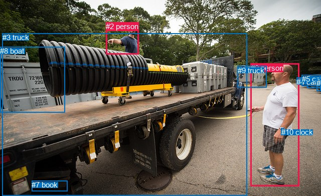
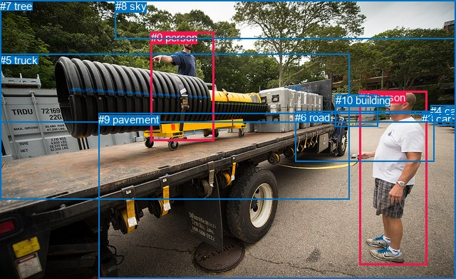

# 图片 0736：2348945.jpg

随机样本序号：404。图片 SHA256：`fd991bcccf8342f3ab5c5228dce3873765964a545365ac3f31d69b32c8a9258d`。

红色框表示人，蓝色框表示其他物体。两个模式分别保留自身框编号，可依据位置比较对应对象。

## 自动检测框与输出

人的框编号：`[0, 2]`。状态：`ok`。

### 自动检测全部物体框

| 编号 | 类别 | 是否为人 | 检测分数 | 像素坐标 xyxy |
|---|---|---|---|---|
| 0 | person | True | 0.9996 | 499.6, 126.8, 596.3, 371.2 |
| 1 | car | False | 0.9978 | 612.7, 152.7, 640.0, 175.9 |
| 2 | person | True | 0.9967 | 211.4, 44.1, 276.5, 108.4 |
| 3 | truck | False | 0.9946 | 4.6, 66.1, 492.0, 391.0 |
| 4 | car | False | 0.9852 | 591.2, 154.7, 607.3, 168.4 |
| 5 | car | False | 0.9784 | 602.0, 149.1, 638.7, 171.2 |
| 6 | car | False | 0.8842 | 631.4, 156.7, 640.0, 181.0 |
| 7 | book | False | 0.6890 | 63.3, 360.3, 134.7, 381.2 |
| 8 | boat | False | 0.6867 | 0.0, 93.4, 129.3, 224.2 |
| 9 | truck | False | 0.6565 | 473.5, 131.7, 531.7, 174.6 |
| 10 | clock | False | 0.3857 | 560.8, 255.3, 566.9, 260.4 |

### 自动检测 Top50 人相关候选

评分物体对：110；人相关物体对：38；输出关系：50。

| 排名 | 主语编号与类别 | 关系 | 宾语编号与类别 | 类型 | 人与人 | 排序分数 | 原始融合 logit |
|---|---|---|---|---|---|---|---|
| 1 | #0 person | pulling | #3 truck | semantic | False | 0.99446 | 5.1909 |
| 2 | #0 person | wearing | #10 clock | semantic | False | 0.99370 | 5.0614 |
| 3 | #0 person | beside | #3 truck | spatial | False | 0.98772 | 4.3878 |
| 4 | #2 person | standing on | #3 truck | semantic | False | 0.97615 | 3.7118 |
| 5 | #0 person | pulling | #8 boat | semantic | False | 0.94164 | 2.7810 |
| 6 | #2 person | beside | #3 truck | spatial | False | 0.91260 | 2.3458 |
| 7 | #0 person | looking at | #2 person | semantic | True | 0.88963 | 2.0870 |
| 8 | #2 person | talking to | #0 person | semantic | True | 0.85059 | 1.7393 |
| 9 | #10 clock | on | #0 person | spatial | False | 0.84752 | 1.7153 |
| 10 | #2 person | beside | #8 boat | spatial | False | 0.77831 | 1.2558 |
| 11 | #2 person | throwing | #8 boat | semantic | False | 0.76609 | 1.1863 |
| 12 | #0 person | on | #10 clock | spatial | False | 0.74861 | 1.0912 |
| 13 | #0 person | pushing | #9 truck | semantic | False | 0.74718 | 1.0836 |
| 14 | #3 truck | carrying | #2 person | semantic | False | 0.62346 | 0.5043 |
| 15 | #0 person | wearing | #4 car | semantic | False | 0.59429 | 0.3817 |
| 16 | #0 person | beside | #2 person | spatial | True | 0.58801 | 0.3557 |
| 17 | #10 clock | wearing | #0 person | semantic | False | 0.57567 | 0.3050 |
| 18 | #3 truck | beside | #0 person | spatial | False | 0.51675 | 0.0670 |
| 19 | #0 person | beside | #9 truck | spatial | False | 0.48137 | -0.0746 |
| 20 | #2 person | standing on | #9 truck | semantic | False | 0.47114 | -0.1156 |
| 21 | #3 truck | pulling | #0 person | semantic | False | 0.40349 | -0.3909 |
| 22 | #9 truck | looking at | #2 person | semantic | False | 0.37256 | -0.5213 |
| 23 | #2 person | beside | #0 person | spatial | True | 0.30585 | -0.8196 |
| 24 | #9 truck | beside | #0 person | spatial | False | 0.30121 | -0.8415 |
| 25 | #0 person | beside | #4 car | spatial | False | 0.29463 | -0.8730 |
| 26 | #9 truck | looking at | #0 person | semantic | False | 0.28687 | -0.9106 |
| 27 | #0 person | beside | #5 car | spatial | False | 0.26996 | -0.9948 |
| 28 | #0 person | beside | #1 car | spatial | False | 0.24106 | -1.1469 |
| 29 | #0 person | beside | #6 car | spatial | False | 0.21277 | -1.3083 |
| 30 | #0 person | beside | #8 boat | spatial | False | 0.21006 | -1.3246 |
| 31 | #3 truck | beside | #2 person | spatial | False | 0.18477 | -1.4843 |
| 32 | #2 person | in front of | #9 truck | spatial | False | 0.13530 | -1.8549 |
| 33 | #4 car | parked on | #0 person | semantic | False | 0.11446 | -2.0460 |
| 34 | #8 boat | beside | #2 person | spatial | False | 0.10018 | -2.1952 |
| 35 | #4 car | beside | #0 person | spatial | False | 0.08654 | -2.3566 |
| 36 | #0 person | standing on | #7 book | semantic | False | 0.07960 | -2.4478 |
| 37 | #5 car | parked on | #0 person | semantic | False | 0.07755 | -2.4761 |
| 38 | #6 car | parked on | #0 person | semantic | False | 0.07382 | -2.5294 |
| 39 | #1 car | parked on | #0 person | semantic | False | 0.06503 | -2.6657 |
| 40 | #5 car | beside | #0 person | spatial | False | 0.05554 | -2.8335 |
| 41 | #2 person | standing on | #6 car | semantic | False | 0.05541 | -2.8359 |
| 42 | #6 car | beside | #0 person | spatial | False | 0.04995 | -2.9455 |
| 43 | #1 car | beside | #0 person | spatial | False | 0.04983 | -2.9481 |
| 44 | #0 person | looking at | #5 car | semantic | False | 0.04700 | -3.0094 |
| 45 | #2 person | throwing | #4 car | semantic | False | 0.04399 | -3.0789 |
| 46 | #2 person | standing on | #1 car | semantic | False | 0.04357 | -3.0889 |
| 47 | #2 person | standing on | #5 car | semantic | False | 0.04124 | -3.1462 |
| 48 | #7 book | beside | #0 person | spatial | False | 0.04085 | -3.1561 |
| 49 | #0 person | looking at | #1 car | semantic | False | 0.03684 | -3.2635 |
| 50 | #2 person | in front of | #5 car | spatial | False | 0.03578 | -3.2941 |

### 自动检测逐条人相关 GT 核验

R@50：25.00%；命中 1/4。

| GT 主语编号 | GT 关系 | GT 宾语编号 | 结果阶段 | 匹配预测主语编号 | 匹配预测宾语编号 |
|---|---|---|---|---|---|
| 0 | talking to | 1 | endpoint_missing_or_wrong_class | [] | [0] |
| 0 | standing on | 5 | endpoint_missing_or_wrong_class | [] | [3] |
| 1 | pulling | 5 | hit50 | [0] | [3] |
| 1 | standing on | 9 | endpoint_missing_or_wrong_class | [0] | [] |

## 真实框与输出

人的框编号：`[0, 1]`。

### 真实框全部物体框

| 编号 | 类别 | 是否为人 | 检测分数 | 像素坐标 xyxy |
|---|---|---|---|---|
| 0 | person | True | GT | 212.0, 44.0, 301.0, 197.0 |
| 1 | person | True | GT | 504.0, 128.0, 599.0, 371.0 |
| 2 | car | False | GT | 613.0, 153.0, 640.0, 175.0 |
| 3 | car | False | GT | 592.0, 158.0, 606.0, 169.0 |
| 4 | car | False | GT | 604.0, 147.0, 640.0, 171.0 |
| 5 | truck | False | GT | 0.0, 76.0, 491.0, 280.0 |
| 6 | road | False | GT | 414.0, 156.0, 609.0, 227.0 |
| 7 | tree | False | GT | 0.0, 0.0, 640.0, 172.0 |
| 8 | sky | False | GT | 162.0, 0.0, 640.0, 54.0 |
| 9 | pavement | False | GT | 138.0, 159.0, 640.0, 391.0 |
| 10 | building | False | GT | 471.0, 132.0, 531.0, 177.0 |

### 真实框 Top50 人相关候选

评分物体对：110；人相关物体对：38；输出关系：50。

| 排名 | 主语编号与类别 | 关系 | 宾语编号与类别 | 类型 | 人与人 | 排序分数 | 原始融合 logit |
|---|---|---|---|---|---|---|---|
| 1 | #1 person | pulling | #5 truck | semantic | False | 0.99758 | 6.0209 |
| 2 | #0 person | standing on | #5 truck | semantic | False | 0.98041 | 3.9127 |
| 3 | #1 person | standing on | #9 pavement | semantic | False | 0.97641 | 3.7232 |
| 4 | #0 person | standing on | #9 pavement | semantic | False | 0.97364 | 3.6090 |
| 5 | #1 person | standing on | #6 road | semantic | False | 0.95997 | 3.1773 |
| 6 | #0 person | on | #5 truck | spatial | False | 0.95380 | 3.0274 |
| 7 | #1 person | on | #9 pavement | spatial | False | 0.93906 | 2.7351 |
| 8 | #1 person | on | #6 road | spatial | False | 0.92885 | 2.5692 |
| 9 | #0 person | standing on | #6 road | semantic | False | 0.92554 | 2.5202 |
| 10 | #1 person | beside | #5 truck | spatial | False | 0.91651 | 2.3958 |
| 11 | #0 person | on | #9 pavement | spatial | False | 0.88889 | 2.0795 |
| 12 | #0 person | talking to | #1 person | semantic | True | 0.86961 | 1.8975 |
| 13 | #0 person | on | #6 road | spatial | False | 0.86601 | 1.8661 |
| 14 | #1 person | looking at | #0 person | semantic | True | 0.86074 | 1.8214 |
| 15 | #5 truck | pulling | #0 person | semantic | False | 0.49872 | -0.0051 |
| 16 | #0 person | beside | #1 person | spatial | True | 0.45648 | -0.1745 |
| 17 | #1 person | beside | #0 person | spatial | True | 0.40284 | -0.3937 |
| 18 | #0 person | in | #7 tree | spatial | False | 0.39229 | -0.4377 |
| 19 | #0 person | looking at | #8 sky | semantic | False | 0.29412 | -0.8755 |
| 20 | #0 person | looking at | #7 tree | semantic | False | 0.27354 | -0.9767 |
| 21 | #1 person | pushing | #10 building | semantic | False | 0.25794 | -1.0567 |
| 22 | #1 person | looking at | #7 tree | semantic | False | 0.24049 | -1.1500 |
| 23 | #5 truck | pulling | #1 person | semantic | False | 0.20865 | -1.3331 |
| 24 | #8 sky | over | #0 person | spatial | False | 0.17541 | -1.5478 |
| 25 | #6 road | beside | #1 person | spatial | False | 0.15981 | -1.6597 |
| 26 | #1 person | looking at | #8 sky | semantic | False | 0.14601 | -1.7662 |
| 27 | #1 person | in | #7 tree | spatial | False | 0.13764 | -1.8350 |
| 28 | #1 person | beside | #10 building | spatial | False | 0.13239 | -1.8800 |
| 29 | #5 truck | beside | #1 person | spatial | False | 0.12532 | -1.9430 |
| 30 | #10 building | beside | #1 person | spatial | False | 0.12194 | -1.9742 |
| 31 | #0 person | talking to | #10 building | semantic | False | 0.11340 | -2.0565 |
| 32 | #10 building | looking at | #0 person | semantic | False | 0.09476 | -2.2569 |
| 33 | #1 person | wearing | #3 car | semantic | False | 0.08952 | -2.3195 |
| 34 | #5 truck | beside | #0 person | spatial | False | 0.08818 | -2.3360 |
| 35 | #0 person | in | #10 building | spatial | False | 0.08744 | -2.3453 |
| 36 | #0 person | in | #8 sky | spatial | False | 0.07931 | -2.4517 |
| 37 | #7 tree | beside | #0 person | spatial | False | 0.07227 | -2.5523 |
| 38 | #10 building | looking at | #1 person | semantic | False | 0.07024 | -2.5830 |
| 39 | #4 car | beside | #1 person | spatial | False | 0.05663 | -2.8129 |
| 40 | #3 car | parked on | #1 person | semantic | False | 0.04936 | -2.9581 |
| 41 | #2 car | beside | #1 person | spatial | False | 0.04849 | -2.9767 |
| 42 | #8 sky | over | #1 person | spatial | False | 0.04558 | -3.0416 |
| 43 | #9 pavement | beside | #1 person | spatial | False | 0.04507 | -3.0533 |
| 44 | #3 car | beside | #1 person | spatial | False | 0.04492 | -3.0569 |
| 45 | #1 person | in | #3 car | spatial | False | 0.03977 | -3.1841 |
| 46 | #10 building | beside | #0 person | spatial | False | 0.03579 | -3.2935 |
| 47 | #6 road | beside | #0 person | spatial | False | 0.03163 | -3.4217 |
| 48 | #4 car | parked on | #1 person | semantic | False | 0.03039 | -3.4629 |
| 49 | #4 car | beside | #0 person | spatial | False | 0.02727 | -3.5744 |
| 50 | #2 car | parked on | #1 person | semantic | False | 0.02572 | -3.6343 |

### 真实框逐条人相关 GT 核验

R@50：100.00%；命中 4/4。

| GT 主语编号 | GT 关系 | GT 宾语编号 | 结果阶段 | 匹配预测主语编号 | 匹配预测宾语编号 |
|---|---|---|---|---|---|
| 0 | talking to | 1 | hit50 | [0] | [1] |
| 0 | standing on | 5 | hit50 | [0] | [5] |
| 1 | pulling | 5 | hit50 | [1] | [5] |
| 1 | standing on | 9 | hit50 | [1] | [9] |

## 全部人相关 GT

| 主语编号与类别 | 关系 | 宾语编号与类别 |
|---|---|---|
| #0 person | talking to | #1 person |
| #0 person | standing on | #5 truck |
| #1 person | pulling | #5 truck |
| #1 person | standing on | #9 pavement |

原始记录、全部人相关物体对的两项预测与分项分数见 [逐图证据 JSON](../evidence/cases/0736.json)。全部56类 logits 保留于本机 HOR/output/random500/logits/。

<!-- HOR_COMPLETE_RESULTS -->

## 六组条件的完整输出对照

以下保留同一图片三种框与候选模式、两种谓词输出规则的全部 Top50。框编号各自在所属模式内解释。

### 自动检测框完整枚举：空间与语义各保留一个谓词

| 排名 | 主语编号与类别 | 谓词 | 宾语编号与类别 | 分组 | 排序分数 | predicate logit | pair logit |
|---|---|---|---|---|---|---|---|
| 1 | #0 person | pulling | #3 truck | semantic | 0.9944640 | 5.0511346 | 0.1397954 |
| 2 | #0 person | wearing | #10 clock | semantic | 0.9937032 | 4.3984218 | 0.6629851 |
| 3 | #0 person | beside | #3 truck | spatial | 0.9877239 | 4.2479558 | 0.1397954 |
| 4 | #2 person | standing on | #3 truck | semantic | 0.9761490 | 3.7805037 | -0.0687120 |
| 5 | #0 person | pulling | #8 boat | semantic | 0.9416406 | 3.9073720 | -1.1263697 |
| 6 | #2 person | beside | #3 truck | spatial | 0.9126012 | 2.4145284 | -0.0687120 |
| 7 | #0 person | looking at | #2 person | semantic | 0.8896342 | 2.8532419 | -0.7662323 |
| 8 | #2 person | talking to | #0 person | semantic | 0.8505948 | 2.9634237 | -1.2241502 |
| 9 | #10 clock | on | #0 person | spatial | 0.8475221 | 2.0804195 | -0.3651219 |
| 10 | #2 person | beside | #8 boat | spatial | 0.7783063 | 2.2879000 | -1.0320764 |
| 11 | #2 person | throwing | #8 boat | semantic | 0.7660867 | 2.2184210 | -1.0320764 |
| 12 | #0 person | on | #10 clock | spatial | 0.7486068 | 0.4282107 | 0.6629851 |
| 13 | #0 person | pushing | #9 truck | semantic | 0.7471809 | 2.0117850 | -0.9281515 |
| 14 | #3 truck | carrying | #2 person | semantic | 0.6234589 | 1.9331841 | -1.4289286 |
| 15 | #0 person | wearing | #4 car | semantic | 0.5942865 | 1.4433198 | -1.0616057 |
| 16 | #0 person | beside | #2 person | spatial | 0.5880067 | 1.1219635 | -0.7662323 |
| 17 | #10 clock | wearing | #0 person | semantic | 0.5756679 | 0.6701365 | -0.3651219 |
| 18 | #3 truck | beside | #0 person | spatial | 0.5167518 | 1.3872228 | -1.3201907 |
| 19 | #0 person | beside | #9 truck | spatial | 0.4813708 | 0.8536000 | -0.9281515 |
| 20 | #2 person | standing on | #9 truck | semantic | 0.4711416 | 1.1011519 | -1.2167141 |
| 21 | #3 truck | pulling | #0 person | semantic | 0.4034908 | 0.9292498 | -1.3201907 |
| 22 | #9 truck | looking at | #2 person | semantic | 0.3725553 | 1.2553768 | -1.7766467 |
| 23 | #2 person | beside | #0 person | spatial | 0.3058473 | 0.4045444 | -1.2241502 |
| 24 | #9 truck | beside | #0 person | spatial | 0.3012121 | 0.0716758 | -0.9132085 |
| 25 | #0 person | beside | #4 car | spatial | 0.2946274 | 0.1885910 | -1.0616057 |
| 26 | #9 truck | looking at | #0 person | semantic | 0.2868736 | 0.0025916 | -0.9132085 |
| 27 | #0 person | beside | #5 car | spatial | 0.2699593 | 0.1531744 | -1.1480036 |
| 28 | #0 person | beside | #1 car | spatial | 0.2410611 | 0.0326939 | -1.1795646 |
| 29 | #0 person | beside | #6 car | spatial | 0.2127748 | -0.1181960 | -1.1900839 |
| 30 | #0 person | beside | #8 boat | spatial | 0.2100557 | -0.1982203 | -1.1263697 |
| 31 | #3 truck | beside | #2 person | spatial | 0.1847728 | -0.0554113 | -1.4289286 |
| 32 | #2 person | in front of | #9 truck | spatial | 0.1352975 | -0.6381950 | -1.2167141 |
| 33 | #4 car | parked on | #0 person | semantic | 0.1144552 | -1.3609107 | -0.6851088 |
| 34 | #8 boat | beside | #2 person | spatial | 0.1001837 | -0.5926881 | -1.6024975 |
| 35 | #4 car | beside | #0 person | spatial | 0.0865403 | -1.6715207 | -0.6851088 |
| 36 | #0 person | standing on | #7 book | semantic | 0.0796008 | -1.1486552 | -1.2991276 |
| 37 | #5 car | parked on | #0 person | semantic | 0.0775524 | -1.8426297 | -0.6334477 |
| 38 | #6 car | parked on | #0 person | semantic | 0.0738229 | -1.9029038 | -0.6264925 |
| 39 | #1 car | parked on | #0 person | semantic | 0.0650263 | -2.0380857 | -0.6276413 |
| 40 | #5 car | beside | #0 person | spatial | 0.0555419 | -2.2000258 | -0.6334477 |
| 41 | #2 person | standing on | #6 car | semantic | 0.0554130 | -1.5449426 | -1.2909901 |
| 42 | #6 car | beside | #0 person | spatial | 0.0499485 | -2.3190320 | -0.6264925 |
| 43 | #1 car | beside | #0 person | spatial | 0.0498282 | -2.3204195 | -0.6276413 |
| 44 | #0 person | looking at | #5 car | semantic | 0.0470048 | -1.8613555 | -1.1480036 |
| 45 | #2 person | throwing | #4 car | semantic | 0.0439859 | -1.8429439 | -1.2359594 |
| 46 | #2 person | standing on | #1 car | semantic | 0.0435658 | -1.8032687 | -1.2856711 |
| 47 | #2 person | standing on | #5 car | semantic | 0.0412395 | -1.8819654 | -1.2642790 |
| 48 | #7 book | beside | #0 person | spatial | 0.0408508 | -1.7489171 | -1.4072027 |
| 49 | #0 person | looking at | #1 car | semantic | 0.0368437 | -2.0839674 | -1.1795646 |
| 50 | #2 person | in front of | #5 car | spatial | 0.0357755 | -2.0297823 | -1.2642790 |

GT 命中：1/4，R@50=25.00%。

| GT主语 | GT谓词 | GT宾语 | 结果阶段 | 匹配主语框 | 匹配宾语框 |
|---|---|---|---|---|---|
| 0 | talking to | 1 | endpoint_missing_or_wrong_class | [] | [0] |
| 0 | standing on | 5 | endpoint_missing_or_wrong_class | [] | [3] |
| 1 | pulling | 5 | hit50 | [0] | [3] |
| 1 | standing on | 9 | endpoint_missing_or_wrong_class | [0] | [] |

### 自动检测框完整枚举：每对只保留一个谓词

| 排名 | 主语编号与类别 | 谓词 | 宾语编号与类别 | 分组 | 排序分数 | predicate logit | pair logit |
|---|---|---|---|---|---|---|---|
| 1 | #0 person | pulling | #3 truck | single | 0.9944640 | 5.0511346 | 0.1397954 |
| 2 | #0 person | wearing | #10 clock | single | 0.9937032 | 4.3984218 | 0.6629851 |
| 3 | #2 person | standing on | #3 truck | single | 0.9761490 | 3.7805037 | -0.0687120 |
| 4 | #0 person | pulling | #8 boat | single | 0.9416406 | 3.9073720 | -1.1263697 |
| 5 | #0 person | looking at | #2 person | single | 0.8896342 | 2.8532419 | -0.7662323 |
| 6 | #2 person | talking to | #0 person | single | 0.8505948 | 2.9634237 | -1.2241502 |
| 7 | #10 clock | on | #0 person | single | 0.8475221 | 2.0804195 | -0.3651219 |
| 8 | #2 person | beside | #8 boat | single | 0.7783063 | 2.2879000 | -1.0320764 |
| 9 | #0 person | pushing | #9 truck | single | 0.7471809 | 2.0117850 | -0.9281515 |
| 10 | #3 truck | carrying | #2 person | single | 0.6234589 | 1.9331841 | -1.4289286 |
| 11 | #0 person | wearing | #4 car | single | 0.5942865 | 1.4433198 | -1.0616057 |
| 12 | #3 truck | beside | #0 person | single | 0.5167518 | 1.3872228 | -1.3201907 |
| 13 | #2 person | standing on | #9 truck | single | 0.4711416 | 1.1011519 | -1.2167141 |
| 14 | #9 truck | looking at | #2 person | single | 0.3725553 | 1.2553768 | -1.7766467 |
| 15 | #9 truck | beside | #0 person | single | 0.3012121 | 0.0716758 | -0.9132085 |
| 16 | #0 person | beside | #5 car | single | 0.2699593 | 0.1531744 | -1.1480036 |
| 17 | #0 person | beside | #1 car | single | 0.2410611 | 0.0326939 | -1.1795646 |
| 18 | #0 person | beside | #6 car | single | 0.2127748 | -0.1181960 | -1.1900839 |
| 19 | #4 car | parked on | #0 person | single | 0.1144552 | -1.3609107 | -0.6851088 |
| 20 | #8 boat | beside | #2 person | single | 0.1001837 | -0.5926881 | -1.6024975 |
| 21 | #0 person | standing on | #7 book | single | 0.0796008 | -1.1486552 | -1.2991276 |
| 22 | #5 car | parked on | #0 person | single | 0.0775524 | -1.8426297 | -0.6334477 |
| 23 | #6 car | parked on | #0 person | single | 0.0738229 | -1.9029038 | -0.6264925 |
| 24 | #1 car | parked on | #0 person | single | 0.0650263 | -2.0380857 | -0.6276413 |
| 25 | #2 person | standing on | #6 car | single | 0.0554130 | -1.5449426 | -1.2909901 |
| 26 | #2 person | throwing | #4 car | single | 0.0439859 | -1.8429439 | -1.2359594 |
| 27 | #2 person | standing on | #1 car | single | 0.0435658 | -1.8032687 | -1.2856711 |
| 28 | #2 person | standing on | #5 car | single | 0.0412395 | -1.8819654 | -1.2642790 |
| 29 | #7 book | beside | #0 person | single | 0.0408508 | -1.7489171 | -1.4072027 |
| 30 | #2 person | wearing | #10 clock | single | 0.0334494 | -1.7721884 | -1.5915101 |
| 31 | #8 boat | beside | #0 person | single | 0.0248889 | -2.2737501 | -1.3943784 |
| 32 | #4 car | looking at | #2 person | single | 0.0201235 | -2.2798767 | -1.6056622 |
| 33 | #2 person | standing on | #7 book | single | 0.0117413 | -2.6749995 | -1.7578367 |
| 34 | #6 car | looking at | #2 person | single | 0.0110866 | -2.7991521 | -1.6917152 |
| 35 | #10 clock | wearing | #2 person | single | 0.0104647 | -2.9835434 | -1.5656804 |
| 36 | #5 car | driving | #2 person | single | 0.0056754 | -3.5386519 | -1.6272631 |
| 37 | #1 car | driving | #2 person | single | 0.0043137 | -3.7793698 | -1.6622601 |
| 38 | #7 book | looking at | #2 person | single | 0.0013510 | -4.6953859 | -1.9101995 |

GT 命中：1/4，R@50=25.00%。

| GT主语 | GT谓词 | GT宾语 | 结果阶段 | 匹配主语框 | 匹配宾语框 |
|---|---|---|---|---|---|
| 0 | talking to | 1 | endpoint_missing_or_wrong_class | [] | [0] |
| 0 | standing on | 5 | endpoint_missing_or_wrong_class | [] | [3] |
| 1 | pulling | 5 | hit50 | [0] | [3] |
| 1 | standing on | 9 | endpoint_missing_or_wrong_class | [0] | [] |

### 真实框完整枚举：空间与语义各保留一个谓词

| 排名 | 主语编号与类别 | 谓词 | 宾语编号与类别 | 分组 | 排序分数 | predicate logit | pair logit |
|---|---|---|---|---|---|---|---|
| 1 | #1 person | pulling | #5 truck | semantic | 0.9975784 | 6.1343951 | -0.1134789 |
| 2 | #0 person | standing on | #5 truck | semantic | 0.9804052 | 3.7878480 | 0.1248525 |
| 3 | #1 person | standing on | #9 pavement | semantic | 0.9764142 | 3.5313973 | 0.1918448 |
| 4 | #0 person | standing on | #9 pavement | semantic | 0.9736361 | 4.1169066 | -0.5078672 |
| 5 | #1 person | standing on | #6 road | semantic | 0.9599697 | 3.3581948 | -0.1809288 |
| 6 | #0 person | on | #5 truck | spatial | 0.9537985 | 2.9025860 | 0.1248525 |
| 7 | #1 person | on | #9 pavement | spatial | 0.9390649 | 2.5432286 | 0.1918448 |
| 8 | #1 person | on | #6 road | spatial | 0.9288530 | 2.7501311 | -0.1809288 |
| 9 | #0 person | standing on | #6 road | semantic | 0.9255435 | 3.1921363 | -0.6719694 |
| 10 | #1 person | beside | #5 truck | spatial | 0.9165091 | 2.5093126 | -0.1134789 |
| 11 | #0 person | on | #9 pavement | spatial | 0.8888946 | 2.5873661 | -0.5078672 |
| 12 | #0 person | talking to | #1 person | semantic | 0.8696083 | 3.0494452 | -1.1519449 |
| 13 | #0 person | on | #6 road | spatial | 0.8660069 | 2.5380731 | -0.6719694 |
| 14 | #1 person | looking at | #0 person | semantic | 0.8607363 | 2.3528466 | -0.5314281 |
| 15 | #5 truck | pulling | #0 person | semantic | 0.4987205 | 1.2302003 | -1.2353183 |
| 16 | #0 person | beside | #1 person | spatial | 0.4564828 | 0.9774346 | -1.1519449 |
| 17 | #1 person | beside | #0 person | spatial | 0.4028371 | 0.1377707 | -0.5314281 |
| 18 | #0 person | in | #7 tree | spatial | 0.3922920 | 0.3715558 | -0.8092439 |
| 19 | #0 person | looking at | #8 sky | semantic | 0.2941210 | 0.3087339 | -1.1841863 |
| 20 | #0 person | looking at | #7 tree | semantic | 0.2735391 | -0.1674962 | -0.8092439 |
| 21 | #1 person | pushing | #10 building | semantic | 0.2579441 | -0.1542144 | -0.9024674 |
| 22 | #1 person | looking at | #7 tree | semantic | 0.2404914 | -0.0968547 | -1.0531324 |
| 23 | #5 truck | pulling | #1 person | semantic | 0.2086546 | 0.2673769 | -1.6004314 |
| 24 | #8 sky | over | #0 person | spatial | 0.1754113 | -0.7660003 | -0.7817513 |
| 25 | #6 road | beside | #1 person | spatial | 0.1598063 | -0.5261741 | -1.1334958 |
| 26 | #1 person | looking at | #8 sky | semantic | 0.1460140 | 0.0774169 | -1.8436289 |
| 27 | #1 person | in | #7 tree | spatial | 0.1376437 | -0.7818677 | -1.0531324 |
| 28 | #1 person | beside | #10 building | spatial | 0.1323944 | -0.9774847 | -0.9024674 |
| 29 | #5 truck | beside | #1 person | spatial | 0.1253226 | -0.3425322 | -1.6004314 |
| 30 | #10 building | beside | #1 person | spatial | 0.1219378 | -1.0542126 | -0.9199942 |
| 31 | #0 person | talking to | #10 building | semantic | 0.1133958 | -0.5620041 | -1.4945107 |
| 32 | #10 building | looking at | #0 person | semantic | 0.0947570 | -0.9799061 | -1.2769814 |
| 33 | #1 person | wearing | #3 car | semantic | 0.0895245 | -1.2981362 | -1.0213188 |
| 34 | #5 truck | beside | #0 person | spatial | 0.0881817 | -1.1007228 | -1.2353183 |
| 35 | #0 person | in | #10 building | spatial | 0.0874398 | -0.8507926 | -1.4945107 |
| 36 | #0 person | in | #8 sky | spatial | 0.0793148 | -1.2675066 | -1.1841863 |
| 37 | #7 tree | beside | #0 person | spatial | 0.0722718 | -1.8831711 | -0.6691338 |
| 38 | #10 building | looking at | #1 person | semantic | 0.0702413 | -1.6629946 | -0.9199942 |
| 39 | #4 car | beside | #1 person | spatial | 0.0566300 | -2.1834476 | -0.6294729 |
| 40 | #3 car | parked on | #1 person | semantic | 0.0493561 | -2.2769611 | -0.6811177 |
| 41 | #2 car | beside | #1 person | spatial | 0.0484876 | -2.3487182 | -0.6280271 |
| 42 | #8 sky | over | #1 person | spatial | 0.0455821 | -1.9142373 | -1.1273484 |
| 43 | #9 pavement | beside | #1 person | spatial | 0.0450742 | -1.8323529 | -1.2209704 |
| 44 | #3 car | beside | #1 person | spatial | 0.0449206 | -2.3757808 | -0.6811177 |
| 45 | #1 person | in | #3 car | spatial | 0.0397682 | -2.1627872 | -1.0213188 |
| 46 | #10 building | beside | #0 person | spatial | 0.0357940 | -2.0165434 | -1.2769814 |
| 47 | #6 road | beside | #0 person | spatial | 0.0316254 | -2.0025096 | -1.4191487 |
| 48 | #4 car | parked on | #1 person | semantic | 0.0303877 | -2.8333874 | -0.6294729 |
| 49 | #4 car | beside | #0 person | spatial | 0.0272676 | -2.3632722 | -1.2111378 |
| 50 | #2 car | parked on | #1 person | semantic | 0.0257228 | -3.0062928 | -0.6280271 |

GT 命中：4/4，R@50=100.00%。

| GT主语 | GT谓词 | GT宾语 | 结果阶段 | 匹配主语框 | 匹配宾语框 |
|---|---|---|---|---|---|
| 0 | talking to | 1 | hit50 | [0] | [1] |
| 0 | standing on | 5 | hit50 | [0] | [5] |
| 1 | pulling | 5 | hit50 | [1] | [5] |
| 1 | standing on | 9 | hit50 | [1] | [9] |

### 真实框完整枚举：每对只保留一个谓词

| 排名 | 主语编号与类别 | 谓词 | 宾语编号与类别 | 分组 | 排序分数 | predicate logit | pair logit |
|---|---|---|---|---|---|---|---|
| 1 | #1 person | pulling | #5 truck | single | 0.9975784 | 6.1343951 | -0.1134789 |
| 2 | #0 person | standing on | #5 truck | single | 0.9804052 | 3.7878480 | 0.1248525 |
| 3 | #1 person | standing on | #9 pavement | single | 0.9764142 | 3.5313973 | 0.1918448 |
| 4 | #0 person | standing on | #9 pavement | single | 0.9736361 | 4.1169066 | -0.5078672 |
| 5 | #1 person | standing on | #6 road | single | 0.9599697 | 3.3581948 | -0.1809288 |
| 6 | #0 person | standing on | #6 road | single | 0.9255435 | 3.1921363 | -0.6719694 |
| 7 | #0 person | talking to | #1 person | single | 0.8696083 | 3.0494452 | -1.1519449 |
| 8 | #1 person | looking at | #0 person | single | 0.8607363 | 2.3528466 | -0.5314281 |
| 9 | #5 truck | pulling | #0 person | single | 0.4987205 | 1.2302003 | -1.2353183 |
| 10 | #0 person | in | #7 tree | single | 0.3922920 | 0.3715558 | -0.8092439 |
| 11 | #0 person | looking at | #8 sky | single | 0.2941210 | 0.3087339 | -1.1841863 |
| 12 | #1 person | pushing | #10 building | single | 0.2579441 | -0.1542144 | -0.9024674 |
| 13 | #1 person | looking at | #7 tree | single | 0.2404914 | -0.0968547 | -1.0531324 |
| 14 | #5 truck | pulling | #1 person | single | 0.2086546 | 0.2673769 | -1.6004314 |
| 15 | #8 sky | over | #0 person | single | 0.1754113 | -0.7660003 | -0.7817513 |
| 16 | #6 road | beside | #1 person | single | 0.1598063 | -0.5261741 | -1.1334958 |
| 17 | #1 person | looking at | #8 sky | single | 0.1460140 | 0.0774169 | -1.8436289 |
| 18 | #10 building | beside | #1 person | single | 0.1219378 | -1.0542126 | -0.9199942 |
| 19 | #0 person | talking to | #10 building | single | 0.1133958 | -0.5620041 | -1.4945107 |
| 20 | #10 building | looking at | #0 person | single | 0.0947570 | -0.9799061 | -1.2769814 |
| 21 | #1 person | wearing | #3 car | single | 0.0895245 | -1.2981362 | -1.0213188 |
| 22 | #7 tree | beside | #0 person | single | 0.0722718 | -1.8831711 | -0.6691338 |
| 23 | #4 car | beside | #1 person | single | 0.0566300 | -2.1834476 | -0.6294729 |
| 24 | #3 car | parked on | #1 person | single | 0.0493561 | -2.2769611 | -0.6811177 |
| 25 | #2 car | beside | #1 person | single | 0.0484876 | -2.3487182 | -0.6280271 |
| 26 | #8 sky | over | #1 person | single | 0.0455821 | -1.9142373 | -1.1273484 |
| 27 | #9 pavement | beside | #1 person | single | 0.0450742 | -1.8323529 | -1.2209704 |
| 28 | #6 road | beside | #0 person | single | 0.0316254 | -2.0025096 | -1.4191487 |
| 29 | #4 car | beside | #0 person | single | 0.0272676 | -2.3632722 | -1.2111378 |
| 30 | #3 car | looking at | #0 person | single | 0.0253288 | -2.3726122 | -1.2775466 |
| 31 | #7 tree | beside | #1 person | single | 0.0251314 | -2.7277212 | -0.9304653 |
| 32 | #2 car | beside | #0 person | single | 0.0235661 | -2.4984515 | -1.2256455 |
| 33 | #1 person | beside | #4 car | single | 0.0132342 | -3.1826515 | -1.1289794 |
| 34 | #9 pavement | holding | #0 person | single | 0.0122887 | -2.9775562 | -1.4091501 |
| 35 | #1 person | beside | #2 car | single | 0.0118100 | -3.2650557 | -1.1618686 |
| 36 | #0 person | standing on | #4 car | single | 0.0098765 | -2.9890368 | -1.6186296 |
| 37 | #0 person | looking at | #3 car | single | 0.0088441 | -3.1602628 | -1.5588567 |
| 38 | #0 person | beside | #2 car | single | 0.0082281 | -3.1470327 | -1.6449068 |

GT 命中：4/4，R@50=100.00%。

| GT主语 | GT谓词 | GT宾语 | 结果阶段 | 匹配主语框 | 匹配宾语框 |
|---|---|---|---|---|---|
| 0 | talking to | 1 | hit50 | [0] | [1] |
| 0 | standing on | 5 | hit50 | [0] | [5] |
| 1 | pulling | 5 | hit50 | [1] | [5] |
| 1 | standing on | 9 | hit50 | [1] | [9] |

### 真实框400候选：空间与语义各保留一个谓词

| 排名 | 主语编号与类别 | 谓词 | 宾语编号与类别 | 分组 | 排序分数 | predicate logit | pair logit |
|---|---|---|---|---|---|---|---|
| 1 | #1 person | pulling | #5 truck | semantic | 0.9975784 | 6.1343951 | -0.1134789 |
| 2 | #0 person | standing on | #5 truck | semantic | 0.9804052 | 3.7878480 | 0.1248525 |
| 3 | #1 person | standing on | #9 pavement | semantic | 0.9764142 | 3.5313973 | 0.1918448 |
| 4 | #0 person | standing on | #9 pavement | semantic | 0.9736361 | 4.1169066 | -0.5078672 |
| 5 | #1 person | standing on | #6 road | semantic | 0.9581845 | 3.3127007 | -0.1809288 |
| 6 | #0 person | on | #5 truck | spatial | 0.9537985 | 2.9025860 | 0.1248525 |
| 7 | #1 person | on | #9 pavement | spatial | 0.9390649 | 2.5432286 | 0.1918448 |
| 8 | #0 person | standing on | #6 road | semantic | 0.9291039 | 3.2449751 | -0.6719694 |
| 9 | #1 person | on | #6 road | spatial | 0.9281300 | 2.7392411 | -0.1809288 |
| 10 | #1 person | beside | #5 truck | spatial | 0.9165091 | 2.5093126 | -0.1134789 |
| 11 | #0 person | on | #9 pavement | spatial | 0.8888946 | 2.5873661 | -0.5078672 |
| 12 | #0 person | talking to | #1 person | semantic | 0.8696083 | 3.0494452 | -1.1519449 |
| 13 | #0 person | on | #6 road | spatial | 0.8672654 | 2.5489626 | -0.6719694 |
| 14 | #1 person | looking at | #0 person | semantic | 0.8607363 | 2.3528466 | -0.5314281 |
| 15 | #5 truck | pulling | #0 person | semantic | 0.4987196 | 1.2301970 | -1.2353183 |
| 16 | #0 person | beside | #1 person | spatial | 0.4564971 | 0.9774923 | -1.1519449 |
| 17 | #1 person | beside | #0 person | spatial | 0.4028371 | 0.1377707 | -0.5314281 |
| 18 | #0 person | in | #7 tree | spatial | 0.3938755 | 0.3781934 | -0.8092439 |
| 19 | #0 person | looking at | #8 sky | semantic | 0.2941210 | 0.3087339 | -1.1841863 |
| 20 | #0 person | looking at | #7 tree | semantic | 0.2736084 | -0.1671476 | -0.8092439 |
| 21 | #1 person | pushing | #10 building | semantic | 0.2579453 | -0.1542082 | -0.9024674 |
| 22 | #1 person | looking at | #7 tree | semantic | 0.2459012 | -0.0674610 | -1.0531324 |
| 23 | #5 truck | pulling | #1 person | semantic | 0.1941433 | 0.1771221 | -1.6004314 |
| 24 | #8 sky | over | #0 person | spatial | 0.1756504 | -0.7643478 | -0.7817513 |
| 25 | #6 road | beside | #1 person | spatial | 0.1598025 | -0.5262022 | -1.1334958 |
| 26 | #1 person | looking at | #8 sky | semantic | 0.1423443 | 0.0476747 | -1.8436289 |
| 27 | #1 person | in | #7 tree | spatial | 0.1380380 | -0.7785494 | -1.0531324 |
| 28 | #1 person | beside | #10 building | spatial | 0.1323944 | -0.9774847 | -0.9024674 |
| 29 | #5 truck | beside | #1 person | spatial | 0.1253099 | -0.3426480 | -1.6004314 |
| 30 | #10 building | beside | #1 person | spatial | 0.1219324 | -1.0542631 | -0.9199942 |
| 31 | #0 person | talking to | #10 building | semantic | 0.1133958 | -0.5620041 | -1.4945107 |
| 32 | #10 building | looking at | #0 person | semantic | 0.0934743 | -0.9949515 | -1.2769814 |
| 33 | #1 person | wearing | #3 car | semantic | 0.0875696 | -1.3223596 | -1.0213188 |
| 34 | #0 person | in | #10 building | spatial | 0.0873075 | -0.8524520 | -1.4945107 |
| 35 | #5 truck | beside | #0 person | spatial | 0.0857977 | -1.1307418 | -1.2353183 |
| 36 | #0 person | in | #8 sky | spatial | 0.0777081 | -1.2897158 | -1.1841863 |
| 37 | #7 tree | beside | #0 person | spatial | 0.0722718 | -1.8831711 | -0.6691338 |
| 38 | #10 building | looking at | #1 person | semantic | 0.0692763 | -1.6778660 | -0.9199942 |
| 39 | #4 car | beside | #1 person | spatial | 0.0574360 | -2.1684599 | -0.6294729 |
| 40 | #3 car | parked on | #1 person | semantic | 0.0493556 | -2.2769706 | -0.6811177 |
| 41 | #2 car | beside | #1 person | spatial | 0.0491838 | -2.3337302 | -0.6280271 |
| 42 | #8 sky | over | #1 person | spatial | 0.0455821 | -1.9142373 | -1.1273484 |
| 43 | #3 car | beside | #1 person | spatial | 0.0449215 | -2.3757589 | -0.6811177 |
| 44 | #9 pavement | beside | #1 person | spatial | 0.0437990 | -1.8623862 | -1.2209704 |
| 45 | #1 person | in | #3 car | spatial | 0.0402666 | -2.1498158 | -1.0213188 |
| 46 | #10 building | beside | #0 person | spatial | 0.0357935 | -2.0165577 | -1.2769814 |
| 47 | #6 road | beside | #0 person | spatial | 0.0307159 | -2.0326297 | -1.4191487 |
| 48 | #4 car | parked on | #1 person | semantic | 0.0306101 | -2.8258657 | -0.6294729 |
| 49 | #4 car | beside | #0 person | spatial | 0.0268714 | -2.3783178 | -1.2111378 |
| 50 | #2 car | parked on | #1 person | semantic | 0.0257227 | -3.0062940 | -0.6280271 |

GT 命中：4/4，R@50=100.00%。

| GT主语 | GT谓词 | GT宾语 | 结果阶段 | 匹配主语框 | 匹配宾语框 |
|---|---|---|---|---|---|
| 0 | talking to | 1 | hit50 | [0] | [1] |
| 0 | standing on | 5 | hit50 | [0] | [5] |
| 1 | pulling | 5 | hit50 | [1] | [5] |
| 1 | standing on | 9 | hit50 | [1] | [9] |

### 真实框400候选：每对只保留一个谓词

| 排名 | 主语编号与类别 | 谓词 | 宾语编号与类别 | 分组 | 排序分数 | predicate logit | pair logit |
|---|---|---|---|---|---|---|---|
| 1 | #1 person | pulling | #5 truck | single | 0.9975784 | 6.1343951 | -0.1134789 |
| 2 | #0 person | standing on | #5 truck | single | 0.9804052 | 3.7878480 | 0.1248525 |
| 3 | #1 person | standing on | #9 pavement | single | 0.9764142 | 3.5313973 | 0.1918448 |
| 4 | #0 person | standing on | #9 pavement | single | 0.9736361 | 4.1169066 | -0.5078672 |
| 5 | #1 person | standing on | #6 road | single | 0.9581845 | 3.3127007 | -0.1809288 |
| 6 | #0 person | standing on | #6 road | single | 0.9291039 | 3.2449751 | -0.6719694 |
| 7 | #0 person | talking to | #1 person | single | 0.8696083 | 3.0494452 | -1.1519449 |
| 8 | #1 person | looking at | #0 person | single | 0.8607363 | 2.3528466 | -0.5314281 |
| 9 | #5 truck | pulling | #0 person | single | 0.4987196 | 1.2301970 | -1.2353183 |
| 10 | #0 person | in | #7 tree | single | 0.3938755 | 0.3781934 | -0.8092439 |
| 11 | #0 person | looking at | #8 sky | single | 0.2941210 | 0.3087339 | -1.1841863 |
| 12 | #1 person | pushing | #10 building | single | 0.2579453 | -0.1542082 | -0.9024674 |
| 13 | #1 person | looking at | #7 tree | single | 0.2459012 | -0.0674610 | -1.0531324 |
| 14 | #5 truck | pulling | #1 person | single | 0.1941433 | 0.1771221 | -1.6004314 |
| 15 | #8 sky | over | #0 person | single | 0.1756504 | -0.7643478 | -0.7817513 |
| 16 | #6 road | beside | #1 person | single | 0.1598025 | -0.5262022 | -1.1334958 |
| 17 | #1 person | looking at | #8 sky | single | 0.1423443 | 0.0476747 | -1.8436289 |
| 18 | #10 building | beside | #1 person | single | 0.1219324 | -1.0542631 | -0.9199942 |
| 19 | #0 person | talking to | #10 building | single | 0.1133958 | -0.5620041 | -1.4945107 |
| 20 | #10 building | looking at | #0 person | single | 0.0934743 | -0.9949515 | -1.2769814 |
| 21 | #1 person | wearing | #3 car | single | 0.0875696 | -1.3223596 | -1.0213188 |
| 22 | #7 tree | beside | #0 person | single | 0.0722718 | -1.8831711 | -0.6691338 |
| 23 | #4 car | beside | #1 person | single | 0.0574360 | -2.1684599 | -0.6294729 |
| 24 | #3 car | parked on | #1 person | single | 0.0493556 | -2.2769706 | -0.6811177 |
| 25 | #2 car | beside | #1 person | single | 0.0491838 | -2.3337302 | -0.6280271 |
| 26 | #8 sky | over | #1 person | single | 0.0455821 | -1.9142373 | -1.1273484 |
| 27 | #9 pavement | beside | #1 person | single | 0.0437990 | -1.8623862 | -1.2209704 |
| 28 | #6 road | beside | #0 person | single | 0.0307159 | -2.0326297 | -1.4191487 |
| 29 | #4 car | beside | #0 person | single | 0.0268714 | -2.3783178 | -1.2111378 |
| 30 | #7 tree | beside | #1 person | single | 0.0251299 | -2.7277789 | -0.9304653 |
| 31 | #3 car | looking at | #0 person | single | 0.0249544 | -2.3878865 | -1.2775466 |
| 32 | #2 car | beside | #0 person | single | 0.0225514 | -2.5435016 | -1.2256455 |
| 33 | #1 person | beside | #4 car | single | 0.0131363 | -3.1901746 | -1.1289794 |
| 34 | #9 pavement | holding | #0 person | single | 0.0122708 | -2.9790335 | -1.4091501 |
| 35 | #1 person | beside | #2 car | single | 0.0117232 | -3.2725205 | -1.1618686 |
| 36 | #0 person | standing on | #4 car | single | 0.0097462 | -3.0024543 | -1.6186296 |
| 37 | #0 person | looking at | #3 car | single | 0.0089049 | -3.1533501 | -1.5588567 |
| 38 | #0 person | beside | #2 car | single | 0.0081672 | -3.1545265 | -1.6449068 |

GT 命中：4/4，R@50=100.00%。

| GT主语 | GT谓词 | GT宾语 | 结果阶段 | 匹配主语框 | 匹配宾语框 |
|---|---|---|---|---|---|
| 0 | talking to | 1 | hit50 | [0] | [1] |
| 0 | standing on | 5 | hit50 | [0] | [5] |
| 1 | pulling | 5 | hit50 | [1] | [5] |
| 1 | standing on | 9 | hit50 | [1] | [9] |
