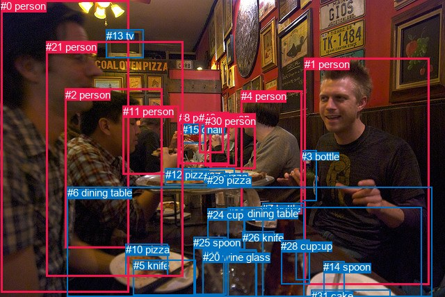
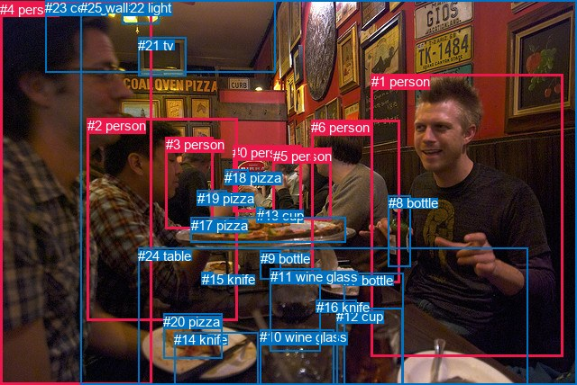

# 图片 0749：2349334.jpg

随机样本序号：66。图片 SHA256：`124e9b44a0687f4ef1dab48dfe021bca7da071e65e645507b8dab55373d43316`。

红色框表示人，蓝色框表示其他物体。两个模式分别保留自身框编号，可依据位置比较对应对象。

## 自动检测框与输出

人的框编号：`[0, 1, 2, 4, 8, 9, 11, 19, 21, 30]`。状态：`ok`。

### 自动检测全部物体框

| 编号 | 类别 | 是否为人 | 检测分数 | 像素坐标 xyxy |
|---|---|---|---|---|
| 0 | person | True | 0.9971 | 1.1, 0.0, 185.4, 421.5 |
| 1 | person | True | 0.9969 | 437.8, 83.9, 617.8, 410.3 |
| 2 | person | True | 0.9950 | 93.8, 127.7, 233.6, 357.2 |
| 3 | bottle | False | 0.9887 | 433.0, 216.7, 455.5, 289.7 |
| 4 | person | True | 0.9875 | 346.6, 130.1, 434.6, 308.1 |
| 5 | knife | False | 0.9777 | 191.6, 374.0, 281.7, 425.9 |
| 6 | dining table | False | 0.9773 | 96.6, 269.1, 621.1, 427.5 |
| 7 | bottle | False | 0.9613 | 377.4, 292.3, 437.3, 428.0 |
| 8 | person | True | 0.9485 | 257.0, 161.2, 329.5, 236.1 |
| 9 | person | True | 0.9427 | 301.7, 163.7, 367.6, 243.9 |
| 10 | pizza | False | 0.9238 | 180.9, 351.2, 242.0, 397.1 |
| 11 | person | True | 0.9207 | 176.8, 152.3, 257.8, 251.4 |
| 12 | pizza | False | 0.8810 | 237.9, 242.7, 337.1, 266.1 |
| 13 | tv | False | 0.8497 | 152.6, 42.7, 206.5, 83.5 |
| 14 | spoon | False | 0.8033 | 465.3, 376.4, 495.0, 428.0 |
| 15 | chair | False | 0.7971 | 262.3, 178.1, 294.6, 206.6 |
| 16 | cup | False | 0.7361 | 291.8, 359.5, 368.5, 427.9 |
| 17 | cup | False | 0.7262 | 425.7, 345.6, 445.7, 404.0 |
| 18 | wine glass | False | 0.6971 | 298.6, 300.3, 351.6, 361.8 |
| 19 | person | True | 0.6676 | 286.1, 161.2, 321.9, 220.3 |
| 20 | wine glass | False | 0.6048 | 291.7, 361.9, 369.5, 428.0 |
| 21 | person | True | 0.5551 | 66.2, 59.2, 263.3, 398.8 |
| 22 | knife | False | 0.5158 | 278.1, 341.6, 322.5, 425.9 |
| 23 | dining table | False | 0.4424 | 328.0, 298.7, 606.7, 427.6 |
| 24 | cup | False | 0.4254 | 298.4, 300.7, 352.8, 359.0 |
| 25 | spoon | False | 0.4229 | 278.2, 341.4, 325.6, 424.7 |
| 26 | knife | False | 0.4160 | 348.5, 333.6, 394.0, 344.8 |
| 27 | pizza | False | 0.4116 | 293.2, 246.0, 323.3, 253.2 |
| 28 | cup | False | 0.3952 | 404.5, 346.3, 445.2, 409.4 |
| 29 | pizza | False | 0.3917 | 298.0, 251.3, 328.2, 262.8 |
| 30 | person | True | 0.3696 | 294.7, 166.3, 340.9, 239.8 |
| 31 | cake | False | 0.3613 | 447.8, 417.5, 562.0, 427.9 |

### 自动检测 Top50 人相关候选

评分物体对：992；人相关物体对：530；输出关系：50。

| 排名 | 主语编号与类别 | 关系 | 宾语编号与类别 | 类型 | 人与人 | 排序分数 | 原始融合 logit |
|---|---|---|---|---|---|---|---|
| 1 | #8 person | holding | #15 chair | semantic | False | 0.98189 | 3.9930 |
| 2 | #9 person | sitting on | #6 dining table | semantic | False | 0.95914 | 3.1558 |
| 3 | #21 person | eating | #10 pizza | semantic | False | 0.95696 | 3.1015 |
| 4 | #2 person | sitting on | #6 dining table | semantic | False | 0.95658 | 3.0925 |
| 5 | #4 person | sitting on | #6 dining table | semantic | False | 0.95633 | 3.0864 |
| 6 | #1 person | sitting on | #6 dining table | semantic | False | 0.95291 | 3.0074 |
| 7 | #1 person | holding | #3 bottle | semantic | False | 0.94878 | 2.9190 |
| 8 | #30 person | sitting on | #6 dining table | semantic | False | 0.94874 | 2.9182 |
| 9 | #1 person | sitting on | #23 dining table | semantic | False | 0.94149 | 2.7783 |
| 10 | #19 person | holding | #15 chair | semantic | False | 0.93814 | 2.7190 |
| 11 | #11 person | sitting on | #6 dining table | semantic | False | 0.93198 | 2.6175 |
| 12 | #21 person | sitting on | #6 dining table | semantic | False | 0.92753 | 2.5494 |
| 13 | #13 tv | hanging from | #21 person | spatial | False | 0.92136 | 2.4610 |
| 14 | #0 person | eating | #10 pizza | semantic | False | 0.91995 | 2.4417 |
| 15 | #2 person | eating | #10 pizza | semantic | False | 0.91495 | 2.3756 |
| 16 | #8 person | sitting on | #6 dining table | semantic | False | 0.91424 | 2.3665 |
| 17 | #19 person | sitting on | #6 dining table | semantic | False | 0.90473 | 2.2509 |
| 18 | #21 person | eating | #12 pizza | semantic | False | 0.89939 | 2.1905 |
| 19 | #13 tv | hanging from | #0 person | spatial | False | 0.89793 | 2.1744 |
| 20 | #1 person | on | #6 dining table | spatial | False | 0.88480 | 2.0387 |
| 21 | #2 person | eating | #12 pizza | semantic | False | 0.87746 | 1.9686 |
| 22 | #0 person | sitting on | #6 dining table | semantic | False | 0.87217 | 1.9203 |
| 23 | #2 person | in | #6 dining table | spatial | False | 0.86714 | 1.8759 |
| 24 | #1 person | on | #23 dining table | spatial | False | 0.86379 | 1.8471 |
| 25 | #21 person | in | #6 dining table | spatial | False | 0.85869 | 1.8045 |
| 26 | #8 person | on | #15 chair | spatial | False | 0.85479 | 1.7727 |
| 27 | #4 person | on | #6 dining table | spatial | False | 0.85249 | 1.7542 |
| 28 | #4 person | sitting on | #23 dining table | semantic | False | 0.84814 | 1.7201 |
| 29 | #0 person | talking to | #21 person | semantic | True | 0.82638 | 1.5602 |
| 30 | #19 person | in | #8 person | spatial | True | 0.79940 | 1.3826 |
| 31 | #0 person | in | #6 dining table | spatial | False | 0.79153 | 1.3342 |
| 32 | #11 person | eating | #12 pizza | semantic | False | 0.78631 | 1.3028 |
| 33 | #19 person | on | #15 chair | spatial | False | 0.78340 | 1.2856 |
| 34 | #0 person | talking to | #2 person | semantic | True | 0.75904 | 1.1474 |
| 35 | #8 person | holding | #19 person | semantic | True | 0.75356 | 1.1177 |
| 36 | #2 person | sitting on | #23 dining table | semantic | False | 0.75335 | 1.1166 |
| 37 | #30 person | holding | #19 person | semantic | True | 0.75231 | 1.1110 |
| 38 | #11 person | in | #6 dining table | spatial | False | 0.74002 | 1.0461 |
| 39 | #4 person | holding | #3 bottle | semantic | False | 0.73754 | 1.0332 |
| 40 | #8 person | on | #6 dining table | spatial | False | 0.72221 | 0.9554 |
| 41 | #21 person | sitting on | #23 dining table | semantic | False | 0.70928 | 0.8919 |
| 42 | #9 person | on | #6 dining table | spatial | False | 0.70256 | 0.8595 |
| 43 | #30 person | on | #6 dining table | spatial | False | 0.69406 | 0.8191 |
| 44 | #4 person | on | #23 dining table | spatial | False | 0.66417 | 0.6819 |
| 45 | #21 person | talking to | #0 person | semantic | True | 0.66409 | 0.6816 |
| 46 | #0 person | sitting on | #23 dining table | semantic | False | 0.65524 | 0.6422 |
| 47 | #8 person | in | #19 person | spatial | True | 0.62900 | 0.5279 |
| 48 | #19 person | on | #6 dining table | spatial | False | 0.62857 | 0.5261 |
| 49 | #19 person | sitting on | #8 person | semantic | True | 0.62694 | 0.5191 |
| 50 | #2 person | talking to | #11 person | semantic | True | 0.61607 | 0.4729 |

### 自动检测逐条人相关 GT 核验

R@50：20.00%；命中 1/5。

| GT 主语编号 | GT 关系 | GT 宾语编号 | 结果阶段 | 匹配预测主语编号 | 匹配预测宾语编号 |
|---|---|---|---|---|---|
| 1 | looking at | 4 | wrong_predicate | [1] | [0] |
| 1 | holding | 8 | hit50 | [1] | [3] |
| 2 | eating | 19 | endpoint_missing_or_wrong_class | [2, 21] | [] |
| 6 | talking to | 5 | rank_below50 | [4] | [9] |
| 23 | on | 4 | endpoint_missing_or_wrong_class | [] | [0] |

## 真实框与输出

人的框编号：`[0, 1, 2, 3, 4, 5, 6]`。

### 真实框全部物体框

| 编号 | 类别 | 是否为人 | 检测分数 | 像素坐标 xyxy |
|---|---|---|---|---|
| 0 | person | True | GT | 258.0, 161.0, 334.0, 235.0 |
| 1 | person | True | GT | 412.0, 82.0, 625.0, 396.0 |
| 2 | person | True | GT | 97.0, 131.0, 264.0, 356.0 |
| 3 | person | True | GT | 184.0, 152.0, 237.0, 254.0 |
| 4 | person | True | GT | 0.0, 2.0, 169.0, 428.0 |
| 5 | person | True | GT | 303.0, 165.0, 367.0, 245.0 |
| 6 | person | True | GT | 345.0, 133.0, 443.0, 315.0 |
| 7 | bottle | False | GT | 381.0, 303.0, 447.0, 427.0 |
| 8 | bottle | False | GT | 431.0, 217.0, 456.0, 296.0 |
| 9 | bottle | False | GT | 289.0, 279.0, 311.0, 311.0 |
| 10 | wine glass | False | GT | 288.0, 366.0, 370.0, 428.0 |
| 11 | wine glass | False | GT | 300.0, 299.0, 356.0, 391.0 |
| 12 | cup | False | GT | 373.0, 343.0, 446.0, 428.0 |
| 13 | cup | False | GT | 285.0, 231.0, 293.0, 243.0 |
| 14 | knife | False | GT | 193.0, 369.0, 287.0, 427.0 |
| 15 | knife | False | GT | 224.0, 302.0, 236.0, 305.0 |
| 16 | knife | False | GT | 351.0, 333.0, 396.0, 341.0 |
| 17 | pizza | False | GT | 212.0, 242.0, 384.0, 270.0 |
| 18 | pizza | False | GT | 249.0, 189.0, 275.0, 203.0 |
| 19 | pizza | False | GT | 219.0, 212.0, 252.0, 227.0 |
| 20 | pizza | False | GT | 181.0, 349.0, 246.0, 399.0 |
| 21 | tv | False | GT | 153.0, 42.0, 206.0, 85.0 |
| 22 | light | False | GT | 136.0, 0.0, 177.0, 27.0 |
| 23 | ceiling | False | GT | 50.0, 0.0, 305.0, 80.0 |
| 24 | table | False | GT | 153.0, 276.0, 585.0, 428.0 |
| 25 | wall | False | GT | 89.0, 0.0, 640.0, 428.0 |

### 真实框 Top50 人相关候选

评分物体对：650；人相关物体对：308；输出关系：50。

| 排名 | 主语编号与类别 | 关系 | 宾语编号与类别 | 类型 | 人与人 | 排序分数 | 原始融合 logit |
|---|---|---|---|---|---|---|---|
| 1 | #2 person | holding | #19 pizza | semantic | False | 0.99111 | 4.7136 |
| 2 | #3 person | holding | #19 pizza | semantic | False | 0.99040 | 4.6367 |
| 3 | #0 person | holding | #18 pizza | semantic | False | 0.98681 | 4.3149 |
| 4 | #1 person | holding | #8 bottle | semantic | False | 0.97633 | 3.7197 |
| 5 | #2 person | eating | #17 pizza | semantic | False | 0.97214 | 3.5523 |
| 6 | #6 person | sitting on | #24 table | semantic | False | 0.95287 | 3.0066 |
| 7 | #1 person | sitting on | #24 table | semantic | False | 0.95178 | 2.9825 |
| 8 | #1 person | in | #25 wall | spatial | False | 0.95027 | 2.9502 |
| 9 | #2 person | sitting on | #24 table | semantic | False | 0.94550 | 2.8534 |
| 10 | #5 person | sitting on | #24 table | semantic | False | 0.94406 | 2.8260 |
| 11 | #6 person | holding | #8 bottle | semantic | False | 0.93102 | 2.6025 |
| 12 | #2 person | eating | #20 pizza | semantic | False | 0.92847 | 2.5635 |
| 13 | #4 person | sitting on | #24 table | semantic | False | 0.91021 | 2.3162 |
| 14 | #6 person | eating | #17 pizza | semantic | False | 0.90370 | 2.2391 |
| 15 | #4 person | eating | #20 pizza | semantic | False | 0.89916 | 2.1880 |
| 16 | #1 person | on | #24 table | spatial | False | 0.89622 | 2.1559 |
| 17 | #0 person | sitting on | #24 table | semantic | False | 0.89324 | 2.1243 |
| 18 | #6 person | in | #25 wall | spatial | False | 0.88729 | 2.0634 |
| 19 | #0 person | on | #18 pizza | spatial | False | 0.88038 | 1.9960 |
| 20 | #3 person | sitting on | #24 table | semantic | False | 0.88008 | 1.9932 |
| 21 | #2 person | holding | #18 pizza | semantic | False | 0.87617 | 1.9567 |
| 22 | #6 person | on | #24 table | spatial | False | 0.86605 | 1.8665 |
| 23 | #2 person | in | #24 table | spatial | False | 0.86594 | 1.8655 |
| 24 | #4 person | in | #24 table | spatial | False | 0.83262 | 1.6043 |
| 25 | #0 person | in | #25 wall | spatial | False | 0.82493 | 1.5501 |
| 26 | #3 person | in | #19 pizza | spatial | False | 0.81159 | 1.4604 |
| 27 | #2 person | on | #19 pizza | spatial | False | 0.81048 | 1.4532 |
| 28 | #4 person | talking to | #2 person | semantic | True | 0.79968 | 1.3843 |
| 29 | #2 person | talking to | #3 person | semantic | True | 0.78931 | 1.3208 |
| 30 | #4 person | holding | #19 pizza | semantic | False | 0.78550 | 1.2980 |
| 31 | #4 person | in | #25 wall | spatial | False | 0.77822 | 1.2553 |
| 32 | #1 person | talking to | #6 person | semantic | True | 0.76494 | 1.1799 |
| 33 | #5 person | in | #25 wall | spatial | False | 0.76018 | 1.1537 |
| 34 | #2 person | in | #25 wall | spatial | False | 0.75341 | 1.1169 |
| 35 | #3 person | holding | #18 pizza | semantic | False | 0.74465 | 1.0703 |
| 36 | #5 person | eating | #17 pizza | semantic | False | 0.73767 | 1.0339 |
| 37 | #4 person | eating | #17 pizza | semantic | False | 0.73671 | 1.0289 |
| 38 | #5 person | on | #24 table | spatial | False | 0.73460 | 1.0181 |
| 39 | #4 person | beside | #2 person | spatial | True | 0.73213 | 1.0054 |
| 40 | #0 person | on | #24 table | spatial | False | 0.71716 | 0.9304 |
| 41 | #3 person | eating | #17 pizza | semantic | False | 0.71361 | 0.9130 |
| 42 | #1 person | sitting on | #25 wall | semantic | False | 0.70709 | 0.8813 |
| 43 | #5 person | talking to | #0 person | semantic | True | 0.70055 | 0.8499 |
| 44 | #1 person | talking to | #4 person | semantic | True | 0.69501 | 0.8236 |
| 45 | #3 person | on | #24 table | spatial | False | 0.67482 | 0.7301 |
| 46 | #6 person | sitting on | #25 wall | semantic | False | 0.66607 | 0.6905 |
| 47 | #0 person | talking to | #5 person | semantic | True | 0.65617 | 0.6463 |
| 48 | #1 person | eating | #17 pizza | semantic | False | 0.65165 | 0.6263 |
| 49 | #5 person | holding | #18 pizza | semantic | False | 0.63729 | 0.5636 |
| 50 | #2 person | in | #17 pizza | spatial | False | 0.63328 | 0.5463 |

### 真实框逐条人相关 GT 核验

R@50：20.00%；命中 1/5。

| GT 主语编号 | GT 关系 | GT 宾语编号 | 结果阶段 | 匹配预测主语编号 | 匹配预测宾语编号 |
|---|---|---|---|---|---|
| 1 | looking at | 4 | wrong_predicate | [1] | [4] |
| 1 | holding | 8 | hit50 | [1] | [8] |
| 2 | eating | 19 | wrong_predicate | [2] | [19] |
| 6 | talking to | 5 | rank_below50 | [6] | [5] |
| 23 | on | 4 | wrong_predicate | [23] | [4] |

## 全部人相关 GT

| 主语编号与类别 | 关系 | 宾语编号与类别 |
|---|---|---|
| #1 person | looking at | #4 person |
| #1 person | holding | #8 bottle |
| #2 person | eating | #19 pizza |
| #6 person | talking to | #5 person |
| #23 ceiling | on | #4 person |

原始记录、全部人相关物体对的两项预测与分项分数见 [逐图证据 JSON](../evidence/cases/0749.json)。全部56类 logits 保留于本机 HOR/output/random500/logits/。

<!-- HOR_COMPLETE_RESULTS -->

## 六组条件的完整输出对照

以下保留同一图片三种框与候选模式、两种谓词输出规则的全部 Top50。框编号各自在所属模式内解释。

### 自动检测框完整枚举：空间与语义各保留一个谓词

| 排名 | 主语编号与类别 | 谓词 | 宾语编号与类别 | 分组 | 排序分数 | predicate logit | pair logit |
|---|---|---|---|---|---|---|---|
| 1 | #8 person | holding | #15 chair | semantic | 0.9818894 | 3.8420787 | 0.1509027 |
| 2 | #9 person | sitting on | #6 dining table | semantic | 0.9591357 | 3.2171164 | -0.0613417 |
| 3 | #21 person | eating | #10 pizza | semantic | 0.9569553 | 3.6924148 | -0.5908961 |
| 4 | #2 person | sitting on | #6 dining table | semantic | 0.9565834 | 3.1418486 | -0.0493234 |
| 5 | #4 person | sitting on | #6 dining table | semantic | 0.9563283 | 3.1208181 | -0.0344154 |
| 6 | #1 person | sitting on | #6 dining table | semantic | 0.9529095 | 3.0305281 | -0.0230807 |
| 7 | #1 person | holding | #3 bottle | semantic | 0.9487785 | 3.2505536 | -0.3315376 |
| 8 | #30 person | sitting on | #6 dining table | semantic | 0.9487395 | 2.9763861 | -0.0581709 |
| 9 | #1 person | sitting on | #23 dining table | semantic | 0.9414937 | 2.9763541 | -0.1980212 |
| 10 | #19 person | holding | #15 chair | semantic | 0.9381403 | 2.6018796 | 0.1171519 |
| 11 | #11 person | sitting on | #6 dining table | semantic | 0.9319766 | 2.8078556 | -0.1904009 |
| 12 | #21 person | sitting on | #6 dining table | semantic | 0.9275317 | 2.7867618 | -0.2373834 |
| 13 | #13 tv | hanging from | #21 person | spatial | 0.9213623 | 3.6078954 | -1.1468930 |
| 14 | #0 person | eating | #10 pizza | semantic | 0.9199489 | 2.9058590 | -0.4642069 |
| 15 | #2 person | eating | #10 pizza | semantic | 0.9149467 | 2.8622513 | -0.4866637 |
| 16 | #8 person | sitting on | #6 dining table | semantic | 0.9142408 | 2.4798722 | -0.1133225 |
| 17 | #19 person | sitting on | #6 dining table | semantic | 0.9047254 | 2.4046369 | -0.1537676 |
| 18 | #21 person | eating | #12 pizza | semantic | 0.8993942 | 2.7153344 | -0.5248234 |
| 19 | #13 tv | hanging from | #0 person | spatial | 0.8979265 | 3.6680779 | -1.4936829 |
| 20 | #1 person | on | #6 dining table | spatial | 0.8847996 | 2.0617685 | -0.0230807 |
| 21 | #2 person | eating | #12 pizza | semantic | 0.8774573 | 2.2686319 | -0.3000630 |
| 22 | #0 person | sitting on | #6 dining table | semantic | 0.8721678 | 2.0555267 | -0.1352637 |
| 23 | #2 person | in | #6 dining table | spatial | 0.8671427 | 1.9252520 | -0.0493234 |
| 24 | #1 person | on | #23 dining table | spatial | 0.8637890 | 2.0451446 | -0.1980212 |
| 25 | #21 person | in | #6 dining table | spatial | 0.8586921 | 2.0418525 | -0.2373834 |
| 26 | #8 person | on | #15 chair | spatial | 0.8547949 | 1.6218119 | 0.1509027 |
| 27 | #4 person | on | #6 dining table | spatial | 0.8524873 | 1.7886591 | -0.0344154 |
| 28 | #4 person | sitting on | #23 dining table | semantic | 0.8481364 | 2.1759562 | -0.4558980 |
| 29 | #0 person | talking to | #21 person | semantic | 0.8263832 | 2.6156626 | -1.0554543 |
| 30 | #19 person | in | #8 person | spatial | 0.7994020 | 2.0161729 | -0.6336117 |
| 31 | #0 person | in | #6 dining table | spatial | 0.7915324 | 1.4694510 | -0.1352637 |
| 32 | #11 person | eating | #12 pizza | semantic | 0.7863106 | 2.1046591 | -0.8018305 |
| 33 | #19 person | on | #15 chair | spatial | 0.7834009 | 1.1684442 | 0.1171519 |
| 34 | #0 person | talking to | #2 person | semantic | 0.7590403 | 2.3741822 | -1.2267573 |
| 35 | #8 person | holding | #19 person | semantic | 0.7535610 | 1.5507517 | -0.4330561 |
| 36 | #2 person | sitting on | #23 dining table | semantic | 0.7533511 | 1.6794100 | -0.5628448 |
| 37 | #30 person | holding | #19 person | semantic | 0.7523122 | 1.5121379 | -0.4011554 |
| 38 | #11 person | in | #6 dining table | spatial | 0.7400197 | 1.2364721 | -0.1904009 |
| 39 | #4 person | holding | #3 bottle | semantic | 0.7375370 | 1.1777611 | -0.1445549 |
| 40 | #8 person | on | #6 dining table | spatial | 0.7222069 | 1.0687575 | -0.1133225 |
| 41 | #21 person | sitting on | #23 dining table | semantic | 0.7092801 | 1.6101832 | -0.7182930 |
| 42 | #9 person | on | #6 dining table | spatial | 0.7025639 | 0.9208789 | -0.0613417 |
| 43 | #30 person | on | #6 dining table | spatial | 0.6940558 | 0.8773203 | -0.0581709 |
| 44 | #4 person | on | #23 dining table | spatial | 0.6641699 | 1.1378307 | -0.4558980 |
| 45 | #21 person | talking to | #0 person | semantic | 0.6640903 | 1.9861226 | -1.3045468 |
| 46 | #0 person | sitting on | #23 dining table | semantic | 0.6552429 | 1.1437607 | -0.5015947 |
| 47 | #8 person | in | #19 person | spatial | 0.6289977 | 0.9609756 | -0.4330561 |
| 48 | #19 person | on | #6 dining table | spatial | 0.6285711 | 0.6798592 | -0.1537676 |
| 49 | #19 person | sitting on | #8 person | semantic | 0.6269367 | 1.1527095 | -0.6336117 |
| 50 | #2 person | talking to | #11 person | semantic | 0.6160682 | 1.6810832 | -1.2081906 |

GT 命中：1/5，R@50=20.00%。

| GT主语 | GT谓词 | GT宾语 | 结果阶段 | 匹配主语框 | 匹配宾语框 |
|---|---|---|---|---|---|
| 1 | looking at | 4 | wrong_predicate | [1] | [0] |
| 1 | holding | 8 | hit50 | [1] | [3] |
| 2 | eating | 19 | endpoint_missing_or_wrong_class | [2, 21] | [] |
| 6 | talking to | 5 | rank_below50 | [4] | [9] |
| 23 | on | 4 | endpoint_missing_or_wrong_class | [] | [0] |

### 自动检测框完整枚举：每对只保留一个谓词

| 排名 | 主语编号与类别 | 谓词 | 宾语编号与类别 | 分组 | 排序分数 | predicate logit | pair logit |
|---|---|---|---|---|---|---|---|
| 1 | #8 person | holding | #15 chair | single | 0.9818894 | 3.8420787 | 0.1509027 |
| 2 | #9 person | sitting on | #6 dining table | single | 0.9591357 | 3.2171164 | -0.0613417 |
| 3 | #21 person | eating | #10 pizza | single | 0.9569553 | 3.6924148 | -0.5908961 |
| 4 | #2 person | sitting on | #6 dining table | single | 0.9565834 | 3.1418486 | -0.0493234 |
| 5 | #4 person | sitting on | #6 dining table | single | 0.9563283 | 3.1208181 | -0.0344154 |
| 6 | #1 person | sitting on | #6 dining table | single | 0.9529095 | 3.0305281 | -0.0230807 |
| 7 | #1 person | holding | #3 bottle | single | 0.9487785 | 3.2505536 | -0.3315376 |
| 8 | #30 person | sitting on | #6 dining table | single | 0.9487395 | 2.9763861 | -0.0581709 |
| 9 | #1 person | sitting on | #23 dining table | single | 0.9414937 | 2.9763541 | -0.1980212 |
| 10 | #19 person | holding | #15 chair | single | 0.9381403 | 2.6018796 | 0.1171519 |
| 11 | #11 person | sitting on | #6 dining table | single | 0.9319766 | 2.8078556 | -0.1904009 |
| 12 | #21 person | sitting on | #6 dining table | single | 0.9275317 | 2.7867618 | -0.2373834 |
| 13 | #13 tv | hanging from | #21 person | single | 0.9213623 | 3.6078954 | -1.1468930 |
| 14 | #0 person | eating | #10 pizza | single | 0.9199489 | 2.9058590 | -0.4642069 |
| 15 | #2 person | eating | #10 pizza | single | 0.9149467 | 2.8622513 | -0.4866637 |
| 16 | #8 person | sitting on | #6 dining table | single | 0.9142408 | 2.4798722 | -0.1133225 |
| 17 | #19 person | sitting on | #6 dining table | single | 0.9047254 | 2.4046369 | -0.1537676 |
| 18 | #21 person | eating | #12 pizza | single | 0.8993942 | 2.7153344 | -0.5248234 |
| 19 | #13 tv | hanging from | #0 person | single | 0.8979265 | 3.6680779 | -1.4936829 |
| 20 | #2 person | eating | #12 pizza | single | 0.8774573 | 2.2686319 | -0.3000630 |
| 21 | #0 person | sitting on | #6 dining table | single | 0.8721678 | 2.0555267 | -0.1352637 |
| 22 | #4 person | sitting on | #23 dining table | single | 0.8481364 | 2.1759562 | -0.4558980 |
| 23 | #0 person | talking to | #21 person | single | 0.8263832 | 2.6156626 | -1.0554543 |
| 24 | #19 person | in | #8 person | single | 0.7994020 | 2.0161729 | -0.6336117 |
| 25 | #11 person | eating | #12 pizza | single | 0.7863106 | 2.1046591 | -0.8018305 |
| 26 | #0 person | talking to | #2 person | single | 0.7590403 | 2.3741822 | -1.2267573 |
| 27 | #8 person | holding | #19 person | single | 0.7535610 | 1.5507517 | -0.4330561 |
| 28 | #2 person | sitting on | #23 dining table | single | 0.7533511 | 1.6794100 | -0.5628448 |
| 29 | #30 person | holding | #19 person | single | 0.7523122 | 1.5121379 | -0.4011554 |
| 30 | #4 person | holding | #3 bottle | single | 0.7375370 | 1.1777611 | -0.1445549 |
| 31 | #21 person | sitting on | #23 dining table | single | 0.7092801 | 1.6101832 | -0.7182930 |
| 32 | #21 person | talking to | #0 person | single | 0.6640903 | 1.9861226 | -1.3045468 |
| 33 | #0 person | sitting on | #23 dining table | single | 0.6552429 | 1.1437607 | -0.5015947 |
| 34 | #2 person | talking to | #11 person | single | 0.6160682 | 1.6810832 | -1.2081906 |
| 35 | #2 person | in | #21 person | single | 0.6137130 | 1.4988747 | -1.0359278 |
| 36 | #9 person | sitting on | #23 dining table | single | 0.5849611 | 0.8940654 | -0.5508922 |
| 37 | #2 person | talking to | #0 person | single | 0.5758982 | 1.4798236 | -1.1738662 |
| 38 | #0 person | eating | #12 pizza | single | 0.5709883 | 0.9658580 | -0.6799735 |
| 39 | #1 person | talking to | #21 person | single | 0.5706972 | 1.4105124 | -1.1258160 |
| 40 | #1 person | talking to | #0 person | single | 0.5338795 | 1.1727839 | -1.0370578 |
| 41 | #11 person | sitting on | #23 dining table | single | 0.5320042 | 0.7225308 | -0.5943387 |
| 42 | #9 person | talking to | #19 person | single | 0.5302947 | 0.6014247 | -0.4800972 |
| 43 | #19 person | talking to | #30 person | single | 0.4952762 | 0.6882596 | -0.7071553 |
| 44 | #21 person | talking to | #11 person | single | 0.4929659 | 1.4081359 | -1.4362743 |
| 45 | #30 person | holding | #15 chair | single | 0.4869375 | -0.1022801 | 0.0500183 |
| 46 | #21 person | talking to | #2 person | single | 0.4518450 | 1.2275891 | -1.4208081 |
| 47 | #11 person | holding | #15 chair | single | 0.4453231 | 0.0453916 | -0.2649772 |
| 48 | #30 person | in | #8 person | single | 0.4174020 | 0.4311919 | -0.7646394 |
| 49 | #9 person | eating | #12 pizza | single | 0.4075368 | 0.4388590 | -0.8130165 |
| 50 | #1 person | talking to | #2 person | single | 0.4068982 | 1.0185132 | -1.3953164 |

GT 命中：1/5，R@50=20.00%。

| GT主语 | GT谓词 | GT宾语 | 结果阶段 | 匹配主语框 | 匹配宾语框 |
|---|---|---|---|---|---|
| 1 | looking at | 4 | wrong_predicate | [1] | [0] |
| 1 | holding | 8 | hit50 | [1] | [3] |
| 2 | eating | 19 | endpoint_missing_or_wrong_class | [2, 21] | [] |
| 6 | talking to | 5 | rank_below50 | [4] | [9] |
| 23 | on | 4 | endpoint_missing_or_wrong_class | [] | [0] |

### 真实框完整枚举：空间与语义各保留一个谓词

| 排名 | 主语编号与类别 | 谓词 | 宾语编号与类别 | 分组 | 排序分数 | predicate logit | pair logit |
|---|---|---|---|---|---|---|---|
| 1 | #2 person | holding | #19 pizza | semantic | 0.9911075 | 4.4693141 | 0.2443061 |
| 2 | #3 person | holding | #19 pizza | semantic | 0.9904035 | 4.3360343 | 0.3006814 |
| 3 | #0 person | holding | #18 pizza | semantic | 0.9868090 | 4.0436444 | 0.2712983 |
| 4 | #1 person | holding | #8 bottle | semantic | 0.9763326 | 3.9480119 | -0.2283051 |
| 5 | #2 person | eating | #17 pizza | semantic | 0.9721392 | 3.8784337 | -0.3261523 |
| 6 | #6 person | sitting on | #24 table | semantic | 0.9528722 | 3.1148090 | -0.1081929 |
| 7 | #1 person | sitting on | #24 table | semantic | 0.9517782 | 3.0907106 | -0.1081876 |
| 8 | #1 person | in | #25 wall | spatial | 0.9502748 | 3.0381618 | -0.0879222 |
| 9 | #2 person | sitting on | #24 table | semantic | 0.9454963 | 2.9733500 | -0.1199076 |
| 10 | #5 person | sitting on | #24 table | semantic | 0.9440647 | 2.9944439 | -0.1684447 |
| 11 | #6 person | holding | #8 bottle | semantic | 0.9310212 | 2.7207279 | -0.1182455 |
| 12 | #2 person | eating | #20 pizza | semantic | 0.9284750 | 3.0555105 | -0.4920149 |
| 13 | #4 person | sitting on | #24 table | semantic | 0.9102131 | 2.5159245 | -0.1996855 |
| 14 | #6 person | eating | #17 pizza | semantic | 0.9037021 | 2.8175159 | -0.5784623 |
| 15 | #4 person | eating | #20 pizza | semantic | 0.8991622 | 2.6477504 | -0.4598001 |
| 16 | #1 person | on | #24 table | spatial | 0.8962195 | 2.2640948 | -0.1081876 |
| 17 | #0 person | sitting on | #24 table | semantic | 0.8932433 | 2.3173828 | -0.1930773 |
| 18 | #6 person | in | #25 wall | spatial | 0.8872911 | 2.2367678 | -0.1734030 |
| 19 | #0 person | on | #18 pizza | spatial | 0.8803775 | 1.7247124 | 0.2712983 |
| 20 | #3 person | sitting on | #24 table | semantic | 0.8800769 | 2.2662134 | -0.2730546 |
| 21 | #2 person | holding | #18 pizza | semantic | 0.8761721 | 2.7978773 | -0.8412075 |
| 22 | #6 person | on | #24 table | spatial | 0.8660480 | 1.9746513 | -0.1081929 |
| 23 | #2 person | in | #24 table | spatial | 0.8659398 | 1.9854341 | -0.1199076 |
| 24 | #4 person | in | #24 table | spatial | 0.8326200 | 1.8039961 | -0.1996855 |
| 25 | #0 person | in | #25 wall | spatial | 0.8249305 | 1.8349576 | -0.2848415 |
| 26 | #3 person | in | #19 pizza | spatial | 0.8115872 | 1.1596751 | 0.3006814 |
| 27 | #2 person | on | #19 pizza | spatial | 0.8104831 | 1.2088461 | 0.2443061 |
| 28 | #4 person | talking to | #2 person | semantic | 0.7996776 | 2.6179132 | -1.2336328 |
| 29 | #2 person | talking to | #3 person | semantic | 0.7893079 | 2.4622054 | -1.1414471 |
| 30 | #4 person | holding | #19 pizza | semantic | 0.7855003 | 1.8052058 | -0.5071935 |
| 31 | #4 person | in | #25 wall | spatial | 0.7782220 | 1.3736329 | -0.1182979 |
| 32 | #1 person | talking to | #6 person | semantic | 0.7649362 | 2.6680923 | -1.4881567 |
| 33 | #5 person | in | #25 wall | spatial | 0.7601799 | 1.3420033 | -0.1883373 |
| 34 | #2 person | in | #25 wall | spatial | 0.7534081 | 1.3546109 | -0.2377388 |
| 35 | #3 person | holding | #18 pizza | semantic | 0.7446483 | 1.1484280 | -0.0781575 |
| 36 | #5 person | eating | #17 pizza | semantic | 0.7376685 | 1.8611937 | -0.8273081 |
| 37 | #4 person | eating | #17 pizza | semantic | 0.7367082 | 1.7057490 | -0.6768199 |
| 38 | #5 person | on | #24 table | spatial | 0.7346023 | 1.1865449 | -0.1684447 |
| 39 | #4 person | beside | #2 person | spatial | 0.7321262 | 2.2390699 | -1.2336328 |
| 40 | #0 person | on | #24 table | spatial | 0.7171600 | 1.1234951 | -0.1930773 |
| 41 | #3 person | eating | #17 pizza | semantic | 0.7136075 | 1.7331047 | -0.8201345 |
| 42 | #1 person | sitting on | #25 wall | semantic | 0.7070914 | 0.9692216 | -0.0879222 |
| 43 | #5 person | talking to | #0 person | semantic | 0.7005453 | 1.7151761 | -0.8652800 |
| 44 | #1 person | talking to | #4 person | semantic | 0.6950075 | 1.8617558 | -1.0381203 |
| 45 | #3 person | on | #24 table | spatial | 0.6748218 | 1.0031300 | -0.2730546 |
| 46 | #6 person | sitting on | #25 wall | semantic | 0.6660726 | 0.8638783 | -0.1734030 |
| 47 | #0 person | talking to | #5 person | semantic | 0.6561700 | 1.5916853 | -0.9454129 |
| 48 | #1 person | eating | #17 pizza | semantic | 0.6516452 | 1.2933221 | -0.6670431 |
| 49 | #5 person | holding | #18 pizza | semantic | 0.6372895 | 0.6274652 | -0.0638462 |
| 50 | #2 person | in | #17 pizza | spatial | 0.6332839 | 0.8724828 | -0.3261523 |

GT 命中：1/5，R@50=20.00%。

| GT主语 | GT谓词 | GT宾语 | 结果阶段 | 匹配主语框 | 匹配宾语框 |
|---|---|---|---|---|---|
| 1 | looking at | 4 | wrong_predicate | [1] | [4] |
| 1 | holding | 8 | hit50 | [1] | [8] |
| 2 | eating | 19 | wrong_predicate | [2] | [19] |
| 6 | talking to | 5 | rank_below50 | [6] | [5] |
| 23 | on | 4 | wrong_predicate | [23] | [4] |

### 真实框完整枚举：每对只保留一个谓词

| 排名 | 主语编号与类别 | 谓词 | 宾语编号与类别 | 分组 | 排序分数 | predicate logit | pair logit |
|---|---|---|---|---|---|---|---|
| 1 | #2 person | holding | #19 pizza | single | 0.9911075 | 4.4693141 | 0.2443061 |
| 2 | #3 person | holding | #19 pizza | single | 0.9904035 | 4.3360343 | 0.3006814 |
| 3 | #0 person | holding | #18 pizza | single | 0.9868090 | 4.0436444 | 0.2712983 |
| 4 | #1 person | holding | #8 bottle | single | 0.9763326 | 3.9480119 | -0.2283051 |
| 5 | #2 person | eating | #17 pizza | single | 0.9721392 | 3.8784337 | -0.3261523 |
| 6 | #6 person | sitting on | #24 table | single | 0.9528722 | 3.1148090 | -0.1081929 |
| 7 | #1 person | sitting on | #24 table | single | 0.9517782 | 3.0907106 | -0.1081876 |
| 8 | #1 person | in | #25 wall | single | 0.9502748 | 3.0381618 | -0.0879222 |
| 9 | #2 person | sitting on | #24 table | single | 0.9454963 | 2.9733500 | -0.1199076 |
| 10 | #5 person | sitting on | #24 table | single | 0.9440647 | 2.9944439 | -0.1684447 |
| 11 | #6 person | holding | #8 bottle | single | 0.9310212 | 2.7207279 | -0.1182455 |
| 12 | #2 person | eating | #20 pizza | single | 0.9284750 | 3.0555105 | -0.4920149 |
| 13 | #4 person | sitting on | #24 table | single | 0.9102131 | 2.5159245 | -0.1996855 |
| 14 | #6 person | eating | #17 pizza | single | 0.9037021 | 2.8175159 | -0.5784623 |
| 15 | #4 person | eating | #20 pizza | single | 0.8991622 | 2.6477504 | -0.4598001 |
| 16 | #0 person | sitting on | #24 table | single | 0.8932433 | 2.3173828 | -0.1930773 |
| 17 | #6 person | in | #25 wall | single | 0.8872911 | 2.2367678 | -0.1734030 |
| 18 | #3 person | sitting on | #24 table | single | 0.8800769 | 2.2662134 | -0.2730546 |
| 19 | #2 person | holding | #18 pizza | single | 0.8761721 | 2.7978773 | -0.8412075 |
| 20 | #0 person | in | #25 wall | single | 0.8249305 | 1.8349576 | -0.2848415 |
| 21 | #4 person | talking to | #2 person | single | 0.7996776 | 2.6179132 | -1.2336328 |
| 22 | #2 person | talking to | #3 person | single | 0.7893079 | 2.4622054 | -1.1414471 |
| 23 | #4 person | holding | #19 pizza | single | 0.7855003 | 1.8052058 | -0.5071935 |
| 24 | #4 person | in | #25 wall | single | 0.7782220 | 1.3736329 | -0.1182979 |
| 25 | #1 person | talking to | #6 person | single | 0.7649362 | 2.6680923 | -1.4881567 |
| 26 | #5 person | in | #25 wall | single | 0.7601799 | 1.3420033 | -0.1883373 |
| 27 | #2 person | in | #25 wall | single | 0.7534081 | 1.3546109 | -0.2377388 |
| 28 | #3 person | holding | #18 pizza | single | 0.7446483 | 1.1484280 | -0.0781575 |
| 29 | #5 person | eating | #17 pizza | single | 0.7376685 | 1.8611937 | -0.8273081 |
| 30 | #4 person | eating | #17 pizza | single | 0.7367082 | 1.7057490 | -0.6768199 |
| 31 | #3 person | eating | #17 pizza | single | 0.7136075 | 1.7331047 | -0.8201345 |
| 32 | #5 person | talking to | #0 person | single | 0.7005453 | 1.7151761 | -0.8652800 |
| 33 | #1 person | talking to | #4 person | single | 0.6950075 | 1.8617558 | -1.0381203 |
| 34 | #0 person | talking to | #5 person | single | 0.6561700 | 1.5916853 | -0.9454129 |
| 35 | #1 person | eating | #17 pizza | single | 0.6516452 | 1.2933221 | -0.6670431 |
| 36 | #5 person | holding | #18 pizza | single | 0.6372895 | 0.6274652 | -0.0638462 |
| 37 | #1 person | talking to | #2 person | single | 0.6294591 | 1.8867197 | -1.3568225 |
| 38 | #2 person | beside | #4 person | single | 0.6011863 | 1.6382856 | -1.2278752 |
| 39 | #2 person | wearing | #15 knife | single | 0.5673304 | 0.9969215 | -0.7259541 |
| 40 | #3 person | in | #25 wall | single | 0.5402538 | 0.5056410 | -0.3442768 |
| 41 | #6 person | talking to | #1 person | single | 0.5338337 | 1.3620844 | -1.2265426 |
| 42 | #0 person | holding | #19 pizza | single | 0.5273869 | 0.2757821 | -0.1661246 |
| 43 | #3 person | talking to | #2 person | single | 0.4851260 | 1.2066264 | -1.2661402 |
| 44 | #6 person | talking to | #5 person | single | 0.4410531 | 0.7812223 | -1.0181117 |
| 45 | #0 person | eating | #17 pizza | single | 0.4147938 | 0.7400942 | -1.0842769 |
| 46 | #4 person | talking to | #1 person | single | 0.4141455 | 0.9117165 | -1.2585707 |
| 47 | #5 person | holding | #19 pizza | single | 0.4097210 | -0.0268173 | -0.3383014 |
| 48 | #3 person | talking to | #0 person | single | 0.3746830 | 0.6024251 | -1.1146034 |
| 49 | #18 pizza | holding | #0 person | single | 0.3740296 | 0.4658198 | -0.9807878 |
| 50 | #4 person | talking to | #3 person | single | 0.3720838 | 0.8455315 | -1.3688192 |

GT 命中：2/5，R@50=40.00%。

| GT主语 | GT谓词 | GT宾语 | 结果阶段 | 匹配主语框 | 匹配宾语框 |
|---|---|---|---|---|---|
| 1 | looking at | 4 | wrong_predicate | [1] | [4] |
| 1 | holding | 8 | hit50 | [1] | [8] |
| 2 | eating | 19 | wrong_predicate | [2] | [19] |
| 6 | talking to | 5 | hit50 | [6] | [5] |
| 23 | on | 4 | wrong_predicate | [23] | [4] |

### 真实框400候选：空间与语义各保留一个谓词

| 排名 | 主语编号与类别 | 谓词 | 宾语编号与类别 | 分组 | 排序分数 | predicate logit | pair logit |
|---|---|---|---|---|---|---|---|
| 1 | #2 person | holding | #19 pizza | semantic | 0.9912719 | 4.4881368 | 0.2443061 |
| 2 | #3 person | holding | #19 pizza | semantic | 0.9895235 | 4.2474084 | 0.3006814 |
| 3 | #0 person | holding | #18 pizza | semantic | 0.9858382 | 3.9716458 | 0.2712983 |
| 4 | #1 person | holding | #8 bottle | semantic | 0.9794636 | 4.0931087 | -0.2283051 |
| 5 | #2 person | eating | #17 pizza | semantic | 0.9739697 | 3.9482703 | -0.3261523 |
| 6 | #6 person | sitting on | #24 table | semantic | 0.9587128 | 3.2532315 | -0.1081929 |
| 7 | #1 person | sitting on | #24 table | semantic | 0.9567637 | 3.2050662 | -0.1081876 |
| 8 | #2 person | sitting on | #24 table | semantic | 0.9510980 | 3.0877056 | -0.1199076 |
| 9 | #1 person | in | #25 wall | spatial | 0.9480110 | 2.9912548 | -0.0879222 |
| 10 | #5 person | sitting on | #24 table | semantic | 0.9450106 | 3.0125017 | -0.1684447 |
| 11 | #2 person | eating | #20 pizza | semantic | 0.9247777 | 3.0011215 | -0.4920149 |
| 12 | #4 person | sitting on | #24 table | semantic | 0.9247589 | 2.7085209 | -0.1996855 |
| 13 | #4 person | eating | #20 pizza | semantic | 0.9233573 | 2.9486628 | -0.4598001 |
| 14 | #6 person | eating | #17 pizza | semantic | 0.9205390 | 3.0281553 | -0.5784623 |
| 15 | #0 person | sitting on | #24 table | semantic | 0.9122137 | 2.5340462 | -0.1930773 |
| 16 | #6 person | holding | #8 bottle | semantic | 0.9115098 | 2.4504557 | -0.1182455 |
| 17 | #3 person | sitting on | #24 table | semantic | 0.8975875 | 2.4437566 | -0.2730546 |
| 18 | #1 person | on | #24 table | spatial | 0.8793459 | 2.0944376 | -0.1081876 |
| 19 | #0 person | on | #18 pizza | spatial | 0.8693072 | 1.6235485 | 0.2712983 |
| 20 | #6 person | in | #25 wall | spatial | 0.8564246 | 1.9593091 | -0.1734030 |
| 21 | #2 person | on | #24 table | spatial | 0.8420576 | 1.7935252 | -0.1199076 |
| 22 | #6 person | on | #24 table | spatial | 0.8332870 | 1.7172976 | -0.1081929 |
| 23 | #0 person | in | #25 wall | spatial | 0.8292339 | 1.8650494 | -0.2848415 |
| 24 | #2 person | holding | #18 pizza | semantic | 0.8138479 | 2.3164172 | -0.8412075 |
| 25 | #4 person | in | #25 wall | spatial | 0.8124446 | 1.5842710 | -0.1182979 |
| 26 | #4 person | in | #24 table | spatial | 0.8095354 | 1.6466794 | -0.1996855 |
| 27 | #2 person | eating | #25 wall | semantic | 0.8063293 | 1.6640716 | -0.2377388 |
| 28 | #1 person | talking to | #6 person | semantic | 0.8052859 | 2.9078217 | -1.4881567 |
| 29 | #4 person | talking to | #2 person | semantic | 0.8045333 | 2.6485052 | -1.2336328 |
| 30 | #2 person | talking to | #3 person | semantic | 0.8038695 | 2.5521040 | -1.1414471 |
| 31 | #2 person | in | #25 wall | spatial | 0.7865170 | 1.5417957 | -0.2377388 |
| 32 | #2 person | on | #19 pizza | spatial | 0.7834816 | 1.0417657 | 0.2443061 |
| 33 | #5 person | eating | #17 pizza | semantic | 0.7756793 | 2.0679708 | -0.8273081 |
| 34 | #3 person | in | #19 pizza | spatial | 0.7749054 | 0.9355388 | 0.3006814 |
| 35 | #1 person | sitting on | #25 wall | semantic | 0.7707062 | 1.3002253 | -0.0879222 |
| 36 | #5 person | in | #25 wall | spatial | 0.7650266 | 1.3687758 | -0.1883373 |
| 37 | #1 person | talking to | #4 person | semantic | 0.7603345 | 2.1926346 | -1.0381203 |
| 38 | #4 person | eating | #17 pizza | semantic | 0.7556280 | 1.8056774 | -0.6768199 |
| 39 | #1 person | eating | #17 pizza | semantic | 0.7289506 | 1.6563478 | -0.6670431 |
| 40 | #4 person | holding | #19 pizza | semantic | 0.7064515 | 1.3854051 | -0.5071935 |
| 41 | #4 person | beside | #2 person | spatial | 0.7015382 | 2.0882664 | -1.2336328 |
| 42 | #6 person | sitting on | #25 wall | semantic | 0.6967571 | 1.0053058 | -0.1734030 |
| 43 | #0 person | on | #24 table | spatial | 0.6915094 | 1.0002627 | -0.1930773 |
| 44 | #3 person | eating | #17 pizza | semantic | 0.6912826 | 1.6262569 | -0.8201345 |
| 45 | #5 person | sitting on | #25 wall | semantic | 0.6903908 | 0.9902840 | -0.1883373 |
| 46 | #5 person | on | #24 table | spatial | 0.6826962 | 0.9346352 | -0.1684447 |
| 47 | #1 person | talking to | #2 person | semantic | 0.6705548 | 2.0675178 | -1.3568225 |
| 48 | #5 person | talking to | #0 person | semantic | 0.6548964 | 1.5059128 | -0.8652800 |
| 49 | #0 person | eating | #25 wall | semantic | 0.6442367 | 0.8786421 | -0.2848415 |
| 50 | #3 person | on | #24 table | spatial | 0.6256739 | 0.7867565 | -0.2730546 |

GT 命中：1/5，R@50=20.00%。

| GT主语 | GT谓词 | GT宾语 | 结果阶段 | 匹配主语框 | 匹配宾语框 |
|---|---|---|---|---|---|
| 1 | looking at | 4 | wrong_predicate | [1] | [4] |
| 1 | holding | 8 | hit50 | [1] | [8] |
| 2 | eating | 19 | wrong_predicate | [2] | [19] |
| 6 | talking to | 5 | rank_below50 | [6] | [5] |
| 23 | on | 4 | wrong_predicate | [23] | [4] |

### 真实框400候选：每对只保留一个谓词

| 排名 | 主语编号与类别 | 谓词 | 宾语编号与类别 | 分组 | 排序分数 | predicate logit | pair logit |
|---|---|---|---|---|---|---|---|
| 1 | #2 person | holding | #19 pizza | single | 0.9912719 | 4.4881368 | 0.2443061 |
| 2 | #3 person | holding | #19 pizza | single | 0.9895235 | 4.2474084 | 0.3006814 |
| 3 | #0 person | holding | #18 pizza | single | 0.9858382 | 3.9716458 | 0.2712983 |
| 4 | #1 person | holding | #8 bottle | single | 0.9794636 | 4.0931087 | -0.2283051 |
| 5 | #2 person | eating | #17 pizza | single | 0.9739697 | 3.9482703 | -0.3261523 |
| 6 | #6 person | sitting on | #24 table | single | 0.9587128 | 3.2532315 | -0.1081929 |
| 7 | #1 person | sitting on | #24 table | single | 0.9567637 | 3.2050662 | -0.1081876 |
| 8 | #2 person | sitting on | #24 table | single | 0.9510980 | 3.0877056 | -0.1199076 |
| 9 | #1 person | in | #25 wall | single | 0.9480110 | 2.9912548 | -0.0879222 |
| 10 | #5 person | sitting on | #24 table | single | 0.9450106 | 3.0125017 | -0.1684447 |
| 11 | #2 person | eating | #20 pizza | single | 0.9247777 | 3.0011215 | -0.4920149 |
| 12 | #4 person | sitting on | #24 table | single | 0.9247589 | 2.7085209 | -0.1996855 |
| 13 | #4 person | eating | #20 pizza | single | 0.9233573 | 2.9486628 | -0.4598001 |
| 14 | #6 person | eating | #17 pizza | single | 0.9205390 | 3.0281553 | -0.5784623 |
| 15 | #0 person | sitting on | #24 table | single | 0.9122137 | 2.5340462 | -0.1930773 |
| 16 | #6 person | holding | #8 bottle | single | 0.9115098 | 2.4504557 | -0.1182455 |
| 17 | #3 person | sitting on | #24 table | single | 0.8975875 | 2.4437566 | -0.2730546 |
| 18 | #6 person | in | #25 wall | single | 0.8564246 | 1.9593091 | -0.1734030 |
| 19 | #0 person | in | #25 wall | single | 0.8292339 | 1.8650494 | -0.2848415 |
| 20 | #2 person | holding | #18 pizza | single | 0.8138479 | 2.3164172 | -0.8412075 |
| 21 | #4 person | in | #25 wall | single | 0.8124446 | 1.5842710 | -0.1182979 |
| 22 | #2 person | eating | #25 wall | single | 0.8063293 | 1.6640716 | -0.2377388 |
| 23 | #1 person | talking to | #6 person | single | 0.8052859 | 2.9078217 | -1.4881567 |
| 24 | #4 person | talking to | #2 person | single | 0.8045333 | 2.6485052 | -1.2336328 |
| 25 | #2 person | talking to | #3 person | single | 0.8038695 | 2.5521040 | -1.1414471 |
| 26 | #5 person | eating | #17 pizza | single | 0.7756793 | 2.0679708 | -0.8273081 |
| 27 | #5 person | in | #25 wall | single | 0.7650266 | 1.3687758 | -0.1883373 |
| 28 | #1 person | talking to | #4 person | single | 0.7603345 | 2.1926346 | -1.0381203 |
| 29 | #4 person | eating | #17 pizza | single | 0.7556280 | 1.8056774 | -0.6768199 |
| 30 | #1 person | eating | #17 pizza | single | 0.7289506 | 1.6563478 | -0.6670431 |
| 31 | #4 person | holding | #19 pizza | single | 0.7064515 | 1.3854051 | -0.5071935 |
| 32 | #3 person | eating | #17 pizza | single | 0.6912826 | 1.6262569 | -0.8201345 |
| 33 | #1 person | talking to | #2 person | single | 0.6705548 | 2.0675178 | -1.3568225 |
| 34 | #5 person | talking to | #0 person | single | 0.6548964 | 1.5059128 | -0.8652800 |
| 35 | #3 person | in | #25 wall | single | 0.6230053 | 0.8466005 | -0.3442768 |
| 36 | #2 person | wearing | #15 knife | single | 0.5939572 | 1.1063027 | -0.7259541 |
| 37 | #0 person | talking to | #5 person | single | 0.5713971 | 1.2329664 | -0.9454129 |
| 38 | #2 person | beside | #4 person | single | 0.5497918 | 1.4277048 | -1.2278752 |
| 39 | #6 person | talking to | #1 person | single | 0.5414380 | 1.3926759 | -1.2265426 |
| 40 | #3 person | holding | #18 pizza | single | 0.5391754 | 0.2351809 | -0.0781575 |
| 41 | #0 person | eating | #17 pizza | single | 0.5042279 | 1.1011891 | -1.0842769 |
| 42 | #3 person | talking to | #2 person | single | 0.4774889 | 1.1760349 | -1.2661402 |
| 43 | #5 person | holding | #18 pizza | single | 0.4744121 | -0.0385947 | -0.0638462 |
| 44 | #4 person | talking to | #1 person | single | 0.4585498 | 1.0923886 | -1.2585707 |
| 45 | #0 person | holding | #19 pizza | single | 0.4164702 | -0.1711559 | -0.1661246 |
| 46 | #6 person | talking to | #5 person | single | 0.3902760 | 0.5719595 | -1.0181117 |
| 47 | #4 person | talking to | #3 person | single | 0.3652257 | 0.8160653 | -1.3688192 |
| 48 | #5 person | holding | #19 pizza | single | 0.3186879 | -0.4215069 | -0.3383014 |
| 49 | #3 person | talking to | #0 person | single | 0.3011019 | 0.2725472 | -1.1146034 |
| 50 | #3 person | talking to | #5 person | single | 0.2822216 | 0.4200644 | -1.3535326 |

GT 命中：2/5，R@50=40.00%。

| GT主语 | GT谓词 | GT宾语 | 结果阶段 | 匹配主语框 | 匹配宾语框 |
|---|---|---|---|---|---|
| 1 | looking at | 4 | wrong_predicate | [1] | [4] |
| 1 | holding | 8 | hit50 | [1] | [8] |
| 2 | eating | 19 | wrong_predicate | [2] | [19] |
| 6 | talking to | 5 | hit50 | [6] | [5] |
| 23 | on | 4 | wrong_predicate | [23] | [4] |
