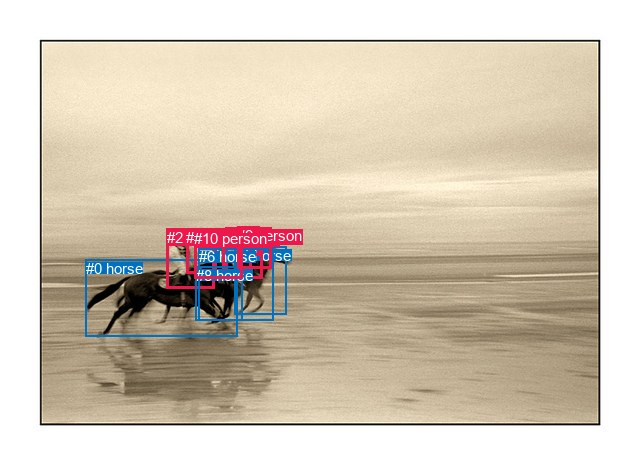
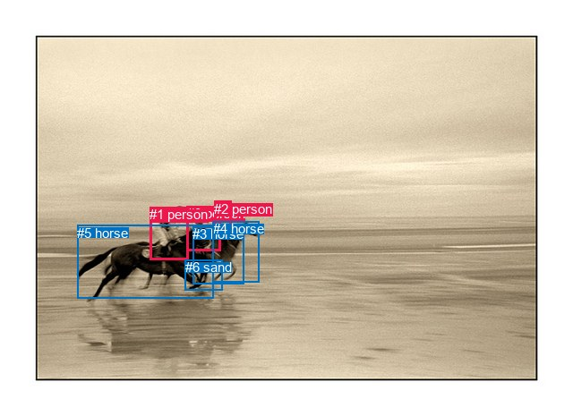

# 图片 0758：2350121.jpg

随机样本序号：395。图片 SHA256：`e931bb55b630e775a69395b87e118a76b66d7a216978000228b98e1dff015698`。

红色框表示人，蓝色框表示其他物体。两个模式分别保留自身框编号，可依据位置比较对应对象。

## 自动检测框与输出

人的框编号：`[2, 3, 4, 5, 7, 9, 10]`。状态：`ok`。

### 自动检测全部物体框

| 编号 | 类别 | 是否为人 | 检测分数 | 像素坐标 xyxy |
|---|---|---|---|---|
| 0 | horse | False | 0.9963 | 85.7, 259.5, 237.8, 336.5 |
| 1 | horse | False | 0.9936 | 234.1, 246.7, 286.7, 314.3 |
| 2 | person | True | 0.9742 | 166.9, 228.9, 214.9, 288.4 |
| 3 | person | True | 0.9512 | 214.3, 229.7, 251.7, 273.8 |
| 4 | person | True | 0.9362 | 225.8, 227.2, 262.9, 278.3 |
| 5 | person | True | 0.8264 | 237.7, 226.8, 259.5, 255.1 |
| 6 | horse | False | 0.8005 | 198.7, 248.0, 273.4, 321.0 |
| 7 | person | True | 0.7819 | 186.3, 229.0, 224.9, 273.8 |
| 8 | horse | False | 0.6493 | 195.9, 266.8, 242.8, 321.0 |
| 9 | person | True | 0.5018 | 237.2, 227.1, 271.3, 268.3 |
| 10 | person | True | 0.4524 | 194.4, 230.3, 242.8, 278.7 |

### 自动检测 Top50 人相关候选

评分物体对：110；人相关物体对：98；输出关系：50。

| 排名 | 主语编号与类别 | 关系 | 宾语编号与类别 | 类型 | 人与人 | 排序分数 | 原始融合 logit |
|---|---|---|---|---|---|---|---|
| 1 | #2 person | riding | #0 horse | semantic | False | 0.99321 | 4.9860 |
| 2 | #4 person | riding | #6 horse | semantic | False | 0.99113 | 4.7158 |
| 3 | #10 person | riding | #6 horse | semantic | False | 0.98970 | 4.5651 |
| 4 | #3 person | riding | #6 horse | semantic | False | 0.98924 | 4.5209 |
| 5 | #4 person | riding | #1 horse | semantic | False | 0.98843 | 4.4480 |
| 6 | #2 person | riding | #6 horse | semantic | False | 0.98610 | 4.2621 |
| 7 | #10 person | riding | #8 horse | semantic | False | 0.98384 | 4.1087 |
| 8 | #7 person | riding | #6 horse | semantic | False | 0.98217 | 4.0091 |
| 9 | #2 person | riding | #8 horse | semantic | False | 0.97953 | 3.8683 |
| 10 | #9 person | riding | #6 horse | semantic | False | 0.97947 | 3.8652 |
| 11 | #7 person | riding | #0 horse | semantic | False | 0.97857 | 3.8211 |
| 12 | #3 person | riding | #1 horse | semantic | False | 0.97850 | 3.8181 |
| 13 | #4 person | riding | #8 horse | semantic | False | 0.97729 | 3.7618 |
| 14 | #3 person | riding | #8 horse | semantic | False | 0.97684 | 3.7420 |
| 15 | #9 person | riding | #1 horse | semantic | False | 0.97674 | 3.7377 |
| 16 | #10 person | riding | #0 horse | semantic | False | 0.97404 | 3.6249 |
| 17 | #7 person | riding | #8 horse | semantic | False | 0.97375 | 3.6136 |
| 18 | #10 person | riding | #1 horse | semantic | False | 0.96995 | 3.4745 |
| 19 | #2 person | on | #0 horse | spatial | False | 0.96519 | 3.3223 |
| 20 | #4 person | on | #6 horse | spatial | False | 0.94893 | 2.9222 |
| 21 | #5 person | riding | #6 horse | semantic | False | 0.94823 | 2.9077 |
| 22 | #10 person | on | #6 horse | spatial | False | 0.94514 | 2.8465 |
| 23 | #3 person | riding | #0 horse | semantic | False | 0.94267 | 2.7999 |
| 24 | #3 person | on | #6 horse | spatial | False | 0.93880 | 2.7305 |
| 25 | #4 person | on | #1 horse | spatial | False | 0.92980 | 2.5836 |
| 26 | #5 person | riding | #1 horse | semantic | False | 0.92717 | 2.5439 |
| 27 | #4 person | riding | #0 horse | semantic | False | 0.92538 | 2.5178 |
| 28 | #2 person | on | #6 horse | spatial | False | 0.91843 | 2.4212 |
| 29 | #7 person | on | #6 horse | spatial | False | 0.90837 | 2.2939 |
| 30 | #9 person | on | #6 horse | spatial | False | 0.90219 | 2.2218 |
| 31 | #9 person | on | #1 horse | spatial | False | 0.88594 | 2.0499 |
| 32 | #7 person | on | #0 horse | spatial | False | 0.88459 | 2.0366 |
| 33 | #10 person | on | #8 horse | spatial | False | 0.87688 | 1.9632 |
| 34 | #4 person | wearing | #5 person | semantic | True | 0.86821 | 1.8853 |
| 35 | #10 person | on | #0 horse | spatial | False | 0.85250 | 1.7543 |
| 36 | #3 person | on | #1 horse | spatial | False | 0.84771 | 1.7168 |
| 37 | #9 person | riding | #8 horse | semantic | False | 0.84717 | 1.7126 |
| 38 | #2 person | on | #8 horse | spatial | False | 0.84046 | 1.6617 |
| 39 | #2 person | wearing | #7 person | semantic | True | 0.83969 | 1.6560 |
| 40 | #7 person | on | #8 horse | spatial | False | 0.81579 | 1.4881 |
| 41 | #3 person | on | #8 horse | spatial | False | 0.80702 | 1.4308 |
| 42 | #4 person | on | #8 horse | spatial | False | 0.80324 | 1.4067 |
| 43 | #5 person | on | #6 horse | spatial | False | 0.75688 | 1.1357 |
| 44 | #9 person | wearing | #5 person | semantic | True | 0.75362 | 1.1180 |
| 45 | #5 person | on | #9 person | spatial | True | 0.72948 | 0.9920 |
| 46 | #4 person | wearing | #9 person | semantic | True | 0.71103 | 0.9004 |
| 47 | #10 person | on | #1 horse | spatial | False | 0.70715 | 0.8816 |
| 48 | #5 person | on | #1 horse | spatial | False | 0.66053 | 0.6656 |
| 49 | #3 person | wearing | #5 person | semantic | True | 0.64686 | 0.6052 |
| 50 | #3 person | on | #0 horse | spatial | False | 0.63104 | 0.5367 |

### 自动检测逐条人相关 GT 核验

R@50：50.00%；命中 2/4。

| GT 主语编号 | GT 关系 | GT 宾语编号 | 结果阶段 | 匹配预测主语编号 | 匹配预测宾语编号 |
|---|---|---|---|---|---|
| 0 | riding | 3 | hit50 | [3, 10] | [6] |
| 1 | on back of | 5 | wrong_predicate | [2] | [0] |
| 1 | riding | 5 | hit50 | [2] | [0] |
| 2 | on back of | 4 | wrong_predicate | [5] | [1] |

## 真实框与输出

人的框编号：`[0, 1, 2]`。

### 真实框全部物体框

| 编号 | 类别 | 是否为人 | 检测分数 | 像素坐标 xyxy |
|---|---|---|---|---|
| 0 | person | True | GT | 209.0, 230.0, 247.0, 280.0 |
| 1 | person | True | GT | 167.0, 231.0, 210.0, 290.0 |
| 2 | person | True | GT | 239.0, 225.0, 258.0, 256.0 |
| 3 | horse | False | GT | 215.0, 253.0, 272.0, 317.0 |
| 4 | horse | False | GT | 238.0, 247.0, 290.0, 315.0 |
| 5 | horse | False | GT | 86.0, 252.0, 238.0, 334.0 |
| 6 | sand | False | GT | 207.0, 290.0, 249.0, 324.0 |

### 真实框 Top50 人相关候选

评分物体对：42；人相关物体对：30；输出关系：50。

| 排名 | 主语编号与类别 | 关系 | 宾语编号与类别 | 类型 | 人与人 | 排序分数 | 原始融合 logit |
|---|---|---|---|---|---|---|---|
| 1 | #1 person | riding | #5 horse | semantic | False | 0.99542 | 5.3814 |
| 2 | #0 person | riding | #3 horse | semantic | False | 0.99497 | 5.2868 |
| 3 | #0 person | riding | #4 horse | semantic | False | 0.99299 | 4.9538 |
| 4 | #0 person | riding | #5 horse | semantic | False | 0.98958 | 4.5532 |
| 5 | #2 person | riding | #3 horse | semantic | False | 0.98919 | 4.5161 |
| 6 | #2 person | riding | #4 horse | semantic | False | 0.97970 | 3.8767 |
| 7 | #1 person | on | #5 horse | spatial | False | 0.97711 | 3.7537 |
| 8 | #0 person | on | #3 horse | spatial | False | 0.97208 | 3.5501 |
| 9 | #1 person | riding | #3 horse | semantic | False | 0.96718 | 3.3834 |
| 10 | #0 person | on | #4 horse | spatial | False | 0.95641 | 3.0883 |
| 11 | #0 person | on | #5 horse | spatial | False | 0.94868 | 2.9170 |
| 12 | #2 person | on | #3 horse | spatial | False | 0.94627 | 2.8685 |
| 13 | #0 person | riding | #6 sand | semantic | False | 0.92939 | 2.5773 |
| 14 | #2 person | on | #4 horse | spatial | False | 0.92861 | 2.5656 |
| 15 | #1 person | riding | #4 horse | semantic | False | 0.87554 | 1.9509 |
| 16 | #2 person | riding | #5 horse | semantic | False | 0.85142 | 1.7458 |
| 17 | #0 person | holding | #2 person | semantic | True | 0.85037 | 1.7375 |
| 18 | #2 person | riding | #6 sand | semantic | False | 0.84072 | 1.6636 |
| 19 | #1 person | riding | #6 sand | semantic | False | 0.76250 | 1.1664 |
| 20 | #1 person | on | #3 horse | spatial | False | 0.69272 | 0.8129 |
| 21 | #2 person | on | #5 horse | spatial | False | 0.56060 | 0.2436 |
| 22 | #1 person | wearing | #0 person | semantic | True | 0.47863 | -0.0855 |
| 23 | #2 person | on | #0 person | spatial | True | 0.47161 | -0.1137 |
| 24 | #2 person | on | #6 sand | spatial | False | 0.42018 | -0.3220 |
| 25 | #0 person | on | #6 sand | spatial | False | 0.40534 | -0.3833 |
| 26 | #0 person | on | #2 person | spatial | True | 0.34183 | -0.6552 |
| 27 | #0 person | beside | #1 person | spatial | True | 0.33975 | -0.6644 |
| 28 | #0 person | wearing | #1 person | semantic | True | 0.33885 | -0.6684 |
| 29 | #1 person | beside | #0 person | spatial | True | 0.32200 | -0.7446 |
| 30 | #3 horse | carrying | #0 person | semantic | False | 0.22287 | -1.2490 |
| 31 | #1 person | on | #4 horse | spatial | False | 0.18303 | -1.4959 |
| 32 | #2 person | wearing | #0 person | semantic | True | 0.14992 | -1.7352 |
| 33 | #5 horse | carrying | #1 person | semantic | False | 0.14806 | -1.7499 |
| 34 | #1 person | on | #6 sand | spatial | False | 0.13177 | -1.8854 |
| 35 | #4 horse | carrying | #0 person | semantic | False | 0.12454 | -1.9501 |
| 36 | #1 person | wearing | #2 person | semantic | True | 0.09020 | -2.3112 |
| 37 | #4 horse | carrying | #2 person | semantic | False | 0.05836 | -2.7811 |
| 38 | #3 horse | carrying | #2 person | semantic | False | 0.05425 | -2.8583 |
| 39 | #5 horse | carrying | #0 person | semantic | False | 0.04177 | -3.1329 |
| 40 | #5 horse | in | #1 person | spatial | False | 0.02385 | -3.7120 |
| 41 | #1 person | in | #2 person | spatial | True | 0.02029 | -3.8770 |
| 42 | #3 horse | in | #0 person | spatial | False | 0.01789 | -4.0052 |
| 43 | #6 sand | in | #0 person | spatial | False | 0.01312 | -4.3204 |
| 44 | #2 person | on | #1 person | spatial | True | 0.01287 | -4.3401 |
| 45 | #3 horse | in | #2 person | spatial | False | 0.01121 | -4.4798 |
| 46 | #5 horse | in | #0 person | spatial | False | 0.01017 | -4.5786 |
| 47 | #4 horse | in | #2 person | spatial | False | 0.00903 | -4.6982 |
| 48 | #3 horse | carrying | #1 person | semantic | False | 0.00806 | -4.8130 |
| 49 | #4 horse | in | #0 person | spatial | False | 0.00654 | -5.0235 |
| 50 | #4 horse | carrying | #1 person | semantic | False | 0.00627 | -5.0651 |

### 真实框逐条人相关 GT 核验

R@50：50.00%；命中 2/4。

| GT 主语编号 | GT 关系 | GT 宾语编号 | 结果阶段 | 匹配预测主语编号 | 匹配预测宾语编号 |
|---|---|---|---|---|---|
| 0 | riding | 3 | hit50 | [0] | [3] |
| 1 | on back of | 5 | wrong_predicate | [1] | [5] |
| 1 | riding | 5 | hit50 | [1] | [5] |
| 2 | on back of | 4 | wrong_predicate | [2] | [4] |

## 全部人相关 GT

| 主语编号与类别 | 关系 | 宾语编号与类别 |
|---|---|---|
| #0 person | riding | #3 horse |
| #1 person | on back of | #5 horse |
| #1 person | riding | #5 horse |
| #2 person | on back of | #4 horse |

原始记录、全部人相关物体对的两项预测与分项分数见 [逐图证据 JSON](../evidence/cases/0758.json)。全部56类 logits 保留于本机 HOR/output/random500/logits/。

<!-- HOR_COMPLETE_RESULTS -->

## 六组条件的完整输出对照

以下保留同一图片三种框与候选模式、两种谓词输出规则的全部 Top50。框编号各自在所属模式内解释。

### 自动检测框完整枚举：空间与语义各保留一个谓词

| 排名 | 主语编号与类别 | 谓词 | 宾语编号与类别 | 分组 | 排序分数 | predicate logit | pair logit |
|---|---|---|---|---|---|---|---|
| 1 | #2 person | riding | #0 horse | semantic | 0.9932132 | 4.5553756 | 0.4305940 |
| 2 | #4 person | riding | #6 horse | semantic | 0.9911265 | 4.5495114 | 0.1662634 |
| 3 | #10 person | riding | #6 horse | semantic | 0.9896979 | 4.4303679 | 0.1346879 |
| 4 | #3 person | riding | #6 horse | semantic | 0.9892375 | 4.3711638 | 0.1497112 |
| 5 | #4 person | riding | #1 horse | semantic | 0.9884333 | 4.3674979 | 0.0804901 |
| 6 | #2 person | riding | #6 horse | semantic | 0.9861029 | 4.1301894 | 0.1318944 |
| 7 | #10 person | riding | #8 horse | semantic | 0.9838372 | 4.1279902 | -0.0192466 |
| 8 | #7 person | riding | #6 horse | semantic | 0.9821736 | 4.0108027 | -0.0017148 |
| 9 | #2 person | riding | #8 horse | semantic | 0.9795340 | 3.8270774 | 0.0412350 |
| 10 | #9 person | riding | #6 horse | semantic | 0.9794725 | 3.8302541 | 0.0349955 |
| 11 | #7 person | riding | #0 horse | semantic | 0.9785666 | 3.6580157 | 0.1631273 |
| 12 | #3 person | riding | #1 horse | semantic | 0.9785017 | 3.7661624 | 0.0518882 |
| 13 | #4 person | riding | #8 horse | semantic | 0.9772859 | 3.7683606 | -0.0065676 |
| 14 | #3 person | riding | #8 horse | semantic | 0.9768425 | 3.7683606 | -0.0263522 |
| 15 | #9 person | riding | #1 horse | semantic | 0.9767446 | 3.7693381 | -0.0316498 |
| 16 | #10 person | riding | #0 horse | semantic | 0.9740390 | 3.4153295 | 0.2095287 |
| 17 | #7 person | riding | #8 horse | semantic | 0.9737518 | 3.7686057 | -0.1550468 |
| 18 | #10 person | riding | #1 horse | semantic | 0.9699527 | 3.4662271 | 0.0082490 |
| 19 | #2 person | on | #0 horse | spatial | 0.9651875 | 2.8917532 | 0.4305940 |
| 20 | #4 person | on | #6 horse | spatial | 0.9489323 | 2.7559223 | 0.1662634 |
| 21 | #5 person | riding | #6 horse | semantic | 0.9482253 | 3.0527687 | -0.1450775 |
| 22 | #10 person | on | #6 horse | spatial | 0.9451361 | 2.7117848 | 0.1346879 |
| 23 | #3 person | riding | #0 horse | semantic | 0.9426680 | 2.6361337 | 0.1637207 |
| 24 | #3 person | on | #6 horse | spatial | 0.9388043 | 2.5808196 | 0.1497112 |
| 25 | #4 person | on | #1 horse | spatial | 0.9298009 | 2.5031443 | 0.0804901 |
| 26 | #5 person | riding | #1 horse | semantic | 0.9271651 | 2.7499013 | -0.2059644 |
| 27 | #4 person | riding | #0 horse | semantic | 0.9253814 | 2.3638468 | 0.1539685 |
| 28 | #2 person | on | #6 horse | spatial | 0.9184329 | 2.2893491 | 0.1318944 |
| 29 | #7 person | on | #6 horse | spatial | 0.9083745 | 2.2956624 | -0.0017148 |
| 30 | #9 person | on | #6 horse | spatial | 0.9021868 | 2.1867666 | 0.0349955 |
| 31 | #9 person | on | #1 horse | spatial | 0.8859403 | 2.0815773 | -0.0316498 |
| 32 | #7 person | on | #0 horse | spatial | 0.8845910 | 1.8735166 | 0.1631273 |
| 33 | #10 person | on | #8 horse | spatial | 0.8768752 | 1.9824128 | -0.0192466 |
| 34 | #4 person | wearing | #5 person | semantic | 0.8682132 | 2.0973501 | -0.2120982 |
| 35 | #10 person | on | #0 horse | spatial | 0.8524981 | 1.5448012 | 0.2095287 |
| 36 | #3 person | on | #1 horse | spatial | 0.8477116 | 1.6648760 | 0.0518882 |
| 37 | #9 person | riding | #8 horse | semantic | 0.8471700 | 1.8816538 | -0.1690785 |
| 38 | #2 person | on | #8 horse | spatial | 0.8404639 | 1.6204491 | 0.0412350 |
| 39 | #2 person | wearing | #7 person | semantic | 0.8396948 | 1.9675775 | -0.3116188 |
| 40 | #7 person | on | #8 horse | spatial | 0.8157854 | 1.6430969 | -0.1550468 |
| 41 | #3 person | on | #8 horse | spatial | 0.8070185 | 1.4571047 | -0.0263522 |
| 42 | #4 person | on | #8 horse | spatial | 0.8032432 | 1.4132566 | -0.0065676 |
| 43 | #5 person | on | #6 horse | spatial | 0.7568802 | 1.2807279 | -0.1450775 |
| 44 | #9 person | wearing | #5 person | semantic | 0.7536204 | 1.5116253 | -0.3936098 |
| 45 | #5 person | on | #9 person | spatial | 0.7294801 | 1.6089802 | -0.6169937 |
| 46 | #4 person | wearing | #9 person | semantic | 0.7110278 | 1.2232003 | -0.3228192 |
| 47 | #10 person | on | #1 horse | spatial | 0.7071477 | 0.8733225 | 0.0082490 |
| 48 | #5 person | on | #1 horse | spatial | 0.6605283 | 0.8716140 | -0.2059644 |
| 49 | #3 person | wearing | #5 person | semantic | 0.6468559 | 0.8502970 | -0.2450497 |
| 50 | #3 person | on | #0 horse | spatial | 0.6310378 | 0.3729510 | 0.1637207 |

GT 命中：2/4，R@50=50.00%。

| GT主语 | GT谓词 | GT宾语 | 结果阶段 | 匹配主语框 | 匹配宾语框 |
|---|---|---|---|---|---|
| 0 | riding | 3 | hit50 | [3, 10] | [6] |
| 1 | on back of | 5 | wrong_predicate | [2] | [0] |
| 1 | riding | 5 | hit50 | [2] | [0] |
| 2 | on back of | 4 | wrong_predicate | [5] | [1] |

### 自动检测框完整枚举：每对只保留一个谓词

| 排名 | 主语编号与类别 | 谓词 | 宾语编号与类别 | 分组 | 排序分数 | predicate logit | pair logit |
|---|---|---|---|---|---|---|---|
| 1 | #2 person | riding | #0 horse | single | 0.9932132 | 4.5553756 | 0.4305940 |
| 2 | #4 person | riding | #6 horse | single | 0.9911265 | 4.5495114 | 0.1662634 |
| 3 | #10 person | riding | #6 horse | single | 0.9896979 | 4.4303679 | 0.1346879 |
| 4 | #3 person | riding | #6 horse | single | 0.9892375 | 4.3711638 | 0.1497112 |
| 5 | #4 person | riding | #1 horse | single | 0.9884333 | 4.3674979 | 0.0804901 |
| 6 | #2 person | riding | #6 horse | single | 0.9861029 | 4.1301894 | 0.1318944 |
| 7 | #10 person | riding | #8 horse | single | 0.9838372 | 4.1279902 | -0.0192466 |
| 8 | #7 person | riding | #6 horse | single | 0.9821736 | 4.0108027 | -0.0017148 |
| 9 | #2 person | riding | #8 horse | single | 0.9795340 | 3.8270774 | 0.0412350 |
| 10 | #9 person | riding | #6 horse | single | 0.9794725 | 3.8302541 | 0.0349955 |
| 11 | #7 person | riding | #0 horse | single | 0.9785666 | 3.6580157 | 0.1631273 |
| 12 | #3 person | riding | #1 horse | single | 0.9785017 | 3.7661624 | 0.0518882 |
| 13 | #4 person | riding | #8 horse | single | 0.9772859 | 3.7683606 | -0.0065676 |
| 14 | #3 person | riding | #8 horse | single | 0.9768425 | 3.7683606 | -0.0263522 |
| 15 | #9 person | riding | #1 horse | single | 0.9767446 | 3.7693381 | -0.0316498 |
| 16 | #10 person | riding | #0 horse | single | 0.9740390 | 3.4153295 | 0.2095287 |
| 17 | #7 person | riding | #8 horse | single | 0.9737518 | 3.7686057 | -0.1550468 |
| 18 | #10 person | riding | #1 horse | single | 0.9699527 | 3.4662271 | 0.0082490 |
| 19 | #5 person | riding | #6 horse | single | 0.9482253 | 3.0527687 | -0.1450775 |
| 20 | #3 person | riding | #0 horse | single | 0.9426680 | 2.6361337 | 0.1637207 |
| 21 | #5 person | riding | #1 horse | single | 0.9271651 | 2.7499013 | -0.2059644 |
| 22 | #4 person | riding | #0 horse | single | 0.9253814 | 2.3638468 | 0.1539685 |
| 23 | #4 person | wearing | #5 person | single | 0.8682132 | 2.0973501 | -0.2120982 |
| 24 | #9 person | riding | #8 horse | single | 0.8471700 | 1.8816538 | -0.1690785 |
| 25 | #2 person | wearing | #7 person | single | 0.8396948 | 1.9675775 | -0.3116188 |
| 26 | #9 person | wearing | #5 person | single | 0.7536204 | 1.5116253 | -0.3936098 |
| 27 | #5 person | on | #9 person | single | 0.7294801 | 1.6089802 | -0.6169937 |
| 28 | #4 person | wearing | #9 person | single | 0.7110278 | 1.2232003 | -0.3228192 |
| 29 | #3 person | wearing | #5 person | single | 0.6468559 | 0.8502970 | -0.2450497 |
| 30 | #7 person | riding | #1 horse | single | 0.6223745 | 0.6629763 | -0.1633369 |
| 31 | #9 person | riding | #0 horse | single | 0.6133170 | 0.4688311 | -0.0075541 |
| 32 | #10 person | wearing | #7 person | single | 0.6122161 | 0.8731627 | -0.4165258 |
| 33 | #10 person | wearing | #3 person | single | 0.6107969 | 0.9237919 | -0.4731287 |
| 34 | #7 person | wearing | #10 person | single | 0.6020544 | 0.9441833 | -0.5301508 |
| 35 | #5 person | on | #4 person | single | 0.5939104 | 1.0997171 | -0.7195626 |
| 36 | #2 person | riding | #1 horse | single | 0.5917083 | 0.4192529 | -0.0482209 |
| 37 | #5 person | riding | #8 horse | single | 0.4864495 | 0.3220401 | -0.3762552 |
| 38 | #2 person | wearing | #10 person | single | 0.4527964 | 0.2602811 | -0.4496595 |
| 39 | #3 person | holding | #9 person | single | 0.4246936 | 0.0607514 | -0.3642862 |
| 40 | #4 person | wearing | #3 person | single | 0.4153692 | 0.1633878 | -0.5052005 |
| 41 | #3 person | wearing | #10 person | single | 0.3649143 | 0.0157194 | -0.5698171 |
| 42 | #5 person | on | #3 person | single | 0.3627548 | 0.1893921 | -0.7528197 |
| 43 | #3 person | wearing | #4 person | single | 0.3515566 | -0.0848603 | -0.5273438 |
| 44 | #7 person | wearing | #2 person | single | 0.3408895 | 0.0508537 | -0.7101868 |
| 45 | #10 person | holding | #5 person | single | 0.3237123 | -0.5176497 | -0.2191138 |
| 46 | #5 person | riding | #0 horse | single | 0.3065068 | -0.6107888 | -0.2057129 |
| 47 | #9 person | on | #4 person | single | 0.2925967 | -0.2731562 | -0.6096495 |
| 48 | #4 person | wearing | #10 person | single | 0.2240971 | -0.6631408 | -0.5788074 |
| 49 | #3 person | wearing | #7 person | single | 0.2205272 | -0.7438607 | -0.5187361 |
| 50 | #7 person | wearing | #3 person | single | 0.2178418 | -0.7490497 | -0.5292382 |

GT 命中：2/4，R@50=50.00%。

| GT主语 | GT谓词 | GT宾语 | 结果阶段 | 匹配主语框 | 匹配宾语框 |
|---|---|---|---|---|---|
| 0 | riding | 3 | hit50 | [3, 10] | [6] |
| 1 | on back of | 5 | wrong_predicate | [2] | [0] |
| 1 | riding | 5 | hit50 | [2] | [0] |
| 2 | on back of | 4 | wrong_predicate | [5] | [1] |

### 真实框完整枚举：空间与语义各保留一个谓词

| 排名 | 主语编号与类别 | 谓词 | 宾语编号与类别 | 分组 | 排序分数 | predicate logit | pair logit |
|---|---|---|---|---|---|---|---|
| 1 | #1 person | riding | #5 horse | semantic | 0.9954196 | 4.9137836 | 0.4676072 |
| 2 | #0 person | riding | #3 horse | semantic | 0.9949676 | 5.0887103 | 0.1981107 |
| 3 | #0 person | riding | #4 horse | semantic | 0.9929932 | 4.9106069 | 0.0432284 |
| 4 | #0 person | riding | #5 horse | semantic | 0.9895759 | 4.3146472 | 0.2385041 |
| 5 | #2 person | riding | #3 horse | semantic | 0.9891869 | 4.6718316 | -0.1557021 |
| 6 | #2 person | riding | #4 horse | semantic | 0.9797020 | 4.1323886 | -0.2556644 |
| 7 | #1 person | on | #5 horse | spatial | 0.9771056 | 3.2860961 | 0.4676072 |
| 8 | #0 person | on | #3 horse | spatial | 0.9720808 | 3.3520131 | 0.1981107 |
| 9 | #1 person | riding | #3 horse | semantic | 0.9671828 | 3.2856803 | 0.0977513 |
| 10 | #0 person | on | #4 horse | spatial | 0.9564077 | 3.0450768 | 0.0432284 |
| 11 | #0 person | on | #5 horse | spatial | 0.9486825 | 2.6785374 | 0.2385041 |
| 12 | #2 person | on | #3 horse | spatial | 0.9462653 | 3.0241661 | -0.1557021 |
| 13 | #0 person | riding | #6 sand | semantic | 0.9293876 | 3.2240310 | -0.6467101 |
| 14 | #2 person | on | #4 horse | spatial | 0.9286144 | 2.8212605 | -0.2556644 |
| 15 | #1 person | riding | #4 horse | semantic | 0.8755425 | 2.0493722 | -0.0984937 |
| 16 | #2 person | riding | #5 horse | semantic | 0.8514184 | 1.9479446 | -0.2021758 |
| 17 | #0 person | holding | #2 person | semantic | 0.8503673 | 1.8963175 | -0.1588327 |
| 18 | #2 person | riding | #6 sand | semantic | 0.8407210 | 2.6018887 | -0.9382864 |
| 19 | #1 person | riding | #6 sand | semantic | 0.7624968 | 1.9320621 | -0.7656453 |
| 20 | #1 person | on | #3 horse | spatial | 0.6927240 | 0.7151341 | 0.0977513 |
| 21 | #2 person | on | #5 horse | spatial | 0.5605968 | 0.4457603 | -0.2021758 |
| 22 | #1 person | wearing | #0 person | semantic | 0.4786328 | 0.4613662 | -0.5468872 |
| 23 | #2 person | on | #0 person | spatial | 0.4716120 | 0.7022171 | -0.8158913 |
| 24 | #2 person | on | #6 sand | spatial | 0.4201815 | 0.6162581 | -0.9382864 |
| 25 | #0 person | on | #6 sand | spatial | 0.4053402 | 0.2634473 | -0.6467101 |
| 26 | #0 person | on | #2 person | spatial | 0.3418261 | -0.4963341 | -0.1588327 |
| 27 | #0 person | beside | #1 person | spatial | 0.3397549 | 0.1600561 | -0.8244427 |
| 28 | #0 person | wearing | #1 person | semantic | 0.3388492 | 0.1560159 | -0.8244427 |
| 29 | #1 person | beside | #0 person | spatial | 0.3219955 | -0.1977291 | -0.5468872 |
| 30 | #3 horse | carrying | #0 person | semantic | 0.2228657 | -0.2661552 | -0.9828889 |
| 31 | #1 person | on | #4 horse | spatial | 0.1830312 | -1.3974507 | -0.0984937 |
| 32 | #2 person | wearing | #0 person | semantic | 0.1499180 | -0.9193532 | -0.8158913 |
| 33 | #5 horse | carrying | #1 person | semantic | 0.1480612 | -0.8310814 | -0.9188074 |
| 34 | #1 person | on | #6 sand | spatial | 0.1317686 | -1.1197653 | -0.7656453 |
| 35 | #4 horse | carrying | #0 person | semantic | 0.1245376 | -0.9995217 | -0.9506227 |
| 36 | #1 person | wearing | #2 person | semantic | 0.0902002 | -2.1361809 | -0.1750120 |
| 37 | #4 horse | carrying | #2 person | semantic | 0.0583562 | -2.1154847 | -0.6655774 |
| 38 | #3 horse | carrying | #2 person | semantic | 0.0542536 | -2.1650820 | -0.6932225 |
| 39 | #5 horse | carrying | #0 person | semantic | 0.0417713 | -1.9988148 | -1.1340613 |
| 40 | #5 horse | in | #1 person | spatial | 0.0238453 | -2.7932262 | -0.9188074 |
| 41 | #1 person | in | #2 person | spatial | 0.0202921 | -3.7020092 | -0.1750120 |
| 42 | #3 horse | in | #0 person | spatial | 0.0178941 | -3.0223408 | -0.9828889 |
| 43 | #6 sand | in | #0 person | spatial | 0.0131205 | -3.0464520 | -1.2739199 |
| 44 | #2 person | on | #1 person | spatial | 0.0128676 | -3.2483377 | -1.0917529 |
| 45 | #3 horse | in | #2 person | spatial | 0.0112088 | -3.7865610 | -0.6932225 |
| 46 | #5 horse | in | #0 person | spatial | 0.0101653 | -3.4444983 | -1.1340613 |
| 47 | #4 horse | in | #2 person | spatial | 0.0090296 | -4.0326033 | -0.6655774 |
| 48 | #3 horse | carrying | #1 person | semantic | 0.0080577 | -3.7241187 | -1.0889151 |
| 49 | #4 horse | in | #0 person | spatial | 0.0065384 | -4.0728731 | -0.9506227 |
| 50 | #4 horse | carrying | #1 person | semantic | 0.0062734 | -3.9718390 | -1.0933074 |

GT 命中：2/4，R@50=50.00%。

| GT主语 | GT谓词 | GT宾语 | 结果阶段 | 匹配主语框 | 匹配宾语框 |
|---|---|---|---|---|---|
| 0 | riding | 3 | hit50 | [0] | [3] |
| 1 | on back of | 5 | wrong_predicate | [1] | [5] |
| 1 | riding | 5 | hit50 | [1] | [5] |
| 2 | on back of | 4 | wrong_predicate | [2] | [4] |

### 真实框完整枚举：每对只保留一个谓词

| 排名 | 主语编号与类别 | 谓词 | 宾语编号与类别 | 分组 | 排序分数 | predicate logit | pair logit |
|---|---|---|---|---|---|---|---|
| 1 | #1 person | riding | #5 horse | single | 0.9954196 | 4.9137836 | 0.4676072 |
| 2 | #0 person | riding | #3 horse | single | 0.9949676 | 5.0887103 | 0.1981107 |
| 3 | #0 person | riding | #4 horse | single | 0.9929932 | 4.9106069 | 0.0432284 |
| 4 | #0 person | riding | #5 horse | single | 0.9895759 | 4.3146472 | 0.2385041 |
| 5 | #2 person | riding | #3 horse | single | 0.9891869 | 4.6718316 | -0.1557021 |
| 6 | #2 person | riding | #4 horse | single | 0.9797020 | 4.1323886 | -0.2556644 |
| 7 | #1 person | riding | #3 horse | single | 0.9671828 | 3.2856803 | 0.0977513 |
| 8 | #0 person | riding | #6 sand | single | 0.9293876 | 3.2240310 | -0.6467101 |
| 9 | #1 person | riding | #4 horse | single | 0.8755425 | 2.0493722 | -0.0984937 |
| 10 | #2 person | riding | #5 horse | single | 0.8514184 | 1.9479446 | -0.2021758 |
| 11 | #0 person | holding | #2 person | single | 0.8503673 | 1.8963175 | -0.1588327 |
| 12 | #2 person | riding | #6 sand | single | 0.8407210 | 2.6018887 | -0.9382864 |
| 13 | #1 person | riding | #6 sand | single | 0.7624968 | 1.9320621 | -0.7656453 |
| 14 | #1 person | wearing | #0 person | single | 0.4786328 | 0.4613662 | -0.5468872 |
| 15 | #2 person | on | #0 person | single | 0.4716120 | 0.7022171 | -0.8158913 |
| 16 | #0 person | beside | #1 person | single | 0.3397549 | 0.1600561 | -0.8244427 |
| 17 | #3 horse | carrying | #0 person | single | 0.2228657 | -0.2661552 | -0.9828889 |
| 18 | #5 horse | carrying | #1 person | single | 0.1480612 | -0.8310814 | -0.9188074 |
| 19 | #4 horse | carrying | #0 person | single | 0.1245376 | -0.9995217 | -0.9506227 |
| 20 | #1 person | wearing | #2 person | single | 0.0902002 | -2.1361809 | -0.1750120 |
| 21 | #4 horse | carrying | #2 person | single | 0.0583562 | -2.1154847 | -0.6655774 |
| 22 | #3 horse | carrying | #2 person | single | 0.0542536 | -2.1650820 | -0.6932225 |
| 23 | #5 horse | carrying | #0 person | single | 0.0417713 | -1.9988148 | -1.1340613 |
| 24 | #6 sand | in | #0 person | single | 0.0131205 | -3.0464520 | -1.2739199 |
| 25 | #2 person | on | #1 person | single | 0.0128676 | -3.2483377 | -1.0917529 |
| 26 | #3 horse | carrying | #1 person | single | 0.0080577 | -3.7241187 | -1.0889151 |
| 27 | #4 horse | carrying | #1 person | single | 0.0062734 | -3.9718390 | -1.0933074 |
| 28 | #6 sand | in | #1 person | single | 0.0061743 | -3.7843554 | -1.2968184 |
| 29 | #6 sand | in | #2 person | single | 0.0048559 | -3.9263935 | -1.3963035 |
| 30 | #5 horse | in | #2 person | single | 0.0045411 | -4.3989997 | -0.9910256 |

GT 命中：2/4，R@50=50.00%。

| GT主语 | GT谓词 | GT宾语 | 结果阶段 | 匹配主语框 | 匹配宾语框 |
|---|---|---|---|---|---|
| 0 | riding | 3 | hit50 | [0] | [3] |
| 1 | on back of | 5 | wrong_predicate | [1] | [5] |
| 1 | riding | 5 | hit50 | [1] | [5] |
| 2 | on back of | 4 | wrong_predicate | [2] | [4] |

### 真实框400候选：空间与语义各保留一个谓词

| 排名 | 主语编号与类别 | 谓词 | 宾语编号与类别 | 分组 | 排序分数 | predicate logit | pair logit |
|---|---|---|---|---|---|---|---|
| 1 | #1 person | riding | #5 horse | semantic | 0.9954196 | 4.9137836 | 0.4676072 |
| 2 | #0 person | riding | #3 horse | semantic | 0.9949676 | 5.0887103 | 0.1981107 |
| 3 | #0 person | riding | #4 horse | semantic | 0.9929932 | 4.9106069 | 0.0432284 |
| 4 | #0 person | riding | #5 horse | semantic | 0.9895783 | 4.3148913 | 0.2385041 |
| 5 | #2 person | riding | #3 horse | semantic | 0.9891869 | 4.6718316 | -0.1557021 |
| 6 | #2 person | riding | #4 horse | semantic | 0.9797020 | 4.1323886 | -0.2556644 |
| 7 | #1 person | on | #5 horse | spatial | 0.9771056 | 3.2860961 | 0.4676072 |
| 8 | #0 person | on | #3 horse | spatial | 0.9710194 | 3.3136096 | 0.1981107 |
| 9 | #1 person | riding | #3 horse | semantic | 0.9671828 | 3.2856803 | 0.0977513 |
| 10 | #0 person | on | #4 horse | spatial | 0.9579811 | 3.0834799 | 0.0432284 |
| 11 | #0 person | on | #5 horse | spatial | 0.9486825 | 2.6785374 | 0.2385041 |
| 12 | #2 person | on | #3 horse | spatial | 0.9462653 | 3.0241661 | -0.1557021 |
| 13 | #2 person | on | #4 horse | spatial | 0.9286144 | 2.8212605 | -0.2556644 |
| 14 | #0 person | riding | #6 sand | semantic | 0.9253683 | 3.1643372 | -0.6467101 |
| 15 | #1 person | riding | #4 horse | semantic | 0.8787975 | 2.0795856 | -0.0984937 |
| 16 | #0 person | holding | #2 person | semantic | 0.8496140 | 1.8904095 | -0.1588327 |
| 17 | #2 person | riding | #5 horse | semantic | 0.8476028 | 1.9180975 | -0.2021758 |
| 18 | #2 person | riding | #6 sand | semantic | 0.8407537 | 2.6021328 | -0.9382864 |
| 19 | #1 person | riding | #6 sand | semantic | 0.7570493 | 1.9022150 | -0.7656453 |
| 20 | #1 person | on | #3 horse | spatial | 0.6874530 | 0.6904874 | 0.0977513 |
| 21 | #2 person | on | #5 horse | spatial | 0.5599261 | 0.4430380 | -0.2021758 |
| 22 | #1 person | wearing | #0 person | semantic | 0.4786328 | 0.4613662 | -0.5468872 |
| 23 | #2 person | on | #0 person | spatial | 0.4668299 | 0.6830158 | -0.8158913 |
| 24 | #2 person | on | #6 sand | spatial | 0.4248666 | 0.6354599 | -0.9382864 |
| 25 | #0 person | on | #6 sand | spatial | 0.3994135 | 0.2388005 | -0.6467101 |
| 26 | #0 person | beside | #1 person | spatial | 0.3465092 | 0.1900239 | -0.8244427 |
| 27 | #0 person | wearing | #1 person | semantic | 0.3442970 | 0.1802392 | -0.8244427 |
| 28 | #0 person | on | #2 person | spatial | 0.3406021 | -0.5017796 | -0.1588327 |
| 29 | #1 person | beside | #0 person | spatial | 0.3154648 | -0.2278056 | -0.5468872 |
| 30 | #3 horse | carrying | #0 person | semantic | 0.2179951 | -0.2944994 | -0.9828889 |
| 31 | #1 person | on | #4 horse | spatial | 0.1896791 | -1.3536026 | -0.0984937 |
| 32 | #2 person | wearing | #0 person | semantic | 0.1514681 | -0.9072416 | -0.8158913 |
| 33 | #5 horse | carrying | #1 person | semantic | 0.1480612 | -0.8310814 | -0.9188074 |
| 34 | #1 person | on | #6 sand | spatial | 0.1286689 | -1.1471341 | -0.7656453 |
| 35 | #4 horse | carrying | #0 person | semantic | 0.1245217 | -0.9996674 | -0.9506227 |
| 36 | #1 person | wearing | #2 person | semantic | 0.0869126 | -2.1769168 | -0.1750120 |
| 37 | #4 horse | carrying | #2 person | semantic | 0.0574875 | -2.1314042 | -0.6655774 |
| 38 | #3 horse | carrying | #2 person | semantic | 0.0543134 | -2.1639171 | -0.6932225 |
| 39 | #5 horse | carrying | #0 person | semantic | 0.0406799 | -2.0264304 | -1.1340613 |
| 40 | #5 horse | in | #1 person | spatial | 0.0238453 | -2.7932262 | -0.9188074 |
| 41 | #1 person | in | #2 person | spatial | 0.0199952 | -3.7170548 | -0.1750120 |
| 42 | #3 horse | in | #0 person | spatial | 0.0178358 | -3.0256596 | -0.9828889 |
| 43 | #6 sand | in | #0 person | spatial | 0.0130990 | -3.0481114 | -1.2739199 |
| 44 | #2 person | on | #1 person | spatial | 0.0127986 | -3.2537825 | -1.0917529 |
| 45 | #3 horse | in | #2 person | spatial | 0.0112456 | -3.7832422 | -0.6932225 |
| 46 | #5 horse | in | #0 person | spatial | 0.0102840 | -3.4327714 | -1.1340613 |
| 47 | #4 horse | in | #2 person | spatial | 0.0088959 | -4.0476484 | -0.6655774 |
| 48 | #3 horse | carrying | #1 person | semantic | 0.0081228 | -3.7160134 | -1.0889151 |
| 49 | #4 horse | in | #0 person | spatial | 0.0064252 | -4.0904636 | -0.9506227 |
| 50 | #4 horse | running on | #1 person | semantic | 0.0062763 | -3.9713721 | -1.0933074 |

GT 命中：2/4，R@50=50.00%。

| GT主语 | GT谓词 | GT宾语 | 结果阶段 | 匹配主语框 | 匹配宾语框 |
|---|---|---|---|---|---|
| 0 | riding | 3 | hit50 | [0] | [3] |
| 1 | on back of | 5 | wrong_predicate | [1] | [5] |
| 1 | riding | 5 | hit50 | [1] | [5] |
| 2 | on back of | 4 | wrong_predicate | [2] | [4] |

### 真实框400候选：每对只保留一个谓词

| 排名 | 主语编号与类别 | 谓词 | 宾语编号与类别 | 分组 | 排序分数 | predicate logit | pair logit |
|---|---|---|---|---|---|---|---|
| 1 | #1 person | riding | #5 horse | single | 0.9954196 | 4.9137836 | 0.4676072 |
| 2 | #0 person | riding | #3 horse | single | 0.9949676 | 5.0887103 | 0.1981107 |
| 3 | #0 person | riding | #4 horse | single | 0.9929932 | 4.9106069 | 0.0432284 |
| 4 | #0 person | riding | #5 horse | single | 0.9895783 | 4.3148913 | 0.2385041 |
| 5 | #2 person | riding | #3 horse | single | 0.9891869 | 4.6718316 | -0.1557021 |
| 6 | #2 person | riding | #4 horse | single | 0.9797020 | 4.1323886 | -0.2556644 |
| 7 | #1 person | riding | #3 horse | single | 0.9671828 | 3.2856803 | 0.0977513 |
| 8 | #0 person | riding | #6 sand | single | 0.9253683 | 3.1643372 | -0.6467101 |
| 9 | #1 person | riding | #4 horse | single | 0.8787975 | 2.0795856 | -0.0984937 |
| 10 | #0 person | holding | #2 person | single | 0.8496140 | 1.8904095 | -0.1588327 |
| 11 | #2 person | riding | #5 horse | single | 0.8476028 | 1.9180975 | -0.2021758 |
| 12 | #2 person | riding | #6 sand | single | 0.8407537 | 2.6021328 | -0.9382864 |
| 13 | #1 person | riding | #6 sand | single | 0.7570493 | 1.9022150 | -0.7656453 |
| 14 | #1 person | wearing | #0 person | single | 0.4786328 | 0.4613662 | -0.5468872 |
| 15 | #2 person | on | #0 person | single | 0.4668299 | 0.6830158 | -0.8158913 |
| 16 | #0 person | beside | #1 person | single | 0.3465092 | 0.1900239 | -0.8244427 |
| 17 | #3 horse | carrying | #0 person | single | 0.2179951 | -0.2944994 | -0.9828889 |
| 18 | #5 horse | carrying | #1 person | single | 0.1480612 | -0.8310814 | -0.9188074 |
| 19 | #4 horse | carrying | #0 person | single | 0.1245217 | -0.9996674 | -0.9506227 |
| 20 | #1 person | wearing | #2 person | single | 0.0869126 | -2.1769168 | -0.1750120 |
| 21 | #4 horse | carrying | #2 person | single | 0.0574875 | -2.1314042 | -0.6655774 |
| 22 | #3 horse | carrying | #2 person | single | 0.0543134 | -2.1639171 | -0.6932225 |
| 23 | #5 horse | carrying | #0 person | single | 0.0406799 | -2.0264304 | -1.1340613 |
| 24 | #6 sand | in | #0 person | single | 0.0130990 | -3.0481114 | -1.2739199 |
| 25 | #2 person | on | #1 person | single | 0.0127986 | -3.2537825 | -1.0917529 |
| 26 | #3 horse | carrying | #1 person | single | 0.0081228 | -3.7160134 | -1.0889151 |
| 27 | #4 horse | running on | #1 person | single | 0.0062763 | -3.9713721 | -1.0933074 |
| 28 | #6 sand | in | #1 person | single | 0.0060274 | -3.8085833 | -1.2968184 |
| 29 | #6 sand | in | #2 person | single | 0.0046697 | -3.9656668 | -1.3963035 |
| 30 | #5 horse | in | #2 person | single | 0.0045411 | -4.3989997 | -0.9910256 |

GT 命中：2/4，R@50=50.00%。

| GT主语 | GT谓词 | GT宾语 | 结果阶段 | 匹配主语框 | 匹配宾语框 |
|---|---|---|---|---|---|
| 0 | riding | 3 | hit50 | [0] | [3] |
| 1 | on back of | 5 | wrong_predicate | [1] | [5] |
| 1 | riding | 5 | hit50 | [1] | [5] |
| 2 | on back of | 4 | wrong_predicate | [2] | [4] |
