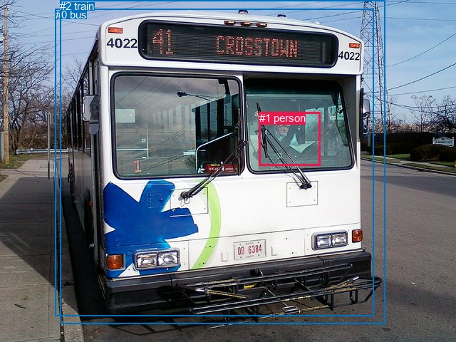
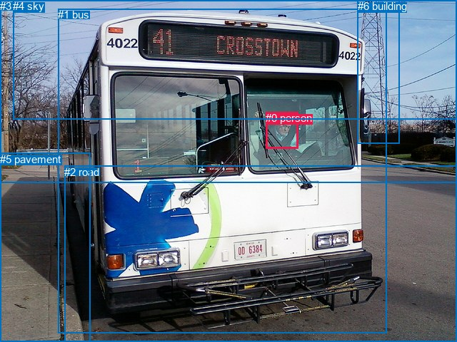

# 图片 0761：2350256.jpg

随机样本序号：410。图片 SHA256：`0a52f0b754a2d186b8c4a46e7f1105ebe61f18f1494d500ee6f39c75f6ce7c3a`。

红色框表示人，蓝色框表示其他物体。两个模式分别保留自身框编号，可依据位置比较对应对象。

## 自动检测框与输出

人的框编号：`[1]`。状态：`ok`。

### 自动检测全部物体框

| 编号 | 类别 | 是否为人 | 检测分数 | 像素坐标 xyxy |
|---|---|---|---|---|
| 0 | bus | False | 0.9925 | 77.9, 12.1, 524.2, 443.9 |
| 1 | person | True | 0.9892 | 364.0, 157.4, 449.3, 232.5 |
| 2 | train | False | 0.3678 | 84.5, 0.0, 540.0, 454.8 |

### 自动检测 Top50 人相关候选

评分物体对：6；人相关物体对：4；输出关系：8。

| 排名 | 主语编号与类别 | 关系 | 宾语编号与类别 | 类型 | 人与人 | 排序分数 | 原始融合 logit |
|---|---|---|---|---|---|---|---|
| 1 | #1 person | driving on | #2 train | semantic | False | 0.98756 | 4.3740 |
| 2 | #1 person | driving on | #0 bus | semantic | False | 0.98694 | 4.3249 |
| 3 | #1 person | in | #2 train | spatial | False | 0.95987 | 3.1746 |
| 4 | #1 person | in | #0 bus | spatial | False | 0.95846 | 3.1387 |
| 5 | #0 bus | carrying | #1 person | semantic | False | 0.45719 | -0.1717 |
| 6 | #2 train | carrying | #1 person | semantic | False | 0.43042 | -0.2802 |
| 7 | #0 bus | beside | #1 person | spatial | False | 0.10705 | -2.1212 |
| 8 | #2 train | beside | #1 person | spatial | False | 0.09880 | -2.2107 |

### 自动检测逐条人相关 GT 核验

R@50：0.00%；命中 0/2。

| GT 主语编号 | GT 关系 | GT 宾语编号 | 结果阶段 | 匹配预测主语编号 | 匹配预测宾语编号 |
|---|---|---|---|---|---|
| 0 | in | 1 | endpoint_missing_or_wrong_class | [] | [0] |
| 0 | driving | 1 | endpoint_missing_or_wrong_class | [] | [0] |

## 真实框与输出

人的框编号：`[0]`。

### 真实框全部物体框

| 编号 | 类别 | 是否为人 | 检测分数 | 像素坐标 xyxy |
|---|---|---|---|---|
| 0 | person | True | GT | 372.0, 157.0, 418.0, 208.0 |
| 1 | bus | False | GT | 81.0, 12.0, 542.0, 468.0 |
| 2 | road | False | GT | 90.0, 233.0, 640.0, 480.0 |
| 3 | tree | False | GT | 0.0, 0.0, 640.0, 257.0 |
| 4 | sky | False | GT | 18.0, 0.0, 640.0, 168.0 |
| 5 | pavement | False | GT | 0.0, 215.0, 127.0, 480.0 |
| 6 | building | False | GT | 501.0, 0.0, 560.0, 202.0 |

### 真实框 Top50 人相关候选

评分物体对：42；人相关物体对：12；输出关系：24。

| 排名 | 主语编号与类别 | 关系 | 宾语编号与类别 | 类型 | 人与人 | 排序分数 | 原始融合 logit |
|---|---|---|---|---|---|---|---|
| 1 | #0 person | driving on | #1 bus | semantic | False | 0.98533 | 4.2072 |
| 2 | #0 person | in | #1 bus | spatial | False | 0.95643 | 3.0889 |
| 3 | #1 bus | in | #0 person | spatial | False | 0.18174 | -1.5046 |
| 4 | #1 bus | carrying | #0 person | semantic | False | 0.15526 | -1.6939 |
| 5 | #0 person | in | #3 tree | spatial | False | 0.02411 | -3.7006 |
| 6 | #0 person | on | #2 road | spatial | False | 0.00934 | -4.6645 |
| 7 | #0 person | crossing | #2 road | semantic | False | 0.00614 | -5.0873 |
| 8 | #0 person | in | #4 sky | spatial | False | 0.00378 | -5.5748 |
| 9 | #3 tree | over | #0 person | spatial | False | 0.00310 | -5.7722 |
| 10 | #4 sky | over | #0 person | spatial | False | 0.00304 | -5.7913 |
| 11 | #0 person | beside | #6 building | spatial | False | 0.00292 | -5.8339 |
| 12 | #0 person | looking at | #3 tree | semantic | False | 0.00265 | -5.9288 |
| 13 | #6 building | beside | #0 person | spatial | False | 0.00246 | -6.0070 |
| 14 | #0 person | walking on | #5 pavement | semantic | False | 0.00208 | -6.1739 |
| 15 | #0 person | on | #5 pavement | spatial | False | 0.00186 | -6.2841 |
| 16 | #0 person | looking at | #4 sky | semantic | False | 0.00118 | -6.7392 |
| 17 | #5 pavement | beside | #0 person | spatial | False | 0.00111 | -6.8039 |
| 18 | #0 person | holding | #6 building | semantic | False | 0.00088 | -7.0330 |
| 19 | #6 building | looking at | #0 person | semantic | False | 0.00059 | -7.4414 |
| 20 | #3 tree | wearing | #0 person | semantic | False | 0.00047 | -7.6729 |
| 21 | #5 pavement | holding | #0 person | semantic | False | 0.00034 | -7.9858 |
| 22 | #4 sky | holding | #0 person | semantic | False | 0.00034 | -7.9973 |
| 23 | #2 road | in | #0 person | spatial | False | 0.00023 | -8.3654 |
| 24 | #2 road | playing | #0 person | semantic | False | 0.00010 | -9.1678 |

### 真实框逐条人相关 GT 核验

R@50：50.00%；命中 1/2。

| GT 主语编号 | GT 关系 | GT 宾语编号 | 结果阶段 | 匹配预测主语编号 | 匹配预测宾语编号 |
|---|---|---|---|---|---|
| 0 | in | 1 | hit50 | [0] | [1] |
| 0 | driving | 1 | wrong_predicate | [0] | [1] |

## 全部人相关 GT

| 主语编号与类别 | 关系 | 宾语编号与类别 |
|---|---|---|
| #0 person | in | #1 bus |
| #0 person | driving | #1 bus |

原始记录、全部人相关物体对的两项预测与分项分数见 [逐图证据 JSON](../evidence/cases/0761.json)。全部56类 logits 保留于本机 HOR/output/random500/logits/。

<!-- HOR_COMPLETE_RESULTS -->

## 六组条件的完整输出对照

以下保留同一图片三种框与候选模式、两种谓词输出规则的全部 Top50。框编号各自在所属模式内解释。

### 自动检测框完整枚举：空间与语义各保留一个谓词

| 排名 | 主语编号与类别 | 谓词 | 宾语编号与类别 | 分组 | 排序分数 | predicate logit | pair logit |
|---|---|---|---|---|---|---|---|
| 1 | #1 person | driving on | #2 train | semantic | 0.9875566 | 4.2664247 | 0.1076199 |
| 2 | #1 person | driving on | #0 bus | semantic | 0.9869381 | 4.2062325 | 0.1186739 |
| 3 | #1 person | in | #2 train | spatial | 0.9598656 | 3.0669384 | 0.1076199 |
| 4 | #1 person | in | #0 bus | spatial | 0.9584613 | 3.0200310 | 0.1186739 |
| 5 | #0 bus | carrying | #1 person | semantic | 0.4571857 | 0.5430131 | -0.7146907 |
| 6 | #2 train | carrying | #1 person | semantic | 0.4304153 | 0.4042072 | -0.6843643 |
| 7 | #0 bus | beside | #1 person | spatial | 0.1070532 | -1.4065106 | -0.7146907 |
| 8 | #2 train | beside | #1 person | spatial | 0.0987971 | -1.5262973 | -0.6843643 |

GT 命中：0/2，R@50=0.00%。

| GT主语 | GT谓词 | GT宾语 | 结果阶段 | 匹配主语框 | 匹配宾语框 |
|---|---|---|---|---|---|
| 0 | in | 1 | endpoint_missing_or_wrong_class | [] | [0] |
| 0 | driving | 1 | endpoint_missing_or_wrong_class | [] | [0] |

### 自动检测框完整枚举：每对只保留一个谓词

| 排名 | 主语编号与类别 | 谓词 | 宾语编号与类别 | 分组 | 排序分数 | predicate logit | pair logit |
|---|---|---|---|---|---|---|---|
| 1 | #1 person | driving on | #2 train | single | 0.9875566 | 4.2664247 | 0.1076199 |
| 2 | #1 person | driving on | #0 bus | single | 0.9869381 | 4.2062325 | 0.1186739 |
| 3 | #0 bus | carrying | #1 person | single | 0.4571857 | 0.5430131 | -0.7146907 |
| 4 | #2 train | carrying | #1 person | single | 0.4304153 | 0.4042072 | -0.6843643 |

GT 命中：0/2，R@50=0.00%。

| GT主语 | GT谓词 | GT宾语 | 结果阶段 | 匹配主语框 | 匹配宾语框 |
|---|---|---|---|---|---|
| 0 | in | 1 | endpoint_missing_or_wrong_class | [] | [0] |
| 0 | driving | 1 | endpoint_missing_or_wrong_class | [] | [0] |

### 真实框完整枚举：空间与语义各保留一个谓词

| 排名 | 主语编号与类别 | 谓词 | 宾语编号与类别 | 分组 | 排序分数 | predicate logit | pair logit |
|---|---|---|---|---|---|---|---|
| 1 | #0 person | driving on | #1 bus | semantic | 0.9853300 | 4.4467378 | -0.2395671 |
| 2 | #0 person | in | #1 bus | spatial | 0.9564327 | 3.3284707 | -0.2395671 |
| 3 | #1 bus | in | #0 person | spatial | 0.1817377 | -0.5860624 | -0.9185559 |
| 4 | #1 bus | carrying | #0 person | semantic | 0.1552639 | -0.7753417 | -0.9185559 |
| 5 | #0 person | in | #3 tree | spatial | 0.0241138 | -1.3995454 | -2.3010144 |
| 6 | #0 person | on | #2 road | spatial | 0.0093363 | -2.3758924 | -2.2885752 |
| 7 | #0 person | crossing | #2 road | semantic | 0.0061368 | -2.7987165 | -2.2885752 |
| 8 | #0 person | in | #4 sky | spatial | 0.0037780 | -3.3236983 | -2.2510853 |
| 9 | #3 tree | over | #0 person | spatial | 0.0031032 | -3.6282361 | -2.1439729 |
| 10 | #4 sky | over | #0 person | spatial | 0.0030446 | -3.6905935 | -2.1007428 |
| 11 | #0 person | beside | #6 building | spatial | 0.0029180 | -3.2067523 | -2.6271758 |
| 12 | #0 person | looking at | #3 tree | semantic | 0.0026546 | -3.6277831 | -2.3010144 |
| 13 | #6 building | beside | #0 person | spatial | 0.0024555 | -3.7231953 | -2.2837830 |
| 14 | #0 person | walking on | #5 pavement | semantic | 0.0020788 | -3.4039326 | -2.7699614 |
| 15 | #0 person | on | #5 pavement | spatial | 0.0018622 | -3.5141628 | -2.7699614 |
| 16 | #0 person | looking at | #4 sky | semantic | 0.0011822 | -4.4881325 | -2.2510853 |
| 17 | #5 pavement | beside | #0 person | spatial | 0.0011082 | -4.0034766 | -2.8004284 |
| 18 | #0 person | holding | #6 building | semantic | 0.0008815 | -4.4058018 | -2.6271758 |
| 19 | #6 building | looking at | #0 person | semantic | 0.0005861 | -5.1575899 | -2.2837830 |
| 20 | #3 tree | wearing | #0 person | semantic | 0.0004651 | -5.5289211 | -2.1439729 |
| 21 | #5 pavement | holding | #0 person | semantic | 0.0003401 | -5.1853609 | -2.8004284 |
| 22 | #4 sky | holding | #0 person | semantic | 0.0003363 | -5.8965573 | -2.1007428 |
| 23 | #2 road | in | #0 person | spatial | 0.0002327 | -5.6171165 | -2.7482910 |
| 24 | #2 road | playing | #0 person | semantic | 0.0001043 | -6.4194922 | -2.7482910 |

GT 命中：1/2，R@50=50.00%。

| GT主语 | GT谓词 | GT宾语 | 结果阶段 | 匹配主语框 | 匹配宾语框 |
|---|---|---|---|---|---|
| 0 | in | 1 | hit50 | [0] | [1] |
| 0 | driving | 1 | wrong_predicate | [0] | [1] |

### 真实框完整枚举：每对只保留一个谓词

| 排名 | 主语编号与类别 | 谓词 | 宾语编号与类别 | 分组 | 排序分数 | predicate logit | pair logit |
|---|---|---|---|---|---|---|---|
| 1 | #0 person | driving on | #1 bus | single | 0.9853300 | 4.4467378 | -0.2395671 |
| 2 | #1 bus | in | #0 person | single | 0.1817377 | -0.5860624 | -0.9185559 |
| 3 | #0 person | in | #3 tree | single | 0.0241138 | -1.3995454 | -2.3010144 |
| 4 | #0 person | on | #2 road | single | 0.0093363 | -2.3758924 | -2.2885752 |
| 5 | #0 person | in | #4 sky | single | 0.0037780 | -3.3236983 | -2.2510853 |
| 6 | #3 tree | over | #0 person | single | 0.0031032 | -3.6282361 | -2.1439729 |
| 7 | #4 sky | over | #0 person | single | 0.0030446 | -3.6905935 | -2.1007428 |
| 8 | #0 person | beside | #6 building | single | 0.0029180 | -3.2067523 | -2.6271758 |
| 9 | #6 building | beside | #0 person | single | 0.0024555 | -3.7231953 | -2.2837830 |
| 10 | #0 person | walking on | #5 pavement | single | 0.0020788 | -3.4039326 | -2.7699614 |
| 11 | #5 pavement | beside | #0 person | single | 0.0011082 | -4.0034766 | -2.8004284 |
| 12 | #2 road | in | #0 person | single | 0.0002327 | -5.6171165 | -2.7482910 |

GT 命中：0/2，R@50=0.00%。

| GT主语 | GT谓词 | GT宾语 | 结果阶段 | 匹配主语框 | 匹配宾语框 |
|---|---|---|---|---|---|
| 0 | in | 1 | wrong_predicate | [0] | [1] |
| 0 | driving | 1 | wrong_predicate | [0] | [1] |

### 真实框400候选：空间与语义各保留一个谓词

| 排名 | 主语编号与类别 | 谓词 | 宾语编号与类别 | 分组 | 排序分数 | predicate logit | pair logit |
|---|---|---|---|---|---|---|---|
| 1 | #0 person | driving on | #1 bus | semantic | 0.9853300 | 4.4467378 | -0.2395671 |
| 2 | #0 person | in | #1 bus | spatial | 0.9564327 | 3.3284707 | -0.2395671 |
| 3 | #1 bus | in | #0 person | spatial | 0.1814911 | -0.5877218 | -0.9185559 |
| 4 | #1 bus | carrying | #0 person | semantic | 0.1516576 | -0.8031032 | -0.9185559 |
| 5 | #0 person | in | #3 tree | spatial | 0.0239727 | -1.4055607 | -2.3010144 |
| 6 | #0 person | on | #2 road | spatial | 0.0092758 | -2.3824484 | -2.2885752 |
| 7 | #0 person | crossing | #2 road | semantic | 0.0060013 | -2.8211784 | -2.2885752 |
| 8 | #0 person | in | #4 sky | spatial | 0.0038801 | -3.2969258 | -2.2510853 |
| 9 | #3 tree | over | #0 person | spatial | 0.0031655 | -3.6083117 | -2.1439729 |
| 10 | #4 sky | over | #0 person | spatial | 0.0030825 | -3.6781919 | -2.1007428 |
| 11 | #0 person | beside | #6 building | spatial | 0.0029180 | -3.2067523 | -2.6271758 |
| 12 | #0 person | looking at | #3 tree | semantic | 0.0026349 | -3.6352623 | -2.3010144 |
| 13 | #6 building | beside | #0 person | spatial | 0.0024190 | -3.7381830 | -2.2837830 |
| 14 | #0 person | walking on | #5 pavement | semantic | 0.0020632 | -3.4114554 | -2.7699614 |
| 15 | #0 person | on | #5 pavement | spatial | 0.0018546 | -3.5182464 | -2.7699614 |
| 16 | #0 person | looking at | #4 sky | semantic | 0.0012032 | -4.4705057 | -2.2510853 |
| 17 | #5 pavement | beside | #0 person | spatial | 0.0011249 | -3.9884887 | -2.8004284 |
| 18 | #0 person | holding | #6 building | semantic | 0.0008789 | -4.4087563 | -2.6271758 |
| 19 | #6 building | looking at | #0 person | semantic | 0.0005906 | -5.1500669 | -2.2837830 |
| 20 | #3 tree | wearing | #0 person | semantic | 0.0004670 | -5.5246992 | -2.1439729 |
| 21 | #5 pavement | holding | #0 person | semantic | 0.0003423 | -5.1789374 | -2.8004284 |
| 22 | #4 sky | holding | #0 person | semantic | 0.0003373 | -5.8935347 | -2.1007428 |
| 23 | #2 road | in | #0 person | spatial | 0.0002349 | -5.6079340 | -2.7482910 |
| 24 | #2 road | playing | #0 person | semantic | 0.0001044 | -6.4187727 | -2.7482910 |

GT 命中：1/2，R@50=50.00%。

| GT主语 | GT谓词 | GT宾语 | 结果阶段 | 匹配主语框 | 匹配宾语框 |
|---|---|---|---|---|---|
| 0 | in | 1 | hit50 | [0] | [1] |
| 0 | driving | 1 | wrong_predicate | [0] | [1] |

### 真实框400候选：每对只保留一个谓词

| 排名 | 主语编号与类别 | 谓词 | 宾语编号与类别 | 分组 | 排序分数 | predicate logit | pair logit |
|---|---|---|---|---|---|---|---|
| 1 | #0 person | driving on | #1 bus | single | 0.9853300 | 4.4467378 | -0.2395671 |
| 2 | #1 bus | in | #0 person | single | 0.1814911 | -0.5877218 | -0.9185559 |
| 3 | #0 person | in | #3 tree | single | 0.0239727 | -1.4055607 | -2.3010144 |
| 4 | #0 person | on | #2 road | single | 0.0092758 | -2.3824484 | -2.2885752 |
| 5 | #0 person | in | #4 sky | single | 0.0038801 | -3.2969258 | -2.2510853 |
| 6 | #3 tree | over | #0 person | single | 0.0031655 | -3.6083117 | -2.1439729 |
| 7 | #4 sky | over | #0 person | single | 0.0030825 | -3.6781919 | -2.1007428 |
| 8 | #0 person | beside | #6 building | single | 0.0029180 | -3.2067523 | -2.6271758 |
| 9 | #6 building | beside | #0 person | single | 0.0024190 | -3.7381830 | -2.2837830 |
| 10 | #0 person | walking on | #5 pavement | single | 0.0020632 | -3.4114554 | -2.7699614 |
| 11 | #5 pavement | beside | #0 person | single | 0.0011249 | -3.9884887 | -2.8004284 |
| 12 | #2 road | in | #0 person | single | 0.0002349 | -5.6079340 | -2.7482910 |

GT 命中：0/2，R@50=0.00%。

| GT主语 | GT谓词 | GT宾语 | 结果阶段 | 匹配主语框 | 匹配宾语框 |
|---|---|---|---|---|---|
| 0 | in | 1 | wrong_predicate | [0] | [1] |
| 0 | driving | 1 | wrong_predicate | [0] | [1] |
