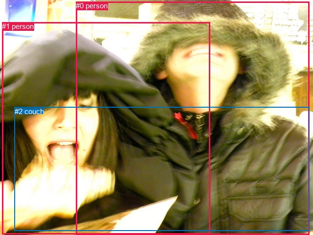
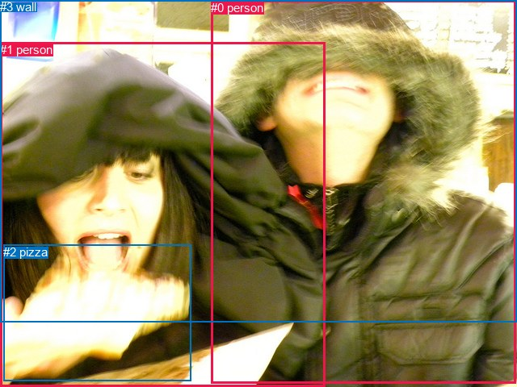

# 图片 0769：2350508.jpg

随机样本序号：496。图片 SHA256：`b08173e02dc865e7f13fecbcbed574b70271c07fef6023236d0dea8d6bf77619`。

红色框表示人，蓝色框表示其他物体。两个模式分别保留自身框编号，可依据位置比较对应对象。

## 自动检测框与输出

人的框编号：`[0, 1]`。状态：`ok`。

### 自动检测全部物体框

| 编号 | 类别 | 是否为人 | 检测分数 | 像素坐标 xyxy |
|---|---|---|---|---|
| 0 | person | True | 0.9930 | 155.1, 3.4, 632.8, 479.4 |
| 1 | person | True | 0.9517 | 4.0, 45.5, 430.0, 478.1 |
| 2 | couch | False | 0.3871 | 29.8, 218.8, 632.5, 471.2 |

### 自动检测 Top50 人相关候选

评分物体对：6；人相关物体对：6；输出关系：12。

| 排名 | 主语编号与类别 | 关系 | 宾语编号与类别 | 类型 | 人与人 | 排序分数 | 原始融合 logit |
|---|---|---|---|---|---|---|---|
| 1 | #0 person | wearing | #2 couch | semantic | False | 0.98219 | 4.0102 |
| 2 | #0 person | holding | #1 person | semantic | True | 0.93718 | 2.7025 |
| 3 | #1 person | holding | #2 couch | semantic | False | 0.89853 | 2.1810 |
| 4 | #2 couch | on | #0 person | spatial | False | 0.88528 | 2.0434 |
| 5 | #0 person | in | #2 couch | spatial | False | 0.45750 | -0.1704 |
| 6 | #1 person | feeding | #0 person | semantic | True | 0.45283 | -0.1892 |
| 7 | #0 person | beside | #1 person | spatial | True | 0.41478 | -0.3442 |
| 8 | #1 person | beside | #0 person | spatial | True | 0.33560 | -0.6829 |
| 9 | #2 couch | wearing | #0 person | semantic | False | 0.30506 | -0.8233 |
| 10 | #2 couch | in front of | #1 person | spatial | False | 0.25613 | -1.0662 |
| 11 | #1 person | in front of | #2 couch | spatial | False | 0.23578 | -1.1760 |
| 12 | #2 couch | holding | #1 person | semantic | False | 0.22919 | -1.2129 |

### 自动检测逐条人相关 GT 核验

R@50：0.00%；命中 0/5。

| GT 主语编号 | GT 关系 | GT 宾语编号 | 结果阶段 | 匹配预测主语编号 | 匹配预测宾语编号 |
|---|---|---|---|---|---|
| 1 | attached to | 2 | endpoint_missing_or_wrong_class | [1] | [] |
| 1 | looking at | 2 | endpoint_missing_or_wrong_class | [1] | [] |
| 1 | eating | 2 | endpoint_missing_or_wrong_class | [1] | [] |
| 1 | in front of | 3 | endpoint_missing_or_wrong_class | [1] | [] |
| 2 | attached to | 1 | endpoint_missing_or_wrong_class | [] | [1] |

## 真实框与输出

人的框编号：`[0, 1]`。

### 真实框全部物体框

| 编号 | 类别 | 是否为人 | 检测分数 | 像素坐标 xyxy |
|---|---|---|---|---|
| 0 | person | True | GT | 261.0, 1.0, 638.0, 475.0 |
| 1 | person | True | GT | 0.0, 53.0, 403.0, 480.0 |
| 2 | pizza | False | GT | 4.0, 304.0, 237.0, 473.0 |
| 3 | wall | False | GT | 0.0, 0.0, 640.0, 400.0 |

### 真实框 Top50 人相关候选

评分物体对：12；人相关物体对：10；输出关系：20。

| 排名 | 主语编号与类别 | 关系 | 宾语编号与类别 | 类型 | 人与人 | 排序分数 | 原始融合 logit |
|---|---|---|---|---|---|---|---|
| 1 | #1 person | eating | #2 pizza | semantic | False | 0.95843 | 3.1378 |
| 2 | #0 person | holding | #2 pizza | semantic | False | 0.91772 | 2.4117 |
| 3 | #0 person | holding | #3 wall | semantic | False | 0.90376 | 2.2397 |
| 4 | #3 wall | holding | #0 person | semantic | False | 0.89212 | 2.1125 |
| 5 | #3 wall | holding | #1 person | semantic | False | 0.85025 | 1.7366 |
| 6 | #0 person | holding | #1 person | semantic | True | 0.84440 | 1.6913 |
| 7 | #1 person | holding | #3 wall | semantic | False | 0.47757 | -0.0898 |
| 8 | #1 person | beside | #0 person | spatial | True | 0.27939 | -0.9475 |
| 9 | #1 person | in | #2 pizza | spatial | False | 0.22467 | -1.2386 |
| 10 | #1 person | holding | #0 person | semantic | True | 0.20000 | -1.3863 |
| 11 | #0 person | on | #3 wall | spatial | False | 0.18651 | -1.4729 |
| 12 | #0 person | beside | #1 person | spatial | True | 0.16918 | -1.5914 |
| 13 | #3 wall | on | #0 person | spatial | False | 0.16613 | -1.6133 |
| 14 | #0 person | in | #2 pizza | spatial | False | 0.15384 | -1.7048 |
| 15 | #1 person | in front of | #3 wall | spatial | False | 0.10052 | -2.1914 |
| 16 | #3 wall | in | #1 person | spatial | False | 0.08377 | -2.3922 |
| 17 | #2 pizza | in front of | #1 person | spatial | False | 0.06179 | -2.7203 |
| 18 | #2 pizza | in front of | #0 person | spatial | False | 0.03158 | -3.4230 |
| 19 | #2 pizza | holding | #1 person | semantic | False | 0.01030 | -4.5654 |
| 20 | #2 pizza | holding | #0 person | semantic | False | 0.00223 | -6.1024 |

### 真实框逐条人相关 GT 核验

R@50：40.00%；命中 2/5。

| GT 主语编号 | GT 关系 | GT 宾语编号 | 结果阶段 | 匹配预测主语编号 | 匹配预测宾语编号 |
|---|---|---|---|---|---|
| 1 | attached to | 2 | wrong_predicate | [1] | [2] |
| 1 | looking at | 2 | wrong_predicate | [1] | [2] |
| 1 | eating | 2 | hit50 | [1] | [2] |
| 1 | in front of | 3 | hit50 | [1] | [3] |
| 2 | attached to | 1 | wrong_predicate | [2] | [1] |

## 全部人相关 GT

| 主语编号与类别 | 关系 | 宾语编号与类别 |
|---|---|---|
| #1 person | attached to | #2 pizza |
| #1 person | looking at | #2 pizza |
| #1 person | eating | #2 pizza |
| #1 person | in front of | #3 wall |
| #2 pizza | attached to | #1 person |

原始记录、全部人相关物体对的两项预测与分项分数见 [逐图证据 JSON](../evidence/cases/0769.json)。全部56类 logits 保留于本机 HOR/output/random500/logits/。

<!-- HOR_COMPLETE_RESULTS -->

## 六组条件的完整输出对照

以下保留同一图片三种框与候选模式、两种谓词输出规则的全部 Top50。框编号各自在所属模式内解释。

### 自动检测框完整枚举：空间与语义各保留一个谓词

| 排名 | 主语编号与类别 | 谓词 | 宾语编号与类别 | 分组 | 排序分数 | predicate logit | pair logit |
|---|---|---|---|---|---|---|---|
| 1 | #0 person | wearing | #2 couch | semantic | 0.9821927 | 3.5998034 | 0.4103750 |
| 2 | #0 person | holding | #1 person | semantic | 0.9371757 | 2.4069004 | 0.2956276 |
| 3 | #1 person | holding | #2 couch | semantic | 0.8985327 | 2.1192431 | 0.0617836 |
| 4 | #2 couch | on | #0 person | spatial | 0.8852797 | 2.4254699 | -0.3820626 |
| 5 | #0 person | in | #2 couch | spatial | 0.4575013 | -0.5807810 | 0.4103750 |
| 6 | #1 person | feeding | #0 person | semantic | 0.4528291 | -0.0036974 | -0.1855491 |
| 7 | #0 person | beside | #1 person | spatial | 0.4147817 | -0.6398602 | 0.2956276 |
| 8 | #1 person | beside | #0 person | spatial | 0.3356039 | -0.4973979 | -0.1855491 |
| 9 | #2 couch | wearing | #0 person | semantic | 0.3050554 | -0.4412761 | -0.3820626 |
| 10 | #2 couch | in front of | #1 person | spatial | 0.2561313 | -0.3762951 | -0.6898794 |
| 11 | #1 person | in front of | #2 couch | spatial | 0.2357782 | -1.2377503 | 0.0617836 |
| 12 | #2 couch | holding | #1 person | semantic | 0.2291869 | -0.5230289 | -0.6898794 |

GT 命中：0/5，R@50=0.00%。

| GT主语 | GT谓词 | GT宾语 | 结果阶段 | 匹配主语框 | 匹配宾语框 |
|---|---|---|---|---|---|
| 1 | attached to | 2 | endpoint_missing_or_wrong_class | [1] | [] |
| 1 | looking at | 2 | endpoint_missing_or_wrong_class | [1] | [] |
| 1 | eating | 2 | endpoint_missing_or_wrong_class | [1] | [] |
| 1 | in front of | 3 | endpoint_missing_or_wrong_class | [1] | [] |
| 2 | attached to | 1 | endpoint_missing_or_wrong_class | [] | [1] |

### 自动检测框完整枚举：每对只保留一个谓词

| 排名 | 主语编号与类别 | 谓词 | 宾语编号与类别 | 分组 | 排序分数 | predicate logit | pair logit |
|---|---|---|---|---|---|---|---|
| 1 | #0 person | wearing | #2 couch | single | 0.9821927 | 3.5998034 | 0.4103750 |
| 2 | #0 person | holding | #1 person | single | 0.9371757 | 2.4069004 | 0.2956276 |
| 3 | #1 person | holding | #2 couch | single | 0.8985327 | 2.1192431 | 0.0617836 |
| 4 | #2 couch | on | #0 person | single | 0.8852797 | 2.4254699 | -0.3820626 |
| 5 | #1 person | feeding | #0 person | single | 0.4528291 | -0.0036974 | -0.1855491 |
| 6 | #2 couch | in front of | #1 person | single | 0.2561313 | -0.3762951 | -0.6898794 |

GT 命中：0/5，R@50=0.00%。

| GT主语 | GT谓词 | GT宾语 | 结果阶段 | 匹配主语框 | 匹配宾语框 |
|---|---|---|---|---|---|
| 1 | attached to | 2 | endpoint_missing_or_wrong_class | [1] | [] |
| 1 | looking at | 2 | endpoint_missing_or_wrong_class | [1] | [] |
| 1 | eating | 2 | endpoint_missing_or_wrong_class | [1] | [] |
| 1 | in front of | 3 | endpoint_missing_or_wrong_class | [1] | [] |
| 2 | attached to | 1 | endpoint_missing_or_wrong_class | [] | [1] |

### 真实框完整枚举：空间与语义各保留一个谓词

| 排名 | 主语编号与类别 | 谓词 | 宾语编号与类别 | 分组 | 排序分数 | predicate logit | pair logit |
|---|---|---|---|---|---|---|---|
| 1 | #1 person | eating | #2 pizza | semantic | 0.9584264 | 2.7272429 | 0.4105836 |
| 2 | #0 person | holding | #2 pizza | semantic | 0.9177175 | 2.2277513 | 0.1839808 |
| 3 | #0 person | holding | #3 wall | semantic | 0.9037597 | 2.2610459 | -0.0213309 |
| 4 | #3 wall | holding | #0 person | semantic | 0.8921163 | 2.4131489 | -0.3006064 |
| 5 | #3 wall | holding | #1 person | semantic | 0.8502519 | 1.9013882 | -0.1648104 |
| 6 | #0 person | holding | #1 person | semantic | 0.8443982 | 1.5146732 | 0.1766504 |
| 7 | #1 person | holding | #3 wall | semantic | 0.4775690 | 0.1256304 | -0.2154146 |
| 8 | #1 person | beside | #0 person | spatial | 0.2793941 | -0.8025463 | -0.1449229 |
| 9 | #1 person | in | #2 pizza | spatial | 0.2246748 | -1.6492124 | 0.4105836 |
| 10 | #1 person | holding | #0 person | semantic | 0.2000009 | -1.2413661 | -0.1449229 |
| 11 | #0 person | on | #3 wall | spatial | 0.1865094 | -1.4515214 | -0.0213309 |
| 12 | #0 person | beside | #1 person | spatial | 0.1691830 | -1.7680790 | 0.1766504 |
| 13 | #3 wall | on | #0 person | spatial | 0.1661350 | -1.3126645 | -0.3006064 |
| 14 | #0 person | in | #2 pizza | spatial | 0.1538383 | -1.8887889 | 0.1839808 |
| 15 | #1 person | in front of | #3 wall | spatial | 0.1005219 | -1.9760249 | -0.2154146 |
| 16 | #3 wall | in | #1 person | spatial | 0.0837670 | -2.2274218 | -0.1648104 |
| 17 | #2 pizza | in front of | #1 person | spatial | 0.0617857 | -1.5715213 | -1.1487852 |
| 18 | #2 pizza | in front of | #0 person | spatial | 0.0315844 | -1.9401214 | -1.4828774 |
| 19 | #2 pizza | holding | #1 person | semantic | 0.0102989 | -3.4165792 | -1.1487852 |
| 20 | #2 pizza | holding | #0 person | semantic | 0.0022325 | -4.6195431 | -1.4828774 |

GT 命中：2/5，R@50=40.00%。

| GT主语 | GT谓词 | GT宾语 | 结果阶段 | 匹配主语框 | 匹配宾语框 |
|---|---|---|---|---|---|
| 1 | attached to | 2 | wrong_predicate | [1] | [2] |
| 1 | looking at | 2 | wrong_predicate | [1] | [2] |
| 1 | eating | 2 | hit50 | [1] | [2] |
| 1 | in front of | 3 | hit50 | [1] | [3] |
| 2 | attached to | 1 | wrong_predicate | [2] | [1] |

### 真实框完整枚举：每对只保留一个谓词

| 排名 | 主语编号与类别 | 谓词 | 宾语编号与类别 | 分组 | 排序分数 | predicate logit | pair logit |
|---|---|---|---|---|---|---|---|
| 1 | #1 person | eating | #2 pizza | single | 0.9584264 | 2.7272429 | 0.4105836 |
| 2 | #0 person | holding | #2 pizza | single | 0.9177175 | 2.2277513 | 0.1839808 |
| 3 | #0 person | holding | #3 wall | single | 0.9037597 | 2.2610459 | -0.0213309 |
| 4 | #3 wall | holding | #0 person | single | 0.8921163 | 2.4131489 | -0.3006064 |
| 5 | #3 wall | holding | #1 person | single | 0.8502519 | 1.9013882 | -0.1648104 |
| 6 | #0 person | holding | #1 person | single | 0.8443982 | 1.5146732 | 0.1766504 |
| 7 | #1 person | holding | #3 wall | single | 0.4775690 | 0.1256304 | -0.2154146 |
| 8 | #1 person | beside | #0 person | single | 0.2793941 | -0.8025463 | -0.1449229 |
| 9 | #2 pizza | in front of | #1 person | single | 0.0617857 | -1.5715213 | -1.1487852 |
| 10 | #2 pizza | in front of | #0 person | single | 0.0315844 | -1.9401214 | -1.4828774 |

GT 命中：1/5，R@50=20.00%。

| GT主语 | GT谓词 | GT宾语 | 结果阶段 | 匹配主语框 | 匹配宾语框 |
|---|---|---|---|---|---|
| 1 | attached to | 2 | wrong_predicate | [1] | [2] |
| 1 | looking at | 2 | wrong_predicate | [1] | [2] |
| 1 | eating | 2 | hit50 | [1] | [2] |
| 1 | in front of | 3 | wrong_predicate | [1] | [3] |
| 2 | attached to | 1 | wrong_predicate | [2] | [1] |

### 真实框400候选：空间与语义各保留一个谓词

| 排名 | 主语编号与类别 | 谓词 | 宾语编号与类别 | 分组 | 排序分数 | predicate logit | pair logit |
|---|---|---|---|---|---|---|---|
| 1 | #1 person | eating | #2 pizza | semantic | 0.9584264 | 2.7272429 | 0.4105836 |
| 2 | #0 person | holding | #2 pizza | semantic | 0.9176060 | 2.2262740 | 0.1839808 |
| 3 | #0 person | holding | #3 wall | semantic | 0.9040163 | 2.2639999 | -0.0213309 |
| 4 | #3 wall | holding | #0 person | semantic | 0.8924003 | 2.4161029 | -0.3006064 |
| 5 | #3 wall | holding | #1 person | semantic | 0.8506276 | 1.9043422 | -0.1648104 |
| 6 | #0 person | holding | #1 person | semantic | 0.8440096 | 1.5117188 | 0.1766504 |
| 7 | #1 person | holding | #3 wall | semantic | 0.4767859 | 0.1224914 | -0.2154146 |
| 8 | #1 person | beside | #0 person | spatial | 0.2854748 | -0.7725418 | -0.1449229 |
| 9 | #1 person | in | #2 pizza | spatial | 0.2245303 | -1.6500421 | 0.4105836 |
| 10 | #1 person | holding | #0 person | semantic | 0.2046786 | -1.2123826 | -0.1449229 |
| 11 | #0 person | on | #3 wall | spatial | 0.1865094 | -1.4515214 | -0.0213309 |
| 12 | #0 person | beside | #1 person | spatial | 0.1691830 | -1.7680790 | 0.1766504 |
| 13 | #3 wall | on | #0 person | spatial | 0.1689930 | -1.2921741 | -0.3006064 |
| 14 | #0 person | in | #2 pizza | spatial | 0.1535146 | -1.8912780 | 0.1839808 |
| 15 | #1 person | in front of | #3 wall | spatial | 0.1005253 | -1.9759867 | -0.2154146 |
| 16 | #3 wall | in | #1 person | spatial | 0.0839582 | -2.2249327 | -0.1648104 |
| 17 | #2 pizza | in front of | #1 person | spatial | 0.0635350 | -1.5417366 | -1.1487852 |
| 18 | #2 pizza | in front of | #0 person | spatial | 0.0320383 | -1.9253819 | -1.4828774 |
| 19 | #2 pizza | holding | #1 person | semantic | 0.0104687 | -3.4000564 | -1.1487852 |
| 20 | #2 pizza | holding | #0 person | semantic | 0.0022526 | -4.6105433 | -1.4828774 |

GT 命中：2/5，R@50=40.00%。

| GT主语 | GT谓词 | GT宾语 | 结果阶段 | 匹配主语框 | 匹配宾语框 |
|---|---|---|---|---|---|
| 1 | attached to | 2 | wrong_predicate | [1] | [2] |
| 1 | looking at | 2 | wrong_predicate | [1] | [2] |
| 1 | eating | 2 | hit50 | [1] | [2] |
| 1 | in front of | 3 | hit50 | [1] | [3] |
| 2 | attached to | 1 | wrong_predicate | [2] | [1] |

### 真实框400候选：每对只保留一个谓词

| 排名 | 主语编号与类别 | 谓词 | 宾语编号与类别 | 分组 | 排序分数 | predicate logit | pair logit |
|---|---|---|---|---|---|---|---|
| 1 | #1 person | eating | #2 pizza | single | 0.9584264 | 2.7272429 | 0.4105836 |
| 2 | #0 person | holding | #2 pizza | single | 0.9176060 | 2.2262740 | 0.1839808 |
| 3 | #0 person | holding | #3 wall | single | 0.9040163 | 2.2639999 | -0.0213309 |
| 4 | #3 wall | holding | #0 person | single | 0.8924003 | 2.4161029 | -0.3006064 |
| 5 | #3 wall | holding | #1 person | single | 0.8506276 | 1.9043422 | -0.1648104 |
| 6 | #0 person | holding | #1 person | single | 0.8440096 | 1.5117188 | 0.1766504 |
| 7 | #1 person | holding | #3 wall | single | 0.4767859 | 0.1224914 | -0.2154146 |
| 8 | #1 person | beside | #0 person | single | 0.2854748 | -0.7725418 | -0.1449229 |
| 9 | #2 pizza | in front of | #1 person | single | 0.0635350 | -1.5417366 | -1.1487852 |
| 10 | #2 pizza | in front of | #0 person | single | 0.0320383 | -1.9253819 | -1.4828774 |

GT 命中：1/5，R@50=20.00%。

| GT主语 | GT谓词 | GT宾语 | 结果阶段 | 匹配主语框 | 匹配宾语框 |
|---|---|---|---|---|---|
| 1 | attached to | 2 | wrong_predicate | [1] | [2] |
| 1 | looking at | 2 | wrong_predicate | [1] | [2] |
| 1 | eating | 2 | hit50 | [1] | [2] |
| 1 | in front of | 3 | wrong_predicate | [1] | [3] |
| 2 | attached to | 1 | wrong_predicate | [2] | [1] |
