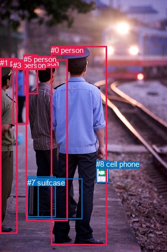
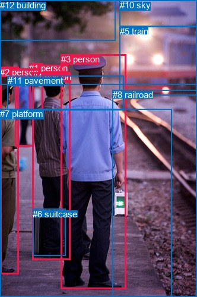

# 图片 0775：2350750.jpg

随机样本序号：373。图片 SHA256：`8af42935801f576774ee720fc7e19d8638284692b33dc6a6cdf98debab2acc71`。

红色框表示人，蓝色框表示其他物体。两个模式分别保留自身框编号，可依据位置比较对应对象。

## 自动检测框与输出

人的框编号：`[0, 1, 2, 3, 5]`。状态：`ok`。

### 自动检测全部物体框

| 编号 | 类别 | 是否为人 | 检测分数 | 像素坐标 xyxy |
|---|---|---|---|---|
| 0 | person | True | 0.9993 | 101.2, 91.0, 212.6, 486.6 |
| 1 | person | True | 0.9968 | 0.3, 115.7, 34.8, 463.9 |
| 2 | person | True | 0.9950 | 51.5, 117.5, 134.9, 439.0 |
| 3 | person | True | 0.9828 | 26.0, 121.1, 56.8, 246.5 |
| 4 | suitcase | False | 0.9649 | 54.7, 354.2, 76.0, 430.8 |
| 5 | person | True | 0.9482 | 46.5, 108.7, 75.3, 186.3 |
| 6 | suitcase | False | 0.9292 | 54.8, 350.7, 110.8, 430.9 |
| 7 | suitcase | False | 0.8150 | 54.1, 354.1, 163.8, 434.9 |
| 8 | cell phone | False | 0.6211 | 191.5, 317.5, 215.9, 362.7 |

### 自动检测 Top50 人相关候选

评分物体对：72；人相关物体对：60；输出关系：50。

| 排名 | 主语编号与类别 | 关系 | 宾语编号与类别 | 类型 | 人与人 | 排序分数 | 原始融合 logit |
|---|---|---|---|---|---|---|---|
| 1 | #0 person | holding | #8 cell phone | semantic | False | 0.98868 | 4.4697 |
| 2 | #2 person | holding | #4 suitcase | semantic | False | 0.98169 | 3.9818 |
| 3 | #2 person | holding | #6 suitcase | semantic | False | 0.97984 | 3.8836 |
| 4 | #2 person | holding | #7 suitcase | semantic | False | 0.96325 | 3.2663 |
| 5 | #0 person | holding | #7 suitcase | semantic | False | 0.83768 | 1.6410 |
| 6 | #3 person | carrying | #5 person | semantic | True | 0.63039 | 0.5339 |
| 7 | #0 person | on | #8 cell phone | spatial | False | 0.63026 | 0.5333 |
| 8 | #0 person | holding | #6 suitcase | semantic | False | 0.59549 | 0.3867 |
| 9 | #1 person | holding | #4 suitcase | semantic | False | 0.50650 | 0.0260 |
| 10 | #1 person | holding | #6 suitcase | semantic | False | 0.48844 | -0.0462 |
| 11 | #2 person | on | #6 suitcase | spatial | False | 0.42451 | -0.3043 |
| 12 | #2 person | on | #7 suitcase | spatial | False | 0.42390 | -0.3068 |
| 13 | #1 person | holding | #8 cell phone | semantic | False | 0.38003 | -0.4894 |
| 14 | #2 person | on | #4 suitcase | spatial | False | 0.36579 | -0.5503 |
| 15 | #1 person | pulling | #7 suitcase | semantic | False | 0.27973 | -0.9458 |
| 16 | #5 person | holding | #8 cell phone | semantic | False | 0.25200 | -1.0880 |
| 17 | #0 person | on | #7 suitcase | spatial | False | 0.24410 | -1.1304 |
| 18 | #3 person | holding | #8 cell phone | semantic | False | 0.20941 | -1.3285 |
| 19 | #0 person | holding | #4 suitcase | semantic | False | 0.19500 | -1.4179 |
| 20 | #3 person | in front of | #5 person | spatial | True | 0.16249 | -1.6398 |
| 21 | #2 person | holding | #8 cell phone | semantic | False | 0.16065 | -1.6534 |
| 22 | #0 person | on | #6 suitcase | spatial | False | 0.15432 | -1.7011 |
| 23 | #2 person | talking to | #0 person | semantic | True | 0.14138 | -1.8039 |
| 24 | #5 person | walking on | #3 person | semantic | True | 0.13342 | -1.8710 |
| 25 | #1 person | carrying | #3 person | semantic | True | 0.11363 | -2.0542 |
| 26 | #3 person | holding | #6 suitcase | semantic | False | 0.08945 | -2.3204 |
| 27 | #1 person | talking to | #2 person | semantic | True | 0.08897 | -2.3263 |
| 28 | #3 person | holding | #4 suitcase | semantic | False | 0.06807 | -2.6168 |
| 29 | #2 person | beside | #0 person | spatial | True | 0.06426 | -2.6783 |
| 30 | #1 person | beside | #4 suitcase | spatial | False | 0.06048 | -2.7430 |
| 31 | #5 person | beside | #2 person | spatial | True | 0.05951 | -2.7602 |
| 32 | #1 person | beside | #6 suitcase | spatial | False | 0.05886 | -2.7719 |
| 33 | #0 person | talking to | #2 person | semantic | True | 0.05796 | -2.7883 |
| 34 | #5 person | walking on | #2 person | semantic | True | 0.05765 | -2.7939 |
| 35 | #5 person | holding | #6 suitcase | semantic | False | 0.05731 | -2.8003 |
| 36 | #5 person | holding | #4 suitcase | semantic | False | 0.05428 | -2.8577 |
| 37 | #0 person | beside | #2 person | spatial | True | 0.05076 | -2.9286 |
| 38 | #3 person | walking on | #2 person | semantic | True | 0.04947 | -2.9557 |
| 39 | #2 person | carrying | #5 person | semantic | True | 0.04678 | -3.0144 |
| 40 | #1 person | beside | #2 person | spatial | True | 0.04608 | -3.0301 |
| 41 | #3 person | walking on | #1 person | semantic | True | 0.03918 | -3.1995 |
| 42 | #5 person | carrying | #7 suitcase | semantic | False | 0.03619 | -3.2820 |
| 43 | #5 person | looking at | #0 person | semantic | True | 0.03568 | -3.2967 |
| 44 | #1 person | looking at | #0 person | semantic | True | 0.03508 | -3.3144 |
| 45 | #1 person | beside | #7 suitcase | spatial | False | 0.03478 | -3.3235 |
| 46 | #3 person | walking on | #7 suitcase | semantic | False | 0.03426 | -3.3390 |
| 47 | #1 person | carrying | #5 person | semantic | True | 0.03279 | -3.3843 |
| 48 | #1 person | in front of | #5 person | spatial | True | 0.03267 | -3.3880 |
| 49 | #1 person | in front of | #3 person | spatial | True | 0.03165 | -3.4209 |
| 50 | #5 person | beside | #3 person | spatial | True | 0.02752 | -3.5650 |

### 自动检测逐条人相关 GT 核验

R@50：0.00%；命中 0/6。

| GT 主语编号 | GT 关系 | GT 宾语编号 | 结果阶段 | 匹配预测主语编号 | 匹配预测宾语编号 |
|---|---|---|---|---|---|
| 3 | looking at | 5 | endpoint_missing_or_wrong_class | [0] | [] |
| 3 | standing on | 7 | endpoint_missing_or_wrong_class | [0] | [] |
| 4 | looking at | 5 | endpoint_missing_or_wrong_class | [2] | [] |
| 4 | beside | 6 | wrong_predicate | [2] | [6] |
| 4 | standing on | 7 | endpoint_missing_or_wrong_class | [2] | [] |
| 6 | beside | 4 | rank_below50 | [6] | [2] |

## 真实框与输出

人的框编号：`[0, 1, 2, 3, 4]`。

### 真实框全部物体框

| 编号 | 类别 | 是否为人 | 检测分数 | 像素坐标 xyxy |
|---|---|---|---|---|
| 0 | person | True | GT | 25.0, 119.0, 57.0, 246.0 |
| 1 | person | True | GT | 49.0, 106.0, 72.0, 185.0 |
| 2 | person | True | GT | 0.0, 113.0, 32.0, 462.0 |
| 3 | person | True | GT | 103.0, 91.0, 213.0, 486.0 |
| 4 | person | True | GT | 55.0, 121.0, 119.0, 437.0 |
| 5 | train | False | GT | 202.0, 44.0, 332.0, 161.0 |
| 6 | suitcase | False | GT | 55.0, 352.0, 111.0, 431.0 |
| 7 | platform | False | GT | 0.0, 183.0, 290.0, 500.0 |
| 8 | railroad | False | GT | 190.0, 151.0, 332.0, 500.0 |
| 9 | tree | False | GT | 0.0, 0.0, 194.0, 69.0 |
| 10 | sky | False | GT | 202.0, 0.0, 332.0, 45.0 |
| 11 | pavement | False | GT | 13.0, 127.0, 208.0, 185.0 |
| 12 | building | False | GT | 0.0, 0.0, 332.0, 142.0 |

### 真实框 Top50 人相关候选

评分物体对：156；人相关物体对：100；输出关系：50。

| 排名 | 主语编号与类别 | 关系 | 宾语编号与类别 | 类型 | 人与人 | 排序分数 | 原始融合 logit |
|---|---|---|---|---|---|---|---|
| 1 | #4 person | standing on | #7 platform | semantic | False | 0.98326 | 4.0729 |
| 2 | #4 person | holding | #6 suitcase | semantic | False | 0.98083 | 3.9353 |
| 3 | #2 person | standing on | #7 platform | semantic | False | 0.97982 | 3.8828 |
| 4 | #3 person | standing on | #7 platform | semantic | False | 0.97686 | 3.7427 |
| 5 | #0 person | walking on | #7 platform | semantic | False | 0.94966 | 2.9373 |
| 6 | #3 person | on | #7 platform | spatial | False | 0.93605 | 2.6836 |
| 7 | #4 person | on | #7 platform | spatial | False | 0.92799 | 2.5563 |
| 8 | #1 person | walking on | #7 platform | semantic | False | 0.90202 | 2.2199 |
| 9 | #3 person | on | #8 railroad | spatial | False | 0.88895 | 2.0800 |
| 10 | #2 person | on | #7 platform | spatial | False | 0.88729 | 2.0633 |
| 11 | #3 person | standing on | #8 railroad | semantic | False | 0.88387 | 2.0296 |
| 12 | #0 person | on | #7 platform | spatial | False | 0.86162 | 1.8288 |
| 13 | #3 person | wearing | #11 pavement | semantic | False | 0.84780 | 1.7175 |
| 14 | #3 person | looking at | #5 train | semantic | False | 0.84407 | 1.6888 |
| 15 | #4 person | in | #6 suitcase | spatial | False | 0.83713 | 1.6370 |
| 16 | #1 person | walking on | #11 pavement | semantic | False | 0.82144 | 1.5261 |
| 17 | #3 person | in | #11 pavement | spatial | False | 0.81358 | 1.4735 |
| 18 | #1 person | on | #7 platform | spatial | False | 0.78720 | 1.3082 |
| 19 | #3 person | holding | #6 suitcase | semantic | False | 0.77862 | 1.2576 |
| 20 | #4 person | looking at | #8 railroad | semantic | False | 0.77029 | 1.2100 |
| 21 | #4 person | in | #11 pavement | spatial | False | 0.76129 | 1.1598 |
| 22 | #4 person | looking at | #5 train | semantic | False | 0.73581 | 1.0243 |
| 23 | #4 person | wearing | #11 pavement | semantic | False | 0.73242 | 1.0069 |
| 24 | #0 person | walking on | #11 pavement | semantic | False | 0.70785 | 0.8850 |
| 25 | #1 person | looking at | #5 train | semantic | False | 0.66886 | 0.7030 |
| 26 | #2 person | looking at | #5 train | semantic | False | 0.65490 | 0.6407 |
| 27 | #4 person | beside | #3 person | spatial | True | 0.62212 | 0.4985 |
| 28 | #0 person | looking at | #5 train | semantic | False | 0.59200 | 0.3722 |
| 29 | #1 person | looking at | #8 railroad | semantic | False | 0.58790 | 0.3553 |
| 30 | #4 person | on | #8 railroad | spatial | False | 0.58242 | 0.3327 |
| 31 | #2 person | beside | #4 person | spatial | True | 0.56801 | 0.2737 |
| 32 | #0 person | carrying | #1 person | semantic | True | 0.56582 | 0.2648 |
| 33 | #1 person | on | #11 pavement | spatial | False | 0.55677 | 0.2280 |
| 34 | #0 person | walking on | #8 railroad | semantic | False | 0.54328 | 0.1735 |
| 35 | #0 person | in | #11 pavement | spatial | False | 0.52274 | 0.0910 |
| 36 | #2 person | standing on | #8 railroad | semantic | False | 0.52056 | 0.0823 |
| 37 | #4 person | talking to | #3 person | semantic | True | 0.50988 | 0.0395 |
| 38 | #2 person | wearing | #0 person | semantic | True | 0.50535 | 0.0214 |
| 39 | #2 person | beside | #8 railroad | spatial | False | 0.48089 | -0.0765 |
| 40 | #2 person | in | #11 pavement | spatial | False | 0.47881 | -0.0848 |
| 41 | #6 suitcase | beside | #4 person | spatial | False | 0.45851 | -0.1664 |
| 42 | #3 person | beside | #4 person | spatial | True | 0.45375 | -0.1855 |
| 43 | #2 person | talking to | #4 person | semantic | True | 0.40891 | -0.3685 |
| 44 | #3 person | holding | #4 person | semantic | True | 0.36889 | -0.5370 |
| 45 | #2 person | wearing | #11 pavement | semantic | False | 0.35313 | -0.6053 |
| 46 | #0 person | beside | #1 person | spatial | True | 0.34167 | -0.6559 |
| 47 | #3 person | on | #5 train | spatial | False | 0.32038 | -0.7520 |
| 48 | #0 person | on | #8 railroad | spatial | False | 0.30714 | -0.8135 |
| 49 | #1 person | on | #8 railroad | spatial | False | 0.28836 | -0.9033 |
| 50 | #4 person | beside | #2 person | spatial | True | 0.28343 | -0.9275 |

### 真实框逐条人相关 GT 核验

R@50：83.33%；命中 5/6。

| GT 主语编号 | GT 关系 | GT 宾语编号 | 结果阶段 | 匹配预测主语编号 | 匹配预测宾语编号 |
|---|---|---|---|---|---|
| 3 | looking at | 5 | hit50 | [3] | [5] |
| 3 | standing on | 7 | hit50 | [3] | [7] |
| 4 | looking at | 5 | hit50 | [4] | [5] |
| 4 | beside | 6 | wrong_predicate | [4] | [6] |
| 4 | standing on | 7 | hit50 | [4] | [7] |
| 6 | beside | 4 | hit50 | [6] | [4] |

## 全部人相关 GT

| 主语编号与类别 | 关系 | 宾语编号与类别 |
|---|---|---|
| #3 person | looking at | #5 train |
| #3 person | standing on | #7 platform |
| #4 person | looking at | #5 train |
| #4 person | beside | #6 suitcase |
| #4 person | standing on | #7 platform |
| #6 suitcase | beside | #4 person |

原始记录、全部人相关物体对的两项预测与分项分数见 [逐图证据 JSON](../evidence/cases/0775.json)。全部56类 logits 保留于本机 HOR/output/random500/logits/。

<!-- HOR_COMPLETE_RESULTS -->

## 六组条件的完整输出对照

以下保留同一图片三种框与候选模式、两种谓词输出规则的全部 Top50。框编号各自在所属模式内解释。

### 自动检测框完整枚举：空间与语义各保留一个谓词

| 排名 | 主语编号与类别 | 谓词 | 宾语编号与类别 | 分组 | 排序分数 | predicate logit | pair logit |
|---|---|---|---|---|---|---|---|
| 1 | #0 person | holding | #8 cell phone | semantic | 0.9886790 | 3.4827609 | 0.9869452 |
| 2 | #2 person | holding | #4 suitcase | semantic | 0.9816901 | 3.6171384 | 0.3646989 |
| 3 | #2 person | holding | #6 suitcase | semantic | 0.9798379 | 3.4720416 | 0.4115419 |
| 4 | #2 person | holding | #7 suitcase | semantic | 0.9632531 | 2.8709750 | 0.3952870 |
| 5 | #0 person | holding | #7 suitcase | semantic | 0.8376766 | 1.7494941 | -0.1084520 |
| 6 | #3 person | carrying | #5 person | semantic | 0.6303941 | 0.7430282 | -0.2091204 |
| 7 | #0 person | on | #8 cell phone | spatial | 0.6302592 | -0.4536161 | 0.9869452 |
| 8 | #0 person | holding | #6 suitcase | semantic | 0.5954940 | 0.6261578 | -0.2394329 |
| 9 | #1 person | holding | #4 suitcase | semantic | 0.5065012 | -0.1796789 | 0.2056851 |
| 10 | #1 person | holding | #6 suitcase | semantic | 0.4884448 | -0.1527114 | 0.1064822 |
| 11 | #2 person | on | #6 suitcase | spatial | 0.4245081 | -0.7158360 | 0.4115419 |
| 12 | #2 person | on | #7 suitcase | spatial | 0.4238980 | -0.7020788 | 0.3952870 |
| 13 | #1 person | holding | #8 cell phone | semantic | 0.3800258 | -0.4186320 | -0.0708067 |
| 14 | #2 person | on | #4 suitcase | spatial | 0.3657933 | -0.9150057 | 0.3646989 |
| 15 | #1 person | pulling | #7 suitcase | semantic | 0.2797273 | -0.8761363 | -0.0696787 |
| 16 | #5 person | holding | #8 cell phone | semantic | 0.2520014 | -0.1472421 | -0.9407245 |
| 17 | #0 person | on | #7 suitcase | spatial | 0.2440955 | -1.0219035 | -0.1084520 |
| 18 | #3 person | holding | #8 cell phone | semantic | 0.2094083 | -0.6418061 | -0.6866897 |
| 19 | #0 person | holding | #4 suitcase | semantic | 0.1949971 | -1.1089647 | -0.3088963 |
| 20 | #3 person | in front of | #5 person | spatial | 0.1624876 | -1.4307144 | -0.2091204 |
| 21 | #2 person | holding | #8 cell phone | semantic | 0.1606510 | -1.8349071 | 0.1815151 |
| 22 | #0 person | on | #6 suitcase | spatial | 0.1543227 | -1.4616587 | -0.2394329 |
| 23 | #2 person | talking to | #0 person | semantic | 0.1413786 | -0.6438994 | -1.1599870 |
| 24 | #5 person | walking on | #3 person | semantic | 0.1334237 | -1.1772778 | -0.6937425 |
| 25 | #1 person | carrying | #3 person | semantic | 0.1136281 | -1.2674131 | -0.7867925 |
| 26 | #3 person | holding | #6 suitcase | semantic | 0.0894500 | -1.6837573 | -0.6366116 |
| 27 | #1 person | talking to | #2 person | semantic | 0.0889657 | -1.3329976 | -0.9933321 |
| 28 | #3 person | holding | #4 suitcase | semantic | 0.0680659 | -1.9842060 | -0.6325802 |
| 29 | #2 person | beside | #0 person | spatial | 0.0642645 | -1.5183392 | -1.1599870 |
| 30 | #1 person | beside | #4 suitcase | spatial | 0.0604811 | -2.9487216 | 0.2056851 |
| 31 | #5 person | beside | #2 person | spatial | 0.0595115 | -1.3903084 | -1.3699214 |
| 32 | #1 person | beside | #6 suitcase | spatial | 0.0588591 | -2.8784285 | 0.1064822 |
| 33 | #0 person | talking to | #2 person | semantic | 0.0579585 | -1.9650385 | -0.8232837 |
| 34 | #5 person | walking on | #2 person | semantic | 0.0576539 | -1.4239941 | -1.3699214 |
| 35 | #5 person | holding | #6 suitcase | semantic | 0.0573060 | -1.9266081 | -0.8737286 |
| 36 | #5 person | holding | #4 suitcase | semantic | 0.0542829 | -1.9612255 | -0.8965085 |
| 37 | #0 person | beside | #2 person | spatial | 0.0507596 | -2.1052775 | -0.8232837 |
| 38 | #3 person | walking on | #2 person | semantic | 0.0494692 | -1.5526030 | -1.4030677 |
| 39 | #2 person | carrying | #5 person | semantic | 0.0467798 | -2.2881939 | -0.7262008 |
| 40 | #1 person | beside | #2 person | spatial | 0.0460840 | -2.0367787 | -0.9933321 |
| 41 | #3 person | walking on | #1 person | semantic | 0.0391843 | -1.8663170 | -1.3331897 |
| 42 | #5 person | carrying | #7 suitcase | semantic | 0.0361926 | -2.4165800 | -0.8654571 |
| 43 | #5 person | looking at | #0 person | semantic | 0.0356840 | -1.5562263 | -1.7404915 |
| 44 | #1 person | looking at | #0 person | semantic | 0.0350814 | -1.9735489 | -1.3408251 |
| 45 | #1 person | beside | #7 suitcase | spatial | 0.0347753 | -3.2537742 | -0.0696787 |
| 46 | #3 person | walking on | #7 suitcase | semantic | 0.0342580 | -2.6703832 | -0.6685945 |
| 47 | #1 person | carrying | #5 person | semantic | 0.0327913 | -2.7841172 | -0.6001344 |
| 48 | #1 person | in front of | #5 person | spatial | 0.0326720 | -2.7878838 | -0.6001344 |
| 49 | #1 person | in front of | #3 person | spatial | 0.0316491 | -2.6340938 | -0.7867925 |
| 50 | #5 person | beside | #3 person | spatial | 0.0275184 | -2.8712525 | -0.6937425 |

GT 命中：0/6，R@50=0.00%。

| GT主语 | GT谓词 | GT宾语 | 结果阶段 | 匹配主语框 | 匹配宾语框 |
|---|---|---|---|---|---|
| 3 | looking at | 5 | endpoint_missing_or_wrong_class | [0] | [] |
| 3 | standing on | 7 | endpoint_missing_or_wrong_class | [0] | [] |
| 4 | looking at | 5 | endpoint_missing_or_wrong_class | [2] | [] |
| 4 | beside | 6 | wrong_predicate | [2] | [6] |
| 4 | standing on | 7 | endpoint_missing_or_wrong_class | [2] | [] |
| 6 | beside | 4 | rank_below50 | [6] | [2] |

### 自动检测框完整枚举：每对只保留一个谓词

| 排名 | 主语编号与类别 | 谓词 | 宾语编号与类别 | 分组 | 排序分数 | predicate logit | pair logit |
|---|---|---|---|---|---|---|---|
| 1 | #0 person | holding | #8 cell phone | single | 0.9886790 | 3.4827609 | 0.9869452 |
| 2 | #2 person | holding | #4 suitcase | single | 0.9816901 | 3.6171384 | 0.3646989 |
| 3 | #2 person | holding | #6 suitcase | single | 0.9798379 | 3.4720416 | 0.4115419 |
| 4 | #2 person | holding | #7 suitcase | single | 0.9632531 | 2.8709750 | 0.3952870 |
| 5 | #0 person | holding | #7 suitcase | single | 0.8376766 | 1.7494941 | -0.1084520 |
| 6 | #3 person | carrying | #5 person | single | 0.6303941 | 0.7430282 | -0.2091204 |
| 7 | #0 person | holding | #6 suitcase | single | 0.5954940 | 0.6261578 | -0.2394329 |
| 8 | #1 person | holding | #4 suitcase | single | 0.5065012 | -0.1796789 | 0.2056851 |
| 9 | #1 person | holding | #6 suitcase | single | 0.4884448 | -0.1527114 | 0.1064822 |
| 10 | #1 person | holding | #8 cell phone | single | 0.3800258 | -0.4186320 | -0.0708067 |
| 11 | #1 person | pulling | #7 suitcase | single | 0.2797273 | -0.8761363 | -0.0696787 |
| 12 | #5 person | holding | #8 cell phone | single | 0.2520014 | -0.1472421 | -0.9407245 |
| 13 | #3 person | holding | #8 cell phone | single | 0.2094083 | -0.6418061 | -0.6866897 |
| 14 | #0 person | holding | #4 suitcase | single | 0.1949971 | -1.1089647 | -0.3088963 |
| 15 | #2 person | holding | #8 cell phone | single | 0.1606510 | -1.8349071 | 0.1815151 |
| 16 | #2 person | talking to | #0 person | single | 0.1413786 | -0.6438994 | -1.1599870 |
| 17 | #5 person | walking on | #3 person | single | 0.1334237 | -1.1772778 | -0.6937425 |
| 18 | #1 person | carrying | #3 person | single | 0.1136281 | -1.2674131 | -0.7867925 |
| 19 | #3 person | holding | #6 suitcase | single | 0.0894500 | -1.6837573 | -0.6366116 |
| 20 | #1 person | talking to | #2 person | single | 0.0889657 | -1.3329976 | -0.9933321 |
| 21 | #3 person | holding | #4 suitcase | single | 0.0680659 | -1.9842060 | -0.6325802 |
| 22 | #5 person | beside | #2 person | single | 0.0595115 | -1.3903084 | -1.3699214 |
| 23 | #0 person | talking to | #2 person | single | 0.0579585 | -1.9650385 | -0.8232837 |
| 24 | #5 person | holding | #6 suitcase | single | 0.0573060 | -1.9266081 | -0.8737286 |
| 25 | #5 person | holding | #4 suitcase | single | 0.0542829 | -1.9612255 | -0.8965085 |
| 26 | #3 person | walking on | #2 person | single | 0.0494692 | -1.5526030 | -1.4030677 |
| 27 | #2 person | carrying | #5 person | single | 0.0467798 | -2.2881939 | -0.7262008 |
| 28 | #3 person | walking on | #1 person | single | 0.0391843 | -1.8663170 | -1.3331897 |
| 29 | #5 person | carrying | #7 suitcase | single | 0.0361926 | -2.4165800 | -0.8654571 |
| 30 | #5 person | looking at | #0 person | single | 0.0356840 | -1.5562263 | -1.7404915 |
| 31 | #1 person | looking at | #0 person | single | 0.0350814 | -1.9735489 | -1.3408251 |
| 32 | #3 person | walking on | #7 suitcase | single | 0.0342580 | -2.6703832 | -0.6685945 |
| 33 | #1 person | carrying | #5 person | single | 0.0327913 | -2.7841172 | -0.6001344 |
| 34 | #5 person | walking on | #1 person | single | 0.0202652 | -2.4861915 | -1.3921865 |
| 35 | #4 suitcase | on | #2 person | single | 0.0199657 | -2.4561183 | -1.4374541 |
| 36 | #6 suitcase | beside | #2 person | single | 0.0195461 | -2.4806230 | -1.4346145 |
| 37 | #2 person | beside | #1 person | single | 0.0187653 | -2.7578125 | -1.1989903 |
| 38 | #7 suitcase | beside | #2 person | single | 0.0173488 | -2.5259261 | -1.5108049 |
| 39 | #0 person | beside | #1 person | single | 0.0166450 | -3.0271878 | -1.0516703 |
| 40 | #3 person | looking at | #0 person | single | 0.0133626 | -2.4960818 | -1.8057599 |
| 41 | #2 person | walking on | #3 person | single | 0.0105558 | -3.4543204 | -1.0861473 |
| 42 | #6 suitcase | beside | #0 person | single | 0.0057088 | -3.4060230 | -1.7539930 |
| 43 | #7 suitcase | on | #0 person | single | 0.0051314 | -3.5549846 | -1.7122437 |
| 44 | #8 cell phone | on | #0 person | single | 0.0047752 | -2.0495820 | -3.2899458 |
| 45 | #4 suitcase | beside | #0 person | single | 0.0034765 | -3.8337653 | -1.8244925 |
| 46 | #0 person | walking on | #5 person | single | 0.0033052 | -4.3447456 | -1.3641949 |
| 47 | #4 suitcase | beside | #1 person | single | 0.0024837 | -4.3739738 | -1.6215613 |
| 48 | #6 suitcase | beside | #1 person | single | 0.0022837 | -4.4184165 | -1.6612345 |
| 49 | #0 person | beside | #3 person | single | 0.0020112 | -4.5072913 | -1.6997114 |
| 50 | #7 suitcase | beside | #1 person | single | 0.0016689 | -4.6228681 | -1.7710788 |

GT 命中：1/6，R@50=16.67%。

| GT主语 | GT谓词 | GT宾语 | 结果阶段 | 匹配主语框 | 匹配宾语框 |
|---|---|---|---|---|---|
| 3 | looking at | 5 | endpoint_missing_or_wrong_class | [0] | [] |
| 3 | standing on | 7 | endpoint_missing_or_wrong_class | [0] | [] |
| 4 | looking at | 5 | endpoint_missing_or_wrong_class | [2] | [] |
| 4 | beside | 6 | wrong_predicate | [2] | [6] |
| 4 | standing on | 7 | endpoint_missing_or_wrong_class | [2] | [] |
| 6 | beside | 4 | hit50 | [6] | [2] |

### 真实框完整枚举：空间与语义各保留一个谓词

| 排名 | 主语编号与类别 | 谓词 | 宾语编号与类别 | 分组 | 排序分数 | predicate logit | pair logit |
|---|---|---|---|---|---|---|---|
| 1 | #4 person | standing on | #7 platform | semantic | 0.9832568 | 3.9555326 | 0.1173426 |
| 2 | #4 person | holding | #6 suitcase | semantic | 0.9808341 | 3.5079112 | 0.4273579 |
| 3 | #2 person | standing on | #7 platform | semantic | 0.9798221 | 3.8806624 | 0.0021231 |
| 4 | #3 person | standing on | #7 platform | semantic | 0.9768592 | 3.7823300 | -0.0395867 |
| 5 | #0 person | walking on | #7 platform | semantic | 0.9496602 | 2.9851403 | -0.0478324 |
| 6 | #3 person | on | #7 platform | spatial | 0.9360526 | 2.7231965 | -0.0395867 |
| 7 | #4 person | on | #7 platform | spatial | 0.9279923 | 2.4389081 | 0.1173426 |
| 8 | #1 person | walking on | #7 platform | semantic | 0.9020247 | 2.5307755 | -0.3108486 |
| 9 | #3 person | on | #8 railroad | spatial | 0.8889475 | 2.3443193 | -0.2642846 |
| 10 | #2 person | on | #7 platform | spatial | 0.8872858 | 2.0611892 | 0.0021231 |
| 11 | #3 person | standing on | #8 railroad | semantic | 0.8838700 | 2.2938848 | -0.2642846 |
| 12 | #0 person | on | #7 platform | spatial | 0.8616201 | 1.8766446 | -0.0478324 |
| 13 | #3 person | wearing | #11 pavement | semantic | 0.8478020 | 2.2417932 | -0.5243287 |
| 14 | #3 person | looking at | #5 train | semantic | 0.8440653 | 2.1316404 | -0.4428482 |
| 15 | #4 person | in | #6 suitcase | spatial | 0.8371313 | 1.2096786 | 0.4273579 |
| 16 | #1 person | walking on | #11 pavement | semantic | 0.8214354 | 1.9168663 | -0.3907639 |
| 17 | #3 person | in | #11 pavement | spatial | 0.8135842 | 1.9977984 | -0.5243287 |
| 18 | #1 person | on | #7 platform | spatial | 0.7872038 | 1.6190014 | -0.3108486 |
| 19 | #3 person | holding | #6 suitcase | semantic | 0.7786151 | 1.5001111 | -0.2424972 |
| 20 | #4 person | looking at | #8 railroad | semantic | 0.7702905 | 1.6739964 | -0.4640445 |
| 21 | #4 person | in | #11 pavement | spatial | 0.7612942 | 1.6276374 | -0.4678494 |
| 22 | #4 person | looking at | #5 train | semantic | 0.7358112 | 1.2092710 | -0.1849616 |
| 23 | #4 person | wearing | #11 pavement | semantic | 0.7324168 | 1.4747686 | -0.4678494 |
| 24 | #0 person | walking on | #11 pavement | semantic | 0.7078532 | 1.2398481 | -0.3548678 |
| 25 | #1 person | looking at | #5 train | semantic | 0.6688574 | 0.6067486 | 0.0962731 |
| 26 | #2 person | looking at | #5 train | semantic | 0.6549022 | 0.8166904 | -0.1760323 |
| 27 | #4 person | beside | #3 person | spatial | 0.6221161 | 1.6743913 | -1.1758516 |
| 28 | #0 person | looking at | #5 train | semantic | 0.5919968 | 0.3625321 | 0.0096943 |
| 29 | #1 person | looking at | #8 railroad | semantic | 0.5879001 | 0.4802165 | -0.1249254 |
| 30 | #4 person | on | #8 railroad | spatial | 0.5824242 | 0.7967772 | -0.4640445 |
| 31 | #2 person | beside | #4 person | spatial | 0.5680051 | 1.2792144 | -1.0054976 |
| 32 | #0 person | carrying | #1 person | semantic | 0.5658227 | 0.5166168 | -0.2517888 |
| 33 | #1 person | on | #11 pavement | spatial | 0.5567651 | 0.6188078 | -0.3907639 |
| 34 | #0 person | walking on | #8 railroad | semantic | 0.5432770 | 0.3401909 | -0.1666486 |
| 35 | #0 person | in | #11 pavement | spatial | 0.5227432 | 0.4459033 | -0.3548678 |
| 36 | #2 person | standing on | #8 railroad | semantic | 0.5205585 | 0.6594696 | -0.5771891 |
| 37 | #4 person | talking to | #3 person | semantic | 0.5098807 | 1.2153797 | -1.1758516 |
| 38 | #2 person | wearing | #0 person | semantic | 0.5053523 | 0.8451080 | -0.8236980 |
| 39 | #2 person | beside | #8 railroad | spatial | 0.4808911 | 0.5007162 | -0.5771891 |
| 40 | #2 person | in | #11 pavement | spatial | 0.4788058 | 0.4142537 | -0.4990816 |
| 41 | #6 suitcase | beside | #4 person | spatial | 0.4585061 | 1.2533445 | -1.4197026 |
| 42 | #3 person | beside | #4 person | spatial | 0.4537478 | 0.6789508 | -0.8644900 |
| 43 | #2 person | talking to | #4 person | semantic | 0.4089088 | 0.6370192 | -1.0054976 |
| 44 | #3 person | holding | #4 person | semantic | 0.3688928 | 0.3275204 | -0.8644900 |
| 45 | #2 person | wearing | #11 pavement | semantic | 0.3531312 | -0.1062222 | -0.4990816 |
| 46 | #0 person | beside | #1 person | spatial | 0.3416695 | -0.4040742 | -0.2517888 |
| 47 | #3 person | on | #5 train | spatial | 0.3203850 | -0.3091550 | -0.4428482 |
| 48 | #0 person | on | #8 railroad | spatial | 0.3071395 | -0.6468782 | -0.1666486 |
| 49 | #1 person | on | #8 railroad | spatial | 0.2883630 | -0.7784226 | -0.1249254 |
| 50 | #4 person | beside | #2 person | spatial | 0.2834284 | 0.2569795 | -1.1844981 |

GT 命中：5/6，R@50=83.33%。

| GT主语 | GT谓词 | GT宾语 | 结果阶段 | 匹配主语框 | 匹配宾语框 |
|---|---|---|---|---|---|
| 3 | looking at | 5 | hit50 | [3] | [5] |
| 3 | standing on | 7 | hit50 | [3] | [7] |
| 4 | looking at | 5 | hit50 | [4] | [5] |
| 4 | beside | 6 | wrong_predicate | [4] | [6] |
| 4 | standing on | 7 | hit50 | [4] | [7] |
| 6 | beside | 4 | hit50 | [6] | [4] |

### 真实框完整枚举：每对只保留一个谓词

| 排名 | 主语编号与类别 | 谓词 | 宾语编号与类别 | 分组 | 排序分数 | predicate logit | pair logit |
|---|---|---|---|---|---|---|---|
| 1 | #4 person | standing on | #7 platform | single | 0.9832568 | 3.9555326 | 0.1173426 |
| 2 | #4 person | holding | #6 suitcase | single | 0.9808341 | 3.5079112 | 0.4273579 |
| 3 | #2 person | standing on | #7 platform | single | 0.9798221 | 3.8806624 | 0.0021231 |
| 4 | #3 person | standing on | #7 platform | single | 0.9768592 | 3.7823300 | -0.0395867 |
| 5 | #0 person | walking on | #7 platform | single | 0.9496602 | 2.9851403 | -0.0478324 |
| 6 | #1 person | walking on | #7 platform | single | 0.9020247 | 2.5307755 | -0.3108486 |
| 7 | #3 person | on | #8 railroad | single | 0.8889475 | 2.3443193 | -0.2642846 |
| 8 | #3 person | wearing | #11 pavement | single | 0.8478020 | 2.2417932 | -0.5243287 |
| 9 | #3 person | looking at | #5 train | single | 0.8440653 | 2.1316404 | -0.4428482 |
| 10 | #1 person | walking on | #11 pavement | single | 0.8214354 | 1.9168663 | -0.3907639 |
| 11 | #3 person | holding | #6 suitcase | single | 0.7786151 | 1.5001111 | -0.2424972 |
| 12 | #4 person | looking at | #8 railroad | single | 0.7702905 | 1.6739964 | -0.4640445 |
| 13 | #4 person | in | #11 pavement | single | 0.7612942 | 1.6276374 | -0.4678494 |
| 14 | #4 person | looking at | #5 train | single | 0.7358112 | 1.2092710 | -0.1849616 |
| 15 | #0 person | walking on | #11 pavement | single | 0.7078532 | 1.2398481 | -0.3548678 |
| 16 | #1 person | looking at | #5 train | single | 0.6688574 | 0.6067486 | 0.0962731 |
| 17 | #2 person | looking at | #5 train | single | 0.6549022 | 0.8166904 | -0.1760323 |
| 18 | #4 person | beside | #3 person | single | 0.6221161 | 1.6743913 | -1.1758516 |
| 19 | #0 person | looking at | #5 train | single | 0.5919968 | 0.3625321 | 0.0096943 |
| 20 | #1 person | looking at | #8 railroad | single | 0.5879001 | 0.4802165 | -0.1249254 |
| 21 | #2 person | beside | #4 person | single | 0.5680051 | 1.2792144 | -1.0054976 |
| 22 | #0 person | carrying | #1 person | single | 0.5658227 | 0.5166168 | -0.2517888 |
| 23 | #0 person | walking on | #8 railroad | single | 0.5432770 | 0.3401909 | -0.1666486 |
| 24 | #2 person | standing on | #8 railroad | single | 0.5205585 | 0.6594696 | -0.5771891 |
| 25 | #2 person | wearing | #0 person | single | 0.5053523 | 0.8451080 | -0.8236980 |
| 26 | #2 person | in | #11 pavement | single | 0.4788058 | 0.4142537 | -0.4990816 |
| 27 | #6 suitcase | beside | #4 person | single | 0.4585061 | 1.2533445 | -1.4197026 |
| 28 | #3 person | beside | #4 person | single | 0.4537478 | 0.6789508 | -0.8644900 |
| 29 | #4 person | beside | #2 person | single | 0.2834284 | 0.2569795 | -1.1844981 |
| 30 | #11 pavement | on | #3 person | single | 0.2807520 | 0.1422138 | -1.0829482 |
| 31 | #4 person | wearing | #1 person | single | 0.2769094 | -0.2074070 | -0.7524369 |
| 32 | #0 person | walking on | #12 building | single | 0.2521579 | -0.4166894 | -0.6704471 |
| 33 | #2 person | beside | #3 person | single | 0.2354136 | 0.1638722 | -1.3418635 |
| 34 | #2 person | wearing | #1 person | single | 0.2149547 | -0.6396685 | -0.6556455 |
| 35 | #1 person | walking on | #12 building | single | 0.1969482 | -0.8093812 | -0.5960973 |
| 36 | #1 person | walking on | #0 person | single | 0.1937617 | -0.7537284 | -0.6720221 |
| 37 | #3 person | looking at | #12 building | single | 0.1846980 | -0.5628667 | -0.9219698 |
| 38 | #6 suitcase | beside | #3 person | single | 0.1663760 | 0.1384068 | -1.7499387 |
| 39 | #2 person | holding | #6 suitcase | single | 0.1598208 | -1.7553751 | 0.0958128 |
| 40 | #8 railroad | beside | #3 person | single | 0.1593135 | 0.0794387 | -1.7427835 |
| 41 | #1 person | beside | #4 person | single | 0.1563892 | -0.3775392 | -1.3078041 |
| 42 | #11 pavement | on | #4 person | single | 0.1349169 | -0.9367850 | -0.9213815 |
| 43 | #11 pavement | wearing | #1 person | single | 0.1194741 | -1.4684513 | -0.5289681 |
| 44 | #1 person | looking at | #3 person | single | 0.1169915 | -0.3004127 | -1.7208214 |
| 45 | #4 person | wearing | #0 person | single | 0.1060481 | -1.0374744 | -1.0942845 |
| 46 | #0 person | beside | #2 person | single | 0.0863630 | -1.0524814 | -1.3063931 |
| 47 | #3 person | beside | #2 person | single | 0.0846974 | -1.3369172 | -1.0432522 |
| 48 | #2 person | looking at | #12 building | single | 0.0828176 | -1.4075131 | -0.9971521 |
| 49 | #2 person | looking at | #10 sky | single | 0.0808274 | -1.3967056 | -1.0344528 |
| 50 | #0 person | beside | #4 person | single | 0.0772692 | -1.0984786 | -1.3815639 |

GT 命中：5/6，R@50=83.33%。

| GT主语 | GT谓词 | GT宾语 | 结果阶段 | 匹配主语框 | 匹配宾语框 |
|---|---|---|---|---|---|
| 3 | looking at | 5 | hit50 | [3] | [5] |
| 3 | standing on | 7 | hit50 | [3] | [7] |
| 4 | looking at | 5 | hit50 | [4] | [5] |
| 4 | beside | 6 | wrong_predicate | [4] | [6] |
| 4 | standing on | 7 | hit50 | [4] | [7] |
| 6 | beside | 4 | hit50 | [6] | [4] |

### 真实框400候选：空间与语义各保留一个谓词

| 排名 | 主语编号与类别 | 谓词 | 宾语编号与类别 | 分组 | 排序分数 | predicate logit | pair logit |
|---|---|---|---|---|---|---|---|
| 1 | #4 person | standing on | #7 platform | semantic | 0.9832568 | 3.9555326 | 0.1173426 |
| 2 | #4 person | holding | #6 suitcase | semantic | 0.9808341 | 3.5079112 | 0.4273579 |
| 3 | #2 person | standing on | #7 platform | semantic | 0.9798221 | 3.8806624 | 0.0021231 |
| 4 | #3 person | standing on | #7 platform | semantic | 0.9768592 | 3.7823300 | -0.0395867 |
| 5 | #0 person | walking on | #7 platform | semantic | 0.9496602 | 2.9851403 | -0.0478324 |
| 6 | #3 person | on | #7 platform | spatial | 0.9360526 | 2.7231965 | -0.0395867 |
| 7 | #4 person | on | #7 platform | spatial | 0.9279923 | 2.4389081 | 0.1173426 |
| 8 | #1 person | walking on | #7 platform | semantic | 0.9043921 | 2.5578561 | -0.3108486 |
| 9 | #3 person | on | #8 railroad | spatial | 0.8889475 | 2.3443193 | -0.2642846 |
| 10 | #2 person | on | #7 platform | spatial | 0.8872858 | 2.0611892 | 0.0021231 |
| 11 | #3 person | standing on | #8 railroad | semantic | 0.8838700 | 2.2938848 | -0.2642846 |
| 12 | #0 person | on | #7 platform | spatial | 0.8622681 | 1.8820896 | -0.0478324 |
| 13 | #3 person | wearing | #11 pavement | semantic | 0.8478020 | 2.2417932 | -0.5243287 |
| 14 | #3 person | looking at | #5 train | semantic | 0.8440653 | 2.1316404 | -0.4428482 |
| 15 | #4 person | in | #6 suitcase | spatial | 0.8371313 | 1.2096786 | 0.4273579 |
| 16 | #1 person | walking on | #11 pavement | semantic | 0.8253731 | 1.9439473 | -0.3907639 |
| 17 | #3 person | in | #11 pavement | spatial | 0.8135842 | 1.9977984 | -0.5243287 |
| 18 | #1 person | on | #7 platform | spatial | 0.7890224 | 1.6298909 | -0.3108486 |
| 19 | #3 person | holding | #6 suitcase | semantic | 0.7832574 | 1.5272479 | -0.2424972 |
| 20 | #4 person | looking at | #8 railroad | semantic | 0.7702905 | 1.6739964 | -0.4640445 |
| 21 | #4 person | in | #11 pavement | spatial | 0.7618968 | 1.6309562 | -0.4678494 |
| 22 | #4 person | wearing | #11 pavement | semantic | 0.7371373 | 1.4989920 | -0.4678494 |
| 23 | #4 person | looking at | #5 train | semantic | 0.7356757 | 1.2085738 | -0.1849616 |
| 24 | #0 person | walking on | #11 pavement | semantic | 0.7015917 | 1.2097569 | -0.3548678 |
| 25 | #1 person | looking at | #5 train | semantic | 0.6690119 | 0.6074462 | 0.0962731 |
| 26 | #2 person | looking at | #5 train | semantic | 0.6480700 | 0.7865987 | -0.1760323 |
| 27 | #4 person | beside | #3 person | spatial | 0.6221161 | 1.6743913 | -1.1758516 |
| 28 | #0 person | looking at | #5 train | semantic | 0.5919968 | 0.3625321 | 0.0096943 |
| 29 | #1 person | looking at | #8 railroad | semantic | 0.5878158 | 0.4798684 | -0.1249254 |
| 30 | #4 person | on | #8 railroad | spatial | 0.5870866 | 0.8159790 | -0.4640445 |
| 31 | #2 person | beside | #4 person | spatial | 0.5679908 | 1.2791562 | -1.0054976 |
| 32 | #0 person | carrying | #1 person | semantic | 0.5655366 | 0.5154519 | -0.2517888 |
| 33 | #1 person | on | #11 pavement | spatial | 0.5554212 | 0.6133633 | -0.3907639 |
| 34 | #0 person | walking on | #8 railroad | semantic | 0.5432770 | 0.3401909 | -0.1666486 |
| 35 | #2 person | standing on | #8 railroad | semantic | 0.5205585 | 0.6594696 | -0.5771891 |
| 36 | #0 person | in | #11 pavement | spatial | 0.5160602 | 0.4191308 | -0.3548678 |
| 37 | #4 person | talking to | #3 person | semantic | 0.5098807 | 1.2153797 | -1.1758516 |
| 38 | #2 person | wearing | #0 person | semantic | 0.5053523 | 0.8451080 | -0.8236980 |
| 39 | #2 person | beside | #8 railroad | spatial | 0.4808911 | 0.5007162 | -0.5771891 |
| 40 | #2 person | in | #11 pavement | spatial | 0.4788058 | 0.4142537 | -0.4990816 |
| 41 | #6 suitcase | beside | #4 person | spatial | 0.4584773 | 1.2532287 | -1.4197026 |
| 42 | #3 person | beside | #4 person | spatial | 0.4537335 | 0.6788931 | -0.8644900 |
| 43 | #2 person | talking to | #4 person | semantic | 0.4089088 | 0.6370192 | -1.0054976 |
| 44 | #3 person | holding | #4 person | semantic | 0.3675183 | 0.3216119 | -0.8644900 |
| 45 | #2 person | wearing | #11 pavement | semantic | 0.3531312 | -0.1062222 | -0.4990816 |
| 46 | #0 person | beside | #1 person | spatial | 0.3416630 | -0.4041033 | -0.2517888 |
| 47 | #3 person | on | #5 train | spatial | 0.3203850 | -0.3091550 | -0.4428482 |
| 48 | #0 person | on | #8 railroad | spatial | 0.3065603 | -0.6496010 | -0.1666486 |
| 49 | #4 person | beside | #2 person | spatial | 0.2834284 | 0.2569795 | -1.1844981 |
| 50 | #1 person | on | #8 railroad | spatial | 0.2822275 | -0.8085139 | -0.1249254 |

GT 命中：5/6，R@50=83.33%。

| GT主语 | GT谓词 | GT宾语 | 结果阶段 | 匹配主语框 | 匹配宾语框 |
|---|---|---|---|---|---|
| 3 | looking at | 5 | hit50 | [3] | [5] |
| 3 | standing on | 7 | hit50 | [3] | [7] |
| 4 | looking at | 5 | hit50 | [4] | [5] |
| 4 | beside | 6 | wrong_predicate | [4] | [6] |
| 4 | standing on | 7 | hit50 | [4] | [7] |
| 6 | beside | 4 | hit50 | [6] | [4] |

### 真实框400候选：每对只保留一个谓词

| 排名 | 主语编号与类别 | 谓词 | 宾语编号与类别 | 分组 | 排序分数 | predicate logit | pair logit |
|---|---|---|---|---|---|---|---|
| 1 | #4 person | standing on | #7 platform | single | 0.9832568 | 3.9555326 | 0.1173426 |
| 2 | #4 person | holding | #6 suitcase | single | 0.9808341 | 3.5079112 | 0.4273579 |
| 3 | #2 person | standing on | #7 platform | single | 0.9798221 | 3.8806624 | 0.0021231 |
| 4 | #3 person | standing on | #7 platform | single | 0.9768592 | 3.7823300 | -0.0395867 |
| 5 | #0 person | walking on | #7 platform | single | 0.9496602 | 2.9851403 | -0.0478324 |
| 6 | #1 person | walking on | #7 platform | single | 0.9043921 | 2.5578561 | -0.3108486 |
| 7 | #3 person | on | #8 railroad | single | 0.8889475 | 2.3443193 | -0.2642846 |
| 8 | #3 person | wearing | #11 pavement | single | 0.8478020 | 2.2417932 | -0.5243287 |
| 9 | #3 person | looking at | #5 train | single | 0.8440653 | 2.1316404 | -0.4428482 |
| 10 | #1 person | walking on | #11 pavement | single | 0.8253731 | 1.9439473 | -0.3907639 |
| 11 | #3 person | holding | #6 suitcase | single | 0.7832574 | 1.5272479 | -0.2424972 |
| 12 | #4 person | looking at | #8 railroad | single | 0.7702905 | 1.6739964 | -0.4640445 |
| 13 | #4 person | in | #11 pavement | single | 0.7618968 | 1.6309562 | -0.4678494 |
| 14 | #4 person | looking at | #5 train | single | 0.7356757 | 1.2085738 | -0.1849616 |
| 15 | #0 person | walking on | #11 pavement | single | 0.7015917 | 1.2097569 | -0.3548678 |
| 16 | #1 person | looking at | #5 train | single | 0.6690119 | 0.6074462 | 0.0962731 |
| 17 | #2 person | looking at | #5 train | single | 0.6480700 | 0.7865987 | -0.1760323 |
| 18 | #4 person | beside | #3 person | single | 0.6221161 | 1.6743913 | -1.1758516 |
| 19 | #0 person | looking at | #5 train | single | 0.5919968 | 0.3625321 | 0.0096943 |
| 20 | #1 person | looking at | #8 railroad | single | 0.5878158 | 0.4798684 | -0.1249254 |
| 21 | #2 person | beside | #4 person | single | 0.5679908 | 1.2791562 | -1.0054976 |
| 22 | #0 person | carrying | #1 person | single | 0.5655366 | 0.5154519 | -0.2517888 |
| 23 | #0 person | walking on | #8 railroad | single | 0.5432770 | 0.3401909 | -0.1666486 |
| 24 | #2 person | standing on | #8 railroad | single | 0.5205585 | 0.6594696 | -0.5771891 |
| 25 | #2 person | wearing | #0 person | single | 0.5053523 | 0.8451080 | -0.8236980 |
| 26 | #2 person | in | #11 pavement | single | 0.4788058 | 0.4142537 | -0.4990816 |
| 27 | #6 suitcase | beside | #4 person | single | 0.4584773 | 1.2532287 | -1.4197026 |
| 28 | #3 person | beside | #4 person | single | 0.4537335 | 0.6788931 | -0.8644900 |
| 29 | #4 person | beside | #2 person | single | 0.2834284 | 0.2569795 | -1.1844981 |
| 30 | #11 pavement | on | #3 person | single | 0.2796537 | 0.1367683 | -1.0829482 |
| 31 | #4 person | wearing | #1 person | single | 0.2769094 | -0.2074070 | -0.7524369 |
| 32 | #0 person | walking on | #12 building | single | 0.2572988 | -0.3896089 | -0.6704471 |
| 33 | #2 person | beside | #3 person | single | 0.2300456 | 0.1338096 | -1.3418635 |
| 34 | #2 person | wearing | #1 person | single | 0.2200762 | -0.6095772 | -0.6556455 |
| 35 | #1 person | walking on | #12 building | single | 0.2017509 | -0.7792900 | -0.5960973 |
| 36 | #1 person | walking on | #0 person | single | 0.1895662 | -0.7808089 | -0.6720221 |
| 37 | #3 person | looking at | #12 building | single | 0.1846980 | -0.5628667 | -0.9219698 |
| 38 | #6 suitcase | beside | #3 person | single | 0.1663600 | 0.1382909 | -1.7499387 |
| 39 | #2 person | holding | #6 suitcase | single | 0.1634700 | -1.7284458 | 0.0958128 |
| 40 | #1 person | beside | #4 person | single | 0.1603848 | -0.3475633 | -1.3078041 |
| 41 | #8 railroad | beside | #3 person | single | 0.1593212 | 0.0794964 | -1.7427835 |
| 42 | #11 pavement | on | #4 person | single | 0.1320661 | -0.9614315 | -0.9213815 |
| 43 | #11 pavement | wearing | #1 person | single | 0.1207542 | -1.4563396 | -0.5289681 |
| 44 | #1 person | looking at | #3 person | single | 0.1139889 | -0.3298068 | -1.7208214 |
| 45 | #4 person | wearing | #0 person | single | 0.1060481 | -1.0374744 | -1.0942845 |
| 46 | #2 person | looking at | #12 building | single | 0.0875053 | -1.3473308 | -0.9971521 |
| 47 | #0 person | beside | #2 person | single | 0.0851843 | -1.0675125 | -1.3063931 |
| 48 | #3 person | beside | #2 person | single | 0.0846963 | -1.3369315 | -1.0432522 |
| 49 | #2 person | looking at | #10 sky | single | 0.0808403 | -1.3965313 | -1.0344528 |
| 50 | #0 person | beside | #4 person | single | 0.0783472 | -1.0834544 | -1.3815639 |

GT 命中：5/6，R@50=83.33%。

| GT主语 | GT谓词 | GT宾语 | 结果阶段 | 匹配主语框 | 匹配宾语框 |
|---|---|---|---|---|---|
| 3 | looking at | 5 | hit50 | [3] | [5] |
| 3 | standing on | 7 | hit50 | [3] | [7] |
| 4 | looking at | 5 | hit50 | [4] | [5] |
| 4 | beside | 6 | wrong_predicate | [4] | [6] |
| 4 | standing on | 7 | hit50 | [4] | [7] |
| 6 | beside | 4 | hit50 | [6] | [4] |
