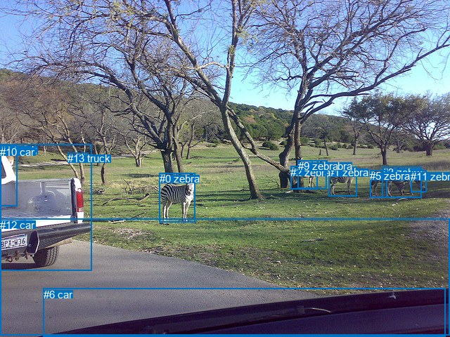
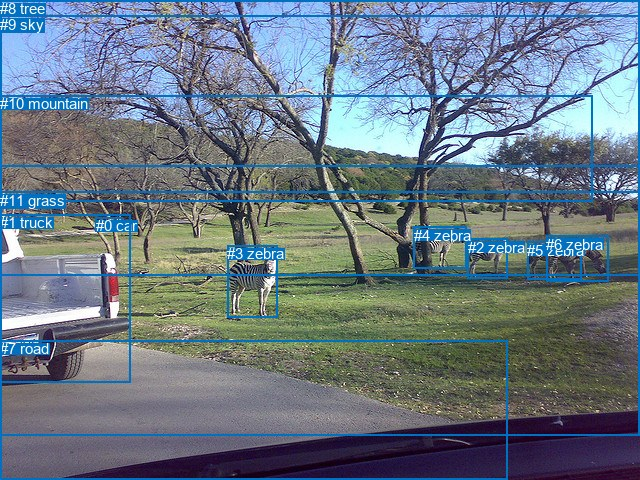

# 图片 0779：2350888.jpg

随机样本序号：159。图片 SHA256：`71e3bcf1f503dbfce4526592bb69c2342d1c020d2532044a71a89fa58f78d471`。

红色框表示人，蓝色框表示其他物体。两个模式分别保留自身框编号，可依据位置比较对应对象。

## 自动检测框与输出

人的框编号：`[]`。状态：`no_person`。

### 自动检测全部物体框

| 编号 | 类别 | 是否为人 | 检测分数 | 像素坐标 xyxy |
|---|---|---|---|---|
| 0 | zebra | False | 0.9994 | 226.8, 246.1, 277.5, 316.7 |
| 1 | zebra | False | 0.9966 | 467.1, 237.3, 507.9, 279.1 |
| 2 | zebra | False | 0.9959 | 413.5, 236.6, 451.4, 269.2 |
| 3 | zebra | False | 0.9918 | 544.0, 237.1, 599.8, 281.2 |
| 4 | truck | False | 0.9680 | 0.1, 205.2, 130.0, 385.3 |
| 5 | zebra | False | 0.9480 | 526.4, 242.0, 550.0, 281.4 |
| 6 | car | False | 0.8942 | 61.7, 410.5, 633.0, 480.0 |
| 7 | zebra | False | 0.8137 | 444.0, 228.4, 465.1, 244.0 |
| 8 | car | False | 0.7856 | 96.6, 217.2, 119.3, 229.3 |
| 9 | zebra | False | 0.5339 | 423.9, 228.2, 464.3, 268.6 |
| 10 | car | False | 0.5170 | 0.0, 207.9, 24.9, 293.6 |
| 11 | zebra | False | 0.4989 | 584.3, 242.8, 606.7, 273.8 |
| 12 | car | False | 0.4188 | 0.0, 311.8, 640.0, 478.0 |
| 13 | truck | False | 0.3826 | 96.5, 217.1, 125.7, 229.4 |

### 自动检测 Top50 人相关候选

评分物体对：0；人相关物体对：0；输出关系：0。

| 排名 | 主语编号与类别 | 关系 | 宾语编号与类别 | 类型 | 人与人 | 排序分数 | 原始融合 logit |
|---|---|---|---|---|---|---|---|

### 自动检测逐条人相关 GT 核验

本图没有人相关 GT，R@50 无分母；预测候选继续展示。

## 真实框与输出

人的框编号：`[]`。

### 真实框全部物体框

| 编号 | 类别 | 是否为人 | 检测分数 | 像素坐标 xyxy |
|---|---|---|---|---|
| 0 | car | False | GT | 96.0, 217.0, 123.0, 229.0 |
| 1 | truck | False | GT | 0.0, 214.0, 130.0, 382.0 |
| 2 | zebra | False | GT | 468.0, 239.0, 507.0, 279.0 |
| 3 | zebra | False | GT | 227.0, 245.0, 277.0, 317.0 |
| 4 | zebra | False | GT | 414.0, 227.0, 467.0, 269.0 |
| 5 | zebra | False | GT | 527.0, 242.0, 581.0, 280.0 |
| 6 | zebra | False | GT | 546.0, 236.0, 608.0, 282.0 |
| 7 | road | False | GT | 0.0, 340.0, 507.0, 480.0 |
| 8 | tree | False | GT | 0.0, 0.0, 640.0, 275.0 |
| 9 | sky | False | GT | 0.0, 16.0, 640.0, 167.0 |
| 10 | mountain | False | GT | 0.0, 95.0, 592.0, 201.0 |
| 11 | grass | False | GT | 0.0, 192.0, 640.0, 435.0 |

### 真实框 Top50 人相关候选

评分物体对：0；人相关物体对：0；输出关系：0。

| 排名 | 主语编号与类别 | 关系 | 宾语编号与类别 | 类型 | 人与人 | 排序分数 | 原始融合 logit |
|---|---|---|---|---|---|---|---|

### 真实框逐条人相关 GT 核验

本图没有人相关 GT，R@50 无分母；预测候选继续展示。

## 全部人相关 GT

| 主语编号与类别 | 关系 | 宾语编号与类别 |
|---|---|---|

原始记录、全部人相关物体对的两项预测与分项分数见 [逐图证据 JSON](../evidence/cases/0779.json)。全部56类 logits 保留于本机 HOR/output/random500/logits/。

<!-- HOR_COMPLETE_RESULTS -->

## 六组条件的完整输出对照

以下保留同一图片三种框与候选模式、两种谓词输出规则的全部 Top50。框编号各自在所属模式内解释。

### 自动检测框完整枚举：空间与语义各保留一个谓词

| 排名 | 主语编号与类别 | 谓词 | 宾语编号与类别 | 分组 | 排序分数 | predicate logit | pair logit |
|---|---|---|---|---|---|---|---|

没有人相关 GT，本条件的召回率无分母。

### 自动检测框完整枚举：每对只保留一个谓词

| 排名 | 主语编号与类别 | 谓词 | 宾语编号与类别 | 分组 | 排序分数 | predicate logit | pair logit |
|---|---|---|---|---|---|---|---|

没有人相关 GT，本条件的召回率无分母。

### 真实框完整枚举：空间与语义各保留一个谓词

| 排名 | 主语编号与类别 | 谓词 | 宾语编号与类别 | 分组 | 排序分数 | predicate logit | pair logit |
|---|---|---|---|---|---|---|---|

没有人相关 GT，本条件的召回率无分母。

### 真实框完整枚举：每对只保留一个谓词

| 排名 | 主语编号与类别 | 谓词 | 宾语编号与类别 | 分组 | 排序分数 | predicate logit | pair logit |
|---|---|---|---|---|---|---|---|

没有人相关 GT，本条件的召回率无分母。

### 真实框400候选：空间与语义各保留一个谓词

| 排名 | 主语编号与类别 | 谓词 | 宾语编号与类别 | 分组 | 排序分数 | predicate logit | pair logit |
|---|---|---|---|---|---|---|---|

没有人相关 GT，本条件的召回率无分母。

### 真实框400候选：每对只保留一个谓词

| 排名 | 主语编号与类别 | 谓词 | 宾语编号与类别 | 分组 | 排序分数 | predicate logit | pair logit |
|---|---|---|---|---|---|---|---|

没有人相关 GT，本条件的召回率无分母。
