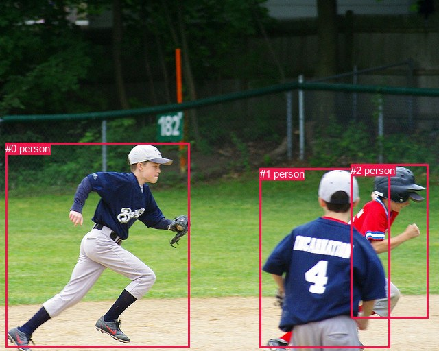
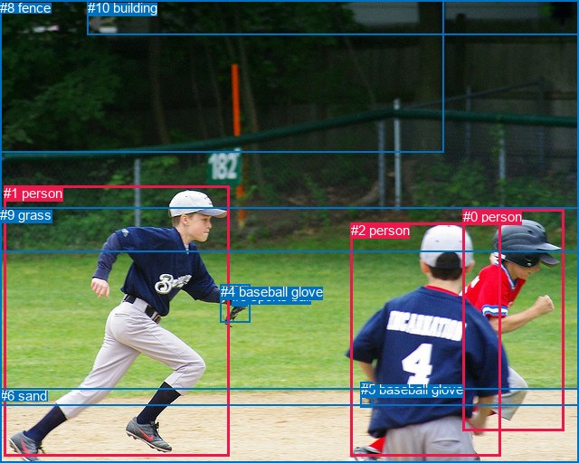

# 图片 0784：2351059.jpg

随机样本序号：449。图片 SHA256：`34d59037b3289cea82204ddd5067a9736a987276fb83839d6dab8d126042d65f`。

红色框表示人，蓝色框表示其他物体。两个模式分别保留自身框编号，可依据位置比较对应对象。

## 自动检测框与输出

人的框编号：`[0, 1, 2]`。状态：`ok`。

### 自动检测全部物体框

| 编号 | 类别 | 是否为人 | 检测分数 | 像素坐标 xyxy |
|---|---|---|---|---|
| 0 | person | True | 0.9999 | 8.1, 208.2, 276.8, 506.5 |
| 1 | person | True | 0.9994 | 378.8, 245.4, 568.9, 507.8 |
| 2 | person | True | 0.9827 | 511.2, 239.6, 624.2, 464.4 |

### 自动检测 Top50 人相关候选

评分物体对：6；人相关物体对：6；输出关系：12。

| 排名 | 主语编号与类别 | 关系 | 宾语编号与类别 | 类型 | 人与人 | 排序分数 | 原始融合 logit |
|---|---|---|---|---|---|---|---|
| 1 | #0 person | running on | #1 person | semantic | True | 0.94835 | 2.9103 |
| 2 | #0 person | running on | #2 person | semantic | True | 0.92691 | 2.5401 |
| 3 | #1 person | running on | #0 person | semantic | True | 0.91866 | 2.4242 |
| 4 | #2 person | beside | #1 person | spatial | True | 0.89905 | 2.1867 |
| 5 | #1 person | in front of | #2 person | spatial | True | 0.89374 | 2.1296 |
| 6 | #2 person | running on | #1 person | semantic | True | 0.89339 | 2.1258 |
| 7 | #1 person | running on | #2 person | semantic | True | 0.88342 | 2.0252 |
| 8 | #2 person | looking at | #0 person | semantic | True | 0.87336 | 1.9310 |
| 9 | #1 person | in front of | #0 person | spatial | True | 0.69749 | 0.8354 |
| 10 | #2 person | beside | #0 person | spatial | True | 0.56656 | 0.2678 |
| 11 | #0 person | beside | #1 person | spatial | True | 0.49890 | -0.0044 |
| 12 | #0 person | in front of | #2 person | spatial | True | 0.46396 | -0.1444 |

### 自动检测逐条人相关 GT 核验

R@50：0.00%；命中 0/5。

| GT 主语编号 | GT 关系 | GT 宾语编号 | 结果阶段 | 匹配预测主语编号 | 匹配预测宾语编号 |
|---|---|---|---|---|---|
| 0 | running on | 6 | endpoint_missing_or_wrong_class | [2] | [] |
| 1 | catching | 3 | endpoint_missing_or_wrong_class | [0] | [] |
| 1 | wearing | 4 | endpoint_missing_or_wrong_class | [0] | [] |
| 1 | running on | 6 | endpoint_missing_or_wrong_class | [0] | [] |
| 2 | looking at | 1 | wrong_predicate | [1] | [0] |

## 真实框与输出

人的框编号：`[0, 1, 2]`。

### 真实框全部物体框

| 编号 | 类别 | 是否为人 | 检测分数 | 像素坐标 xyxy |
|---|---|---|---|---|
| 0 | person | True | GT | 512.0, 231.0, 623.0, 476.0 |
| 1 | person | True | GT | 4.0, 205.0, 253.0, 504.0 |
| 2 | person | True | GT | 388.0, 246.0, 554.0, 504.0 |
| 3 | sports ball | False | GT | 257.0, 319.0, 274.0, 338.0 |
| 4 | baseball glove | False | GT | 244.0, 314.0, 277.0, 356.0 |
| 5 | baseball glove | False | GT | 399.0, 422.0, 412.0, 450.0 |
| 6 | sand | False | GT | 0.0, 429.0, 640.0, 512.0 |
| 7 | tree | False | GT | 0.0, 0.0, 491.0, 168.0 |
| 8 | fence | False | GT | 0.0, 0.0, 640.0, 278.0 |
| 9 | grass | False | GT | 0.0, 229.0, 640.0, 448.0 |
| 10 | building | False | GT | 97.0, 0.0, 640.0, 38.0 |

### 真实框 Top50 人相关候选

评分物体对：110；人相关物体对：54；输出关系：50。

| 排名 | 主语编号与类别 | 关系 | 宾语编号与类别 | 类型 | 人与人 | 排序分数 | 原始融合 logit |
|---|---|---|---|---|---|---|---|
| 1 | #2 person | wearing | #5 baseball glove | semantic | False | 0.98206 | 4.0028 |
| 2 | #1 person | on | #6 sand | spatial | False | 0.96321 | 3.2651 |
| 3 | #2 person | standing on | #6 sand | semantic | False | 0.95130 | 2.9723 |
| 4 | #2 person | on | #6 sand | spatial | False | 0.94730 | 2.8889 |
| 5 | #1 person | running on | #9 grass | semantic | False | 0.94613 | 2.8658 |
| 6 | #0 person | on | #6 sand | spatial | False | 0.94395 | 2.8239 |
| 7 | #0 person | standing on | #6 sand | semantic | False | 0.94081 | 2.7660 |
| 8 | #1 person | in | #9 grass | spatial | False | 0.93881 | 2.7306 |
| 9 | #1 person | holding | #4 baseball glove | semantic | False | 0.93875 | 2.7297 |
| 10 | #0 person | in | #9 grass | spatial | False | 0.93448 | 2.6577 |
| 11 | #1 person | running on | #6 sand | semantic | False | 0.90725 | 2.2805 |
| 12 | #2 person | in | #9 grass | spatial | False | 0.87233 | 1.9217 |
| 13 | #2 person | looking at | #1 person | semantic | True | 0.86962 | 1.8976 |
| 14 | #0 person | looking at | #1 person | semantic | True | 0.86779 | 1.8816 |
| 15 | #1 person | talking to | #2 person | semantic | True | 0.81607 | 1.4900 |
| 16 | #5 baseball glove | on | #2 person | spatial | False | 0.81158 | 1.4603 |
| 17 | #1 person | throwing | #3 sports ball | semantic | False | 0.80442 | 1.4141 |
| 18 | #2 person | in | #5 baseball glove | spatial | False | 0.79449 | 1.3522 |
| 19 | #0 person | standing on | #9 grass | semantic | False | 0.74940 | 1.0954 |
| 20 | #9 grass | beside | #1 person | spatial | False | 0.74510 | 1.0726 |
| 21 | #1 person | playing | #0 person | semantic | True | 0.74448 | 1.0694 |
| 22 | #2 person | talking to | #0 person | semantic | True | 0.71703 | 0.9298 |
| 23 | #2 person | standing on | #9 grass | semantic | False | 0.65476 | 0.6400 |
| 24 | #0 person | talking to | #2 person | semantic | True | 0.63548 | 0.5558 |
| 25 | #2 person | beside | #0 person | spatial | True | 0.60432 | 0.4235 |
| 26 | #1 person | on | #4 baseball glove | spatial | False | 0.57906 | 0.3189 |
| 27 | #0 person | beside | #2 person | spatial | True | 0.43966 | -0.2425 |
| 28 | #8 fence | beside | #1 person | spatial | False | 0.41025 | -0.3630 |
| 29 | #1 person | beside | #2 person | spatial | True | 0.31348 | -0.7839 |
| 30 | #4 baseball glove | on | #1 person | spatial | False | 0.27897 | -0.9496 |
| 31 | #1 person | in | #8 fence | spatial | False | 0.27704 | -0.9592 |
| 32 | #2 person | in | #1 person | spatial | True | 0.27368 | -0.9760 |
| 33 | #1 person | playing | #8 fence | semantic | False | 0.24096 | -1.1474 |
| 34 | #1 person | on | #3 sports ball | spatial | False | 0.21665 | -1.2853 |
| 35 | #9 grass | looking at | #1 person | semantic | False | 0.20718 | -1.3420 |
| 36 | #0 person | beside | #1 person | spatial | True | 0.19720 | -1.4039 |
| 37 | #6 sand | in | #1 person | spatial | False | 0.19676 | -1.4067 |
| 38 | #3 sports ball | on | #1 person | spatial | False | 0.17295 | -1.5649 |
| 39 | #1 person | in | #0 person | spatial | True | 0.16902 | -1.5926 |
| 40 | #5 baseball glove | wearing | #2 person | semantic | False | 0.16728 | -1.6051 |
| 41 | #7 tree | beside | #1 person | spatial | False | 0.16494 | -1.6219 |
| 42 | #8 fence | looking at | #1 person | semantic | False | 0.15611 | -1.6875 |
| 43 | #2 person | holding | #4 baseball glove | semantic | False | 0.14196 | -1.7991 |
| 44 | #6 sand | holding | #1 person | semantic | False | 0.12766 | -1.9219 |
| 45 | #6 sand | beside | #2 person | spatial | False | 0.12493 | -1.9465 |
| 46 | #2 person | holding | #3 sports ball | semantic | False | 0.11711 | -2.0201 |
| 47 | #9 grass | beside | #2 person | spatial | False | 0.11514 | -2.0392 |
| 48 | #0 person | in | #8 fence | spatial | False | 0.10901 | -2.1009 |
| 49 | #0 person | holding | #4 baseball glove | semantic | False | 0.10292 | -2.1652 |
| 50 | #9 grass | beside | #0 person | spatial | False | 0.08880 | -2.3284 |

### 真实框逐条人相关 GT 核验

R@50：40.00%；命中 2/5。

| GT 主语编号 | GT 关系 | GT 宾语编号 | 结果阶段 | 匹配预测主语编号 | 匹配预测宾语编号 |
|---|---|---|---|---|---|
| 0 | running on | 6 | wrong_predicate | [0] | [6] |
| 1 | catching | 3 | wrong_predicate | [1] | [3] |
| 1 | wearing | 4 | wrong_predicate | [1] | [4] |
| 1 | running on | 6 | hit50 | [1] | [6] |
| 2 | looking at | 1 | hit50 | [2] | [1] |

## 全部人相关 GT

| 主语编号与类别 | 关系 | 宾语编号与类别 |
|---|---|---|
| #0 person | running on | #6 sand |
| #1 person | catching | #3 sports ball |
| #1 person | wearing | #4 baseball glove |
| #1 person | running on | #6 sand |
| #2 person | looking at | #1 person |

原始记录、全部人相关物体对的两项预测与分项分数见 [逐图证据 JSON](../evidence/cases/0784.json)。全部56类 logits 保留于本机 HOR/output/random500/logits/。

<!-- HOR_COMPLETE_RESULTS -->

## 六组条件的完整输出对照

以下保留同一图片三种框与候选模式、两种谓词输出规则的全部 Top50。框编号各自在所属模式内解释。

### 自动检测框完整枚举：空间与语义各保留一个谓词

| 排名 | 主语编号与类别 | 谓词 | 宾语编号与类别 | 分组 | 排序分数 | predicate logit | pair logit |
|---|---|---|---|---|---|---|---|
| 1 | #0 person | running on | #1 person | semantic | 0.9483541 | 3.8597016 | -0.9493849 |
| 2 | #0 person | running on | #2 person | semantic | 0.9269071 | 3.6451030 | -1.1049808 |
| 3 | #1 person | running on | #0 person | semantic | 0.9186574 | 3.0009537 | -0.5767096 |
| 4 | #2 person | beside | #1 person | spatial | 0.8990508 | 3.0440164 | -0.8572946 |
| 5 | #1 person | in front of | #2 person | spatial | 0.8937447 | 2.8837395 | -0.7541646 |
| 6 | #2 person | running on | #1 person | semantic | 0.8933858 | 2.9830956 | -0.8572946 |
| 7 | #1 person | running on | #2 person | semantic | 0.8834224 | 2.7794108 | -0.7541646 |
| 8 | #2 person | looking at | #0 person | semantic | 0.8733612 | 2.6398139 | -0.7088040 |
| 9 | #1 person | in front of | #0 person | spatial | 0.6974950 | 1.4121070 | -0.5767096 |
| 10 | #2 person | beside | #0 person | spatial | 0.5665579 | 0.9766250 | -0.7088040 |
| 11 | #0 person | beside | #1 person | spatial | 0.4989041 | 0.9450016 | -0.9493849 |
| 12 | #0 person | in front of | #2 person | spatial | 0.4639637 | 0.9605851 | -1.1049808 |

GT 命中：0/5，R@50=0.00%。

| GT主语 | GT谓词 | GT宾语 | 结果阶段 | 匹配主语框 | 匹配宾语框 |
|---|---|---|---|---|---|
| 0 | running on | 6 | endpoint_missing_or_wrong_class | [2] | [] |
| 1 | catching | 3 | endpoint_missing_or_wrong_class | [0] | [] |
| 1 | wearing | 4 | endpoint_missing_or_wrong_class | [0] | [] |
| 1 | running on | 6 | endpoint_missing_or_wrong_class | [0] | [] |
| 2 | looking at | 1 | wrong_predicate | [1] | [0] |

### 自动检测框完整枚举：每对只保留一个谓词

| 排名 | 主语编号与类别 | 谓词 | 宾语编号与类别 | 分组 | 排序分数 | predicate logit | pair logit |
|---|---|---|---|---|---|---|---|
| 1 | #0 person | running on | #1 person | single | 0.9483541 | 3.8597016 | -0.9493849 |
| 2 | #0 person | running on | #2 person | single | 0.9269071 | 3.6451030 | -1.1049808 |
| 3 | #1 person | running on | #0 person | single | 0.9186574 | 3.0009537 | -0.5767096 |
| 4 | #2 person | beside | #1 person | single | 0.8990508 | 3.0440164 | -0.8572946 |
| 5 | #1 person | in front of | #2 person | single | 0.8937447 | 2.8837395 | -0.7541646 |
| 6 | #2 person | looking at | #0 person | single | 0.8733612 | 2.6398139 | -0.7088040 |

GT 命中：0/5，R@50=0.00%。

| GT主语 | GT谓词 | GT宾语 | 结果阶段 | 匹配主语框 | 匹配宾语框 |
|---|---|---|---|---|---|
| 0 | running on | 6 | endpoint_missing_or_wrong_class | [2] | [] |
| 1 | catching | 3 | endpoint_missing_or_wrong_class | [0] | [] |
| 1 | wearing | 4 | endpoint_missing_or_wrong_class | [0] | [] |
| 1 | running on | 6 | endpoint_missing_or_wrong_class | [0] | [] |
| 2 | looking at | 1 | wrong_predicate | [1] | [0] |

### 真实框完整枚举：空间与语义各保留一个谓词

| 排名 | 主语编号与类别 | 谓词 | 宾语编号与类别 | 分组 | 排序分数 | predicate logit | pair logit |
|---|---|---|---|---|---|---|---|
| 1 | #2 person | wearing | #5 baseball glove | semantic | 0.9820628 | 3.9961057 | 0.0066719 |
| 2 | #1 person | on | #6 sand | spatial | 0.9632108 | 3.4253449 | -0.1602763 |
| 3 | #2 person | standing on | #6 sand | semantic | 0.9513050 | 3.1641884 | -0.1919314 |
| 4 | #2 person | on | #6 sand | spatial | 0.9472970 | 3.0808735 | -0.1919314 |
| 5 | #1 person | running on | #9 grass | semantic | 0.9461274 | 3.1821752 | -0.3164190 |
| 6 | #0 person | on | #6 sand | spatial | 0.9439524 | 3.1559429 | -0.3320668 |
| 7 | #0 person | standing on | #6 sand | semantic | 0.9408120 | 3.0980911 | -0.3320668 |
| 8 | #1 person | in | #9 grass | spatial | 0.9388087 | 3.0470257 | -0.3164190 |
| 9 | #1 person | holding | #4 baseball glove | semantic | 0.9387547 | 3.0017195 | -0.2720521 |
| 10 | #0 person | in | #9 grass | spatial | 0.9344850 | 3.0664930 | -0.4087774 |
| 11 | #1 person | running on | #6 sand | semantic | 0.9072525 | 2.4408164 | -0.1602763 |
| 12 | #2 person | in | #9 grass | spatial | 0.8723265 | 2.4834876 | -0.5618001 |
| 13 | #2 person | looking at | #1 person | semantic | 0.8696203 | 2.5403671 | -0.6427609 |
| 14 | #0 person | looking at | #1 person | semantic | 0.8677906 | 2.6166959 | -0.7351326 |
| 15 | #1 person | talking to | #2 person | semantic | 0.8160740 | 2.4769611 | -0.9869897 |
| 16 | #5 baseball glove | on | #2 person | spatial | 0.8115767 | 2.0852847 | -0.6249974 |
| 17 | #1 person | throwing | #3 sports ball | semantic | 0.8044157 | 1.6611781 | -0.2470534 |
| 18 | #2 person | in | #5 baseball glove | spatial | 0.7944885 | 1.3455248 | 0.0066719 |
| 19 | #0 person | standing on | #9 grass | semantic | 0.7493955 | 1.5041685 | -0.4087774 |
| 20 | #9 grass | beside | #1 person | spatial | 0.7450967 | 1.8506007 | -0.7779708 |
| 21 | #1 person | playing | #0 person | semantic | 0.7444810 | 2.1856618 | -1.1162715 |
| 22 | #2 person | talking to | #0 person | semantic | 0.7170270 | 1.6988406 | -0.7690787 |
| 23 | #2 person | standing on | #9 grass | semantic | 0.6547595 | 1.2018266 | -0.5618001 |
| 24 | #0 person | talking to | #2 person | semantic | 0.6354807 | 1.3604593 | -0.8046573 |
| 25 | #2 person | beside | #0 person | spatial | 0.6043217 | 1.1925840 | -0.7690787 |
| 26 | #1 person | on | #4 baseball glove | spatial | 0.5790620 | 0.5909762 | -0.2720521 |
| 27 | #0 person | beside | #2 person | spatial | 0.4396595 | 0.5621133 | -0.8046573 |
| 28 | #8 fence | beside | #1 person | spatial | 0.4102452 | -0.0691090 | -0.2938429 |
| 29 | #1 person | beside | #2 person | spatial | 0.3134822 | 0.2031002 | -0.9869897 |
| 30 | #4 baseball glove | on | #1 person | spatial | 0.2789748 | -0.1988111 | -0.7507417 |
| 31 | #1 person | in | #8 fence | spatial | 0.2770383 | 0.0385485 | -0.9977489 |
| 32 | #2 person | in | #1 person | spatial | 0.2736798 | -0.3332715 | -0.6427609 |
| 33 | #1 person | playing | #8 fence | semantic | 0.2409555 | -0.1496992 | -0.9977489 |
| 34 | #1 person | on | #3 sports ball | spatial | 0.2166460 | -1.0382664 | -0.2470534 |
| 35 | #9 grass | looking at | #1 person | semantic | 0.2071827 | -0.5640211 | -0.7779708 |
| 36 | #0 person | beside | #1 person | spatial | 0.1972028 | -0.6687369 | -0.7351326 |
| 37 | #6 sand | in | #1 person | spatial | 0.1967616 | -0.5444770 | -0.8621818 |
| 38 | #3 sports ball | on | #1 person | spatial | 0.1729503 | -0.8245587 | -0.7403021 |
| 39 | #1 person | in | #0 person | spatial | 0.1690194 | -0.4763212 | -1.1162715 |
| 40 | #5 baseball glove | wearing | #2 person | semantic | 0.1672763 | -0.9800577 | -0.6249974 |
| 41 | #7 tree | beside | #1 person | spatial | 0.1649409 | -1.2016511 | -0.4202645 |
| 42 | #8 fence | looking at | #1 person | semantic | 0.1561095 | -1.3936222 | -0.2938429 |
| 43 | #2 person | holding | #4 baseball glove | semantic | 0.1419644 | -0.8052874 | -0.9937817 |
| 44 | #6 sand | holding | #1 person | semantic | 0.1276551 | -1.0596709 | -0.8621818 |
| 45 | #6 sand | beside | #2 person | spatial | 0.1249339 | -1.0045111 | -0.9420031 |
| 46 | #2 person | holding | #3 sports ball | semantic | 0.1171093 | -1.0725856 | -0.9475077 |
| 47 | #9 grass | beside | #2 person | spatial | 0.1151437 | -1.0047424 | -1.0345021 |
| 48 | #0 person | in | #8 fence | spatial | 0.1090126 | -1.0583353 | -1.0425313 |
| 49 | #0 person | holding | #4 baseball glove | semantic | 0.1029213 | -1.0133314 | -1.1518476 |
| 50 | #9 grass | beside | #0 person | spatial | 0.0887980 | -1.1859260 | -1.1424745 |

GT 命中：2/5，R@50=40.00%。

| GT主语 | GT谓词 | GT宾语 | 结果阶段 | 匹配主语框 | 匹配宾语框 |
|---|---|---|---|---|---|
| 0 | running on | 6 | wrong_predicate | [0] | [6] |
| 1 | catching | 3 | wrong_predicate | [1] | [3] |
| 1 | wearing | 4 | wrong_predicate | [1] | [4] |
| 1 | running on | 6 | hit50 | [1] | [6] |
| 2 | looking at | 1 | hit50 | [2] | [1] |

### 真实框完整枚举：每对只保留一个谓词

| 排名 | 主语编号与类别 | 谓词 | 宾语编号与类别 | 分组 | 排序分数 | predicate logit | pair logit |
|---|---|---|---|---|---|---|---|
| 1 | #2 person | wearing | #5 baseball glove | single | 0.9820628 | 3.9961057 | 0.0066719 |
| 2 | #1 person | on | #6 sand | single | 0.9632108 | 3.4253449 | -0.1602763 |
| 3 | #2 person | standing on | #6 sand | single | 0.9513050 | 3.1641884 | -0.1919314 |
| 4 | #1 person | running on | #9 grass | single | 0.9461274 | 3.1821752 | -0.3164190 |
| 5 | #0 person | on | #6 sand | single | 0.9439524 | 3.1559429 | -0.3320668 |
| 6 | #1 person | holding | #4 baseball glove | single | 0.9387547 | 3.0017195 | -0.2720521 |
| 7 | #0 person | in | #9 grass | single | 0.9344850 | 3.0664930 | -0.4087774 |
| 8 | #2 person | in | #9 grass | single | 0.8723265 | 2.4834876 | -0.5618001 |
| 9 | #2 person | looking at | #1 person | single | 0.8696203 | 2.5403671 | -0.6427609 |
| 10 | #0 person | looking at | #1 person | single | 0.8677906 | 2.6166959 | -0.7351326 |
| 11 | #1 person | talking to | #2 person | single | 0.8160740 | 2.4769611 | -0.9869897 |
| 12 | #5 baseball glove | on | #2 person | single | 0.8115767 | 2.0852847 | -0.6249974 |
| 13 | #1 person | throwing | #3 sports ball | single | 0.8044157 | 1.6611781 | -0.2470534 |
| 14 | #9 grass | beside | #1 person | single | 0.7450967 | 1.8506007 | -0.7779708 |
| 15 | #1 person | playing | #0 person | single | 0.7444810 | 2.1856618 | -1.1162715 |
| 16 | #2 person | talking to | #0 person | single | 0.7170270 | 1.6988406 | -0.7690787 |
| 17 | #0 person | talking to | #2 person | single | 0.6354807 | 1.3604593 | -0.8046573 |
| 18 | #8 fence | beside | #1 person | single | 0.4102452 | -0.0691090 | -0.2938429 |
| 19 | #4 baseball glove | on | #1 person | single | 0.2789748 | -0.1988111 | -0.7507417 |
| 20 | #1 person | in | #8 fence | single | 0.2770383 | 0.0385485 | -0.9977489 |
| 21 | #6 sand | in | #1 person | single | 0.1967616 | -0.5444770 | -0.8621818 |
| 22 | #3 sports ball | on | #1 person | single | 0.1729503 | -0.8245587 | -0.7403021 |
| 23 | #7 tree | beside | #1 person | single | 0.1649409 | -1.2016511 | -0.4202645 |
| 24 | #2 person | holding | #4 baseball glove | single | 0.1419644 | -0.8052874 | -0.9937817 |
| 25 | #6 sand | beside | #2 person | single | 0.1249339 | -1.0045111 | -0.9420031 |
| 26 | #2 person | holding | #3 sports ball | single | 0.1171093 | -1.0725856 | -0.9475077 |
| 27 | #9 grass | beside | #2 person | single | 0.1151437 | -1.0047424 | -1.0345021 |
| 28 | #0 person | in | #8 fence | single | 0.1090126 | -1.0583353 | -1.0425313 |
| 29 | #0 person | holding | #4 baseball glove | single | 0.1029213 | -1.0133314 | -1.1518476 |
| 30 | #9 grass | beside | #0 person | single | 0.0887980 | -1.1859260 | -1.1424745 |
| 31 | #0 person | holding | #5 baseball glove | single | 0.0861247 | -1.7720823 | -0.5898161 |
| 32 | #0 person | holding | #3 sports ball | single | 0.0846464 | -1.2557082 | -1.1251203 |
| 33 | #1 person | playing | #10 building | single | 0.0819874 | -1.2408500 | -1.1747950 |
| 34 | #1 person | in | #7 tree | single | 0.0764981 | -1.3368461 | -1.1540604 |
| 35 | #6 sand | in | #0 person | single | 0.0730933 | -1.3425527 | -1.1975631 |
| 36 | #1 person | wearing | #5 baseball glove | single | 0.0639005 | -1.5277364 | -1.1566579 |
| 37 | #5 baseball glove | on | #0 person | single | 0.0581494 | -1.5373542 | -1.2474772 |
| 38 | #8 fence | beside | #0 person | single | 0.0553698 | -1.9551864 | -0.8815732 |
| 39 | #8 fence | beside | #2 person | single | 0.0518066 | -1.9995425 | -0.9074989 |
| 40 | #5 baseball glove | on | #1 person | single | 0.0514341 | -1.7579224 | -1.1567280 |
| 41 | #2 person | in front of | #8 fence | single | 0.0466295 | -1.6865256 | -1.3312440 |
| 42 | #3 sports ball | on | #2 person | single | 0.0371989 | -1.9886649 | -1.2649019 |
| 43 | #3 sports ball | on | #0 person | single | 0.0279000 | -2.1090555 | -1.4417763 |
| 44 | #4 baseball glove | on | #2 person | single | 0.0236658 | -2.4284599 | -1.2913138 |
| 45 | #4 baseball glove | on | #0 person | single | 0.0232477 | -2.2713714 | -1.4666567 |
| 46 | #2 person | looking at | #10 building | single | 0.0167210 | -2.4045880 | -1.6696392 |
| 47 | #0 person | looking at | #10 building | single | 0.0141683 | -2.5746658 | -1.6678102 |
| 48 | #10 building | over | #1 person | single | 0.0128115 | -3.3363304 | -1.0081871 |
| 49 | #0 person | in | #7 tree | single | 0.0120615 | -2.7749729 | -1.6306323 |
| 50 | #7 tree | beside | #0 person | single | 0.0112152 | -3.3629677 | -1.1162403 |

GT 命中：1/5，R@50=20.00%。

| GT主语 | GT谓词 | GT宾语 | 结果阶段 | 匹配主语框 | 匹配宾语框 |
|---|---|---|---|---|---|
| 0 | running on | 6 | wrong_predicate | [0] | [6] |
| 1 | catching | 3 | wrong_predicate | [1] | [3] |
| 1 | wearing | 4 | wrong_predicate | [1] | [4] |
| 1 | running on | 6 | wrong_predicate | [1] | [6] |
| 2 | looking at | 1 | hit50 | [2] | [1] |

### 真实框400候选：空间与语义各保留一个谓词

| 排名 | 主语编号与类别 | 谓词 | 宾语编号与类别 | 分组 | 排序分数 | predicate logit | pair logit |
|---|---|---|---|---|---|---|---|
| 1 | #2 person | wearing | #5 baseball glove | semantic | 0.9820628 | 3.9961057 | 0.0066719 |
| 2 | #1 person | on | #6 sand | spatial | 0.9632108 | 3.4253449 | -0.1602763 |
| 3 | #2 person | standing on | #6 sand | semantic | 0.9491537 | 3.1186953 | -0.1919314 |
| 4 | #1 person | running on | #9 grass | semantic | 0.9461274 | 3.1821752 | -0.3164190 |
| 5 | #2 person | on | #6 sand | spatial | 0.9453465 | 3.0424709 | -0.1919314 |
| 6 | #0 person | on | #6 sand | spatial | 0.9439524 | 3.1559429 | -0.3320668 |
| 7 | #0 person | standing on | #6 sand | semantic | 0.9408120 | 3.0980911 | -0.3320668 |
| 8 | #1 person | in | #9 grass | spatial | 0.9388087 | 3.0470257 | -0.3164190 |
| 9 | #1 person | holding | #4 baseball glove | semantic | 0.9387547 | 3.0017195 | -0.2720521 |
| 10 | #0 person | in | #9 grass | spatial | 0.9344850 | 3.0664930 | -0.4087774 |
| 11 | #1 person | running on | #6 sand | semantic | 0.9046893 | 2.4107251 | -0.1602763 |
| 12 | #2 person | in | #9 grass | spatial | 0.8719564 | 2.4801688 | -0.5618001 |
| 13 | #2 person | looking at | #1 person | semantic | 0.8695413 | 2.5396695 | -0.6427609 |
| 14 | #0 person | looking at | #1 person | semantic | 0.8677906 | 2.6166959 | -0.7351326 |
| 15 | #1 person | talking to | #2 person | semantic | 0.8160740 | 2.4769611 | -0.9869897 |
| 16 | #5 baseball glove | on | #2 person | spatial | 0.8107426 | 2.0798402 | -0.6249974 |
| 17 | #2 person | in | #5 baseball glove | spatial | 0.7982916 | 1.3689785 | 0.0066719 |
| 18 | #1 person | throwing | #3 sports ball | semantic | 0.7948149 | 1.6012502 | -0.2470534 |
| 19 | #1 person | playing | #0 person | semantic | 0.7444810 | 2.1856618 | -1.1162715 |
| 20 | #0 person | standing on | #9 grass | semantic | 0.7437021 | 1.4740772 | -0.4087774 |
| 21 | #9 grass | beside | #1 person | spatial | 0.7335328 | 1.7905917 | -0.7779708 |
| 22 | #2 person | talking to | #0 person | semantic | 0.7170270 | 1.6988406 | -0.7690787 |
| 23 | #2 person | standing on | #9 grass | semantic | 0.6547595 | 1.2018266 | -0.5618001 |
| 24 | #0 person | talking to | #2 person | semantic | 0.6285405 | 1.3306179 | -0.8046573 |
| 25 | #2 person | beside | #0 person | spatial | 0.5971181 | 1.1625504 | -0.7690787 |
| 26 | #1 person | on | #4 baseball glove | spatial | 0.5790620 | 0.5909762 | -0.2720521 |
| 27 | #0 person | beside | #2 person | spatial | 0.4396595 | 0.5621133 | -0.8046573 |
| 28 | #8 fence | beside | #1 person | spatial | 0.4102592 | -0.0690508 | -0.2938429 |
| 29 | #1 person | beside | #2 person | spatial | 0.3134822 | 0.2031002 | -0.9869897 |
| 30 | #4 baseball glove | on | #1 person | spatial | 0.2778808 | -0.2042561 | -0.7507417 |
| 31 | #1 person | in | #8 fence | spatial | 0.2770383 | 0.0385485 | -0.9977489 |
| 32 | #2 person | in | #1 person | spatial | 0.2736798 | -0.3332715 | -0.6427609 |
| 33 | #1 person | playing | #8 fence | semantic | 0.2368064 | -0.1725202 | -0.9977489 |
| 34 | #1 person | on | #3 sports ball | spatial | 0.2166460 | -1.0382664 | -0.2470534 |
| 35 | #9 grass | looking at | #1 person | semantic | 0.2022836 | -0.5941119 | -0.7779708 |
| 36 | #0 person | beside | #1 person | spatial | 0.1972120 | -0.6686788 | -0.7351326 |
| 37 | #6 sand | in | #1 person | spatial | 0.1967616 | -0.5444770 | -0.8621818 |
| 38 | #3 sports ball | on | #1 person | spatial | 0.1679261 | -0.8600948 | -0.7403021 |
| 39 | #7 tree | beside | #1 person | spatial | 0.1670297 | -1.1865621 | -0.4202645 |
| 40 | #1 person | in | #0 person | spatial | 0.1662103 | -0.4964561 | -1.1162715 |
| 41 | #5 baseball glove | wearing | #2 person | semantic | 0.1655960 | -0.9921691 | -0.6249974 |
| 42 | #8 fence | looking at | #1 person | semantic | 0.1561095 | -1.3936222 | -0.2938429 |
| 43 | #2 person | holding | #4 baseball glove | semantic | 0.1418744 | -0.8060262 | -0.9937817 |
| 44 | #6 sand | holding | #1 person | semantic | 0.1278197 | -1.0581937 | -0.8621818 |
| 45 | #6 sand | beside | #2 person | spatial | 0.1216904 | -1.0345156 | -0.9420031 |
| 46 | #2 person | holding | #3 sports ball | semantic | 0.1168042 | -1.0755401 | -0.9475077 |
| 47 | #9 grass | beside | #2 person | spatial | 0.1151437 | -1.0047424 | -1.0345021 |
| 48 | #0 person | in | #8 fence | spatial | 0.1090126 | -1.0583353 | -1.0425313 |
| 49 | #0 person | holding | #4 baseball glove | semantic | 0.1006430 | -1.0382528 | -1.1518476 |
| 50 | #9 grass | beside | #0 person | spatial | 0.0888003 | -1.1858971 | -1.1424745 |

GT 命中：2/5，R@50=40.00%。

| GT主语 | GT谓词 | GT宾语 | 结果阶段 | 匹配主语框 | 匹配宾语框 |
|---|---|---|---|---|---|
| 0 | running on | 6 | wrong_predicate | [0] | [6] |
| 1 | catching | 3 | wrong_predicate | [1] | [3] |
| 1 | wearing | 4 | wrong_predicate | [1] | [4] |
| 1 | running on | 6 | hit50 | [1] | [6] |
| 2 | looking at | 1 | hit50 | [2] | [1] |

### 真实框400候选：每对只保留一个谓词

| 排名 | 主语编号与类别 | 谓词 | 宾语编号与类别 | 分组 | 排序分数 | predicate logit | pair logit |
|---|---|---|---|---|---|---|---|
| 1 | #2 person | wearing | #5 baseball glove | single | 0.9820628 | 3.9961057 | 0.0066719 |
| 2 | #1 person | on | #6 sand | single | 0.9632108 | 3.4253449 | -0.1602763 |
| 3 | #2 person | standing on | #6 sand | single | 0.9491537 | 3.1186953 | -0.1919314 |
| 4 | #1 person | running on | #9 grass | single | 0.9461274 | 3.1821752 | -0.3164190 |
| 5 | #0 person | on | #6 sand | single | 0.9439524 | 3.1559429 | -0.3320668 |
| 6 | #1 person | holding | #4 baseball glove | single | 0.9387547 | 3.0017195 | -0.2720521 |
| 7 | #0 person | in | #9 grass | single | 0.9344850 | 3.0664930 | -0.4087774 |
| 8 | #2 person | in | #9 grass | single | 0.8719564 | 2.4801688 | -0.5618001 |
| 9 | #2 person | looking at | #1 person | single | 0.8695413 | 2.5396695 | -0.6427609 |
| 10 | #0 person | looking at | #1 person | single | 0.8677906 | 2.6166959 | -0.7351326 |
| 11 | #1 person | talking to | #2 person | single | 0.8160740 | 2.4769611 | -0.9869897 |
| 12 | #5 baseball glove | on | #2 person | single | 0.8107426 | 2.0798402 | -0.6249974 |
| 13 | #1 person | throwing | #3 sports ball | single | 0.7948149 | 1.6012502 | -0.2470534 |
| 14 | #1 person | playing | #0 person | single | 0.7444810 | 2.1856618 | -1.1162715 |
| 15 | #9 grass | beside | #1 person | single | 0.7335328 | 1.7905917 | -0.7779708 |
| 16 | #2 person | talking to | #0 person | single | 0.7170270 | 1.6988406 | -0.7690787 |
| 17 | #0 person | talking to | #2 person | single | 0.6285405 | 1.3306179 | -0.8046573 |
| 18 | #8 fence | beside | #1 person | single | 0.4102592 | -0.0690508 | -0.2938429 |
| 19 | #4 baseball glove | on | #1 person | single | 0.2778808 | -0.2042561 | -0.7507417 |
| 20 | #1 person | in | #8 fence | single | 0.2770383 | 0.0385485 | -0.9977489 |
| 21 | #6 sand | in | #1 person | single | 0.1967616 | -0.5444770 | -0.8621818 |
| 22 | #3 sports ball | on | #1 person | single | 0.1679261 | -0.8600948 | -0.7403021 |
| 23 | #7 tree | beside | #1 person | single | 0.1670297 | -1.1865621 | -0.4202645 |
| 24 | #2 person | holding | #4 baseball glove | single | 0.1418744 | -0.8060262 | -0.9937817 |
| 25 | #6 sand | beside | #2 person | single | 0.1216904 | -1.0345156 | -0.9420031 |
| 26 | #2 person | holding | #3 sports ball | single | 0.1168042 | -1.0755401 | -0.9475077 |
| 27 | #9 grass | beside | #2 person | single | 0.1151437 | -1.0047424 | -1.0345021 |
| 28 | #0 person | in | #8 fence | single | 0.1090126 | -1.0583353 | -1.0425313 |
| 29 | #0 person | holding | #4 baseball glove | single | 0.1006430 | -1.0382528 | -1.1518476 |
| 30 | #9 grass | beside | #0 person | single | 0.0888003 | -1.1858971 | -1.1424745 |
| 31 | #0 person | holding | #3 sports ball | single | 0.0843037 | -1.2601395 | -1.1251203 |
| 32 | #0 person | holding | #5 baseball glove | single | 0.0840552 | -1.7986658 | -0.5898161 |
| 33 | #1 person | playing | #10 building | single | 0.0819874 | -1.2408500 | -1.1747950 |
| 34 | #1 person | in | #7 tree | single | 0.0762640 | -1.3401647 | -1.1540604 |
| 35 | #6 sand | in | #0 person | single | 0.0729810 | -1.3442121 | -1.1975631 |
| 36 | #1 person | wearing | #5 baseball glove | single | 0.0623809 | -1.5534265 | -1.1566579 |
| 37 | #5 baseball glove | on | #0 person | single | 0.0578426 | -1.5429692 | -1.2474772 |
| 38 | #8 fence | beside | #0 person | single | 0.0545886 | -1.9702210 | -0.8815732 |
| 39 | #8 fence | beside | #2 person | single | 0.0518096 | -1.9994819 | -0.9074989 |
| 40 | #5 baseball glove | on | #1 person | single | 0.0503713 | -1.7799208 | -1.1567280 |
| 41 | #2 person | in front of | #8 fence | single | 0.0459921 | -1.7009587 | -1.3312440 |
| 42 | #3 sports ball | on | #2 person | single | 0.0370044 | -1.9941099 | -1.2649019 |
| 43 | #3 sports ball | on | #0 person | single | 0.0272663 | -2.1326809 | -1.4417763 |
| 44 | #4 baseball glove | on | #2 person | single | 0.0233206 | -2.4435055 | -1.2913138 |
| 45 | #4 baseball glove | on | #0 person | single | 0.0229558 | -2.2843029 | -1.4666567 |
| 46 | #2 person | looking at | #10 building | single | 0.0164726 | -2.4198079 | -1.6696392 |
| 47 | #0 person | looking at | #10 building | single | 0.0141671 | -2.5747530 | -1.6678102 |
| 48 | #10 building | over | #1 person | single | 0.0128115 | -3.3363304 | -1.0081871 |
| 49 | #0 person | in | #7 tree | single | 0.0119030 | -2.7883592 | -1.6306323 |
| 50 | #7 tree | beside | #0 person | single | 0.0110502 | -3.3779554 | -1.1162403 |

GT 命中：1/5，R@50=20.00%。

| GT主语 | GT谓词 | GT宾语 | 结果阶段 | 匹配主语框 | 匹配宾语框 |
|---|---|---|---|---|---|
| 0 | running on | 6 | wrong_predicate | [0] | [6] |
| 1 | catching | 3 | wrong_predicate | [1] | [3] |
| 1 | wearing | 4 | wrong_predicate | [1] | [4] |
| 1 | running on | 6 | wrong_predicate | [1] | [6] |
| 2 | looking at | 1 | hit50 | [2] | [1] |
