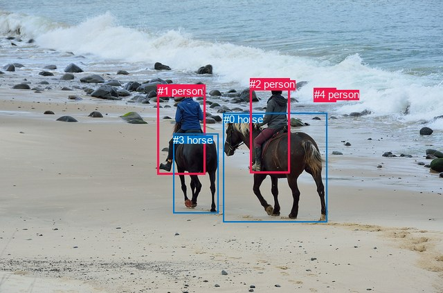
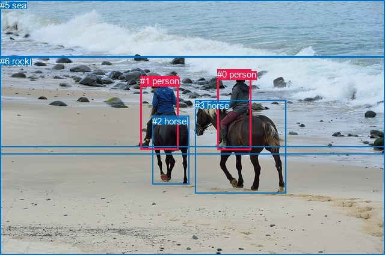

# 图片 0787：2351136.jpg

随机样本序号：126。图片 SHA256：`cbf50318249d78406eeee4f1e91693acc0f8e05dc9e745632354369caae57777`。

红色框表示人，蓝色框表示其他物体。两个模式分别保留自身框编号，可依据位置比较对应对象。

## 自动检测框与输出

人的框编号：`[1, 2, 4]`。状态：`ok`。

### 自动检测全部物体框

| 编号 | 类别 | 是否为人 | 检测分数 | 像素坐标 xyxy |
|---|---|---|---|---|
| 0 | horse | False | 0.9995 | 322.6, 163.8, 472.5, 321.3 |
| 1 | person | True | 0.9992 | 227.7, 122.9, 296.4, 252.7 |
| 2 | person | True | 0.9988 | 361.5, 113.4, 418.6, 250.2 |
| 3 | horse | False | 0.9974 | 250.4, 193.8, 315.5, 308.2 |
| 4 | person | True | 0.5638 | 454.0, 127.6, 485.1, 147.7 |

### 自动检测 Top50 人相关候选

评分物体对：20；人相关物体对：18；输出关系：36。

| 排名 | 主语编号与类别 | 关系 | 宾语编号与类别 | 类型 | 人与人 | 排序分数 | 原始融合 logit |
|---|---|---|---|---|---|---|---|
| 1 | #1 person | riding | #3 horse | semantic | False | 0.99602 | 5.5229 |
| 2 | #2 person | riding | #0 horse | semantic | False | 0.99374 | 5.0679 |
| 3 | #1 person | riding | #0 horse | semantic | False | 0.98253 | 4.0298 |
| 4 | #1 person | on | #3 horse | spatial | False | 0.97866 | 3.8256 |
| 5 | #2 person | on | #0 horse | spatial | False | 0.97549 | 3.6838 |
| 6 | #2 person | riding | #3 horse | semantic | False | 0.95114 | 2.9687 |
| 7 | #1 person | on | #0 horse | spatial | False | 0.89748 | 2.1695 |
| 8 | #2 person | on | #3 horse | spatial | False | 0.85378 | 1.7646 |
| 9 | #0 horse | walking on | #4 person | semantic | False | 0.74698 | 1.0825 |
| 10 | #4 person | beside | #0 horse | spatial | False | 0.67006 | 0.7084 |
| 11 | #3 horse | walking on | #4 person | semantic | False | 0.66816 | 0.6999 |
| 12 | #2 person | looking at | #4 person | semantic | True | 0.58109 | 0.3272 |
| 13 | #0 horse | in | #4 person | spatial | False | 0.54833 | 0.1939 |
| 14 | #1 person | riding | #2 person | semantic | True | 0.51907 | 0.0763 |
| 15 | #2 person | riding | #1 person | semantic | True | 0.50195 | 0.0078 |
| 16 | #3 horse | carrying | #1 person | semantic | False | 0.47196 | -0.1123 |
| 17 | #4 person | lying on | #0 horse | semantic | False | 0.44448 | -0.2230 |
| 18 | #1 person | in | #2 person | spatial | True | 0.39183 | -0.4396 |
| 19 | #2 person | on | #1 person | spatial | True | 0.38627 | -0.4630 |
| 20 | #1 person | on | #4 person | spatial | True | 0.38345 | -0.4749 |
| 21 | #0 horse | carrying | #2 person | semantic | False | 0.37382 | -0.5158 |
| 22 | #2 person | on | #4 person | spatial | True | 0.35535 | -0.5956 |
| 23 | #4 person | beside | #2 person | spatial | True | 0.32453 | -0.7330 |
| 24 | #4 person | beside | #3 horse | spatial | False | 0.27040 | -0.9926 |
| 25 | #4 person | beside | #1 person | spatial | True | 0.26034 | -1.0442 |
| 26 | #1 person | looking at | #4 person | semantic | True | 0.25782 | -1.0573 |
| 27 | #3 horse | in | #1 person | spatial | False | 0.20067 | -1.3821 |
| 28 | #3 horse | in | #4 person | spatial | False | 0.19454 | -1.4208 |
| 29 | #0 horse | in | #2 person | spatial | False | 0.16596 | -1.6145 |
| 30 | #4 person | looking at | #2 person | semantic | True | 0.12034 | -1.9892 |
| 31 | #4 person | looking at | #1 person | semantic | True | 0.11574 | -2.0334 |
| 32 | #4 person | looking at | #3 horse | semantic | False | 0.05884 | -2.7724 |
| 33 | #0 horse | in | #1 person | spatial | False | 0.05457 | -2.8522 |
| 34 | #0 horse | carrying | #1 person | semantic | False | 0.02897 | -3.5120 |
| 35 | #3 horse | in | #2 person | spatial | False | 0.02653 | -3.6027 |
| 36 | #3 horse | carrying | #2 person | semantic | False | 0.02498 | -3.6642 |

### 自动检测逐条人相关 GT 核验

R@50：50.00%；命中 1/2。

| GT 主语编号 | GT 关系 | GT 宾语编号 | 结果阶段 | 匹配预测主语编号 | 匹配预测宾语编号 |
|---|---|---|---|---|---|
| 0 | on back of | 3 | wrong_predicate | [2] | [0] |
| 0 | riding | 3 | hit50 | [2] | [0] |

## 真实框与输出

人的框编号：`[0, 1]`。

### 真实框全部物体框

| 编号 | 类别 | 是否为人 | 检测分数 | 像素坐标 xyxy |
|---|---|---|---|---|
| 0 | person | True | GT | 361.0, 115.0, 417.0, 249.0 |
| 1 | person | True | GT | 233.0, 126.0, 296.0, 248.0 |
| 2 | horse | False | GT | 253.0, 193.0, 314.0, 307.0 |
| 3 | horse | False | GT | 324.0, 167.0, 475.0, 322.0 |
| 4 | sand | False | GT | 0.0, 95.0, 640.0, 424.0 |
| 5 | sea | False | GT | 0.0, 0.0, 640.0, 244.0 |
| 6 | rock | False | GT | 0.0, 93.0, 640.0, 257.0 |

### 真实框 Top50 人相关候选

评分物体对：42；人相关物体对：22；输出关系：44。

| 排名 | 主语编号与类别 | 关系 | 宾语编号与类别 | 类型 | 人与人 | 排序分数 | 原始融合 logit |
|---|---|---|---|---|---|---|---|
| 1 | #1 person | riding | #2 horse | semantic | False | 0.99632 | 5.6014 |
| 2 | #0 person | riding | #3 horse | semantic | False | 0.99465 | 5.2249 |
| 3 | #1 person | riding | #3 horse | semantic | False | 0.97903 | 3.8433 |
| 4 | #1 person | on | #2 horse | spatial | False | 0.97125 | 3.5200 |
| 5 | #0 person | on | #3 horse | spatial | False | 0.97043 | 3.4909 |
| 6 | #1 person | riding | #4 sand | semantic | False | 0.94122 | 2.7734 |
| 7 | #0 person | riding | #4 sand | semantic | False | 0.92525 | 2.5159 |
| 8 | #1 person | on | #4 sand | spatial | False | 0.92076 | 2.4527 |
| 9 | #0 person | on | #4 sand | spatial | False | 0.89531 | 2.1462 |
| 10 | #1 person | on | #3 horse | spatial | False | 0.85059 | 1.7392 |
| 11 | #0 person | riding | #2 horse | semantic | False | 0.80023 | 1.3877 |
| 12 | #1 person | riding | #6 rock | semantic | False | 0.68051 | 0.7561 |
| 13 | #2 horse | carrying | #1 person | semantic | False | 0.52718 | 0.1088 |
| 14 | #0 person | riding | #6 rock | semantic | False | 0.50864 | 0.0346 |
| 15 | #1 person | looking at | #5 sea | semantic | False | 0.49588 | -0.0165 |
| 16 | #0 person | looking at | #5 sea | semantic | False | 0.47784 | -0.0887 |
| 17 | #3 horse | carrying | #0 person | semantic | False | 0.47758 | -0.0898 |
| 18 | #0 person | on | #2 horse | spatial | False | 0.47316 | -0.1075 |
| 19 | #1 person | on | #6 rock | spatial | False | 0.43942 | -0.2435 |
| 20 | #1 person | in | #5 sea | spatial | False | 0.35059 | -0.6164 |
| 21 | #5 sea | beside | #1 person | spatial | False | 0.26030 | -1.0444 |
| 22 | #0 person | in | #5 sea | spatial | False | 0.25508 | -1.0717 |
| 23 | #0 person | on | #6 rock | spatial | False | 0.24772 | -1.1108 |
| 24 | #1 person | riding | #0 person | semantic | True | 0.20146 | -1.3772 |
| 25 | #0 person | riding | #1 person | semantic | True | 0.17276 | -1.5662 |
| 26 | #5 sea | beside | #0 person | spatial | False | 0.16695 | -1.6074 |
| 27 | #6 rock | beside | #1 person | spatial | False | 0.15322 | -1.7096 |
| 28 | #2 horse | in | #1 person | spatial | False | 0.14055 | -1.8107 |
| 29 | #3 horse | in | #0 person | spatial | False | 0.11471 | -2.0435 |
| 30 | #1 person | on | #0 person | spatial | True | 0.11292 | -2.0613 |
| 31 | #0 person | on | #1 person | spatial | True | 0.11001 | -2.0907 |
| 32 | #6 rock | beside | #0 person | spatial | False | 0.10732 | -2.1184 |
| 33 | #5 sea | talking to | #1 person | semantic | False | 0.06958 | -2.5931 |
| 34 | #5 sea | talking to | #0 person | semantic | False | 0.06093 | -2.7352 |
| 35 | #6 rock | looking at | #1 person | semantic | False | 0.02669 | -3.5964 |
| 36 | #4 sand | beside | #1 person | spatial | False | 0.02560 | -3.6391 |
| 37 | #3 horse | carrying | #1 person | semantic | False | 0.02085 | -3.8494 |
| 38 | #3 horse | beside | #1 person | spatial | False | 0.01998 | -3.8930 |
| 39 | #6 rock | holding | #0 person | semantic | False | 0.01963 | -3.9110 |
| 40 | #4 sand | holding | #1 person | semantic | False | 0.01235 | -4.3813 |
| 41 | #4 sand | beside | #0 person | spatial | False | 0.01180 | -4.4277 |
| 42 | #2 horse | in | #0 person | spatial | False | 0.01061 | -4.5352 |
| 43 | #2 horse | holding | #0 person | semantic | False | 0.00751 | -4.8840 |
| 44 | #4 sand | holding | #0 person | semantic | False | 0.00591 | -5.1256 |

### 真实框逐条人相关 GT 核验

R@50：50.00%；命中 1/2。

| GT 主语编号 | GT 关系 | GT 宾语编号 | 结果阶段 | 匹配预测主语编号 | 匹配预测宾语编号 |
|---|---|---|---|---|---|
| 0 | on back of | 3 | wrong_predicate | [0] | [3] |
| 0 | riding | 3 | hit50 | [0] | [3] |

## 全部人相关 GT

| 主语编号与类别 | 关系 | 宾语编号与类别 |
|---|---|---|
| #0 person | on back of | #3 horse |
| #0 person | riding | #3 horse |

原始记录、全部人相关物体对的两项预测与分项分数见 [逐图证据 JSON](../evidence/cases/0787.json)。全部56类 logits 保留于本机 HOR/output/random500/logits/。

<!-- HOR_COMPLETE_RESULTS -->

## 六组条件的完整输出对照

以下保留同一图片三种框与候选模式、两种谓词输出规则的全部 Top50。框编号各自在所属模式内解释。

### 自动检测框完整枚举：空间与语义各保留一个谓词

| 排名 | 主语编号与类别 | 谓词 | 宾语编号与类别 | 分组 | 排序分数 | predicate logit | pair logit |
|---|---|---|---|---|---|---|---|
| 1 | #1 person | riding | #3 horse | semantic | 0.9960216 | 5.0263295 | 0.4965439 |
| 2 | #2 person | riding | #0 horse | semantic | 0.9937436 | 4.6701217 | 0.3977528 |
| 3 | #1 person | riding | #0 horse | semantic | 0.9825321 | 4.1823077 | -0.1525355 |
| 4 | #1 person | on | #3 horse | spatial | 0.9786604 | 3.3290763 | 0.4965439 |
| 5 | #2 person | on | #0 horse | spatial | 0.9754897 | 3.2860961 | 0.3977528 |
| 6 | #2 person | riding | #3 horse | semantic | 0.9511390 | 3.4060445 | -0.4373639 |
| 7 | #1 person | on | #0 horse | spatial | 0.8974754 | 2.3220181 | -0.1525355 |
| 8 | #2 person | on | #3 horse | spatial | 0.8537822 | 2.2019424 | -0.4373639 |
| 9 | #0 horse | walking on | #4 person | semantic | 0.7469756 | 2.0673227 | -0.9847761 |
| 10 | #4 person | beside | #0 horse | spatial | 0.6700577 | 1.2854018 | -0.5769558 |
| 11 | #3 horse | walking on | #4 person | semantic | 0.6681599 | 2.3982844 | -1.6984100 |
| 12 | #2 person | looking at | #4 person | semantic | 0.5810872 | 1.5668797 | -1.2396417 |
| 13 | #0 horse | in | #4 person | spatial | 0.5483341 | 1.1787181 | -0.9847761 |
| 14 | #1 person | riding | #2 person | semantic | 0.5190709 | 1.1565313 | -1.0802108 |
| 15 | #2 person | riding | #1 person | semantic | 0.5019457 | 1.1257071 | -1.1179245 |
| 16 | #3 horse | carrying | #1 person | semantic | 0.4719578 | 0.7031898 | -0.8154764 |
| 17 | #4 person | lying on | #0 horse | semantic | 0.4444783 | 0.3539491 | -0.5769558 |
| 18 | #1 person | in | #2 person | spatial | 0.3918328 | 0.6405964 | -1.0802108 |
| 19 | #2 person | on | #1 person | spatial | 0.3862741 | 0.6549234 | -1.1179245 |
| 20 | #1 person | on | #4 person | spatial | 0.3834500 | 1.2716632 | -1.7465934 |
| 21 | #0 horse | carrying | #2 person | semantic | 0.3738233 | 0.1881433 | -0.7039925 |
| 22 | #2 person | on | #4 person | spatial | 0.3553491 | 0.6440334 | -1.2396417 |
| 23 | #4 person | beside | #2 person | spatial | 0.3245295 | 0.4710879 | -1.2041209 |
| 24 | #4 person | beside | #3 horse | spatial | 0.2704044 | 0.5008898 | -1.4934616 |
| 25 | #4 person | beside | #1 person | spatial | 0.2603370 | 0.5904117 | -1.6346296 |
| 26 | #1 person | looking at | #4 person | semantic | 0.2578163 | 0.6892438 | -1.7465934 |
| 27 | #3 horse | in | #1 person | spatial | 0.2006699 | -0.5666361 | -0.8154764 |
| 28 | #3 horse | in | #4 person | spatial | 0.1945408 | 0.2776394 | -1.6984100 |
| 29 | #0 horse | in | #2 person | spatial | 0.1659617 | -0.9105299 | -0.7039925 |
| 30 | #4 person | looking at | #2 person | semantic | 0.1203373 | -0.7851191 | -1.2041209 |
| 31 | #4 person | looking at | #1 person | semantic | 0.1157360 | -0.3988137 | -1.6346296 |
| 32 | #4 person | looking at | #3 horse | semantic | 0.0588367 | -1.2788894 | -1.4934616 |
| 33 | #0 horse | in | #1 person | spatial | 0.0545697 | -1.7570410 | -1.0951197 |
| 34 | #0 horse | carrying | #1 person | semantic | 0.0289727 | -2.4168799 | -1.0951197 |
| 35 | #3 horse | in | #2 person | spatial | 0.0265281 | -2.3711190 | -1.2315462 |
| 36 | #3 horse | carrying | #2 person | semantic | 0.0249833 | -2.4326994 | -1.2315462 |

GT 命中：1/2，R@50=50.00%。

| GT主语 | GT谓词 | GT宾语 | 结果阶段 | 匹配主语框 | 匹配宾语框 |
|---|---|---|---|---|---|
| 0 | on back of | 3 | wrong_predicate | [2] | [0] |
| 0 | riding | 3 | hit50 | [2] | [0] |

### 自动检测框完整枚举：每对只保留一个谓词

| 排名 | 主语编号与类别 | 谓词 | 宾语编号与类别 | 分组 | 排序分数 | predicate logit | pair logit |
|---|---|---|---|---|---|---|---|
| 1 | #1 person | riding | #3 horse | single | 0.9960216 | 5.0263295 | 0.4965439 |
| 2 | #2 person | riding | #0 horse | single | 0.9937436 | 4.6701217 | 0.3977528 |
| 3 | #1 person | riding | #0 horse | single | 0.9825321 | 4.1823077 | -0.1525355 |
| 4 | #2 person | riding | #3 horse | single | 0.9511390 | 3.4060445 | -0.4373639 |
| 5 | #0 horse | walking on | #4 person | single | 0.7469756 | 2.0673227 | -0.9847761 |
| 6 | #4 person | beside | #0 horse | single | 0.6700577 | 1.2854018 | -0.5769558 |
| 7 | #3 horse | walking on | #4 person | single | 0.6681599 | 2.3982844 | -1.6984100 |
| 8 | #2 person | looking at | #4 person | single | 0.5810872 | 1.5668797 | -1.2396417 |
| 9 | #1 person | riding | #2 person | single | 0.5190709 | 1.1565313 | -1.0802108 |
| 10 | #2 person | riding | #1 person | single | 0.5019457 | 1.1257071 | -1.1179245 |
| 11 | #3 horse | carrying | #1 person | single | 0.4719578 | 0.7031898 | -0.8154764 |
| 12 | #1 person | on | #4 person | single | 0.3834500 | 1.2716632 | -1.7465934 |
| 13 | #0 horse | carrying | #2 person | single | 0.3738233 | 0.1881433 | -0.7039925 |
| 14 | #4 person | beside | #2 person | single | 0.3245295 | 0.4710879 | -1.2041209 |
| 15 | #4 person | beside | #3 horse | single | 0.2704044 | 0.5008898 | -1.4934616 |
| 16 | #4 person | beside | #1 person | single | 0.2603370 | 0.5904117 | -1.6346296 |
| 17 | #0 horse | in | #1 person | single | 0.0545697 | -1.7570410 | -1.0951197 |
| 18 | #3 horse | in | #2 person | single | 0.0265281 | -2.3711190 | -1.2315462 |

GT 命中：1/2，R@50=50.00%。

| GT主语 | GT谓词 | GT宾语 | 结果阶段 | 匹配主语框 | 匹配宾语框 |
|---|---|---|---|---|---|
| 0 | on back of | 3 | wrong_predicate | [2] | [0] |
| 0 | riding | 3 | hit50 | [2] | [0] |

### 真实框完整枚举：空间与语义各保留一个谓词

| 排名 | 主语编号与类别 | 谓词 | 宾语编号与类别 | 分组 | 排序分数 | predicate logit | pair logit |
|---|---|---|---|---|---|---|---|
| 1 | #1 person | riding | #2 horse | semantic | 0.9963208 | 5.0874896 | 0.5138862 |
| 2 | #0 person | riding | #3 horse | semantic | 0.9946479 | 4.8501801 | 0.3747154 |
| 3 | #1 person | riding | #3 horse | semantic | 0.9790274 | 4.0054269 | -0.1620833 |
| 4 | #1 person | on | #2 horse | spatial | 0.9712510 | 3.0060945 | 0.5138862 |
| 5 | #0 person | on | #3 horse | spatial | 0.9704267 | 3.1161489 | 0.3747154 |
| 6 | #1 person | riding | #4 sand | semantic | 0.9412197 | 3.2382035 | -0.4648335 |
| 7 | #0 person | riding | #4 sand | semantic | 0.9252498 | 2.9639611 | -0.4480499 |
| 8 | #1 person | on | #4 sand | spatial | 0.9207584 | 2.9175291 | -0.4648335 |
| 9 | #0 person | on | #4 sand | spatial | 0.8953140 | 2.5942588 | -0.4480499 |
| 10 | #1 person | on | #3 horse | spatial | 0.8505900 | 1.9013195 | -0.1620833 |
| 11 | #0 person | riding | #2 horse | semantic | 0.8002254 | 1.8444762 | -0.4567725 |
| 12 | #1 person | riding | #6 rock | semantic | 0.6805056 | 1.9726601 | -1.2165637 |
| 13 | #2 horse | carrying | #1 person | semantic | 0.5271806 | 0.9355645 | -0.8267350 |
| 14 | #0 person | riding | #6 rock | semantic | 0.5086378 | 1.3984828 | -1.3639281 |
| 15 | #1 person | looking at | #5 sea | semantic | 0.4958827 | 0.8480673 | -0.8645370 |
| 16 | #0 person | looking at | #5 sea | semantic | 0.4778427 | 0.8697915 | -0.9584785 |
| 17 | #3 horse | carrying | #0 person | semantic | 0.4775755 | 0.6138811 | -0.7036391 |
| 18 | #0 person | on | #2 horse | spatial | 0.4731622 | 0.3493180 | -0.4567725 |
| 19 | #1 person | on | #6 rock | spatial | 0.4394179 | 0.9730392 | -1.2165637 |
| 20 | #1 person | in | #5 sea | spatial | 0.3505910 | 0.2480946 | -0.8645370 |
| 21 | #5 sea | beside | #1 person | spatial | 0.2603011 | 0.2233605 | -1.2677647 |
| 22 | #0 person | in | #5 sea | spatial | 0.2550796 | -0.1132231 | -0.9584785 |
| 23 | #0 person | on | #6 rock | spatial | 0.2477234 | 0.2531366 | -1.3639281 |
| 24 | #1 person | riding | #0 person | semantic | 0.2014595 | -0.3099985 | -1.0671990 |
| 25 | #0 person | riding | #1 person | semantic | 0.1727621 | -0.4638758 | -1.1023010 |
| 26 | #5 sea | beside | #0 person | spatial | 0.1669480 | -0.2873373 | -1.3200762 |
| 27 | #6 rock | beside | #1 person | spatial | 0.1532183 | -0.3159394 | -1.3936399 |
| 28 | #2 horse | in | #1 person | spatial | 0.1405545 | -0.9839571 | -0.8267350 |
| 29 | #3 horse | in | #0 person | spatial | 0.1147072 | -1.3398967 | -0.7036391 |
| 30 | #1 person | on | #0 person | spatial | 0.1129156 | -0.9941001 | -1.0671990 |
| 31 | #0 person | on | #1 person | spatial | 0.1100073 | -0.9883659 | -1.1023010 |
| 32 | #6 rock | beside | #0 person | spatial | 0.1073234 | -0.6739702 | -1.4444081 |
| 33 | #5 sea | talking to | #1 person | semantic | 0.0695842 | -1.3253295 | -1.2677647 |
| 34 | #5 sea | talking to | #0 person | semantic | 0.0609256 | -1.4151657 | -1.3200762 |
| 35 | #6 rock | looking at | #1 person | semantic | 0.0266914 | -2.2027197 | -1.3936399 |
| 36 | #4 sand | beside | #1 person | spatial | 0.0256034 | -1.9210222 | -1.7180729 |
| 37 | #3 horse | carrying | #1 person | semantic | 0.0208482 | -2.7150979 | -1.1343203 |
| 38 | #3 horse | beside | #1 person | spatial | 0.0199769 | -2.7586796 | -1.1343203 |
| 39 | #6 rock | holding | #0 person | semantic | 0.0196270 | -2.4666193 | -1.4444081 |
| 40 | #4 sand | holding | #1 person | semantic | 0.0123541 | -2.6632650 | -1.7180729 |
| 41 | #4 sand | beside | #0 person | spatial | 0.0118010 | -2.6135328 | -1.8141685 |
| 42 | #2 horse | in | #0 person | spatial | 0.0106107 | -3.2691517 | -1.2660750 |
| 43 | #2 horse | holding | #0 person | semantic | 0.0075100 | -3.6179037 | -1.2660750 |
| 44 | #4 sand | holding | #0 person | semantic | 0.0059076 | -3.3114295 | -1.8141685 |

GT 命中：1/2，R@50=50.00%。

| GT主语 | GT谓词 | GT宾语 | 结果阶段 | 匹配主语框 | 匹配宾语框 |
|---|---|---|---|---|---|
| 0 | on back of | 3 | wrong_predicate | [0] | [3] |
| 0 | riding | 3 | hit50 | [0] | [3] |

### 真实框完整枚举：每对只保留一个谓词

| 排名 | 主语编号与类别 | 谓词 | 宾语编号与类别 | 分组 | 排序分数 | predicate logit | pair logit |
|---|---|---|---|---|---|---|---|
| 1 | #1 person | riding | #2 horse | single | 0.9963208 | 5.0874896 | 0.5138862 |
| 2 | #0 person | riding | #3 horse | single | 0.9946479 | 4.8501801 | 0.3747154 |
| 3 | #1 person | riding | #3 horse | single | 0.9790274 | 4.0054269 | -0.1620833 |
| 4 | #1 person | riding | #4 sand | single | 0.9412197 | 3.2382035 | -0.4648335 |
| 5 | #0 person | riding | #4 sand | single | 0.9252498 | 2.9639611 | -0.4480499 |
| 6 | #0 person | riding | #2 horse | single | 0.8002254 | 1.8444762 | -0.4567725 |
| 7 | #1 person | riding | #6 rock | single | 0.6805056 | 1.9726601 | -1.2165637 |
| 8 | #2 horse | carrying | #1 person | single | 0.5271806 | 0.9355645 | -0.8267350 |
| 9 | #0 person | riding | #6 rock | single | 0.5086378 | 1.3984828 | -1.3639281 |
| 10 | #1 person | looking at | #5 sea | single | 0.4958827 | 0.8480673 | -0.8645370 |
| 11 | #0 person | looking at | #5 sea | single | 0.4778427 | 0.8697915 | -0.9584785 |
| 12 | #3 horse | carrying | #0 person | single | 0.4775755 | 0.6138811 | -0.7036391 |
| 13 | #5 sea | beside | #1 person | single | 0.2603011 | 0.2233605 | -1.2677647 |
| 14 | #1 person | riding | #0 person | single | 0.2014595 | -0.3099985 | -1.0671990 |
| 15 | #0 person | riding | #1 person | single | 0.1727621 | -0.4638758 | -1.1023010 |
| 16 | #5 sea | beside | #0 person | single | 0.1669480 | -0.2873373 | -1.3200762 |
| 17 | #6 rock | beside | #1 person | single | 0.1532183 | -0.3159394 | -1.3936399 |
| 18 | #6 rock | beside | #0 person | single | 0.1073234 | -0.6739702 | -1.4444081 |
| 19 | #4 sand | beside | #1 person | single | 0.0256034 | -1.9210222 | -1.7180729 |
| 20 | #3 horse | carrying | #1 person | single | 0.0208482 | -2.7150979 | -1.1343203 |
| 21 | #4 sand | beside | #0 person | single | 0.0118010 | -2.6135328 | -1.8141685 |
| 22 | #2 horse | in | #0 person | single | 0.0106107 | -3.2691517 | -1.2660750 |

GT 命中：1/2，R@50=50.00%。

| GT主语 | GT谓词 | GT宾语 | 结果阶段 | 匹配主语框 | 匹配宾语框 |
|---|---|---|---|---|---|
| 0 | on back of | 3 | wrong_predicate | [0] | [3] |
| 0 | riding | 3 | hit50 | [0] | [3] |

### 真实框400候选：空间与语义各保留一个谓词

| 排名 | 主语编号与类别 | 谓词 | 宾语编号与类别 | 分组 | 排序分数 | predicate logit | pair logit |
|---|---|---|---|---|---|---|---|
| 1 | #1 person | riding | #2 horse | semantic | 0.9963208 | 5.0874896 | 0.5138862 |
| 2 | #0 person | riding | #3 horse | semantic | 0.9946479 | 4.8501801 | 0.3747154 |
| 3 | #1 person | riding | #3 horse | semantic | 0.9790274 | 4.0054269 | -0.1620833 |
| 4 | #1 person | on | #2 horse | spatial | 0.9710985 | 3.0006495 | 0.5138862 |
| 5 | #0 person | on | #3 horse | spatial | 0.9702700 | 3.1107039 | 0.3747154 |
| 6 | #1 person | riding | #4 sand | semantic | 0.9412332 | 3.2384477 | -0.4648335 |
| 7 | #0 person | riding | #4 sand | semantic | 0.9252498 | 2.9639611 | -0.4480499 |
| 8 | #1 person | on | #4 sand | spatial | 0.9207584 | 2.9175291 | -0.4648335 |
| 9 | #0 person | on | #4 sand | spatial | 0.8942889 | 2.5833688 | -0.4480499 |
| 10 | #1 person | on | #3 horse | spatial | 0.8498968 | 1.8958750 | -0.1620833 |
| 11 | #0 person | riding | #2 horse | semantic | 0.7954112 | 1.8146291 | -0.4567725 |
| 12 | #1 person | riding | #6 rock | semantic | 0.6739817 | 1.9428134 | -1.2165637 |
| 13 | #2 horse | carrying | #1 person | semantic | 0.5202560 | 0.9078035 | -0.8267350 |
| 14 | #0 person | riding | #6 rock | semantic | 0.5161558 | 1.4285741 | -1.3639281 |
| 15 | #1 person | looking at | #5 sea | semantic | 0.4885361 | 0.8186731 | -0.8645370 |
| 16 | #0 person | looking at | #5 sea | semantic | 0.4780166 | 0.8704882 | -0.9584785 |
| 17 | #0 person | on | #2 horse | spatial | 0.4724837 | 0.3465958 | -0.4567725 |
| 18 | #3 horse | carrying | #0 person | semantic | 0.4703637 | 0.5849547 | -0.7036391 |
| 19 | #1 person | on | #6 rock | spatial | 0.4380770 | 0.9675937 | -1.2165637 |
| 20 | #1 person | in | #5 sea | spatial | 0.3505910 | 0.2480946 | -0.8645370 |
| 21 | #5 sea | beside | #1 person | spatial | 0.2603067 | 0.2233896 | -1.2677647 |
| 22 | #0 person | on | #6 rock | spatial | 0.2513191 | 0.2723384 | -1.3639281 |
| 23 | #0 person | in | #5 sea | spatial | 0.2506488 | -0.1366768 | -0.9584785 |
| 24 | #1 person | riding | #0 person | semantic | 0.2062638 | -0.2803960 | -1.0671990 |
| 25 | #0 person | riding | #1 person | semantic | 0.1727971 | -0.4636312 | -1.1023010 |
| 26 | #5 sea | beside | #0 person | spatial | 0.1711648 | -0.2573185 | -1.3200762 |
| 27 | #6 rock | beside | #1 person | spatial | 0.1611709 | -0.2559018 | -1.3936399 |
| 28 | #2 horse | in | #1 person | spatial | 0.1434626 | -0.9600885 | -0.8267350 |
| 29 | #3 horse | in | #0 person | spatial | 0.1143811 | -1.3431118 | -0.7036391 |
| 30 | #1 person | on | #0 person | spatial | 0.1143010 | -0.9803433 | -1.0671990 |
| 31 | #0 person | on | #1 person | spatial | 0.1124436 | -0.9637191 | -1.1023010 |
| 32 | #6 rock | beside | #0 person | spatial | 0.1102348 | -0.6439366 | -1.4444081 |
| 33 | #5 sea | talking to | #1 person | semantic | 0.0695842 | -1.3253295 | -1.2677647 |
| 34 | #5 sea | talking to | #0 person | semantic | 0.0626664 | -1.3851373 | -1.3200762 |
| 35 | #6 rock | holding | #1 person | semantic | 0.0267512 | -2.2004189 | -1.3936399 |
| 36 | #4 sand | beside | #1 person | spatial | 0.0256041 | -1.9209931 | -1.7180729 |
| 37 | #3 horse | carrying | #1 person | semantic | 0.0205878 | -2.7279315 | -1.1343203 |
| 38 | #3 horse | beside | #1 person | spatial | 0.0202736 | -2.7436342 | -1.1343203 |
| 39 | #6 rock | holding | #0 person | semantic | 0.0199186 | -2.4515736 | -1.4444081 |
| 40 | #4 sand | holding | #1 person | semantic | 0.0125116 | -2.6504350 | -1.7180729 |
| 41 | #4 sand | beside | #0 person | spatial | 0.0118008 | -2.6135526 | -1.8141685 |
| 42 | #2 horse | in | #0 person | spatial | 0.0106456 | -3.2658329 | -1.2660750 |
| 43 | #2 horse | holding | #0 person | semantic | 0.0075321 | -3.6149495 | -1.2660750 |
| 44 | #4 sand | holding | #0 person | semantic | 0.0059076 | -3.3114295 | -1.8141685 |

GT 命中：1/2，R@50=50.00%。

| GT主语 | GT谓词 | GT宾语 | 结果阶段 | 匹配主语框 | 匹配宾语框 |
|---|---|---|---|---|---|
| 0 | on back of | 3 | wrong_predicate | [0] | [3] |
| 0 | riding | 3 | hit50 | [0] | [3] |

### 真实框400候选：每对只保留一个谓词

| 排名 | 主语编号与类别 | 谓词 | 宾语编号与类别 | 分组 | 排序分数 | predicate logit | pair logit |
|---|---|---|---|---|---|---|---|
| 1 | #1 person | riding | #2 horse | single | 0.9963208 | 5.0874896 | 0.5138862 |
| 2 | #0 person | riding | #3 horse | single | 0.9946479 | 4.8501801 | 0.3747154 |
| 3 | #1 person | riding | #3 horse | single | 0.9790274 | 4.0054269 | -0.1620833 |
| 4 | #1 person | riding | #4 sand | single | 0.9412332 | 3.2384477 | -0.4648335 |
| 5 | #0 person | riding | #4 sand | single | 0.9252498 | 2.9639611 | -0.4480499 |
| 6 | #0 person | riding | #2 horse | single | 0.7954112 | 1.8146291 | -0.4567725 |
| 7 | #1 person | riding | #6 rock | single | 0.6739817 | 1.9428134 | -1.2165637 |
| 8 | #2 horse | carrying | #1 person | single | 0.5202560 | 0.9078035 | -0.8267350 |
| 9 | #0 person | riding | #6 rock | single | 0.5161558 | 1.4285741 | -1.3639281 |
| 10 | #1 person | looking at | #5 sea | single | 0.4885361 | 0.8186731 | -0.8645370 |
| 11 | #0 person | looking at | #5 sea | single | 0.4780166 | 0.8704882 | -0.9584785 |
| 12 | #3 horse | carrying | #0 person | single | 0.4703637 | 0.5849547 | -0.7036391 |
| 13 | #5 sea | beside | #1 person | single | 0.2603067 | 0.2233896 | -1.2677647 |
| 14 | #1 person | riding | #0 person | single | 0.2062638 | -0.2803960 | -1.0671990 |
| 15 | #0 person | riding | #1 person | single | 0.1727971 | -0.4636312 | -1.1023010 |
| 16 | #5 sea | beside | #0 person | single | 0.1711648 | -0.2573185 | -1.3200762 |
| 17 | #6 rock | beside | #1 person | single | 0.1611709 | -0.2559018 | -1.3936399 |
| 18 | #6 rock | beside | #0 person | single | 0.1102348 | -0.6439366 | -1.4444081 |
| 19 | #4 sand | beside | #1 person | single | 0.0256041 | -1.9209931 | -1.7180729 |
| 20 | #3 horse | carrying | #1 person | single | 0.0205878 | -2.7279315 | -1.1343203 |
| 21 | #4 sand | beside | #0 person | single | 0.0118008 | -2.6135526 | -1.8141685 |
| 22 | #2 horse | in | #0 person | single | 0.0106456 | -3.2658329 | -1.2660750 |

GT 命中：1/2，R@50=50.00%。

| GT主语 | GT谓词 | GT宾语 | 结果阶段 | 匹配主语框 | 匹配宾语框 |
|---|---|---|---|---|---|
| 0 | on back of | 3 | wrong_predicate | [0] | [3] |
| 0 | riding | 3 | hit50 | [0] | [3] |
