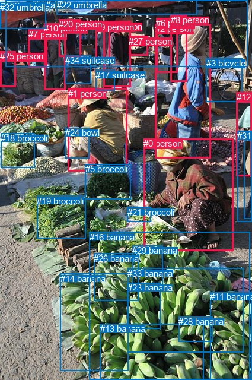
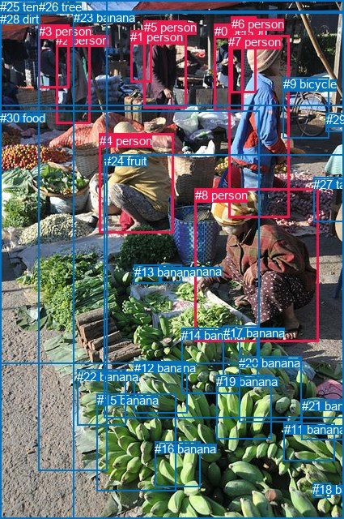

# 图片 0792：2351247.jpg

随机样本序号：448。图片 SHA256：`edf5f635541bcc6558db28535ed8acfed4439cfca1fdef1dae8ce09a237ec25f`。

红色框表示人，蓝色框表示其他物体。两个模式分别保留自身框编号，可依据位置比较对应对象。

## 自动检测框与输出

人的框编号：`[0, 1, 2, 4, 6, 7, 8, 9, 10, 12, 20, 25, 27]`。状态：`ok`。

### 自动检测全部物体框

| 编号 | 类别 | 是否为人 | 检测分数 | 像素坐标 xyxy |
|---|---|---|---|---|
| 0 | person | True | 0.9982 | 242.1, 233.0, 393.5, 422.7 |
| 1 | person | True | 0.9958 | 115.0, 148.7, 214.8, 288.6 |
| 2 | person | True | 0.9888 | 261.7, 40.2, 355.4, 266.6 |
| 3 | bicycle | False | 0.9832 | 347.5, 97.8, 408.3, 171.2 |
| 4 | person | True | 0.9724 | 174.9, 35.5, 220.2, 146.5 |
| 5 | broccoli | False | 0.9496 | 143.7, 276.4, 220.6, 335.6 |
| 6 | person | True | 0.9457 | 263.1, 30.5, 299.2, 122.7 |
| 7 | person | True | 0.9401 | 48.0, 49.2, 79.7, 113.7 |
| 8 | person | True | 0.9267 | 287.6, 25.1, 315.3, 137.7 |
| 9 | person | True | 0.9237 | 161.3, 36.6, 185.5, 104.7 |
| 10 | person | True | 0.9175 | 74.2, 39.2, 110.3, 151.7 |
| 11 | banana | False | 0.9098 | 354.4, 491.3, 424.7, 639.1 |
| 12 | person | True | 0.8703 | 398.7, 155.0, 425.0, 296.2 |
| 13 | banana | False | 0.8675 | 168.6, 545.2, 343.3, 639.0 |
| 14 | banana | False | 0.8314 | 102.0, 460.5, 216.6, 625.0 |
| 15 | chair | False | 0.7708 | 411.8, 222.7, 425.0, 368.8 |
| 16 | banana | False | 0.7241 | 150.9, 390.6, 421.9, 639.4 |
| 17 | suitcase | False | 0.6835 | 161.2, 117.6, 193.9, 152.4 |
| 18 | broccoli | False | 0.6641 | 1.3, 224.3, 58.4, 282.4 |
| 19 | broccoli | False | 0.6324 | 62.3, 329.6, 144.4, 401.5 |
| 20 | person | True | 0.6240 | 99.2, 32.3, 136.6, 95.1 |
| 21 | broccoli | False | 0.5569 | 214.6, 348.6, 254.1, 373.5 |
| 22 | umbrella | False | 0.5035 | 95.9, 0.1, 332.4, 24.4 |
| 23 | banana | False | 0.4953 | 214.8, 476.3, 270.8, 553.4 |
| 24 | bowl | False | 0.4891 | 109.6, 215.5, 150.4, 266.5 |
| 25 | person | True | 0.4753 | 0.0, 86.1, 26.2, 146.6 |
| 26 | banana | False | 0.4570 | 158.3, 427.0, 233.7, 506.9 |
| 27 | person | True | 0.4433 | 217.3, 60.7, 249.8, 93.7 |
| 28 | banana | False | 0.4340 | 301.3, 533.2, 358.1, 575.5 |
| 29 | banana | False | 0.4270 | 223.1, 413.5, 274.9, 490.1 |
| 30 | umbrella | False | 0.4248 | 9.3, 0.0, 417.7, 112.5 |
| 31 | chair | False | 0.4206 | 400.1, 220.2, 424.8, 373.1 |
| 32 | umbrella | False | 0.4043 | 0.3, 3.5, 77.4, 48.1 |
| 33 | banana | False | 0.3809 | 215.1, 451.6, 410.3, 593.2 |
| 34 | suitcase | False | 0.3622 | 110.3, 93.0, 154.0, 140.2 |

### 自动检测 Top50 人相关候选

评分物体对：1190；人相关物体对：728；输出关系：50。

| 排名 | 主语编号与类别 | 关系 | 宾语编号与类别 | 类型 | 人与人 | 排序分数 | 原始融合 logit |
|---|---|---|---|---|---|---|---|
| 1 | #0 person | holding | #21 broccoli | semantic | False | 0.97841 | 3.8136 |
| 2 | #1 person | wearing | #24 bowl | semantic | False | 0.97624 | 3.7156 |
| 3 | #0 person | picking | #29 banana | semantic | False | 0.95362 | 3.0234 |
| 4 | #12 person | sitting on | #31 chair | semantic | False | 0.94279 | 2.8021 |
| 5 | #12 person | leaning on | #31 chair | spatial | False | 0.93916 | 2.7367 |
| 6 | #0 person | picking | #16 banana | semantic | False | 0.93224 | 2.6217 |
| 7 | #9 person | standing on | #30 umbrella | semantic | False | 0.92900 | 2.5715 |
| 8 | #12 person | leaning on | #15 chair | spatial | False | 0.92354 | 2.4914 |
| 9 | #12 person | sitting on | #15 chair | semantic | False | 0.92136 | 2.4610 |
| 10 | #20 person | standing on | #30 umbrella | semantic | False | 0.91410 | 2.3647 |
| 11 | #4 person | carrying | #17 suitcase | semantic | False | 0.91286 | 2.3491 |
| 12 | #10 person | standing on | #32 umbrella | semantic | False | 0.90326 | 2.2339 |
| 13 | #2 person | wearing | #8 person | semantic | True | 0.90027 | 2.2002 |
| 14 | #7 person | standing on | #32 umbrella | semantic | False | 0.89659 | 2.1599 |
| 15 | #0 person | beside | #2 person | spatial | True | 0.89502 | 2.1431 |
| 16 | #3 bicycle | parked on | #12 person | semantic | False | 0.89163 | 2.1075 |
| 17 | #4 person | standing on | #30 umbrella | semantic | False | 0.88622 | 2.0527 |
| 18 | #9 person | standing on | #22 umbrella | semantic | False | 0.88168 | 2.0085 |
| 19 | #10 person | beside | #20 person | spatial | True | 0.87901 | 1.9831 |
| 20 | #20 person | standing on | #34 suitcase | semantic | False | 0.87876 | 1.9807 |
| 21 | #0 person | picking | #26 banana | semantic | False | 0.87456 | 1.9419 |
| 22 | #2 person | wearing | #3 bicycle | semantic | False | 0.87316 | 1.9292 |
| 23 | #10 person | beside | #7 person | spatial | True | 0.87033 | 1.9038 |
| 24 | #6 person | standing on | #22 umbrella | semantic | False | 0.85426 | 1.7684 |
| 25 | #4 person | wearing | #27 person | semantic | True | 0.84954 | 1.7310 |
| 26 | #1 person | in | #24 bowl | spatial | False | 0.83484 | 1.6203 |
| 27 | #2 person | beside | #3 bicycle | spatial | False | 0.83476 | 1.6198 |
| 28 | #0 person | picking | #33 banana | semantic | False | 0.83169 | 1.5976 |
| 29 | #20 person | standing on | #32 umbrella | semantic | False | 0.83040 | 1.5885 |
| 30 | #6 person | standing on | #30 umbrella | semantic | False | 0.82861 | 1.5758 |
| 31 | #0 person | picking | #19 broccoli | semantic | False | 0.81324 | 1.4712 |
| 32 | #25 person | sitting on | #32 umbrella | semantic | False | 0.80786 | 1.4362 |
| 33 | #4 person | standing on | #22 umbrella | semantic | False | 0.80518 | 1.4190 |
| 34 | #20 person | standing on | #22 umbrella | semantic | False | 0.79815 | 1.3748 |
| 35 | #1 person | wearing | #17 suitcase | semantic | False | 0.79741 | 1.3702 |
| 36 | #0 person | picking | #23 banana | semantic | False | 0.79606 | 1.3619 |
| 37 | #24 bowl | beside | #1 person | spatial | False | 0.79097 | 1.3308 |
| 38 | #0 person | picking | #5 broccoli | semantic | False | 0.78893 | 1.3185 |
| 39 | #10 person | standing on | #30 umbrella | semantic | False | 0.78775 | 1.3114 |
| 40 | #0 person | beside | #1 person | spatial | True | 0.78596 | 1.3007 |
| 41 | #9 person | beside | #4 person | spatial | True | 0.77763 | 1.2519 |
| 42 | #7 person | standing on | #30 umbrella | semantic | False | 0.77623 | 1.2438 |
| 43 | #7 person | beside | #10 person | spatial | True | 0.76886 | 1.2019 |
| 44 | #32 umbrella | over | #25 person | spatial | False | 0.76503 | 1.1804 |
| 45 | #3 bicycle | parked on | #2 person | semantic | False | 0.75920 | 1.1483 |
| 46 | #9 person | looking at | #4 person | semantic | True | 0.75745 | 1.1387 |
| 47 | #9 person | standing on | #17 suitcase | semantic | False | 0.75241 | 1.1115 |
| 48 | #2 person | beside | #0 person | spatial | True | 0.75209 | 1.1098 |
| 49 | #3 bicycle | leaning on | #12 person | spatial | False | 0.73862 | 1.0388 |
| 50 | #10 person | carrying | #20 person | semantic | True | 0.73707 | 1.0308 |

### 自动检测逐条人相关 GT 核验

R@50：0.00%；命中 0/3。

| GT 主语编号 | GT 关系 | GT 宾语编号 | 结果阶段 | 匹配预测主语编号 | 匹配预测宾语编号 |
|---|---|---|---|---|---|
| 4 | beside | 8 | rank_below50 | [1] | [0] |
| 7 | standing on | 28 | endpoint_missing_or_wrong_class | [2] | [] |
| 8 | picking | 30 | endpoint_missing_or_wrong_class | [0] | [] |

## 真实框与输出

人的框编号：`[0, 1, 2, 3, 4, 5, 6, 7, 8]`。

### 真实框全部物体框

| 编号 | 类别 | 是否为人 | 检测分数 | 像素坐标 xyxy |
|---|---|---|---|---|
| 0 | person | True | GT | 265.0, 30.0, 301.0, 138.0 |
| 1 | person | True | GT | 161.0, 37.0, 188.0, 101.0 |
| 2 | person | True | GT | 69.0, 41.0, 111.0, 153.0 |
| 3 | person | True | GT | 48.0, 30.0, 86.0, 108.0 |
| 4 | person | True | GT | 123.0, 165.0, 215.0, 288.0 |
| 5 | person | True | GT | 178.0, 25.0, 231.0, 134.0 |
| 6 | person | True | GT | 286.0, 21.0, 317.0, 114.0 |
| 7 | person | True | GT | 282.0, 43.0, 357.0, 268.0 |
| 8 | person | True | GT | 241.0, 232.0, 394.0, 421.0 |
| 9 | bicycle | False | GT | 350.0, 95.0, 407.0, 170.0 |
| 10 | banana | False | GT | 198.0, 326.0, 224.0, 348.0 |
| 11 | banana | False | GT | 351.0, 521.0, 414.0, 568.0 |
| 12 | banana | False | GT | 166.0, 445.0, 232.0, 509.0 |
| 13 | banana | False | GT | 166.0, 327.0, 198.0, 350.0 |
| 14 | banana | False | GT | 224.0, 405.0, 296.0, 486.0 |
| 15 | banana | False | GT | 120.0, 485.0, 218.0, 605.0 |
| 16 | banana | False | GT | 191.0, 545.0, 247.0, 601.0 |
| 17 | banana | False | GT | 276.0, 402.0, 319.0, 464.0 |
| 18 | banana | False | GT | 386.0, 595.0, 408.0, 613.0 |
| 19 | banana | False | GT | 267.0, 462.0, 335.0, 541.0 |
| 20 | banana | False | GT | 295.0, 439.0, 373.0, 521.0 |
| 21 | banana | False | GT | 373.0, 492.0, 425.0, 542.0 |
| 22 | banana | False | GT | 95.0, 456.0, 155.0, 524.0 |
| 23 | banana | False | GT | 91.0, 13.0, 425.0, 640.0 |
| 24 | fruit | False | GT | 129.0, 190.0, 425.0, 516.0 |
| 25 | tent | False | GT | 0.0, 0.0, 425.0, 130.0 |
| 26 | tree | False | GT | 48.0, 0.0, 132.0, 581.0 |
| 27 | table | False | GT | 387.0, 219.0, 425.0, 274.0 |
| 28 | dirt | False | GT | 0.0, 15.0, 425.0, 640.0 |
| 29 | paper | False | GT | 403.0, 139.0, 425.0, 162.0 |
| 30 | food | False | GT | 0.0, 137.0, 320.0, 448.0 |

### 真实框 Top50 人相关候选

评分物体对：930；人相关物体对：468；输出关系：50。

| 排名 | 主语编号与类别 | 关系 | 宾语编号与类别 | 类型 | 人与人 | 排序分数 | 原始融合 logit |
|---|---|---|---|---|---|---|---|
| 1 | #8 person | picking | #17 banana | semantic | False | 0.98242 | 4.0233 |
| 2 | #7 person | wearing | #6 person | semantic | True | 0.97600 | 3.7055 |
| 3 | #8 person | picking | #14 banana | semantic | False | 0.97068 | 3.4996 |
| 4 | #1 person | standing on | #25 tent | semantic | False | 0.94587 | 2.8607 |
| 5 | #8 person | picking | #10 banana | semantic | False | 0.94176 | 2.7832 |
| 6 | #8 person | wearing | #24 fruit | semantic | False | 0.93836 | 2.7228 |
| 7 | #5 person | standing on | #25 tent | semantic | False | 0.93230 | 2.6225 |
| 8 | #2 person | walking on | #26 tree | semantic | False | 0.92955 | 2.5797 |
| 9 | #8 person | picking | #30 food | semantic | False | 0.91876 | 2.4256 |
| 10 | #7 person | wearing | #9 bicycle | semantic | False | 0.91657 | 2.3966 |
| 11 | #2 person | standing on | #25 tent | semantic | False | 0.89518 | 2.1448 |
| 12 | #2 person | beside | #3 person | spatial | True | 0.88953 | 2.0860 |
| 13 | #2 person | wearing | #3 person | semantic | True | 0.88871 | 2.0777 |
| 14 | #7 person | beside | #9 bicycle | spatial | False | 0.88648 | 2.0553 |
| 15 | #0 person | standing on | #25 tent | semantic | False | 0.88553 | 2.0459 |
| 16 | #7 person | wearing | #23 banana | semantic | False | 0.88526 | 2.0432 |
| 17 | #8 person | wearing | #23 banana | semantic | False | 0.86881 | 1.8905 |
| 18 | #8 person | picking | #13 banana | semantic | False | 0.85780 | 1.7971 |
| 19 | #8 person | picking | #20 banana | semantic | False | 0.85701 | 1.7907 |
| 20 | #1 person | beside | #5 person | spatial | True | 0.85032 | 1.7371 |
| 21 | #8 person | picking | #12 banana | semantic | False | 0.84072 | 1.6636 |
| 22 | #1 person | walking on | #5 person | semantic | True | 0.82862 | 1.5759 |
| 23 | #8 person | picking | #19 banana | semantic | False | 0.82255 | 1.5337 |
| 24 | #3 person | beside | #2 person | spatial | True | 0.81956 | 1.5133 |
| 25 | #0 person | wearing | #6 person | semantic | True | 0.81472 | 1.4810 |
| 26 | #8 person | beside | #24 fruit | spatial | False | 0.81222 | 1.4645 |
| 27 | #8 person | beside | #7 person | spatial | True | 0.80605 | 1.4246 |
| 28 | #7 person | wearing | #30 food | semantic | False | 0.80092 | 1.3920 |
| 29 | #8 person | wearing | #28 dirt | semantic | False | 0.79632 | 1.3635 |
| 30 | #3 person | standing on | #25 tent | semantic | False | 0.79629 | 1.3632 |
| 31 | #7 person | wearing | #28 dirt | semantic | False | 0.79501 | 1.3554 |
| 32 | #7 person | wearing | #24 fruit | semantic | False | 0.79482 | 1.3543 |
| 33 | #8 person | beside | #30 food | spatial | False | 0.78507 | 1.2955 |
| 34 | #7 person | beside | #0 person | spatial | True | 0.78359 | 1.2867 |
| 35 | #5 person | beside | #1 person | spatial | True | 0.77601 | 1.2426 |
| 36 | #6 person | wearing | #7 person | semantic | True | 0.75957 | 1.1503 |
| 37 | #3 person | walking on | #26 tree | semantic | False | 0.75356 | 1.1177 |
| 38 | #5 person | carrying | #1 person | semantic | True | 0.74546 | 1.0746 |
| 39 | #6 person | wearing | #0 person | semantic | True | 0.71778 | 0.9335 |
| 40 | #8 person | in | #23 banana | spatial | False | 0.71369 | 0.9134 |
| 41 | #2 person | standing on | #28 dirt | semantic | False | 0.70705 | 0.8811 |
| 42 | #8 person | in | #28 dirt | spatial | False | 0.68610 | 0.7820 |
| 43 | #0 person | looking at | #7 person | semantic | True | 0.68588 | 0.7809 |
| 44 | #6 person | beside | #0 person | spatial | True | 0.67463 | 0.7292 |
| 45 | #7 person | wearing | #25 tent | semantic | False | 0.66085 | 0.6671 |
| 46 | #23 banana | wearing | #4 person | semantic | False | 0.64880 | 0.6137 |
| 47 | #9 bicycle | parked on | #7 person | semantic | False | 0.60913 | 0.4436 |
| 48 | #4 person | sitting on | #30 food | semantic | False | 0.60497 | 0.4262 |
| 49 | #8 person | beside | #14 banana | spatial | False | 0.60334 | 0.4194 |
| 50 | #8 person | picking | #11 banana | semantic | False | 0.58812 | 0.3562 |

### 真实框逐条人相关 GT 核验

R@50：33.33%；命中 1/3。

| GT 主语编号 | GT 关系 | GT 宾语编号 | 结果阶段 | 匹配预测主语编号 | 匹配预测宾语编号 |
|---|---|---|---|---|---|
| 4 | beside | 8 | rank_below50 | [4] | [8] |
| 7 | standing on | 28 | wrong_predicate | [7] | [28] |
| 8 | picking | 30 | hit50 | [8] | [30] |

## 全部人相关 GT

| 主语编号与类别 | 关系 | 宾语编号与类别 |
|---|---|---|
| #4 person | beside | #8 person |
| #7 person | standing on | #28 dirt |
| #8 person | picking | #30 food |

原始记录、全部人相关物体对的两项预测与分项分数见 [逐图证据 JSON](../evidence/cases/0792.json)。全部56类 logits 保留于本机 HOR/output/random500/logits/。

<!-- HOR_COMPLETE_RESULTS -->

## 六组条件的完整输出对照

以下保留同一图片三种框与候选模式、两种谓词输出规则的全部 Top50。框编号各自在所属模式内解释。

### 自动检测框完整枚举：空间与语义各保留一个谓词

| 排名 | 主语编号与类别 | 谓词 | 宾语编号与类别 | 分组 | 排序分数 | predicate logit | pair logit |
|---|---|---|---|---|---|---|---|
| 1 | #0 person | holding | #21 broccoli | semantic | 0.9784077 | 3.4337153 | 0.3798714 |
| 2 | #1 person | wearing | #24 bowl | semantic | 0.9762369 | 3.7421365 | -0.0265630 |
| 3 | #0 person | picking | #29 banana | semantic | 0.9536214 | 2.7926388 | 0.2307908 |
| 4 | #12 person | sitting on | #31 chair | semantic | 0.9427894 | 3.1207218 | -0.3186182 |
| 5 | #12 person | leaning on | #31 chair | spatial | 0.9391571 | 3.0553060 | -0.3186182 |
| 6 | #0 person | picking | #16 banana | semantic | 0.9322448 | 2.3714695 | 0.2502249 |
| 7 | #9 person | standing on | #30 umbrella | semantic | 0.9290030 | 2.8220692 | -0.2505948 |
| 8 | #12 person | leaning on | #15 chair | spatial | 0.9235395 | 2.8382397 | -0.3468010 |
| 9 | #12 person | sitting on | #15 chair | semantic | 0.9213592 | 2.8077602 | -0.3468010 |
| 10 | #20 person | standing on | #30 umbrella | semantic | 0.9140962 | 2.8132963 | -0.4485885 |
| 11 | #4 person | carrying | #17 suitcase | semantic | 0.9128610 | 2.7175384 | -0.3684595 |
| 12 | #10 person | standing on | #32 umbrella | semantic | 0.9032563 | 2.5184975 | -0.2845563 |
| 13 | #2 person | wearing | #8 person | semantic | 0.9002682 | 2.0489764 | 0.1512314 |
| 14 | #7 person | standing on | #32 umbrella | semantic | 0.8965926 | 2.6007123 | -0.4407879 |
| 15 | #0 person | beside | #2 person | spatial | 0.8950181 | 2.9835157 | -0.8404596 |
| 16 | #3 bicycle | parked on | #12 person | semantic | 0.8916265 | 2.6405392 | -0.5330760 |
| 17 | #4 person | standing on | #30 umbrella | semantic | 0.8862216 | 2.2826705 | -0.2299563 |
| 18 | #9 person | standing on | #22 umbrella | semantic | 0.8816830 | 2.3320346 | -0.3235694 |
| 19 | #10 person | beside | #20 person | spatial | 0.8790064 | 2.4439840 | -0.4609288 |
| 20 | #20 person | standing on | #34 suitcase | semantic | 0.8787558 | 2.3744721 | -0.3937721 |
| 21 | #0 person | picking | #26 banana | semantic | 0.8745613 | 2.0407524 | -0.0988476 |
| 22 | #2 person | wearing | #3 bicycle | semantic | 0.8731639 | 2.3019753 | -0.3727473 |
| 23 | #10 person | beside | #7 person | spatial | 0.8703251 | 2.3513970 | -0.4475605 |
| 24 | #6 person | standing on | #22 umbrella | semantic | 0.8542643 | 2.2585931 | -0.4901472 |
| 25 | #4 person | wearing | #27 person | semantic | 0.8495364 | 1.9942975 | -0.2633276 |
| 26 | #1 person | in | #24 bowl | spatial | 0.8348392 | 1.6468825 | -0.0265630 |
| 27 | #2 person | beside | #3 bicycle | spatial | 0.8347650 | 1.9925284 | -0.3727473 |
| 28 | #0 person | picking | #33 banana | semantic | 0.8316889 | 1.5286269 | 0.0690173 |
| 29 | #20 person | standing on | #32 umbrella | semantic | 0.8304018 | 2.1163945 | -0.5279168 |
| 30 | #6 person | standing on | #30 umbrella | semantic | 0.8286114 | 1.9846158 | -0.4087975 |
| 31 | #0 person | picking | #19 broccoli | semantic | 0.8132422 | 1.8302932 | -0.3590768 |
| 32 | #25 person | sitting on | #32 umbrella | semantic | 0.8078581 | 1.6100073 | -0.1738547 |
| 33 | #4 person | standing on | #22 umbrella | semantic | 0.8051820 | 1.6465659 | -0.2275632 |
| 34 | #20 person | standing on | #22 umbrella | semantic | 0.7981545 | 2.0450964 | -0.6702965 |
| 35 | #1 person | wearing | #17 suitcase | semantic | 0.7974131 | 1.8784428 | -0.5082396 |
| 36 | #0 person | picking | #23 banana | semantic | 0.7960646 | 1.4690909 | -0.1072145 |
| 37 | #24 bowl | beside | #1 person | spatial | 0.7909695 | 2.0262914 | -0.6955121 |
| 38 | #0 person | picking | #5 broccoli | semantic | 0.7889271 | 1.7699199 | -0.4514495 |
| 39 | #10 person | standing on | #30 umbrella | semantic | 0.7877458 | 1.7425561 | -0.4311649 |
| 40 | #0 person | beside | #1 person | spatial | 0.7859565 | 2.1727576 | -0.8720355 |
| 41 | #9 person | beside | #4 person | spatial | 0.7776272 | 1.6941891 | -0.4422973 |
| 42 | #7 person | standing on | #30 umbrella | semantic | 0.7762311 | 1.9134169 | -0.6695807 |
| 43 | #7 person | beside | #10 person | spatial | 0.7688563 | 2.0530577 | -0.8511931 |
| 44 | #32 umbrella | over | #25 person | spatial | 0.7650274 | 1.7835832 | -0.6031402 |
| 45 | #3 bicycle | parked on | #2 person | semantic | 0.7591982 | 1.7090983 | -0.5608090 |
| 46 | #9 person | looking at | #4 person | semantic | 0.7574491 | 1.5810423 | -0.4422973 |
| 47 | #9 person | standing on | #17 suitcase | semantic | 0.7524054 | 1.5457916 | -0.4343090 |
| 48 | #2 person | beside | #0 person | spatial | 0.7520926 | 1.8428235 | -0.7330194 |
| 49 | #3 bicycle | leaning on | #12 person | spatial | 0.7386168 | 1.5718675 | -0.5330760 |
| 50 | #10 person | carrying | #20 person | semantic | 0.7370722 | 1.4917355 | -0.4609288 |

GT 命中：0/3，R@50=0.00%。

| GT主语 | GT谓词 | GT宾语 | 结果阶段 | 匹配主语框 | 匹配宾语框 |
|---|---|---|---|---|---|
| 4 | beside | 8 | rank_below50 | [1] | [0] |
| 7 | standing on | 28 | endpoint_missing_or_wrong_class | [2] | [] |
| 8 | picking | 30 | endpoint_missing_or_wrong_class | [0] | [] |

### 自动检测框完整枚举：每对只保留一个谓词

| 排名 | 主语编号与类别 | 谓词 | 宾语编号与类别 | 分组 | 排序分数 | predicate logit | pair logit |
|---|---|---|---|---|---|---|---|
| 1 | #0 person | holding | #21 broccoli | single | 0.9784077 | 3.4337153 | 0.3798714 |
| 2 | #1 person | wearing | #24 bowl | single | 0.9762369 | 3.7421365 | -0.0265630 |
| 3 | #0 person | picking | #29 banana | single | 0.9536214 | 2.7926388 | 0.2307908 |
| 4 | #12 person | sitting on | #31 chair | single | 0.9427894 | 3.1207218 | -0.3186182 |
| 5 | #0 person | picking | #16 banana | single | 0.9322448 | 2.3714695 | 0.2502249 |
| 6 | #9 person | standing on | #30 umbrella | single | 0.9290030 | 2.8220692 | -0.2505948 |
| 7 | #12 person | leaning on | #15 chair | single | 0.9235395 | 2.8382397 | -0.3468010 |
| 8 | #20 person | standing on | #30 umbrella | single | 0.9140962 | 2.8132963 | -0.4485885 |
| 9 | #4 person | carrying | #17 suitcase | single | 0.9128610 | 2.7175384 | -0.3684595 |
| 10 | #10 person | standing on | #32 umbrella | single | 0.9032563 | 2.5184975 | -0.2845563 |
| 11 | #2 person | wearing | #8 person | single | 0.9002682 | 2.0489764 | 0.1512314 |
| 12 | #7 person | standing on | #32 umbrella | single | 0.8965926 | 2.6007123 | -0.4407879 |
| 13 | #0 person | beside | #2 person | single | 0.8950181 | 2.9835157 | -0.8404596 |
| 14 | #3 bicycle | parked on | #12 person | single | 0.8916265 | 2.6405392 | -0.5330760 |
| 15 | #4 person | standing on | #30 umbrella | single | 0.8862216 | 2.2826705 | -0.2299563 |
| 16 | #9 person | standing on | #22 umbrella | single | 0.8816830 | 2.3320346 | -0.3235694 |
| 17 | #10 person | beside | #20 person | single | 0.8790064 | 2.4439840 | -0.4609288 |
| 18 | #20 person | standing on | #34 suitcase | single | 0.8787558 | 2.3744721 | -0.3937721 |
| 19 | #0 person | picking | #26 banana | single | 0.8745613 | 2.0407524 | -0.0988476 |
| 20 | #2 person | wearing | #3 bicycle | single | 0.8731639 | 2.3019753 | -0.3727473 |
| 21 | #10 person | beside | #7 person | single | 0.8703251 | 2.3513970 | -0.4475605 |
| 22 | #6 person | standing on | #22 umbrella | single | 0.8542643 | 2.2585931 | -0.4901472 |
| 23 | #4 person | wearing | #27 person | single | 0.8495364 | 1.9942975 | -0.2633276 |
| 24 | #0 person | picking | #33 banana | single | 0.8316889 | 1.5286269 | 0.0690173 |
| 25 | #20 person | standing on | #32 umbrella | single | 0.8304018 | 2.1163945 | -0.5279168 |
| 26 | #6 person | standing on | #30 umbrella | single | 0.8286114 | 1.9846158 | -0.4087975 |
| 27 | #0 person | picking | #19 broccoli | single | 0.8132422 | 1.8302932 | -0.3590768 |
| 28 | #25 person | sitting on | #32 umbrella | single | 0.8078581 | 1.6100073 | -0.1738547 |
| 29 | #4 person | standing on | #22 umbrella | single | 0.8051820 | 1.6465659 | -0.2275632 |
| 30 | #20 person | standing on | #22 umbrella | single | 0.7981545 | 2.0450964 | -0.6702965 |
| 31 | #1 person | wearing | #17 suitcase | single | 0.7974131 | 1.8784428 | -0.5082396 |
| 32 | #0 person | picking | #23 banana | single | 0.7960646 | 1.4690909 | -0.1072145 |
| 33 | #24 bowl | beside | #1 person | single | 0.7909695 | 2.0262914 | -0.6955121 |
| 34 | #0 person | picking | #5 broccoli | single | 0.7889271 | 1.7699199 | -0.4514495 |
| 35 | #10 person | standing on | #30 umbrella | single | 0.7877458 | 1.7425561 | -0.4311649 |
| 36 | #0 person | beside | #1 person | single | 0.7859565 | 2.1727576 | -0.8720355 |
| 37 | #9 person | beside | #4 person | single | 0.7776272 | 1.6941891 | -0.4422973 |
| 38 | #7 person | standing on | #30 umbrella | single | 0.7762311 | 1.9134169 | -0.6695807 |
| 39 | #7 person | beside | #10 person | single | 0.7688563 | 2.0530577 | -0.8511931 |
| 40 | #32 umbrella | over | #25 person | single | 0.7650274 | 1.7835832 | -0.6031402 |
| 41 | #3 bicycle | parked on | #2 person | single | 0.7591982 | 1.7090983 | -0.5608090 |
| 42 | #9 person | standing on | #17 suitcase | single | 0.7524054 | 1.5457916 | -0.4343090 |
| 43 | #2 person | beside | #0 person | single | 0.7520926 | 1.8428235 | -0.7330194 |
| 44 | #31 chair | holding | #12 person | single | 0.7330021 | 1.4257064 | -0.4157988 |
| 45 | #15 chair | holding | #12 person | single | 0.7323679 | 1.3910141 | -0.3843447 |
| 46 | #0 person | picking | #11 banana | single | 0.7265940 | 1.0473228 | -0.0699128 |
| 47 | #32 umbrella | over | #7 person | single | 0.7149600 | 1.6426964 | -0.7230995 |
| 48 | #20 person | beside | #10 person | single | 0.7087358 | 1.7206373 | -0.8313850 |
| 49 | #8 person | looking at | #2 person | single | 0.7046598 | 1.3641276 | -0.4945405 |
| 50 | #2 person | wearing | #30 umbrella | single | 0.6962901 | 1.3581624 | -0.5284691 |

GT 命中：0/3，R@50=0.00%。

| GT主语 | GT谓词 | GT宾语 | 结果阶段 | 匹配主语框 | 匹配宾语框 |
|---|---|---|---|---|---|
| 4 | beside | 8 | rank_below50 | [1] | [0] |
| 7 | standing on | 28 | endpoint_missing_or_wrong_class | [2] | [] |
| 8 | picking | 30 | endpoint_missing_or_wrong_class | [0] | [] |

### 真实框完整枚举：空间与语义各保留一个谓词

| 排名 | 主语编号与类别 | 谓词 | 宾语编号与类别 | 分组 | 排序分数 | predicate logit | pair logit |
|---|---|---|---|---|---|---|---|
| 1 | #8 person | picking | #17 banana | semantic | 0.9824213 | 3.6045165 | 0.4188162 |
| 2 | #7 person | wearing | #6 person | semantic | 0.9760015 | 3.3766770 | 0.3287948 |
| 3 | #8 person | picking | #14 banana | semantic | 0.9706762 | 3.2433972 | 0.2561948 |
| 4 | #1 person | standing on | #25 tent | semantic | 0.9458703 | 3.1495008 | -0.2887768 |
| 5 | #8 person | picking | #10 banana | semantic | 0.9417606 | 2.7325039 | 0.0506836 |
| 6 | #8 person | wearing | #24 fruit | semantic | 0.9383577 | 2.7730570 | -0.0502745 |
| 7 | #5 person | standing on | #25 tent | semantic | 0.9322978 | 2.8324704 | -0.2099360 |
| 8 | #2 person | walking on | #26 tree | semantic | 0.9295452 | 3.1084595 | -0.5287352 |
| 9 | #8 person | picking | #30 food | semantic | 0.9187589 | 2.3417134 | 0.0838901 |
| 10 | #7 person | wearing | #9 bicycle | semantic | 0.9165654 | 2.7247562 | -0.3281856 |
| 11 | #2 person | standing on | #25 tent | semantic | 0.8951822 | 2.5770521 | -0.4322484 |
| 12 | #2 person | beside | #3 person | spatial | 0.8895319 | 2.3809681 | -0.2950003 |
| 13 | #2 person | wearing | #3 person | semantic | 0.8887150 | 2.3726821 | -0.2950003 |
| 14 | #7 person | beside | #9 bicycle | spatial | 0.8864818 | 2.3834829 | -0.3281856 |
| 15 | #0 person | standing on | #25 tent | semantic | 0.8855332 | 2.4169092 | -0.3710045 |
| 16 | #7 person | wearing | #23 banana | semantic | 0.8852634 | 2.2419386 | -0.1986924 |
| 17 | #8 person | wearing | #23 banana | semantic | 0.8688118 | 1.9232764 | -0.0327826 |
| 18 | #8 person | picking | #13 banana | semantic | 0.8577963 | 1.9200888 | -0.1229826 |
| 19 | #8 person | picking | #20 banana | semantic | 0.8570122 | 1.7090306 | 0.0816628 |
| 20 | #1 person | beside | #5 person | spatial | 0.8503211 | 2.1743770 | -0.4372553 |
| 21 | #8 person | picking | #12 banana | semantic | 0.8407176 | 1.7396851 | -0.0761079 |
| 22 | #1 person | walking on | #5 person | semantic | 0.8286180 | 2.0131197 | -0.4372553 |
| 23 | #8 person | picking | #19 banana | semantic | 0.8225467 | 1.3786016 | 0.1550960 |
| 24 | #3 person | beside | #2 person | spatial | 0.8195559 | 2.3537674 | -0.8404258 |
| 25 | #0 person | wearing | #6 person | semantic | 0.8147185 | 1.6951804 | -0.2142141 |
| 26 | #8 person | beside | #24 fruit | spatial | 0.8122236 | 1.5147982 | -0.0502745 |
| 27 | #8 person | beside | #7 person | spatial | 0.8060545 | 2.2321014 | -0.8075274 |
| 28 | #7 person | wearing | #30 food | semantic | 0.8009173 | 2.0604935 | -0.6684564 |
| 29 | #8 person | wearing | #28 dirt | semantic | 0.7963238 | 1.5555620 | -0.1920876 |
| 30 | #3 person | standing on | #25 tent | semantic | 0.7962867 | 2.0896769 | -0.7264311 |
| 31 | #7 person | wearing | #28 dirt | semantic | 0.7950086 | 1.6598272 | -0.3044422 |
| 32 | #7 person | wearing | #24 fruit | semantic | 0.7948247 | 2.0054274 | -0.6511703 |
| 33 | #8 person | beside | #30 food | spatial | 0.7850728 | 1.2115870 | 0.0838901 |
| 34 | #7 person | beside | #0 person | spatial | 0.7835894 | 1.6288819 | -0.3421745 |
| 35 | #5 person | beside | #1 person | spatial | 0.7760134 | 1.6931481 | -0.4505644 |
| 36 | #6 person | wearing | #7 person | semantic | 0.7595742 | 1.6486969 | -0.4983501 |
| 37 | #3 person | walking on | #26 tree | semantic | 0.7535636 | 1.9198766 | -0.8021670 |
| 38 | #5 person | carrying | #1 person | semantic | 0.7454626 | 1.5251217 | -0.4505644 |
| 39 | #6 person | wearing | #0 person | semantic | 0.7177755 | 1.5958853 | -0.6624311 |
| 40 | #8 person | in | #23 banana | spatial | 0.7136915 | 0.9461632 | -0.0327826 |
| 41 | #2 person | standing on | #28 dirt | semantic | 0.7070484 | 1.2185593 | -0.3374676 |
| 42 | #8 person | in | #28 dirt | spatial | 0.6861026 | 0.9740486 | -0.1920876 |
| 43 | #0 person | looking at | #7 person | semantic | 0.6858827 | 1.4728794 | -0.6919393 |
| 44 | #6 person | beside | #0 person | spatial | 0.6746292 | 1.3916287 | -0.6624311 |
| 45 | #7 person | wearing | #25 tent | semantic | 0.6608530 | 1.2414832 | -0.5743854 |
| 46 | #23 banana | wearing | #4 person | semantic | 0.6487954 | 1.3929100 | -0.7791615 |
| 47 | #9 bicycle | parked on | #7 person | semantic | 0.6091275 | 0.9572287 | -0.5135823 |
| 48 | #4 person | sitting on | #30 food | semantic | 0.6049703 | 1.2190447 | -0.7928261 |
| 49 | #8 person | beside | #14 banana | spatial | 0.6033402 | 0.1632075 | 0.2561948 |
| 50 | #8 person | picking | #11 banana | semantic | 0.5881155 | 0.4760914 | -0.1199111 |

GT 命中：1/3，R@50=33.33%。

| GT主语 | GT谓词 | GT宾语 | 结果阶段 | 匹配主语框 | 匹配宾语框 |
|---|---|---|---|---|---|
| 4 | beside | 8 | rank_below50 | [4] | [8] |
| 7 | standing on | 28 | wrong_predicate | [7] | [28] |
| 8 | picking | 30 | hit50 | [8] | [30] |

### 真实框完整枚举：每对只保留一个谓词

| 排名 | 主语编号与类别 | 谓词 | 宾语编号与类别 | 分组 | 排序分数 | predicate logit | pair logit |
|---|---|---|---|---|---|---|---|
| 1 | #8 person | picking | #17 banana | single | 0.9824213 | 3.6045165 | 0.4188162 |
| 2 | #7 person | wearing | #6 person | single | 0.9760015 | 3.3766770 | 0.3287948 |
| 3 | #8 person | picking | #14 banana | single | 0.9706762 | 3.2433972 | 0.2561948 |
| 4 | #1 person | standing on | #25 tent | single | 0.9458703 | 3.1495008 | -0.2887768 |
| 5 | #8 person | picking | #10 banana | single | 0.9417606 | 2.7325039 | 0.0506836 |
| 6 | #8 person | wearing | #24 fruit | single | 0.9383577 | 2.7730570 | -0.0502745 |
| 7 | #5 person | standing on | #25 tent | single | 0.9322978 | 2.8324704 | -0.2099360 |
| 8 | #2 person | walking on | #26 tree | single | 0.9295452 | 3.1084595 | -0.5287352 |
| 9 | #8 person | picking | #30 food | single | 0.9187589 | 2.3417134 | 0.0838901 |
| 10 | #7 person | wearing | #9 bicycle | single | 0.9165654 | 2.7247562 | -0.3281856 |
| 11 | #2 person | standing on | #25 tent | single | 0.8951822 | 2.5770521 | -0.4322484 |
| 12 | #2 person | beside | #3 person | single | 0.8895319 | 2.3809681 | -0.2950003 |
| 13 | #0 person | standing on | #25 tent | single | 0.8855332 | 2.4169092 | -0.3710045 |
| 14 | #7 person | wearing | #23 banana | single | 0.8852634 | 2.2419386 | -0.1986924 |
| 15 | #8 person | wearing | #23 banana | single | 0.8688118 | 1.9232764 | -0.0327826 |
| 16 | #8 person | picking | #13 banana | single | 0.8577963 | 1.9200888 | -0.1229826 |
| 17 | #8 person | picking | #20 banana | single | 0.8570122 | 1.7090306 | 0.0816628 |
| 18 | #1 person | beside | #5 person | single | 0.8503211 | 2.1743770 | -0.4372553 |
| 19 | #8 person | picking | #12 banana | single | 0.8407176 | 1.7396851 | -0.0761079 |
| 20 | #8 person | picking | #19 banana | single | 0.8225467 | 1.3786016 | 0.1550960 |
| 21 | #3 person | beside | #2 person | single | 0.8195559 | 2.3537674 | -0.8404258 |
| 22 | #0 person | wearing | #6 person | single | 0.8147185 | 1.6951804 | -0.2142141 |
| 23 | #8 person | beside | #7 person | single | 0.8060545 | 2.2321014 | -0.8075274 |
| 24 | #7 person | wearing | #30 food | single | 0.8009173 | 2.0604935 | -0.6684564 |
| 25 | #8 person | wearing | #28 dirt | single | 0.7963238 | 1.5555620 | -0.1920876 |
| 26 | #3 person | standing on | #25 tent | single | 0.7962867 | 2.0896769 | -0.7264311 |
| 27 | #7 person | wearing | #28 dirt | single | 0.7950086 | 1.6598272 | -0.3044422 |
| 28 | #7 person | wearing | #24 fruit | single | 0.7948247 | 2.0054274 | -0.6511703 |
| 29 | #7 person | beside | #0 person | single | 0.7835894 | 1.6288819 | -0.3421745 |
| 30 | #5 person | beside | #1 person | single | 0.7760134 | 1.6931481 | -0.4505644 |
| 31 | #6 person | wearing | #7 person | single | 0.7595742 | 1.6486969 | -0.4983501 |
| 32 | #3 person | walking on | #26 tree | single | 0.7535636 | 1.9198766 | -0.8021670 |
| 33 | #6 person | wearing | #0 person | single | 0.7177755 | 1.5958853 | -0.6624311 |
| 34 | #2 person | standing on | #28 dirt | single | 0.7070484 | 1.2185593 | -0.3374676 |
| 35 | #0 person | looking at | #7 person | single | 0.6858827 | 1.4728794 | -0.6919393 |
| 36 | #7 person | wearing | #25 tent | single | 0.6608530 | 1.2414832 | -0.5743854 |
| 37 | #23 banana | wearing | #4 person | single | 0.6487954 | 1.3929100 | -0.7791615 |
| 38 | #9 bicycle | parked on | #7 person | single | 0.6091275 | 0.9572287 | -0.5135823 |
| 39 | #4 person | sitting on | #30 food | single | 0.6049703 | 1.2190447 | -0.7928261 |
| 40 | #8 person | picking | #11 banana | single | 0.5881155 | 0.4760914 | -0.1199111 |
| 41 | #2 person | wearing | #30 food | single | 0.5775551 | 1.1004348 | -0.7876899 |
| 42 | #7 person | beside | #8 person | single | 0.5289675 | 0.8227277 | -0.7067279 |
| 43 | #4 person | on | #23 banana | single | 0.5174893 | 0.8652720 | -0.7952867 |
| 44 | #8 person | picking | #15 banana | single | 0.5056136 | 0.4460244 | -0.4235691 |
| 45 | #4 person | in | #28 dirt | single | 0.4834520 | 0.7330556 | -0.7992716 |
| 46 | #8 person | picking | #16 banana | single | 0.4496686 | 0.1755023 | -0.3775118 |
| 47 | #5 person | standing on | #28 dirt | single | 0.4436999 | 0.1668940 | -0.3930535 |
| 48 | #23 banana | wearing | #6 person | single | 0.4302498 | 0.0849586 | -0.3657907 |
| 49 | #1 person | walking on | #28 dirt | single | 0.4184464 | 0.0828471 | -0.4120016 |
| 50 | #8 person | wearing | #4 person | single | 0.4006230 | 0.4012561 | -0.8041259 |

GT 命中：1/3，R@50=33.33%。

| GT主语 | GT谓词 | GT宾语 | 结果阶段 | 匹配主语框 | 匹配宾语框 |
|---|---|---|---|---|---|
| 4 | beside | 8 | rank_below50 | [4] | [8] |
| 7 | standing on | 28 | wrong_predicate | [7] | [28] |
| 8 | picking | 30 | hit50 | [8] | [30] |

### 真实框400候选：空间与语义各保留一个谓词

| 排名 | 主语编号与类别 | 谓词 | 宾语编号与类别 | 分组 | 排序分数 | predicate logit | pair logit |
|---|---|---|---|---|---|---|---|
| 1 | #8 person | picking | #17 banana | semantic | 0.9861258 | 3.8449349 | 0.4188162 |
| 2 | #8 person | picking | #14 banana | semantic | 0.9781229 | 3.5439982 | 0.2561948 |
| 3 | #7 person | wearing | #6 person | semantic | 0.9592801 | 2.8306704 | 0.3287948 |
| 4 | #8 person | picking | #30 food | semantic | 0.9349771 | 2.5818925 | 0.0838901 |
| 5 | #8 person | wearing | #24 fruit | semantic | 0.9337019 | 2.6952705 | -0.0502745 |
| 6 | #2 person | walking on | #26 tree | semantic | 0.9330109 | 3.1626220 | -0.5287352 |
| 7 | #1 person | standing on | #25 tent | semantic | 0.9209673 | 2.7443404 | -0.2887768 |
| 8 | #8 person | picking | #20 banana | semantic | 0.9162228 | 2.3104367 | 0.0816628 |
| 9 | #5 person | standing on | #25 tent | semantic | 0.9100527 | 2.5242138 | -0.2099360 |
| 10 | #8 person | picking | #19 banana | semantic | 0.8970736 | 2.0100274 | 0.1550960 |
| 11 | #8 person | wearing | #23 banana | semantic | 0.8727728 | 1.9584837 | -0.0327826 |
| 12 | #7 person | wearing | #23 banana | semantic | 0.8709790 | 2.1083345 | -0.1986924 |
| 13 | #8 person | picking | #12 banana | semantic | 0.8703485 | 1.9801512 | -0.0761079 |
| 14 | #7 person | wearing | #9 bicycle | semantic | 0.8700346 | 2.2294512 | -0.3281856 |
| 15 | #2 person | standing on | #25 tent | semantic | 0.8563301 | 2.2173862 | -0.4322484 |
| 16 | #0 person | standing on | #25 tent | semantic | 0.8445073 | 2.0631585 | -0.3710045 |
| 17 | #7 person | standing on | #28 dirt | semantic | 0.7791162 | 1.5649657 | -0.3044422 |
| 18 | #8 person | beside | #24 fruit | spatial | 0.7781015 | 1.3049111 | -0.0502745 |
| 19 | #8 person | wearing | #28 dirt | semantic | 0.7778778 | 1.4454298 | -0.1920876 |
| 20 | #2 person | wearing | #3 person | semantic | 0.7674648 | 1.4890513 | -0.2950003 |
| 21 | #3 person | walking on | #26 tree | semantic | 0.7530042 | 1.9168663 | -0.8021670 |
| 22 | #7 person | wearing | #24 fruit | semantic | 0.7525062 | 1.7631941 | -0.6511703 |
| 23 | #7 person | beside | #9 bicycle | spatial | 0.7374225 | 1.3607998 | -0.3281856 |
| 24 | #8 person | beside | #7 person | spatial | 0.7315103 | 1.8098264 | -0.8075274 |
| 25 | #2 person | standing on | #28 dirt | semantic | 0.7255340 | 1.3095479 | -0.3374676 |
| 26 | #2 person | beside | #3 person | spatial | 0.7198923 | 1.2389278 | -0.2950003 |
| 27 | #3 person | standing on | #25 tent | semantic | 0.7157767 | 1.6500392 | -0.7264311 |
| 28 | #0 person | wearing | #6 person | semantic | 0.7020695 | 1.0713863 | -0.2142141 |
| 29 | #8 person | picking | #15 banana | semantic | 0.6972879 | 1.2579851 | -0.4235691 |
| 30 | #1 person | beside | #5 person | spatial | 0.6907561 | 1.2409120 | -0.4372553 |
| 31 | #8 person | beside | #30 food | spatial | 0.6867340 | 0.7010040 | 0.0838901 |
| 32 | #1 person | walking on | #5 person | semantic | 0.6791527 | 1.1871362 | -0.4372553 |
| 33 | #4 person | sitting on | #30 food | semantic | 0.6774733 | 1.5350103 | -0.7928261 |
| 34 | #7 person | wearing | #30 food | semantic | 0.6726958 | 1.3888597 | -0.6684564 |
| 35 | #7 person | beside | #0 person | spatial | 0.6649137 | 1.0274434 | -0.3421745 |
| 36 | #8 person | beside | #23 banana | spatial | 0.6611762 | 0.7013226 | -0.0327826 |
| 37 | #9 bicycle | parked on | #7 person | semantic | 0.6578726 | 1.1674104 | -0.5135823 |
| 38 | #6 person | wearing | #7 person | semantic | 0.6436177 | 1.0894508 | -0.4983501 |
| 39 | #8 person | beside | #14 banana | spatial | 0.6106012 | 0.1936455 | 0.2561948 |
| 40 | #3 person | beside | #2 person | spatial | 0.6058666 | 1.2703962 | -0.8404258 |
| 41 | #0 person | looking at | #7 person | semantic | 0.5968947 | 1.0844822 | -0.6919393 |
| 42 | #23 banana | wearing | #4 person | semantic | 0.5937682 | 1.1587267 | -0.7791615 |
| 43 | #5 person | beside | #1 person | spatial | 0.5915138 | 0.8207912 | -0.4505644 |
| 44 | #7 person | wearing | #25 tent | semantic | 0.5794882 | 0.8950582 | -0.5743854 |
| 45 | #8 person | in | #28 dirt | spatial | 0.5767795 | 0.5016541 | -0.1920876 |
| 46 | #8 person | beside | #17 banana | spatial | 0.5700737 | -0.1366644 | 0.4188162 |
| 47 | #6 person | wearing | #0 person | semantic | 0.5631402 | 0.9163475 | -0.6624311 |
| 48 | #5 person | standing on | #28 dirt | semantic | 0.5515286 | 0.5999022 | -0.3930535 |
| 49 | #5 person | carrying | #1 person | semantic | 0.5511224 | 0.6557708 | -0.4505644 |
| 50 | #0 person | standing on | #28 dirt | semantic | 0.5436676 | 0.5653248 | -0.3902084 |

GT 命中：2/3，R@50=66.67%。

| GT主语 | GT谓词 | GT宾语 | 结果阶段 | 匹配主语框 | 匹配宾语框 |
|---|---|---|---|---|---|
| 4 | beside | 8 | rank_below50 | [4] | [8] |
| 7 | standing on | 28 | hit50 | [7] | [28] |
| 8 | picking | 30 | hit50 | [8] | [30] |

### 真实框400候选：每对只保留一个谓词

| 排名 | 主语编号与类别 | 谓词 | 宾语编号与类别 | 分组 | 排序分数 | predicate logit | pair logit |
|---|---|---|---|---|---|---|---|
| 1 | #8 person | picking | #17 banana | single | 0.9861258 | 3.8449349 | 0.4188162 |
| 2 | #8 person | picking | #14 banana | single | 0.9781229 | 3.5439982 | 0.2561948 |
| 3 | #7 person | wearing | #6 person | single | 0.9592801 | 2.8306704 | 0.3287948 |
| 4 | #8 person | picking | #30 food | single | 0.9349771 | 2.5818925 | 0.0838901 |
| 5 | #8 person | wearing | #24 fruit | single | 0.9337019 | 2.6952705 | -0.0502745 |
| 6 | #2 person | walking on | #26 tree | single | 0.9330109 | 3.1626220 | -0.5287352 |
| 7 | #1 person | standing on | #25 tent | single | 0.9209673 | 2.7443404 | -0.2887768 |
| 8 | #8 person | picking | #20 banana | single | 0.9162228 | 2.3104367 | 0.0816628 |
| 9 | #5 person | standing on | #25 tent | single | 0.9100527 | 2.5242138 | -0.2099360 |
| 10 | #8 person | picking | #19 banana | single | 0.8970736 | 2.0100274 | 0.1550960 |
| 11 | #8 person | wearing | #23 banana | single | 0.8727728 | 1.9584837 | -0.0327826 |
| 12 | #7 person | wearing | #23 banana | single | 0.8709790 | 2.1083345 | -0.1986924 |
| 13 | #8 person | picking | #12 banana | single | 0.8703485 | 1.9801512 | -0.0761079 |
| 14 | #7 person | wearing | #9 bicycle | single | 0.8700346 | 2.2294512 | -0.3281856 |
| 15 | #2 person | standing on | #25 tent | single | 0.8563301 | 2.2173862 | -0.4322484 |
| 16 | #0 person | standing on | #25 tent | single | 0.8445073 | 2.0631585 | -0.3710045 |
| 17 | #7 person | standing on | #28 dirt | single | 0.7791162 | 1.5649657 | -0.3044422 |
| 18 | #8 person | wearing | #28 dirt | single | 0.7778778 | 1.4454298 | -0.1920876 |
| 19 | #2 person | wearing | #3 person | single | 0.7674648 | 1.4890513 | -0.2950003 |
| 20 | #3 person | walking on | #26 tree | single | 0.7530042 | 1.9168663 | -0.8021670 |
| 21 | #7 person | wearing | #24 fruit | single | 0.7525062 | 1.7631941 | -0.6511703 |
| 22 | #8 person | beside | #7 person | single | 0.7315103 | 1.8098264 | -0.8075274 |
| 23 | #2 person | standing on | #28 dirt | single | 0.7255340 | 1.3095479 | -0.3374676 |
| 24 | #3 person | standing on | #25 tent | single | 0.7157767 | 1.6500392 | -0.7264311 |
| 25 | #0 person | wearing | #6 person | single | 0.7020695 | 1.0713863 | -0.2142141 |
| 26 | #8 person | picking | #15 banana | single | 0.6972879 | 1.2579851 | -0.4235691 |
| 27 | #1 person | beside | #5 person | single | 0.6907561 | 1.2409120 | -0.4372553 |
| 28 | #4 person | sitting on | #30 food | single | 0.6774733 | 1.5350103 | -0.7928261 |
| 29 | #7 person | wearing | #30 food | single | 0.6726958 | 1.3888597 | -0.6684564 |
| 30 | #7 person | beside | #0 person | single | 0.6649137 | 1.0274434 | -0.3421745 |
| 31 | #9 bicycle | parked on | #7 person | single | 0.6578726 | 1.1674104 | -0.5135823 |
| 32 | #6 person | wearing | #7 person | single | 0.6436177 | 1.0894508 | -0.4983501 |
| 33 | #3 person | beside | #2 person | single | 0.6058666 | 1.2703962 | -0.8404258 |
| 34 | #0 person | looking at | #7 person | single | 0.5968947 | 1.0844822 | -0.6919393 |
| 35 | #23 banana | wearing | #4 person | single | 0.5937682 | 1.1587267 | -0.7791615 |
| 36 | #5 person | beside | #1 person | single | 0.5915138 | 0.8207912 | -0.4505644 |
| 37 | #7 person | wearing | #25 tent | single | 0.5794882 | 0.8950582 | -0.5743854 |
| 38 | #6 person | wearing | #0 person | single | 0.5631402 | 0.9163475 | -0.6624311 |
| 39 | #5 person | standing on | #28 dirt | single | 0.5515286 | 0.5999022 | -0.3930535 |
| 40 | #0 person | standing on | #28 dirt | single | 0.5436676 | 0.5653248 | -0.3902084 |
| 41 | #2 person | wearing | #30 food | single | 0.5040492 | 0.8038869 | -0.7876899 |
| 42 | #7 person | picking | #19 banana | single | 0.4877862 | 0.8970342 | -0.9458989 |
| 43 | #1 person | walking on | #28 dirt | single | 0.4760342 | 0.3160648 | -0.4120016 |
| 44 | #7 person | picking | #14 banana | single | 0.4575709 | 0.7466969 | -0.9168228 |
| 45 | #7 person | looking at | #8 person | single | 0.4313772 | 0.4304934 | -0.7067279 |
| 46 | #4 person | in | #28 dirt | single | 0.3807179 | 0.3127694 | -0.7992716 |
| 47 | #23 banana | wearing | #6 person | single | 0.3654725 | -0.1858988 | -0.3657907 |
| 48 | #7 person | picking | #20 banana | single | 0.3577785 | 0.5661497 | -1.1511691 |
| 49 | #0 person | looking at | #8 person | single | 0.3542953 | 0.4277043 | -1.0279161 |
| 50 | #4 person | on | #23 banana | single | 0.3463708 | 0.1602564 | -0.7952867 |

GT 命中：2/3，R@50=66.67%。

| GT主语 | GT谓词 | GT宾语 | 结果阶段 | 匹配主语框 | 匹配宾语框 |
|---|---|---|---|---|---|
| 4 | beside | 8 | rank_below50 | [4] | [8] |
| 7 | standing on | 28 | hit50 | [7] | [28] |
| 8 | picking | 30 | hit50 | [8] | [30] |
