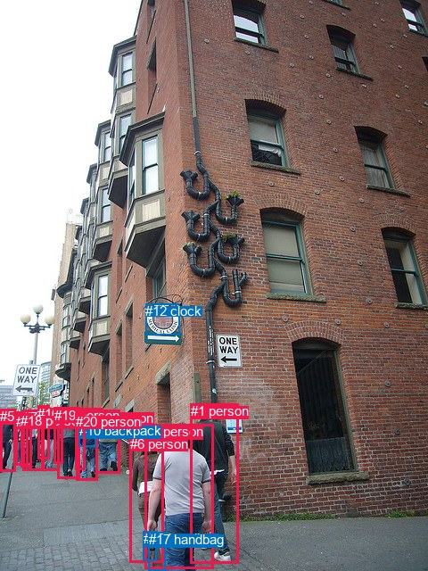
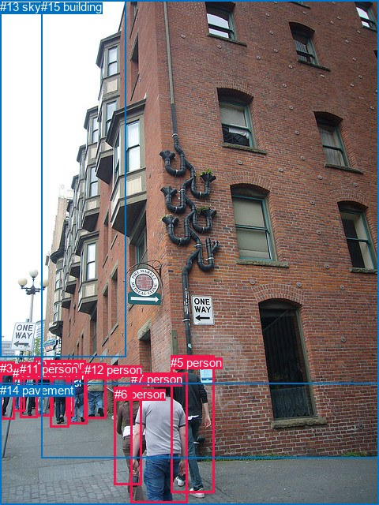

# 图片 0797：2351374.jpg

随机样本序号：481。图片 SHA256：`3abd43185186ffec9dc8d22bfc633216673e3bfabb5c7d1fbf9503edef43b195`。

红色框表示人，蓝色框表示其他物体。两个模式分别保留自身框编号，可依据位置比较对应对象。

## 自动检测框与输出

人的框编号：`[0, 1, 2, 3, 4, 5, 6, 7, 8, 9, 11, 14, 15, 16, 18, 19, 20]`。状态：`ok`。

### 自动检测全部物体框

| 编号 | 类别 | 是否为人 | 检测分数 | 像素坐标 xyxy |
|---|---|---|---|---|
| 0 | person | True | 0.9993 | 162.8, 475.5, 239.8, 637.7 |
| 1 | person | True | 0.9979 | 213.6, 452.2, 267.9, 631.1 |
| 2 | person | True | 0.9961 | 107.3, 459.9, 134.9, 530.5 |
| 3 | person | True | 0.9953 | 85.5, 462.4, 110.0, 538.2 |
| 4 | person | True | 0.9940 | 64.2, 456.3, 89.9, 537.0 |
| 5 | person | True | 0.9921 | 0.0, 458.1, 17.5, 528.8 |
| 6 | person | True | 0.9875 | 145.7, 488.8, 183.5, 630.7 |
| 7 | person | True | 0.9819 | 26.0, 459.4, 48.5, 527.5 |
| 8 | person | True | 0.9815 | 47.9, 459.3, 66.3, 527.4 |
| 9 | person | True | 0.9232 | 17.9, 463.7, 31.9, 521.6 |
| 10 | backpack | False | 0.8982 | 89.0, 474.4, 107.7, 500.2 |
| 11 | person | True | 0.7683 | 42.5, 454.9, 55.2, 472.6 |
| 12 | clock | False | 0.7519 | 163.4, 340.5, 201.9, 375.7 |
| 13 | handbag | False | 0.7413 | 161.0, 595.3, 175.8, 628.6 |
| 14 | person | True | 0.7298 | 61.1, 457.7, 73.8, 473.8 |
| 15 | person | True | 0.7297 | 86.0, 462.5, 95.5, 480.1 |
| 16 | person | True | 0.5293 | 42.3, 454.5, 55.9, 514.6 |
| 17 | handbag | False | 0.5203 | 166.7, 596.2, 185.6, 639.5 |
| 18 | person | True | 0.4942 | 23.3, 463.4, 35.8, 523.4 |
| 19 | person | True | 0.4664 | 60.8, 456.9, 70.4, 519.0 |
| 20 | person | True | 0.4551 | 84.6, 463.5, 95.8, 526.0 |

### 自动检测 Top50 人相关候选

评分物体对：420；人相关物体对：408；输出关系：50。

| 排名 | 主语编号与类别 | 关系 | 宾语编号与类别 | 类型 | 人与人 | 排序分数 | 原始融合 logit |
|---|---|---|---|---|---|---|---|
| 1 | #20 person | wearing | #15 person | semantic | True | 0.98779 | 4.3931 |
| 2 | #3 person | wearing | #10 backpack | semantic | False | 0.98775 | 4.3899 |
| 3 | #16 person | wearing | #11 person | semantic | True | 0.98527 | 4.2032 |
| 4 | #19 person | wearing | #14 person | semantic | True | 0.98240 | 4.0222 |
| 5 | #6 person | carrying | #13 handbag | semantic | False | 0.98015 | 3.8996 |
| 6 | #0 person | carrying | #17 handbag | semantic | False | 0.97463 | 3.6485 |
| 7 | #0 person | carrying | #13 handbag | semantic | False | 0.97194 | 3.5449 |
| 8 | #3 person | wearing | #15 person | semantic | True | 0.97100 | 3.5111 |
| 9 | #4 person | wearing | #14 person | semantic | True | 0.96889 | 3.4387 |
| 10 | #3 person | in | #10 backpack | spatial | False | 0.95674 | 3.0964 |
| 11 | #20 person | in | #15 person | spatial | True | 0.95228 | 2.9935 |
| 12 | #20 person | wearing | #10 backpack | semantic | False | 0.95081 | 2.9616 |
| 13 | #16 person | in | #11 person | spatial | True | 0.94246 | 2.7959 |
| 14 | #6 person | carrying | #17 handbag | semantic | False | 0.93989 | 2.7495 |
| 15 | #8 person | holding | #11 person | semantic | True | 0.92525 | 2.5160 |
| 16 | #19 person | in | #14 person | spatial | True | 0.92358 | 2.4920 |
| 17 | #3 person | in | #15 person | spatial | True | 0.91120 | 2.3284 |
| 18 | #8 person | wearing | #14 person | semantic | True | 0.90261 | 2.2265 |
| 19 | #4 person | in | #14 person | spatial | True | 0.88547 | 2.0453 |
| 20 | #7 person | holding | #11 person | semantic | True | 0.88003 | 1.9927 |
| 21 | #4 person | wearing | #15 person | semantic | True | 0.85308 | 1.7590 |
| 22 | #20 person | in | #10 backpack | spatial | False | 0.82489 | 1.5498 |
| 23 | #6 person | in | #13 handbag | spatial | False | 0.77365 | 1.2290 |
| 24 | #8 person | in | #14 person | spatial | True | 0.75195 | 1.1090 |
| 25 | #8 person | in | #11 person | spatial | True | 0.75135 | 1.1058 |
| 26 | #4 person | wearing | #10 backpack | semantic | False | 0.73929 | 1.0423 |
| 27 | #0 person | in | #17 handbag | spatial | False | 0.73149 | 1.0022 |
| 28 | #16 person | wearing | #14 person | semantic | True | 0.72613 | 0.9751 |
| 29 | #0 person | in | #13 handbag | spatial | False | 0.69380 | 0.8179 |
| 30 | #4 person | in | #15 person | spatial | True | 0.69322 | 0.8152 |
| 31 | #0 person | holding | #6 person | semantic | True | 0.67533 | 0.7324 |
| 32 | #20 person | wearing | #14 person | semantic | True | 0.65596 | 0.6453 |
| 33 | #2 person | wearing | #10 backpack | semantic | False | 0.63748 | 0.5645 |
| 34 | #0 person | walking on | #12 clock | semantic | False | 0.62291 | 0.5019 |
| 35 | #0 person | walking on | #1 person | semantic | True | 0.60840 | 0.4406 |
| 36 | #19 person | holding | #13 handbag | semantic | False | 0.60835 | 0.4404 |
| 37 | #7 person | in | #11 person | spatial | True | 0.59904 | 0.4015 |
| 38 | #3 person | wearing | #14 person | semantic | True | 0.59781 | 0.3964 |
| 39 | #18 person | holding | #11 person | semantic | True | 0.58958 | 0.3622 |
| 40 | #16 person | holding | #13 handbag | semantic | False | 0.52659 | 0.1065 |
| 41 | #6 person | in | #17 handbag | spatial | False | 0.52360 | 0.0945 |
| 42 | #20 person | holding | #13 handbag | semantic | False | 0.51795 | 0.0718 |
| 43 | #19 person | wearing | #11 person | semantic | True | 0.50850 | 0.0340 |
| 44 | #19 person | holding | #17 handbag | semantic | False | 0.50500 | 0.0200 |
| 45 | #1 person | walking on | #12 clock | semantic | False | 0.50217 | 0.0087 |
| 46 | #20 person | holding | #17 handbag | semantic | False | 0.50195 | 0.0078 |
| 47 | #8 person | holding | #13 handbag | semantic | False | 0.48164 | -0.0735 |
| 48 | #19 person | wearing | #15 person | semantic | True | 0.46957 | -0.1219 |
| 49 | #9 person | holding | #11 person | semantic | True | 0.44956 | -0.2025 |
| 50 | #10 backpack | on | #15 person | spatial | False | 0.44683 | -0.2135 |

### 自动检测逐条人相关 GT 核验

R@50：0.00%；命中 0/6。

| GT 主语编号 | GT 关系 | GT 宾语编号 | 结果阶段 | 匹配预测主语编号 | 匹配预测宾语编号 |
|---|---|---|---|---|---|
| 7 | attached to | 14 | endpoint_missing_or_wrong_class | [0] | [] |
| 7 | walking on | 14 | endpoint_missing_or_wrong_class | [0] | [] |
| 8 | in front of | 9 | wrong_predicate | [14] | [11] |
| 10 | going down | 14 | endpoint_missing_or_wrong_class | [9] | [] |
| 12 | beside | 15 | endpoint_missing_or_wrong_class | [2] | [] |
| 13 | on | 3 | endpoint_missing_or_wrong_class | [] | [5] |

## 真实框与输出

人的框编号：`[0, 1, 2, 3, 4, 5, 6, 7, 8, 9, 10, 11, 12]`。

### 真实框全部物体框

| 编号 | 类别 | 是否为人 | 检测分数 | 像素坐标 xyxy |
|---|---|---|---|---|
| 0 | person | True | GT | 46.0, 459.0, 68.0, 528.0 |
| 1 | person | True | GT | 64.0, 457.0, 88.0, 541.0 |
| 2 | person | True | GT | 88.0, 463.0, 111.0, 538.0 |
| 3 | person | True | GT | 0.0, 458.0, 18.0, 531.0 |
| 4 | person | True | GT | 83.0, 464.0, 93.0, 528.0 |
| 5 | person | True | GT | 216.0, 451.0, 271.0, 625.0 |
| 6 | person | True | GT | 145.0, 491.0, 180.0, 615.0 |
| 7 | person | True | GT | 166.0, 472.0, 238.0, 637.0 |
| 8 | person | True | GT | 61.0, 458.0, 71.0, 472.0 |
| 9 | person | True | GT | 43.0, 454.0, 53.0, 472.0 |
| 10 | person | True | GT | 16.0, 464.0, 31.0, 522.0 |
| 11 | person | True | GT | 25.0, 459.0, 47.0, 529.0 |
| 12 | person | True | GT | 107.0, 460.0, 135.0, 530.0 |
| 13 | sky | False | GT | 0.0, 0.0, 159.0, 453.0 |
| 14 | pavement | False | GT | 0.0, 486.0, 480.0, 640.0 |
| 15 | building | False | GT | 52.0, 0.0, 480.0, 581.0 |

### 真实框 Top50 人相关候选

评分物体对：240；人相关物体对：234；输出关系：50。

| 排名 | 主语编号与类别 | 关系 | 宾语编号与类别 | 类型 | 人与人 | 排序分数 | 原始融合 logit |
|---|---|---|---|---|---|---|---|
| 1 | #5 person | walking on | #14 pavement | semantic | False | 0.99575 | 5.4567 |
| 2 | #7 person | walking on | #14 pavement | semantic | False | 0.99492 | 5.2768 |
| 3 | #11 person | walking on | #14 pavement | semantic | False | 0.99421 | 5.1455 |
| 4 | #3 person | walking on | #14 pavement | semantic | False | 0.99399 | 5.1083 |
| 5 | #10 person | walking on | #14 pavement | semantic | False | 0.99389 | 5.0913 |
| 6 | #1 person | walking on | #14 pavement | semantic | False | 0.99324 | 4.9896 |
| 7 | #2 person | walking on | #14 pavement | semantic | False | 0.99279 | 4.9256 |
| 8 | #12 person | walking on | #14 pavement | semantic | False | 0.99264 | 4.9046 |
| 9 | #0 person | walking on | #14 pavement | semantic | False | 0.99227 | 4.8548 |
| 10 | #6 person | walking on | #14 pavement | semantic | False | 0.99194 | 4.8128 |
| 11 | #4 person | walking on | #14 pavement | semantic | False | 0.98728 | 4.3516 |
| 12 | #1 person | wearing | #8 person | semantic | True | 0.96744 | 3.3914 |
| 13 | #3 person | walking on | #15 building | semantic | False | 0.96020 | 3.1834 |
| 14 | #0 person | wearing | #8 person | semantic | True | 0.95722 | 3.1081 |
| 15 | #5 person | on | #14 pavement | spatial | False | 0.94450 | 2.8343 |
| 16 | #10 person | walking on | #15 building | semantic | False | 0.93445 | 2.6571 |
| 17 | #7 person | on | #14 pavement | spatial | False | 0.93380 | 2.6466 |
| 18 | #0 person | holding | #9 person | semantic | True | 0.93287 | 2.6316 |
| 19 | #11 person | walking on | #15 building | semantic | False | 0.92635 | 2.5319 |
| 20 | #7 person | walking on | #15 building | semantic | False | 0.91446 | 2.3694 |
| 21 | #9 person | looking at | #15 building | semantic | False | 0.91392 | 2.3625 |
| 22 | #1 person | walking on | #15 building | semantic | False | 0.90967 | 2.3096 |
| 23 | #6 person | on | #14 pavement | spatial | False | 0.90951 | 2.3077 |
| 24 | #0 person | walking on | #15 building | semantic | False | 0.90849 | 2.2953 |
| 25 | #2 person | on | #14 pavement | spatial | False | 0.89745 | 2.1692 |
| 26 | #1 person | on | #14 pavement | spatial | False | 0.89408 | 2.1331 |
| 27 | #5 person | looking at | #15 building | semantic | False | 0.89157 | 2.1069 |
| 28 | #12 person | on | #14 pavement | spatial | False | 0.88446 | 2.0353 |
| 29 | #9 person | walking on | #14 pavement | semantic | False | 0.88259 | 2.0172 |
| 30 | #2 person | looking at | #15 building | semantic | False | 0.86988 | 1.8999 |
| 31 | #5 person | leaning on | #15 building | spatial | False | 0.86767 | 1.8805 |
| 32 | #4 person | looking at | #15 building | semantic | False | 0.86505 | 1.8579 |
| 33 | #12 person | looking at | #15 building | semantic | False | 0.86179 | 1.8302 |
| 34 | #11 person | on | #14 pavement | spatial | False | 0.86121 | 1.8254 |
| 35 | #11 person | holding | #9 person | semantic | True | 0.85927 | 1.8092 |
| 36 | #3 person | on | #14 pavement | spatial | False | 0.85312 | 1.7593 |
| 37 | #1 person | in | #8 person | spatial | True | 0.85048 | 1.7384 |
| 38 | #0 person | on | #14 pavement | spatial | False | 0.84493 | 1.6954 |
| 39 | #10 person | on | #14 pavement | spatial | False | 0.84365 | 1.6856 |
| 40 | #12 person | leaning on | #15 building | spatial | False | 0.84089 | 1.6649 |
| 41 | #8 person | looking at | #15 building | semantic | False | 0.80757 | 1.4343 |
| 42 | #0 person | in | #8 person | spatial | True | 0.80749 | 1.4338 |
| 43 | #4 person | on | #14 pavement | spatial | False | 0.79391 | 1.3487 |
| 44 | #7 person | holding | #6 person | semantic | True | 0.78781 | 1.3118 |
| 45 | #6 person | walking on | #15 building | semantic | False | 0.78145 | 1.2741 |
| 46 | #7 person | in front of | #15 building | spatial | False | 0.75515 | 1.1262 |
| 47 | #2 person | beside | #15 building | spatial | False | 0.74179 | 1.0553 |
| 48 | #3 person | beside | #15 building | spatial | False | 0.73024 | 0.9958 |
| 49 | #0 person | beside | #15 building | spatial | False | 0.72687 | 0.9788 |
| 50 | #1 person | beside | #15 building | spatial | False | 0.72236 | 0.9562 |

### 真实框逐条人相关 GT 核验

R@50：16.67%；命中 1/6。

| GT 主语编号 | GT 关系 | GT 宾语编号 | 结果阶段 | 匹配预测主语编号 | 匹配预测宾语编号 |
|---|---|---|---|---|---|
| 7 | attached to | 14 | wrong_predicate | [7] | [14] |
| 7 | walking on | 14 | hit50 | [7] | [14] |
| 8 | in front of | 9 | wrong_predicate | [8] | [9] |
| 10 | going down | 14 | wrong_predicate | [10] | [14] |
| 12 | beside | 15 | wrong_predicate | [12] | [15] |
| 13 | on | 3 | wrong_predicate | [13] | [3] |

## 全部人相关 GT

| 主语编号与类别 | 关系 | 宾语编号与类别 |
|---|---|---|
| #7 person | attached to | #14 pavement |
| #7 person | walking on | #14 pavement |
| #8 person | in front of | #9 person |
| #10 person | going down | #14 pavement |
| #12 person | beside | #15 building |
| #13 sky | on | #3 person |

原始记录、全部人相关物体对的两项预测与分项分数见 [逐图证据 JSON](../evidence/cases/0797.json)。全部56类 logits 保留于本机 HOR/output/random500/logits/。

<!-- HOR_COMPLETE_RESULTS -->

## 六组条件的完整输出对照

以下保留同一图片三种框与候选模式、两种谓词输出规则的全部 Top50。框编号各自在所属模式内解释。

### 自动检测框完整枚举：空间与语义各保留一个谓词

| 排名 | 主语编号与类别 | 谓词 | 宾语编号与类别 | 分组 | 排序分数 | predicate logit | pair logit |
|---|---|---|---|---|---|---|---|
| 1 | #20 person | wearing | #15 person | semantic | 0.9877881 | 4.0314584 | 0.3616061 |
| 2 | #3 person | wearing | #10 backpack | semantic | 0.9877496 | 4.0197234 | 0.3701506 |
| 3 | #16 person | wearing | #11 person | semantic | 0.9852723 | 4.0799050 | 0.1232872 |
| 4 | #19 person | wearing | #14 person | semantic | 0.9824011 | 4.0255904 | -0.0034284 |
| 5 | #6 person | carrying | #13 handbag | semantic | 0.9801512 | 3.5206828 | 0.3788810 |
| 6 | #0 person | carrying | #17 handbag | semantic | 0.9746310 | 3.0811639 | 0.5673647 |
| 7 | #0 person | carrying | #13 handbag | semantic | 0.9719394 | 3.0881538 | 0.4567752 |
| 8 | #3 person | wearing | #15 person | semantic | 0.9710010 | 3.0844936 | 0.4265736 |
| 9 | #4 person | wearing | #14 person | semantic | 0.9688926 | 3.1153369 | 0.3233720 |
| 10 | #3 person | in | #10 backpack | spatial | 0.9567420 | 2.7262011 | 0.3701506 |
| 11 | #20 person | in | #15 person | spatial | 0.9522818 | 2.6319404 | 0.3616061 |
| 12 | #20 person | wearing | #10 backpack | semantic | 0.9508092 | 2.6734486 | 0.2881579 |
| 13 | #16 person | in | #11 person | spatial | 0.9424562 | 2.6726561 | 0.1232872 |
| 14 | #6 person | carrying | #17 handbag | semantic | 0.9398865 | 2.4422569 | 0.3072673 |
| 15 | #8 person | holding | #11 person | semantic | 0.9252531 | 2.3706913 | 0.1452683 |
| 16 | #19 person | in | #14 person | spatial | 0.9235790 | 2.4954271 | -0.0034284 |
| 17 | #3 person | in | #15 person | spatial | 0.9111980 | 1.9017773 | 0.4265736 |
| 18 | #8 person | wearing | #14 person | semantic | 0.9026068 | 2.0678649 | 0.1586668 |
| 19 | #4 person | in | #14 person | spatial | 0.8854688 | 1.7218976 | 0.3233720 |
| 20 | #7 person | holding | #11 person | semantic | 0.8800325 | 1.7659125 | 0.2268253 |
| 21 | #4 person | wearing | #15 person | semantic | 0.8530787 | 1.4219575 | 0.3369966 |
| 22 | #20 person | in | #10 backpack | spatial | 0.8248912 | 1.2616858 | 0.2881579 |
| 23 | #6 person | in | #13 handbag | spatial | 0.7736475 | 0.8501420 | 0.3788810 |
| 24 | #8 person | in | #14 person | spatial | 0.7519498 | 0.9503717 | 0.1586668 |
| 25 | #8 person | in | #11 person | spatial | 0.7513488 | 0.9605508 | 0.1452683 |
| 26 | #4 person | wearing | #10 backpack | semantic | 0.7392909 | 0.7886105 | 0.2536758 |
| 27 | #0 person | in | #17 handbag | spatial | 0.7314906 | 0.4348340 | 0.5673647 |
| 28 | #16 person | wearing | #14 person | semantic | 0.7261313 | 0.9039330 | 0.0711491 |
| 29 | #0 person | in | #13 handbag | spatial | 0.6937966 | 0.3611541 | 0.4567752 |
| 30 | #4 person | in | #15 person | spatial | 0.6932158 | 0.4782004 | 0.3369966 |
| 31 | #0 person | holding | #6 person | semantic | 0.6753317 | 0.9976320 | -0.2652324 |
| 32 | #20 person | wearing | #14 person | semantic | 0.6559594 | 0.3975706 | 0.2477688 |
| 33 | #2 person | wearing | #10 backpack | semantic | 0.6374830 | 0.4811521 | 0.0833040 |
| 34 | #0 person | walking on | #12 clock | semantic | 0.6229069 | 1.0306726 | -0.5287673 |
| 35 | #0 person | walking on | #1 person | semantic | 0.6084042 | 1.5316730 | -1.0910637 |
| 36 | #19 person | holding | #13 handbag | semantic | 0.6083523 | 1.5524497 | -1.1120582 |
| 37 | #7 person | in | #11 person | spatial | 0.5990390 | 0.1746373 | 0.2268253 |
| 38 | #3 person | wearing | #14 person | semantic | 0.5978135 | 0.0746164 | 0.3217465 |
| 39 | #18 person | holding | #11 person | semantic | 0.5895780 | 0.1396775 | 0.2225435 |
| 40 | #16 person | holding | #13 handbag | semantic | 0.5265874 | 1.2867980 | -1.1803479 |
| 41 | #6 person | in | #17 handbag | spatial | 0.5236030 | -0.2127852 | 0.3072673 |
| 42 | #20 person | holding | #13 handbag | semantic | 0.5179531 | 0.7630706 | -0.6912272 |
| 43 | #19 person | wearing | #11 person | semantic | 0.5084972 | 0.1119337 | -0.0779414 |
| 44 | #19 person | holding | #17 handbag | semantic | 0.5050031 | 1.2794127 | -1.2593999 |
| 45 | #1 person | walking on | #12 clock | semantic | 0.5021678 | 0.7463179 | -0.7376466 |
| 46 | #20 person | holding | #17 handbag | semantic | 0.5019483 | 0.8195605 | -0.8117672 |
| 47 | #8 person | holding | #13 handbag | semantic | 0.4816370 | 0.9395461 | -1.0130311 |
| 48 | #19 person | wearing | #15 person | semantic | 0.4695713 | -0.1052518 | -0.0166135 |
| 49 | #9 person | holding | #11 person | semantic | 0.4495582 | -0.4071250 | 0.2046690 |
| 50 | #10 backpack | on | #15 person | spatial | 0.4468310 | -0.0682521 | -0.1452310 |

GT 命中：0/6，R@50=0.00%。

| GT主语 | GT谓词 | GT宾语 | 结果阶段 | 匹配主语框 | 匹配宾语框 |
|---|---|---|---|---|---|
| 7 | attached to | 14 | endpoint_missing_or_wrong_class | [0] | [] |
| 7 | walking on | 14 | endpoint_missing_or_wrong_class | [0] | [] |
| 8 | in front of | 9 | wrong_predicate | [14] | [11] |
| 10 | going down | 14 | endpoint_missing_or_wrong_class | [9] | [] |
| 12 | beside | 15 | endpoint_missing_or_wrong_class | [2] | [] |
| 13 | on | 3 | endpoint_missing_or_wrong_class | [] | [5] |

### 自动检测框完整枚举：每对只保留一个谓词

| 排名 | 主语编号与类别 | 谓词 | 宾语编号与类别 | 分组 | 排序分数 | predicate logit | pair logit |
|---|---|---|---|---|---|---|---|
| 1 | #20 person | wearing | #15 person | single | 0.9877881 | 4.0314584 | 0.3616061 |
| 2 | #3 person | wearing | #10 backpack | single | 0.9877496 | 4.0197234 | 0.3701506 |
| 3 | #16 person | wearing | #11 person | single | 0.9852723 | 4.0799050 | 0.1232872 |
| 4 | #19 person | wearing | #14 person | single | 0.9824011 | 4.0255904 | -0.0034284 |
| 5 | #6 person | carrying | #13 handbag | single | 0.9801512 | 3.5206828 | 0.3788810 |
| 6 | #0 person | carrying | #17 handbag | single | 0.9746310 | 3.0811639 | 0.5673647 |
| 7 | #0 person | carrying | #13 handbag | single | 0.9719394 | 3.0881538 | 0.4567752 |
| 8 | #3 person | wearing | #15 person | single | 0.9710010 | 3.0844936 | 0.4265736 |
| 9 | #4 person | wearing | #14 person | single | 0.9688926 | 3.1153369 | 0.3233720 |
| 10 | #20 person | wearing | #10 backpack | single | 0.9508092 | 2.6734486 | 0.2881579 |
| 11 | #6 person | carrying | #17 handbag | single | 0.9398865 | 2.4422569 | 0.3072673 |
| 12 | #8 person | holding | #11 person | single | 0.9252531 | 2.3706913 | 0.1452683 |
| 13 | #8 person | wearing | #14 person | single | 0.9026068 | 2.0678649 | 0.1586668 |
| 14 | #7 person | holding | #11 person | single | 0.8800325 | 1.7659125 | 0.2268253 |
| 15 | #4 person | wearing | #15 person | single | 0.8530787 | 1.4219575 | 0.3369966 |
| 16 | #4 person | wearing | #10 backpack | single | 0.7392909 | 0.7886105 | 0.2536758 |
| 17 | #16 person | wearing | #14 person | single | 0.7261313 | 0.9039330 | 0.0711491 |
| 18 | #0 person | holding | #6 person | single | 0.6753317 | 0.9976320 | -0.2652324 |
| 19 | #20 person | wearing | #14 person | single | 0.6559594 | 0.3975706 | 0.2477688 |
| 20 | #2 person | wearing | #10 backpack | single | 0.6374830 | 0.4811521 | 0.0833040 |
| 21 | #0 person | walking on | #12 clock | single | 0.6229069 | 1.0306726 | -0.5287673 |
| 22 | #0 person | walking on | #1 person | single | 0.6084042 | 1.5316730 | -1.0910637 |
| 23 | #19 person | holding | #13 handbag | single | 0.6083523 | 1.5524497 | -1.1120582 |
| 24 | #3 person | wearing | #14 person | single | 0.5978135 | 0.0746164 | 0.3217465 |
| 25 | #18 person | holding | #11 person | single | 0.5895780 | 0.1396775 | 0.2225435 |
| 26 | #16 person | holding | #13 handbag | single | 0.5265874 | 1.2867980 | -1.1803479 |
| 27 | #20 person | holding | #13 handbag | single | 0.5179531 | 0.7630706 | -0.6912272 |
| 28 | #19 person | wearing | #11 person | single | 0.5084972 | 0.1119337 | -0.0779414 |
| 29 | #19 person | holding | #17 handbag | single | 0.5050031 | 1.2794127 | -1.2593999 |
| 30 | #1 person | walking on | #12 clock | single | 0.5021678 | 0.7463179 | -0.7376466 |
| 31 | #20 person | holding | #17 handbag | single | 0.5019483 | 0.8195605 | -0.8117672 |
| 32 | #8 person | holding | #13 handbag | single | 0.4816370 | 0.9395461 | -1.0130311 |
| 33 | #19 person | wearing | #15 person | single | 0.4695713 | -0.1052518 | -0.0166135 |
| 34 | #9 person | holding | #11 person | single | 0.4495582 | -0.4071250 | 0.2046690 |
| 35 | #10 backpack | on | #15 person | single | 0.4468310 | -0.0682521 | -0.1452310 |
| 36 | #9 person | walking on | #18 person | single | 0.4403978 | 0.1309180 | -0.3704658 |
| 37 | #5 person | walking on | #9 person | single | 0.4287739 | -0.0300331 | -0.2568223 |
| 38 | #6 person | walking on | #0 person | single | 0.4238144 | 0.5792484 | -0.8863825 |
| 39 | #7 person | wearing | #14 person | single | 0.4224494 | -0.4391890 | 0.1264623 |
| 40 | #9 person | walking on | #7 person | single | 0.4150138 | 0.0647144 | -0.4079907 |
| 41 | #1 person | walking on | #0 person | single | 0.4135822 | 0.4258375 | -0.7750137 |
| 42 | #13 handbag | on | #6 person | single | 0.4124310 | 0.4531755 | -0.8071003 |
| 43 | #4 person | wearing | #11 person | single | 0.3991635 | -0.5566931 | 0.1477413 |
| 44 | #3 person | holding | #13 handbag | single | 0.3945657 | 0.0901747 | -0.5183352 |
| 45 | #18 person | holding | #13 handbag | single | 0.3898502 | 0.7785707 | -1.2265127 |
| 46 | #18 person | walking on | #7 person | single | 0.3820538 | -0.0706892 | -0.4101508 |
| 47 | #3 person | wearing | #20 person | single | 0.3775112 | -0.2366738 | -0.2634516 |
| 48 | #18 person | walking on | #9 person | single | 0.3727637 | -0.1744823 | -0.3458962 |
| 49 | #14 person | on | #19 person | single | 0.3695709 | 0.1650348 | -0.6990930 |
| 50 | #15 person | on | #20 person | single | 0.3691465 | 0.1771989 | -0.7130792 |

GT 命中：0/6，R@50=0.00%。

| GT主语 | GT谓词 | GT宾语 | 结果阶段 | 匹配主语框 | 匹配宾语框 |
|---|---|---|---|---|---|
| 7 | attached to | 14 | endpoint_missing_or_wrong_class | [0] | [] |
| 7 | walking on | 14 | endpoint_missing_or_wrong_class | [0] | [] |
| 8 | in front of | 9 | wrong_predicate | [14] | [11] |
| 10 | going down | 14 | endpoint_missing_or_wrong_class | [9] | [] |
| 12 | beside | 15 | endpoint_missing_or_wrong_class | [2] | [] |
| 13 | on | 3 | endpoint_missing_or_wrong_class | [] | [5] |

### 真实框完整枚举：空间与语义各保留一个谓词

| 排名 | 主语编号与类别 | 谓词 | 宾语编号与类别 | 分组 | 排序分数 | predicate logit | pair logit |
|---|---|---|---|---|---|---|---|
| 1 | #5 person | walking on | #14 pavement | semantic | 0.9957504 | 5.2539287 | 0.2027502 |
| 2 | #7 person | walking on | #14 pavement | semantic | 0.9949172 | 5.0433049 | 0.2334698 |
| 3 | #11 person | walking on | #14 pavement | semantic | 0.9942083 | 4.9500051 | 0.1955243 |
| 4 | #3 person | walking on | #14 pavement | semantic | 0.9939902 | 4.9740891 | 0.1342452 |
| 5 | #10 person | walking on | #14 pavement | semantic | 0.9938875 | 4.8988547 | 0.1924262 |
| 6 | #1 person | walking on | #14 pavement | semantic | 0.9932374 | 4.8537259 | 0.1358455 |
| 7 | #2 person | walking on | #14 pavement | semantic | 0.9927937 | 4.8296409 | 0.0959196 |
| 8 | #12 person | walking on | #14 pavement | semantic | 0.9926423 | 4.9861035 | -0.0814718 |
| 9 | #0 person | walking on | #14 pavement | semantic | 0.9922696 | 4.7784886 | 0.0763608 |
| 10 | #6 person | walking on | #14 pavement | semantic | 0.9919402 | 4.7754512 | 0.0373145 |
| 11 | #4 person | walking on | #14 pavement | semantic | 0.9872772 | 4.3782859 | -0.0267352 |
| 12 | #1 person | wearing | #8 person | semantic | 0.9674351 | 3.0536513 | 0.3377591 |
| 13 | #3 person | walking on | #15 building | semantic | 0.9602050 | 3.8577447 | -0.6743408 |
| 14 | #0 person | wearing | #8 person | semantic | 0.9572241 | 2.8848386 | 0.2232258 |
| 15 | #5 person | on | #14 pavement | spatial | 0.9444991 | 2.6315036 | 0.2027502 |
| 16 | #10 person | walking on | #15 building | semantic | 0.9344468 | 3.2980671 | -0.6409755 |
| 17 | #7 person | on | #14 pavement | spatial | 0.9338012 | 2.4131322 | 0.2334698 |
| 18 | #0 person | holding | #9 person | semantic | 0.9328696 | 2.4604163 | 0.1712120 |
| 19 | #11 person | walking on | #15 building | semantic | 0.9263452 | 3.1295614 | -0.5977035 |
| 20 | #7 person | walking on | #15 building | semantic | 0.9144621 | 2.9700875 | -0.6007113 |
| 21 | #9 person | looking at | #15 building | semantic | 0.9139214 | 3.1156960 | -0.7532131 |
| 22 | #1 person | walking on | #15 building | semantic | 0.9096723 | 3.0573373 | -0.7476984 |
| 23 | #6 person | on | #14 pavement | spatial | 0.9095146 | 2.2704082 | 0.0373145 |
| 24 | #0 person | walking on | #15 building | semantic | 0.9084892 | 3.0182281 | -0.7229022 |
| 25 | #2 person | on | #14 pavement | spatial | 0.8974454 | 2.0732369 | 0.0959196 |
| 26 | #1 person | on | #14 pavement | spatial | 0.8940832 | 1.9972992 | 0.1358455 |
| 27 | #5 person | looking at | #15 building | semantic | 0.8915719 | 2.4367371 | -0.3298378 |
| 28 | #12 person | on | #14 pavement | spatial | 0.8844562 | 2.1167955 | -0.0814718 |
| 29 | #9 person | walking on | #14 pavement | semantic | 0.8825892 | 2.3080525 | -0.2908712 |
| 30 | #2 person | looking at | #15 building | semantic | 0.8698817 | 2.6096144 | -0.7097005 |
| 31 | #5 person | leaning on | #15 building | spatial | 0.8676694 | 2.2103457 | -0.3298378 |
| 32 | #4 person | looking at | #15 building | semantic | 0.8650478 | 2.6397057 | -0.7818414 |
| 33 | #12 person | looking at | #15 building | semantic | 0.8617883 | 2.4605522 | -0.6303291 |
| 34 | #11 person | on | #14 pavement | spatial | 0.8612146 | 1.6298909 | 0.1955243 |
| 35 | #11 person | holding | #9 person | semantic | 0.8592700 | 1.5778098 | 0.2314304 |
| 36 | #3 person | on | #14 pavement | spatial | 0.8531183 | 1.6250253 | 0.1342452 |
| 37 | #1 person | in | #8 person | spatial | 0.8504820 | 1.4006276 | 0.3377591 |
| 38 | #0 person | on | #14 pavement | spatial | 0.8449281 | 1.6190014 | 0.0763608 |
| 39 | #10 person | on | #14 pavement | spatial | 0.8436470 | 1.4931917 | 0.1924262 |
| 40 | #12 person | leaning on | #15 building | spatial | 0.8408883 | 2.2951813 | -0.6303291 |
| 41 | #8 person | looking at | #15 building | semantic | 0.8075748 | 2.5320001 | -1.0976721 |
| 42 | #0 person | in | #8 person | spatial | 0.8074919 | 1.2105689 | 0.2232258 |
| 43 | #4 person | on | #14 pavement | spatial | 0.7939120 | 1.3754044 | -0.0267352 |
| 44 | #7 person | holding | #6 person | semantic | 0.7878070 | 1.6190391 | -0.3072819 |
| 45 | #6 person | walking on | #15 building | semantic | 0.7814475 | 2.1696525 | -0.8955305 |
| 46 | #7 person | in front of | #15 building | spatial | 0.7551454 | 1.7269573 | -0.6007113 |
| 47 | #2 person | beside | #15 building | spatial | 0.7417934 | 1.7650113 | -0.7097005 |
| 48 | #3 person | beside | #15 building | spatial | 0.7302377 | 1.6701694 | -0.6743408 |
| 49 | #0 person | beside | #15 building | spatial | 0.7268710 | 1.7017064 | -0.7229022 |
| 50 | #1 person | beside | #15 building | spatial | 0.7223614 | 1.7039037 | -0.7476984 |

GT 命中：1/6，R@50=16.67%。

| GT主语 | GT谓词 | GT宾语 | 结果阶段 | 匹配主语框 | 匹配宾语框 |
|---|---|---|---|---|---|
| 7 | attached to | 14 | wrong_predicate | [7] | [14] |
| 7 | walking on | 14 | hit50 | [7] | [14] |
| 8 | in front of | 9 | wrong_predicate | [8] | [9] |
| 10 | going down | 14 | wrong_predicate | [10] | [14] |
| 12 | beside | 15 | wrong_predicate | [12] | [15] |
| 13 | on | 3 | wrong_predicate | [13] | [3] |

### 真实框完整枚举：每对只保留一个谓词

| 排名 | 主语编号与类别 | 谓词 | 宾语编号与类别 | 分组 | 排序分数 | predicate logit | pair logit |
|---|---|---|---|---|---|---|---|
| 1 | #5 person | walking on | #14 pavement | single | 0.9957504 | 5.2539287 | 0.2027502 |
| 2 | #7 person | walking on | #14 pavement | single | 0.9949172 | 5.0433049 | 0.2334698 |
| 3 | #11 person | walking on | #14 pavement | single | 0.9942083 | 4.9500051 | 0.1955243 |
| 4 | #3 person | walking on | #14 pavement | single | 0.9939902 | 4.9740891 | 0.1342452 |
| 5 | #10 person | walking on | #14 pavement | single | 0.9938875 | 4.8988547 | 0.1924262 |
| 6 | #1 person | walking on | #14 pavement | single | 0.9932374 | 4.8537259 | 0.1358455 |
| 7 | #2 person | walking on | #14 pavement | single | 0.9927937 | 4.8296409 | 0.0959196 |
| 8 | #12 person | walking on | #14 pavement | single | 0.9926423 | 4.9861035 | -0.0814718 |
| 9 | #0 person | walking on | #14 pavement | single | 0.9922696 | 4.7784886 | 0.0763608 |
| 10 | #6 person | walking on | #14 pavement | single | 0.9919402 | 4.7754512 | 0.0373145 |
| 11 | #4 person | walking on | #14 pavement | single | 0.9872772 | 4.3782859 | -0.0267352 |
| 12 | #1 person | wearing | #8 person | single | 0.9674351 | 3.0536513 | 0.3377591 |
| 13 | #3 person | walking on | #15 building | single | 0.9602050 | 3.8577447 | -0.6743408 |
| 14 | #0 person | wearing | #8 person | single | 0.9572241 | 2.8848386 | 0.2232258 |
| 15 | #10 person | walking on | #15 building | single | 0.9344468 | 3.2980671 | -0.6409755 |
| 16 | #0 person | holding | #9 person | single | 0.9328696 | 2.4604163 | 0.1712120 |
| 17 | #11 person | walking on | #15 building | single | 0.9263452 | 3.1295614 | -0.5977035 |
| 18 | #7 person | walking on | #15 building | single | 0.9144621 | 2.9700875 | -0.6007113 |
| 19 | #9 person | looking at | #15 building | single | 0.9139214 | 3.1156960 | -0.7532131 |
| 20 | #1 person | walking on | #15 building | single | 0.9096723 | 3.0573373 | -0.7476984 |
| 21 | #0 person | walking on | #15 building | single | 0.9084892 | 3.0182281 | -0.7229022 |
| 22 | #5 person | looking at | #15 building | single | 0.8915719 | 2.4367371 | -0.3298378 |
| 23 | #9 person | walking on | #14 pavement | single | 0.8825892 | 2.3080525 | -0.2908712 |
| 24 | #2 person | looking at | #15 building | single | 0.8698817 | 2.6096144 | -0.7097005 |
| 25 | #4 person | looking at | #15 building | single | 0.8650478 | 2.6397057 | -0.7818414 |
| 26 | #12 person | looking at | #15 building | single | 0.8617883 | 2.4605522 | -0.6303291 |
| 27 | #11 person | holding | #9 person | single | 0.8592700 | 1.5778098 | 0.2314304 |
| 28 | #8 person | looking at | #15 building | single | 0.8075748 | 2.5320001 | -1.0976721 |
| 29 | #7 person | holding | #6 person | single | 0.7878070 | 1.6190391 | -0.3072819 |
| 30 | #6 person | walking on | #15 building | single | 0.7814475 | 2.1696525 | -0.8955305 |
| 31 | #10 person | walking on | #11 person | single | 0.5895061 | 0.7567854 | -0.3948612 |
| 32 | #3 person | walking on | #10 person | single | 0.5844706 | 0.5913181 | -0.2501647 |
| 33 | #8 person | walking on | #14 pavement | single | 0.4941634 | 0.6199741 | -0.6433214 |
| 34 | #10 person | walking on | #3 person | single | 0.4828715 | 0.0542054 | -0.1227461 |
| 35 | #7 person | walking on | #5 person | single | 0.4673937 | 0.9825325 | -1.1131432 |
| 36 | #11 person | walking on | #10 person | single | 0.4190543 | 0.0587211 | -0.3853781 |
| 37 | #6 person | walking on | #7 person | single | 0.4175151 | 0.6943312 | -1.0273137 |
| 38 | #5 person | beside | #7 person | single | 0.4102070 | 0.4934301 | -0.8565398 |
| 39 | #3 person | walking on | #11 person | single | 0.3986312 | -0.0511069 | -0.3600645 |
| 40 | #4 person | wearing | #8 person | single | 0.3556391 | -0.8626492 | 0.2683065 |
| 41 | #11 person | wearing | #8 person | single | 0.3548310 | -0.7591727 | 0.1613019 |
| 42 | #2 person | wearing | #8 person | single | 0.3483958 | -0.9697747 | 0.3436764 |
| 43 | #10 person | carrying | #9 person | single | 0.3219646 | -0.9819202 | 0.2371622 |
| 44 | #1 person | holding | #4 person | single | 0.2940627 | -0.4954925 | -0.3802409 |
| 45 | #1 person | wearing | #9 person | single | 0.2725534 | -1.0946500 | 0.1129438 |
| 46 | #4 person | walking on | #2 person | single | 0.2589538 | -0.3859015 | -0.6655122 |
| 47 | #0 person | walking on | #11 person | single | 0.2568246 | -0.5190053 | -0.5435334 |
| 48 | #11 person | beside | #3 person | single | 0.2564021 | -0.8364537 | -0.2282999 |
| 49 | #11 person | walking on | #0 person | single | 0.2557222 | -0.6363740 | -0.4319484 |
| 50 | #2 person | holding | #4 person | single | 0.2479767 | -0.7965751 | -0.3128575 |

GT 命中：1/6，R@50=16.67%。

| GT主语 | GT谓词 | GT宾语 | 结果阶段 | 匹配主语框 | 匹配宾语框 |
|---|---|---|---|---|---|
| 7 | attached to | 14 | wrong_predicate | [7] | [14] |
| 7 | walking on | 14 | hit50 | [7] | [14] |
| 8 | in front of | 9 | wrong_predicate | [8] | [9] |
| 10 | going down | 14 | wrong_predicate | [10] | [14] |
| 12 | beside | 15 | wrong_predicate | [12] | [15] |
| 13 | on | 3 | wrong_predicate | [13] | [3] |

### 真实框400候选：空间与语义各保留一个谓词

| 排名 | 主语编号与类别 | 谓词 | 宾语编号与类别 | 分组 | 排序分数 | predicate logit | pair logit |
|---|---|---|---|---|---|---|---|
| 1 | #5 person | walking on | #14 pavement | semantic | 0.9957504 | 5.2539287 | 0.2027502 |
| 2 | #7 person | walking on | #14 pavement | semantic | 0.9949322 | 5.0463147 | 0.2334698 |
| 3 | #11 person | walking on | #14 pavement | semantic | 0.9942083 | 4.9500051 | 0.1955243 |
| 4 | #3 person | walking on | #14 pavement | semantic | 0.9939902 | 4.9740891 | 0.1342452 |
| 5 | #10 person | walking on | #14 pavement | semantic | 0.9938691 | 4.8958440 | 0.1924262 |
| 6 | #1 person | walking on | #14 pavement | semantic | 0.9932374 | 4.8537259 | 0.1358455 |
| 7 | #2 person | walking on | #14 pavement | semantic | 0.9927937 | 4.8296409 | 0.0959196 |
| 8 | #0 person | walking on | #14 pavement | semantic | 0.9926743 | 4.8326507 | 0.0763608 |
| 9 | #12 person | walking on | #14 pavement | semantic | 0.9926423 | 4.9861035 | -0.0814718 |
| 10 | #6 person | walking on | #14 pavement | semantic | 0.9919642 | 4.7784629 | 0.0373145 |
| 11 | #4 person | walking on | #14 pavement | semantic | 0.9872772 | 4.3782859 | -0.0267352 |
| 12 | #1 person | wearing | #8 person | semantic | 0.9674351 | 3.0536513 | 0.3377591 |
| 13 | #3 person | walking on | #15 building | semantic | 0.9602050 | 3.8577447 | -0.6743408 |
| 14 | #0 person | wearing | #8 person | semantic | 0.9572241 | 2.8848386 | 0.2232258 |
| 15 | #5 person | on | #14 pavement | spatial | 0.9444991 | 2.6315036 | 0.2027502 |
| 16 | #0 person | holding | #9 person | semantic | 0.9361896 | 2.5146904 | 0.1712120 |
| 17 | #10 person | walking on | #15 building | semantic | 0.9344468 | 3.2980671 | -0.6409755 |
| 18 | #7 person | on | #14 pavement | spatial | 0.9338012 | 2.4131322 | 0.2334698 |
| 19 | #11 person | walking on | #15 building | semantic | 0.9263452 | 3.1295614 | -0.5977035 |
| 20 | #7 person | walking on | #15 building | semantic | 0.9144621 | 2.9700875 | -0.6007113 |
| 21 | #9 person | looking at | #15 building | semantic | 0.9138664 | 3.1149979 | -0.7532131 |
| 22 | #0 person | walking on | #15 building | semantic | 0.9084892 | 3.0182281 | -0.7229022 |
| 23 | #6 person | on | #14 pavement | spatial | 0.9063041 | 2.2320051 | 0.0373145 |
| 24 | #1 person | walking on | #15 building | semantic | 0.9051220 | 3.0031757 | -0.7476984 |
| 25 | #2 person | on | #14 pavement | spatial | 0.8984433 | 2.0841265 | 0.0959196 |
| 26 | #1 person | on | #14 pavement | spatial | 0.8940832 | 1.9972992 | 0.1358455 |
| 27 | #5 person | looking at | #15 building | semantic | 0.8915719 | 2.4367371 | -0.3298378 |
| 28 | #12 person | on | #14 pavement | spatial | 0.8844562 | 2.1167955 | -0.0814718 |
| 29 | #9 person | walking on | #14 pavement | semantic | 0.8797538 | 2.2809720 | -0.2908712 |
| 30 | #2 person | looking at | #15 building | semantic | 0.8698817 | 2.6096144 | -0.7097005 |
| 31 | #5 person | leaning on | #15 building | spatial | 0.8676694 | 2.2103457 | -0.3298378 |
| 32 | #11 person | holding | #9 person | semantic | 0.8657060 | 1.6320834 | 0.2314304 |
| 33 | #4 person | looking at | #15 building | semantic | 0.8651292 | 2.6404028 | -0.7818414 |
| 34 | #11 person | on | #14 pavement | spatial | 0.8612146 | 1.6298909 | 0.1955243 |
| 35 | #12 person | looking at | #15 building | semantic | 0.8581650 | 2.4304614 | -0.6303291 |
| 36 | #3 person | on | #14 pavement | spatial | 0.8531183 | 1.6250253 | 0.1342452 |
| 37 | #1 person | in | #8 person | spatial | 0.8504820 | 1.4006276 | 0.3377591 |
| 38 | #0 person | on | #14 pavement | spatial | 0.8456401 | 1.6244459 | 0.0763608 |
| 39 | #10 person | on | #14 pavement | spatial | 0.8436470 | 1.4931917 | 0.1924262 |
| 40 | #12 person | leaning on | #15 building | spatial | 0.8408883 | 2.2951813 | -0.6303291 |
| 41 | #0 person | in | #8 person | spatial | 0.8116195 | 1.2373419 | 0.2232258 |
| 42 | #8 person | looking at | #15 building | semantic | 0.8076831 | 2.5326967 | -1.0976721 |
| 43 | #4 person | on | #14 pavement | spatial | 0.7939120 | 1.3754044 | -0.0267352 |
| 44 | #7 person | holding | #6 person | semantic | 0.7878070 | 1.6190391 | -0.3072819 |
| 45 | #6 person | walking on | #15 building | semantic | 0.7762648 | 2.1395612 | -0.8955305 |
| 46 | #7 person | in front of | #15 building | spatial | 0.7551454 | 1.7269573 | -0.6007113 |
| 47 | #2 person | beside | #15 building | spatial | 0.7417934 | 1.7650113 | -0.7097005 |
| 48 | #3 person | beside | #15 building | spatial | 0.7302377 | 1.6701694 | -0.6743408 |
| 49 | #0 person | beside | #15 building | spatial | 0.7268710 | 1.7017064 | -0.7229022 |
| 50 | #1 person | beside | #15 building | spatial | 0.7223381 | 1.7037878 | -0.7476984 |

GT 命中：1/6，R@50=16.67%。

| GT主语 | GT谓词 | GT宾语 | 结果阶段 | 匹配主语框 | 匹配宾语框 |
|---|---|---|---|---|---|
| 7 | attached to | 14 | wrong_predicate | [7] | [14] |
| 7 | walking on | 14 | hit50 | [7] | [14] |
| 8 | in front of | 9 | wrong_predicate | [8] | [9] |
| 10 | going down | 14 | wrong_predicate | [10] | [14] |
| 12 | beside | 15 | wrong_predicate | [12] | [15] |
| 13 | on | 3 | wrong_predicate | [13] | [3] |

### 真实框400候选：每对只保留一个谓词

| 排名 | 主语编号与类别 | 谓词 | 宾语编号与类别 | 分组 | 排序分数 | predicate logit | pair logit |
|---|---|---|---|---|---|---|---|
| 1 | #5 person | walking on | #14 pavement | single | 0.9957504 | 5.2539287 | 0.2027502 |
| 2 | #7 person | walking on | #14 pavement | single | 0.9949322 | 5.0463147 | 0.2334698 |
| 3 | #11 person | walking on | #14 pavement | single | 0.9942083 | 4.9500051 | 0.1955243 |
| 4 | #3 person | walking on | #14 pavement | single | 0.9939902 | 4.9740891 | 0.1342452 |
| 5 | #10 person | walking on | #14 pavement | single | 0.9938691 | 4.8958440 | 0.1924262 |
| 6 | #1 person | walking on | #14 pavement | single | 0.9932374 | 4.8537259 | 0.1358455 |
| 7 | #2 person | walking on | #14 pavement | single | 0.9927937 | 4.8296409 | 0.0959196 |
| 8 | #0 person | walking on | #14 pavement | single | 0.9926743 | 4.8326507 | 0.0763608 |
| 9 | #12 person | walking on | #14 pavement | single | 0.9926423 | 4.9861035 | -0.0814718 |
| 10 | #6 person | walking on | #14 pavement | single | 0.9919642 | 4.7784629 | 0.0373145 |
| 11 | #4 person | walking on | #14 pavement | single | 0.9872772 | 4.3782859 | -0.0267352 |
| 12 | #1 person | wearing | #8 person | single | 0.9674351 | 3.0536513 | 0.3377591 |
| 13 | #3 person | walking on | #15 building | single | 0.9602050 | 3.8577447 | -0.6743408 |
| 14 | #0 person | wearing | #8 person | single | 0.9572241 | 2.8848386 | 0.2232258 |
| 15 | #0 person | holding | #9 person | single | 0.9361896 | 2.5146904 | 0.1712120 |
| 16 | #10 person | walking on | #15 building | single | 0.9344468 | 3.2980671 | -0.6409755 |
| 17 | #11 person | walking on | #15 building | single | 0.9263452 | 3.1295614 | -0.5977035 |
| 18 | #7 person | walking on | #15 building | single | 0.9144621 | 2.9700875 | -0.6007113 |
| 19 | #9 person | looking at | #15 building | single | 0.9138664 | 3.1149979 | -0.7532131 |
| 20 | #0 person | walking on | #15 building | single | 0.9084892 | 3.0182281 | -0.7229022 |
| 21 | #1 person | walking on | #15 building | single | 0.9051220 | 3.0031757 | -0.7476984 |
| 22 | #5 person | looking at | #15 building | single | 0.8915719 | 2.4367371 | -0.3298378 |
| 23 | #9 person | walking on | #14 pavement | single | 0.8797538 | 2.2809720 | -0.2908712 |
| 24 | #2 person | looking at | #15 building | single | 0.8698817 | 2.6096144 | -0.7097005 |
| 25 | #11 person | holding | #9 person | single | 0.8657060 | 1.6320834 | 0.2314304 |
| 26 | #4 person | looking at | #15 building | single | 0.8651292 | 2.6404028 | -0.7818414 |
| 27 | #12 person | looking at | #15 building | single | 0.8581650 | 2.4304614 | -0.6303291 |
| 28 | #8 person | looking at | #15 building | single | 0.8076831 | 2.5326967 | -1.0976721 |
| 29 | #7 person | holding | #6 person | single | 0.7878070 | 1.6190391 | -0.3072819 |
| 30 | #6 person | walking on | #15 building | single | 0.7762648 | 2.1395612 | -0.8955305 |
| 31 | #10 person | walking on | #11 person | single | 0.5964054 | 0.7853708 | -0.3948612 |
| 32 | #3 person | walking on | #10 person | single | 0.5778791 | 0.5642376 | -0.2501647 |
| 33 | #8 person | walking on | #14 pavement | single | 0.4941634 | 0.6199741 | -0.6433214 |
| 34 | #10 person | walking on | #3 person | single | 0.4828715 | 0.0542054 | -0.1227461 |
| 35 | #7 person | walking on | #5 person | single | 0.4602846 | 0.9539461 | -1.1131432 |
| 36 | #11 person | walking on | #10 person | single | 0.4194207 | 0.0602264 | -0.3853781 |
| 37 | #6 person | walking on | #7 person | single | 0.4171491 | 0.6928258 | -1.0273137 |
| 38 | #5 person | beside | #7 person | single | 0.4102070 | 0.4934301 | -0.8565398 |
| 39 | #3 person | walking on | #11 person | single | 0.3917987 | -0.0796933 | -0.3600645 |
| 40 | #4 person | wearing | #8 person | single | 0.3487737 | -0.8927402 | 0.2683065 |
| 41 | #11 person | wearing | #8 person | single | 0.3428277 | -0.8120201 | 0.1613019 |
| 42 | #2 person | wearing | #8 person | single | 0.3420911 | -0.9976656 | 0.3436764 |
| 43 | #10 person | carrying | #9 person | single | 0.3128170 | -1.0241444 | 0.2371622 |
| 44 | #1 person | holding | #4 person | single | 0.2937562 | -0.4969697 | -0.3802409 |
| 45 | #1 person | wearing | #9 person | single | 0.2669152 | -1.1232743 | 0.1129438 |
| 46 | #11 person | beside | #3 person | single | 0.2563855 | -0.8365405 | -0.2282999 |
| 47 | #11 person | walking on | #0 person | single | 0.2557222 | -0.6363740 | -0.4319484 |
| 48 | #4 person | walking on | #2 person | single | 0.2536484 | -0.4137354 | -0.6655122 |
| 49 | #0 person | walking on | #11 person | single | 0.2508402 | -0.5506024 | -0.5435334 |
| 50 | #2 person | holding | #4 person | single | 0.2424078 | -0.8266661 | -0.3128575 |

GT 命中：1/6，R@50=16.67%。

| GT主语 | GT谓词 | GT宾语 | 结果阶段 | 匹配主语框 | 匹配宾语框 |
|---|---|---|---|---|---|
| 7 | attached to | 14 | wrong_predicate | [7] | [14] |
| 7 | walking on | 14 | hit50 | [7] | [14] |
| 8 | in front of | 9 | wrong_predicate | [8] | [9] |
| 10 | going down | 14 | wrong_predicate | [10] | [14] |
| 12 | beside | 15 | wrong_predicate | [12] | [15] |
| 13 | on | 3 | wrong_predicate | [13] | [3] |
