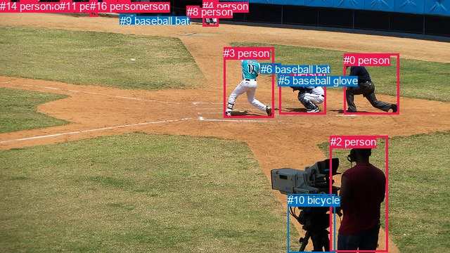
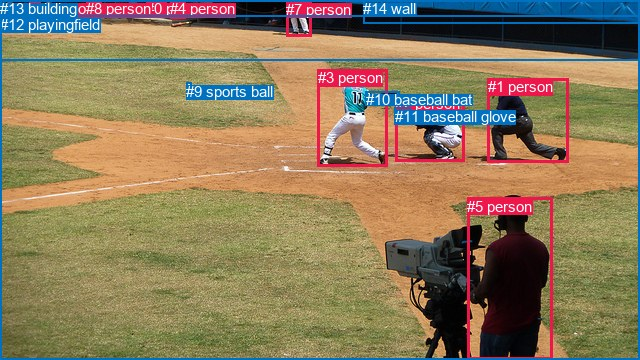

# 图片 0806：2351780.jpg

随机样本序号：203。图片 SHA256：`94a9ed090252062e3ed0959fc90f05ddb34dfc55b48da186b48d8e2d540f9c54`。

红色框表示人，蓝色框表示其他物体。两个模式分别保留自身框编号，可依据位置比较对应对象。

## 自动检测框与输出

人的框编号：`[0, 1, 2, 3, 4, 7, 8, 11, 12, 13, 14, 15, 16]`。状态：`ok`。

### 自动检测全部物体框

| 编号 | 类别 | 是否为人 | 检测分数 | 像素坐标 xyxy |
|---|---|---|---|---|
| 0 | person | True | 0.9997 | 489.1, 77.0, 567.5, 162.9 |
| 1 | person | True | 0.9994 | 397.6, 95.6, 463.5, 162.5 |
| 2 | person | True | 0.9993 | 470.0, 193.1, 551.6, 358.0 |
| 3 | person | True | 0.9993 | 318.0, 67.1, 389.7, 167.1 |
| 4 | person | True | 0.9951 | 288.1, 0.3, 310.6, 37.0 |
| 5 | baseball glove | False | 0.9892 | 395.7, 105.8, 411.3, 121.1 |
| 6 | baseball bat | False | 0.9885 | 370.8, 90.2, 399.3, 97.2 |
| 7 | person | True | 0.8610 | 28.4, 0.1, 53.7, 16.6 |
| 8 | person | True | 0.8194 | 265.9, 8.2, 283.3, 25.8 |
| 9 | baseball bat | False | 0.7911 | 170.9, 20.9, 193.8, 27.4 |
| 10 | bicycle | False | 0.7647 | 409.2, 276.3, 476.9, 359.4 |
| 11 | person | True | 0.7456 | 85.0, 0.1, 102.3, 16.0 |
| 12 | person | True | 0.6549 | 146.7, 0.2, 166.5, 17.2 |
| 13 | person | True | 0.5451 | 0.3, 0.2, 14.8, 12.9 |
| 14 | person | True | 0.4785 | 0.1, 0.2, 5.9, 15.0 |
| 15 | person | True | 0.4221 | 168.5, 0.2, 185.5, 17.8 |
| 16 | person | True | 0.3709 | 127.5, 0.1, 138.4, 23.3 |

### 自动检测 Top50 人相关候选

评分物体对：272；人相关物体对：260；输出关系：50。

| 排名 | 主语编号与类别 | 关系 | 宾语编号与类别 | 类型 | 人与人 | 排序分数 | 原始融合 logit |
|---|---|---|---|---|---|---|---|
| 1 | #3 person | swinging | #6 baseball bat | semantic | False | 0.99729 | 5.9074 |
| 2 | #3 person | swinging | #5 baseball glove | semantic | False | 0.98128 | 3.9591 |
| 3 | #2 person | holding | #10 bicycle | semantic | False | 0.97911 | 3.8473 |
| 4 | #1 person | holding | #5 baseball glove | semantic | False | 0.97622 | 3.7149 |
| 5 | #12 person | sitting on | #9 baseball bat | semantic | False | 0.95888 | 3.1493 |
| 6 | #15 person | on | #9 baseball bat | spatial | False | 0.95764 | 3.1183 |
| 7 | #15 person | sitting on | #9 baseball bat | semantic | False | 0.95619 | 3.0831 |
| 8 | #12 person | on | #9 baseball bat | spatial | False | 0.94971 | 2.9383 |
| 9 | #8 person | looking at | #3 person | semantic | True | 0.92380 | 2.4951 |
| 10 | #0 person | looking at | #3 person | semantic | True | 0.92111 | 2.4576 |
| 11 | #4 person | looking at | #3 person | semantic | True | 0.91053 | 2.3201 |
| 12 | #14 person | in | #13 person | spatial | True | 0.89912 | 2.1875 |
| 13 | #16 person | standing on | #9 baseball bat | semantic | False | 0.88632 | 2.0537 |
| 14 | #2 person | beside | #10 bicycle | spatial | False | 0.88518 | 2.0424 |
| 15 | #11 person | standing on | #9 baseball bat | semantic | False | 0.87343 | 1.9317 |
| 16 | #1 person | catching | #6 baseball bat | semantic | False | 0.86212 | 1.8330 |
| 17 | #2 person | looking at | #3 person | semantic | True | 0.85925 | 1.8091 |
| 18 | #14 person | holding | #13 person | semantic | True | 0.85470 | 1.7720 |
| 19 | #4 person | pushing | #8 person | semantic | True | 0.84538 | 1.6988 |
| 20 | #3 person | on | #6 baseball bat | spatial | False | 0.83384 | 1.6131 |
| 21 | #3 person | in | #5 baseball glove | spatial | False | 0.83244 | 1.6030 |
| 22 | #13 person | standing on | #9 baseball bat | semantic | False | 0.81610 | 1.4901 |
| 23 | #8 person | talking to | #4 person | semantic | True | 0.81012 | 1.4508 |
| 24 | #0 person | looking at | #1 person | semantic | True | 0.80223 | 1.4003 |
| 25 | #1 person | in | #5 baseball glove | spatial | False | 0.79874 | 1.3785 |
| 26 | #3 person | pushing | #1 person | semantic | True | 0.79085 | 1.3301 |
| 27 | #8 person | standing on | #9 baseball bat | semantic | False | 0.78076 | 1.2701 |
| 28 | #10 bicycle | beside | #2 person | spatial | False | 0.78024 | 1.2670 |
| 29 | #10 bicycle | holding | #2 person | semantic | False | 0.75870 | 1.1456 |
| 30 | #2 person | looking at | #1 person | semantic | True | 0.75648 | 1.1335 |
| 31 | #1 person | looking at | #3 person | semantic | True | 0.75223 | 1.1106 |
| 32 | #15 person | looking at | #3 person | semantic | True | 0.74809 | 1.0885 |
| 33 | #16 person | on | #9 baseball bat | spatial | False | 0.74471 | 1.0706 |
| 34 | #4 person | standing on | #9 baseball bat | semantic | False | 0.73975 | 1.0446 |
| 35 | #11 person | looking at | #3 person | semantic | True | 0.73918 | 1.0417 |
| 36 | #3 person | beside | #1 person | spatial | True | 0.73492 | 1.0197 |
| 37 | #0 person | beside | #1 person | spatial | True | 0.72070 | 0.9479 |
| 38 | #7 person | standing on | #9 baseball bat | semantic | False | 0.71676 | 0.9285 |
| 39 | #12 person | looking at | #3 person | semantic | True | 0.69768 | 0.8363 |
| 40 | #14 person | standing on | #9 baseball bat | semantic | False | 0.69252 | 0.8119 |
| 41 | #16 person | looking at | #3 person | semantic | True | 0.68908 | 0.7958 |
| 42 | #7 person | looking at | #3 person | semantic | True | 0.68181 | 0.7621 |
| 43 | #13 person | holding | #14 person | semantic | True | 0.67783 | 0.7438 |
| 44 | #4 person | in | #8 person | spatial | True | 0.66368 | 0.6797 |
| 45 | #0 person | beside | #3 person | spatial | True | 0.65849 | 0.6566 |
| 46 | #12 person | sitting on | #15 person | semantic | True | 0.65424 | 0.6377 |
| 47 | #13 person | in | #14 person | spatial | True | 0.65256 | 0.6303 |
| 48 | #1 person | beside | #3 person | spatial | True | 0.64917 | 0.6154 |
| 49 | #0 person | holding | #5 baseball glove | semantic | False | 0.64483 | 0.5964 |
| 50 | #14 person | looking at | #3 person | semantic | True | 0.63914 | 0.5716 |

### 自动检测逐条人相关 GT 核验

R@50：12.50%；命中 1/8。

| GT 主语编号 | GT 关系 | GT 宾语编号 | 结果阶段 | 匹配预测主语编号 | 匹配预测宾语编号 |
|---|---|---|---|---|---|
| 1 | on | 12 | endpoint_missing_or_wrong_class | [0] | [] |
| 2 | wearing | 11 | wrong_predicate | [1] | [5] |
| 2 | on | 12 | endpoint_missing_or_wrong_class | [1] | [] |
| 3 | about to hit | 9 | endpoint_missing_or_wrong_class | [3] | [] |
| 3 | holding | 10 | endpoint_missing_or_wrong_class | [3] | [] |
| 3 | swinging | 10 | endpoint_missing_or_wrong_class | [3] | [] |
| 5 | looking at | 3 | hit50 | [2] | [3] |
| 5 | on | 12 | endpoint_missing_or_wrong_class | [2] | [] |

## 真实框与输出

人的框编号：`[0, 1, 2, 3, 4, 5, 6, 7, 8]`。

### 真实框全部物体框

| 编号 | 类别 | 是否为人 | 检测分数 | 像素坐标 xyxy |
|---|---|---|---|---|
| 0 | person | True | GT | 146.0, 0.0, 166.0, 16.0 |
| 1 | person | True | GT | 488.0, 78.0, 569.0, 162.0 |
| 2 | person | True | GT | 395.0, 95.0, 464.0, 161.0 |
| 3 | person | True | GT | 318.0, 69.0, 387.0, 166.0 |
| 4 | person | True | GT | 170.0, 0.0, 185.0, 18.0 |
| 5 | person | True | GT | 467.0, 198.0, 552.0, 360.0 |
| 6 | person | True | GT | 29.0, 0.0, 40.0, 17.0 |
| 7 | person | True | GT | 286.0, 1.0, 311.0, 36.0 |
| 8 | person | True | GT | 86.0, 0.0, 101.0, 16.0 |
| 9 | sports ball | False | GT | 186.0, 83.0, 191.0, 87.0 |
| 10 | baseball bat | False | GT | 366.0, 91.0, 400.0, 101.0 |
| 11 | baseball glove | False | GT | 395.0, 108.0, 411.0, 120.0 |
| 12 | playingfield | False | GT | 0.0, 16.0, 640.0, 360.0 |
| 13 | building | False | GT | 0.0, 0.0, 640.0, 61.0 |
| 14 | wall | False | GT | 363.0, 0.0, 640.0, 23.0 |

### 真实框 Top50 人相关候选

评分物体对：210；人相关物体对：180；输出关系：50。

| 排名 | 主语编号与类别 | 关系 | 宾语编号与类别 | 类型 | 人与人 | 排序分数 | 原始融合 logit |
|---|---|---|---|---|---|---|---|
| 1 | #3 person | swinging | #10 baseball bat | semantic | False | 0.99745 | 5.9695 |
| 2 | #3 person | swinging | #11 baseball glove | semantic | False | 0.98242 | 4.0235 |
| 3 | #7 person | standing on | #12 playingfield | semantic | False | 0.98094 | 3.9407 |
| 4 | #7 person | standing on | #13 building | semantic | False | 0.97741 | 3.7673 |
| 5 | #4 person | in | #13 building | spatial | False | 0.97699 | 3.7484 |
| 6 | #2 person | holding | #11 baseball glove | semantic | False | 0.97499 | 3.6632 |
| 7 | #0 person | in | #13 building | spatial | False | 0.97388 | 3.6187 |
| 8 | #6 person | standing on | #12 playingfield | semantic | False | 0.97349 | 3.6035 |
| 9 | #7 person | in | #13 building | spatial | False | 0.97181 | 3.5404 |
| 10 | #1 person | on | #12 playingfield | spatial | False | 0.96946 | 3.4578 |
| 11 | #3 person | on | #12 playingfield | spatial | False | 0.96819 | 3.4157 |
| 12 | #8 person | standing on | #13 building | semantic | False | 0.96361 | 3.2763 |
| 13 | #8 person | in | #13 building | spatial | False | 0.96179 | 3.2257 |
| 14 | #2 person | on | #12 playingfield | spatial | False | 0.95835 | 3.1360 |
| 15 | #8 person | standing on | #12 playingfield | semantic | False | 0.95765 | 3.1184 |
| 16 | #4 person | standing on | #12 playingfield | semantic | False | 0.95653 | 3.0913 |
| 17 | #6 person | standing on | #13 building | semantic | False | 0.95314 | 3.0126 |
| 18 | #0 person | standing on | #13 building | semantic | False | 0.94832 | 2.9096 |
| 19 | #2 person | holding | #10 baseball bat | semantic | False | 0.94815 | 2.9061 |
| 20 | #0 person | standing on | #12 playingfield | semantic | False | 0.94455 | 2.8353 |
| 21 | #5 person | on | #12 playingfield | spatial | False | 0.94303 | 2.8065 |
| 22 | #5 person | standing on | #12 playingfield | semantic | False | 0.94268 | 2.8001 |
| 23 | #4 person | standing on | #13 building | semantic | False | 0.93484 | 2.6635 |
| 24 | #7 person | on | #12 playingfield | spatial | False | 0.93410 | 2.6514 |
| 25 | #6 person | in | #13 building | spatial | False | 0.93325 | 2.6377 |
| 26 | #1 person | standing on | #12 playingfield | semantic | False | 0.92842 | 2.5627 |
| 27 | #4 person | on | #12 playingfield | spatial | False | 0.92822 | 2.5597 |
| 28 | #6 person | on | #12 playingfield | spatial | False | 0.92525 | 2.5159 |
| 29 | #0 person | on | #12 playingfield | spatial | False | 0.89691 | 2.1634 |
| 30 | #3 person | standing on | #12 playingfield | semantic | False | 0.88347 | 2.0257 |
| 31 | #5 person | looking at | #3 person | semantic | True | 0.88101 | 2.0020 |
| 32 | #1 person | looking at | #3 person | semantic | True | 0.87990 | 1.9914 |
| 33 | #8 person | on | #12 playingfield | spatial | False | 0.87377 | 1.9347 |
| 34 | #3 person | throwing | #9 sports ball | semantic | False | 0.86007 | 1.8159 |
| 35 | #7 person | looking at | #3 person | semantic | True | 0.84187 | 1.6722 |
| 36 | #5 person | looking at | #2 person | semantic | True | 0.78899 | 1.3188 |
| 37 | #2 person | standing on | #12 playingfield | semantic | False | 0.77628 | 1.2441 |
| 38 | #2 person | in | #11 baseball glove | spatial | False | 0.76750 | 1.1942 |
| 39 | #3 person | in | #10 baseball bat | spatial | False | 0.75315 | 1.1155 |
| 40 | #6 person | looking at | #3 person | semantic | True | 0.73013 | 0.9953 |
| 41 | #3 person | beside | #2 person | spatial | True | 0.71160 | 0.9032 |
| 42 | #1 person | looking at | #2 person | semantic | True | 0.69820 | 0.8387 |
| 43 | #1 person | beside | #2 person | spatial | True | 0.68917 | 0.7962 |
| 44 | #8 person | looking at | #3 person | semantic | True | 0.68866 | 0.7939 |
| 45 | #2 person | looking at | #3 person | semantic | True | 0.65997 | 0.6632 |
| 46 | #5 person | beside | #1 person | spatial | True | 0.64575 | 0.6004 |
| 47 | #3 person | pushing | #2 person | semantic | True | 0.63431 | 0.5508 |
| 48 | #2 person | beside | #3 person | spatial | True | 0.63312 | 0.5456 |
| 49 | #3 person | in | #11 baseball glove | spatial | False | 0.62863 | 0.5264 |
| 50 | #1 person | beside | #3 person | spatial | True | 0.61791 | 0.4807 |

### 真实框逐条人相关 GT 核验

R@50：62.50%；命中 5/8。

| GT 主语编号 | GT 关系 | GT 宾语编号 | 结果阶段 | 匹配预测主语编号 | 匹配预测宾语编号 |
|---|---|---|---|---|---|
| 1 | on | 12 | hit50 | [1] | [12] |
| 2 | wearing | 11 | wrong_predicate | [2] | [11] |
| 2 | on | 12 | hit50 | [2] | [12] |
| 3 | about to hit | 9 | wrong_predicate | [3] | [9] |
| 3 | holding | 10 | wrong_predicate | [3] | [10] |
| 3 | swinging | 10 | hit50 | [3] | [10] |
| 5 | looking at | 3 | hit50 | [5] | [3] |
| 5 | on | 12 | hit50 | [5] | [12] |

## 全部人相关 GT

| 主语编号与类别 | 关系 | 宾语编号与类别 |
|---|---|---|
| #1 person | on | #12 playingfield |
| #2 person | wearing | #11 baseball glove |
| #2 person | on | #12 playingfield |
| #3 person | about to hit | #9 sports ball |
| #3 person | holding | #10 baseball bat |
| #3 person | swinging | #10 baseball bat |
| #5 person | looking at | #3 person |
| #5 person | on | #12 playingfield |

原始记录、全部人相关物体对的两项预测与分项分数见 [逐图证据 JSON](../evidence/cases/0806.json)。全部56类 logits 保留于本机 HOR/output/random500/logits/。

<!-- HOR_COMPLETE_RESULTS -->

## 六组条件的完整输出对照

以下保留同一图片三种框与候选模式、两种谓词输出规则的全部 Top50。框编号各自在所属模式内解释。

### 自动检测框完整枚举：空间与语义各保留一个谓词

| 排名 | 主语编号与类别 | 谓词 | 宾语编号与类别 | 分组 | 排序分数 | predicate logit | pair logit |
|---|---|---|---|---|---|---|---|
| 1 | #3 person | swinging | #6 baseball bat | semantic | 0.9972881 | 5.5335860 | 0.3738033 |
| 2 | #3 person | swinging | #5 baseball glove | semantic | 0.9812765 | 3.6679626 | 0.2911127 |
| 3 | #2 person | holding | #10 bicycle | semantic | 0.9791085 | 3.8641953 | -0.0168930 |
| 4 | #1 person | holding | #5 baseball glove | semantic | 0.9762203 | 3.9217629 | -0.2069084 |
| 5 | #12 person | sitting on | #9 baseball bat | semantic | 0.9588795 | 3.2470956 | -0.0978358 |
| 6 | #15 person | on | #9 baseball bat | spatial | 0.9576405 | 3.2281737 | -0.1098952 |
| 7 | #15 person | sitting on | #9 baseball bat | semantic | 0.9561885 | 3.1929536 | -0.1098952 |
| 8 | #12 person | on | #9 baseball bat | spatial | 0.9497086 | 3.0361571 | -0.0978358 |
| 9 | #8 person | looking at | #3 person | semantic | 0.9237975 | 3.2191100 | -0.7240117 |
| 10 | #0 person | looking at | #3 person | semantic | 0.9211121 | 3.1101174 | -0.6525635 |
| 11 | #4 person | looking at | #3 person | semantic | 0.9105307 | 2.9105268 | -0.5903950 |
| 12 | #14 person | in | #13 person | spatial | 0.8991249 | 2.0849757 | 0.1025637 |
| 13 | #16 person | standing on | #9 baseball bat | semantic | 0.8863180 | 2.1905503 | -0.1368797 |
| 14 | #2 person | beside | #10 bicycle | spatial | 0.8851755 | 2.0592742 | -0.0168930 |
| 15 | #11 person | standing on | #9 baseball bat | semantic | 0.8734341 | 2.2675653 | -0.3358952 |
| 16 | #1 person | catching | #6 baseball bat | semantic | 0.8621230 | 2.3482285 | -0.5151923 |
| 17 | #2 person | looking at | #3 person | semantic | 0.8592499 | 2.4215055 | -0.6124310 |
| 18 | #14 person | holding | #13 person | semantic | 0.8547006 | 1.6693907 | 0.1025637 |
| 19 | #4 person | pushing | #8 person | semantic | 0.8453828 | 1.7415519 | -0.0427153 |
| 20 | #3 person | on | #6 baseball bat | spatial | 0.8338356 | 1.2392550 | 0.3738033 |
| 21 | #3 person | in | #5 baseball glove | spatial | 0.8324379 | 1.3118920 | 0.2911127 |
| 22 | #13 person | standing on | #9 baseball bat | semantic | 0.8160967 | 2.0751877 | -0.5850651 |
| 23 | #8 person | talking to | #4 person | semantic | 0.8101172 | 1.6171494 | -0.1663773 |
| 24 | #0 person | looking at | #1 person | semantic | 0.8022288 | 2.0331082 | -0.6328252 |
| 25 | #1 person | in | #5 baseball glove | spatial | 0.7987428 | 1.5853639 | -0.2069084 |
| 26 | #3 person | pushing | #1 person | semantic | 0.7908534 | 1.8013673 | -0.4712902 |
| 27 | #8 person | standing on | #9 baseball bat | semantic | 0.7807629 | 1.7420402 | -0.4719227 |
| 28 | #10 bicycle | beside | #2 person | spatial | 0.7802368 | 1.7285595 | -0.4615123 |
| 29 | #10 bicycle | holding | #2 person | semantic | 0.7587026 | 1.6070919 | -0.4615123 |
| 30 | #2 person | looking at | #1 person | semantic | 0.7564799 | 1.8060832 | -0.6726066 |
| 31 | #1 person | looking at | #3 person | semantic | 0.7522330 | 1.8063235 | -0.6957660 |
| 32 | #15 person | looking at | #3 person | semantic | 0.7480923 | 2.1379161 | -1.0494524 |
| 33 | #16 person | on | #9 baseball bat | spatial | 0.7447065 | 1.2074556 | -0.1368797 |
| 34 | #4 person | standing on | #9 baseball bat | semantic | 0.7397451 | 1.6238194 | -0.5791748 |
| 35 | #11 person | looking at | #3 person | semantic | 0.7391776 | 1.8411875 | -0.7994887 |
| 36 | #3 person | beside | #1 person | spatial | 0.7349180 | 1.4910097 | -0.4712902 |
| 37 | #0 person | beside | #1 person | spatial | 0.7207003 | 1.5807629 | -0.6328252 |
| 38 | #7 person | standing on | #9 baseball bat | semantic | 0.7167621 | 1.4543867 | -0.5259298 |
| 39 | #12 person | looking at | #3 person | semantic | 0.6976783 | 1.8971858 | -1.0609195 |
| 40 | #14 person | standing on | #9 baseball bat | semantic | 0.6925249 | 1.3970623 | -0.5851126 |
| 41 | #16 person | looking at | #3 person | semantic | 0.6890779 | 1.8069124 | -1.0111003 |
| 42 | #7 person | looking at | #3 person | semantic | 0.6818051 | 1.3772669 | -0.6151872 |
| 43 | #13 person | holding | #14 person | semantic | 0.6778314 | 0.5578709 | 0.1859525 |
| 44 | #4 person | in | #8 person | spatial | 0.6636798 | 0.7224517 | -0.0427153 |
| 45 | #0 person | beside | #3 person | spatial | 0.6584892 | 1.3091321 | -0.6525635 |
| 46 | #12 person | sitting on | #15 person | semantic | 0.6542374 | 0.9028707 | -0.2651523 |
| 47 | #13 person | in | #14 person | spatial | 0.6525570 | 0.4443450 | 0.1859525 |
| 48 | #1 person | beside | #3 person | spatial | 0.6491693 | 1.3111558 | -0.6957660 |
| 49 | #0 person | holding | #5 baseball glove | semantic | 0.6448318 | 1.2591715 | -0.6627735 |
| 50 | #14 person | looking at | #3 person | semantic | 0.6391406 | 1.3108096 | -0.7391737 |

GT 命中：1/8，R@50=12.50%。

| GT主语 | GT谓词 | GT宾语 | 结果阶段 | 匹配主语框 | 匹配宾语框 |
|---|---|---|---|---|---|
| 1 | on | 12 | endpoint_missing_or_wrong_class | [0] | [] |
| 2 | wearing | 11 | wrong_predicate | [1] | [5] |
| 2 | on | 12 | endpoint_missing_or_wrong_class | [1] | [] |
| 3 | about to hit | 9 | endpoint_missing_or_wrong_class | [3] | [] |
| 3 | holding | 10 | endpoint_missing_or_wrong_class | [3] | [] |
| 3 | swinging | 10 | endpoint_missing_or_wrong_class | [3] | [] |
| 5 | looking at | 3 | hit50 | [2] | [3] |
| 5 | on | 12 | endpoint_missing_or_wrong_class | [2] | [] |

### 自动检测框完整枚举：每对只保留一个谓词

| 排名 | 主语编号与类别 | 谓词 | 宾语编号与类别 | 分组 | 排序分数 | predicate logit | pair logit |
|---|---|---|---|---|---|---|---|
| 1 | #3 person | swinging | #6 baseball bat | single | 0.9972881 | 5.5335860 | 0.3738033 |
| 2 | #3 person | swinging | #5 baseball glove | single | 0.9812765 | 3.6679626 | 0.2911127 |
| 3 | #2 person | holding | #10 bicycle | single | 0.9791085 | 3.8641953 | -0.0168930 |
| 4 | #1 person | holding | #5 baseball glove | single | 0.9762203 | 3.9217629 | -0.2069084 |
| 5 | #12 person | sitting on | #9 baseball bat | single | 0.9588795 | 3.2470956 | -0.0978358 |
| 6 | #15 person | on | #9 baseball bat | single | 0.9576405 | 3.2281737 | -0.1098952 |
| 7 | #8 person | looking at | #3 person | single | 0.9237975 | 3.2191100 | -0.7240117 |
| 8 | #0 person | looking at | #3 person | single | 0.9211121 | 3.1101174 | -0.6525635 |
| 9 | #4 person | looking at | #3 person | single | 0.9105307 | 2.9105268 | -0.5903950 |
| 10 | #14 person | in | #13 person | single | 0.8991249 | 2.0849757 | 0.1025637 |
| 11 | #16 person | standing on | #9 baseball bat | single | 0.8863180 | 2.1905503 | -0.1368797 |
| 12 | #11 person | standing on | #9 baseball bat | single | 0.8734341 | 2.2675653 | -0.3358952 |
| 13 | #1 person | catching | #6 baseball bat | single | 0.8621230 | 2.3482285 | -0.5151923 |
| 14 | #2 person | looking at | #3 person | single | 0.8592499 | 2.4215055 | -0.6124310 |
| 15 | #4 person | pushing | #8 person | single | 0.8453828 | 1.7415519 | -0.0427153 |
| 16 | #13 person | standing on | #9 baseball bat | single | 0.8160967 | 2.0751877 | -0.5850651 |
| 17 | #8 person | talking to | #4 person | single | 0.8101172 | 1.6171494 | -0.1663773 |
| 18 | #0 person | looking at | #1 person | single | 0.8022288 | 2.0331082 | -0.6328252 |
| 19 | #3 person | pushing | #1 person | single | 0.7908534 | 1.8013673 | -0.4712902 |
| 20 | #8 person | standing on | #9 baseball bat | single | 0.7807629 | 1.7420402 | -0.4719227 |
| 21 | #10 bicycle | beside | #2 person | single | 0.7802368 | 1.7285595 | -0.4615123 |
| 22 | #2 person | looking at | #1 person | single | 0.7564799 | 1.8060832 | -0.6726066 |
| 23 | #1 person | looking at | #3 person | single | 0.7522330 | 1.8063235 | -0.6957660 |
| 24 | #15 person | looking at | #3 person | single | 0.7480923 | 2.1379161 | -1.0494524 |
| 25 | #4 person | standing on | #9 baseball bat | single | 0.7397451 | 1.6238194 | -0.5791748 |
| 26 | #11 person | looking at | #3 person | single | 0.7391776 | 1.8411875 | -0.7994887 |
| 27 | #7 person | standing on | #9 baseball bat | single | 0.7167621 | 1.4543867 | -0.5259298 |
| 28 | #12 person | looking at | #3 person | single | 0.6976783 | 1.8971858 | -1.0609195 |
| 29 | #14 person | standing on | #9 baseball bat | single | 0.6925249 | 1.3970623 | -0.5851126 |
| 30 | #16 person | looking at | #3 person | single | 0.6890779 | 1.8069124 | -1.0111003 |
| 31 | #7 person | looking at | #3 person | single | 0.6818051 | 1.3772669 | -0.6151872 |
| 32 | #13 person | holding | #14 person | single | 0.6778314 | 0.5578709 | 0.1859525 |
| 33 | #12 person | sitting on | #15 person | single | 0.6542374 | 0.9028707 | -0.2651523 |
| 34 | #0 person | holding | #5 baseball glove | single | 0.6448318 | 1.2591715 | -0.6627735 |
| 35 | #14 person | looking at | #3 person | single | 0.6391406 | 1.3108096 | -0.7391737 |
| 36 | #13 person | looking at | #3 person | single | 0.6260882 | 1.1925364 | -0.6770649 |
| 37 | #16 person | standing on | #12 person | single | 0.6240110 | 0.7537136 | -0.2471056 |
| 38 | #7 person | beside | #13 person | single | 0.6157641 | 0.4597540 | 0.0118531 |
| 39 | #0 person | catching | #6 baseball bat | single | 0.5722238 | 1.0384922 | -0.7475621 |
| 40 | #4 person | looking at | #1 person | single | 0.5204095 | 1.3807535 | -1.2990704 |
| 41 | #15 person | sitting on | #12 person | single | 0.4928816 | 0.2288461 | -0.2573217 |
| 42 | #2 person | beside | #0 person | single | 0.4808264 | 0.8553638 | -0.9320958 |
| 43 | #14 person | looking at | #7 person | single | 0.4322323 | -0.2382913 | -0.0344582 |
| 44 | #12 person | beside | #16 person | single | 0.4170763 | -0.1383562 | -0.1964310 |
| 45 | #2 person | holding | #5 baseball glove | single | 0.4048730 | 0.6781960 | -1.0633974 |
| 46 | #13 person | looking at | #7 person | single | 0.3948421 | -0.4053292 | -0.0216742 |
| 47 | #7 person | beside | #14 person | single | 0.3865816 | -0.5350499 | 0.0733455 |
| 48 | #3 person | pushing | #10 bicycle | single | 0.3812161 | 0.2071896 | -0.6915791 |
| 49 | #2 person | looking at | #6 baseball bat | single | 0.3621134 | 0.4764900 | -1.0426931 |
| 50 | #7 person | beside | #11 person | single | 0.3475354 | -0.4401722 | -0.1897182 |

GT 命中：1/8，R@50=12.50%。

| GT主语 | GT谓词 | GT宾语 | 结果阶段 | 匹配主语框 | 匹配宾语框 |
|---|---|---|---|---|---|
| 1 | on | 12 | endpoint_missing_or_wrong_class | [0] | [] |
| 2 | wearing | 11 | wrong_predicate | [1] | [5] |
| 2 | on | 12 | endpoint_missing_or_wrong_class | [1] | [] |
| 3 | about to hit | 9 | endpoint_missing_or_wrong_class | [3] | [] |
| 3 | holding | 10 | endpoint_missing_or_wrong_class | [3] | [] |
| 3 | swinging | 10 | endpoint_missing_or_wrong_class | [3] | [] |
| 5 | looking at | 3 | hit50 | [2] | [3] |
| 5 | on | 12 | endpoint_missing_or_wrong_class | [2] | [] |

### 真实框完整枚举：空间与语义各保留一个谓词

| 排名 | 主语编号与类别 | 谓词 | 宾语编号与类别 | 分组 | 排序分数 | predicate logit | pair logit |
|---|---|---|---|---|---|---|---|
| 1 | #3 person | swinging | #10 baseball bat | semantic | 0.9974510 | 5.6539416 | 0.3155779 |
| 2 | #3 person | swinging | #11 baseball glove | semantic | 0.9824234 | 3.7883096 | 0.2351463 |
| 3 | #7 person | standing on | #12 playingfield | semantic | 0.9809361 | 4.1007886 | -0.1600839 |
| 4 | #7 person | standing on | #13 building | semantic | 0.9774073 | 3.4991632 | 0.2681150 |
| 5 | #4 person | in | #13 building | spatial | 0.9769867 | 3.5417609 | 0.2066404 |
| 6 | #2 person | holding | #11 baseball glove | semantic | 0.9749904 | 3.8604827 | -0.1973138 |
| 7 | #0 person | in | #13 building | spatial | 0.9738821 | 3.4213958 | 0.1972754 |
| 8 | #6 person | standing on | #12 playingfield | semantic | 0.9734938 | 3.6589074 | -0.0553920 |
| 9 | #7 person | in | #13 building | spatial | 0.9718149 | 3.2722554 | 0.2681150 |
| 10 | #1 person | on | #12 playingfield | spatial | 0.9694616 | 3.3502765 | 0.1074817 |
| 11 | #3 person | on | #12 playingfield | spatial | 0.9681916 | 3.5898471 | -0.1741486 |
| 12 | #8 person | standing on | #13 building | semantic | 0.9636065 | 3.0307631 | 0.2455296 |
| 13 | #8 person | in | #13 building | spatial | 0.9617914 | 2.9802060 | 0.2455296 |
| 14 | #2 person | on | #12 playingfield | spatial | 0.9583534 | 3.5090442 | -0.3730475 |
| 15 | #8 person | standing on | #12 playingfield | semantic | 0.9576454 | 3.3286185 | -0.2102174 |
| 16 | #4 person | standing on | #12 playingfield | semantic | 0.9565334 | 3.3551373 | -0.2638124 |
| 17 | #6 person | standing on | #13 building | semantic | 0.9531413 | 2.9338598 | 0.0787654 |
| 18 | #0 person | standing on | #13 building | semantic | 0.9483179 | 2.7123046 | 0.1972754 |
| 19 | #2 person | holding | #10 baseball bat | semantic | 0.9481452 | 3.4273887 | -0.5213301 |
| 20 | #0 person | standing on | #12 playingfield | semantic | 0.9445531 | 3.0850310 | -0.2497454 |
| 21 | #5 person | on | #12 playingfield | spatial | 0.9430264 | 3.0751395 | -0.2686339 |
| 22 | #5 person | standing on | #12 playingfield | semantic | 0.9426801 | 3.0687141 | -0.2686339 |
| 23 | #4 person | standing on | #13 building | semantic | 0.9348399 | 2.4568863 | 0.2066404 |
| 24 | #7 person | on | #12 playingfield | spatial | 0.9340965 | 2.8114719 | -0.1600839 |
| 25 | #6 person | in | #13 building | spatial | 0.9332484 | 2.5589280 | 0.0787654 |
| 26 | #1 person | standing on | #12 playingfield | semantic | 0.9284247 | 2.4552584 | 0.1074817 |
| 27 | #4 person | on | #12 playingfield | spatial | 0.9282230 | 2.8235197 | -0.2638124 |
| 28 | #6 person | on | #12 playingfield | spatial | 0.9252509 | 2.5713205 | -0.0553920 |
| 29 | #0 person | on | #12 playingfield | spatial | 0.8969132 | 2.4131322 | -0.2497454 |
| 30 | #3 person | standing on | #12 playingfield | semantic | 0.8834682 | 2.1998396 | -0.1741486 |
| 31 | #5 person | looking at | #3 person | semantic | 0.8810083 | 2.6132092 | -0.6111953 |
| 32 | #1 person | looking at | #3 person | semantic | 0.8798953 | 2.6699052 | -0.6784672 |
| 33 | #8 person | on | #12 playingfield | spatial | 0.8737655 | 2.1448889 | -0.2102174 |
| 34 | #3 person | throwing | #9 sports ball | semantic | 0.8600742 | 2.7348590 | -0.9189531 |
| 35 | #7 person | looking at | #3 person | semantic | 0.8418697 | 2.2492161 | -0.5770098 |
| 36 | #5 person | looking at | #2 person | semantic | 0.7889882 | 1.9746690 | -0.6558313 |
| 37 | #2 person | standing on | #12 playingfield | semantic | 0.7762841 | 1.6171889 | -0.3730475 |
| 38 | #2 person | in | #11 baseball glove | spatial | 0.7674963 | 1.3915415 | -0.1973138 |
| 39 | #3 person | in | #10 baseball bat | spatial | 0.7531482 | 0.7998958 | 0.3155779 |
| 40 | #6 person | looking at | #3 person | semantic | 0.7301315 | 1.6179976 | -0.6227077 |
| 41 | #3 person | beside | #2 person | spatial | 0.7116025 | 1.4016614 | -0.4984816 |
| 42 | #1 person | looking at | #2 person | semantic | 0.6981996 | 1.5036678 | -0.6649290 |
| 43 | #1 person | beside | #2 person | spatial | 0.6891655 | 1.4611497 | -0.6649290 |
| 44 | #8 person | looking at | #3 person | semantic | 0.6886643 | 1.6242733 | -0.8303910 |
| 45 | #2 person | looking at | #3 person | semantic | 0.6599695 | 1.3682027 | -0.7050443 |
| 46 | #5 person | beside | #1 person | spatial | 0.6457522 | 1.5175738 | -0.9171544 |
| 47 | #3 person | pushing | #2 person | semantic | 0.6343138 | 1.0492496 | -0.4984816 |
| 48 | #2 person | beside | #3 person | spatial | 0.6331236 | 1.2506847 | -0.7050443 |
| 49 | #3 person | in | #11 baseball glove | spatial | 0.6286346 | 0.2912173 | 0.2351463 |
| 50 | #1 person | beside | #3 person | spatial | 0.6179065 | 1.1591387 | -0.6784672 |

GT 命中：5/8，R@50=62.50%。

| GT主语 | GT谓词 | GT宾语 | 结果阶段 | 匹配主语框 | 匹配宾语框 |
|---|---|---|---|---|---|
| 1 | on | 12 | hit50 | [1] | [12] |
| 2 | wearing | 11 | wrong_predicate | [2] | [11] |
| 2 | on | 12 | hit50 | [2] | [12] |
| 3 | about to hit | 9 | wrong_predicate | [3] | [9] |
| 3 | holding | 10 | wrong_predicate | [3] | [10] |
| 3 | swinging | 10 | hit50 | [3] | [10] |
| 5 | looking at | 3 | hit50 | [5] | [3] |
| 5 | on | 12 | hit50 | [5] | [12] |

### 真实框完整枚举：每对只保留一个谓词

| 排名 | 主语编号与类别 | 谓词 | 宾语编号与类别 | 分组 | 排序分数 | predicate logit | pair logit |
|---|---|---|---|---|---|---|---|
| 1 | #3 person | swinging | #10 baseball bat | single | 0.9974510 | 5.6539416 | 0.3155779 |
| 2 | #3 person | swinging | #11 baseball glove | single | 0.9824234 | 3.7883096 | 0.2351463 |
| 3 | #7 person | standing on | #12 playingfield | single | 0.9809361 | 4.1007886 | -0.1600839 |
| 4 | #7 person | standing on | #13 building | single | 0.9774073 | 3.4991632 | 0.2681150 |
| 5 | #4 person | in | #13 building | single | 0.9769867 | 3.5417609 | 0.2066404 |
| 6 | #2 person | holding | #11 baseball glove | single | 0.9749904 | 3.8604827 | -0.1973138 |
| 7 | #0 person | in | #13 building | single | 0.9738821 | 3.4213958 | 0.1972754 |
| 8 | #6 person | standing on | #12 playingfield | single | 0.9734938 | 3.6589074 | -0.0553920 |
| 9 | #1 person | on | #12 playingfield | single | 0.9694616 | 3.3502765 | 0.1074817 |
| 10 | #3 person | on | #12 playingfield | single | 0.9681916 | 3.5898471 | -0.1741486 |
| 11 | #8 person | standing on | #13 building | single | 0.9636065 | 3.0307631 | 0.2455296 |
| 12 | #2 person | on | #12 playingfield | single | 0.9583534 | 3.5090442 | -0.3730475 |
| 13 | #8 person | standing on | #12 playingfield | single | 0.9576454 | 3.3286185 | -0.2102174 |
| 14 | #4 person | standing on | #12 playingfield | single | 0.9565334 | 3.3551373 | -0.2638124 |
| 15 | #6 person | standing on | #13 building | single | 0.9531413 | 2.9338598 | 0.0787654 |
| 16 | #2 person | holding | #10 baseball bat | single | 0.9481452 | 3.4273887 | -0.5213301 |
| 17 | #0 person | standing on | #12 playingfield | single | 0.9445531 | 3.0850310 | -0.2497454 |
| 18 | #5 person | on | #12 playingfield | single | 0.9430264 | 3.0751395 | -0.2686339 |
| 19 | #5 person | looking at | #3 person | single | 0.8810083 | 2.6132092 | -0.6111953 |
| 20 | #1 person | looking at | #3 person | single | 0.8798953 | 2.6699052 | -0.6784672 |
| 21 | #3 person | throwing | #9 sports ball | single | 0.8600742 | 2.7348590 | -0.9189531 |
| 22 | #7 person | looking at | #3 person | single | 0.8418697 | 2.2492161 | -0.5770098 |
| 23 | #5 person | looking at | #2 person | single | 0.7889882 | 1.9746690 | -0.6558313 |
| 24 | #6 person | looking at | #3 person | single | 0.7301315 | 1.6179976 | -0.6227077 |
| 25 | #3 person | beside | #2 person | single | 0.7116025 | 1.4016614 | -0.4984816 |
| 26 | #1 person | looking at | #2 person | single | 0.6981996 | 1.5036678 | -0.6649290 |
| 27 | #8 person | looking at | #3 person | single | 0.6886643 | 1.6242733 | -0.8303910 |
| 28 | #2 person | looking at | #3 person | single | 0.6599695 | 1.3682027 | -0.7050443 |
| 29 | #5 person | beside | #1 person | single | 0.6457522 | 1.5175738 | -0.9171544 |
| 30 | #4 person | looking at | #3 person | single | 0.6052706 | 1.4948430 | -1.0673677 |
| 31 | #2 person | catching | #9 sports ball | single | 0.5840209 | 1.6073866 | -1.2680849 |
| 32 | #7 person | standing on | #14 wall | single | 0.5442213 | 0.6301928 | -0.4528444 |
| 33 | #0 person | looking at | #3 person | single | 0.5347257 | 1.2226276 | -1.0835010 |
| 34 | #2 person | beside | #1 person | single | 0.4053937 | 0.8606544 | -1.2436949 |
| 35 | #1 person | holding | #10 baseball bat | single | 0.4010829 | 0.4098201 | -0.8107750 |
| 36 | #5 person | holding | #10 baseball bat | single | 0.3998200 | 0.6977777 | -1.1039929 |
| 37 | #5 person | holding | #11 baseball glove | single | 0.3809499 | 0.5774126 | -1.0629309 |
| 38 | #1 person | holding | #11 baseball glove | single | 0.3356937 | -0.0039024 | -0.6786417 |
| 39 | #11 baseball glove | on | #2 person | single | 0.3013111 | 0.1361895 | -0.9772516 |
| 40 | #10 baseball bat | holding | #3 person | single | 0.2935128 | -0.0671687 | -0.8112153 |
| 41 | #6 person | looking at | #2 person | single | 0.2898593 | 0.0434909 | -0.9395586 |
| 42 | #0 person | beside | #4 person | single | 0.2872377 | -0.6443415 | -0.2644962 |
| 43 | #0 person | standing on | #14 wall | single | 0.2532115 | -0.4970584 | -0.5844986 |
| 44 | #8 person | standing on | #14 wall | single | 0.2492511 | -0.5036879 | -0.5989225 |
| 45 | #4 person | standing on | #14 wall | single | 0.2406395 | -0.5652995 | -0.5838773 |
| 46 | #4 person | beside | #0 person | single | 0.2396380 | -0.9004059 | -0.2542592 |
| 47 | #3 person | beside | #1 person | single | 0.2346521 | 0.1978960 | -1.3801227 |
| 48 | #1 person | catching | #9 sports ball | single | 0.2267021 | -0.4069815 | -0.8200459 |
| 49 | #1 person | beside | #5 person | single | 0.2205320 | 0.0116520 | -1.2742207 |
| 50 | #6 person | standing on | #14 wall | single | 0.2173336 | -0.5337791 | -0.7474937 |

GT 命中：5/8，R@50=62.50%。

| GT主语 | GT谓词 | GT宾语 | 结果阶段 | 匹配主语框 | 匹配宾语框 |
|---|---|---|---|---|---|
| 1 | on | 12 | hit50 | [1] | [12] |
| 2 | wearing | 11 | wrong_predicate | [2] | [11] |
| 2 | on | 12 | hit50 | [2] | [12] |
| 3 | about to hit | 9 | wrong_predicate | [3] | [9] |
| 3 | holding | 10 | wrong_predicate | [3] | [10] |
| 3 | swinging | 10 | hit50 | [3] | [10] |
| 5 | looking at | 3 | hit50 | [5] | [3] |
| 5 | on | 12 | hit50 | [5] | [12] |

### 真实框400候选：空间与语义各保留一个谓词

| 排名 | 主语编号与类别 | 谓词 | 宾语编号与类别 | 分组 | 排序分数 | predicate logit | pair logit |
|---|---|---|---|---|---|---|---|
| 1 | #3 person | swinging | #10 baseball bat | semantic | 0.9974510 | 5.6539416 | 0.3155779 |
| 2 | #3 person | swinging | #11 baseball glove | semantic | 0.9824234 | 3.7883096 | 0.2351463 |
| 3 | #7 person | standing on | #12 playingfield | semantic | 0.9810728 | 4.1081328 | -0.1600839 |
| 4 | #7 person | standing on | #13 building | semantic | 0.9774073 | 3.4991632 | 0.2681150 |
| 5 | #4 person | in | #13 building | spatial | 0.9769867 | 3.5417609 | 0.2066404 |
| 6 | #2 person | holding | #11 baseball glove | semantic | 0.9749904 | 3.8604827 | -0.1973138 |
| 7 | #0 person | in | #13 building | spatial | 0.9738821 | 3.4213958 | 0.1972754 |
| 8 | #6 person | standing on | #12 playingfield | semantic | 0.9734938 | 3.6589074 | -0.0553920 |
| 9 | #7 person | in | #13 building | spatial | 0.9718149 | 3.2722554 | 0.2681150 |
| 10 | #1 person | on | #12 playingfield | spatial | 0.9694616 | 3.3502765 | 0.1074817 |
| 11 | #3 person | on | #12 playingfield | spatial | 0.9681916 | 3.5898471 | -0.1741486 |
| 12 | #8 person | standing on | #13 building | semantic | 0.9654148 | 3.0836010 | 0.2455296 |
| 13 | #8 person | in | #13 building | spatial | 0.9617914 | 2.9802060 | 0.2455296 |
| 14 | #2 person | on | #12 playingfield | spatial | 0.9583534 | 3.5090442 | -0.3730475 |
| 15 | #8 person | standing on | #12 playingfield | semantic | 0.9579423 | 3.3359628 | -0.2102174 |
| 16 | #4 person | standing on | #12 playingfield | semantic | 0.9562271 | 3.3477931 | -0.2638124 |
| 17 | #6 person | standing on | #13 building | semantic | 0.9554455 | 2.9866982 | 0.0787654 |
| 18 | #2 person | holding | #10 baseball bat | semantic | 0.9484348 | 3.4332967 | -0.5213301 |
| 19 | #0 person | standing on | #13 building | semantic | 0.9483179 | 2.7123046 | 0.1972754 |
| 20 | #5 person | on | #12 playingfield | spatial | 0.9430264 | 3.0751395 | -0.2686339 |
| 21 | #5 person | standing on | #12 playingfield | semantic | 0.9426801 | 3.0687141 | -0.2686339 |
| 22 | #0 person | standing on | #12 playingfield | semantic | 0.9409084 | 3.0175037 | -0.2497454 |
| 23 | #4 person | standing on | #13 building | semantic | 0.9352857 | 2.4642301 | 0.2066404 |
| 24 | #7 person | on | #12 playingfield | spatial | 0.9340965 | 2.8114719 | -0.1600839 |
| 25 | #6 person | in | #13 building | spatial | 0.9334549 | 2.5622468 | 0.0787654 |
| 26 | #4 person | on | #12 playingfield | spatial | 0.9300346 | 2.8510332 | -0.2638124 |
| 27 | #1 person | standing on | #12 playingfield | semantic | 0.9284247 | 2.4552584 | 0.1074817 |
| 28 | #6 person | on | #12 playingfield | spatial | 0.9260006 | 2.5822105 | -0.0553920 |
| 29 | #0 person | on | #12 playingfield | spatial | 0.8948819 | 2.3913527 | -0.2497454 |
| 30 | #3 person | standing on | #12 playingfield | semantic | 0.8834682 | 2.1998396 | -0.1741486 |
| 31 | #5 person | looking at | #3 person | semantic | 0.8810083 | 2.6132092 | -0.6111953 |
| 32 | #1 person | looking at | #3 person | semantic | 0.8798214 | 2.6692076 | -0.6784672 |
| 33 | #8 person | on | #12 playingfield | spatial | 0.8743649 | 2.1503334 | -0.2102174 |
| 34 | #3 person | throwing | #9 sports ball | semantic | 0.8671416 | 2.7948713 | -0.9189531 |
| 35 | #7 person | looking at | #3 person | semantic | 0.8378225 | 2.2191248 | -0.5770098 |
| 36 | #5 person | looking at | #2 person | semantic | 0.7889882 | 1.9746690 | -0.6558313 |
| 37 | #2 person | standing on | #12 playingfield | semantic | 0.7775570 | 1.6245337 | -0.3730475 |
| 38 | #2 person | in | #11 baseball glove | spatial | 0.7674963 | 1.3915415 | -0.1973138 |
| 39 | #3 person | in | #10 baseball bat | spatial | 0.7487619 | 0.7764421 | 0.3155779 |
| 40 | #6 person | looking at | #3 person | semantic | 0.7299941 | 1.6173005 | -0.6227077 |
| 41 | #3 person | beside | #2 person | spatial | 0.7116025 | 1.4016614 | -0.4984816 |
| 42 | #1 person | looking at | #2 person | semantic | 0.6981996 | 1.5036678 | -0.6649290 |
| 43 | #1 person | beside | #2 person | spatial | 0.6891655 | 1.4611497 | -0.6649290 |
| 44 | #8 person | looking at | #3 person | semantic | 0.6888137 | 1.6249704 | -0.8303910 |
| 45 | #2 person | looking at | #3 person | semantic | 0.6599695 | 1.3682027 | -0.7050443 |
| 46 | #5 person | beside | #1 person | spatial | 0.6457654 | 1.5176315 | -0.9171544 |
| 47 | #2 person | beside | #3 person | spatial | 0.6331236 | 1.2506847 | -0.7050443 |
| 48 | #3 person | in | #11 baseball glove | spatial | 0.6294090 | 0.2945361 | 0.2351463 |
| 49 | #3 person | pushing | #2 person | semantic | 0.6273087 | 1.0191698 | -0.4984816 |
| 50 | #1 person | beside | #3 person | spatial | 0.6179065 | 1.1591387 | -0.6784672 |

GT 命中：5/8，R@50=62.50%。

| GT主语 | GT谓词 | GT宾语 | 结果阶段 | 匹配主语框 | 匹配宾语框 |
|---|---|---|---|---|---|
| 1 | on | 12 | hit50 | [1] | [12] |
| 2 | wearing | 11 | wrong_predicate | [2] | [11] |
| 2 | on | 12 | hit50 | [2] | [12] |
| 3 | about to hit | 9 | wrong_predicate | [3] | [9] |
| 3 | holding | 10 | wrong_predicate | [3] | [10] |
| 3 | swinging | 10 | hit50 | [3] | [10] |
| 5 | looking at | 3 | hit50 | [5] | [3] |
| 5 | on | 12 | hit50 | [5] | [12] |

### 真实框400候选：每对只保留一个谓词

| 排名 | 主语编号与类别 | 谓词 | 宾语编号与类别 | 分组 | 排序分数 | predicate logit | pair logit |
|---|---|---|---|---|---|---|---|
| 1 | #3 person | swinging | #10 baseball bat | single | 0.9974510 | 5.6539416 | 0.3155779 |
| 2 | #3 person | swinging | #11 baseball glove | single | 0.9824234 | 3.7883096 | 0.2351463 |
| 3 | #7 person | standing on | #12 playingfield | single | 0.9810728 | 4.1081328 | -0.1600839 |
| 4 | #7 person | standing on | #13 building | single | 0.9774073 | 3.4991632 | 0.2681150 |
| 5 | #4 person | in | #13 building | single | 0.9769867 | 3.5417609 | 0.2066404 |
| 6 | #2 person | holding | #11 baseball glove | single | 0.9749904 | 3.8604827 | -0.1973138 |
| 7 | #0 person | in | #13 building | single | 0.9738821 | 3.4213958 | 0.1972754 |
| 8 | #6 person | standing on | #12 playingfield | single | 0.9734938 | 3.6589074 | -0.0553920 |
| 9 | #1 person | on | #12 playingfield | single | 0.9694616 | 3.3502765 | 0.1074817 |
| 10 | #3 person | on | #12 playingfield | single | 0.9681916 | 3.5898471 | -0.1741486 |
| 11 | #8 person | standing on | #13 building | single | 0.9654148 | 3.0836010 | 0.2455296 |
| 12 | #2 person | on | #12 playingfield | single | 0.9583534 | 3.5090442 | -0.3730475 |
| 13 | #8 person | standing on | #12 playingfield | single | 0.9579423 | 3.3359628 | -0.2102174 |
| 14 | #4 person | standing on | #12 playingfield | single | 0.9562271 | 3.3477931 | -0.2638124 |
| 15 | #6 person | standing on | #13 building | single | 0.9554455 | 2.9866982 | 0.0787654 |
| 16 | #2 person | holding | #10 baseball bat | single | 0.9484348 | 3.4332967 | -0.5213301 |
| 17 | #5 person | on | #12 playingfield | single | 0.9430264 | 3.0751395 | -0.2686339 |
| 18 | #0 person | standing on | #12 playingfield | single | 0.9409084 | 3.0175037 | -0.2497454 |
| 19 | #5 person | looking at | #3 person | single | 0.8810083 | 2.6132092 | -0.6111953 |
| 20 | #1 person | looking at | #3 person | single | 0.8798214 | 2.6692076 | -0.6784672 |
| 21 | #3 person | throwing | #9 sports ball | single | 0.8671416 | 2.7948713 | -0.9189531 |
| 22 | #7 person | looking at | #3 person | single | 0.8378225 | 2.2191248 | -0.5770098 |
| 23 | #5 person | looking at | #2 person | single | 0.7889882 | 1.9746690 | -0.6558313 |
| 24 | #6 person | looking at | #3 person | single | 0.7299941 | 1.6173005 | -0.6227077 |
| 25 | #3 person | beside | #2 person | single | 0.7116025 | 1.4016614 | -0.4984816 |
| 26 | #1 person | looking at | #2 person | single | 0.6981996 | 1.5036678 | -0.6649290 |
| 27 | #8 person | looking at | #3 person | single | 0.6888137 | 1.6249704 | -0.8303910 |
| 28 | #2 person | looking at | #3 person | single | 0.6599695 | 1.3682027 | -0.7050443 |
| 29 | #5 person | beside | #1 person | single | 0.6457654 | 1.5176315 | -0.9171544 |
| 30 | #4 person | looking at | #3 person | single | 0.6051042 | 1.4941463 | -1.0673677 |
| 31 | #2 person | catching | #9 sports ball | single | 0.5909938 | 1.6361599 | -1.2680849 |
| 32 | #7 person | standing on | #14 wall | single | 0.5507662 | 0.6566114 | -0.4528444 |
| 33 | #0 person | looking at | #3 person | single | 0.5423769 | 1.2534161 | -1.0835010 |
| 34 | #5 person | holding | #10 baseball bat | single | 0.4056368 | 0.7219605 | -1.1039929 |
| 35 | #2 person | beside | #1 person | single | 0.4053937 | 0.8606544 | -1.2436949 |
| 36 | #1 person | holding | #10 baseball bat | single | 0.4025030 | 0.4157286 | -0.8107750 |
| 37 | #5 person | holding | #11 baseball glove | single | 0.3806016 | 0.5759354 | -1.0629309 |
| 38 | #1 person | holding | #11 baseball glove | single | 0.3424370 | 0.0261889 | -0.6786417 |
| 39 | #11 baseball glove | on | #2 person | single | 0.3053689 | 0.1553912 | -0.9772516 |
| 40 | #6 person | looking at | #2 person | single | 0.2960195 | 0.0732331 | -0.9395586 |
| 41 | #10 baseball bat | holding | #3 person | single | 0.2873119 | -0.0972600 | -0.8112153 |
| 42 | #0 person | beside | #4 person | single | 0.2872319 | -0.6443701 | -0.2644962 |
| 43 | #0 person | standing on | #14 wall | single | 0.2532115 | -0.4970584 | -0.5844986 |
| 44 | #4 person | standing on | #14 wall | single | 0.2511166 | -0.5087886 | -0.5838773 |
| 45 | #4 person | beside | #0 person | single | 0.2451585 | -0.8703437 | -0.2542592 |
| 46 | #8 person | standing on | #14 wall | single | 0.2443402 | -0.5301070 | -0.5989225 |
| 47 | #3 person | beside | #1 person | single | 0.2346521 | 0.1978960 | -1.3801227 |
| 48 | #1 person | catching | #9 sports ball | single | 0.2265866 | -0.4076405 | -0.8200459 |
| 49 | #6 person | standing on | #14 wall | single | 0.2212278 | -0.5110321 | -0.7474937 |
| 50 | #1 person | beside | #5 person | single | 0.2205271 | 0.0116234 | -1.2742207 |

GT 命中：5/8，R@50=62.50%。

| GT主语 | GT谓词 | GT宾语 | 结果阶段 | 匹配主语框 | 匹配宾语框 |
|---|---|---|---|---|---|
| 1 | on | 12 | hit50 | [1] | [12] |
| 2 | wearing | 11 | wrong_predicate | [2] | [11] |
| 2 | on | 12 | hit50 | [2] | [12] |
| 3 | about to hit | 9 | wrong_predicate | [3] | [9] |
| 3 | holding | 10 | wrong_predicate | [3] | [10] |
| 3 | swinging | 10 | hit50 | [3] | [10] |
| 5 | looking at | 3 | hit50 | [5] | [3] |
| 5 | on | 12 | hit50 | [5] | [12] |
