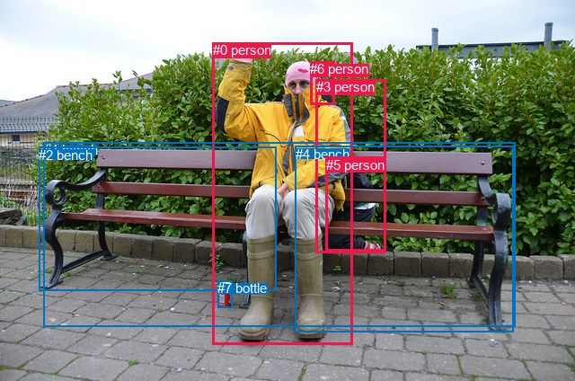
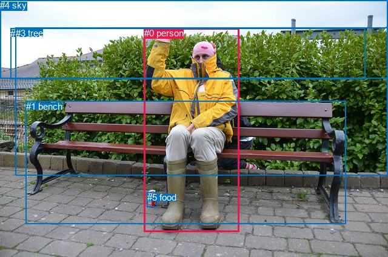

# 图片 0813：2352072.jpg

随机样本序号：89。图片 SHA256：`566aa2a499299e354e2127a702783ca64efa9e2e8ed77c9ffcea10d7ad3cb8e4`。

红色框表示人，蓝色框表示其他物体。两个模式分别保留自身框编号，可依据位置比较对应对象。

## 自动检测框与输出

人的框编号：`[0, 3, 5, 6]`。状态：`ok`。

### 自动检测全部物体框

| 编号 | 类别 | 是否为人 | 检测分数 | 像素坐标 xyxy |
|---|---|---|---|---|
| 0 | person | True | 0.9996 | 236.9, 47.1, 392.3, 383.6 |
| 1 | bench | False | 0.9995 | 48.5, 158.1, 573.8, 363.4 |
| 2 | bench | False | 0.8716 | 43.0, 164.0, 307.5, 323.3 |
| 3 | person | True | 0.8627 | 351.6, 88.4, 429.9, 281.0 |
| 4 | bench | False | 0.5517 | 328.5, 162.6, 571.6, 369.7 |
| 5 | person | True | 0.4953 | 362.7, 174.9, 429.3, 279.9 |
| 6 | person | True | 0.4360 | 345.4, 68.4, 372.4, 116.7 |
| 7 | bottle | False | 0.3533 | 242.5, 312.3, 258.4, 342.0 |

### 自动检测 Top50 人相关候选

评分物体对：56；人相关物体对：44；输出关系：50。

| 排名 | 主语编号与类别 | 关系 | 宾语编号与类别 | 类型 | 人与人 | 排序分数 | 原始融合 logit |
|---|---|---|---|---|---|---|---|
| 1 | #0 person | sitting on | #1 bench | semantic | False | 0.98503 | 4.1863 |
| 2 | #0 person | wearing | #6 person | semantic | True | 0.97677 | 3.7387 |
| 3 | #0 person | wearing | #3 person | semantic | True | 0.97230 | 3.5581 |
| 4 | #0 person | on | #1 bench | spatial | False | 0.96863 | 3.4299 |
| 5 | #0 person | sitting on | #2 bench | semantic | False | 0.96149 | 3.2176 |
| 6 | #5 person | sitting on | #4 bench | semantic | False | 0.95719 | 3.1072 |
| 7 | #0 person | sitting on | #4 bench | semantic | False | 0.94995 | 2.9433 |
| 8 | #5 person | leaning on | #4 bench | spatial | False | 0.94885 | 2.9205 |
| 9 | #5 person | in | #3 person | spatial | True | 0.91481 | 2.3738 |
| 10 | #0 person | on | #4 bench | spatial | False | 0.89661 | 2.1601 |
| 11 | #0 person | on | #2 bench | spatial | False | 0.88407 | 2.0316 |
| 12 | #0 person | in | #6 person | spatial | True | 0.85844 | 1.8024 |
| 13 | #5 person | sitting on | #1 bench | semantic | False | 0.85380 | 1.7647 |
| 14 | #0 person | in | #3 person | spatial | True | 0.84181 | 1.6718 |
| 15 | #5 person | on | #1 bench | spatial | False | 0.83668 | 1.6338 |
| 16 | #5 person | wearing | #3 person | semantic | True | 0.81165 | 1.4608 |
| 17 | #6 person | on | #0 person | spatial | True | 0.78619 | 1.3021 |
| 18 | #3 person | on | #1 bench | spatial | False | 0.74971 | 1.0971 |
| 19 | #3 person | on | #5 person | spatial | True | 0.72392 | 0.9640 |
| 20 | #0 person | holding | #5 person | semantic | True | 0.72308 | 0.9598 |
| 21 | #3 person | on | #0 person | spatial | True | 0.65490 | 0.6406 |
| 22 | #3 person | sitting on | #4 bench | semantic | False | 0.65211 | 0.6283 |
| 23 | #5 person | beside | #0 person | spatial | True | 0.64642 | 0.6033 |
| 24 | #3 person | on | #4 bench | spatial | False | 0.62199 | 0.4980 |
| 25 | #3 person | wearing | #5 person | semantic | True | 0.61816 | 0.4817 |
| 26 | #3 person | sitting on | #1 bench | semantic | False | 0.53326 | 0.1332 |
| 27 | #0 person | holding | #7 bottle | semantic | False | 0.46608 | -0.1359 |
| 28 | #3 person | wearing | #6 person | semantic | True | 0.43865 | -0.2466 |
| 29 | #7 bottle | beside | #0 person | spatial | False | 0.43030 | -0.2806 |
| 30 | #3 person | wearing | #0 person | semantic | True | 0.37843 | -0.4962 |
| 31 | #6 person | on | #3 person | spatial | True | 0.32936 | -0.7111 |
| 32 | #3 person | in | #6 person | spatial | True | 0.30758 | -0.8114 |
| 33 | #0 person | beside | #5 person | spatial | True | 0.30752 | -0.8117 |
| 34 | #5 person | sitting on | #0 person | semantic | True | 0.27673 | -0.9607 |
| 35 | #3 person | on | #2 bench | spatial | False | 0.23798 | -1.1638 |
| 36 | #5 person | wearing | #6 person | semantic | True | 0.22854 | -1.2166 |
| 37 | #5 person | on | #2 bench | spatial | False | 0.22484 | -1.2377 |
| 38 | #3 person | sitting on | #2 bench | semantic | False | 0.16869 | -1.5949 |
| 39 | #0 person | on | #7 bottle | spatial | False | 0.15112 | -1.7258 |
| 40 | #5 person | sitting on | #2 bench | semantic | False | 0.14146 | -1.8032 |
| 41 | #6 person | wearing | #0 person | semantic | True | 0.12419 | -1.9533 |
| 42 | #7 bottle | holding | #0 person | semantic | False | 0.08701 | -2.3507 |
| 43 | #4 bench | beside | #0 person | spatial | False | 0.08325 | -2.3989 |
| 44 | #6 person | wearing | #3 person | semantic | True | 0.05210 | -2.9010 |
| 45 | #1 bench | in | #0 person | spatial | False | 0.05122 | -2.9190 |
| 46 | #6 person | on | #5 person | spatial | True | 0.04347 | -3.0911 |
| 47 | #2 bench | beside | #0 person | spatial | False | 0.04235 | -3.1185 |
| 48 | #5 person | in | #6 person | spatial | True | 0.03922 | -3.1986 |
| 49 | #4 bench | holding | #5 person | semantic | False | 0.03797 | -3.2321 |
| 50 | #4 bench | beside | #5 person | spatial | False | 0.02867 | -3.5227 |

### 自动检测逐条人相关 GT 核验

R@50：33.33%；命中 1/3。

| GT 主语编号 | GT 关系 | GT 宾语编号 | 结果阶段 | 匹配预测主语编号 | 匹配预测宾语编号 |
|---|---|---|---|---|---|
| 0 | sitting on | 1 | hit50 | [0] | [1] |
| 0 | in front of | 3 | endpoint_missing_or_wrong_class | [0] | [] |
| 4 | over | 0 | endpoint_missing_or_wrong_class | [] | [0] |

## 真实框与输出

人的框编号：`[0]`。

### 真实框全部物体框

| 编号 | 类别 | 是否为人 | 检测分数 | 像素坐标 xyxy |
|---|---|---|---|---|
| 0 | person | True | GT | 238.0, 46.0, 395.0, 382.0 |
| 1 | bench | False | GT | 43.0, 167.0, 570.0, 370.0 |
| 2 | roof | False | GT | 17.0, 47.0, 603.0, 131.0 |
| 3 | tree | False | GT | 26.0, 46.0, 640.0, 290.0 |
| 4 | sky | False | GT | 0.0, 0.0, 640.0, 129.0 |
| 5 | food | False | GT | 243.0, 317.0, 260.0, 341.0 |

### 真实框 Top50 人相关候选

评分物体对：30；人相关物体对：10；输出关系：20。

| 排名 | 主语编号与类别 | 关系 | 宾语编号与类别 | 类型 | 人与人 | 排序分数 | 原始融合 logit |
|---|---|---|---|---|---|---|---|
| 1 | #0 person | sitting on | #1 bench | semantic | False | 0.98759 | 4.3772 |
| 2 | #0 person | on | #1 bench | spatial | False | 0.97334 | 3.5977 |
| 3 | #0 person | wearing | #5 food | semantic | False | 0.82848 | 1.5749 |
| 4 | #4 sky | over | #0 person | spatial | False | 0.79845 | 1.3767 |
| 5 | #3 tree | beside | #0 person | spatial | False | 0.78218 | 1.2784 |
| 6 | #5 food | beside | #0 person | spatial | False | 0.62866 | 0.5265 |
| 7 | #0 person | looking at | #4 sky | semantic | False | 0.47923 | -0.0831 |
| 8 | #0 person | on | #5 food | spatial | False | 0.47651 | -0.0940 |
| 9 | #0 person | wearing | #3 tree | semantic | False | 0.47518 | -0.0994 |
| 10 | #0 person | beside | #3 tree | spatial | False | 0.43835 | -0.2479 |
| 11 | #3 tree | looking at | #0 person | semantic | False | 0.42255 | -0.3123 |
| 12 | #0 person | looking at | #2 roof | semantic | False | 0.34389 | -0.6460 |
| 13 | #0 person | in | #2 roof | spatial | False | 0.29385 | -0.8768 |
| 14 | #2 roof | beside | #0 person | spatial | False | 0.26207 | -1.0352 |
| 15 | #1 bench | beside | #0 person | spatial | False | 0.19479 | -1.4192 |
| 16 | #0 person | in | #4 sky | spatial | False | 0.17195 | -1.5719 |
| 17 | #5 food | holding | #0 person | semantic | False | 0.13257 | -1.8784 |
| 18 | #1 bench | holding | #0 person | semantic | False | 0.11527 | -2.0381 |
| 19 | #2 roof | looking at | #0 person | semantic | False | 0.08417 | -2.3870 |
| 20 | #4 sky | holding | #0 person | semantic | False | 0.07268 | -2.5462 |

### 真实框逐条人相关 GT 核验

R@50：66.67%；命中 2/3。

| GT 主语编号 | GT 关系 | GT 宾语编号 | 结果阶段 | 匹配预测主语编号 | 匹配预测宾语编号 |
|---|---|---|---|---|---|
| 0 | sitting on | 1 | hit50 | [0] | [1] |
| 0 | in front of | 3 | wrong_predicate | [0] | [3] |
| 4 | over | 0 | hit50 | [4] | [0] |

## 全部人相关 GT

| 主语编号与类别 | 关系 | 宾语编号与类别 |
|---|---|---|
| #0 person | sitting on | #1 bench |
| #0 person | in front of | #3 tree |
| #4 sky | over | #0 person |

原始记录、全部人相关物体对的两项预测与分项分数见 [逐图证据 JSON](../evidence/cases/0813.json)。全部56类 logits 保留于本机 HOR/output/random500/logits/。

<!-- HOR_COMPLETE_RESULTS -->

## 六组条件的完整输出对照

以下保留同一图片三种框与候选模式、两种谓词输出规则的全部 Top50。框编号各自在所属模式内解释。

### 自动检测框完整枚举：空间与语义各保留一个谓词

| 排名 | 主语编号与类别 | 谓词 | 宾语编号与类别 | 分组 | 排序分数 | predicate logit | pair logit |
|---|---|---|---|---|---|---|---|
| 1 | #0 person | sitting on | #1 bench | semantic | 0.9850256 | 3.5421271 | 0.6442014 |
| 2 | #0 person | wearing | #6 person | semantic | 0.9767665 | 3.4353557 | 0.3032964 |
| 3 | #0 person | wearing | #3 person | semantic | 0.9722959 | 3.2269726 | 0.3311045 |
| 4 | #0 person | on | #1 bench | spatial | 0.9686260 | 2.7856960 | 0.6442014 |
| 5 | #0 person | sitting on | #2 bench | semantic | 0.9614913 | 3.0847340 | 0.1328694 |
| 6 | #5 person | sitting on | #4 bench | semantic | 0.9571871 | 2.8499169 | 0.2572421 |
| 7 | #0 person | sitting on | #4 bench | semantic | 0.9499478 | 2.8951411 | 0.0482002 |
| 8 | #5 person | leaning on | #4 bench | spatial | 0.9488509 | 2.6632657 | 0.2572421 |
| 9 | #5 person | in | #3 person | spatial | 0.9148108 | 2.6664634 | -0.2926215 |
| 10 | #0 person | on | #4 bench | spatial | 0.8966116 | 2.1119299 | 0.0482002 |
| 11 | #0 person | on | #2 bench | spatial | 0.8840735 | 1.8987141 | 0.1328694 |
| 12 | #0 person | in | #6 person | spatial | 0.8584375 | 1.4990764 | 0.3032964 |
| 13 | #5 person | sitting on | #1 bench | semantic | 0.8538002 | 1.6522436 | 0.1124790 |
| 14 | #0 person | in | #3 person | spatial | 0.8418120 | 1.3406677 | 0.3311045 |
| 15 | #5 person | on | #1 bench | spatial | 0.8366845 | 1.5212841 | 0.1124790 |
| 16 | #5 person | wearing | #3 person | semantic | 0.8116549 | 1.7534213 | -0.2926215 |
| 17 | #6 person | on | #0 person | spatial | 0.7861941 | 1.6900735 | -0.3879384 |
| 18 | #3 person | on | #1 bench | spatial | 0.7497148 | 2.1016192 | -1.0045278 |
| 19 | #3 person | on | #5 person | spatial | 0.7239187 | 1.9141507 | -0.9501670 |
| 20 | #0 person | holding | #5 person | semantic | 0.7230778 | 1.3960342 | -0.4362540 |
| 21 | #3 person | on | #0 person | spatial | 0.6548985 | 1.0787778 | -0.4381360 |
| 22 | #3 person | sitting on | #4 bench | semantic | 0.6521134 | 1.7396245 | -1.1112826 |
| 23 | #5 person | beside | #0 person | spatial | 0.6464179 | 0.9171944 | -0.3138640 |
| 24 | #3 person | on | #4 bench | spatial | 0.6219862 | 1.6092696 | -1.1112826 |
| 25 | #3 person | wearing | #5 person | semantic | 0.6181566 | 1.4318981 | -0.9501670 |
| 26 | #3 person | sitting on | #1 bench | semantic | 0.5332608 | 1.1377678 | -1.0045278 |
| 27 | #0 person | holding | #7 bottle | semantic | 0.4660846 | 0.8643527 | -1.0002229 |
| 28 | #3 person | wearing | #6 person | semantic | 0.4386539 | 0.4734893 | -0.7201161 |
| 29 | #7 bottle | beside | #0 person | spatial | 0.4302973 | 0.2274666 | -0.5081047 |
| 30 | #3 person | wearing | #0 person | semantic | 0.3784334 | -0.0580668 | -0.4381360 |
| 31 | #6 person | on | #3 person | spatial | 0.3293574 | 0.1313524 | -0.8424454 |
| 32 | #3 person | in | #6 person | spatial | 0.3075830 | -0.0913272 | -0.7201161 |
| 33 | #0 person | beside | #5 person | spatial | 0.3075198 | -0.3754864 | -0.4362540 |
| 34 | #5 person | sitting on | #0 person | semantic | 0.2767284 | -0.6468844 | -0.3138640 |
| 35 | #3 person | on | #2 bench | spatial | 0.2379788 | 0.3591943 | -1.5229871 |
| 36 | #5 person | wearing | #6 person | semantic | 0.2285355 | 0.0679245 | -1.2845237 |
| 37 | #5 person | on | #2 bench | spatial | 0.2248393 | -0.6604619 | -0.5772225 |
| 38 | #3 person | sitting on | #2 bench | semantic | 0.1686920 | -0.0719385 | -1.5229871 |
| 39 | #0 person | on | #7 bottle | spatial | 0.1511232 | -0.7255955 | -1.0002229 |
| 40 | #5 person | sitting on | #2 bench | semantic | 0.1414591 | -1.2260010 | -0.5772225 |
| 41 | #6 person | wearing | #0 person | semantic | 0.1241891 | -1.5654066 | -0.3879384 |
| 42 | #7 bottle | holding | #0 person | semantic | 0.0870135 | -1.8425529 | -0.5081047 |
| 43 | #4 bench | beside | #0 person | spatial | 0.0832542 | -1.3503001 | -1.0486317 |
| 44 | #6 person | wearing | #3 person | semantic | 0.0521018 | -2.0586023 | -0.8424454 |
| 45 | #1 bench | in | #0 person | spatial | 0.0512226 | -2.0678389 | -0.8511546 |
| 46 | #6 person | on | #5 person | spatial | 0.0434749 | -1.8887584 | -1.2023640 |
| 47 | #2 bench | beside | #0 person | spatial | 0.0423500 | -2.3152802 | -0.8032329 |
| 48 | #5 person | in | #6 person | spatial | 0.0392189 | -1.9140637 | -1.2845237 |
| 49 | #4 bench | holding | #5 person | semantic | 0.0379740 | -1.6146724 | -1.6174672 |
| 50 | #4 bench | beside | #5 person | spatial | 0.0286718 | -1.9052825 | -1.6174672 |

GT 命中：1/3，R@50=33.33%。

| GT主语 | GT谓词 | GT宾语 | 结果阶段 | 匹配主语框 | 匹配宾语框 |
|---|---|---|---|---|---|
| 0 | sitting on | 1 | hit50 | [0] | [1] |
| 0 | in front of | 3 | endpoint_missing_or_wrong_class | [0] | [] |
| 4 | over | 0 | endpoint_missing_or_wrong_class | [] | [0] |

### 自动检测框完整枚举：每对只保留一个谓词

| 排名 | 主语编号与类别 | 谓词 | 宾语编号与类别 | 分组 | 排序分数 | predicate logit | pair logit |
|---|---|---|---|---|---|---|---|
| 1 | #0 person | sitting on | #1 bench | single | 0.9850256 | 3.5421271 | 0.6442014 |
| 2 | #0 person | wearing | #6 person | single | 0.9767665 | 3.4353557 | 0.3032964 |
| 3 | #0 person | wearing | #3 person | single | 0.9722959 | 3.2269726 | 0.3311045 |
| 4 | #0 person | sitting on | #2 bench | single | 0.9614913 | 3.0847340 | 0.1328694 |
| 5 | #5 person | sitting on | #4 bench | single | 0.9571871 | 2.8499169 | 0.2572421 |
| 6 | #0 person | sitting on | #4 bench | single | 0.9499478 | 2.8951411 | 0.0482002 |
| 7 | #5 person | in | #3 person | single | 0.9148108 | 2.6664634 | -0.2926215 |
| 8 | #5 person | sitting on | #1 bench | single | 0.8538002 | 1.6522436 | 0.1124790 |
| 9 | #6 person | on | #0 person | single | 0.7861941 | 1.6900735 | -0.3879384 |
| 10 | #3 person | on | #1 bench | single | 0.7497148 | 2.1016192 | -1.0045278 |
| 11 | #3 person | on | #5 person | single | 0.7239187 | 1.9141507 | -0.9501670 |
| 12 | #0 person | holding | #5 person | single | 0.7230778 | 1.3960342 | -0.4362540 |
| 13 | #3 person | on | #0 person | single | 0.6548985 | 1.0787778 | -0.4381360 |
| 14 | #3 person | sitting on | #4 bench | single | 0.6521134 | 1.7396245 | -1.1112826 |
| 15 | #5 person | beside | #0 person | single | 0.6464179 | 0.9171944 | -0.3138640 |
| 16 | #0 person | holding | #7 bottle | single | 0.4660846 | 0.8643527 | -1.0002229 |
| 17 | #3 person | wearing | #6 person | single | 0.4386539 | 0.4734893 | -0.7201161 |
| 18 | #7 bottle | beside | #0 person | single | 0.4302973 | 0.2274666 | -0.5081047 |
| 19 | #6 person | on | #3 person | single | 0.3293574 | 0.1313524 | -0.8424454 |
| 20 | #3 person | on | #2 bench | single | 0.2379788 | 0.3591943 | -1.5229871 |
| 21 | #5 person | wearing | #6 person | single | 0.2285355 | 0.0679245 | -1.2845237 |
| 22 | #5 person | on | #2 bench | single | 0.2248393 | -0.6604619 | -0.5772225 |
| 23 | #4 bench | beside | #0 person | single | 0.0832542 | -1.3503001 | -1.0486317 |
| 24 | #1 bench | in | #0 person | single | 0.0512226 | -2.0678389 | -0.8511546 |
| 25 | #6 person | on | #5 person | single | 0.0434749 | -1.8887584 | -1.2023640 |
| 26 | #2 bench | beside | #0 person | single | 0.0423500 | -2.3152802 | -0.8032329 |
| 27 | #4 bench | holding | #5 person | single | 0.0379740 | -1.6146724 | -1.6174672 |
| 28 | #7 bottle | on | #5 person | single | 0.0223161 | -1.7582128 | -2.0216632 |
| 29 | #1 bench | beside | #5 person | single | 0.0220165 | -2.3917732 | -1.4019285 |
| 30 | #4 bench | in | #3 person | single | 0.0199771 | -2.1795225 | -1.7134671 |
| 31 | #1 bench | in | #3 person | single | 0.0132430 | -2.7957253 | -1.5152302 |
| 32 | #2 bench | beside | #5 person | single | 0.0128731 | -2.4675941 | -1.8720676 |
| 33 | #7 bottle | on | #3 person | single | 0.0106523 | -2.0463817 | -2.4848895 |
| 34 | #6 person | on | #1 bench | single | 0.0105321 | -1.9992471 | -2.5434923 |
| 35 | #6 person | on | #4 bench | single | 0.0090557 | -2.4748280 | -2.2204392 |
| 36 | #7 bottle | on | #6 person | single | 0.0087534 | -1.9585991 | -2.7709203 |
| 37 | #2 bench | beside | #3 person | single | 0.0073079 | -2.8556721 | -2.0557988 |
| 38 | #5 person | on | #7 bottle | single | 0.0046566 | -3.8520155 | -1.5127950 |
| 39 | #6 person | on | #2 bench | single | 0.0038236 | -2.8677373 | -2.6950076 |
| 40 | #4 bench | on | #6 person | single | 0.0034761 | -3.1508379 | -2.5075340 |
| 41 | #1 bench | in | #6 person | single | 0.0027204 | -3.7415407 | -2.1627214 |
| 42 | #3 person | on | #7 bottle | single | 0.0013489 | -4.3884015 | -2.2187371 |
| 43 | #2 bench | beside | #6 person | single | 0.0012186 | -3.9569519 | -2.7518430 |
| 44 | #6 person | on | #7 bottle | single | 0.0005421 | -4.8854437 | -2.6339879 |

GT 命中：1/3，R@50=33.33%。

| GT主语 | GT谓词 | GT宾语 | 结果阶段 | 匹配主语框 | 匹配宾语框 |
|---|---|---|---|---|---|
| 0 | sitting on | 1 | hit50 | [0] | [1] |
| 0 | in front of | 3 | endpoint_missing_or_wrong_class | [0] | [] |
| 4 | over | 0 | endpoint_missing_or_wrong_class | [] | [0] |

### 真实框完整枚举：空间与语义各保留一个谓词

| 排名 | 主语编号与类别 | 谓词 | 宾语编号与类别 | 分组 | 排序分数 | predicate logit | pair logit |
|---|---|---|---|---|---|---|---|
| 1 | #0 person | sitting on | #1 bench | semantic | 0.9875948 | 3.7617946 | 0.6153672 |
| 2 | #0 person | on | #1 bench | spatial | 0.9733422 | 2.9822879 | 0.6153672 |
| 3 | #0 person | wearing | #5 food | semantic | 0.8284782 | 2.5223866 | -0.9475062 |
| 4 | #4 sky | over | #0 person | spatial | 0.7984546 | 2.2180977 | -0.8414344 |
| 5 | #3 tree | beside | #0 person | spatial | 0.7821795 | 1.1285844 | 0.1498284 |
| 6 | #5 food | beside | #0 person | spatial | 0.6286584 | 1.0408554 | -0.5143898 |
| 7 | #0 person | looking at | #4 sky | semantic | 0.4792302 | 1.0931983 | -1.1763256 |
| 8 | #0 person | on | #5 food | spatial | 0.4765121 | 0.8534856 | -0.9475062 |
| 9 | #0 person | wearing | #3 tree | semantic | 0.4751753 | 0.6100998 | -0.7094804 |
| 10 | #0 person | beside | #3 tree | spatial | 0.4383463 | 0.4616041 | -0.7094804 |
| 11 | #3 tree | looking at | #0 person | semantic | 0.4225522 | -0.4621334 | 0.1498284 |
| 12 | #0 person | looking at | #2 roof | semantic | 0.3438867 | 0.3051391 | -0.9511603 |
| 13 | #0 person | in | #2 roof | spatial | 0.2938510 | 0.0744066 | -0.9511603 |
| 14 | #2 roof | beside | #0 person | spatial | 0.2620726 | -0.7047553 | -0.3304686 |
| 15 | #1 bench | beside | #0 person | spatial | 0.1947947 | -0.5253062 | -0.8938447 |
| 16 | #0 person | in | #4 sky | spatial | 0.1719479 | -0.3955588 | -1.1763256 |
| 17 | #5 food | holding | #0 person | semantic | 0.1325686 | -1.3640468 | -0.5143898 |
| 18 | #1 bench | holding | #0 person | semantic | 0.1152654 | -1.1442060 | -0.8938447 |
| 19 | #2 roof | looking at | #0 person | semantic | 0.0841717 | -2.0565012 | -0.3304686 |
| 20 | #4 sky | holding | #0 person | semantic | 0.0726815 | -1.7047765 | -0.8414344 |

GT 命中：2/3，R@50=66.67%。

| GT主语 | GT谓词 | GT宾语 | 结果阶段 | 匹配主语框 | 匹配宾语框 |
|---|---|---|---|---|---|
| 0 | sitting on | 1 | hit50 | [0] | [1] |
| 0 | in front of | 3 | wrong_predicate | [0] | [3] |
| 4 | over | 0 | hit50 | [4] | [0] |

### 真实框完整枚举：每对只保留一个谓词

| 排名 | 主语编号与类别 | 谓词 | 宾语编号与类别 | 分组 | 排序分数 | predicate logit | pair logit |
|---|---|---|---|---|---|---|---|
| 1 | #0 person | sitting on | #1 bench | single | 0.9875948 | 3.7617946 | 0.6153672 |
| 2 | #0 person | wearing | #5 food | single | 0.8284782 | 2.5223866 | -0.9475062 |
| 3 | #4 sky | over | #0 person | single | 0.7984546 | 2.2180977 | -0.8414344 |
| 4 | #3 tree | beside | #0 person | single | 0.7821795 | 1.1285844 | 0.1498284 |
| 5 | #5 food | beside | #0 person | single | 0.6286584 | 1.0408554 | -0.5143898 |
| 6 | #0 person | looking at | #4 sky | single | 0.4792302 | 1.0931983 | -1.1763256 |
| 7 | #0 person | wearing | #3 tree | single | 0.4751753 | 0.6100998 | -0.7094804 |
| 8 | #0 person | looking at | #2 roof | single | 0.3438867 | 0.3051391 | -0.9511603 |
| 9 | #2 roof | beside | #0 person | single | 0.2620726 | -0.7047553 | -0.3304686 |
| 10 | #1 bench | beside | #0 person | single | 0.1947947 | -0.5253062 | -0.8938447 |

GT 命中：2/3，R@50=66.67%。

| GT主语 | GT谓词 | GT宾语 | 结果阶段 | 匹配主语框 | 匹配宾语框 |
|---|---|---|---|---|---|
| 0 | sitting on | 1 | hit50 | [0] | [1] |
| 0 | in front of | 3 | wrong_predicate | [0] | [3] |
| 4 | over | 0 | hit50 | [4] | [0] |

### 真实框400候选：空间与语义各保留一个谓词

| 排名 | 主语编号与类别 | 谓词 | 宾语编号与类别 | 分组 | 排序分数 | predicate logit | pair logit |
|---|---|---|---|---|---|---|---|
| 1 | #0 person | sitting on | #1 bench | semantic | 0.9875948 | 3.7617946 | 0.6153672 |
| 2 | #0 person | on | #1 bench | spatial | 0.9733422 | 2.9822879 | 0.6153672 |
| 3 | #0 person | wearing | #5 food | semantic | 0.8288947 | 2.5253205 | -0.9475062 |
| 4 | #4 sky | over | #0 person | spatial | 0.7984546 | 2.2180977 | -0.8414344 |
| 5 | #3 tree | beside | #0 person | spatial | 0.7821795 | 1.1285844 | 0.1498284 |
| 6 | #5 food | beside | #0 person | spatial | 0.6356287 | 1.0708308 | -0.5143898 |
| 7 | #0 person | looking at | #4 sky | semantic | 0.4794042 | 1.0938954 | -1.1763256 |
| 8 | #0 person | on | #5 food | spatial | 0.4765121 | 0.8534856 | -0.9475062 |
| 9 | #0 person | wearing | #3 tree | semantic | 0.4751753 | 0.6100998 | -0.7094804 |
| 10 | #0 person | beside | #3 tree | spatial | 0.4383606 | 0.4616623 | -0.7094804 |
| 11 | #3 tree | looking at | #0 person | semantic | 0.4153968 | -0.4915276 | 0.1498284 |
| 12 | #0 person | looking at | #2 roof | semantic | 0.3438867 | 0.3051391 | -0.9511603 |
| 13 | #0 person | in | #2 roof | spatial | 0.2938510 | 0.0744066 | -0.9511603 |
| 14 | #2 roof | beside | #0 person | spatial | 0.2563061 | -0.7347887 | -0.3304686 |
| 15 | #1 bench | beside | #0 person | spatial | 0.1947947 | -0.5253062 | -0.8938447 |
| 16 | #0 person | in | #4 sky | spatial | 0.1714759 | -0.3988776 | -1.1763256 |
| 17 | #5 food | holding | #0 person | semantic | 0.1341366 | -1.3504784 | -0.5143898 |
| 18 | #1 bench | holding | #0 person | semantic | 0.1126743 | -1.1698661 | -0.8938447 |
| 19 | #2 roof | looking at | #0 person | semantic | 0.0830324 | -2.0713723 | -0.3304686 |
| 20 | #4 sky | holding | #0 person | semantic | 0.0729807 | -1.7003453 | -0.8414344 |

GT 命中：2/3，R@50=66.67%。

| GT主语 | GT谓词 | GT宾语 | 结果阶段 | 匹配主语框 | 匹配宾语框 |
|---|---|---|---|---|---|
| 0 | sitting on | 1 | hit50 | [0] | [1] |
| 0 | in front of | 3 | wrong_predicate | [0] | [3] |
| 4 | over | 0 | hit50 | [4] | [0] |

### 真实框400候选：每对只保留一个谓词

| 排名 | 主语编号与类别 | 谓词 | 宾语编号与类别 | 分组 | 排序分数 | predicate logit | pair logit |
|---|---|---|---|---|---|---|---|
| 1 | #0 person | sitting on | #1 bench | single | 0.9875948 | 3.7617946 | 0.6153672 |
| 2 | #0 person | wearing | #5 food | single | 0.8288947 | 2.5253205 | -0.9475062 |
| 3 | #4 sky | over | #0 person | single | 0.7984546 | 2.2180977 | -0.8414344 |
| 4 | #3 tree | beside | #0 person | single | 0.7821795 | 1.1285844 | 0.1498284 |
| 5 | #5 food | beside | #0 person | single | 0.6356287 | 1.0708308 | -0.5143898 |
| 6 | #0 person | looking at | #4 sky | single | 0.4794042 | 1.0938954 | -1.1763256 |
| 7 | #0 person | wearing | #3 tree | single | 0.4751753 | 0.6100998 | -0.7094804 |
| 8 | #0 person | looking at | #2 roof | single | 0.3438867 | 0.3051391 | -0.9511603 |
| 9 | #2 roof | beside | #0 person | single | 0.2563061 | -0.7347887 | -0.3304686 |
| 10 | #1 bench | beside | #0 person | single | 0.1947947 | -0.5253062 | -0.8938447 |

GT 命中：2/3，R@50=66.67%。

| GT主语 | GT谓词 | GT宾语 | 结果阶段 | 匹配主语框 | 匹配宾语框 |
|---|---|---|---|---|---|
| 0 | sitting on | 1 | hit50 | [0] | [1] |
| 0 | in front of | 3 | wrong_predicate | [0] | [3] |
| 4 | over | 0 | hit50 | [4] | [0] |
