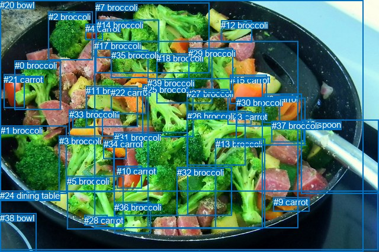
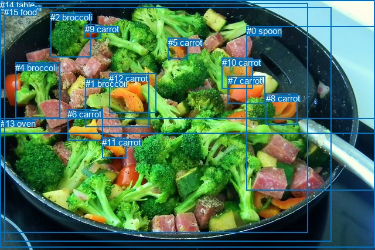

# 图片 0816：2352214.jpg

随机样本序号：474。图片 SHA256：`11957ae08b2b2a3802cb671efab513fdc32ee83a31b390341f2db228b6015c8d`。

红色框表示人，蓝色框表示其他物体。两个模式分别保留自身框编号，可依据位置比较对应对象。

## 自动检测框与输出

人的框编号：`[]`。状态：`no_person`。

### 自动检测全部物体框

| 编号 | 类别 | 是否为人 | 检测分数 | 像素坐标 xyxy |
|---|---|---|---|---|
| 0 | broccoli | False | 0.9814 | 24.8, 102.4, 102.1, 185.2 |
| 1 | broccoli | False | 0.9715 | 0.9, 212.3, 112.1, 327.1 |
| 2 | broccoli | False | 0.9707 | 81.6, 19.7, 156.4, 101.0 |
| 3 | broccoli | False | 0.9467 | 100.0, 229.9, 192.4, 324.9 |
| 4 | carrot | False | 0.9213 | 144.1, 40.4, 173.7, 67.3 |
| 5 | broccoli | False | 0.9211 | 113.4, 297.7, 208.3, 387.2 |
| 6 | carrot | False | 0.9153 | 445.9, 158.8, 509.2, 207.9 |
| 7 | broccoli | False | 0.9137 | 161.5, 4.2, 353.9, 123.7 |
| 8 | broccoli | False | 0.8768 | 399.4, 164.6, 472.5, 213.8 |
| 9 | carrot | False | 0.8710 | 461.5, 333.5, 522.2, 357.4 |
| 10 | carrot | False | 0.8692 | 197.1, 280.7, 239.1, 318.9 |
| 11 | broccoli | False | 0.8567 | 145.1, 145.2, 232.3, 214.4 |
| 12 | broccoli | False | 0.8498 | 373.2, 34.3, 425.3, 71.1 |
| 13 | broccoli | False | 0.8347 | 363.9, 234.6, 447.5, 385.5 |
| 14 | broccoli | False | 0.8336 | 162.8, 33.9, 268.6, 97.6 |
| 15 | carrot | False | 0.8336 | 389.0, 126.9, 450.2, 175.4 |
| 16 | spoon | False | 0.8274 | 508.1, 202.0, 640.0, 327.8 |
| 17 | broccoli | False | 0.8263 | 159.3, 69.1, 503.8, 385.0 |
| 18 | broccoli | False | 0.8203 | 264.2, 90.1, 358.2, 174.3 |
| 19 | broccoli | False | 0.7714 | 123.0, 185.4, 159.7, 216.5 |
| 20 | bowl | False | 0.7468 | 0.0, 0.0, 613.5, 426.0 |
| 21 | carrot | False | 0.7467 | 6.1, 125.6, 41.6, 182.5 |
| 22 | carrot | False | 0.7456 | 187.4, 148.5, 246.3, 192.4 |
| 23 | carrot | False | 0.7415 | 384.7, 188.9, 424.1, 210.5 |
| 24 | dining table | False | 0.7314 | 0.0, 322.2, 638.0, 422.0 |
| 25 | broccoli | False | 0.6735 | 240.6, 142.9, 326.8, 231.9 |
| 26 | broccoli | False | 0.6670 | 315.6, 188.0, 414.2, 279.7 |
| 27 | broccoli | False | 0.6565 | 315.5, 150.4, 385.3, 201.6 |
| 28 | carrot | False | 0.6482 | 142.3, 364.0, 181.1, 381.1 |
| 29 | broccoli | False | 0.6477 | 318.2, 81.6, 393.5, 158.9 |
| 30 | broccoli | False | 0.6276 | 398.8, 165.3, 515.7, 245.4 |
| 31 | broccoli | False | 0.5931 | 192.6, 223.8, 317.4, 365.0 |
| 32 | broccoli | False | 0.5739 | 298.9, 282.6, 391.0, 364.6 |
| 33 | broccoli | False | 0.5720 | 116.9, 185.3, 173.5, 230.3 |
| 34 | carrot | False | 0.5697 | 174.9, 235.2, 213.2, 268.0 |
| 35 | broccoli | False | 0.5462 | 188.0, 84.6, 250.6, 131.1 |
| 36 | broccoli | False | 0.5453 | 193.2, 341.6, 255.0, 395.0 |
| 37 | broccoli | False | 0.5431 | 458.6, 204.1, 513.2, 240.7 |
| 38 | bowl | False | 0.5385 | 0.5, 360.4, 61.4, 425.5 |
| 39 | broccoli | False | 0.5159 | 249.2, 132.3, 443.2, 386.2 |

### 自动检测 Top50 人相关候选

评分物体对：0；人相关物体对：0；输出关系：0。

| 排名 | 主语编号与类别 | 关系 | 宾语编号与类别 | 类型 | 人与人 | 排序分数 | 原始融合 logit |
|---|---|---|---|---|---|---|---|

### 自动检测逐条人相关 GT 核验

本图没有人相关 GT，R@50 无分母；预测候选继续展示。

## 真实框与输出

人的框编号：`[]`。

### 真实框全部物体框

| 编号 | 类别 | 是否为人 | 检测分数 | 像素坐标 xyxy |
|---|---|---|---|---|
| 0 | spoon | False | GT | 421.0, 44.0, 640.0, 325.0 |
| 1 | broccoli | False | GT | 146.0, 134.0, 255.0, 216.0 |
| 2 | broccoli | False | GT | 86.0, 21.0, 155.0, 98.0 |
| 3 | broccoli | False | GT | 0.0, 5.0, 525.0, 397.0 |
| 4 | broccoli | False | GT | 26.0, 107.0, 102.0, 202.0 |
| 5 | carrot | False | GT | 287.0, 64.0, 321.0, 101.0 |
| 6 | carrot | False | GT | 115.0, 186.0, 175.0, 240.0 |
| 7 | carrot | False | GT | 389.0, 129.0, 453.0, 176.0 |
| 8 | carrot | False | GT | 454.0, 159.0, 508.0, 212.0 |
| 9 | carrot | False | GT | 145.0, 41.0, 173.0, 65.0 |
| 10 | carrot | False | GT | 379.0, 98.0, 432.0, 151.0 |
| 11 | carrot | False | GT | 174.0, 234.0, 216.0, 269.0 |
| 12 | carrot | False | GT | 186.0, 125.0, 266.0, 193.0 |
| 13 | oven | False | GT | 1.0, 202.0, 640.0, 421.0 |
| 14 | table | False | GT | 0.0, 0.0, 640.0, 228.0 |
| 15 | food | False | GT | 7.0, 12.0, 565.0, 411.0 |

### 真实框 Top50 人相关候选

评分物体对：0；人相关物体对：0；输出关系：0。

| 排名 | 主语编号与类别 | 关系 | 宾语编号与类别 | 类型 | 人与人 | 排序分数 | 原始融合 logit |
|---|---|---|---|---|---|---|---|

### 真实框逐条人相关 GT 核验

本图没有人相关 GT，R@50 无分母；预测候选继续展示。

## 全部人相关 GT

| 主语编号与类别 | 关系 | 宾语编号与类别 |
|---|---|---|

原始记录、全部人相关物体对的两项预测与分项分数见 [逐图证据 JSON](../evidence/cases/0816.json)。全部56类 logits 保留于本机 HOR/output/random500/logits/。

<!-- HOR_COMPLETE_RESULTS -->

## 六组条件的完整输出对照

以下保留同一图片三种框与候选模式、两种谓词输出规则的全部 Top50。框编号各自在所属模式内解释。

### 自动检测框完整枚举：空间与语义各保留一个谓词

| 排名 | 主语编号与类别 | 谓词 | 宾语编号与类别 | 分组 | 排序分数 | predicate logit | pair logit |
|---|---|---|---|---|---|---|---|

没有人相关 GT，本条件的召回率无分母。

### 自动检测框完整枚举：每对只保留一个谓词

| 排名 | 主语编号与类别 | 谓词 | 宾语编号与类别 | 分组 | 排序分数 | predicate logit | pair logit |
|---|---|---|---|---|---|---|---|

没有人相关 GT，本条件的召回率无分母。

### 真实框完整枚举：空间与语义各保留一个谓词

| 排名 | 主语编号与类别 | 谓词 | 宾语编号与类别 | 分组 | 排序分数 | predicate logit | pair logit |
|---|---|---|---|---|---|---|---|

没有人相关 GT，本条件的召回率无分母。

### 真实框完整枚举：每对只保留一个谓词

| 排名 | 主语编号与类别 | 谓词 | 宾语编号与类别 | 分组 | 排序分数 | predicate logit | pair logit |
|---|---|---|---|---|---|---|---|

没有人相关 GT，本条件的召回率无分母。

### 真实框400候选：空间与语义各保留一个谓词

| 排名 | 主语编号与类别 | 谓词 | 宾语编号与类别 | 分组 | 排序分数 | predicate logit | pair logit |
|---|---|---|---|---|---|---|---|

没有人相关 GT，本条件的召回率无分母。

### 真实框400候选：每对只保留一个谓词

| 排名 | 主语编号与类别 | 谓词 | 宾语编号与类别 | 分组 | 排序分数 | predicate logit | pair logit |
|---|---|---|---|---|---|---|---|

没有人相关 GT，本条件的召回率无分母。
