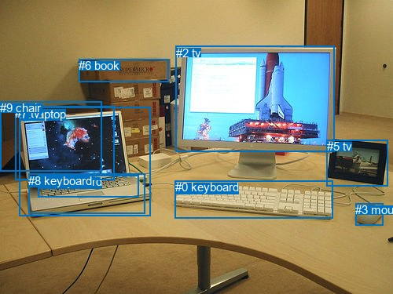
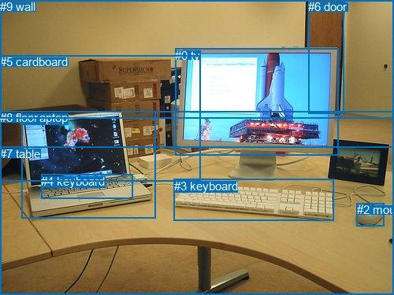

# 图片 0822：2352548.jpg

随机样本序号：429。图片 SHA256：`1895627cd71d8f224dcf6b6f0b05a4b3f69fc73d0483ef28cc978b03f81d92c7`。

红色框表示人，蓝色框表示其他物体。两个模式分别保留自身框编号，可依据位置比较对应对象。

## 自动检测框与输出

人的框编号：`[]`。状态：`no_person`。

### 自动检测全部物体框

| 编号 | 类别 | 是否为人 | 检测分数 | 像素坐标 xyxy |
|---|---|---|---|---|
| 0 | keyboard | False | 0.9997 | 222.6, 230.1, 423.9, 278.8 |
| 1 | laptop | False | 0.9994 | 24.8, 136.9, 191.6, 275.9 |
| 2 | tv | False | 0.9989 | 223.5, 58.6, 425.4, 193.3 |
| 3 | mouse | False | 0.9958 | 452.4, 259.1, 487.9, 287.1 |
| 4 | keyboard | False | 0.8108 | 48.7, 223.4, 177.0, 251.7 |
| 5 | tv | False | 0.8067 | 415.5, 178.2, 493.7, 237.1 |
| 6 | book | False | 0.4469 | 100.2, 75.1, 214.5, 104.5 |
| 7 | tv | False | 0.4258 | 19.4, 135.9, 145.3, 229.5 |
| 8 | keyboard | False | 0.4243 | 36.2, 221.5, 185.0, 272.5 |
| 9 | chair | False | 0.3870 | 0.0, 129.4, 129.3, 218.1 |

### 自动检测 Top50 人相关候选

评分物体对：0；人相关物体对：0；输出关系：0。

| 排名 | 主语编号与类别 | 关系 | 宾语编号与类别 | 类型 | 人与人 | 排序分数 | 原始融合 logit |
|---|---|---|---|---|---|---|---|

### 自动检测逐条人相关 GT 核验

本图没有人相关 GT，R@50 无分母；预测候选继续展示。

## 真实框与输出

人的框编号：`[]`。

### 真实框全部物体框

| 编号 | 类别 | 是否为人 | 检测分数 | 像素坐标 xyxy |
|---|---|---|---|---|
| 0 | tv | False | GT | 222.0, 62.0, 429.0, 198.0 |
| 1 | laptop | False | GT | 27.0, 141.0, 197.0, 277.0 |
| 2 | mouse | False | GT | 453.0, 258.0, 488.0, 287.0 |
| 3 | keyboard | False | GT | 221.0, 228.0, 423.0, 281.0 |
| 4 | keyboard | False | GT | 52.0, 222.0, 169.0, 253.0 |
| 5 | cardboard | False | GT | 0.0, 70.0, 254.0, 230.0 |
| 6 | door | False | GT | 391.0, 0.0, 436.0, 144.0 |
| 7 | table | False | GT | 0.0, 187.0, 500.0, 375.0 |
| 8 | floor | False | GT | 0.0, 141.0, 500.0, 375.0 |
| 9 | wall | False | GT | 0.0, 0.0, 500.0, 151.0 |

### 真实框 Top50 人相关候选

评分物体对：0；人相关物体对：0；输出关系：0。

| 排名 | 主语编号与类别 | 关系 | 宾语编号与类别 | 类型 | 人与人 | 排序分数 | 原始融合 logit |
|---|---|---|---|---|---|---|---|

### 真实框逐条人相关 GT 核验

本图没有人相关 GT，R@50 无分母；预测候选继续展示。

## 全部人相关 GT

| 主语编号与类别 | 关系 | 宾语编号与类别 |
|---|---|---|

原始记录、全部人相关物体对的两项预测与分项分数见 [逐图证据 JSON](../evidence/cases/0822.json)。全部56类 logits 保留于本机 HOR/output/random500/logits/。

<!-- HOR_COMPLETE_RESULTS -->

## 六组条件的完整输出对照

以下保留同一图片三种框与候选模式、两种谓词输出规则的全部 Top50。框编号各自在所属模式内解释。

### 自动检测框完整枚举：空间与语义各保留一个谓词

| 排名 | 主语编号与类别 | 谓词 | 宾语编号与类别 | 分组 | 排序分数 | predicate logit | pair logit |
|---|---|---|---|---|---|---|---|

没有人相关 GT，本条件的召回率无分母。

### 自动检测框完整枚举：每对只保留一个谓词

| 排名 | 主语编号与类别 | 谓词 | 宾语编号与类别 | 分组 | 排序分数 | predicate logit | pair logit |
|---|---|---|---|---|---|---|---|

没有人相关 GT，本条件的召回率无分母。

### 真实框完整枚举：空间与语义各保留一个谓词

| 排名 | 主语编号与类别 | 谓词 | 宾语编号与类别 | 分组 | 排序分数 | predicate logit | pair logit |
|---|---|---|---|---|---|---|---|

没有人相关 GT，本条件的召回率无分母。

### 真实框完整枚举：每对只保留一个谓词

| 排名 | 主语编号与类别 | 谓词 | 宾语编号与类别 | 分组 | 排序分数 | predicate logit | pair logit |
|---|---|---|---|---|---|---|---|

没有人相关 GT，本条件的召回率无分母。

### 真实框400候选：空间与语义各保留一个谓词

| 排名 | 主语编号与类别 | 谓词 | 宾语编号与类别 | 分组 | 排序分数 | predicate logit | pair logit |
|---|---|---|---|---|---|---|---|

没有人相关 GT，本条件的召回率无分母。

### 真实框400候选：每对只保留一个谓词

| 排名 | 主语编号与类别 | 谓词 | 宾语编号与类别 | 分组 | 排序分数 | predicate logit | pair logit |
|---|---|---|---|---|---|---|---|

没有人相关 GT，本条件的召回率无分母。
