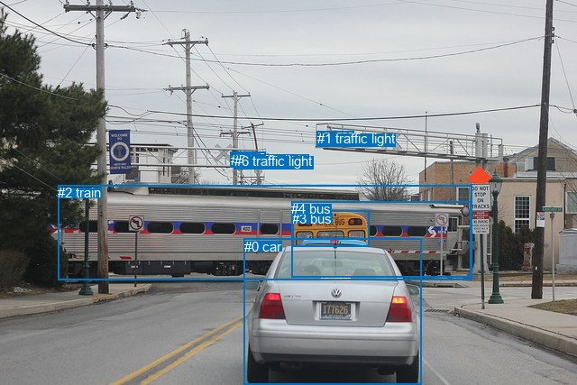
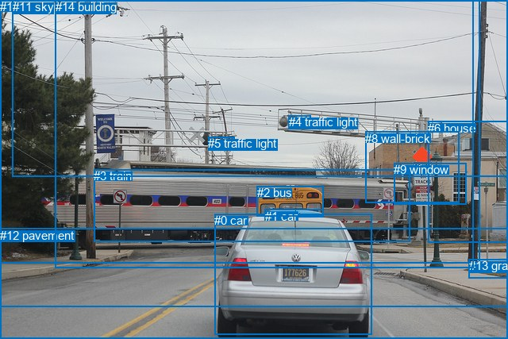

# 图片 0823：2352668.jpg

随机样本序号：223。图片 SHA256：`4e57fdaa7e50f2f384087931a026ad14252f976289b636213d24b2f61f64f544`。

红色框表示人，蓝色框表示其他物体。两个模式分别保留自身框编号，可依据位置比较对应对象。

## 自动检测框与输出

人的框编号：`[]`。状态：`no_person`。

### 自动检测全部物体框

| 编号 | 类别 | 是否为人 | 检测分数 | 像素坐标 xyxy |
|---|---|---|---|---|
| 0 | car | False | 0.9982 | 270.6, 264.7, 467.0, 427.0 |
| 1 | traffic light | False | 0.9900 | 351.7, 145.2, 392.0, 162.3 |
| 2 | train | False | 0.9750 | 64.3, 205.2, 523.9, 310.8 |
| 3 | bus | False | 0.8648 | 324.4, 233.6, 409.6, 273.3 |
| 4 | bus | False | 0.7759 | 323.4, 223.2, 523.0, 307.2 |
| 5 | traffic light | False | 0.4332 | 256.0, 168.6, 294.9, 183.8 |
| 6 | traffic light | False | 0.3707 | 260.3, 170.5, 282.2, 183.0 |

### 自动检测 Top50 人相关候选

评分物体对：0；人相关物体对：0；输出关系：0。

| 排名 | 主语编号与类别 | 关系 | 宾语编号与类别 | 类型 | 人与人 | 排序分数 | 原始融合 logit |
|---|---|---|---|---|---|---|---|

### 自动检测逐条人相关 GT 核验

本图没有人相关 GT，R@50 无分母；预测候选继续展示。

## 真实框与输出

人的框编号：`[]`。

### 真实框全部物体框

| 编号 | 类别 | 是否为人 | 检测分数 | 像素坐标 xyxy |
|---|---|---|---|---|
| 0 | car | False | GT | 270.0, 269.0, 468.0, 421.0 |
| 1 | car | False | GT | 334.0, 264.0, 408.0, 274.0 |
| 2 | bus | False | GT | 324.0, 234.0, 408.0, 272.0 |
| 3 | train | False | GT | 118.0, 213.0, 516.0, 304.0 |
| 4 | traffic light | False | GT | 364.0, 145.0, 391.0, 161.0 |
| 5 | traffic light | False | GT | 262.0, 172.0, 295.0, 183.0 |
| 6 | house | False | GT | 539.0, 153.0, 640.0, 306.0 |
| 7 | road | False | GT | 0.0, 288.0, 640.0, 427.0 |
| 8 | wall-brick | False | GT | 460.0, 166.0, 578.0, 256.0 |
| 9 | window | False | GT | 496.0, 205.0, 587.0, 257.0 |
| 10 | tree | False | GT | 0.0, 0.0, 604.0, 332.0 |
| 11 | sky | False | GT | 16.0, 0.0, 640.0, 222.0 |
| 12 | pavement | False | GT | 0.0, 288.0, 640.0, 387.0 |
| 13 | grass | False | GT | 591.0, 326.0, 640.0, 350.0 |
| 14 | building | False | GT | 70.0, 0.0, 597.0, 337.0 |

### 真实框 Top50 人相关候选

评分物体对：0；人相关物体对：0；输出关系：0。

| 排名 | 主语编号与类别 | 关系 | 宾语编号与类别 | 类型 | 人与人 | 排序分数 | 原始融合 logit |
|---|---|---|---|---|---|---|---|

### 真实框逐条人相关 GT 核验

本图没有人相关 GT，R@50 无分母；预测候选继续展示。

## 全部人相关 GT

| 主语编号与类别 | 关系 | 宾语编号与类别 |
|---|---|---|

原始记录、全部人相关物体对的两项预测与分项分数见 [逐图证据 JSON](../evidence/cases/0823.json)。全部56类 logits 保留于本机 HOR/output/random500/logits/。

<!-- HOR_COMPLETE_RESULTS -->

## 六组条件的完整输出对照

以下保留同一图片三种框与候选模式、两种谓词输出规则的全部 Top50。框编号各自在所属模式内解释。

### 自动检测框完整枚举：空间与语义各保留一个谓词

| 排名 | 主语编号与类别 | 谓词 | 宾语编号与类别 | 分组 | 排序分数 | predicate logit | pair logit |
|---|---|---|---|---|---|---|---|

没有人相关 GT，本条件的召回率无分母。

### 自动检测框完整枚举：每对只保留一个谓词

| 排名 | 主语编号与类别 | 谓词 | 宾语编号与类别 | 分组 | 排序分数 | predicate logit | pair logit |
|---|---|---|---|---|---|---|---|

没有人相关 GT，本条件的召回率无分母。

### 真实框完整枚举：空间与语义各保留一个谓词

| 排名 | 主语编号与类别 | 谓词 | 宾语编号与类别 | 分组 | 排序分数 | predicate logit | pair logit |
|---|---|---|---|---|---|---|---|

没有人相关 GT，本条件的召回率无分母。

### 真实框完整枚举：每对只保留一个谓词

| 排名 | 主语编号与类别 | 谓词 | 宾语编号与类别 | 分组 | 排序分数 | predicate logit | pair logit |
|---|---|---|---|---|---|---|---|

没有人相关 GT，本条件的召回率无分母。

### 真实框400候选：空间与语义各保留一个谓词

| 排名 | 主语编号与类别 | 谓词 | 宾语编号与类别 | 分组 | 排序分数 | predicate logit | pair logit |
|---|---|---|---|---|---|---|---|

没有人相关 GT，本条件的召回率无分母。

### 真实框400候选：每对只保留一个谓词

| 排名 | 主语编号与类别 | 谓词 | 宾语编号与类别 | 分组 | 排序分数 | predicate logit | pair logit |
|---|---|---|---|---|---|---|---|

没有人相关 GT，本条件的召回率无分母。
