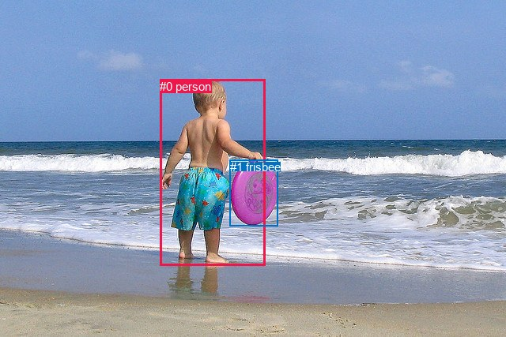
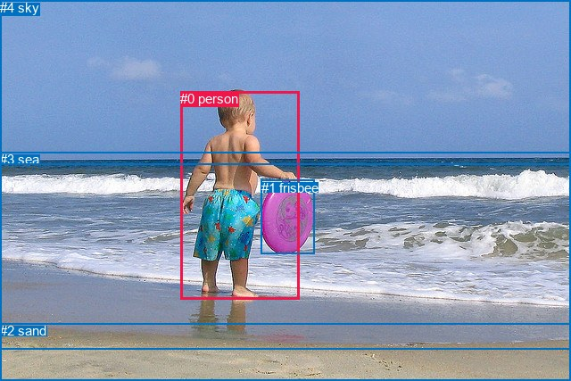

# 图片 0826：2352851.jpg

随机样本序号：259。图片 SHA256：`2ce2ac7144577c0a6349c272e034295852aa5e1d0e81dcf5451f148e72e98d3d`。

红色框表示人，蓝色框表示其他物体。两个模式分别保留自身框编号，可依据位置比较对应对象。

## 自动检测框与输出

人的框编号：`[0]`。状态：`ok`。

### 自动检测全部物体框

| 编号 | 类别 | 是否为人 | 检测分数 | 像素坐标 xyxy |
|---|---|---|---|---|
| 0 | person | True | 0.9997 | 202.2, 100.8, 335.4, 337.0 |
| 1 | frisbee | False | 0.9980 | 290.7, 203.0, 351.7, 286.2 |

### 自动检测 Top50 人相关候选

评分物体对：2；人相关物体对：2；输出关系：4。

| 排名 | 主语编号与类别 | 关系 | 宾语编号与类别 | 类型 | 人与人 | 排序分数 | 原始融合 logit |
|---|---|---|---|---|---|---|---|
| 1 | #0 person | holding | #1 frisbee | semantic | False | 0.99101 | 4.7026 |
| 2 | #0 person | in | #1 frisbee | spatial | False | 0.60367 | 0.4208 |
| 3 | #1 frisbee | holding | #0 person | semantic | False | 0.00796 | -4.8251 |
| 4 | #1 frisbee | beside | #0 person | spatial | False | 0.00555 | -5.1878 |

### 自动检测逐条人相关 GT 核验

R@50：25.00%；命中 1/4。

| GT 主语编号 | GT 关系 | GT 宾语编号 | 结果阶段 | 匹配预测主语编号 | 匹配预测宾语编号 |
|---|---|---|---|---|---|
| 0 | holding | 1 | hit50 | [0] | [1] |
| 0 | standing on | 2 | endpoint_missing_or_wrong_class | [0] | [] |
| 0 | beside | 3 | endpoint_missing_or_wrong_class | [0] | [] |
| 0 | looking at | 3 | endpoint_missing_or_wrong_class | [0] | [] |

## 真实框与输出

人的框编号：`[0]`。

### 真实框全部物体框

| 编号 | 类别 | 是否为人 | 检测分数 | 像素坐标 xyxy |
|---|---|---|---|---|
| 0 | person | True | GT | 202.0, 102.0, 335.0, 335.0 |
| 1 | frisbee | False | GT | 293.0, 202.0, 352.0, 285.0 |
| 2 | sand | False | GT | 0.0, 362.0, 640.0, 427.0 |
| 3 | sea | False | GT | 0.0, 170.0, 640.0, 391.0 |
| 4 | sky | False | GT | 0.0, 0.0, 640.0, 184.0 |

### 真实框 Top50 人相关候选

评分物体对：20；人相关物体对：8；输出关系：16。

| 排名 | 主语编号与类别 | 关系 | 宾语编号与类别 | 类型 | 人与人 | 排序分数 | 原始融合 logit |
|---|---|---|---|---|---|---|---|
| 1 | #0 person | holding | #1 frisbee | semantic | False | 0.99413 | 5.1314 |
| 2 | #0 person | standing on | #2 sand | semantic | False | 0.97069 | 3.5002 |
| 3 | #0 person | on | #2 sand | spatial | False | 0.95651 | 3.0906 |
| 4 | #0 person | in | #3 sea | spatial | False | 0.94844 | 2.9121 |
| 5 | #0 person | standing on | #3 sea | semantic | False | 0.92339 | 2.4893 |
| 6 | #4 sky | over | #0 person | spatial | False | 0.89944 | 2.1910 |
| 7 | #0 person | in | #1 frisbee | spatial | False | 0.87530 | 1.9487 |
| 8 | #3 sea | beside | #0 person | spatial | False | 0.79860 | 1.3775 |
| 9 | #0 person | looking at | #4 sky | semantic | False | 0.71634 | 0.9264 |
| 10 | #1 frisbee | beside | #0 person | spatial | False | 0.68039 | 0.7555 |
| 11 | #1 frisbee | holding | #0 person | semantic | False | 0.67005 | 0.7084 |
| 12 | #2 sand | beside | #0 person | spatial | False | 0.52824 | 0.1131 |
| 13 | #0 person | in | #4 sky | spatial | False | 0.36382 | -0.5588 |
| 14 | #3 sea | looking at | #0 person | semantic | False | 0.30198 | -0.8379 |
| 15 | #4 sky | flying over | #0 person | semantic | False | 0.20927 | -1.3294 |
| 16 | #2 sand | holding | #0 person | semantic | False | 0.14890 | -1.7433 |

### 真实框逐条人相关 GT 核验

R@50：50.00%；命中 2/4。

| GT 主语编号 | GT 关系 | GT 宾语编号 | 结果阶段 | 匹配预测主语编号 | 匹配预测宾语编号 |
|---|---|---|---|---|---|
| 0 | holding | 1 | hit50 | [0] | [1] |
| 0 | standing on | 2 | hit50 | [0] | [2] |
| 0 | beside | 3 | wrong_predicate | [0] | [3] |
| 0 | looking at | 3 | wrong_predicate | [0] | [3] |

## 全部人相关 GT

| 主语编号与类别 | 关系 | 宾语编号与类别 |
|---|---|---|
| #0 person | holding | #1 frisbee |
| #0 person | standing on | #2 sand |
| #0 person | beside | #3 sea |
| #0 person | looking at | #3 sea |

原始记录、全部人相关物体对的两项预测与分项分数见 [逐图证据 JSON](../evidence/cases/0826.json)。全部56类 logits 保留于本机 HOR/output/random500/logits/。

<!-- HOR_COMPLETE_RESULTS -->

## 六组条件的完整输出对照

以下保留同一图片三种框与候选模式、两种谓词输出规则的全部 Top50。框编号各自在所属模式内解释。

### 自动检测框完整枚举：空间与语义各保留一个谓词

| 排名 | 主语编号与类别 | 谓词 | 宾语编号与类别 | 分组 | 排序分数 | predicate logit | pair logit |
|---|---|---|---|---|---|---|---|
| 1 | #0 person | holding | #1 frisbee | semantic | 0.9910101 | 3.9287696 | 0.7738500 |
| 2 | #0 person | in | #1 frisbee | spatial | 0.6036667 | -0.3530831 | 0.7738500 |
| 3 | #1 frisbee | holding | #0 person | semantic | 0.0079621 | -4.0833974 | -0.7416670 |
| 4 | #1 frisbee | beside | #0 person | spatial | 0.0055531 | -4.4461718 | -0.7416670 |

GT 命中：1/4，R@50=25.00%。

| GT主语 | GT谓词 | GT宾语 | 结果阶段 | 匹配主语框 | 匹配宾语框 |
|---|---|---|---|---|---|
| 0 | holding | 1 | hit50 | [0] | [1] |
| 0 | standing on | 2 | endpoint_missing_or_wrong_class | [0] | [] |
| 0 | beside | 3 | endpoint_missing_or_wrong_class | [0] | [] |
| 0 | looking at | 3 | endpoint_missing_or_wrong_class | [0] | [] |

### 自动检测框完整枚举：每对只保留一个谓词

| 排名 | 主语编号与类别 | 谓词 | 宾语编号与类别 | 分组 | 排序分数 | predicate logit | pair logit |
|---|---|---|---|---|---|---|---|
| 1 | #0 person | holding | #1 frisbee | single | 0.9910101 | 3.9287696 | 0.7738500 |
| 2 | #1 frisbee | holding | #0 person | single | 0.0079621 | -4.0833974 | -0.7416670 |

GT 命中：1/4，R@50=25.00%。

| GT主语 | GT谓词 | GT宾语 | 结果阶段 | 匹配主语框 | 匹配宾语框 |
|---|---|---|---|---|---|
| 0 | holding | 1 | hit50 | [0] | [1] |
| 0 | standing on | 2 | endpoint_missing_or_wrong_class | [0] | [] |
| 0 | beside | 3 | endpoint_missing_or_wrong_class | [0] | [] |
| 0 | looking at | 3 | endpoint_missing_or_wrong_class | [0] | [] |

### 真实框完整枚举：空间与语义各保留一个谓词

| 排名 | 主语编号与类别 | 谓词 | 宾语编号与类别 | 分组 | 排序分数 | predicate logit | pair logit |
|---|---|---|---|---|---|---|---|
| 1 | #0 person | holding | #1 frisbee | semantic | 0.9941267 | 4.3585706 | 0.7728740 |
| 2 | #0 person | standing on | #2 sand | semantic | 0.9706937 | 3.5122228 | -0.0120117 |
| 3 | #0 person | on | #2 sand | spatial | 0.9565051 | 3.1026530 | -0.0120117 |
| 4 | #0 person | in | #3 sea | spatial | 0.9484410 | 2.9045229 | 0.0075708 |
| 5 | #0 person | standing on | #3 sea | semantic | 0.9233917 | 2.4817767 | 0.0075708 |
| 6 | #4 sky | over | #0 person | spatial | 0.8994391 | 2.8886685 | -0.6976612 |
| 7 | #0 person | in | #1 frisbee | spatial | 0.8753045 | 1.1758232 | 0.7728740 |
| 8 | #3 sea | beside | #0 person | spatial | 0.7985957 | 2.3061910 | -0.9286507 |
| 9 | #0 person | looking at | #4 sky | semantic | 0.7163442 | 2.1505752 | -1.2241759 |
| 10 | #1 frisbee | beside | #0 person | spatial | 0.6803856 | 1.4893327 | -0.7337884 |
| 11 | #1 frisbee | holding | #0 person | semantic | 0.6700509 | 1.4422035 | -0.7337884 |
| 12 | #2 sand | beside | #0 person | spatial | 0.5282414 | 1.1036978 | -0.9906117 |
| 13 | #0 person | in | #4 sky | spatial | 0.3638226 | 0.6653647 | -1.2241759 |
| 14 | #3 sea | looking at | #0 person | semantic | 0.3019821 | 0.0907736 | -0.9286507 |
| 15 | #4 sky | flying over | #0 person | semantic | 0.2092651 | -0.6317000 | -0.6976612 |
| 16 | #2 sand | holding | #0 person | semantic | 0.1489003 | -0.7526407 | -0.9906117 |

GT 命中：2/4，R@50=50.00%。

| GT主语 | GT谓词 | GT宾语 | 结果阶段 | 匹配主语框 | 匹配宾语框 |
|---|---|---|---|---|---|
| 0 | holding | 1 | hit50 | [0] | [1] |
| 0 | standing on | 2 | hit50 | [0] | [2] |
| 0 | beside | 3 | wrong_predicate | [0] | [3] |
| 0 | looking at | 3 | wrong_predicate | [0] | [3] |

### 真实框完整枚举：每对只保留一个谓词

| 排名 | 主语编号与类别 | 谓词 | 宾语编号与类别 | 分组 | 排序分数 | predicate logit | pair logit |
|---|---|---|---|---|---|---|---|
| 1 | #0 person | holding | #1 frisbee | single | 0.9941267 | 4.3585706 | 0.7728740 |
| 2 | #0 person | standing on | #2 sand | single | 0.9706937 | 3.5122228 | -0.0120117 |
| 3 | #0 person | in | #3 sea | single | 0.9484410 | 2.9045229 | 0.0075708 |
| 4 | #4 sky | over | #0 person | single | 0.8994391 | 2.8886685 | -0.6976612 |
| 5 | #3 sea | beside | #0 person | single | 0.7985957 | 2.3061910 | -0.9286507 |
| 6 | #0 person | looking at | #4 sky | single | 0.7163442 | 2.1505752 | -1.2241759 |
| 7 | #1 frisbee | beside | #0 person | single | 0.6803856 | 1.4893327 | -0.7337884 |
| 8 | #2 sand | beside | #0 person | single | 0.5282414 | 1.1036978 | -0.9906117 |

GT 命中：2/4，R@50=50.00%。

| GT主语 | GT谓词 | GT宾语 | 结果阶段 | 匹配主语框 | 匹配宾语框 |
|---|---|---|---|---|---|
| 0 | holding | 1 | hit50 | [0] | [1] |
| 0 | standing on | 2 | hit50 | [0] | [2] |
| 0 | beside | 3 | wrong_predicate | [0] | [3] |
| 0 | looking at | 3 | wrong_predicate | [0] | [3] |

### 真实框400候选：空间与语义各保留一个谓词

| 排名 | 主语编号与类别 | 谓词 | 宾语编号与类别 | 分组 | 排序分数 | predicate logit | pair logit |
|---|---|---|---|---|---|---|---|
| 1 | #0 person | holding | #1 frisbee | semantic | 0.9941267 | 4.3585706 | 0.7728740 |
| 2 | #0 person | standing on | #2 sand | semantic | 0.9706937 | 3.5122228 | -0.0120117 |
| 3 | #0 person | on | #2 sand | spatial | 0.9580750 | 3.1410561 | -0.0120117 |
| 4 | #0 person | in | #3 sea | spatial | 0.9487647 | 2.9111600 | 0.0075708 |
| 5 | #0 person | standing on | #3 sea | semantic | 0.9233917 | 2.4817767 | 0.0075708 |
| 6 | #4 sky | over | #0 person | spatial | 0.8994391 | 2.8886685 | -0.6976612 |
| 7 | #0 person | in | #1 frisbee | spatial | 0.8749418 | 1.1725044 | 0.7728740 |
| 8 | #3 sea | beside | #0 person | spatial | 0.7985957 | 2.3061910 | -0.9286507 |
| 9 | #0 person | looking at | #4 sky | semantic | 0.7164859 | 2.1512728 | -1.2241759 |
| 10 | #1 frisbee | beside | #0 person | spatial | 0.6868810 | 1.5193663 | -0.7337884 |
| 11 | #1 frisbee | holding | #0 person | semantic | 0.6700509 | 1.4422035 | -0.7337884 |
| 12 | #2 sand | beside | #0 person | spatial | 0.5207657 | 1.0737224 | -0.9906117 |
| 13 | #0 person | in | #4 sky | spatial | 0.3638226 | 0.6653647 | -1.2241759 |
| 14 | #3 sea | looking at | #0 person | semantic | 0.3019821 | 0.0907736 | -0.9286507 |
| 15 | #4 sky | flying over | #0 person | semantic | 0.2092651 | -0.6317000 | -0.6976612 |
| 16 | #2 sand | holding | #0 person | semantic | 0.1489003 | -0.7526407 | -0.9906117 |

GT 命中：2/4，R@50=50.00%。

| GT主语 | GT谓词 | GT宾语 | 结果阶段 | 匹配主语框 | 匹配宾语框 |
|---|---|---|---|---|---|
| 0 | holding | 1 | hit50 | [0] | [1] |
| 0 | standing on | 2 | hit50 | [0] | [2] |
| 0 | beside | 3 | wrong_predicate | [0] | [3] |
| 0 | looking at | 3 | wrong_predicate | [0] | [3] |

### 真实框400候选：每对只保留一个谓词

| 排名 | 主语编号与类别 | 谓词 | 宾语编号与类别 | 分组 | 排序分数 | predicate logit | pair logit |
|---|---|---|---|---|---|---|---|
| 1 | #0 person | holding | #1 frisbee | single | 0.9941267 | 4.3585706 | 0.7728740 |
| 2 | #0 person | standing on | #2 sand | single | 0.9706937 | 3.5122228 | -0.0120117 |
| 3 | #0 person | in | #3 sea | single | 0.9487647 | 2.9111600 | 0.0075708 |
| 4 | #4 sky | over | #0 person | single | 0.8994391 | 2.8886685 | -0.6976612 |
| 5 | #3 sea | beside | #0 person | single | 0.7985957 | 2.3061910 | -0.9286507 |
| 6 | #0 person | looking at | #4 sky | single | 0.7164859 | 2.1512728 | -1.2241759 |
| 7 | #1 frisbee | beside | #0 person | single | 0.6868810 | 1.5193663 | -0.7337884 |
| 8 | #2 sand | beside | #0 person | single | 0.5207657 | 1.0737224 | -0.9906117 |

GT 命中：2/4，R@50=50.00%。

| GT主语 | GT谓词 | GT宾语 | 结果阶段 | 匹配主语框 | 匹配宾语框 |
|---|---|---|---|---|---|
| 0 | holding | 1 | hit50 | [0] | [1] |
| 0 | standing on | 2 | hit50 | [0] | [2] |
| 0 | beside | 3 | wrong_predicate | [0] | [3] |
| 0 | looking at | 3 | wrong_predicate | [0] | [3] |
