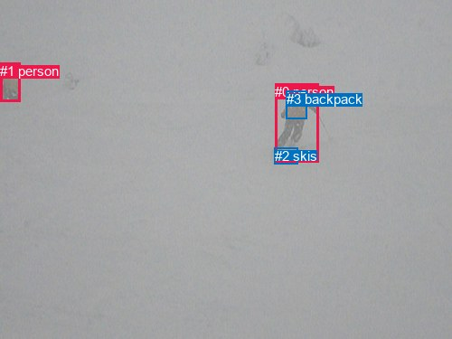
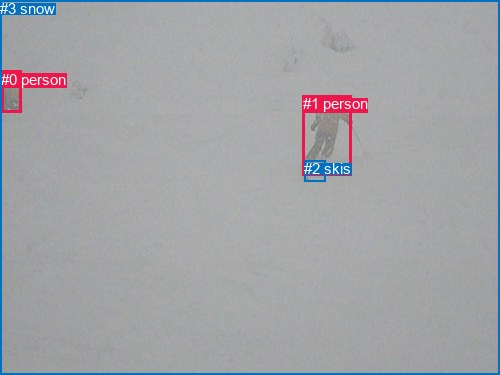

# 图片 0841：2353618.jpg

随机样本序号：72。图片 SHA256：`1801f68895f24d80d50ed42dd7ef872f6df89e8922af73ff91eca4838e56de72`。

红色框表示人，蓝色框表示其他物体。两个模式分别保留自身框编号，可依据位置比较对应对象。

## 自动检测框与输出

人的框编号：`[0, 1]`。状态：`ok`。

### 自动检测全部物体框

| 编号 | 类别 | 是否为人 | 检测分数 | 像素坐标 xyxy |
|---|---|---|---|---|
| 0 | person | True | 0.9988 | 304.3, 92.8, 352.8, 179.6 |
| 1 | person | True | 0.9689 | 0.0, 69.6, 22.4, 112.5 |
| 2 | skis | False | 0.6191 | 303.7, 163.7, 329.2, 181.7 |
| 3 | backpack | False | 0.5743 | 316.9, 100.8, 339.1, 131.8 |

### 自动检测 Top50 人相关候选

评分物体对：12；人相关物体对：10；输出关系：20。

| 排名 | 主语编号与类别 | 关系 | 宾语编号与类别 | 类型 | 人与人 | 排序分数 | 原始融合 logit |
|---|---|---|---|---|---|---|---|
| 1 | #0 person | wearing | #3 backpack | semantic | False | 0.98966 | 4.5611 |
| 2 | #0 person | on | #2 skis | spatial | False | 0.98417 | 4.1298 |
| 3 | #0 person | wearing | #2 skis | semantic | False | 0.97922 | 3.8528 |
| 4 | #3 backpack | on | #0 person | spatial | False | 0.94298 | 2.8056 |
| 5 | #2 skis | on | #0 person | spatial | False | 0.88142 | 2.0060 |
| 6 | #0 person | in | #3 backpack | spatial | False | 0.86466 | 1.8546 |
| 7 | #1 person | looking at | #0 person | semantic | True | 0.84562 | 1.7007 |
| 8 | #1 person | going down | #2 skis | semantic | False | 0.82463 | 1.5481 |
| 9 | #0 person | in front of | #1 person | spatial | True | 0.77231 | 1.2214 |
| 10 | #1 person | wearing | #3 backpack | semantic | False | 0.72903 | 0.9897 |
| 11 | #1 person | beside | #0 person | spatial | True | 0.61719 | 0.4776 |
| 12 | #1 person | on | #2 skis | spatial | False | 0.60902 | 0.4432 |
| 13 | #0 person | running on | #1 person | semantic | True | 0.56622 | 0.2664 |
| 14 | #3 backpack | wearing | #0 person | semantic | False | 0.45814 | -0.1678 |
| 15 | #2 skis | wearing | #0 person | semantic | False | 0.29634 | -0.8648 |
| 16 | #2 skis | on | #1 person | spatial | False | 0.15441 | -1.7004 |
| 17 | #1 person | on | #3 backpack | spatial | False | 0.11293 | -2.0612 |
| 18 | #2 skis | wearing | #1 person | semantic | False | 0.01279 | -4.3465 |
| 19 | #3 backpack | wearing | #1 person | semantic | False | 0.00644 | -5.0395 |
| 20 | #3 backpack | on | #1 person | spatial | False | 0.00230 | -6.0712 |

### 自动检测逐条人相关 GT 核验

R@50：60.00%；命中 3/5。

| GT 主语编号 | GT 关系 | GT 宾语编号 | 结果阶段 | 匹配预测主语编号 | 匹配预测宾语编号 |
|---|---|---|---|---|---|
| 0 | looking at | 1 | hit50 | [1] | [0] |
| 1 | standing on | 2 | wrong_predicate | [0] | [2] |
| 1 | wearing | 2 | hit50 | [0] | [2] |
| 1 | on | 3 | endpoint_missing_or_wrong_class | [0] | [] |
| 2 | on | 0 | hit50 | [2] | [1] |

## 真实框与输出

人的框编号：`[0, 1]`。

### 真实框全部物体框

| 编号 | 类别 | 是否为人 | 检测分数 | 像素坐标 xyxy |
|---|---|---|---|---|
| 0 | person | True | GT | 1.0, 71.0, 22.0, 113.0 |
| 1 | person | True | GT | 303.0, 95.0, 352.0, 175.0 |
| 2 | skis | False | GT | 304.0, 160.0, 325.0, 181.0 |
| 3 | snow | False | GT | 0.0, 0.0, 500.0, 375.0 |

### 真实框 Top50 人相关候选

评分物体对：12；人相关物体对：10；输出关系：20。

| 排名 | 主语编号与类别 | 关系 | 宾语编号与类别 | 类型 | 人与人 | 排序分数 | 原始融合 logit |
|---|---|---|---|---|---|---|---|
| 1 | #1 person | on | #2 skis | spatial | False | 0.98556 | 4.2230 |
| 2 | #1 person | wearing | #2 skis | semantic | False | 0.98440 | 4.1446 |
| 3 | #1 person | on | #3 snow | spatial | False | 0.96885 | 3.4374 |
| 4 | #0 person | on | #3 snow | spatial | False | 0.96869 | 3.4321 |
| 5 | #1 person | going down | #3 snow | semantic | False | 0.96467 | 3.3070 |
| 6 | #0 person | going down | #3 snow | semantic | False | 0.93721 | 2.7031 |
| 7 | #2 skis | on | #1 person | spatial | False | 0.88300 | 2.0211 |
| 8 | #0 person | wearing | #2 skis | semantic | False | 0.80302 | 1.4053 |
| 9 | #0 person | beside | #1 person | spatial | True | 0.70705 | 0.8811 |
| 10 | #0 person | looking at | #1 person | semantic | True | 0.65718 | 0.6508 |
| 11 | #1 person | in front of | #0 person | spatial | True | 0.65527 | 0.6423 |
| 12 | #0 person | on | #2 skis | spatial | False | 0.57925 | 0.3197 |
| 13 | #1 person | running on | #0 person | semantic | True | 0.46882 | -0.1249 |
| 14 | #2 skis | carrying | #1 person | semantic | False | 0.28828 | -0.9038 |
| 15 | #3 snow | on | #1 person | spatial | False | 0.27813 | -0.9538 |
| 16 | #3 snow | on | #0 person | spatial | False | 0.27681 | -0.9604 |
| 17 | #3 snow | holding | #1 person | semantic | False | 0.07448 | -2.5199 |
| 18 | #2 skis | on | #0 person | spatial | False | 0.04886 | -2.9688 |
| 19 | #3 snow | holding | #0 person | semantic | False | 0.03261 | -3.3900 |
| 20 | #2 skis | wearing | #0 person | semantic | False | 0.01282 | -4.3436 |

### 真实框逐条人相关 GT 核验

R@50：80.00%；命中 4/5。

| GT 主语编号 | GT 关系 | GT 宾语编号 | 结果阶段 | 匹配预测主语编号 | 匹配预测宾语编号 |
|---|---|---|---|---|---|
| 0 | looking at | 1 | hit50 | [0] | [1] |
| 1 | standing on | 2 | wrong_predicate | [1] | [2] |
| 1 | wearing | 2 | hit50 | [1] | [2] |
| 1 | on | 3 | hit50 | [1] | [3] |
| 2 | on | 0 | hit50 | [2] | [0] |

## 全部人相关 GT

| 主语编号与类别 | 关系 | 宾语编号与类别 |
|---|---|---|
| #0 person | looking at | #1 person |
| #1 person | standing on | #2 skis |
| #1 person | wearing | #2 skis |
| #1 person | on | #3 snow |
| #2 skis | on | #0 person |

原始记录、全部人相关物体对的两项预测与分项分数见 [逐图证据 JSON](../evidence/cases/0841.json)。全部56类 logits 保留于本机 HOR/output/random500/logits/。

<!-- HOR_COMPLETE_RESULTS -->

## 六组条件的完整输出对照

以下保留同一图片三种框与候选模式、两种谓词输出规则的全部 Top50。框编号各自在所属模式内解释。

### 自动检测框完整枚举：空间与语义各保留一个谓词

| 排名 | 主语编号与类别 | 谓词 | 宾语编号与类别 | 分组 | 排序分数 | predicate logit | pair logit |
|---|---|---|---|---|---|---|---|
| 1 | #0 person | wearing | #3 backpack | semantic | 0.9896578 | 4.2574458 | 0.3036888 |
| 2 | #0 person | on | #2 skis | spatial | 0.9841687 | 3.4917836 | 0.6380217 |
| 3 | #0 person | wearing | #2 skis | semantic | 0.9792212 | 3.2147994 | 0.6380217 |
| 4 | #3 backpack | on | #0 person | spatial | 0.9429795 | 3.1794600 | -0.3738254 |
| 5 | #2 skis | on | #0 person | spatial | 0.8814233 | 2.6091456 | -0.6031674 |
| 6 | #0 person | in | #3 backpack | spatial | 0.8646604 | 1.5508614 | 0.3036888 |
| 7 | #1 person | looking at | #0 person | semantic | 0.8456199 | 1.9672389 | -0.2665863 |
| 8 | #1 person | going down | #2 skis | semantic | 0.8246339 | 1.9101782 | -0.3621147 |
| 9 | #0 person | in front of | #1 person | spatial | 0.7723069 | 2.0002952 | -0.7789114 |
| 10 | #1 person | wearing | #3 backpack | semantic | 0.7290308 | 1.7442322 | -0.7545211 |
| 11 | #1 person | beside | #0 person | spatial | 0.6171894 | 0.7442222 | -0.2665863 |
| 12 | #1 person | on | #2 skis | spatial | 0.6090162 | 0.8052936 | -0.3621147 |
| 13 | #0 person | running on | #1 person | semantic | 0.5662208 | 1.0453596 | -0.7789114 |
| 14 | #3 backpack | wearing | #0 person | semantic | 0.4581390 | 0.2059884 | -0.3738254 |
| 15 | #2 skis | wearing | #0 person | semantic | 0.2963388 | -0.2616262 | -0.6031674 |
| 16 | #2 skis | on | #1 person | spatial | 0.1544138 | -0.3397970 | -1.3605969 |
| 17 | #1 person | on | #3 backpack | spatial | 0.1129266 | -1.3066690 | -0.7545211 |
| 18 | #2 skis | wearing | #1 person | semantic | 0.0127860 | -2.9859385 | -1.3605969 |
| 19 | #3 backpack | wearing | #1 person | semantic | 0.0064353 | -3.6356864 | -1.4038073 |
| 20 | #3 backpack | on | #1 person | spatial | 0.0023031 | -4.6673985 | -1.4038073 |

GT 命中：3/5，R@50=60.00%。

| GT主语 | GT谓词 | GT宾语 | 结果阶段 | 匹配主语框 | 匹配宾语框 |
|---|---|---|---|---|---|
| 0 | looking at | 1 | hit50 | [1] | [0] |
| 1 | standing on | 2 | wrong_predicate | [0] | [2] |
| 1 | wearing | 2 | hit50 | [0] | [2] |
| 1 | on | 3 | endpoint_missing_or_wrong_class | [0] | [] |
| 2 | on | 0 | hit50 | [2] | [1] |

### 自动检测框完整枚举：每对只保留一个谓词

| 排名 | 主语编号与类别 | 谓词 | 宾语编号与类别 | 分组 | 排序分数 | predicate logit | pair logit |
|---|---|---|---|---|---|---|---|
| 1 | #0 person | wearing | #3 backpack | single | 0.9896578 | 4.2574458 | 0.3036888 |
| 2 | #0 person | on | #2 skis | single | 0.9841687 | 3.4917836 | 0.6380217 |
| 3 | #3 backpack | on | #0 person | single | 0.9429795 | 3.1794600 | -0.3738254 |
| 4 | #2 skis | on | #0 person | single | 0.8814233 | 2.6091456 | -0.6031674 |
| 5 | #1 person | looking at | #0 person | single | 0.8456199 | 1.9672389 | -0.2665863 |
| 6 | #1 person | going down | #2 skis | single | 0.8246339 | 1.9101782 | -0.3621147 |
| 7 | #0 person | in front of | #1 person | single | 0.7723069 | 2.0002952 | -0.7789114 |
| 8 | #1 person | wearing | #3 backpack | single | 0.7290308 | 1.7442322 | -0.7545211 |
| 9 | #2 skis | on | #1 person | single | 0.1544138 | -0.3397970 | -1.3605969 |
| 10 | #3 backpack | wearing | #1 person | single | 0.0064353 | -3.6356864 | -1.4038073 |

GT 命中：2/5，R@50=40.00%。

| GT主语 | GT谓词 | GT宾语 | 结果阶段 | 匹配主语框 | 匹配宾语框 |
|---|---|---|---|---|---|
| 0 | looking at | 1 | hit50 | [1] | [0] |
| 1 | standing on | 2 | wrong_predicate | [0] | [2] |
| 1 | wearing | 2 | wrong_predicate | [0] | [2] |
| 1 | on | 3 | endpoint_missing_or_wrong_class | [0] | [] |
| 2 | on | 0 | hit50 | [2] | [1] |

### 真实框完整枚举：空间与语义各保留一个谓词

| 排名 | 主语编号与类别 | 谓词 | 宾语编号与类别 | 分组 | 排序分数 | predicate logit | pair logit |
|---|---|---|---|---|---|---|---|
| 1 | #1 person | on | #2 skis | spatial | 0.9855570 | 3.6499724 | 0.5730255 |
| 2 | #1 person | wearing | #2 skis | semantic | 0.9843968 | 3.5715299 | 0.5730255 |
| 3 | #1 person | on | #3 snow | spatial | 0.9688543 | 3.2998247 | 0.1376151 |
| 4 | #0 person | on | #3 snow | spatial | 0.9686916 | 3.2596836 | 0.1723791 |
| 5 | #1 person | going down | #3 snow | semantic | 0.9646670 | 3.1693482 | 0.1376151 |
| 6 | #0 person | going down | #3 snow | semantic | 0.9372100 | 2.5307336 | 0.1723791 |
| 7 | #2 skis | on | #1 person | spatial | 0.8829964 | 2.5661654 | -0.5450493 |
| 8 | #0 person | wearing | #2 skis | semantic | 0.8030233 | 1.7814035 | -0.3761053 |
| 9 | #0 person | beside | #1 person | spatial | 0.7070464 | 1.1043916 | -0.2233092 |
| 10 | #0 person | looking at | #1 person | semantic | 0.6571849 | 0.8740835 | -0.2233092 |
| 11 | #1 person | in front of | #0 person | spatial | 0.6552730 | 1.4954162 | -0.8531171 |
| 12 | #0 person | on | #2 skis | spatial | 0.5792543 | 0.6958184 | -0.3761053 |
| 13 | #1 person | running on | #0 person | semantic | 0.4688227 | 0.7282457 | -0.8531171 |
| 14 | #2 skis | carrying | #1 person | semantic | 0.2882756 | -0.3587246 | -0.5450493 |
| 15 | #3 snow | on | #1 person | spatial | 0.2781289 | -0.0351772 | -0.9185848 |
| 16 | #3 snow | on | #0 person | spatial | 0.2768070 | 0.0622787 | -1.0226341 |
| 17 | #3 snow | holding | #1 person | semantic | 0.0744763 | -1.6012936 | -0.9185848 |
| 18 | #2 skis | on | #0 person | spatial | 0.0488554 | -1.6675766 | -1.3012251 |
| 19 | #3 snow | holding | #0 person | semantic | 0.0326081 | -2.3674078 | -1.0226341 |
| 20 | #2 skis | wearing | #0 person | semantic | 0.0128227 | -3.0424047 | -1.3012251 |

GT 命中：4/5，R@50=80.00%。

| GT主语 | GT谓词 | GT宾语 | 结果阶段 | 匹配主语框 | 匹配宾语框 |
|---|---|---|---|---|---|
| 0 | looking at | 1 | hit50 | [0] | [1] |
| 1 | standing on | 2 | wrong_predicate | [1] | [2] |
| 1 | wearing | 2 | hit50 | [1] | [2] |
| 1 | on | 3 | hit50 | [1] | [3] |
| 2 | on | 0 | hit50 | [2] | [0] |

### 真实框完整枚举：每对只保留一个谓词

| 排名 | 主语编号与类别 | 谓词 | 宾语编号与类别 | 分组 | 排序分数 | predicate logit | pair logit |
|---|---|---|---|---|---|---|---|
| 1 | #1 person | on | #2 skis | single | 0.9855570 | 3.6499724 | 0.5730255 |
| 2 | #1 person | on | #3 snow | single | 0.9688543 | 3.2998247 | 0.1376151 |
| 3 | #0 person | on | #3 snow | single | 0.9686916 | 3.2596836 | 0.1723791 |
| 4 | #2 skis | on | #1 person | single | 0.8829964 | 2.5661654 | -0.5450493 |
| 5 | #0 person | wearing | #2 skis | single | 0.8030233 | 1.7814035 | -0.3761053 |
| 6 | #0 person | beside | #1 person | single | 0.7070464 | 1.1043916 | -0.2233092 |
| 7 | #1 person | in front of | #0 person | single | 0.6552730 | 1.4954162 | -0.8531171 |
| 8 | #3 snow | on | #1 person | single | 0.2781289 | -0.0351772 | -0.9185848 |
| 9 | #3 snow | on | #0 person | single | 0.2768070 | 0.0622787 | -1.0226341 |
| 10 | #2 skis | on | #0 person | single | 0.0488554 | -1.6675766 | -1.3012251 |

GT 命中：2/5，R@50=40.00%。

| GT主语 | GT谓词 | GT宾语 | 结果阶段 | 匹配主语框 | 匹配宾语框 |
|---|---|---|---|---|---|
| 0 | looking at | 1 | wrong_predicate | [0] | [1] |
| 1 | standing on | 2 | wrong_predicate | [1] | [2] |
| 1 | wearing | 2 | wrong_predicate | [1] | [2] |
| 1 | on | 3 | hit50 | [1] | [3] |
| 2 | on | 0 | hit50 | [2] | [0] |

### 真实框400候选：空间与语义各保留一个谓词

| 排名 | 主语编号与类别 | 谓词 | 宾语编号与类别 | 分组 | 排序分数 | predicate logit | pair logit |
|---|---|---|---|---|---|---|---|
| 1 | #1 person | on | #2 skis | spatial | 0.9855570 | 3.6499724 | 0.5730255 |
| 2 | #1 person | wearing | #2 skis | semantic | 0.9837292 | 3.5289512 | 0.5730255 |
| 3 | #1 person | on | #3 snow | spatial | 0.9688543 | 3.2998247 | 0.1376151 |
| 4 | #0 person | on | #3 snow | spatial | 0.9683598 | 3.2487941 | 0.1723791 |
| 5 | #1 person | going down | #3 snow | semantic | 0.9648753 | 3.1754799 | 0.1376151 |
| 6 | #0 person | going down | #3 snow | semantic | 0.9372100 | 2.5307336 | 0.1723791 |
| 7 | #2 skis | on | #1 person | spatial | 0.8789700 | 2.5277624 | -0.5450493 |
| 8 | #0 person | wearing | #2 skis | semantic | 0.8020934 | 1.7755351 | -0.3761053 |
| 9 | #0 person | beside | #1 person | spatial | 0.7070464 | 1.1043916 | -0.2233092 |
| 10 | #0 person | looking at | #1 person | semantic | 0.6571849 | 0.8740835 | -0.2233092 |
| 11 | #1 person | in front of | #0 person | spatial | 0.6552601 | 1.4953589 | -0.8531171 |
| 12 | #0 person | on | #2 skis | spatial | 0.5745676 | 0.6766171 | -0.3761053 |
| 13 | #1 person | running on | #0 person | semantic | 0.4688227 | 0.7282457 | -0.8531171 |
| 14 | #2 skis | carrying | #1 person | semantic | 0.2882756 | -0.3587246 | -0.5450493 |
| 15 | #3 snow | on | #1 person | spatial | 0.2759477 | -0.0460672 | -0.9185848 |
| 16 | #3 snow | on | #0 person | spatial | 0.2719004 | 0.0376320 | -1.0226341 |
| 17 | #3 snow | holding | #1 person | semantic | 0.0734458 | -1.6163392 | -0.9185848 |
| 18 | #2 skis | on | #0 person | spatial | 0.0478466 | -1.6895006 | -1.3012251 |
| 19 | #3 snow | holding | #0 person | semantic | 0.0325499 | -2.3692541 | -1.0226341 |
| 20 | #2 skis | wearing | #0 person | semantic | 0.0127856 | -3.0453389 | -1.3012251 |

GT 命中：4/5，R@50=80.00%。

| GT主语 | GT谓词 | GT宾语 | 结果阶段 | 匹配主语框 | 匹配宾语框 |
|---|---|---|---|---|---|
| 0 | looking at | 1 | hit50 | [0] | [1] |
| 1 | standing on | 2 | wrong_predicate | [1] | [2] |
| 1 | wearing | 2 | hit50 | [1] | [2] |
| 1 | on | 3 | hit50 | [1] | [3] |
| 2 | on | 0 | hit50 | [2] | [0] |

### 真实框400候选：每对只保留一个谓词

| 排名 | 主语编号与类别 | 谓词 | 宾语编号与类别 | 分组 | 排序分数 | predicate logit | pair logit |
|---|---|---|---|---|---|---|---|
| 1 | #1 person | on | #2 skis | single | 0.9855570 | 3.6499724 | 0.5730255 |
| 2 | #1 person | on | #3 snow | single | 0.9688543 | 3.2998247 | 0.1376151 |
| 3 | #0 person | on | #3 snow | single | 0.9683598 | 3.2487941 | 0.1723791 |
| 4 | #2 skis | on | #1 person | single | 0.8789700 | 2.5277624 | -0.5450493 |
| 5 | #0 person | wearing | #2 skis | single | 0.8020934 | 1.7755351 | -0.3761053 |
| 6 | #0 person | beside | #1 person | single | 0.7070464 | 1.1043916 | -0.2233092 |
| 7 | #1 person | in front of | #0 person | single | 0.6552601 | 1.4953589 | -0.8531171 |
| 8 | #3 snow | on | #1 person | single | 0.2759477 | -0.0460672 | -0.9185848 |
| 9 | #3 snow | on | #0 person | single | 0.2719004 | 0.0376320 | -1.0226341 |
| 10 | #2 skis | on | #0 person | single | 0.0478466 | -1.6895006 | -1.3012251 |

GT 命中：2/5，R@50=40.00%。

| GT主语 | GT谓词 | GT宾语 | 结果阶段 | 匹配主语框 | 匹配宾语框 |
|---|---|---|---|---|---|
| 0 | looking at | 1 | wrong_predicate | [0] | [1] |
| 1 | standing on | 2 | wrong_predicate | [1] | [2] |
| 1 | wearing | 2 | wrong_predicate | [1] | [2] |
| 1 | on | 3 | hit50 | [1] | [3] |
| 2 | on | 0 | hit50 | [2] | [0] |
