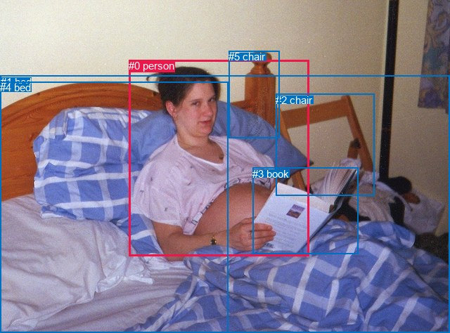
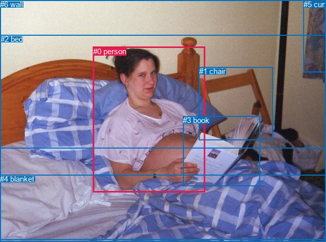

# 图片 0847：2353823.jpg

随机样本序号：98。图片 SHA256：`3b1e4dc0f5d15f4d74b3d2926e15d80e996a7e6fb4302808bbf7ba84213e0d2e`。

红色框表示人，蓝色框表示其他物体。两个模式分别保留自身框编号，可依据位置比较对应对象。

## 自动检测框与输出

人的框编号：`[0]`。状态：`ok`。

### 自动检测全部物体框

| 编号 | 类别 | 是否为人 | 检测分数 | 像素坐标 xyxy |
|---|---|---|---|---|
| 0 | person | True | 0.9992 | 183.2, 85.3, 439.9, 364.6 |
| 1 | bed | False | 0.9959 | 0.6, 107.7, 639.1, 474.0 |
| 2 | chair | False | 0.9844 | 392.1, 133.8, 532.8, 278.1 |
| 3 | book | False | 0.9626 | 359.4, 239.0, 509.2, 361.0 |
| 4 | bed | False | 0.4985 | 0.0, 116.3, 324.5, 474.0 |
| 5 | chair | False | 0.4820 | 325.3, 72.3, 398.0, 196.7 |

### 自动检测 Top50 人相关候选

评分物体对：30；人相关物体对：10；输出关系：20。

| 排名 | 主语编号与类别 | 关系 | 宾语编号与类别 | 类型 | 人与人 | 排序分数 | 原始融合 logit |
|---|---|---|---|---|---|---|---|
| 1 | #0 person | lying on | #1 bed | semantic | False | 0.99621 | 5.5729 |
| 2 | #0 person | holding | #3 book | semantic | False | 0.99451 | 5.1989 |
| 3 | #0 person | lying on | #4 bed | semantic | False | 0.99220 | 4.8464 |
| 4 | #0 person | on | #1 bed | spatial | False | 0.94730 | 2.8890 |
| 5 | #2 chair | beside | #0 person | spatial | False | 0.94131 | 2.7750 |
| 6 | #0 person | on | #4 bed | spatial | False | 0.93395 | 2.6490 |
| 7 | #0 person | leaning on | #2 chair | spatial | False | 0.85661 | 1.7874 |
| 8 | #5 chair | beside | #0 person | spatial | False | 0.83881 | 1.6494 |
| 9 | #0 person | beside | #5 chair | spatial | False | 0.83770 | 1.6412 |
| 10 | #3 book | in front of | #0 person | spatial | False | 0.68959 | 0.7982 |
| 11 | #0 person | wearing | #5 chair | semantic | False | 0.61477 | 0.4674 |
| 12 | #0 person | on | #3 book | spatial | False | 0.58618 | 0.3482 |
| 13 | #0 person | sitting on | #2 chair | semantic | False | 0.52447 | 0.0979 |
| 14 | #2 chair | holding | #0 person | semantic | False | 0.26614 | -1.0143 |
| 15 | #3 book | lying on | #0 person | semantic | False | 0.18890 | -1.4572 |
| 16 | #4 bed | beside | #0 person | spatial | False | 0.13615 | -1.8476 |
| 17 | #1 bed | holding | #0 person | semantic | False | 0.13141 | -1.8885 |
| 18 | #1 bed | in | #0 person | spatial | False | 0.09347 | -2.2720 |
| 19 | #5 chair | holding | #0 person | semantic | False | 0.07977 | -2.4455 |
| 20 | #4 bed | holding | #0 person | semantic | False | 0.07001 | -2.5865 |

### 自动检测逐条人相关 GT 核验

R@50：100.00%；命中 2/2。

| GT 主语编号 | GT 关系 | GT 宾语编号 | 结果阶段 | 匹配预测主语编号 | 匹配预测宾语编号 |
|---|---|---|---|---|---|
| 0 | lying on | 2 | hit50 | [0] | [1] |
| 0 | holding | 3 | hit50 | [0] | [3] |

## 真实框与输出

人的框编号：`[0]`。

### 真实框全部物体框

| 编号 | 类别 | 是否为人 | 检测分数 | 像素坐标 xyxy |
|---|---|---|---|---|
| 0 | person | True | GT | 183.0, 92.0, 403.0, 376.0 |
| 1 | chair | False | GT | 391.0, 131.0, 536.0, 275.0 |
| 2 | bed | False | GT | 1.0, 68.0, 640.0, 469.0 |
| 3 | book | False | GT | 359.0, 227.0, 511.0, 364.0 |
| 4 | blanket | False | GT | 0.0, 342.0, 640.0, 474.0 |
| 5 | curtain | False | GT | 596.0, 0.0, 640.0, 141.0 |
| 6 | wall | False | GT | 0.0, 0.0, 640.0, 291.0 |

### 真实框 Top50 人相关候选

评分物体对：42；人相关物体对：12；输出关系：24。

| 排名 | 主语编号与类别 | 关系 | 宾语编号与类别 | 类型 | 人与人 | 排序分数 | 原始融合 logit |
|---|---|---|---|---|---|---|---|
| 1 | #0 person | holding | #3 book | semantic | False | 0.99433 | 5.1665 |
| 2 | #0 person | lying on | #2 bed | semantic | False | 0.99363 | 5.0494 |
| 3 | #0 person | lying on | #4 blanket | semantic | False | 0.98923 | 4.5200 |
| 4 | #0 person | on | #2 bed | spatial | False | 0.97052 | 3.4942 |
| 5 | #0 person | on | #4 blanket | spatial | False | 0.94451 | 2.8345 |
| 6 | #1 chair | beside | #0 person | spatial | False | 0.86923 | 1.8941 |
| 7 | #0 person | leaning on | #1 chair | spatial | False | 0.74171 | 1.0549 |
| 8 | #0 person | on | #3 book | spatial | False | 0.67186 | 0.7166 |
| 9 | #3 book | in front of | #0 person | spatial | False | 0.57292 | 0.2938 |
| 10 | #0 person | leaning on | #6 wall | spatial | False | 0.55419 | 0.2176 |
| 11 | #0 person | sitting on | #1 chair | semantic | False | 0.47897 | -0.0842 |
| 12 | #6 wall | beside | #0 person | spatial | False | 0.42264 | -0.3119 |
| 13 | #3 book | holding | #0 person | semantic | False | 0.29106 | -0.8903 |
| 14 | #1 chair | looking at | #0 person | semantic | False | 0.22992 | -1.2088 |
| 15 | #2 bed | in | #0 person | spatial | False | 0.17877 | -1.5247 |
| 16 | #4 blanket | beside | #0 person | spatial | False | 0.16878 | -1.5943 |
| 17 | #2 bed | holding | #0 person | semantic | False | 0.16728 | -1.6050 |
| 18 | #0 person | lying on | #6 wall | semantic | False | 0.16072 | -1.6529 |
| 19 | #5 curtain | beside | #0 person | spatial | False | 0.08090 | -2.4301 |
| 20 | #4 blanket | holding | #0 person | semantic | False | 0.05669 | -2.8117 |
| 21 | #6 wall | looking at | #0 person | semantic | False | 0.04349 | -3.0908 |
| 22 | #0 person | wearing | #5 curtain | semantic | False | 0.01395 | -4.2585 |
| 23 | #0 person | beside | #5 curtain | spatial | False | 0.00879 | -4.7255 |
| 24 | #5 curtain | holding | #0 person | semantic | False | 0.00341 | -5.6774 |

### 真实框逐条人相关 GT 核验

R@50：100.00%；命中 2/2。

| GT 主语编号 | GT 关系 | GT 宾语编号 | 结果阶段 | 匹配预测主语编号 | 匹配预测宾语编号 |
|---|---|---|---|---|---|
| 0 | lying on | 2 | hit50 | [0] | [2] |
| 0 | holding | 3 | hit50 | [0] | [3] |

## 全部人相关 GT

| 主语编号与类别 | 关系 | 宾语编号与类别 |
|---|---|---|
| #0 person | lying on | #2 bed |
| #0 person | holding | #3 book |

原始记录、全部人相关物体对的两项预测与分项分数见 [逐图证据 JSON](../evidence/cases/0847.json)。全部56类 logits 保留于本机 HOR/output/random500/logits/。

<!-- HOR_COMPLETE_RESULTS -->

## 六组条件的完整输出对照

以下保留同一图片三种框与候选模式、两种谓词输出规则的全部 Top50。框编号各自在所属模式内解释。

### 自动检测框完整枚举：空间与语义各保留一个谓词

| 排名 | 主语编号与类别 | 谓词 | 宾语编号与类别 | 分组 | 排序分数 | predicate logit | pair logit |
|---|---|---|---|---|---|---|---|
| 1 | #0 person | lying on | #1 bed | semantic | 0.9962149 | 4.9256740 | 0.6472421 |
| 2 | #0 person | holding | #3 book | semantic | 0.9945080 | 4.8266969 | 0.3722412 |
| 3 | #0 person | lying on | #4 bed | semantic | 0.9922047 | 4.5652938 | 0.2811253 |
| 4 | #0 person | on | #1 bed | spatial | 0.9472989 | 2.2417364 | 0.6472421 |
| 5 | #2 chair | beside | #0 person | spatial | 0.9413109 | 3.1120629 | -0.3370428 |
| 6 | #0 person | on | #4 bed | spatial | 0.9339470 | 2.3678360 | 0.2811253 |
| 7 | #0 person | leaning on | #2 chair | spatial | 0.8566122 | 2.6586132 | -0.8711805 |
| 8 | #5 chair | beside | #0 person | spatial | 0.8388140 | 2.0529127 | -0.4034828 |
| 9 | #0 person | beside | #5 chair | spatial | 0.8377034 | 2.7492332 | -1.1079946 |
| 10 | #3 book | in front of | #0 person | spatial | 0.6895941 | 1.8571963 | -1.0589740 |
| 11 | #0 person | wearing | #5 chair | semantic | 0.6147744 | 1.5754209 | -1.1079946 |
| 12 | #0 person | on | #3 book | spatial | 0.5861776 | -0.0240550 | 0.3722412 |
| 13 | #0 person | sitting on | #2 chair | semantic | 0.5244669 | 0.9691262 | -0.8711805 |
| 14 | #2 chair | holding | #0 person | semantic | 0.2661448 | -0.6772285 | -0.3370428 |
| 15 | #3 book | lying on | #0 person | semantic | 0.1889017 | -0.3981886 | -1.0589740 |
| 16 | #4 bed | beside | #0 person | spatial | 0.1361506 | -0.6841183 | -1.1635182 |
| 17 | #1 bed | holding | #0 person | semantic | 0.1314101 | -0.6947136 | -1.1938345 |
| 18 | #1 bed | in | #0 person | spatial | 0.0934668 | -1.0781868 | -1.1938345 |
| 19 | #5 chair | holding | #0 person | semantic | 0.0797704 | -2.0419884 | -0.4034828 |
| 20 | #4 bed | holding | #0 person | semantic | 0.0700094 | -1.4230268 | -1.1635182 |

GT 命中：2/2，R@50=100.00%。

| GT主语 | GT谓词 | GT宾语 | 结果阶段 | 匹配主语框 | 匹配宾语框 |
|---|---|---|---|---|---|
| 0 | lying on | 2 | hit50 | [0] | [1] |
| 0 | holding | 3 | hit50 | [0] | [3] |

### 自动检测框完整枚举：每对只保留一个谓词

| 排名 | 主语编号与类别 | 谓词 | 宾语编号与类别 | 分组 | 排序分数 | predicate logit | pair logit |
|---|---|---|---|---|---|---|---|
| 1 | #0 person | lying on | #1 bed | single | 0.9962149 | 4.9256740 | 0.6472421 |
| 2 | #0 person | holding | #3 book | single | 0.9945080 | 4.8266969 | 0.3722412 |
| 3 | #0 person | lying on | #4 bed | single | 0.9922047 | 4.5652938 | 0.2811253 |
| 4 | #2 chair | beside | #0 person | single | 0.9413109 | 3.1120629 | -0.3370428 |
| 5 | #0 person | leaning on | #2 chair | single | 0.8566122 | 2.6586132 | -0.8711805 |
| 6 | #5 chair | beside | #0 person | single | 0.8388140 | 2.0529127 | -0.4034828 |
| 7 | #0 person | beside | #5 chair | single | 0.8377034 | 2.7492332 | -1.1079946 |
| 8 | #3 book | in front of | #0 person | single | 0.6895941 | 1.8571963 | -1.0589740 |
| 9 | #4 bed | beside | #0 person | single | 0.1361506 | -0.6841183 | -1.1635182 |
| 10 | #1 bed | holding | #0 person | single | 0.1314101 | -0.6947136 | -1.1938345 |

GT 命中：2/2，R@50=100.00%。

| GT主语 | GT谓词 | GT宾语 | 结果阶段 | 匹配主语框 | 匹配宾语框 |
|---|---|---|---|---|---|
| 0 | lying on | 2 | hit50 | [0] | [1] |
| 0 | holding | 3 | hit50 | [0] | [3] |

### 真实框完整枚举：空间与语义各保留一个谓词

| 排名 | 主语编号与类别 | 谓词 | 宾语编号与类别 | 分组 | 排序分数 | predicate logit | pair logit |
|---|---|---|---|---|---|---|---|
| 1 | #0 person | holding | #3 book | semantic | 0.9943278 | 4.8514285 | 0.3150620 |
| 2 | #0 person | lying on | #2 bed | semantic | 0.9936275 | 4.5649600 | 0.4844190 |
| 3 | #0 person | lying on | #4 blanket | semantic | 0.9892285 | 4.5634828 | -0.0434657 |
| 4 | #0 person | on | #2 bed | spatial | 0.9705229 | 3.0098019 | 0.4844190 |
| 5 | #0 person | on | #4 blanket | spatial | 0.9445120 | 2.8779678 | -0.0434657 |
| 6 | #1 chair | beside | #0 person | spatial | 0.8692266 | 2.2456617 | -0.3515237 |
| 7 | #0 person | leaning on | #1 chair | spatial | 0.7417089 | 2.0178652 | -0.9629953 |
| 8 | #0 person | on | #3 book | spatial | 0.6718577 | 0.4015374 | 0.3150620 |
| 9 | #3 book | in front of | #0 person | spatial | 0.5729231 | 1.3236713 | -1.0298840 |
| 10 | #0 person | leaning on | #6 wall | spatial | 0.5541891 | 1.1724114 | -0.9548005 |
| 11 | #0 person | sitting on | #1 chair | semantic | 0.4789726 | 0.8788362 | -0.9629953 |
| 12 | #6 wall | beside | #0 person | spatial | 0.4226407 | 0.1048460 | -0.4167886 |
| 13 | #3 book | holding | #0 person | semantic | 0.2910568 | 0.1396270 | -1.0298840 |
| 14 | #1 chair | looking at | #0 person | semantic | 0.2299158 | -0.8572633 | -0.3515237 |
| 15 | #2 bed | in | #0 person | spatial | 0.1787666 | -0.3666821 | -1.1580446 |
| 16 | #4 blanket | beside | #0 person | spatial | 0.1687841 | -0.7382002 | -0.8560693 |
| 17 | #2 bed | holding | #0 person | semantic | 0.1672809 | -0.4469771 | -1.1580446 |
| 18 | #0 person | lying on | #6 wall | semantic | 0.1607205 | -0.6980762 | -0.9548005 |
| 19 | #5 curtain | beside | #0 person | spatial | 0.0809039 | -0.9705925 | -1.4595356 |
| 20 | #4 blanket | holding | #0 person | semantic | 0.0566949 | -1.9556367 | -0.8560693 |
| 21 | #6 wall | looking at | #0 person | semantic | 0.0434887 | -2.6740036 | -0.4167886 |
| 22 | #0 person | wearing | #5 curtain | semantic | 0.0139456 | -1.9111571 | -2.3473892 |
| 23 | #0 person | beside | #5 curtain | spatial | 0.0087886 | -2.3780863 | -2.3473892 |
| 24 | #5 curtain | holding | #0 person | semantic | 0.0034108 | -4.2178526 | -1.4595356 |

GT 命中：2/2，R@50=100.00%。

| GT主语 | GT谓词 | GT宾语 | 结果阶段 | 匹配主语框 | 匹配宾语框 |
|---|---|---|---|---|---|
| 0 | lying on | 2 | hit50 | [0] | [2] |
| 0 | holding | 3 | hit50 | [0] | [3] |

### 真实框完整枚举：每对只保留一个谓词

| 排名 | 主语编号与类别 | 谓词 | 宾语编号与类别 | 分组 | 排序分数 | predicate logit | pair logit |
|---|---|---|---|---|---|---|---|
| 1 | #0 person | holding | #3 book | single | 0.9943278 | 4.8514285 | 0.3150620 |
| 2 | #0 person | lying on | #2 bed | single | 0.9936275 | 4.5649600 | 0.4844190 |
| 3 | #0 person | lying on | #4 blanket | single | 0.9892285 | 4.5634828 | -0.0434657 |
| 4 | #1 chair | beside | #0 person | single | 0.8692266 | 2.2456617 | -0.3515237 |
| 5 | #0 person | leaning on | #1 chair | single | 0.7417089 | 2.0178652 | -0.9629953 |
| 6 | #3 book | in front of | #0 person | single | 0.5729231 | 1.3236713 | -1.0298840 |
| 7 | #0 person | leaning on | #6 wall | single | 0.5541891 | 1.1724114 | -0.9548005 |
| 8 | #6 wall | beside | #0 person | single | 0.4226407 | 0.1048460 | -0.4167886 |
| 9 | #2 bed | in | #0 person | single | 0.1787666 | -0.3666821 | -1.1580446 |
| 10 | #4 blanket | beside | #0 person | single | 0.1687841 | -0.7382002 | -0.8560693 |
| 11 | #5 curtain | beside | #0 person | single | 0.0809039 | -0.9705925 | -1.4595356 |
| 12 | #0 person | wearing | #5 curtain | single | 0.0139456 | -1.9111571 | -2.3473892 |

GT 命中：2/2，R@50=100.00%。

| GT主语 | GT谓词 | GT宾语 | 结果阶段 | 匹配主语框 | 匹配宾语框 |
|---|---|---|---|---|---|
| 0 | lying on | 2 | hit50 | [0] | [2] |
| 0 | holding | 3 | hit50 | [0] | [3] |

### 真实框400候选：空间与语义各保留一个谓词

| 排名 | 主语编号与类别 | 谓词 | 宾语编号与类别 | 分组 | 排序分数 | predicate logit | pair logit |
|---|---|---|---|---|---|---|---|
| 1 | #0 person | holding | #3 book | semantic | 0.9943278 | 4.8514285 | 0.3150620 |
| 2 | #0 person | lying on | #2 bed | semantic | 0.9936275 | 4.5649600 | 0.4844190 |
| 3 | #0 person | lying on | #4 blanket | semantic | 0.9892285 | 4.5634828 | -0.0434657 |
| 4 | #0 person | on | #2 bed | spatial | 0.9694042 | 2.9713979 | 0.4844190 |
| 5 | #0 person | on | #4 blanket | spatial | 0.9445120 | 2.8779678 | -0.0434657 |
| 6 | #1 chair | beside | #0 person | spatial | 0.8692136 | 2.2455463 | -0.3515237 |
| 7 | #0 person | leaning on | #1 chair | spatial | 0.7418984 | 2.0188541 | -0.9629953 |
| 8 | #0 person | on | #3 book | spatial | 0.6718577 | 0.4015374 | 0.3150620 |
| 9 | #3 book | in front of | #0 person | spatial | 0.5801200 | 1.3531499 | -1.0298840 |
| 10 | #0 person | leaning on | #6 wall | spatial | 0.5543112 | 1.1729059 | -0.9548005 |
| 11 | #0 person | sitting on | #1 chair | semantic | 0.4789726 | 0.8788362 | -0.9629953 |
| 12 | #6 wall | beside | #0 person | spatial | 0.4299645 | 0.1347928 | -0.4167886 |
| 13 | #3 book | holding | #0 person | semantic | 0.2910568 | 0.1396270 | -1.0298840 |
| 14 | #1 chair | looking at | #0 person | semantic | 0.2299158 | -0.8572633 | -0.3515237 |
| 15 | #2 bed | in | #0 person | spatial | 0.1787666 | -0.3666821 | -1.1580446 |
| 16 | #4 blanket | beside | #0 person | spatial | 0.1646182 | -0.7681904 | -0.8560693 |
| 17 | #2 bed | holding | #0 person | semantic | 0.1640406 | -0.4704213 | -1.1580446 |
| 18 | #0 person | lying on | #6 wall | semantic | 0.1607237 | -0.6980524 | -0.9548005 |
| 19 | #5 curtain | beside | #0 person | spatial | 0.0797922 | -0.9856379 | -1.4595356 |
| 20 | #4 blanket | holding | #0 person | semantic | 0.0567344 | -1.9548981 | -0.8560693 |
| 21 | #6 wall | looking at | #0 person | semantic | 0.0428957 | -2.6883516 | -0.4167886 |
| 22 | #0 person | wearing | #5 curtain | semantic | 0.0137402 | -1.9262025 | -2.3473892 |
| 23 | #0 person | beside | #5 curtain | spatial | 0.0084049 | -2.4231079 | -2.3473892 |
| 24 | #5 curtain | holding | #0 person | semantic | 0.0033754 | -4.2283297 | -1.4595356 |

GT 命中：2/2，R@50=100.00%。

| GT主语 | GT谓词 | GT宾语 | 结果阶段 | 匹配主语框 | 匹配宾语框 |
|---|---|---|---|---|---|
| 0 | lying on | 2 | hit50 | [0] | [2] |
| 0 | holding | 3 | hit50 | [0] | [3] |

### 真实框400候选：每对只保留一个谓词

| 排名 | 主语编号与类别 | 谓词 | 宾语编号与类别 | 分组 | 排序分数 | predicate logit | pair logit |
|---|---|---|---|---|---|---|---|
| 1 | #0 person | holding | #3 book | single | 0.9943278 | 4.8514285 | 0.3150620 |
| 2 | #0 person | lying on | #2 bed | single | 0.9936275 | 4.5649600 | 0.4844190 |
| 3 | #0 person | lying on | #4 blanket | single | 0.9892285 | 4.5634828 | -0.0434657 |
| 4 | #1 chair | beside | #0 person | single | 0.8692136 | 2.2455463 | -0.3515237 |
| 5 | #0 person | leaning on | #1 chair | single | 0.7418984 | 2.0188541 | -0.9629953 |
| 6 | #3 book | in front of | #0 person | single | 0.5801200 | 1.3531499 | -1.0298840 |
| 7 | #0 person | leaning on | #6 wall | single | 0.5543112 | 1.1729059 | -0.9548005 |
| 8 | #6 wall | beside | #0 person | single | 0.4299645 | 0.1347928 | -0.4167886 |
| 9 | #2 bed | in | #0 person | single | 0.1787666 | -0.3666821 | -1.1580446 |
| 10 | #4 blanket | beside | #0 person | single | 0.1646182 | -0.7681904 | -0.8560693 |
| 11 | #5 curtain | beside | #0 person | single | 0.0797922 | -0.9856379 | -1.4595356 |
| 12 | #0 person | wearing | #5 curtain | single | 0.0137402 | -1.9262025 | -2.3473892 |

GT 命中：2/2，R@50=100.00%。

| GT主语 | GT谓词 | GT宾语 | 结果阶段 | 匹配主语框 | 匹配宾语框 |
|---|---|---|---|---|---|
| 0 | lying on | 2 | hit50 | [0] | [2] |
| 0 | holding | 3 | hit50 | [0] | [3] |
