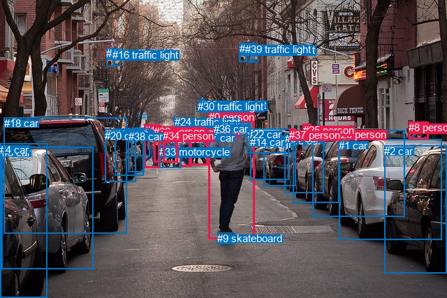
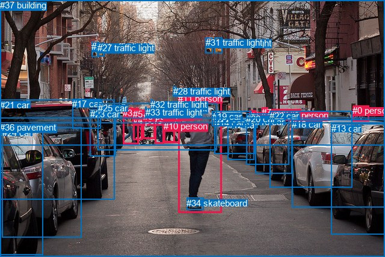

# 图片 0852：2354099.jpg

随机样本序号：87。图片 SHA256：`cc9d8a2d6fdd06220bb2e63d0e41b13cddd7a83758c74b2aa0161e56c8aa18a9`。

红色框表示人，蓝色框表示其他物体。两个模式分别保留自身框编号，可依据位置比较对应对象。

## 自动检测框与输出

人的框编号：`[0, 8, 12, 17, 21, 23, 25, 26, 32, 34, 37]`。状态：`ok`。

### 自动检测全部物体框

| 编号 | 类别 | 是否为人 | 检测分数 | 像素坐标 xyxy |
|---|---|---|---|---|
| 0 | person | True | 0.9989 | 298.9, 158.9, 364.5, 342.9 |
| 1 | car | False | 0.9983 | 485.2, 199.6, 632.2, 343.7 |
| 2 | car | False | 0.9982 | 550.2, 208.1, 639.9, 392.0 |
| 3 | car | False | 0.9977 | 2.9, 210.1, 133.8, 385.1 |
| 4 | car | False | 0.9969 | 0.0, 205.6, 67.7, 427.0 |
| 5 | car | False | 0.9963 | 419.5, 192.7, 485.3, 290.9 |
| 6 | car | False | 0.9962 | 377.4, 197.5, 423.7, 266.5 |
| 7 | car | False | 0.9946 | 447.8, 186.1, 579.0, 311.0 |
| 8 | person | True | 0.9937 | 585.3, 174.3, 613.8, 199.5 |
| 9 | skateboard | False | 0.9921 | 311.1, 333.4, 336.0, 349.0 |
| 10 | traffic light | False | 0.9871 | 357.1, 62.9, 369.7, 89.0 |
| 11 | car | False | 0.9870 | 164.2, 184.0, 205.4, 252.0 |
| 12 | person | True | 0.9854 | 257.1, 182.2, 274.6, 238.1 |
| 13 | traffic light | False | 0.9824 | 152.2, 68.5, 164.3, 95.3 |
| 14 | car | False | 0.9807 | 358.3, 195.0, 413.1, 257.9 |
| 15 | traffic light | False | 0.9799 | 342.6, 62.0, 353.3, 88.1 |
| 16 | traffic light | False | 0.9652 | 161.1, 69.5, 172.3, 94.7 |
| 17 | person | True | 0.9517 | 206.6, 178.0, 228.4, 240.1 |
| 18 | car | False | 0.9511 | 5.7, 168.2, 181.9, 334.3 |
| 19 | car | False | 0.9500 | 188.2, 183.8, 214.1, 223.8 |
| 20 | car | False | 0.9139 | 150.1, 185.8, 194.2, 260.9 |
| 21 | person | True | 0.9096 | 270.4, 180.8, 297.1, 236.9 |
| 22 | car | False | 0.8811 | 353.8, 184.3, 420.9, 219.7 |
| 23 | person | True | 0.7875 | 480.4, 183.6, 491.6, 194.6 |
| 24 | traffic light | False | 0.7799 | 249.6, 166.3, 253.6, 172.2 |
| 25 | person | True | 0.7676 | 433.8, 177.8, 445.8, 190.8 |
| 26 | person | True | 0.7551 | 235.8, 186.1, 251.6, 211.6 |
| 27 | car | False | 0.6907 | 286.7, 188.6, 301.0, 215.2 |
| 28 | traffic light | False | 0.6756 | 287.3, 141.5, 292.5, 152.6 |
| 29 | car | False | 0.6739 | 243.7, 190.9, 260.1, 205.7 |
| 30 | traffic light | False | 0.6613 | 283.1, 143.7, 288.5, 153.0 |
| 31 | car | False | 0.6583 | 407.8, 190.4, 463.7, 276.3 |
| 32 | person | True | 0.6490 | 220.1, 179.9, 230.5, 232.2 |
| 33 | motorcycle | False | 0.6365 | 228.2, 208.8, 259.4, 240.7 |
| 34 | person | True | 0.6189 | 233.1, 186.3, 254.5, 232.8 |
| 35 | traffic light | False | 0.5996 | 343.3, 61.1, 364.5, 88.7 |
| 36 | car | False | 0.5374 | 306.3, 175.8, 358.2, 194.9 |
| 37 | person | True | 0.4127 | 414.0, 184.6, 423.3, 196.9 |
| 38 | car | False | 0.3987 | 183.8, 187.1, 206.4, 246.3 |
| 39 | traffic light | False | 0.3851 | 351.5, 61.8, 361.9, 88.1 |

### 自动检测 Top50 人相关候选

评分物体对：1560；人相关物体对：748；输出关系：50。

| 排名 | 主语编号与类别 | 关系 | 宾语编号与类别 | 类型 | 人与人 | 排序分数 | 原始融合 logit |
|---|---|---|---|---|---|---|---|
| 1 | #0 person | riding | #9 skateboard | semantic | False | 0.99516 | 5.3253 |
| 2 | #34 person | riding | #33 motorcycle | semantic | False | 0.99173 | 4.7868 |
| 3 | #17 person | pushing | #33 motorcycle | semantic | False | 0.98560 | 4.2259 |
| 4 | #0 person | wearing | #36 car | semantic | False | 0.98325 | 4.0724 |
| 5 | #32 person | pushing | #33 motorcycle | semantic | False | 0.97838 | 3.8124 |
| 6 | #26 person | riding | #33 motorcycle | semantic | False | 0.97709 | 3.7531 |
| 7 | #12 person | pushing | #33 motorcycle | semantic | False | 0.97105 | 3.5126 |
| 8 | #0 person | on | #9 skateboard | spatial | False | 0.96949 | 3.4586 |
| 9 | #34 person | wearing | #26 person | semantic | True | 0.96867 | 3.4313 |
| 10 | #34 person | on | #33 motorcycle | spatial | False | 0.96684 | 3.3726 |
| 11 | #34 person | carrying | #29 car | semantic | False | 0.93971 | 2.7463 |
| 12 | #34 person | in | #26 person | spatial | True | 0.93101 | 2.6023 |
| 13 | #26 person | on | #33 motorcycle | spatial | False | 0.92627 | 2.5308 |
| 14 | #32 person | on | #33 motorcycle | spatial | False | 0.90699 | 2.2774 |
| 15 | #21 person | carrying | #27 car | semantic | False | 0.90195 | 2.2190 |
| 16 | #0 person | in | #36 car | spatial | False | 0.89428 | 2.1353 |
| 17 | #21 person | pushing | #33 motorcycle | semantic | False | 0.85114 | 1.7436 |
| 18 | #12 person | carrying | #29 car | semantic | False | 0.83911 | 1.6516 |
| 19 | #12 person | on | #33 motorcycle | spatial | False | 0.80426 | 1.4131 |
| 20 | #26 person | carrying | #29 car | semantic | False | 0.80290 | 1.4045 |
| 21 | #17 person | on | #33 motorcycle | spatial | False | 0.74870 | 1.0917 |
| 22 | #34 person | in | #29 car | spatial | False | 0.71612 | 0.9253 |
| 23 | #12 person | riding | #9 skateboard | semantic | False | 0.71592 | 0.9243 |
| 24 | #21 person | riding | #9 skateboard | semantic | False | 0.70532 | 0.8728 |
| 25 | #17 person | pushing | #38 car | semantic | False | 0.67465 | 0.7293 |
| 26 | #37 person | walking on | #22 car | semantic | False | 0.60195 | 0.4136 |
| 27 | #26 person | in | #29 car | spatial | False | 0.59320 | 0.3772 |
| 28 | #17 person | walking on | #19 car | semantic | False | 0.58830 | 0.3569 |
| 29 | #36 car | on | #0 person | spatial | False | 0.57770 | 0.3133 |
| 30 | #0 person | wearing | #27 car | semantic | False | 0.55768 | 0.2317 |
| 31 | #37 person | beside | #22 car | spatial | False | 0.54196 | 0.1682 |
| 32 | #32 person | walking on | #17 person | semantic | True | 0.53542 | 0.1419 |
| 33 | #21 person | in | #27 car | spatial | False | 0.52402 | 0.0962 |
| 34 | #34 person | riding | #9 skateboard | semantic | False | 0.52069 | 0.0828 |
| 35 | #37 person | walking on | #31 car | semantic | False | 0.50853 | 0.0341 |
| 36 | #8 person | looking at | #0 person | semantic | True | 0.49853 | -0.0059 |
| 37 | #12 person | looking at | #24 traffic light | semantic | False | 0.46967 | -0.1215 |
| 38 | #34 person | looking at | #24 traffic light | semantic | False | 0.46476 | -0.1412 |
| 39 | #17 person | walking on | #11 car | semantic | False | 0.45786 | -0.1690 |
| 40 | #32 person | walking on | #26 person | semantic | True | 0.44265 | -0.2304 |
| 41 | #32 person | walking on | #11 car | semantic | False | 0.44204 | -0.2329 |
| 42 | #12 person | in | #29 car | spatial | False | 0.43857 | -0.2470 |
| 43 | #23 person | on | #7 car | spatial | False | 0.42544 | -0.3005 |
| 44 | #32 person | riding | #9 skateboard | semantic | False | 0.42514 | -0.3017 |
| 45 | #17 person | looking at | #24 traffic light | semantic | False | 0.41113 | -0.3593 |
| 46 | #32 person | walking on | #19 car | semantic | False | 0.41074 | -0.3609 |
| 47 | #17 person | holding | #32 person | semantic | True | 0.40207 | -0.3968 |
| 48 | #32 person | walking on | #18 car | semantic | False | 0.39193 | -0.4392 |
| 49 | #32 person | walking on | #20 car | semantic | False | 0.39069 | -0.4444 |
| 50 | #32 person | walking on | #38 car | semantic | False | 0.37933 | -0.4924 |

### 自动检测逐条人相关 GT 核验

R@50：20.00%；命中 1/5。

| GT 主语编号 | GT 关系 | GT 宾语编号 | 结果阶段 | 匹配预测主语编号 | 匹配预测宾语编号 |
|---|---|---|---|---|---|
| 3 | crossing | 36 | endpoint_missing_or_wrong_class | [17] | [] |
| 9 | crossing | 36 | endpoint_missing_or_wrong_class | [21] | [] |
| 11 | on | 34 | hit50 | [0] | [9] |
| 11 | standing on | 34 | wrong_predicate | [0] | [9] |
| 37 | beside | 11 | endpoint_missing_or_wrong_class | [] | [0] |

## 真实框与输出

人的框编号：`[0, 1, 2, 3, 4, 5, 6, 7, 8, 9, 10, 11]`。

### 真实框全部物体框

| 编号 | 类别 | 是否为人 | 检测分数 | 像素坐标 xyxy |
|---|---|---|---|---|
| 0 | person | True | GT | 586.0, 175.0, 614.0, 201.0 |
| 1 | person | True | GT | 415.0, 184.0, 426.0, 197.0 |
| 2 | person | True | GT | 258.0, 183.0, 273.0, 238.0 |
| 3 | person | True | GT | 204.0, 179.0, 230.0, 239.0 |
| 4 | person | True | GT | 221.0, 192.0, 236.0, 233.0 |
| 5 | person | True | GT | 221.0, 181.0, 230.0, 205.0 |
| 6 | person | True | GT | 238.0, 185.0, 258.0, 231.0 |
| 7 | person | True | GT | 435.0, 178.0, 445.0, 190.0 |
| 8 | person | True | GT | 481.0, 183.0, 491.0, 192.0 |
| 9 | person | True | GT | 272.0, 181.0, 299.0, 237.0 |
| 10 | person | True | GT | 272.0, 201.0, 290.0, 236.0 |
| 11 | person | True | GT | 296.0, 155.0, 368.0, 354.0 |
| 12 | car | False | GT | 379.0, 199.0, 423.0, 266.0 |
| 13 | car | False | GT | 551.0, 205.0, 640.0, 390.0 |
| 14 | car | False | GT | 357.0, 196.0, 424.0, 256.0 |
| 15 | car | False | GT | 0.0, 209.0, 72.0, 423.0 |
| 16 | car | False | GT | 424.0, 194.0, 485.0, 289.0 |
| 17 | car | False | GT | 120.0, 164.0, 167.0, 213.0 |
| 18 | car | False | GT | 485.0, 198.0, 640.0, 344.0 |
| 19 | car | False | GT | 353.0, 185.0, 418.0, 210.0 |
| 20 | car | False | GT | 409.0, 189.0, 481.0, 274.0 |
| 21 | car | False | GT | 0.0, 166.0, 190.0, 332.0 |
| 22 | car | False | GT | 448.0, 184.0, 585.0, 311.0 |
| 23 | car | False | GT | 150.0, 181.0, 193.0, 259.0 |
| 24 | car | False | GT | 4.0, 212.0, 135.0, 395.0 |
| 25 | car | False | GT | 163.0, 171.0, 360.0, 249.0 |
| 26 | traffic light | False | GT | 152.0, 69.0, 164.0, 94.0 |
| 27 | traffic light | False | GT | 162.0, 71.0, 173.0, 93.0 |
| 28 | traffic light | False | GT | 288.0, 143.0, 292.0, 153.0 |
| 29 | traffic light | False | GT | 357.0, 63.0, 370.0, 88.0 |
| 30 | traffic light | False | GT | 250.0, 171.0, 254.0, 175.0 |
| 31 | traffic light | False | GT | 342.0, 62.0, 353.0, 89.0 |
| 32 | traffic light | False | GT | 250.0, 165.0, 254.0, 171.0 |
| 33 | traffic light | False | GT | 242.0, 178.0, 244.0, 182.0 |
| 34 | skateboard | False | GT | 310.0, 329.0, 338.0, 349.0 |
| 35 | tree | False | GT | 0.0, 0.0, 640.0, 197.0 |
| 36 | pavement | False | GT | 0.0, 203.0, 640.0, 427.0 |
| 37 | building | False | GT | 0.0, 0.0, 640.0, 241.0 |

### 真实框 Top50 人相关候选

评分物体对：1406；人相关物体对：756；输出关系：50。

| 排名 | 主语编号与类别 | 关系 | 宾语编号与类别 | 类型 | 人与人 | 排序分数 | 原始融合 logit |
|---|---|---|---|---|---|---|---|
| 1 | #9 person | crossing | #36 pavement | semantic | False | 0.99525 | 5.3457 |
| 2 | #11 person | riding | #34 skateboard | semantic | False | 0.99505 | 5.3039 |
| 3 | #11 person | crossing | #36 pavement | semantic | False | 0.99387 | 5.0889 |
| 4 | #2 person | crossing | #36 pavement | semantic | False | 0.99346 | 5.0233 |
| 5 | #6 person | crossing | #36 pavement | semantic | False | 0.99301 | 4.9569 |
| 6 | #3 person | crossing | #36 pavement | semantic | False | 0.99225 | 4.8522 |
| 7 | #4 person | crossing | #36 pavement | semantic | False | 0.97343 | 3.6010 |
| 8 | #3 person | wearing | #5 person | semantic | True | 0.96475 | 3.3094 |
| 9 | #11 person | on | #34 skateboard | spatial | False | 0.95935 | 3.1612 |
| 10 | #9 person | wearing | #10 person | semantic | True | 0.94106 | 2.7705 |
| 11 | #10 person | crossing | #36 pavement | semantic | False | 0.94079 | 2.7656 |
| 12 | #11 person | on | #36 pavement | spatial | False | 0.91955 | 2.4362 |
| 13 | #2 person | pushing | #10 person | semantic | True | 0.87337 | 1.9311 |
| 14 | #3 person | pushing | #4 person | semantic | True | 0.86883 | 1.8906 |
| 15 | #4 person | carrying | #5 person | semantic | True | 0.85828 | 1.8011 |
| 16 | #3 person | in | #5 person | spatial | True | 0.83314 | 1.6081 |
| 17 | #3 person | on | #36 pavement | spatial | False | 0.82290 | 1.5361 |
| 18 | #0 person | standing on | #36 pavement | semantic | False | 0.80960 | 1.4474 |
| 19 | #6 person | on | #36 pavement | spatial | False | 0.80387 | 1.4106 |
| 20 | #2 person | on | #36 pavement | spatial | False | 0.74089 | 1.0506 |
| 21 | #4 person | on | #36 pavement | spatial | False | 0.73729 | 1.0319 |
| 22 | #9 person | in | #10 person | spatial | True | 0.71967 | 0.9428 |
| 23 | #9 person | on | #36 pavement | spatial | False | 0.71642 | 0.9268 |
| 24 | #5 person | walking on | #36 pavement | semantic | False | 0.65960 | 0.6615 |
| 25 | #2 person | riding | #34 skateboard | semantic | False | 0.62310 | 0.5027 |
| 26 | #4 person | in | #5 person | spatial | True | 0.59211 | 0.3727 |
| 27 | #5 person | pushing | #4 person | semantic | True | 0.57792 | 0.3143 |
| 28 | #9 person | riding | #34 skateboard | semantic | False | 0.57196 | 0.2899 |
| 29 | #8 person | on | #22 car | spatial | False | 0.56984 | 0.2812 |
| 30 | #0 person | looking at | #11 person | semantic | True | 0.54267 | 0.1711 |
| 31 | #3 person | walking on | #25 car | semantic | False | 0.53148 | 0.1261 |
| 32 | #1 person | standing on | #19 car | semantic | False | 0.52834 | 0.1135 |
| 33 | #6 person | looking at | #33 traffic light | semantic | False | 0.52504 | 0.1003 |
| 34 | #9 person | walking on | #25 car | semantic | False | 0.50437 | 0.0175 |
| 35 | #6 person | riding | #34 skateboard | semantic | False | 0.50060 | 0.0024 |
| 36 | #25 car | holding | #10 person | semantic | False | 0.49983 | -0.0007 |
| 37 | #5 person | on | #4 person | spatial | True | 0.49398 | -0.0241 |
| 38 | #6 person | looking at | #30 traffic light | semantic | False | 0.48009 | -0.0797 |
| 39 | #6 person | walking on | #25 car | semantic | False | 0.47483 | -0.1008 |
| 40 | #1 person | standing on | #20 car | semantic | False | 0.46938 | -0.1226 |
| 41 | #6 person | pushing | #10 person | semantic | True | 0.46440 | -0.1426 |
| 42 | #10 person | carrying | #9 person | semantic | True | 0.44247 | -0.2312 |
| 43 | #10 person | on | #36 pavement | spatial | False | 0.43551 | -0.2594 |
| 44 | #3 person | looking at | #33 traffic light | semantic | False | 0.41845 | -0.3292 |
| 45 | #4 person | pushing | #3 person | semantic | True | 0.41648 | -0.3373 |
| 46 | #1 person | standing on | #36 pavement | semantic | False | 0.41586 | -0.3398 |
| 47 | #8 person | standing on | #22 car | semantic | False | 0.41438 | -0.3459 |
| 48 | #3 person | beside | #4 person | spatial | True | 0.40653 | -0.3783 |
| 49 | #2 person | looking at | #30 traffic light | semantic | False | 0.39049 | -0.4453 |
| 50 | #2 person | walking on | #25 car | semantic | False | 0.38998 | -0.4474 |

### 真实框逐条人相关 GT 核验

R@50：60.00%；命中 3/5。

| GT 主语编号 | GT 关系 | GT 宾语编号 | 结果阶段 | 匹配预测主语编号 | 匹配预测宾语编号 |
|---|---|---|---|---|---|
| 3 | crossing | 36 | hit50 | [3] | [36] |
| 9 | crossing | 36 | hit50 | [9] | [36] |
| 11 | on | 34 | hit50 | [11] | [34] |
| 11 | standing on | 34 | wrong_predicate | [11] | [34] |
| 37 | beside | 11 | wrong_predicate | [37] | [11] |

## 全部人相关 GT

| 主语编号与类别 | 关系 | 宾语编号与类别 |
|---|---|---|
| #3 person | crossing | #36 pavement |
| #9 person | crossing | #36 pavement |
| #11 person | on | #34 skateboard |
| #11 person | standing on | #34 skateboard |
| #37 building | beside | #11 person |

原始记录、全部人相关物体对的两项预测与分项分数见 [逐图证据 JSON](../evidence/cases/0852.json)。全部56类 logits 保留于本机 HOR/output/random500/logits/。

<!-- HOR_COMPLETE_RESULTS -->

## 六组条件的完整输出对照

以下保留同一图片三种框与候选模式、两种谓词输出规则的全部 Top50。框编号各自在所属模式内解释。

### 自动检测框完整枚举：空间与语义各保留一个谓词

| 排名 | 主语编号与类别 | 谓词 | 宾语编号与类别 | 分组 | 排序分数 | predicate logit | pair logit |
|---|---|---|---|---|---|---|---|
| 1 | #0 person | riding | #9 skateboard | semantic | 0.9951566 | 5.0175328 | 0.3077650 |
| 2 | #34 person | riding | #33 motorcycle | semantic | 0.9917300 | 4.5443797 | 0.2424343 |
| 3 | #17 person | pushing | #33 motorcycle | semantic | 0.9855988 | 4.0874639 | 0.1384758 |
| 4 | #0 person | wearing | #36 car | semantic | 0.9832497 | 3.8655086 | 0.2069406 |
| 5 | #32 person | pushing | #33 motorcycle | semantic | 0.9783821 | 3.7268167 | 0.0855622 |
| 6 | #26 person | riding | #33 motorcycle | semantic | 0.9770910 | 3.9471984 | -0.1941449 |
| 7 | #12 person | pushing | #33 motorcycle | semantic | 0.9710454 | 3.3055396 | 0.2071053 |
| 8 | #0 person | on | #9 skateboard | spatial | 0.9694852 | 3.1507874 | 0.3077650 |
| 9 | #34 person | wearing | #26 person | semantic | 0.9686686 | 3.3547091 | 0.0765930 |
| 10 | #34 person | on | #33 motorcycle | spatial | 0.9668372 | 3.1301665 | 0.2424343 |
| 11 | #34 person | carrying | #29 car | semantic | 0.9397052 | 2.5600920 | 0.1862282 |
| 12 | #34 person | in | #26 person | spatial | 0.9310117 | 2.5257411 | 0.0765930 |
| 13 | #26 person | on | #33 motorcycle | spatial | 0.9262723 | 2.7249341 | -0.1941449 |
| 14 | #32 person | on | #33 motorcycle | spatial | 0.9069902 | 2.1918645 | 0.0855622 |
| 15 | #21 person | carrying | #27 car | semantic | 0.9019455 | 2.1250339 | 0.0939969 |
| 16 | #0 person | in | #36 car | spatial | 0.8942841 | 1.9283276 | 0.2069406 |
| 17 | #21 person | pushing | #33 motorcycle | semantic | 0.8511425 | 1.8010058 | -0.0574162 |
| 18 | #12 person | carrying | #29 car | semantic | 0.8391109 | 1.3904281 | 0.2611995 |
| 19 | #12 person | on | #33 motorcycle | spatial | 0.8042564 | 1.2060075 | 0.2071053 |
| 20 | #26 person | carrying | #29 car | semantic | 0.8029048 | 1.6022320 | -0.1976822 |
| 21 | #17 person | on | #33 motorcycle | spatial | 0.7487026 | 0.9532290 | 0.1384758 |
| 22 | #34 person | in | #29 car | spatial | 0.7161196 | 0.7390661 | 0.1862282 |
| 23 | #12 person | riding | #9 skateboard | semantic | 0.7159152 | 1.9073462 | -0.9830574 |
| 24 | #21 person | riding | #9 skateboard | semantic | 0.7053236 | 1.8762779 | -1.0034990 |
| 25 | #17 person | pushing | #38 car | semantic | 0.6746486 | 0.8683672 | -0.1390810 |
| 26 | #37 person | walking on | #22 car | semantic | 0.6019544 | 0.8546968 | -0.4410815 |
| 27 | #26 person | in | #29 car | spatial | 0.5931993 | 0.5748892 | -0.1976822 |
| 28 | #17 person | walking on | #19 car | semantic | 0.5882993 | 0.5251703 | -0.1682310 |
| 29 | #36 car | on | #0 person | spatial | 0.5776958 | 0.8859215 | -0.5725999 |
| 30 | #0 person | wearing | #27 car | semantic | 0.5576755 | 0.4275160 | -0.1957826 |
| 31 | #37 person | beside | #22 car | spatial | 0.5419600 | 0.6093173 | -0.4410815 |
| 32 | #32 person | walking on | #17 person | semantic | 0.5354249 | 0.6545391 | -0.5126014 |
| 33 | #21 person | in | #27 car | spatial | 0.5240217 | 0.0021639 | 0.0939969 |
| 34 | #34 person | riding | #9 skateboard | semantic | 0.5206939 | 1.2504702 | -1.1676471 |
| 35 | #37 person | walking on | #31 car | semantic | 0.5085292 | 0.6891880 | -0.6550679 |
| 36 | #8 person | looking at | #0 person | semantic | 0.4985323 | 1.2321496 | -1.2380203 |
| 37 | #12 person | looking at | #24 traffic light | semantic | 0.4696687 | -0.0035748 | -0.1178995 |
| 38 | #34 person | looking at | #24 traffic light | semantic | 0.4647591 | 0.0023518 | -0.1435496 |
| 39 | #17 person | walking on | #11 car | semantic | 0.4578578 | 0.0241838 | -0.1931534 |
| 40 | #32 person | walking on | #26 person | semantic | 0.4426506 | -0.2135491 | -0.0168623 |
| 41 | #32 person | walking on | #11 car | semantic | 0.4420392 | -0.0089178 | -0.2239726 |
| 42 | #12 person | in | #29 car | spatial | 0.4385686 | -0.5081730 | 0.2611995 |
| 43 | #23 person | on | #7 car | spatial | 0.4254351 | 0.5454478 | -0.8459485 |
| 44 | #32 person | riding | #9 skateboard | semantic | 0.4251357 | 1.1313272 | -1.4330527 |
| 45 | #17 person | looking at | #24 traffic light | semantic | 0.4111258 | -0.1738377 | -0.1854757 |
| 46 | #32 person | walking on | #19 car | semantic | 0.4107434 | -0.1759176 | -0.1849753 |
| 47 | #17 person | holding | #32 person | semantic | 0.4020719 | -0.0660715 | -0.3307682 |
| 48 | #32 person | walking on | #18 car | semantic | 0.3919254 | 0.7764511 | -1.2156773 |
| 49 | #32 person | walking on | #20 car | semantic | 0.3906851 | -0.1247673 | -0.3196661 |
| 50 | #32 person | walking on | #38 car | semantic | 0.3793254 | -0.3233638 | -0.1690488 |

GT 命中：1/5，R@50=20.00%。

| GT主语 | GT谓词 | GT宾语 | 结果阶段 | 匹配主语框 | 匹配宾语框 |
|---|---|---|---|---|---|
| 3 | crossing | 36 | endpoint_missing_or_wrong_class | [17] | [] |
| 9 | crossing | 36 | endpoint_missing_or_wrong_class | [21] | [] |
| 11 | on | 34 | hit50 | [0] | [9] |
| 11 | standing on | 34 | wrong_predicate | [0] | [9] |
| 37 | beside | 11 | endpoint_missing_or_wrong_class | [] | [0] |

### 自动检测框完整枚举：每对只保留一个谓词

| 排名 | 主语编号与类别 | 谓词 | 宾语编号与类别 | 分组 | 排序分数 | predicate logit | pair logit |
|---|---|---|---|---|---|---|---|
| 1 | #0 person | riding | #9 skateboard | single | 0.9951566 | 5.0175328 | 0.3077650 |
| 2 | #34 person | riding | #33 motorcycle | single | 0.9917300 | 4.5443797 | 0.2424343 |
| 3 | #17 person | pushing | #33 motorcycle | single | 0.9855988 | 4.0874639 | 0.1384758 |
| 4 | #0 person | wearing | #36 car | single | 0.9832497 | 3.8655086 | 0.2069406 |
| 5 | #32 person | pushing | #33 motorcycle | single | 0.9783821 | 3.7268167 | 0.0855622 |
| 6 | #26 person | riding | #33 motorcycle | single | 0.9770910 | 3.9471984 | -0.1941449 |
| 7 | #12 person | pushing | #33 motorcycle | single | 0.9710454 | 3.3055396 | 0.2071053 |
| 8 | #34 person | wearing | #26 person | single | 0.9686686 | 3.3547091 | 0.0765930 |
| 9 | #34 person | carrying | #29 car | single | 0.9397052 | 2.5600920 | 0.1862282 |
| 10 | #21 person | carrying | #27 car | single | 0.9019455 | 2.1250339 | 0.0939969 |
| 11 | #21 person | pushing | #33 motorcycle | single | 0.8511425 | 1.8010058 | -0.0574162 |
| 12 | #12 person | carrying | #29 car | single | 0.8391109 | 1.3904281 | 0.2611995 |
| 13 | #26 person | carrying | #29 car | single | 0.8029048 | 1.6022320 | -0.1976822 |
| 14 | #12 person | riding | #9 skateboard | single | 0.7159152 | 1.9073462 | -0.9830574 |
| 15 | #21 person | riding | #9 skateboard | single | 0.7053236 | 1.8762779 | -1.0034990 |
| 16 | #17 person | pushing | #38 car | single | 0.6746486 | 0.8683672 | -0.1390810 |
| 17 | #37 person | walking on | #22 car | single | 0.6019544 | 0.8546968 | -0.4410815 |
| 18 | #17 person | walking on | #19 car | single | 0.5882993 | 0.5251703 | -0.1682310 |
| 19 | #36 car | on | #0 person | single | 0.5776958 | 0.8859215 | -0.5725999 |
| 20 | #0 person | wearing | #27 car | single | 0.5576755 | 0.4275160 | -0.1957826 |
| 21 | #32 person | walking on | #17 person | single | 0.5354249 | 0.6545391 | -0.5126014 |
| 22 | #34 person | riding | #9 skateboard | single | 0.5206939 | 1.2504702 | -1.1676471 |
| 23 | #37 person | walking on | #31 car | single | 0.5085292 | 0.6891880 | -0.6550679 |
| 24 | #8 person | looking at | #0 person | single | 0.4985323 | 1.2321496 | -1.2380203 |
| 25 | #12 person | looking at | #24 traffic light | single | 0.4696687 | -0.0035748 | -0.1178995 |
| 26 | #34 person | looking at | #24 traffic light | single | 0.4647591 | 0.0023518 | -0.1435496 |
| 27 | #17 person | walking on | #11 car | single | 0.4578578 | 0.0241838 | -0.1931534 |
| 28 | #32 person | walking on | #26 person | single | 0.4426506 | -0.2135491 | -0.0168623 |
| 29 | #32 person | walking on | #11 car | single | 0.4420392 | -0.0089178 | -0.2239726 |
| 30 | #23 person | on | #7 car | single | 0.4254351 | 0.5454478 | -0.8459485 |
| 31 | #32 person | riding | #9 skateboard | single | 0.4251357 | 1.1313272 | -1.4330527 |
| 32 | #17 person | looking at | #24 traffic light | single | 0.4111258 | -0.1738377 | -0.1854757 |
| 33 | #32 person | walking on | #19 car | single | 0.4107434 | -0.1759176 | -0.1849753 |
| 34 | #17 person | holding | #32 person | single | 0.4020719 | -0.0660715 | -0.3307682 |
| 35 | #32 person | walking on | #18 car | single | 0.3919254 | 0.7764511 | -1.2156773 |
| 36 | #32 person | walking on | #20 car | single | 0.3906851 | -0.1247673 | -0.3196661 |
| 37 | #32 person | walking on | #38 car | single | 0.3793254 | -0.3233638 | -0.1690488 |
| 38 | #12 person | walking on | #21 person | single | 0.3760794 | -0.1805172 | -0.3257055 |
| 39 | #26 person | looking at | #24 traffic light | single | 0.3690388 | -0.2009654 | -0.3353772 |
| 40 | #32 person | walking on | #29 car | single | 0.3440556 | -0.6949816 | 0.0497088 |
| 41 | #22 car | in | #37 person | single | 0.3360481 | -0.1188688 | -0.5620868 |
| 42 | #17 person | walking on | #20 car | single | 0.3342932 | -0.4031005 | -0.2857306 |
| 43 | #23 person | riding | #9 skateboard | single | 0.3271990 | 0.9860024 | -1.7068834 |
| 44 | #26 person | on | #34 person | single | 0.3226401 | -0.0598240 | -0.6818413 |
| 45 | #9 skateboard | on | #0 person | single | 0.3207808 | 0.1459494 | -0.8961352 |
| 46 | #21 person | walking on | #12 person | single | 0.3140339 | -0.1519313 | -0.6293960 |
| 47 | #17 person | wearing | #29 car | single | 0.3031405 | -0.9061985 | 0.0738111 |
| 48 | #17 person | walking on | #18 car | single | 0.2913482 | 0.2949915 | -1.1838367 |
| 49 | #17 person | riding | #9 skateboard | single | 0.2881420 | 0.5324340 | -1.4368589 |
| 50 | #37 person | walking on | #5 car | single | 0.2835372 | -0.2105250 | -0.7164581 |

GT 命中：0/5，R@50=0.00%。

| GT主语 | GT谓词 | GT宾语 | 结果阶段 | 匹配主语框 | 匹配宾语框 |
|---|---|---|---|---|---|
| 3 | crossing | 36 | endpoint_missing_or_wrong_class | [17] | [] |
| 9 | crossing | 36 | endpoint_missing_or_wrong_class | [21] | [] |
| 11 | on | 34 | wrong_predicate | [0] | [9] |
| 11 | standing on | 34 | wrong_predicate | [0] | [9] |
| 37 | beside | 11 | endpoint_missing_or_wrong_class | [] | [0] |

### 真实框完整枚举：空间与语义各保留一个谓词

| 排名 | 主语编号与类别 | 谓词 | 宾语编号与类别 | 分组 | 排序分数 | predicate logit | pair logit |
|---|---|---|---|---|---|---|---|
| 1 | #9 person | crossing | #36 pavement | semantic | 0.9952539 | 5.4377856 | -0.0921062 |
| 2 | #11 person | riding | #34 skateboard | semantic | 0.9950523 | 5.0779586 | 0.2259063 |
| 3 | #11 person | crossing | #36 pavement | semantic | 0.9938730 | 5.0818791 | 0.0070264 |
| 4 | #2 person | crossing | #36 pavement | semantic | 0.9934605 | 4.9586711 | 0.0646774 |
| 5 | #6 person | crossing | #36 pavement | semantic | 0.9930147 | 4.8993421 | 0.0575912 |
| 6 | #3 person | crossing | #36 pavement | semantic | 0.9922491 | 4.7808957 | 0.0712782 |
| 7 | #4 person | crossing | #36 pavement | semantic | 0.9734294 | 3.6404138 | -0.0393913 |
| 8 | #3 person | wearing | #5 person | semantic | 0.9647494 | 3.1696515 | 0.1397338 |
| 9 | #11 person | on | #34 skateboard | spatial | 0.9593462 | 2.9352551 | 0.2259063 |
| 10 | #9 person | wearing | #10 person | semantic | 0.9410632 | 2.8333855 | -0.0628408 |
| 11 | #10 person | crossing | #36 pavement | semantic | 0.9407904 | 3.3389335 | -0.5732973 |
| 12 | #11 person | on | #36 pavement | spatial | 0.9195466 | 2.4291768 | 0.0070264 |
| 13 | #2 person | pushing | #10 person | semantic | 0.8733724 | 1.8609290 | 0.0701833 |
| 14 | #3 person | pushing | #4 person | semantic | 0.8688284 | 2.1919537 | -0.3013139 |
| 15 | #4 person | carrying | #5 person | semantic | 0.8582822 | 1.7499585 | 0.0511368 |
| 16 | #3 person | in | #5 person | spatial | 0.8331435 | 1.4683380 | 0.1397338 |
| 17 | #3 person | on | #36 pavement | spatial | 0.8228952 | 1.4648089 | 0.0712782 |
| 18 | #0 person | standing on | #36 pavement | semantic | 0.8096043 | 1.7434692 | -0.2960285 |
| 19 | #6 person | on | #36 pavement | spatial | 0.8038663 | 1.3530455 | 0.0575912 |
| 20 | #2 person | on | #36 pavement | spatial | 0.7408909 | 0.9859266 | 0.0646774 |
| 21 | #4 person | on | #36 pavement | spatial | 0.7372925 | 1.0713348 | -0.0393913 |
| 22 | #9 person | in | #10 person | spatial | 0.7196723 | 1.0056777 | -0.0628408 |
| 23 | #9 person | on | #36 pavement | spatial | 0.7164214 | 1.0188851 | -0.0921062 |
| 24 | #5 person | walking on | #36 pavement | semantic | 0.6595954 | 0.7434192 | -0.0819275 |
| 25 | #2 person | riding | #34 skateboard | semantic | 0.6230996 | 1.4870467 | -0.9843212 |
| 26 | #4 person | in | #5 person | spatial | 0.5921085 | 0.3215518 | 0.0511368 |
| 27 | #5 person | pushing | #4 person | semantic | 0.5779230 | 0.8989391 | -0.5846863 |
| 28 | #9 person | riding | #34 skateboard | semantic | 0.5719627 | 1.3375673 | -1.0477037 |
| 29 | #8 person | on | #22 car | spatial | 0.5698397 | 1.1495605 | -0.8683633 |
| 30 | #0 person | looking at | #11 person | semantic | 0.5426731 | 1.3556519 | -1.1845434 |
| 31 | #3 person | walking on | #25 car | semantic | 0.5314800 | 0.8215809 | -0.6954941 |
| 32 | #1 person | standing on | #19 car | semantic | 0.5283403 | 0.5246153 | -0.4111323 |
| 33 | #6 person | looking at | #33 traffic light | semantic | 0.5250442 | -0.0432973 | 0.1435579 |
| 34 | #9 person | walking on | #25 car | semantic | 0.5043719 | 0.7553635 | -0.7378754 |
| 35 | #6 person | riding | #34 skateboard | semantic | 0.5006024 | 1.1303501 | -1.1279405 |
| 36 | #25 car | holding | #10 person | semantic | 0.4998342 | -0.0753527 | 0.0746897 |
| 37 | #5 person | on | #4 person | spatial | 0.4939848 | 0.5606241 | -0.5846863 |
| 38 | #6 person | looking at | #30 traffic light | semantic | 0.4800917 | -0.0964642 | 0.0167888 |
| 39 | #6 person | walking on | #25 car | semantic | 0.4748309 | 0.5176582 | -0.6184199 |
| 40 | #1 person | standing on | #20 car | semantic | 0.4693765 | 0.5847974 | -0.7074451 |
| 41 | #6 person | pushing | #10 person | semantic | 0.4644032 | -0.0946956 | -0.0479328 |
| 42 | #10 person | carrying | #9 person | semantic | 0.4424656 | 0.5659142 | -0.7970757 |
| 43 | #10 person | on | #36 pavement | spatial | 0.4355115 | 0.3138986 | -0.5732973 |
| 44 | #3 person | looking at | #33 traffic light | semantic | 0.4184461 | -0.3979864 | 0.0688308 |
| 45 | #4 person | pushing | #3 person | semantic | 0.4164765 | 0.1763763 | -0.5136311 |
| 46 | #1 person | standing on | #36 pavement | semantic | 0.4158586 | -0.1089292 | -0.2308685 |
| 47 | #8 person | standing on | #22 car | semantic | 0.4143790 | 0.5224714 | -0.8683633 |
| 48 | #3 person | beside | #4 person | spatial | 0.4065261 | -0.0770311 | -0.3013139 |
| 49 | #2 person | looking at | #30 traffic light | semantic | 0.3904860 | -0.4596071 | 0.0143374 |
| 50 | #2 person | walking on | #25 car | semantic | 0.3899758 | 0.1595874 | -0.6070014 |

GT 命中：3/5，R@50=60.00%。

| GT主语 | GT谓词 | GT宾语 | 结果阶段 | 匹配主语框 | 匹配宾语框 |
|---|---|---|---|---|---|
| 3 | crossing | 36 | hit50 | [3] | [36] |
| 9 | crossing | 36 | hit50 | [9] | [36] |
| 11 | on | 34 | hit50 | [11] | [34] |
| 11 | standing on | 34 | wrong_predicate | [11] | [34] |
| 37 | beside | 11 | wrong_predicate | [37] | [11] |

### 真实框完整枚举：每对只保留一个谓词

| 排名 | 主语编号与类别 | 谓词 | 宾语编号与类别 | 分组 | 排序分数 | predicate logit | pair logit |
|---|---|---|---|---|---|---|---|
| 1 | #9 person | crossing | #36 pavement | single | 0.9952539 | 5.4377856 | -0.0921062 |
| 2 | #11 person | riding | #34 skateboard | single | 0.9950523 | 5.0779586 | 0.2259063 |
| 3 | #11 person | crossing | #36 pavement | single | 0.9938730 | 5.0818791 | 0.0070264 |
| 4 | #2 person | crossing | #36 pavement | single | 0.9934605 | 4.9586711 | 0.0646774 |
| 5 | #6 person | crossing | #36 pavement | single | 0.9930147 | 4.8993421 | 0.0575912 |
| 6 | #3 person | crossing | #36 pavement | single | 0.9922491 | 4.7808957 | 0.0712782 |
| 7 | #4 person | crossing | #36 pavement | single | 0.9734294 | 3.6404138 | -0.0393913 |
| 8 | #3 person | wearing | #5 person | single | 0.9647494 | 3.1696515 | 0.1397338 |
| 9 | #9 person | wearing | #10 person | single | 0.9410632 | 2.8333855 | -0.0628408 |
| 10 | #10 person | crossing | #36 pavement | single | 0.9407904 | 3.3389335 | -0.5732973 |
| 11 | #2 person | pushing | #10 person | single | 0.8733724 | 1.8609290 | 0.0701833 |
| 12 | #3 person | pushing | #4 person | single | 0.8688284 | 2.1919537 | -0.3013139 |
| 13 | #4 person | carrying | #5 person | single | 0.8582822 | 1.7499585 | 0.0511368 |
| 14 | #0 person | standing on | #36 pavement | single | 0.8096043 | 1.7434692 | -0.2960285 |
| 15 | #5 person | walking on | #36 pavement | single | 0.6595954 | 0.7434192 | -0.0819275 |
| 16 | #2 person | riding | #34 skateboard | single | 0.6230996 | 1.4870467 | -0.9843212 |
| 17 | #5 person | pushing | #4 person | single | 0.5779230 | 0.8989391 | -0.5846863 |
| 18 | #9 person | riding | #34 skateboard | single | 0.5719627 | 1.3375673 | -1.0477037 |
| 19 | #8 person | on | #22 car | single | 0.5698397 | 1.1495605 | -0.8683633 |
| 20 | #0 person | looking at | #11 person | single | 0.5426731 | 1.3556519 | -1.1845434 |
| 21 | #3 person | walking on | #25 car | single | 0.5314800 | 0.8215809 | -0.6954941 |
| 22 | #1 person | standing on | #19 car | single | 0.5283403 | 0.5246153 | -0.4111323 |
| 23 | #6 person | looking at | #33 traffic light | single | 0.5250442 | -0.0432973 | 0.1435579 |
| 24 | #9 person | walking on | #25 car | single | 0.5043719 | 0.7553635 | -0.7378754 |
| 25 | #6 person | riding | #34 skateboard | single | 0.5006024 | 1.1303501 | -1.1279405 |
| 26 | #25 car | holding | #10 person | single | 0.4998342 | -0.0753527 | 0.0746897 |
| 27 | #6 person | looking at | #30 traffic light | single | 0.4800917 | -0.0964642 | 0.0167888 |
| 28 | #6 person | walking on | #25 car | single | 0.4748309 | 0.5176582 | -0.6184199 |
| 29 | #1 person | standing on | #20 car | single | 0.4693765 | 0.5847974 | -0.7074451 |
| 30 | #6 person | pushing | #10 person | single | 0.4644032 | -0.0946956 | -0.0479328 |
| 31 | #10 person | carrying | #9 person | single | 0.4424656 | 0.5659142 | -0.7970757 |
| 32 | #3 person | looking at | #33 traffic light | single | 0.4184461 | -0.3979864 | 0.0688308 |
| 33 | #4 person | pushing | #3 person | single | 0.4164765 | 0.1763763 | -0.5136311 |
| 34 | #1 person | standing on | #36 pavement | single | 0.4158586 | -0.1089292 | -0.2308685 |
| 35 | #2 person | looking at | #30 traffic light | single | 0.3904860 | -0.4596071 | 0.0143374 |
| 36 | #2 person | walking on | #25 car | single | 0.3899758 | 0.1595874 | -0.6070014 |
| 37 | #5 person | on | #3 person | single | 0.3867373 | 0.1599956 | -0.6210434 |
| 38 | #2 person | looking at | #33 traffic light | single | 0.3671769 | -0.6751480 | 0.1308008 |
| 39 | #6 person | pushing | #4 person | single | 0.3659535 | -0.2750735 | -0.2745426 |
| 40 | #0 person | looking at | #18 car | single | 0.3606004 | 0.3696132 | -0.9423724 |
| 41 | #7 person | parked on | #36 pavement | single | 0.3476134 | -0.1562696 | -0.4732770 |
| 42 | #25 car | wearing | #5 person | single | 0.3445077 | -0.6125112 | -0.0307590 |
| 43 | #3 person | looking at | #30 traffic light | single | 0.3444441 | -0.5702538 | -0.0732980 |
| 44 | #34 skateboard | on | #11 person | single | 0.3405100 | 0.2442455 | -0.9052679 |
| 45 | #2 person | walking on | #9 person | single | 0.3186722 | -0.4648581 | -0.2950224 |
| 46 | #9 person | looking at | #11 person | single | 0.3012780 | 0.2478538 | -1.0890734 |
| 47 | #1 person | standing on | #14 car | single | 0.3006559 | -0.2724457 | -0.5717306 |
| 48 | #4 person | looking at | #33 traffic light | single | 0.2820191 | -0.9025102 | -0.0319580 |
| 49 | #6 person | looking at | #32 traffic light | single | 0.2806771 | -0.7520216 | -0.1890839 |
| 50 | #4 person | walking on | #25 car | single | 0.2748686 | -0.2210894 | -0.7489705 |

GT 命中：2/5，R@50=40.00%。

| GT主语 | GT谓词 | GT宾语 | 结果阶段 | 匹配主语框 | 匹配宾语框 |
|---|---|---|---|---|---|
| 3 | crossing | 36 | hit50 | [3] | [36] |
| 9 | crossing | 36 | hit50 | [9] | [36] |
| 11 | on | 34 | wrong_predicate | [11] | [34] |
| 11 | standing on | 34 | wrong_predicate | [11] | [34] |
| 37 | beside | 11 | wrong_predicate | [37] | [11] |

### 真实框400候选：空间与语义各保留一个谓词

| 排名 | 主语编号与类别 | 谓词 | 宾语编号与类别 | 分组 | 排序分数 | predicate logit | pair logit |
|---|---|---|---|---|---|---|---|
| 1 | #11 person | riding | #34 skateboard | semantic | 0.9955895 | 5.1934371 | 0.2259063 |
| 2 | #11 person | crossing | #36 pavement | semantic | 0.9948745 | 5.2613606 | 0.0070264 |
| 3 | #9 person | wearing | #10 person | semantic | 0.9783932 | 3.8757405 | -0.0628408 |
| 4 | #3 person | wearing | #5 person | semantic | 0.9762483 | 3.5763316 | 0.1397338 |
| 5 | #11 person | on | #34 skateboard | spatial | 0.9567201 | 2.8699169 | 0.2259063 |
| 6 | #11 person | on | #36 pavement | spatial | 0.9174876 | 2.4016633 | 0.0070264 |
| 7 | #4 person | carrying | #5 person | semantic | 0.9056451 | 2.2104473 | 0.0511368 |
| 8 | #3 person | walking on | #25 car | semantic | 0.8923615 | 2.8105860 | -0.6954941 |
| 9 | #3 person | pushing | #4 person | semantic | 0.8755274 | 2.2520542 | -0.3013139 |
| 10 | #2 person | pushing | #10 person | semantic | 0.8557779 | 1.7104731 | 0.0701833 |
| 11 | #3 person | in | #5 person | spatial | 0.8390251 | 1.5112591 | 0.1397338 |
| 12 | #6 person | walking on | #25 car | semantic | 0.8389618 | 2.2689433 | -0.6184199 |
| 13 | #9 person | walking on | #25 car | semantic | 0.8303684 | 2.3261156 | -0.7378754 |
| 14 | #9 person | walking on | #37 building | semantic | 0.8146916 | 2.3982983 | -0.9175102 |
| 15 | #6 person | walking on | #37 building | semantic | 0.7975012 | 2.1485367 | -0.7777873 |
| 16 | #9 person | in | #10 person | spatial | 0.7881258 | 1.3765059 | -0.0628408 |
| 17 | #1 person | standing on | #20 car | semantic | 0.7780270 | 1.9616508 | -0.7074451 |
| 18 | #8 person | standing on | #22 car | semantic | 0.7764632 | 2.1135359 | -0.8683633 |
| 19 | #3 person | walking on | #37 building | semantic | 0.7730205 | 2.0883541 | -0.8629081 |
| 20 | #2 person | walking on | #25 car | semantic | 0.7719966 | 1.8266206 | -0.6070014 |
| 21 | #8 person | on | #22 car | spatial | 0.7619817 | 2.0319381 | -0.8683633 |
| 22 | #9 person | walking on | #35 tree | semantic | 0.7579647 | 2.2027264 | -1.0611730 |
| 23 | #2 person | walking on | #37 building | semantic | 0.7292629 | 1.6941714 | -0.7032856 |
| 24 | #11 person | walking on | #37 building | semantic | 0.6943992 | 1.4264169 | -0.6056495 |
| 25 | #6 person | walking on | #35 tree | semantic | 0.6918250 | 1.7152448 | -0.9065795 |
| 26 | #25 car | holding | #10 person | semantic | 0.6716414 | 0.6409287 | 0.0746897 |
| 27 | #1 person | standing on | #19 car | semantic | 0.6566714 | 1.0596280 | -0.4111323 |
| 28 | #3 person | walking on | #21 car | semantic | 0.6478600 | 1.7844596 | -1.1748136 |
| 29 | #3 person | walking on | #35 tree | semantic | 0.6254020 | 1.4775257 | -0.9649847 |
| 30 | #0 person | looking at | #18 car | semantic | 0.5986692 | 1.3422956 | -0.9423724 |
| 31 | #4 person | walking on | #25 car | semantic | 0.5857477 | 1.0953846 | -0.7489705 |
| 32 | #4 person | in | #5 person | spatial | 0.5840153 | 0.2881417 | 0.0511368 |
| 33 | #9 person | walking on | #20 car | semantic | 0.5713048 | 1.8868027 | -1.5996261 |
| 34 | #3 person | crossing | #36 pavement | semantic | 0.5643597 | 0.1875968 | 0.0712782 |
| 35 | #0 person | beside | #18 car | spatial | 0.5383332 | 1.0960069 | -0.9423724 |
| 36 | #11 person | walking on | #35 tree | semantic | 0.5352418 | 0.9810829 | -0.8398815 |
| 37 | #5 person | walking on | #4 person | semantic | 0.4794948 | 0.5026193 | -0.5846863 |
| 38 | #3 person | in | #25 car | spatial | 0.4730823 | 0.5877190 | -0.6954941 |
| 39 | #4 person | pushing | #3 person | semantic | 0.4608582 | 0.3567429 | -0.5136311 |
| 40 | #1 person | beside | #20 car | spatial | 0.4321253 | 0.4342599 | -0.7074451 |
| 41 | #34 skateboard | on | #11 person | spatial | 0.4283104 | 0.6165199 | -0.9052679 |
| 42 | #9 person | looking at | #11 person | semantic | 0.4265134 | 0.7929826 | -1.0890734 |
| 43 | #6 person | in | #25 car | spatial | 0.4249678 | 0.3160071 | -0.6184199 |
| 44 | #25 car | wearing | #5 person | semantic | 0.4220292 | -0.2836900 | -0.0307590 |
| 45 | #2 person | looking at | #11 person | semantic | 0.4194983 | 0.8220282 | -1.1468613 |
| 46 | #5 person | on | #4 person | spatial | 0.4060565 | 0.2043943 | -0.5846863 |
| 47 | #11 person | in | #37 building | spatial | 0.4006926 | 0.2030692 | -0.6056495 |
| 48 | #3 person | walking on | #14 car | semantic | 0.3833454 | 1.0833569 | -1.5587294 |
| 49 | #0 person | looking at | #13 car | semantic | 0.3694190 | 0.3153577 | -0.8500679 |
| 50 | #2 person | walking on | #9 person | semantic | 0.3681355 | -0.2452016 | -0.2950224 |

GT 命中：2/5，R@50=40.00%。

| GT主语 | GT谓词 | GT宾语 | 结果阶段 | 匹配主语框 | 匹配宾语框 |
|---|---|---|---|---|---|
| 3 | crossing | 36 | hit50 | [3] | [36] |
| 9 | crossing | 36 | rank_below50 | [9] | [36] |
| 11 | on | 34 | hit50 | [11] | [34] |
| 11 | standing on | 34 | wrong_predicate | [11] | [34] |
| 37 | beside | 11 | wrong_predicate | [37] | [11] |

### 真实框400候选：每对只保留一个谓词

| 排名 | 主语编号与类别 | 谓词 | 宾语编号与类别 | 分组 | 排序分数 | predicate logit | pair logit |
|---|---|---|---|---|---|---|---|
| 1 | #11 person | riding | #34 skateboard | single | 0.9955895 | 5.1934371 | 0.2259063 |
| 2 | #11 person | crossing | #36 pavement | single | 0.9948745 | 5.2613606 | 0.0070264 |
| 3 | #9 person | wearing | #10 person | single | 0.9783932 | 3.8757405 | -0.0628408 |
| 4 | #3 person | wearing | #5 person | single | 0.9762483 | 3.5763316 | 0.1397338 |
| 5 | #4 person | carrying | #5 person | single | 0.9056451 | 2.2104473 | 0.0511368 |
| 6 | #3 person | walking on | #25 car | single | 0.8923615 | 2.8105860 | -0.6954941 |
| 7 | #3 person | pushing | #4 person | single | 0.8755274 | 2.2520542 | -0.3013139 |
| 8 | #2 person | pushing | #10 person | single | 0.8557779 | 1.7104731 | 0.0701833 |
| 9 | #6 person | walking on | #25 car | single | 0.8389618 | 2.2689433 | -0.6184199 |
| 10 | #9 person | walking on | #25 car | single | 0.8303684 | 2.3261156 | -0.7378754 |
| 11 | #9 person | walking on | #37 building | single | 0.8146916 | 2.3982983 | -0.9175102 |
| 12 | #6 person | walking on | #37 building | single | 0.7975012 | 2.1485367 | -0.7777873 |
| 13 | #1 person | standing on | #20 car | single | 0.7780270 | 1.9616508 | -0.7074451 |
| 14 | #8 person | standing on | #22 car | single | 0.7764632 | 2.1135359 | -0.8683633 |
| 15 | #3 person | walking on | #37 building | single | 0.7730205 | 2.0883541 | -0.8629081 |
| 16 | #2 person | walking on | #25 car | single | 0.7719966 | 1.8266206 | -0.6070014 |
| 17 | #9 person | walking on | #35 tree | single | 0.7579647 | 2.2027264 | -1.0611730 |
| 18 | #2 person | walking on | #37 building | single | 0.7292629 | 1.6941714 | -0.7032856 |
| 19 | #11 person | walking on | #37 building | single | 0.6943992 | 1.4264169 | -0.6056495 |
| 20 | #6 person | walking on | #35 tree | single | 0.6918250 | 1.7152448 | -0.9065795 |
| 21 | #25 car | holding | #10 person | single | 0.6716414 | 0.6409287 | 0.0746897 |
| 22 | #1 person | standing on | #19 car | single | 0.6566714 | 1.0596280 | -0.4111323 |
| 23 | #3 person | walking on | #21 car | single | 0.6478600 | 1.7844596 | -1.1748136 |
| 24 | #3 person | walking on | #35 tree | single | 0.6254020 | 1.4775257 | -0.9649847 |
| 25 | #0 person | looking at | #18 car | single | 0.5986692 | 1.3422956 | -0.9423724 |
| 26 | #4 person | walking on | #25 car | single | 0.5857477 | 1.0953846 | -0.7489705 |
| 27 | #9 person | walking on | #20 car | single | 0.5713048 | 1.8868027 | -1.5996261 |
| 28 | #3 person | crossing | #36 pavement | single | 0.5643597 | 0.1875968 | 0.0712782 |
| 29 | #11 person | walking on | #35 tree | single | 0.5352418 | 0.9810829 | -0.8398815 |
| 30 | #5 person | walking on | #4 person | single | 0.4794948 | 0.5026193 | -0.5846863 |
| 31 | #4 person | pushing | #3 person | single | 0.4608582 | 0.3567429 | -0.5136311 |
| 32 | #34 skateboard | on | #11 person | single | 0.4283104 | 0.6165199 | -0.9052679 |
| 33 | #9 person | looking at | #11 person | single | 0.4265134 | 0.7929826 | -1.0890734 |
| 34 | #25 car | wearing | #5 person | single | 0.4220292 | -0.2836900 | -0.0307590 |
| 35 | #2 person | looking at | #11 person | single | 0.4194983 | 0.8220282 | -1.1468613 |
| 36 | #3 person | walking on | #14 car | single | 0.3833454 | 1.0833569 | -1.5587294 |
| 37 | #0 person | looking at | #13 car | single | 0.3694190 | 0.3153577 | -0.8500679 |
| 38 | #2 person | walking on | #9 person | single | 0.3681355 | -0.2452016 | -0.2950224 |
| 39 | #4 person | walking on | #37 building | single | 0.3559470 | 0.3792024 | -0.9722015 |
| 40 | #3 person | walking on | #24 car | single | 0.3482249 | 1.0051250 | -1.6319759 |
| 41 | #10 person | walking on | #37 building | single | 0.3367978 | 0.6304550 | -1.3080523 |
| 42 | #6 person | pushing | #10 person | single | 0.3353185 | -0.6362944 | -0.0479328 |
| 43 | #6 person | walking on | #14 car | single | 0.3311200 | 0.6049218 | -1.3080459 |
| 44 | #10 person | carrying | #9 person | single | 0.3262847 | 0.0720387 | -0.7970757 |
| 45 | #18 car | beside | #11 person | single | 0.3093011 | 0.5202184 | -1.3236073 |
| 46 | #6 person | pushing | #4 person | single | 0.2807313 | -0.6662946 | -0.2745426 |
| 47 | #13 car | beside | #11 person | single | 0.2768819 | 0.3407617 | -1.3007433 |
| 48 | #22 car | beside | #11 person | single | 0.2649379 | 0.4000559 | -1.4205153 |
| 49 | #9 person | walking on | #2 person | single | 0.2488885 | -0.4543352 | -0.6502138 |
| 50 | #25 car | holding | #9 person | single | 0.2479112 | -0.7439873 | -0.3657962 |

GT 命中：1/5，R@50=20.00%。

| GT主语 | GT谓词 | GT宾语 | 结果阶段 | 匹配主语框 | 匹配宾语框 |
|---|---|---|---|---|---|
| 3 | crossing | 36 | hit50 | [3] | [36] |
| 9 | crossing | 36 | rank_below50 | [9] | [36] |
| 11 | on | 34 | wrong_predicate | [11] | [34] |
| 11 | standing on | 34 | wrong_predicate | [11] | [34] |
| 37 | beside | 11 | wrong_predicate | [37] | [11] |
