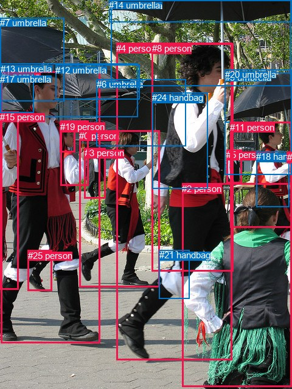
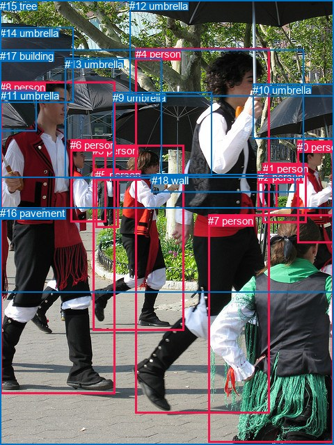

# 图片 0859：2354354.jpg

随机样本序号：161。图片 SHA256：`b03abc9ddfb262030d239d7052951a776df42761d7d89cd598af9c434cfce94f`。

红色框表示人，蓝色框表示其他物体。两个模式分别保留自身框编号，可依据位置比较对应对象。

## 自动检测框与输出

人的框编号：`[0, 1, 2, 3, 4, 5, 8, 11, 15, 16, 19, 22, 23, 25]`。状态：`ok`。

### 自动检测全部物体框

| 编号 | 类别 | 是否为人 | 检测分数 | 像素坐标 xyxy |
|---|---|---|---|---|
| 0 | person | True | 0.9996 | 130.1, 214.8, 262.9, 472.9 |
| 1 | person | True | 0.9989 | 1.4, 117.4, 164.8, 564.7 |
| 2 | person | True | 0.9963 | 299.3, 301.8, 479.9, 636.3 |
| 3 | person | True | 0.9948 | 138.9, 243.1, 173.9, 326.9 |
| 4 | person | True | 0.9925 | 191.2, 71.0, 381.6, 592.4 |
| 5 | person | True | 0.9846 | 372.3, 246.3, 397.6, 301.9 |
| 6 | umbrella | False | 0.9844 | 158.7, 130.2, 305.6, 240.5 |
| 7 | umbrella | False | 0.9801 | 0.1, 29.3, 105.6, 166.5 |
| 8 | person | True | 0.9798 | 249.8, 71.2, 383.8, 446.3 |
| 9 | umbrella | False | 0.9759 | 369.9, 119.1, 479.4, 201.8 |
| 10 | umbrella | False | 0.9684 | 182.6, 0.6, 478.9, 141.2 |
| 11 | person | True | 0.9586 | 378.4, 200.7, 479.6, 374.5 |
| 12 | umbrella | False | 0.9488 | 91.1, 106.9, 229.6, 163.6 |
| 13 | umbrella | False | 0.9378 | 1.1, 104.6, 226.9, 192.3 |
| 14 | umbrella | False | 0.9059 | 179.3, 0.2, 479.7, 36.4 |
| 15 | person | True | 0.8739 | 0.2, 183.9, 30.8, 476.9 |
| 16 | person | True | 0.8677 | 99.2, 198.4, 145.7, 305.9 |
| 17 | umbrella | False | 0.7213 | 0.2, 122.0, 55.6, 185.6 |
| 18 | handbag | False | 0.4829 | 421.1, 249.1, 475.9, 340.5 |
| 19 | person | True | 0.4769 | 98.7, 200.3, 123.7, 250.9 |
| 20 | umbrella | False | 0.4292 | 369.7, 114.2, 480.0, 287.3 |
| 21 | handbag | False | 0.4285 | 261.5, 411.2, 311.8, 491.1 |
| 22 | person | True | 0.4072 | 471.3, 249.4, 478.9, 268.7 |
| 23 | person | True | 0.4011 | 472.4, 250.3, 479.2, 261.7 |
| 24 | handbag | False | 0.3972 | 250.3, 152.4, 341.2, 310.7 |
| 25 | person | True | 0.3753 | 45.7, 411.9, 85.7, 478.6 |

### 自动检测 Top50 人相关候选

评分物体对：650；人相关物体对：518；输出关系：50。

| 排名 | 主语编号与类别 | 关系 | 宾语编号与类别 | 类型 | 人与人 | 排序分数 | 原始融合 logit |
|---|---|---|---|---|---|---|---|
| 1 | #1 person | wearing | #25 person | semantic | True | 0.98839 | 4.4442 |
| 2 | #11 person | wearing | #18 handbag | semantic | False | 0.98695 | 4.3257 |
| 3 | #8 person | wearing | #24 handbag | semantic | False | 0.98562 | 4.2273 |
| 4 | #4 person | wearing | #24 handbag | semantic | False | 0.98524 | 4.2012 |
| 5 | #1 person | holding | #16 person | semantic | True | 0.97737 | 3.7657 |
| 6 | #4 person | wearing | #21 handbag | semantic | False | 0.97019 | 3.4826 |
| 7 | #1 person | holding | #7 umbrella | semantic | False | 0.96931 | 3.4526 |
| 8 | #4 person | holding | #6 umbrella | semantic | False | 0.96884 | 3.4369 |
| 9 | #11 person | drinking | #22 person | semantic | True | 0.96859 | 3.4287 |
| 10 | #1 person | wearing | #15 person | semantic | True | 0.96858 | 3.4285 |
| 11 | #11 person | drinking | #23 person | semantic | True | 0.96646 | 3.3610 |
| 12 | #1 person | holding | #13 umbrella | semantic | False | 0.96608 | 3.3493 |
| 13 | #8 person | holding | #6 umbrella | semantic | False | 0.94753 | 2.8937 |
| 14 | #23 person | on | #22 person | spatial | True | 0.94563 | 2.8560 |
| 15 | #4 person | holding | #9 umbrella | semantic | False | 0.94444 | 2.8330 |
| 16 | #8 person | holding | #9 umbrella | semantic | False | 0.94368 | 2.8187 |
| 17 | #11 person | in | #18 handbag | spatial | False | 0.94139 | 2.7765 |
| 18 | #1 person | holding | #17 umbrella | semantic | False | 0.93889 | 2.7320 |
| 19 | #1 person | talking to | #19 person | semantic | True | 0.93227 | 2.6221 |
| 20 | #0 person | holding | #6 umbrella | semantic | False | 0.91100 | 2.3260 |
| 21 | #1 person | holding | #12 umbrella | semantic | False | 0.90385 | 2.2408 |
| 22 | #4 person | in | #24 handbag | spatial | False | 0.90307 | 2.2318 |
| 23 | #0 person | wearing | #3 person | semantic | True | 0.90173 | 2.2166 |
| 24 | #8 person | in | #24 handbag | spatial | False | 0.90130 | 2.2117 |
| 25 | #11 person | holding | #9 umbrella | semantic | False | 0.89989 | 2.1960 |
| 26 | #11 person | holding | #20 umbrella | semantic | False | 0.89963 | 2.1931 |
| 27 | #4 person | holding | #20 umbrella | semantic | False | 0.89661 | 2.1601 |
| 28 | #2 person | wearing | #21 handbag | semantic | False | 0.89096 | 2.1006 |
| 29 | #22 person | in | #23 person | spatial | True | 0.88896 | 2.0802 |
| 30 | #8 person | holding | #20 umbrella | semantic | False | 0.88786 | 2.0691 |
| 31 | #1 person | in | #15 person | spatial | True | 0.87847 | 1.9780 |
| 32 | #2 person | wearing | #18 handbag | semantic | False | 0.87222 | 1.9207 |
| 33 | #22 person | wearing | #23 person | semantic | True | 0.86836 | 1.8866 |
| 34 | #16 person | holding | #13 umbrella | semantic | False | 0.86571 | 1.8636 |
| 35 | #1 person | in | #25 person | spatial | True | 0.86133 | 1.8264 |
| 36 | #16 person | holding | #19 person | semantic | True | 0.86108 | 1.8243 |
| 37 | #4 person | holding | #13 umbrella | semantic | False | 0.85413 | 1.7673 |
| 38 | #8 person | holding | #14 umbrella | semantic | False | 0.85090 | 1.7417 |
| 39 | #4 person | wearing | #8 person | semantic | True | 0.84012 | 1.6591 |
| 40 | #19 person | holding | #13 umbrella | semantic | False | 0.83960 | 1.6553 |
| 41 | #16 person | holding | #12 umbrella | semantic | False | 0.82807 | 1.5720 |
| 42 | #8 person | holding | #21 handbag | semantic | False | 0.82668 | 1.5623 |
| 43 | #19 person | in | #16 person | spatial | True | 0.82505 | 1.5509 |
| 44 | #19 person | holding | #12 umbrella | semantic | False | 0.82290 | 1.5361 |
| 45 | #4 person | holding | #14 umbrella | semantic | False | 0.81232 | 1.4652 |
| 46 | #4 person | holding | #12 umbrella | semantic | False | 0.80474 | 1.4162 |
| 47 | #11 person | on | #22 person | spatial | True | 0.79530 | 1.3571 |
| 48 | #25 person | on | #1 person | spatial | True | 0.78751 | 1.3100 |
| 49 | #11 person | on | #23 person | spatial | True | 0.78538 | 1.2973 |
| 50 | #8 person | holding | #13 umbrella | semantic | False | 0.77803 | 1.2542 |

### 自动检测逐条人相关 GT 核验

R@50：0.00%；命中 0/5。

| GT 主语编号 | GT 关系 | GT 宾语编号 | 结果阶段 | 匹配预测主语编号 | 匹配预测宾语编号 |
|---|---|---|---|---|---|
| 0 | holding | 10 | endpoint_missing_or_wrong_class | [] | [9] |
| 3 | running on | 16 | endpoint_missing_or_wrong_class | [0] | [] |
| 4 | holding | 12 | rank_below50 | [4] | [10] |
| 4 | on | 16 | endpoint_missing_or_wrong_class | [4] | [] |
| 5 | walking on | 16 | endpoint_missing_or_wrong_class | [3] | [] |

## 真实框与输出

人的框编号：`[0, 1, 2, 3, 4, 5, 6, 7, 8]`。

### 真实框全部物体框

| 编号 | 类别 | 是否为人 | 检测分数 | 像素坐标 xyxy |
|---|---|---|---|---|
| 0 | person | True | GT | 427.0, 203.0, 480.0, 350.0 |
| 1 | person | True | GT | 378.0, 234.0, 441.0, 320.0 |
| 2 | person | True | GT | 371.0, 246.0, 399.0, 301.0 |
| 3 | person | True | GT | 133.0, 208.0, 264.0, 475.0 |
| 4 | person | True | GT | 195.0, 69.0, 388.0, 594.0 |
| 5 | person | True | GT | 137.0, 243.0, 170.0, 328.0 |
| 6 | person | True | GT | 101.0, 200.0, 152.0, 319.0 |
| 7 | person | True | GT | 299.0, 309.0, 480.0, 637.0 |
| 8 | person | True | GT | 0.0, 117.0, 165.0, 566.0 |
| 9 | umbrella | False | GT | 162.0, 132.0, 304.0, 252.0 |
| 10 | umbrella | False | GT | 363.0, 121.0, 480.0, 200.0 |
| 11 | umbrella | False | GT | 1.0, 129.0, 53.0, 188.0 |
| 12 | umbrella | False | GT | 186.0, 0.0, 480.0, 138.0 |
| 13 | umbrella | False | GT | 93.0, 84.0, 233.0, 256.0 |
| 14 | umbrella | False | GT | 0.0, 39.0, 106.0, 147.0 |
| 15 | tree | False | GT | 0.0, 0.0, 480.0, 421.0 |
| 16 | pavement | False | GT | 0.0, 298.0, 480.0, 640.0 |
| 17 | building | False | GT | 0.0, 72.0, 437.0, 256.0 |
| 18 | wall | False | GT | 218.0, 251.0, 425.0, 277.0 |

### 真实框 Top50 人相关候选

评分物体对：342；人相关物体对：252；输出关系：50。

| 排名 | 主语编号与类别 | 关系 | 宾语编号与类别 | 类型 | 人与人 | 排序分数 | 原始融合 logit |
|---|---|---|---|---|---|---|---|
| 1 | #8 person | holding | #6 person | semantic | True | 0.98440 | 4.1450 |
| 2 | #8 person | walking on | #16 pavement | semantic | False | 0.98156 | 3.9746 |
| 3 | #4 person | holding | #9 umbrella | semantic | False | 0.98121 | 3.9554 |
| 4 | #4 person | holding | #10 umbrella | semantic | False | 0.97635 | 3.7203 |
| 5 | #7 person | standing on | #16 pavement | semantic | False | 0.97505 | 3.6657 |
| 6 | #0 person | holding | #10 umbrella | semantic | False | 0.97371 | 3.6120 |
| 7 | #8 person | holding | #14 umbrella | semantic | False | 0.96798 | 3.4089 |
| 8 | #8 person | holding | #11 umbrella | semantic | False | 0.96736 | 3.3889 |
| 9 | #3 person | walking on | #16 pavement | semantic | False | 0.95895 | 3.1511 |
| 10 | #4 person | running on | #16 pavement | semantic | False | 0.95395 | 3.0309 |
| 11 | #7 person | on | #16 pavement | spatial | False | 0.95283 | 3.0056 |
| 12 | #4 person | holding | #17 building | semantic | False | 0.94851 | 2.9135 |
| 13 | #8 person | holding | #17 building | semantic | False | 0.94206 | 2.7887 |
| 14 | #2 person | standing on | #18 wall | semantic | False | 0.93648 | 2.6908 |
| 15 | #8 person | on | #16 pavement | spatial | False | 0.92774 | 2.5524 |
| 16 | #8 person | holding | #5 person | semantic | True | 0.92316 | 2.4861 |
| 17 | #3 person | holding | #5 person | semantic | True | 0.92032 | 2.4467 |
| 18 | #3 person | holding | #9 umbrella | semantic | False | 0.91232 | 2.3423 |
| 19 | #4 person | holding | #15 tree | semantic | False | 0.90589 | 2.2644 |
| 20 | #4 person | wearing | #18 wall | semantic | False | 0.89786 | 2.1737 |
| 21 | #4 person | holding | #13 umbrella | semantic | False | 0.89657 | 2.1597 |
| 22 | #3 person | on | #16 pavement | spatial | False | 0.89625 | 2.1563 |
| 23 | #8 person | holding | #13 umbrella | semantic | False | 0.89047 | 2.0955 |
| 24 | #4 person | on | #16 pavement | spatial | False | 0.88752 | 2.0657 |
| 25 | #1 person | standing on | #18 wall | semantic | False | 0.85498 | 1.7742 |
| 26 | #4 person | holding | #12 umbrella | semantic | False | 0.84391 | 1.6876 |
| 27 | #0 person | standing on | #16 pavement | semantic | False | 0.84231 | 1.6755 |
| 28 | #6 person | holding | #13 umbrella | semantic | False | 0.82885 | 1.5775 |
| 29 | #1 person | on | #18 wall | spatial | False | 0.82031 | 1.5184 |
| 30 | #1 person | standing on | #16 pavement | semantic | False | 0.81975 | 1.5147 |
| 31 | #2 person | on | #18 wall | spatial | False | 0.79638 | 1.3638 |
| 32 | #3 person | holding | #17 building | semantic | False | 0.79410 | 1.3498 |
| 33 | #3 person | holding | #13 umbrella | semantic | False | 0.78312 | 1.2839 |
| 34 | #2 person | in | #1 person | spatial | True | 0.76254 | 1.1667 |
| 35 | #2 person | walking on | #16 pavement | semantic | False | 0.75981 | 1.1516 |
| 36 | #8 person | holding | #9 umbrella | semantic | False | 0.75958 | 1.1504 |
| 37 | #8 person | playing with | #4 person | semantic | True | 0.74551 | 1.0748 |
| 38 | #8 person | in | #11 umbrella | spatial | False | 0.74548 | 1.0746 |
| 39 | #2 person | standing on | #1 person | semantic | True | 0.72972 | 0.9932 |
| 40 | #0 person | on | #16 pavement | spatial | False | 0.72514 | 0.9701 |
| 41 | #1 person | on | #16 pavement | spatial | False | 0.70338 | 0.8635 |
| 42 | #6 person | holding | #17 building | semantic | False | 0.70309 | 0.8621 |
| 43 | #6 person | holding | #5 person | semantic | True | 0.70288 | 0.8610 |
| 44 | #0 person | in | #10 umbrella | spatial | False | 0.69319 | 0.8151 |
| 45 | #8 person | in | #6 person | spatial | True | 0.68846 | 0.7929 |
| 46 | #8 person | holding | #15 tree | semantic | False | 0.67693 | 0.7397 |
| 47 | #2 person | walking on | #15 tree | semantic | False | 0.65443 | 0.6386 |
| 48 | #1 person | holding | #10 umbrella | semantic | False | 0.65133 | 0.6249 |
| 49 | #14 umbrella | over | #8 person | spatial | False | 0.64427 | 0.5939 |
| 50 | #4 person | chasing | #7 person | semantic | True | 0.63881 | 0.5702 |

### 真实框逐条人相关 GT 核验

R@50：60.00%；命中 3/5。

| GT 主语编号 | GT 关系 | GT 宾语编号 | 结果阶段 | 匹配预测主语编号 | 匹配预测宾语编号 |
|---|---|---|---|---|---|
| 0 | holding | 10 | hit50 | [0] | [10] |
| 3 | running on | 16 | wrong_predicate | [3] | [16] |
| 4 | holding | 12 | hit50 | [4] | [12] |
| 4 | on | 16 | hit50 | [4] | [16] |
| 5 | walking on | 16 | wrong_predicate | [5] | [16] |

## 全部人相关 GT

| 主语编号与类别 | 关系 | 宾语编号与类别 |
|---|---|---|
| #0 person | holding | #10 umbrella |
| #3 person | running on | #16 pavement |
| #4 person | holding | #12 umbrella |
| #4 person | on | #16 pavement |
| #5 person | walking on | #16 pavement |

原始记录、全部人相关物体对的两项预测与分项分数见 [逐图证据 JSON](../evidence/cases/0859.json)。全部56类 logits 保留于本机 HOR/output/random500/logits/。

<!-- HOR_COMPLETE_RESULTS -->

## 六组条件的完整输出对照

以下保留同一图片三种框与候选模式、两种谓词输出规则的全部 Top50。框编号各自在所属模式内解释。

### 自动检测框完整枚举：空间与语义各保留一个谓词

| 排名 | 主语编号与类别 | 谓词 | 宾语编号与类别 | 分组 | 排序分数 | predicate logit | pair logit |
|---|---|---|---|---|---|---|---|
| 1 | #1 person | wearing | #25 person | semantic | 0.9883903 | 3.9580379 | 0.4861975 |
| 2 | #11 person | wearing | #18 handbag | semantic | 0.9869488 | 3.9404340 | 0.3853030 |
| 3 | #8 person | wearing | #24 handbag | semantic | 0.9856176 | 3.9815087 | 0.2457529 |
| 4 | #4 person | wearing | #24 handbag | semantic | 0.9852437 | 3.9991126 | 0.2021017 |
| 5 | #1 person | holding | #16 person | semantic | 0.9773728 | 3.8099217 | -0.0442074 |
| 6 | #4 person | wearing | #21 handbag | semantic | 0.9701891 | 3.5116391 | -0.0290235 |
| 7 | #1 person | holding | #7 umbrella | semantic | 0.9693086 | 3.2601748 | 0.1924258 |
| 8 | #4 person | holding | #6 umbrella | semantic | 0.9688368 | 3.6659226 | -0.2290627 |
| 9 | #11 person | drinking | #22 person | semantic | 0.9685906 | 3.1044612 | 0.3242752 |
| 10 | #1 person | wearing | #15 person | semantic | 0.9685830 | 3.1624250 | 0.2660605 |
| 11 | #11 person | drinking | #23 person | semantic | 0.9664633 | 3.0555954 | 0.3054081 |
| 12 | #1 person | holding | #13 umbrella | semantic | 0.9660809 | 3.4477296 | -0.0984592 |
| 13 | #8 person | holding | #6 umbrella | semantic | 0.9475345 | 3.1726460 | -0.2789395 |
| 14 | #23 person | on | #22 person | spatial | 0.9456266 | 2.6802168 | 0.1757553 |
| 15 | #4 person | holding | #9 umbrella | semantic | 0.9444355 | 3.3343701 | -0.5013278 |
| 16 | #8 person | holding | #9 umbrella | semantic | 0.9436777 | 3.1881747 | -0.3694808 |
| 17 | #11 person | in | #18 handbag | spatial | 0.9413934 | 2.3912106 | 0.3853030 |
| 18 | #1 person | holding | #17 umbrella | semantic | 0.9388903 | 2.6421413 | 0.0898874 |
| 19 | #1 person | talking to | #19 person | semantic | 0.9322703 | 2.7262745 | -0.1041749 |
| 20 | #0 person | holding | #6 umbrella | semantic | 0.9110038 | 2.2688107 | 0.0571435 |
| 21 | #1 person | holding | #12 umbrella | semantic | 0.9038528 | 2.7690940 | -0.5283077 |
| 22 | #4 person | in | #24 handbag | spatial | 0.9030666 | 2.0296702 | 0.2021017 |
| 23 | #0 person | wearing | #3 person | semantic | 0.9017279 | 1.8624878 | 0.3540854 |
| 24 | #8 person | in | #24 handbag | spatial | 0.9012952 | 1.9659467 | 0.2457529 |
| 25 | #11 person | holding | #9 umbrella | semantic | 0.8998939 | 2.3149800 | -0.1189342 |
| 26 | #11 person | holding | #20 umbrella | semantic | 0.8996297 | 2.2896996 | -0.0965825 |
| 27 | #4 person | holding | #20 umbrella | semantic | 0.8966075 | 2.6705060 | -0.5104206 |
| 28 | #2 person | wearing | #21 handbag | semantic | 0.8909585 | 2.1831141 | -0.0825444 |
| 29 | #22 person | in | #23 person | spatial | 0.8889607 | 1.9420471 | 0.1381214 |
| 30 | #8 person | holding | #20 umbrella | semantic | 0.8878634 | 2.4789000 | -0.4097998 |
| 31 | #1 person | in | #15 person | spatial | 0.8784679 | 1.7119412 | 0.2660605 |
| 32 | #2 person | wearing | #18 handbag | semantic | 0.8722170 | 2.1597881 | -0.2390831 |
| 33 | #22 person | wearing | #23 person | semantic | 0.8683643 | 1.7484512 | 0.1381214 |
| 34 | #16 person | holding | #13 umbrella | semantic | 0.8657104 | 2.1997652 | -0.3362135 |
| 35 | #1 person | in | #25 person | spatial | 0.8613347 | 1.3402228 | 0.4861975 |
| 36 | #16 person | holding | #19 person | semantic | 0.8610834 | 1.9086838 | -0.0843655 |
| 37 | #4 person | holding | #13 umbrella | semantic | 0.8541273 | 2.3489141 | -0.5815682 |
| 38 | #8 person | holding | #14 umbrella | semantic | 0.8508987 | 1.8571539 | -0.1154869 |
| 39 | #4 person | wearing | #8 person | semantic | 0.8401206 | 2.5296116 | -0.8704862 |
| 40 | #19 person | holding | #13 umbrella | semantic | 0.8396049 | 1.9413099 | -0.2860185 |
| 41 | #16 person | holding | #12 umbrella | semantic | 0.8280693 | 2.0936222 | -0.5216168 |
| 42 | #8 person | holding | #21 handbag | semantic | 0.8266760 | 1.5802150 | -0.0179647 |
| 43 | #19 person | in | #16 person | spatial | 0.8250485 | 1.6652565 | -0.1143231 |
| 44 | #19 person | holding | #12 umbrella | semantic | 0.8228964 | 2.0304856 | -0.4943900 |
| 45 | #4 person | holding | #14 umbrella | semantic | 0.8123199 | 1.4977059 | -0.0325504 |
| 46 | #4 person | holding | #12 umbrella | semantic | 0.8047434 | 2.1801834 | -0.7639750 |
| 47 | #11 person | on | #22 person | spatial | 0.7952960 | 1.0328741 | 0.3242752 |
| 48 | #25 person | on | #1 person | spatial | 0.7875108 | 1.5596876 | -0.2497016 |
| 49 | #11 person | on | #23 person | spatial | 0.7853805 | 0.9918938 | 0.3054081 |
| 50 | #8 person | holding | #13 umbrella | semantic | 0.7780281 | 1.9230356 | -0.6688237 |

GT 命中：0/5，R@50=0.00%。

| GT主语 | GT谓词 | GT宾语 | 结果阶段 | 匹配主语框 | 匹配宾语框 |
|---|---|---|---|---|---|
| 0 | holding | 10 | endpoint_missing_or_wrong_class | [] | [9] |
| 3 | running on | 16 | endpoint_missing_or_wrong_class | [0] | [] |
| 4 | holding | 12 | rank_below50 | [4] | [10] |
| 4 | on | 16 | endpoint_missing_or_wrong_class | [4] | [] |
| 5 | walking on | 16 | endpoint_missing_or_wrong_class | [3] | [] |

### 自动检测框完整枚举：每对只保留一个谓词

| 排名 | 主语编号与类别 | 谓词 | 宾语编号与类别 | 分组 | 排序分数 | predicate logit | pair logit |
|---|---|---|---|---|---|---|---|
| 1 | #1 person | wearing | #25 person | single | 0.9883903 | 3.9580379 | 0.4861975 |
| 2 | #11 person | wearing | #18 handbag | single | 0.9869488 | 3.9404340 | 0.3853030 |
| 3 | #8 person | wearing | #24 handbag | single | 0.9856176 | 3.9815087 | 0.2457529 |
| 4 | #4 person | wearing | #24 handbag | single | 0.9852437 | 3.9991126 | 0.2021017 |
| 5 | #1 person | holding | #16 person | single | 0.9773728 | 3.8099217 | -0.0442074 |
| 6 | #4 person | wearing | #21 handbag | single | 0.9701891 | 3.5116391 | -0.0290235 |
| 7 | #1 person | holding | #7 umbrella | single | 0.9693086 | 3.2601748 | 0.1924258 |
| 8 | #4 person | holding | #6 umbrella | single | 0.9688368 | 3.6659226 | -0.2290627 |
| 9 | #11 person | drinking | #22 person | single | 0.9685906 | 3.1044612 | 0.3242752 |
| 10 | #1 person | wearing | #15 person | single | 0.9685830 | 3.1624250 | 0.2660605 |
| 11 | #11 person | drinking | #23 person | single | 0.9664633 | 3.0555954 | 0.3054081 |
| 12 | #1 person | holding | #13 umbrella | single | 0.9660809 | 3.4477296 | -0.0984592 |
| 13 | #8 person | holding | #6 umbrella | single | 0.9475345 | 3.1726460 | -0.2789395 |
| 14 | #23 person | on | #22 person | single | 0.9456266 | 2.6802168 | 0.1757553 |
| 15 | #4 person | holding | #9 umbrella | single | 0.9444355 | 3.3343701 | -0.5013278 |
| 16 | #8 person | holding | #9 umbrella | single | 0.9436777 | 3.1881747 | -0.3694808 |
| 17 | #1 person | holding | #17 umbrella | single | 0.9388903 | 2.6421413 | 0.0898874 |
| 18 | #1 person | talking to | #19 person | single | 0.9322703 | 2.7262745 | -0.1041749 |
| 19 | #0 person | holding | #6 umbrella | single | 0.9110038 | 2.2688107 | 0.0571435 |
| 20 | #1 person | holding | #12 umbrella | single | 0.9038528 | 2.7690940 | -0.5283077 |
| 21 | #0 person | wearing | #3 person | single | 0.9017279 | 1.8624878 | 0.3540854 |
| 22 | #11 person | holding | #9 umbrella | single | 0.8998939 | 2.3149800 | -0.1189342 |
| 23 | #11 person | holding | #20 umbrella | single | 0.8996297 | 2.2896996 | -0.0965825 |
| 24 | #4 person | holding | #20 umbrella | single | 0.8966075 | 2.6705060 | -0.5104206 |
| 25 | #2 person | wearing | #21 handbag | single | 0.8909585 | 2.1831141 | -0.0825444 |
| 26 | #22 person | in | #23 person | single | 0.8889607 | 1.9420471 | 0.1381214 |
| 27 | #8 person | holding | #20 umbrella | single | 0.8878634 | 2.4789000 | -0.4097998 |
| 28 | #2 person | wearing | #18 handbag | single | 0.8722170 | 2.1597881 | -0.2390831 |
| 29 | #16 person | holding | #13 umbrella | single | 0.8657104 | 2.1997652 | -0.3362135 |
| 30 | #16 person | holding | #19 person | single | 0.8610834 | 1.9086838 | -0.0843655 |
| 31 | #4 person | holding | #13 umbrella | single | 0.8541273 | 2.3489141 | -0.5815682 |
| 32 | #8 person | holding | #14 umbrella | single | 0.8508987 | 1.8571539 | -0.1154869 |
| 33 | #4 person | wearing | #8 person | single | 0.8401206 | 2.5296116 | -0.8704862 |
| 34 | #19 person | holding | #13 umbrella | single | 0.8396049 | 1.9413099 | -0.2860185 |
| 35 | #16 person | holding | #12 umbrella | single | 0.8280693 | 2.0936222 | -0.5216168 |
| 36 | #8 person | holding | #21 handbag | single | 0.8266760 | 1.5802150 | -0.0179647 |
| 37 | #19 person | in | #16 person | single | 0.8250485 | 1.6652565 | -0.1143231 |
| 38 | #19 person | holding | #12 umbrella | single | 0.8228964 | 2.0304856 | -0.4943900 |
| 39 | #4 person | holding | #14 umbrella | single | 0.8123199 | 1.4977059 | -0.0325504 |
| 40 | #4 person | holding | #12 umbrella | single | 0.8047434 | 2.1801834 | -0.7639750 |
| 41 | #25 person | on | #1 person | single | 0.7875108 | 1.5596876 | -0.2497016 |
| 42 | #8 person | holding | #13 umbrella | single | 0.7780281 | 1.9230356 | -0.6688237 |
| 43 | #1 person | holding | #6 umbrella | single | 0.7526522 | 1.7240043 | -0.6111965 |
| 44 | #1 person | holding | #3 person | single | 0.7493916 | 1.2059956 | -0.1106256 |
| 45 | #4 person | holding | #10 umbrella | single | 0.7413185 | 1.5001111 | -0.4472779 |
| 46 | #24 handbag | on | #8 person | single | 0.6888224 | 1.3963432 | -0.6017234 |
| 47 | #0 person | holding | #13 umbrella | single | 0.6874896 | 1.0841932 | -0.2957844 |
| 48 | #8 person | holding | #7 umbrella | single | 0.6818687 | 1.4184904 | -0.6561176 |
| 49 | #5 person | holding | #20 umbrella | single | 0.6786401 | 1.1515918 | -0.4040625 |
| 50 | #21 handbag | on | #4 person | single | 0.6701666 | 1.3948956 | -0.6859570 |

GT 命中：1/5，R@50=20.00%。

| GT主语 | GT谓词 | GT宾语 | 结果阶段 | 匹配主语框 | 匹配宾语框 |
|---|---|---|---|---|---|
| 0 | holding | 10 | endpoint_missing_or_wrong_class | [] | [9] |
| 3 | running on | 16 | endpoint_missing_or_wrong_class | [0] | [] |
| 4 | holding | 12 | hit50 | [4] | [10] |
| 4 | on | 16 | endpoint_missing_or_wrong_class | [4] | [] |
| 5 | walking on | 16 | endpoint_missing_or_wrong_class | [3] | [] |

### 真实框完整枚举：空间与语义各保留一个谓词

| 排名 | 主语编号与类别 | 谓词 | 宾语编号与类别 | 分组 | 排序分数 | predicate logit | pair logit |
|---|---|---|---|---|---|---|---|
| 1 | #8 person | holding | #6 person | semantic | 0.9844029 | 4.2371078 | -0.0921551 |
| 2 | #8 person | walking on | #16 pavement | semantic | 0.9815596 | 3.9510703 | 0.0235287 |
| 3 | #4 person | holding | #9 umbrella | semantic | 0.9812086 | 4.1640096 | -0.2086248 |
| 4 | #4 person | holding | #10 umbrella | semantic | 0.9763457 | 4.2123752 | -0.4921030 |
| 5 | #7 person | standing on | #16 pavement | semantic | 0.9750508 | 3.6899133 | -0.0242626 |
| 6 | #0 person | holding | #10 umbrella | semantic | 0.9737132 | 3.6271787 | -0.0151317 |
| 7 | #8 person | holding | #14 umbrella | semantic | 0.9679803 | 3.2531681 | 0.1556911 |
| 8 | #8 person | holding | #11 umbrella | semantic | 0.9673572 | 3.2923317 | 0.0966101 |
| 9 | #3 person | walking on | #16 pavement | semantic | 0.9589539 | 3.1687264 | -0.0175807 |
| 10 | #4 person | running on | #16 pavement | semantic | 0.9539522 | 3.3190694 | -0.2881370 |
| 11 | #7 person | on | #16 pavement | spatial | 0.9528256 | 3.0298438 | -0.0242626 |
| 12 | #4 person | holding | #17 building | semantic | 0.9485093 | 3.3698201 | -0.4563300 |
| 13 | #8 person | holding | #17 building | semantic | 0.9420611 | 3.0393658 | -0.2506844 |
| 14 | #2 person | standing on | #18 wall | semantic | 0.9364793 | 2.9267149 | -0.2359524 |
| 15 | #8 person | on | #16 pavement | spatial | 0.9277379 | 2.5289211 | 0.0235287 |
| 16 | #8 person | holding | #5 person | semantic | 0.9231627 | 2.6073699 | -0.1212540 |
| 17 | #3 person | holding | #5 person | semantic | 0.9203214 | 2.1726279 | 0.2740939 |
| 18 | #3 person | holding | #9 umbrella | semantic | 0.9123163 | 2.2599478 | 0.0823033 |
| 19 | #4 person | holding | #15 tree | semantic | 0.9058853 | 2.5605202 | -0.2961210 |
| 20 | #4 person | wearing | #18 wall | semantic | 0.8978611 | 3.2605305 | -1.0868480 |
| 21 | #4 person | holding | #13 umbrella | semantic | 0.8965716 | 2.8410931 | -0.6813943 |
| 22 | #3 person | on | #16 pavement | spatial | 0.8962531 | 2.1738496 | -0.0175807 |
| 23 | #8 person | holding | #13 umbrella | semantic | 0.8904686 | 2.4622731 | -0.3667359 |
| 24 | #4 person | on | #16 pavement | spatial | 0.8875225 | 2.3538179 | -0.2881370 |
| 25 | #1 person | standing on | #18 wall | semantic | 0.8549849 | 1.9220724 | -0.1478264 |
| 26 | #4 person | holding | #12 umbrella | semantic | 0.8439057 | 2.1167073 | -0.4291274 |
| 27 | #0 person | standing on | #16 pavement | semantic | 0.8423123 | 2.0346951 | -0.3591610 |
| 28 | #6 person | holding | #13 umbrella | semantic | 0.8288471 | 2.0624332 | -0.4849551 |
| 29 | #1 person | on | #18 wall | spatial | 0.8203087 | 1.6662669 | -0.1478264 |
| 30 | #1 person | standing on | #16 pavement | semantic | 0.8197536 | 1.8896384 | -0.3749595 |
| 31 | #2 person | on | #18 wall | spatial | 0.7963796 | 1.5997710 | -0.2359524 |
| 32 | #3 person | holding | #17 building | semantic | 0.7940991 | 1.6747503 | -0.3249371 |
| 33 | #3 person | holding | #13 umbrella | semantic | 0.7831187 | 1.5337057 | -0.2497713 |
| 34 | #2 person | in | #1 person | spatial | 0.7625409 | 1.1340156 | 0.0326452 |
| 35 | #2 person | walking on | #16 pavement | semantic | 0.7598090 | 1.6521640 | -0.5005314 |
| 36 | #8 person | holding | #9 umbrella | semantic | 0.7595783 | 1.7699647 | -0.6195961 |
| 37 | #8 person | playing with | #4 person | semantic | 0.7455066 | 1.7896290 | -0.7148397 |
| 38 | #8 person | in | #11 umbrella | spatial | 0.7454755 | 0.9780149 | 0.0966101 |
| 39 | #2 person | standing on | #1 person | semantic | 0.7297248 | 0.9605813 | 0.0326452 |
| 40 | #0 person | on | #16 pavement | spatial | 0.7251408 | 1.3292680 | -0.3591610 |
| 41 | #1 person | on | #16 pavement | spatial | 0.7033821 | 1.2384148 | -0.3749595 |
| 42 | #6 person | holding | #17 building | semantic | 0.7030923 | 1.3802948 | -0.5182279 |
| 43 | #6 person | holding | #5 person | semantic | 0.7028763 | 0.8528752 | 0.0081572 |
| 44 | #0 person | in | #10 umbrella | spatial | 0.6931905 | 0.8302093 | -0.0151317 |
| 45 | #8 person | in | #6 person | spatial | 0.6884612 | 0.8850904 | -0.0921551 |
| 46 | #8 person | holding | #15 tree | semantic | 0.6769276 | 1.0452394 | -0.3055512 |
| 47 | #2 person | walking on | #15 tree | semantic | 0.6544328 | 1.1616025 | -0.5230208 |
| 48 | #1 person | holding | #10 umbrella | semantic | 0.6513305 | 0.9132671 | -0.2883742 |
| 49 | #14 umbrella | over | #8 person | spatial | 0.6442697 | 1.4990468 | -0.9051023 |
| 50 | #4 person | chasing | #7 person | semantic | 0.6388080 | 1.6171432 | -1.0469488 |

GT 命中：3/5，R@50=60.00%。

| GT主语 | GT谓词 | GT宾语 | 结果阶段 | 匹配主语框 | 匹配宾语框 |
|---|---|---|---|---|---|
| 0 | holding | 10 | hit50 | [0] | [10] |
| 3 | running on | 16 | wrong_predicate | [3] | [16] |
| 4 | holding | 12 | hit50 | [4] | [12] |
| 4 | on | 16 | hit50 | [4] | [16] |
| 5 | walking on | 16 | wrong_predicate | [5] | [16] |

### 真实框完整枚举：每对只保留一个谓词

| 排名 | 主语编号与类别 | 谓词 | 宾语编号与类别 | 分组 | 排序分数 | predicate logit | pair logit |
|---|---|---|---|---|---|---|---|
| 1 | #8 person | holding | #6 person | single | 0.9844029 | 4.2371078 | -0.0921551 |
| 2 | #8 person | walking on | #16 pavement | single | 0.9815596 | 3.9510703 | 0.0235287 |
| 3 | #4 person | holding | #9 umbrella | single | 0.9812086 | 4.1640096 | -0.2086248 |
| 4 | #4 person | holding | #10 umbrella | single | 0.9763457 | 4.2123752 | -0.4921030 |
| 5 | #7 person | standing on | #16 pavement | single | 0.9750508 | 3.6899133 | -0.0242626 |
| 6 | #0 person | holding | #10 umbrella | single | 0.9737132 | 3.6271787 | -0.0151317 |
| 7 | #8 person | holding | #14 umbrella | single | 0.9679803 | 3.2531681 | 0.1556911 |
| 8 | #8 person | holding | #11 umbrella | single | 0.9673572 | 3.2923317 | 0.0966101 |
| 9 | #3 person | walking on | #16 pavement | single | 0.9589539 | 3.1687264 | -0.0175807 |
| 10 | #4 person | running on | #16 pavement | single | 0.9539522 | 3.3190694 | -0.2881370 |
| 11 | #4 person | holding | #17 building | single | 0.9485093 | 3.3698201 | -0.4563300 |
| 12 | #8 person | holding | #17 building | single | 0.9420611 | 3.0393658 | -0.2506844 |
| 13 | #2 person | standing on | #18 wall | single | 0.9364793 | 2.9267149 | -0.2359524 |
| 14 | #8 person | holding | #5 person | single | 0.9231627 | 2.6073699 | -0.1212540 |
| 15 | #3 person | holding | #5 person | single | 0.9203214 | 2.1726279 | 0.2740939 |
| 16 | #3 person | holding | #9 umbrella | single | 0.9123163 | 2.2599478 | 0.0823033 |
| 17 | #4 person | holding | #15 tree | single | 0.9058853 | 2.5605202 | -0.2961210 |
| 18 | #4 person | wearing | #18 wall | single | 0.8978611 | 3.2605305 | -1.0868480 |
| 19 | #4 person | holding | #13 umbrella | single | 0.8965716 | 2.8410931 | -0.6813943 |
| 20 | #8 person | holding | #13 umbrella | single | 0.8904686 | 2.4622731 | -0.3667359 |
| 21 | #1 person | standing on | #18 wall | single | 0.8549849 | 1.9220724 | -0.1478264 |
| 22 | #4 person | holding | #12 umbrella | single | 0.8439057 | 2.1167073 | -0.4291274 |
| 23 | #0 person | standing on | #16 pavement | single | 0.8423123 | 2.0346951 | -0.3591610 |
| 24 | #6 person | holding | #13 umbrella | single | 0.8288471 | 2.0624332 | -0.4849551 |
| 25 | #1 person | standing on | #16 pavement | single | 0.8197536 | 1.8896384 | -0.3749595 |
| 26 | #3 person | holding | #17 building | single | 0.7940991 | 1.6747503 | -0.3249371 |
| 27 | #3 person | holding | #13 umbrella | single | 0.7831187 | 1.5337057 | -0.2497713 |
| 28 | #2 person | in | #1 person | single | 0.7625409 | 1.1340156 | 0.0326452 |
| 29 | #2 person | walking on | #16 pavement | single | 0.7598090 | 1.6521640 | -0.5005314 |
| 30 | #8 person | holding | #9 umbrella | single | 0.7595783 | 1.7699647 | -0.6195961 |
| 31 | #8 person | playing with | #4 person | single | 0.7455066 | 1.7896290 | -0.7148397 |
| 32 | #6 person | holding | #17 building | single | 0.7030923 | 1.3802948 | -0.5182279 |
| 33 | #6 person | holding | #5 person | single | 0.7028763 | 0.8528752 | 0.0081572 |
| 34 | #8 person | holding | #15 tree | single | 0.6769276 | 1.0452394 | -0.3055512 |
| 35 | #2 person | walking on | #15 tree | single | 0.6544328 | 1.1616025 | -0.5230208 |
| 36 | #1 person | holding | #10 umbrella | single | 0.6513305 | 0.9132671 | -0.2883742 |
| 37 | #14 umbrella | over | #8 person | single | 0.6442697 | 1.4990468 | -0.9051023 |
| 38 | #4 person | chasing | #7 person | single | 0.6388080 | 1.6171432 | -1.0469488 |
| 39 | #3 person | holding | #6 person | single | 0.6243627 | 0.8346004 | -0.3264928 |
| 40 | #4 person | holding | #14 umbrella | single | 0.6218491 | 1.1642966 | -0.6668928 |
| 41 | #6 person | holding | #14 umbrella | single | 0.6007749 | 0.9748869 | -0.5661919 |
| 42 | #0 person | holding | #13 umbrella | single | 0.5965466 | 1.4037194 | -1.0126231 |
| 43 | #10 umbrella | over | #0 person | single | 0.5843841 | 1.0358396 | -0.6950426 |
| 44 | #6 person | talking to | #8 person | single | 0.5830666 | 1.1388159 | -0.8034411 |
| 45 | #1 person | in | #15 tree | single | 0.5732325 | 0.7023368 | -0.4072849 |
| 46 | #8 person | holding | #10 umbrella | single | 0.5696937 | 0.7845087 | -0.5039070 |
| 47 | #6 person | holding | #9 umbrella | single | 0.5592750 | 0.9776316 | -0.7394115 |
| 48 | #0 person | holding | #9 umbrella | single | 0.5536458 | 1.1133165 | -0.8979042 |
| 49 | #3 person | walking on | #15 tree | single | 0.5488371 | 0.3716903 | -0.1757173 |
| 50 | #11 umbrella | on | #8 person | single | 0.5107522 | 0.7059250 | -0.6629097 |

GT 命中：2/5，R@50=40.00%。

| GT主语 | GT谓词 | GT宾语 | 结果阶段 | 匹配主语框 | 匹配宾语框 |
|---|---|---|---|---|---|
| 0 | holding | 10 | hit50 | [0] | [10] |
| 3 | running on | 16 | wrong_predicate | [3] | [16] |
| 4 | holding | 12 | hit50 | [4] | [12] |
| 4 | on | 16 | wrong_predicate | [4] | [16] |
| 5 | walking on | 16 | wrong_predicate | [5] | [16] |

### 真实框400候选：空间与语义各保留一个谓词

| 排名 | 主语编号与类别 | 谓词 | 宾语编号与类别 | 分组 | 排序分数 | predicate logit | pair logit |
|---|---|---|---|---|---|---|---|
| 1 | #8 person | holding | #6 person | semantic | 0.9844029 | 4.2371078 | -0.0921551 |
| 2 | #8 person | walking on | #16 pavement | semantic | 0.9815596 | 3.9510703 | 0.0235287 |
| 3 | #4 person | holding | #9 umbrella | semantic | 0.9812086 | 4.1640096 | -0.2086248 |
| 4 | #4 person | holding | #10 umbrella | semantic | 0.9763457 | 4.2123752 | -0.4921030 |
| 5 | #7 person | standing on | #16 pavement | semantic | 0.9739199 | 3.6444182 | -0.0242626 |
| 6 | #0 person | holding | #10 umbrella | semantic | 0.9722877 | 3.5729041 | -0.0151317 |
| 7 | #8 person | holding | #11 umbrella | semantic | 0.9688504 | 3.3406968 | 0.0966101 |
| 8 | #8 person | holding | #14 umbrella | semantic | 0.9679803 | 3.2531681 | 0.1556911 |
| 9 | #3 person | walking on | #16 pavement | semantic | 0.9589539 | 3.1687264 | -0.0175807 |
| 10 | #4 person | running on | #16 pavement | semantic | 0.9563594 | 3.3752837 | -0.2881370 |
| 11 | #7 person | on | #16 pavement | spatial | 0.9528256 | 3.0298438 | -0.0242626 |
| 12 | #4 person | holding | #17 building | semantic | 0.9485093 | 3.3698201 | -0.4563300 |
| 13 | #8 person | holding | #17 building | semantic | 0.9417377 | 3.0334573 | -0.2506844 |
| 14 | #2 person | standing on | #18 wall | semantic | 0.9364793 | 2.9267149 | -0.2359524 |
| 15 | #8 person | on | #16 pavement | spatial | 0.9277379 | 2.5289211 | 0.0235287 |
| 16 | #8 person | holding | #5 person | semantic | 0.9231627 | 2.6073699 | -0.1212540 |
| 17 | #3 person | holding | #5 person | semantic | 0.9180867 | 2.1425366 | 0.2740939 |
| 18 | #3 person | holding | #9 umbrella | semantic | 0.9118425 | 2.2540393 | 0.0823033 |
| 19 | #4 person | holding | #15 tree | semantic | 0.9058853 | 2.5605202 | -0.2961210 |
| 20 | #4 person | wearing | #18 wall | semantic | 0.8978611 | 3.2605305 | -1.0868480 |
| 21 | #4 person | holding | #13 umbrella | semantic | 0.8965716 | 2.8410931 | -0.6813943 |
| 22 | #3 person | on | #16 pavement | spatial | 0.8962531 | 2.1738496 | -0.0175807 |
| 23 | #8 person | holding | #13 umbrella | semantic | 0.8901801 | 2.4593186 | -0.3667359 |
| 24 | #4 person | on | #16 pavement | spatial | 0.8880649 | 2.3592629 | -0.2881370 |
| 25 | #1 person | standing on | #18 wall | semantic | 0.8558930 | 1.9294157 | -0.1478264 |
| 26 | #4 person | holding | #12 umbrella | semantic | 0.8478285 | 2.1467981 | -0.4291274 |
| 27 | #0 person | standing on | #16 pavement | semantic | 0.8423123 | 2.0346951 | -0.3591610 |
| 28 | #6 person | holding | #13 umbrella | semantic | 0.8262391 | 2.0441589 | -0.4849551 |
| 29 | #1 person | standing on | #16 pavement | semantic | 0.8252189 | 1.9270740 | -0.3749595 |
| 30 | #1 person | on | #18 wall | spatial | 0.8203087 | 1.6662669 | -0.1478264 |
| 31 | #3 person | holding | #17 building | semantic | 0.7994497 | 1.7077961 | -0.3249371 |
| 32 | #2 person | on | #18 wall | spatial | 0.7963796 | 1.5997710 | -0.2359524 |
| 33 | #3 person | holding | #13 umbrella | semantic | 0.7831187 | 1.5337057 | -0.2497713 |
| 34 | #2 person | in | #1 person | spatial | 0.7732656 | 1.1941981 | 0.0326452 |
| 35 | #2 person | walking on | #16 pavement | semantic | 0.7598090 | 1.6521640 | -0.5005314 |
| 36 | #8 person | holding | #9 umbrella | semantic | 0.7595783 | 1.7699647 | -0.6195961 |
| 37 | #8 person | playing with | #4 person | semantic | 0.7455066 | 1.7896290 | -0.7148397 |
| 38 | #8 person | in | #11 umbrella | spatial | 0.7454755 | 0.9780149 | 0.0966101 |
| 39 | #2 person | standing on | #1 person | semantic | 0.7356184 | 0.9906726 | 0.0326452 |
| 40 | #0 person | on | #16 pavement | spatial | 0.7251408 | 1.3292680 | -0.3591610 |
| 41 | #6 person | holding | #5 person | semantic | 0.7085122 | 0.8800120 | 0.0081572 |
| 42 | #1 person | on | #16 pavement | spatial | 0.7067787 | 1.2547493 | -0.3749595 |
| 43 | #6 person | holding | #17 building | semantic | 0.7030923 | 1.3802948 | -0.5182279 |
| 44 | #0 person | in | #10 umbrella | spatial | 0.6931905 | 0.8302093 | -0.0151317 |
| 45 | #8 person | in | #6 person | spatial | 0.6834086 | 0.8616362 | -0.0921551 |
| 46 | #8 person | holding | #15 tree | semantic | 0.6769276 | 1.0452394 | -0.3055512 |
| 47 | #2 person | walking on | #15 tree | semantic | 0.6605313 | 1.1886835 | -0.5230208 |
| 48 | #1 person | holding | #10 umbrella | semantic | 0.6444660 | 0.8831754 | -0.2883742 |
| 49 | #14 umbrella | over | #8 person | spatial | 0.6436634 | 1.4964023 | -0.9051023 |
| 50 | #4 person | chasing | #7 person | semantic | 0.6388080 | 1.6171432 | -1.0469488 |

GT 命中：3/5，R@50=60.00%。

| GT主语 | GT谓词 | GT宾语 | 结果阶段 | 匹配主语框 | 匹配宾语框 |
|---|---|---|---|---|---|
| 0 | holding | 10 | hit50 | [0] | [10] |
| 3 | running on | 16 | wrong_predicate | [3] | [16] |
| 4 | holding | 12 | hit50 | [4] | [12] |
| 4 | on | 16 | hit50 | [4] | [16] |
| 5 | walking on | 16 | wrong_predicate | [5] | [16] |

### 真实框400候选：每对只保留一个谓词

| 排名 | 主语编号与类别 | 谓词 | 宾语编号与类别 | 分组 | 排序分数 | predicate logit | pair logit |
|---|---|---|---|---|---|---|---|
| 1 | #8 person | holding | #6 person | single | 0.9844029 | 4.2371078 | -0.0921551 |
| 2 | #8 person | walking on | #16 pavement | single | 0.9815596 | 3.9510703 | 0.0235287 |
| 3 | #4 person | holding | #9 umbrella | single | 0.9812086 | 4.1640096 | -0.2086248 |
| 4 | #4 person | holding | #10 umbrella | single | 0.9763457 | 4.2123752 | -0.4921030 |
| 5 | #7 person | standing on | #16 pavement | single | 0.9739199 | 3.6444182 | -0.0242626 |
| 6 | #0 person | holding | #10 umbrella | single | 0.9722877 | 3.5729041 | -0.0151317 |
| 7 | #8 person | holding | #11 umbrella | single | 0.9688504 | 3.3406968 | 0.0966101 |
| 8 | #8 person | holding | #14 umbrella | single | 0.9679803 | 3.2531681 | 0.1556911 |
| 9 | #3 person | walking on | #16 pavement | single | 0.9589539 | 3.1687264 | -0.0175807 |
| 10 | #4 person | running on | #16 pavement | single | 0.9563594 | 3.3752837 | -0.2881370 |
| 11 | #4 person | holding | #17 building | single | 0.9485093 | 3.3698201 | -0.4563300 |
| 12 | #8 person | holding | #17 building | single | 0.9417377 | 3.0334573 | -0.2506844 |
| 13 | #2 person | standing on | #18 wall | single | 0.9364793 | 2.9267149 | -0.2359524 |
| 14 | #8 person | holding | #5 person | single | 0.9231627 | 2.6073699 | -0.1212540 |
| 15 | #3 person | holding | #5 person | single | 0.9180867 | 2.1425366 | 0.2740939 |
| 16 | #3 person | holding | #9 umbrella | single | 0.9118425 | 2.2540393 | 0.0823033 |
| 17 | #4 person | holding | #15 tree | single | 0.9058853 | 2.5605202 | -0.2961210 |
| 18 | #4 person | wearing | #18 wall | single | 0.8978611 | 3.2605305 | -1.0868480 |
| 19 | #4 person | holding | #13 umbrella | single | 0.8965716 | 2.8410931 | -0.6813943 |
| 20 | #8 person | holding | #13 umbrella | single | 0.8901801 | 2.4593186 | -0.3667359 |
| 21 | #1 person | standing on | #18 wall | single | 0.8558930 | 1.9294157 | -0.1478264 |
| 22 | #4 person | holding | #12 umbrella | single | 0.8478285 | 2.1467981 | -0.4291274 |
| 23 | #0 person | standing on | #16 pavement | single | 0.8423123 | 2.0346951 | -0.3591610 |
| 24 | #6 person | holding | #13 umbrella | single | 0.8262391 | 2.0441589 | -0.4849551 |
| 25 | #1 person | standing on | #16 pavement | single | 0.8252189 | 1.9270740 | -0.3749595 |
| 26 | #3 person | holding | #17 building | single | 0.7994497 | 1.7077961 | -0.3249371 |
| 27 | #3 person | holding | #13 umbrella | single | 0.7831187 | 1.5337057 | -0.2497713 |
| 28 | #2 person | in | #1 person | single | 0.7732656 | 1.1941981 | 0.0326452 |
| 29 | #2 person | walking on | #16 pavement | single | 0.7598090 | 1.6521640 | -0.5005314 |
| 30 | #8 person | holding | #9 umbrella | single | 0.7595783 | 1.7699647 | -0.6195961 |
| 31 | #8 person | playing with | #4 person | single | 0.7455066 | 1.7896290 | -0.7148397 |
| 32 | #6 person | holding | #5 person | single | 0.7085122 | 0.8800120 | 0.0081572 |
| 33 | #6 person | holding | #17 building | single | 0.7030923 | 1.3802948 | -0.5182279 |
| 34 | #8 person | holding | #15 tree | single | 0.6769276 | 1.0452394 | -0.3055512 |
| 35 | #2 person | walking on | #15 tree | single | 0.6605313 | 1.1886835 | -0.5230208 |
| 36 | #1 person | holding | #10 umbrella | single | 0.6444660 | 0.8831754 | -0.2883742 |
| 37 | #14 umbrella | over | #8 person | single | 0.6436634 | 1.4964023 | -0.9051023 |
| 38 | #4 person | chasing | #7 person | single | 0.6388080 | 1.6171432 | -1.0469488 |
| 39 | #3 person | holding | #6 person | single | 0.6243627 | 0.8346004 | -0.3264928 |
| 40 | #4 person | holding | #14 umbrella | single | 0.6211541 | 1.1613426 | -0.6668928 |
| 41 | #6 person | holding | #14 umbrella | single | 0.6021912 | 0.9807954 | -0.5661919 |
| 42 | #0 person | holding | #13 umbrella | single | 0.5979678 | 1.4096279 | -1.0126231 |
| 43 | #10 umbrella | over | #0 person | single | 0.5830992 | 1.0305514 | -0.6950426 |
| 44 | #6 person | talking to | #8 person | single | 0.5830666 | 1.1388159 | -0.8034411 |
| 45 | #8 person | holding | #10 umbrella | single | 0.5700557 | 0.7859855 | -0.5039070 |
| 46 | #1 person | in | #15 tree | single | 0.5666705 | 0.6755643 | -0.4072849 |
| 47 | #6 person | holding | #9 umbrella | single | 0.5600030 | 0.9805856 | -0.7394115 |
| 48 | #3 person | walking on | #15 tree | single | 0.5555333 | 0.3987708 | -0.1757173 |
| 49 | #0 person | holding | #9 umbrella | single | 0.5476622 | 1.0891337 | -0.8979042 |
| 50 | #11 umbrella | on | #8 person | single | 0.5093915 | 0.7004805 | -0.6629097 |

GT 命中：2/5，R@50=40.00%。

| GT主语 | GT谓词 | GT宾语 | 结果阶段 | 匹配主语框 | 匹配宾语框 |
|---|---|---|---|---|---|
| 0 | holding | 10 | hit50 | [0] | [10] |
| 3 | running on | 16 | wrong_predicate | [3] | [16] |
| 4 | holding | 12 | hit50 | [4] | [12] |
| 4 | on | 16 | wrong_predicate | [4] | [16] |
| 5 | walking on | 16 | wrong_predicate | [5] | [16] |
