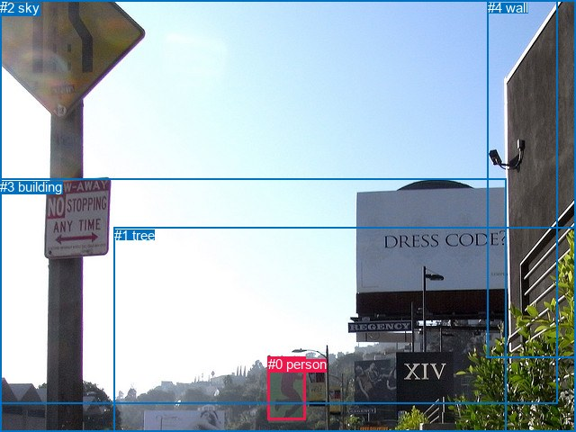

# 图片 0867：2354812.jpg

随机样本序号：241。图片 SHA256：`75df0302d3818cd27c7ea7dd131bcc172ca058377a977dd30df667160670296b`。

红色框表示人，蓝色框表示其他物体。两个模式分别保留自身框编号，可依据位置比较对应对象。

## 自动检测框与输出

人的框编号：`[]`。状态：`no_person`。

### 自动检测全部物体框

| 编号 | 类别 | 是否为人 | 检测分数 | 像素坐标 xyxy |
|---|---|---|---|---|

### 自动检测 Top50 人相关候选

评分物体对：0；人相关物体对：0；输出关系：0。

| 排名 | 主语编号与类别 | 关系 | 宾语编号与类别 | 类型 | 人与人 | 排序分数 | 原始融合 logit |
|---|---|---|---|---|---|---|---|

### 自动检测逐条人相关 GT 核验

本图没有人相关 GT，R@50 无分母；预测候选继续展示。

## 真实框与输出

人的框编号：`[0]`。

### 真实框全部物体框

| 编号 | 类别 | 是否为人 | 检测分数 | 像素坐标 xyxy |
|---|---|---|---|---|
| 0 | person | True | GT | 298.0, 396.0, 340.0, 466.0 |
| 1 | tree | False | GT | 127.0, 253.0, 640.0, 480.0 |
| 2 | sky | False | GT | 0.0, 0.0, 619.0, 449.0 |
| 3 | building | False | GT | 0.0, 199.0, 563.0, 480.0 |
| 4 | wall | False | GT | 542.0, 0.0, 640.0, 397.0 |

### 真实框 Top50 人相关候选

评分物体对：20；人相关物体对：8；输出关系：16。

| 排名 | 主语编号与类别 | 关系 | 宾语编号与类别 | 类型 | 人与人 | 排序分数 | 原始融合 logit |
|---|---|---|---|---|---|---|---|
| 1 | #0 person | on | #3 building | spatial | False | 0.95551 | 3.0669 |
| 2 | #0 person | in | #1 tree | spatial | False | 0.89959 | 2.1926 |
| 3 | #0 person | on | #4 wall | spatial | False | 0.81893 | 1.5091 |
| 4 | #1 tree | beside | #0 person | spatial | False | 0.81785 | 1.5019 |
| 5 | #2 sky | over | #0 person | spatial | False | 0.60809 | 0.4393 |
| 6 | #0 person | standing on | #3 building | semantic | False | 0.57881 | 0.3179 |
| 7 | #0 person | in | #2 sky | spatial | False | 0.55192 | 0.2084 |
| 8 | #0 person | holding | #1 tree | semantic | False | 0.50529 | 0.0212 |
| 9 | #3 building | over | #0 person | spatial | False | 0.48265 | -0.0694 |
| 10 | #4 wall | beside | #0 person | spatial | False | 0.41184 | -0.3564 |
| 11 | #1 tree | holding | #0 person | semantic | False | 0.26410 | -1.0248 |
| 12 | #3 building | holding | #0 person | semantic | False | 0.18922 | -1.4551 |
| 13 | #0 person | looking at | #2 sky | semantic | False | 0.16171 | -1.6455 |
| 14 | #0 person | standing on | #4 wall | semantic | False | 0.15374 | -1.7056 |
| 15 | #4 wall | holding | #0 person | semantic | False | 0.05073 | -2.9292 |
| 16 | #2 sky | flying over | #0 person | semantic | False | 0.03944 | -3.1927 |

### 真实框逐条人相关 GT 核验

本图没有人相关 GT，R@50 无分母；预测候选继续展示。

## 全部人相关 GT

| 主语编号与类别 | 关系 | 宾语编号与类别 |
|---|---|---|

原始记录、全部人相关物体对的两项预测与分项分数见 [逐图证据 JSON](../evidence/cases/0867.json)。全部56类 logits 保留于本机 HOR/output/random500/logits/。

<!-- HOR_COMPLETE_RESULTS -->

## 六组条件的完整输出对照

以下保留同一图片三种框与候选模式、两种谓词输出规则的全部 Top50。框编号各自在所属模式内解释。

### 自动检测框完整枚举：空间与语义各保留一个谓词

| 排名 | 主语编号与类别 | 谓词 | 宾语编号与类别 | 分组 | 排序分数 | predicate logit | pair logit |
|---|---|---|---|---|---|---|---|

没有人相关 GT，本条件的召回率无分母。

### 自动检测框完整枚举：每对只保留一个谓词

| 排名 | 主语编号与类别 | 谓词 | 宾语编号与类别 | 分组 | 排序分数 | predicate logit | pair logit |
|---|---|---|---|---|---|---|---|

没有人相关 GT，本条件的召回率无分母。

### 真实框完整枚举：空间与语义各保留一个谓词

| 排名 | 主语编号与类别 | 谓词 | 宾语编号与类别 | 分组 | 排序分数 | predicate logit | pair logit |
|---|---|---|---|---|---|---|---|
| 1 | #0 person | on | #3 building | spatial | 0.9555086 | 3.5004134 | -0.4334662 |
| 2 | #0 person | in | #1 tree | spatial | 0.8995862 | 2.6598263 | -0.4671912 |
| 3 | #0 person | on | #4 wall | spatial | 0.8189272 | 2.5151358 | -1.0060396 |
| 4 | #1 tree | beside | #0 person | spatial | 0.8178533 | 2.3321185 | -0.8302479 |
| 5 | #2 sky | over | #0 person | spatial | 0.6080933 | 1.9489141 | -1.5096095 |
| 6 | #0 person | standing on | #3 building | semantic | 0.5788136 | 0.7513714 | -0.4334662 |
| 7 | #0 person | in | #2 sky | spatial | 0.5519221 | 1.0939684 | -0.8855283 |
| 8 | #0 person | holding | #1 tree | semantic | 0.5052912 | 0.4883566 | -0.4671912 |
| 9 | #3 building | over | #0 person | spatial | 0.4826475 | 1.1772370 | -1.2466750 |
| 10 | #4 wall | beside | #0 person | spatial | 0.4118359 | 1.3070507 | -1.6634316 |
| 11 | #1 tree | holding | #0 person | semantic | 0.2640957 | -0.1945405 | -0.8302479 |
| 12 | #3 building | holding | #0 person | semantic | 0.1892182 | -0.2084231 | -1.2466750 |
| 13 | #0 person | looking at | #2 sky | semantic | 0.1617119 | -0.7600169 | -0.8855283 |
| 14 | #0 person | standing on | #4 wall | semantic | 0.1537381 | -0.6995387 | -1.0060396 |
| 15 | #4 wall | holding | #0 person | semantic | 0.0507305 | -1.2657340 | -1.6634316 |
| 16 | #2 sky | flying over | #0 person | semantic | 0.0394429 | -1.6830506 | -1.5096095 |

没有人相关 GT，本条件的召回率无分母。

### 真实框完整枚举：每对只保留一个谓词

| 排名 | 主语编号与类别 | 谓词 | 宾语编号与类别 | 分组 | 排序分数 | predicate logit | pair logit |
|---|---|---|---|---|---|---|---|
| 1 | #0 person | on | #3 building | single | 0.9555086 | 3.5004134 | -0.4334662 |
| 2 | #0 person | in | #1 tree | single | 0.8995862 | 2.6598263 | -0.4671912 |
| 3 | #0 person | on | #4 wall | single | 0.8189272 | 2.5151358 | -1.0060396 |
| 4 | #1 tree | beside | #0 person | single | 0.8178533 | 2.3321185 | -0.8302479 |
| 5 | #2 sky | over | #0 person | single | 0.6080933 | 1.9489141 | -1.5096095 |
| 6 | #0 person | in | #2 sky | single | 0.5519221 | 1.0939684 | -0.8855283 |
| 7 | #3 building | over | #0 person | single | 0.4826475 | 1.1772370 | -1.2466750 |
| 8 | #4 wall | beside | #0 person | single | 0.4118359 | 1.3070507 | -1.6634316 |

没有人相关 GT，本条件的召回率无分母。

### 真实框400候选：空间与语义各保留一个谓词

| 排名 | 主语编号与类别 | 谓词 | 宾语编号与类别 | 分组 | 排序分数 | predicate logit | pair logit |
|---|---|---|---|---|---|---|---|
| 1 | #0 person | on | #3 building | spatial | 0.9571130 | 3.5388179 | -0.4334662 |
| 2 | #0 person | in | #1 tree | spatial | 0.8995862 | 2.6598263 | -0.4671912 |
| 3 | #1 tree | beside | #0 person | spatial | 0.8178533 | 2.3321185 | -0.8302479 |
| 4 | #0 person | on | #4 wall | spatial | 0.8173069 | 2.5042462 | -1.0060396 |
| 5 | #2 sky | over | #0 person | spatial | 0.6127341 | 1.9684291 | -1.5096095 |
| 6 | #0 person | standing on | #3 building | semantic | 0.5788136 | 0.7513714 | -0.4334662 |
| 7 | #0 person | in | #2 sky | spatial | 0.5461152 | 1.0705147 | -0.8855283 |
| 8 | #0 person | holding | #1 tree | semantic | 0.5052912 | 0.4883566 | -0.4671912 |
| 9 | #3 building | over | #0 person | spatial | 0.4757978 | 1.1497903 | -1.2466750 |
| 10 | #4 wall | beside | #0 person | spatial | 0.4191435 | 1.3371415 | -1.6634316 |
| 11 | #1 tree | holding | #0 person | semantic | 0.2640957 | -0.1945405 | -0.8302479 |
| 12 | #3 building | holding | #0 person | semantic | 0.1850901 | -0.2355599 | -1.2466750 |
| 13 | #0 person | looking at | #2 sky | semantic | 0.1617119 | -0.7600169 | -0.8855283 |
| 14 | #0 person | standing on | #4 wall | semantic | 0.1537381 | -0.6995387 | -1.0060396 |
| 15 | #4 wall | holding | #0 person | semantic | 0.0519805 | -1.2400739 | -1.6634316 |
| 16 | #2 sky | flying over | #0 person | semantic | 0.0383207 | -1.7130804 | -1.5096095 |

没有人相关 GT，本条件的召回率无分母。

### 真实框400候选：每对只保留一个谓词

| 排名 | 主语编号与类别 | 谓词 | 宾语编号与类别 | 分组 | 排序分数 | predicate logit | pair logit |
|---|---|---|---|---|---|---|---|
| 1 | #0 person | on | #3 building | single | 0.9571130 | 3.5388179 | -0.4334662 |
| 2 | #0 person | in | #1 tree | single | 0.8995862 | 2.6598263 | -0.4671912 |
| 3 | #1 tree | beside | #0 person | single | 0.8178533 | 2.3321185 | -0.8302479 |
| 4 | #0 person | on | #4 wall | single | 0.8173069 | 2.5042462 | -1.0060396 |
| 5 | #2 sky | over | #0 person | single | 0.6127341 | 1.9684291 | -1.5096095 |
| 6 | #0 person | in | #2 sky | single | 0.5461152 | 1.0705147 | -0.8855283 |
| 7 | #3 building | over | #0 person | single | 0.4757978 | 1.1497903 | -1.2466750 |
| 8 | #4 wall | beside | #0 person | single | 0.4191435 | 1.3371415 | -1.6634316 |

没有人相关 GT，本条件的召回率无分母。
