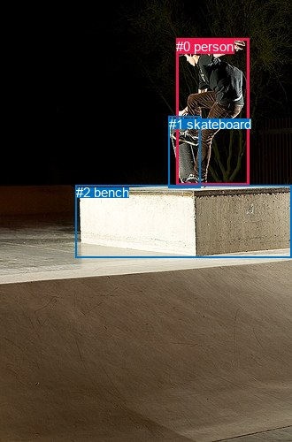
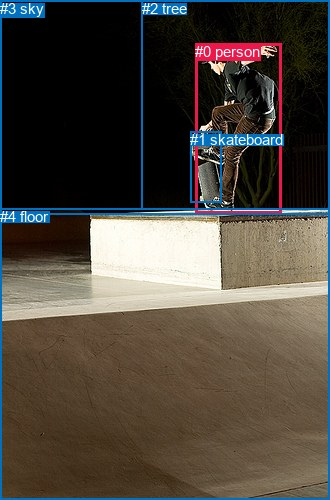

# 图片 0868：2354820.jpg

随机样本序号：106。图片 SHA256：`ba0843cb3822d41d6e1ef6264e215a39015fb246b71f8b830c9100d98ab01b5b`。

红色框表示人，蓝色框表示其他物体。两个模式分别保留自身框编号，可依据位置比较对应对象。

## 自动检测框与输出

人的框编号：`[0]`。状态：`ok`。

### 自动检测全部物体框

| 编号 | 类别 | 是否为人 | 检测分数 | 像素坐标 xyxy |
|---|---|---|---|---|
| 0 | person | True | 0.9994 | 199.1, 43.7, 281.5, 209.4 |
| 1 | skateboard | False | 0.9992 | 190.9, 131.7, 226.9, 212.8 |
| 2 | bench | False | 0.3724 | 85.5, 209.5, 330.0, 291.6 |

### 自动检测 Top50 人相关候选

评分物体对：6；人相关物体对：4；输出关系：8。

| 排名 | 主语编号与类别 | 关系 | 宾语编号与类别 | 类型 | 人与人 | 排序分数 | 原始融合 logit |
|---|---|---|---|---|---|---|---|
| 1 | #0 person | riding | #1 skateboard | semantic | False | 0.97786 | 3.7881 |
| 2 | #0 person | on | #1 skateboard | spatial | False | 0.96120 | 3.2097 |
| 3 | #0 person | jumping over | #2 bench | semantic | False | 0.94401 | 2.8250 |
| 4 | #0 person | on | #2 bench | spatial | False | 0.94270 | 2.8004 |
| 5 | #1 skateboard | on | #0 person | spatial | False | 0.60220 | 0.4146 |
| 6 | #2 bench | beside | #0 person | spatial | False | 0.53700 | 0.1483 |
| 7 | #1 skateboard | carrying | #0 person | semantic | False | 0.45056 | -0.1984 |
| 8 | #2 bench | holding | #0 person | semantic | False | 0.34723 | -0.6312 |

### 自动检测逐条人相关 GT 核验

R@50：25.00%；命中 1/4。

| GT 主语编号 | GT 关系 | GT 宾语编号 | 结果阶段 | 匹配预测主语编号 | 匹配预测宾语编号 |
|---|---|---|---|---|---|
| 0 | playing | 1 | wrong_predicate | [0] | [1] |
| 0 | riding | 1 | hit50 | [0] | [1] |
| 0 | in front of | 2 | endpoint_missing_or_wrong_class | [0] | [] |
| 0 | standing on | 4 | endpoint_missing_or_wrong_class | [0] | [] |

## 真实框与输出

人的框编号：`[0]`。

### 真实框全部物体框

| 编号 | 类别 | 是否为人 | 检测分数 | 像素坐标 xyxy |
|---|---|---|---|---|
| 0 | person | True | GT | 195.0, 43.0, 281.0, 213.0 |
| 1 | skateboard | False | GT | 190.0, 131.0, 221.0, 202.0 |
| 2 | tree | False | GT | 142.0, 0.0, 330.0, 210.0 |
| 3 | sky | False | GT | 0.0, 0.0, 330.0, 214.0 |
| 4 | floor | False | GT | 0.0, 208.0, 330.0, 500.0 |

### 真实框 Top50 人相关候选

评分物体对：20；人相关物体对：8；输出关系：16。

| 排名 | 主语编号与类别 | 关系 | 宾语编号与类别 | 类型 | 人与人 | 排序分数 | 原始融合 logit |
|---|---|---|---|---|---|---|---|
| 1 | #0 person | on | #1 skateboard | spatial | False | 0.97420 | 3.6310 |
| 2 | #0 person | riding | #1 skateboard | semantic | False | 0.96698 | 3.3772 |
| 3 | #0 person | on | #4 floor | spatial | False | 0.94343 | 2.8141 |
| 4 | #0 person | in | #3 sky | spatial | False | 0.92469 | 2.5078 |
| 5 | #0 person | jumping over | #4 floor | semantic | False | 0.91941 | 2.4343 |
| 6 | #2 tree | beside | #0 person | spatial | False | 0.85520 | 1.7760 |
| 7 | #0 person | in | #2 tree | spatial | False | 0.83288 | 1.6062 |
| 8 | #1 skateboard | on | #0 person | spatial | False | 0.82938 | 1.5812 |
| 9 | #0 person | jumping over | #2 tree | semantic | False | 0.68426 | 0.7734 |
| 10 | #0 person | jumping over | #3 sky | semantic | False | 0.67485 | 0.7302 |
| 11 | #1 skateboard | wearing | #0 person | semantic | False | 0.64703 | 0.6060 |
| 12 | #3 sky | over | #0 person | spatial | False | 0.62700 | 0.5194 |
| 13 | #4 floor | holding | #0 person | semantic | False | 0.45915 | -0.1638 |
| 14 | #4 floor | beside | #0 person | spatial | False | 0.42174 | -0.3156 |
| 15 | #2 tree | looking at | #0 person | semantic | False | 0.31097 | -0.7956 |
| 16 | #3 sky | looking at | #0 person | semantic | False | 0.22067 | -1.2617 |

### 真实框逐条人相关 GT 核验

R@50：25.00%；命中 1/4。

| GT 主语编号 | GT 关系 | GT 宾语编号 | 结果阶段 | 匹配预测主语编号 | 匹配预测宾语编号 |
|---|---|---|---|---|---|
| 0 | playing | 1 | wrong_predicate | [0] | [1] |
| 0 | riding | 1 | hit50 | [0] | [1] |
| 0 | in front of | 2 | wrong_predicate | [0] | [2] |
| 0 | standing on | 4 | wrong_predicate | [0] | [4] |

## 全部人相关 GT

| 主语编号与类别 | 关系 | 宾语编号与类别 |
|---|---|---|
| #0 person | playing | #1 skateboard |
| #0 person | riding | #1 skateboard |
| #0 person | in front of | #2 tree |
| #0 person | standing on | #4 floor |

原始记录、全部人相关物体对的两项预测与分项分数见 [逐图证据 JSON](../evidence/cases/0868.json)。全部56类 logits 保留于本机 HOR/output/random500/logits/。

<!-- HOR_COMPLETE_RESULTS -->

## 六组条件的完整输出对照

以下保留同一图片三种框与候选模式、两种谓词输出规则的全部 Top50。框编号各自在所属模式内解释。

### 自动检测框完整枚举：空间与语义各保留一个谓词

| 排名 | 主语编号与类别 | 谓词 | 宾语编号与类别 | 分组 | 排序分数 | predicate logit | pair logit |
|---|---|---|---|---|---|---|---|
| 1 | #0 person | riding | #1 skateboard | semantic | 0.9778619 | 3.5909905 | 0.1970760 |
| 2 | #0 person | on | #1 skateboard | spatial | 0.9611983 | 3.0126405 | 0.1970760 |
| 3 | #0 person | jumping over | #2 bench | semantic | 0.9440101 | 2.9420590 | -0.1170940 |
| 4 | #0 person | on | #2 bench | spatial | 0.9426993 | 2.9175291 | -0.1170940 |
| 5 | #1 skateboard | on | #0 person | spatial | 0.6022024 | 1.0120211 | -0.5973711 |
| 6 | #2 bench | beside | #0 person | spatial | 0.5370001 | 0.7977543 | -0.6494826 |
| 7 | #1 skateboard | carrying | #0 person | semantic | 0.4505649 | 0.3989825 | -0.5973711 |
| 8 | #2 bench | holding | #0 person | semantic | 0.3472321 | 0.0182543 | -0.6494826 |

GT 命中：1/4，R@50=25.00%。

| GT主语 | GT谓词 | GT宾语 | 结果阶段 | 匹配主语框 | 匹配宾语框 |
|---|---|---|---|---|---|
| 0 | playing | 1 | wrong_predicate | [0] | [1] |
| 0 | riding | 1 | hit50 | [0] | [1] |
| 0 | in front of | 2 | endpoint_missing_or_wrong_class | [0] | [] |
| 0 | standing on | 4 | endpoint_missing_or_wrong_class | [0] | [] |

### 自动检测框完整枚举：每对只保留一个谓词

| 排名 | 主语编号与类别 | 谓词 | 宾语编号与类别 | 分组 | 排序分数 | predicate logit | pair logit |
|---|---|---|---|---|---|---|---|
| 1 | #0 person | riding | #1 skateboard | single | 0.9778619 | 3.5909905 | 0.1970760 |
| 2 | #0 person | jumping over | #2 bench | single | 0.9440101 | 2.9420590 | -0.1170940 |
| 3 | #1 skateboard | on | #0 person | single | 0.6022024 | 1.0120211 | -0.5973711 |
| 4 | #2 bench | beside | #0 person | single | 0.5370001 | 0.7977543 | -0.6494826 |

GT 命中：1/4，R@50=25.00%。

| GT主语 | GT谓词 | GT宾语 | 结果阶段 | 匹配主语框 | 匹配宾语框 |
|---|---|---|---|---|---|
| 0 | playing | 1 | wrong_predicate | [0] | [1] |
| 0 | riding | 1 | hit50 | [0] | [1] |
| 0 | in front of | 2 | endpoint_missing_or_wrong_class | [0] | [] |
| 0 | standing on | 4 | endpoint_missing_or_wrong_class | [0] | [] |

### 真实框完整枚举：空间与语义各保留一个谓词

| 排名 | 主语编号与类别 | 谓词 | 宾语编号与类别 | 分组 | 排序分数 | predicate logit | pair logit |
|---|---|---|---|---|---|---|---|
| 1 | #0 person | on | #1 skateboard | spatial | 0.9741950 | 3.4837899 | 0.1472552 |
| 2 | #0 person | riding | #1 skateboard | semantic | 0.9669827 | 3.2298956 | 0.1472552 |
| 3 | #0 person | on | #4 floor | spatial | 0.9434319 | 3.2620006 | -0.4479220 |
| 4 | #0 person | in | #3 sky | spatial | 0.9246895 | 3.3359990 | -0.8281614 |
| 5 | #0 person | jumping over | #4 floor | semantic | 0.9194054 | 2.8822174 | -0.4479220 |
| 6 | #2 tree | beside | #0 person | spatial | 0.8551983 | 2.0851436 | -0.3091761 |
| 7 | #0 person | in | #2 tree | spatial | 0.8328775 | 2.4815044 | -0.8753451 |
| 8 | #1 skateboard | on | #0 person | spatial | 0.8293796 | 2.2015963 | -0.6203599 |
| 9 | #0 person | jumping over | #2 tree | semantic | 0.6842583 | 1.6487560 | -0.8753451 |
| 10 | #0 person | jumping over | #3 sky | semantic | 0.6748517 | 1.5583730 | -0.8281614 |
| 11 | #1 skateboard | wearing | #0 person | semantic | 0.6470315 | 1.2263761 | -0.6203599 |
| 12 | #3 sky | over | #0 person | spatial | 0.6269976 | 0.9664793 | -0.4471211 |
| 13 | #4 floor | holding | #0 person | semantic | 0.4591490 | 0.6475563 | -0.8113255 |
| 14 | #4 floor | beside | #0 person | spatial | 0.4217387 | 0.4956856 | -0.8113255 |
| 15 | #2 tree | looking at | #0 person | semantic | 0.3109712 | -0.4864068 | -0.3091761 |
| 16 | #3 sky | looking at | #0 person | semantic | 0.2206741 | -0.8146212 | -0.4471211 |

GT 命中：1/4，R@50=25.00%。

| GT主语 | GT谓词 | GT宾语 | 结果阶段 | 匹配主语框 | 匹配宾语框 |
|---|---|---|---|---|---|
| 0 | playing | 1 | wrong_predicate | [0] | [1] |
| 0 | riding | 1 | hit50 | [0] | [1] |
| 0 | in front of | 2 | wrong_predicate | [0] | [2] |
| 0 | standing on | 4 | wrong_predicate | [0] | [4] |

### 真实框完整枚举：每对只保留一个谓词

| 排名 | 主语编号与类别 | 谓词 | 宾语编号与类别 | 分组 | 排序分数 | predicate logit | pair logit |
|---|---|---|---|---|---|---|---|
| 1 | #0 person | on | #1 skateboard | single | 0.9741950 | 3.4837899 | 0.1472552 |
| 2 | #0 person | on | #4 floor | single | 0.9434319 | 3.2620006 | -0.4479220 |
| 3 | #0 person | in | #3 sky | single | 0.9246895 | 3.3359990 | -0.8281614 |
| 4 | #2 tree | beside | #0 person | single | 0.8551983 | 2.0851436 | -0.3091761 |
| 5 | #0 person | in | #2 tree | single | 0.8328775 | 2.4815044 | -0.8753451 |
| 6 | #1 skateboard | on | #0 person | single | 0.8293796 | 2.2015963 | -0.6203599 |
| 7 | #3 sky | over | #0 person | single | 0.6269976 | 0.9664793 | -0.4471211 |
| 8 | #4 floor | holding | #0 person | single | 0.4591490 | 0.6475563 | -0.8113255 |

GT 命中：0/4，R@50=0.00%。

| GT主语 | GT谓词 | GT宾语 | 结果阶段 | 匹配主语框 | 匹配宾语框 |
|---|---|---|---|---|---|
| 0 | playing | 1 | wrong_predicate | [0] | [1] |
| 0 | riding | 1 | wrong_predicate | [0] | [1] |
| 0 | in front of | 2 | wrong_predicate | [0] | [2] |
| 0 | standing on | 4 | wrong_predicate | [0] | [4] |

### 真实框400候选：空间与语义各保留一个谓词

| 排名 | 主语编号与类别 | 谓词 | 宾语编号与类别 | 分组 | 排序分数 | predicate logit | pair logit |
|---|---|---|---|---|---|---|---|
| 1 | #0 person | on | #1 skateboard | spatial | 0.9739198 | 3.4728999 | 0.1472552 |
| 2 | #0 person | riding | #1 skateboard | semantic | 0.9669827 | 3.2298956 | 0.1472552 |
| 3 | #0 person | on | #4 floor | spatial | 0.9434319 | 3.2620006 | -0.4479220 |
| 4 | #0 person | in | #3 sky | spatial | 0.9251504 | 3.3426366 | -0.8281614 |
| 5 | #0 person | jumping over | #4 floor | semantic | 0.9216054 | 2.9122844 | -0.4479220 |
| 6 | #2 tree | beside | #0 person | spatial | 0.8588638 | 2.1150613 | -0.3091761 |
| 7 | #0 person | in | #2 tree | spatial | 0.8333389 | 2.4848232 | -0.8753451 |
| 8 | #1 skateboard | on | #0 person | spatial | 0.8293796 | 2.2015963 | -0.6203599 |
| 9 | #0 person | jumping over | #2 tree | semantic | 0.6842583 | 1.6487560 | -0.8753451 |
| 10 | #0 person | jumping over | #3 sky | semantic | 0.6748503 | 1.5583668 | -0.8281614 |
| 11 | #1 skateboard | wearing | #0 person | semantic | 0.6470315 | 1.2263761 | -0.6203599 |
| 12 | #3 sky | over | #0 person | spatial | 0.6257601 | 0.9611912 | -0.4471211 |
| 13 | #4 floor | holding | #0 person | semantic | 0.4595157 | 0.6490331 | -0.8113255 |
| 14 | #4 floor | beside | #0 person | spatial | 0.4217387 | 0.4956856 | -0.8113255 |
| 15 | #2 tree | looking at | #0 person | semantic | 0.3109712 | -0.4864068 | -0.3091761 |
| 16 | #3 sky | looking at | #0 person | semantic | 0.2206741 | -0.8146212 | -0.4471211 |

GT 命中：1/4，R@50=25.00%。

| GT主语 | GT谓词 | GT宾语 | 结果阶段 | 匹配主语框 | 匹配宾语框 |
|---|---|---|---|---|---|
| 0 | playing | 1 | wrong_predicate | [0] | [1] |
| 0 | riding | 1 | hit50 | [0] | [1] |
| 0 | in front of | 2 | wrong_predicate | [0] | [2] |
| 0 | standing on | 4 | wrong_predicate | [0] | [4] |

### 真实框400候选：每对只保留一个谓词

| 排名 | 主语编号与类别 | 谓词 | 宾语编号与类别 | 分组 | 排序分数 | predicate logit | pair logit |
|---|---|---|---|---|---|---|---|
| 1 | #0 person | on | #1 skateboard | single | 0.9739198 | 3.4728999 | 0.1472552 |
| 2 | #0 person | on | #4 floor | single | 0.9434319 | 3.2620006 | -0.4479220 |
| 3 | #0 person | in | #3 sky | single | 0.9251504 | 3.3426366 | -0.8281614 |
| 4 | #2 tree | beside | #0 person | single | 0.8588638 | 2.1150613 | -0.3091761 |
| 5 | #0 person | in | #2 tree | single | 0.8333389 | 2.4848232 | -0.8753451 |
| 6 | #1 skateboard | on | #0 person | single | 0.8293796 | 2.2015963 | -0.6203599 |
| 7 | #3 sky | over | #0 person | single | 0.6257601 | 0.9611912 | -0.4471211 |
| 8 | #4 floor | holding | #0 person | single | 0.4595157 | 0.6490331 | -0.8113255 |

GT 命中：0/4，R@50=0.00%。

| GT主语 | GT谓词 | GT宾语 | 结果阶段 | 匹配主语框 | 匹配宾语框 |
|---|---|---|---|---|---|
| 0 | playing | 1 | wrong_predicate | [0] | [1] |
| 0 | riding | 1 | wrong_predicate | [0] | [1] |
| 0 | in front of | 2 | wrong_predicate | [0] | [2] |
| 0 | standing on | 4 | wrong_predicate | [0] | [4] |
