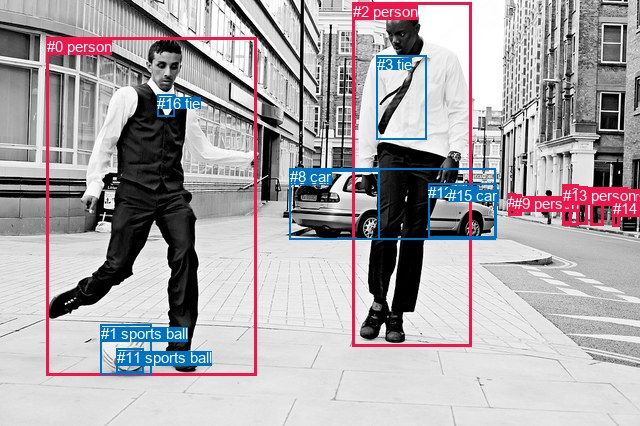
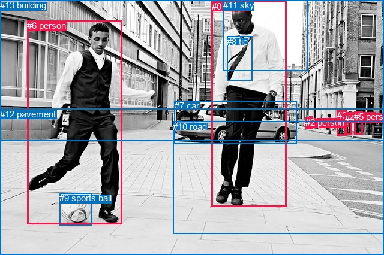

# 图片 0880：2355316.jpg

随机样本序号：432。图片 SHA256：`8194b9a1efda00e15ec8386d9dc78f70055d84203781625fbb17845a356efa9c`。

红色框表示人，蓝色框表示其他物体。两个模式分别保留自身框编号，可依据位置比较对应对象。

## 自动检测框与输出

人的框编号：`[0, 2, 4, 6, 7, 9, 10, 13, 14]`。状态：`ok`。

### 自动检测全部物体框

| 编号 | 类别 | 是否为人 | 检测分数 | 像素坐标 xyxy |
|---|---|---|---|---|
| 0 | person | True | 0.9998 | 46.9, 37.5, 256.9, 375.2 |
| 1 | sports ball | False | 0.9998 | 100.7, 324.8, 151.4, 374.7 |
| 2 | person | True | 0.9994 | 352.5, 2.8, 471.5, 346.1 |
| 3 | tie | False | 0.9977 | 376.7, 55.6, 426.8, 139.1 |
| 4 | person | True | 0.9924 | 576.3, 186.9, 587.1, 224.5 |
| 5 | car | False | 0.9900 | 289.9, 170.3, 379.7, 239.3 |
| 6 | person | True | 0.9889 | 562.9, 184.8, 578.6, 225.4 |
| 7 | person | True | 0.9884 | 508.5, 193.3, 515.6, 215.6 |
| 8 | car | False | 0.9875 | 289.7, 168.2, 495.9, 239.4 |
| 9 | person | True | 0.9827 | 514.0, 194.5, 521.0, 215.1 |
| 10 | person | True | 0.9640 | 590.5, 188.3, 603.0, 225.3 |
| 11 | sports ball | False | 0.9583 | 116.8, 348.5, 143.7, 372.6 |
| 12 | car | False | 0.8852 | 428.1, 183.8, 496.4, 237.5 |
| 13 | person | True | 0.7301 | 562.9, 187.4, 571.2, 223.9 |
| 14 | person | True | 0.6591 | 612.8, 199.5, 619.1, 226.4 |
| 15 | car | False | 0.6315 | 448.0, 187.1, 466.9, 198.6 |
| 16 | tie | False | 0.5192 | 157.2, 94.9, 174.4, 116.4 |

### 自动检测 Top50 人相关候选

评分物体对：272；人相关物体对：216；输出关系：50。

| 排名 | 主语编号与类别 | 关系 | 宾语编号与类别 | 类型 | 人与人 | 排序分数 | 原始融合 logit |
|---|---|---|---|---|---|---|---|
| 1 | #0 person | kicking | #1 sports ball | semantic | False | 0.99975 | 8.2926 |
| 2 | #0 person | kicking | #11 sports ball | semantic | False | 0.99886 | 6.7713 |
| 3 | #2 person | wearing | #3 tie | semantic | False | 0.99741 | 5.9530 |
| 4 | #0 person | wearing | #16 tie | semantic | False | 0.99456 | 5.2077 |
| 5 | #0 person | on | #1 sports ball | spatial | False | 0.95582 | 3.0743 |
| 6 | #2 person | kicking | #1 sports ball | semantic | False | 0.95558 | 3.0687 |
| 7 | #2 person | beside | #8 car | spatial | False | 0.93950 | 2.7427 |
| 8 | #2 person | walking on | #8 car | semantic | False | 0.93041 | 2.5930 |
| 9 | #2 person | beside | #0 person | spatial | True | 0.89970 | 2.1939 |
| 10 | #0 person | on | #11 sports ball | spatial | False | 0.88738 | 2.0642 |
| 11 | #2 person | beside | #12 car | spatial | False | 0.87932 | 1.9860 |
| 12 | #2 person | walking on | #12 car | semantic | False | 0.87715 | 1.9657 |
| 13 | #2 person | in | #3 tie | spatial | False | 0.87691 | 1.9635 |
| 14 | #6 person | beside | #4 person | spatial | True | 0.86957 | 1.8971 |
| 15 | #4 person | walking on | #12 car | semantic | False | 0.85247 | 1.7541 |
| 16 | #13 person | beside | #4 person | spatial | True | 0.84736 | 1.7140 |
| 17 | #4 person | beside | #10 person | spatial | True | 0.84622 | 1.7052 |
| 18 | #0 person | in front of | #8 car | spatial | False | 0.84479 | 1.6943 |
| 19 | #10 person | walking on | #14 person | semantic | True | 0.84312 | 1.6816 |
| 20 | #2 person | looking at | #0 person | semantic | True | 0.83848 | 1.6470 |
| 21 | #13 person | walking on | #12 car | semantic | False | 0.83573 | 1.6268 |
| 22 | #7 person | walking on | #12 car | semantic | False | 0.82515 | 1.5516 |
| 23 | #0 person | beside | #2 person | spatial | True | 0.82201 | 1.5300 |
| 24 | #6 person | walking on | #12 car | semantic | False | 0.81654 | 1.4931 |
| 25 | #10 person | walking on | #12 car | semantic | False | 0.81538 | 1.4854 |
| 26 | #0 person | in front of | #5 car | spatial | False | 0.81165 | 1.4608 |
| 27 | #6 person | beside | #10 person | spatial | True | 0.80433 | 1.4136 |
| 28 | #9 person | walking on | #12 car | semantic | False | 0.80222 | 1.4002 |
| 29 | #4 person | beside | #6 person | spatial | True | 0.79824 | 1.3753 |
| 30 | #2 person | beside | #5 car | spatial | False | 0.79644 | 1.3642 |
| 31 | #0 person | in | #16 tie | spatial | False | 0.78701 | 1.3070 |
| 32 | #7 person | beside | #12 car | spatial | False | 0.75957 | 1.1503 |
| 33 | #4 person | beside | #13 person | spatial | True | 0.74917 | 1.0942 |
| 34 | #10 person | beside | #4 person | spatial | True | 0.74753 | 1.0855 |
| 35 | #6 person | walking on | #4 person | semantic | True | 0.73517 | 1.0210 |
| 36 | #6 person | beside | #13 person | spatial | True | 0.73487 | 1.0195 |
| 37 | #4 person | walking on | #14 person | semantic | True | 0.73456 | 1.0179 |
| 38 | #10 person | beside | #14 person | spatial | True | 0.72956 | 0.9924 |
| 39 | #9 person | beside | #12 car | spatial | False | 0.72245 | 0.9566 |
| 40 | #2 person | walking on | #5 car | semantic | False | 0.71143 | 0.9024 |
| 41 | #6 person | walking on | #14 person | semantic | True | 0.70890 | 0.8901 |
| 42 | #13 person | beside | #6 person | spatial | True | 0.69957 | 0.8453 |
| 43 | #7 person | beside | #9 person | spatial | True | 0.69529 | 0.8250 |
| 44 | #10 person | beside | #6 person | spatial | True | 0.68641 | 0.7834 |
| 45 | #9 person | walking on | #14 person | semantic | True | 0.67891 | 0.7488 |
| 46 | #4 person | walking on | #10 person | semantic | True | 0.67780 | 0.7437 |
| 47 | #9 person | beside | #7 person | spatial | True | 0.67648 | 0.7377 |
| 48 | #7 person | walking on | #14 person | semantic | True | 0.66953 | 0.7061 |
| 49 | #7 person | walking on | #8 car | semantic | False | 0.66868 | 0.7022 |
| 50 | #13 person | walking on | #14 person | semantic | True | 0.66287 | 0.6761 |

### 自动检测逐条人相关 GT 核验

R@50：33.33%；命中 2/6。

| GT 主语编号 | GT 关系 | GT 宾语编号 | 结果阶段 | 匹配预测主语编号 | 匹配预测宾语编号 |
|---|---|---|---|---|---|
| 0 | in front of | 7 | wrong_predicate | [2] | [8] |
| 0 | wearing | 8 | hit50 | [2] | [3] |
| 0 | standing on | 12 | endpoint_missing_or_wrong_class | [2] | [] |
| 1 | standing on | 12 | endpoint_missing_or_wrong_class | [9] | [] |
| 6 | kicking | 9 | hit50 | [0] | [1] |
| 6 | in front of | 13 | endpoint_missing_or_wrong_class | [0] | [] |

## 真实框与输出

人的框编号：`[0, 1, 2, 3, 4, 5, 6]`。

### 真实框全部物体框

| 编号 | 类别 | 是否为人 | 检测分数 | 像素坐标 xyxy |
|---|---|---|---|---|
| 0 | person | True | GT | 353.0, 2.0, 478.0, 345.0 |
| 1 | person | True | GT | 515.0, 194.0, 520.0, 215.0 |
| 2 | person | True | GT | 509.0, 196.0, 515.0, 215.0 |
| 3 | person | True | GT | 562.0, 184.0, 578.0, 226.0 |
| 4 | person | True | GT | 575.0, 189.0, 587.0, 225.0 |
| 5 | person | True | GT | 590.0, 186.0, 604.0, 225.0 |
| 6 | person | True | GT | 45.0, 34.0, 204.0, 375.0 |
| 7 | car | False | GT | 291.0, 168.0, 495.0, 240.0 |
| 8 | tie | False | GT | 378.0, 61.0, 420.0, 134.0 |
| 9 | sports ball | False | GT | 99.0, 322.0, 152.0, 376.0 |
| 10 | road | False | GT | 288.0, 203.0, 640.0, 391.0 |
| 11 | sky | False | GT | 372.0, 0.0, 514.0, 119.0 |
| 12 | pavement | False | GT | 0.0, 182.0, 640.0, 426.0 |
| 13 | building | False | GT | 0.0, 0.0, 640.0, 236.0 |

### 真实框 Top50 人相关候选

评分物体对：182；人相关物体对：140；输出关系：50。

| 排名 | 主语编号与类别 | 关系 | 宾语编号与类别 | 类型 | 人与人 | 排序分数 | 原始融合 logit |
|---|---|---|---|---|---|---|---|
| 1 | #6 person | kicking | #9 sports ball | semantic | False | 0.99976 | 8.3152 |
| 2 | #0 person | wearing | #8 tie | semantic | False | 0.99671 | 5.7124 |
| 3 | #0 person | kicking | #9 sports ball | semantic | False | 0.98885 | 4.4854 |
| 4 | #3 person | walking on | #10 road | semantic | False | 0.98448 | 4.1499 |
| 5 | #6 person | running on | #12 pavement | semantic | False | 0.98339 | 4.0813 |
| 6 | #2 person | walking on | #10 road | semantic | False | 0.98192 | 3.9946 |
| 7 | #1 person | walking on | #10 road | semantic | False | 0.98056 | 3.9208 |
| 8 | #4 person | walking on | #10 road | semantic | False | 0.98050 | 3.9174 |
| 9 | #2 person | walking on | #12 pavement | semantic | False | 0.98025 | 3.9048 |
| 10 | #5 person | walking on | #10 road | semantic | False | 0.97935 | 3.8592 |
| 11 | #0 person | walking on | #12 pavement | semantic | False | 0.97831 | 3.8091 |
| 12 | #5 person | walking on | #12 pavement | semantic | False | 0.97821 | 3.8042 |
| 13 | #1 person | walking on | #12 pavement | semantic | False | 0.97493 | 3.6607 |
| 14 | #4 person | walking on | #12 pavement | semantic | False | 0.97158 | 3.5316 |
| 15 | #3 person | walking on | #12 pavement | semantic | False | 0.96995 | 3.4744 |
| 16 | #6 person | on | #9 sports ball | spatial | False | 0.96711 | 3.3812 |
| 17 | #6 person | on | #12 pavement | spatial | False | 0.95238 | 2.9957 |
| 18 | #0 person | in | #8 tie | spatial | False | 0.94766 | 2.8962 |
| 19 | #0 person | crossing | #10 road | semantic | False | 0.94646 | 2.8723 |
| 20 | #3 person | on | #10 road | spatial | False | 0.90729 | 2.2809 |
| 21 | #0 person | on | #12 pavement | spatial | False | 0.90571 | 2.2624 |
| 22 | #0 person | on | #10 road | spatial | False | 0.90409 | 2.2435 |
| 23 | #0 person | in | #11 sky | spatial | False | 0.90224 | 2.2223 |
| 24 | #5 person | on | #10 road | spatial | False | 0.90006 | 2.1979 |
| 25 | #6 person | kicking | #10 road | semantic | False | 0.89370 | 2.1292 |
| 26 | #4 person | on | #10 road | spatial | False | 0.88939 | 2.0846 |
| 27 | #2 person | on | #10 road | spatial | False | 0.88850 | 2.0756 |
| 28 | #1 person | on | #10 road | spatial | False | 0.86068 | 1.8209 |
| 29 | #5 person | on | #12 pavement | spatial | False | 0.85896 | 1.8067 |
| 30 | #3 person | walking on | #13 building | semantic | False | 0.83737 | 1.6388 |
| 31 | #5 person | walking on | #13 building | semantic | False | 0.83168 | 1.5976 |
| 32 | #2 person | walking on | #13 building | semantic | False | 0.83113 | 1.5937 |
| 33 | #2 person | on | #12 pavement | spatial | False | 0.82942 | 1.5815 |
| 34 | #4 person | on | #12 pavement | spatial | False | 0.82825 | 1.5733 |
| 35 | #1 person | walking on | #13 building | semantic | False | 0.82437 | 1.5462 |
| 36 | #3 person | on | #12 pavement | spatial | False | 0.81995 | 1.5160 |
| 37 | #4 person | walking on | #13 building | semantic | False | 0.81372 | 1.4744 |
| 38 | #1 person | on | #12 pavement | spatial | False | 0.80761 | 1.4346 |
| 39 | #0 person | wearing | #11 sky | semantic | False | 0.76938 | 1.2048 |
| 40 | #6 person | on | #10 road | spatial | False | 0.71442 | 0.9170 |
| 41 | #0 person | beside | #7 car | spatial | False | 0.57967 | 0.3214 |
| 42 | #0 person | on | #9 sports ball | spatial | False | 0.55782 | 0.2323 |
| 43 | #6 person | wearing | #8 tie | semantic | False | 0.51502 | 0.0601 |
| 44 | #3 person | standing on | #4 person | semantic | True | 0.48403 | -0.0639 |
| 45 | #8 tie | on | #0 person | spatial | False | 0.47044 | -0.1184 |
| 46 | #6 person | beside | #0 person | spatial | True | 0.45408 | -0.1842 |
| 47 | #2 person | walking on | #7 car | semantic | False | 0.44920 | -0.2039 |
| 48 | #2 person | beside | #7 car | spatial | False | 0.43515 | -0.2609 |
| 49 | #7 car | beside | #0 person | spatial | False | 0.43326 | -0.2686 |
| 50 | #3 person | in | #13 building | spatial | False | 0.42711 | -0.2937 |

### 真实框逐条人相关 GT 核验

R@50：33.33%；命中 2/6。

| GT 主语编号 | GT 关系 | GT 宾语编号 | 结果阶段 | 匹配预测主语编号 | 匹配预测宾语编号 |
|---|---|---|---|---|---|
| 0 | in front of | 7 | wrong_predicate | [0] | [7] |
| 0 | wearing | 8 | hit50 | [0] | [8] |
| 0 | standing on | 12 | wrong_predicate | [0] | [12] |
| 1 | standing on | 12 | wrong_predicate | [1] | [12] |
| 6 | kicking | 9 | hit50 | [6] | [9] |
| 6 | in front of | 13 | rank_below50 | [6] | [13] |

## 全部人相关 GT

| 主语编号与类别 | 关系 | 宾语编号与类别 |
|---|---|---|
| #0 person | in front of | #7 car |
| #0 person | wearing | #8 tie |
| #0 person | standing on | #12 pavement |
| #1 person | standing on | #12 pavement |
| #6 person | kicking | #9 sports ball |
| #6 person | in front of | #13 building |

原始记录、全部人相关物体对的两项预测与分项分数见 [逐图证据 JSON](../evidence/cases/0880.json)。全部56类 logits 保留于本机 HOR/output/random500/logits/。

<!-- HOR_COMPLETE_RESULTS -->

## 六组条件的完整输出对照

以下保留同一图片三种框与候选模式、两种谓词输出规则的全部 Top50。框编号各自在所属模式内解释。

### 自动检测框完整枚举：空间与语义各保留一个谓词

| 排名 | 主语编号与类别 | 谓词 | 宾语编号与类别 | 分组 | 排序分数 | predicate logit | pair logit |
|---|---|---|---|---|---|---|---|
| 1 | #0 person | kicking | #1 sports ball | semantic | 0.9997497 | 6.3443570 | 1.9482162 |
| 2 | #0 person | kicking | #11 sports ball | semantic | 0.9988551 | 5.3250041 | 1.4463058 |
| 3 | #2 person | wearing | #3 tie | semantic | 0.9974087 | 4.4586053 | 1.4943862 |
| 4 | #0 person | wearing | #16 tie | semantic | 0.9945555 | 4.1959062 | 1.0117835 |
| 5 | #0 person | on | #1 sports ball | spatial | 0.9558184 | 1.1260438 | 1.9482162 |
| 6 | #2 person | kicking | #1 sports ball | semantic | 0.9555812 | 1.7112827 | 1.3573757 |
| 7 | #2 person | beside | #8 car | spatial | 0.9394977 | 2.2621641 | 0.4805012 |
| 8 | #2 person | walking on | #8 car | semantic | 0.9304122 | 2.1125360 | 0.4805012 |
| 9 | #2 person | beside | #0 person | spatial | 0.8997039 | 2.7130990 | -0.5191604 |
| 10 | #0 person | on | #11 sports ball | spatial | 0.8873791 | 0.6179385 | 1.4463058 |
| 11 | #2 person | beside | #12 car | spatial | 0.8793151 | 1.7505836 | 0.2353767 |
| 12 | #2 person | walking on | #12 car | semantic | 0.8771517 | 1.7303534 | 0.2353767 |
| 13 | #2 person | in | #3 tie | spatial | 0.8769113 | 0.4691143 | 1.4943862 |
| 14 | #6 person | beside | #4 person | spatial | 0.8695686 | 2.2618747 | -0.3647248 |
| 15 | #4 person | walking on | #12 car | semantic | 0.8524746 | 1.9198766 | -0.1657338 |
| 16 | #13 person | beside | #4 person | spatial | 0.8473601 | 2.0813560 | -0.3673115 |
| 17 | #4 person | beside | #10 person | spatial | 0.8462162 | 2.0208411 | -0.3156139 |
| 18 | #0 person | in front of | #8 car | spatial | 0.8447896 | 1.6911173 | 0.0031890 |
| 19 | #10 person | walking on | #14 person | semantic | 0.8431222 | 1.7799015 | -0.0982565 |
| 20 | #2 person | looking at | #0 person | semantic | 0.8384814 | 2.1661325 | -0.5191604 |
| 21 | #13 person | walking on | #12 car | semantic | 0.8357286 | 1.7784524 | -0.1516678 |
| 22 | #7 person | walking on | #12 car | semantic | 0.8251510 | 1.5497360 | 0.0019075 |
| 23 | #0 person | beside | #2 person | spatial | 0.8220055 | 2.3501678 | -0.8201735 |
| 24 | #6 person | walking on | #12 car | semantic | 0.8165419 | 1.6430345 | -0.1499424 |
| 25 | #10 person | walking on | #12 car | semantic | 0.8153821 | 1.7784243 | -0.2930564 |
| 26 | #0 person | in front of | #5 car | spatial | 0.8116522 | 1.5386701 | -0.0778880 |
| 27 | #6 person | beside | #10 person | spatial | 0.8043307 | 1.7198858 | -0.3063014 |
| 28 | #9 person | walking on | #12 car | semantic | 0.8022174 | 1.4113221 | -0.0111108 |
| 29 | #4 person | beside | #6 person | spatial | 0.7982385 | 1.7492757 | -0.3739548 |
| 30 | #2 person | beside | #5 car | spatial | 0.7964385 | 1.2082319 | 0.1559499 |
| 31 | #0 person | in | #16 tie | spatial | 0.7870086 | 0.2952042 | 1.0117835 |
| 32 | #7 person | beside | #12 car | spatial | 0.7595654 | 1.1483908 | 0.0019075 |
| 33 | #4 person | beside | #13 person | spatial | 0.7491680 | 1.4487753 | -0.3545952 |
| 34 | #10 person | beside | #4 person | spatial | 0.7475278 | 1.5689807 | -0.4835105 |
| 35 | #6 person | walking on | #4 person | semantic | 0.7351690 | 1.3857331 | -0.3647248 |
| 36 | #6 person | beside | #13 person | spatial | 0.7348684 | 1.3609586 | -0.3414933 |
| 37 | #4 person | walking on | #14 person | semantic | 0.7345568 | 1.0457115 | -0.0278450 |
| 38 | #10 person | beside | #14 person | spatial | 0.7295591 | 1.0906434 | -0.0982565 |
| 39 | #9 person | beside | #12 car | spatial | 0.7224504 | 0.9677596 | -0.0111108 |
| 40 | #2 person | walking on | #5 car | semantic | 0.7114326 | 0.7464018 | 0.1559499 |
| 41 | #6 person | walking on | #14 person | semantic | 0.7089038 | 0.9178205 | -0.0277545 |
| 42 | #13 person | beside | #6 person | spatial | 0.6995705 | 1.2089453 | -0.3636920 |
| 43 | #7 person | beside | #9 person | spatial | 0.6952878 | 1.1465759 | -0.3216176 |
| 44 | #10 person | beside | #6 person | spatial | 0.6864112 | 1.2679577 | -0.4845634 |
| 45 | #9 person | walking on | #14 person | semantic | 0.6789107 | 0.9659743 | -0.2172043 |
| 46 | #4 person | walking on | #10 person | semantic | 0.6777955 | 1.0592728 | -0.3156139 |
| 47 | #9 person | beside | #7 person | spatial | 0.6764826 | 0.8466029 | -0.1089489 |
| 48 | #7 person | walking on | #14 person | semantic | 0.6695338 | 1.0050836 | -0.2990065 |
| 49 | #7 person | walking on | #8 car | semantic | 0.6686830 | 1.0682764 | -0.3660420 |
| 50 | #13 person | walking on | #14 person | semantic | 0.6628678 | 0.7162271 | -0.0401266 |

GT 命中：2/6，R@50=33.33%。

| GT主语 | GT谓词 | GT宾语 | 结果阶段 | 匹配主语框 | 匹配宾语框 |
|---|---|---|---|---|---|
| 0 | in front of | 7 | wrong_predicate | [2] | [8] |
| 0 | wearing | 8 | hit50 | [2] | [3] |
| 0 | standing on | 12 | endpoint_missing_or_wrong_class | [2] | [] |
| 1 | standing on | 12 | endpoint_missing_or_wrong_class | [9] | [] |
| 6 | kicking | 9 | hit50 | [0] | [1] |
| 6 | in front of | 13 | endpoint_missing_or_wrong_class | [0] | [] |

### 自动检测框完整枚举：每对只保留一个谓词

| 排名 | 主语编号与类别 | 谓词 | 宾语编号与类别 | 分组 | 排序分数 | predicate logit | pair logit |
|---|---|---|---|---|---|---|---|
| 1 | #0 person | kicking | #1 sports ball | single | 0.9997497 | 6.3443570 | 1.9482162 |
| 2 | #0 person | kicking | #11 sports ball | single | 0.9988551 | 5.3250041 | 1.4463058 |
| 3 | #2 person | wearing | #3 tie | single | 0.9974087 | 4.4586053 | 1.4943862 |
| 4 | #0 person | wearing | #16 tie | single | 0.9945555 | 4.1959062 | 1.0117835 |
| 5 | #2 person | kicking | #1 sports ball | single | 0.9555812 | 1.7112827 | 1.3573757 |
| 6 | #2 person | beside | #8 car | single | 0.9394977 | 2.2621641 | 0.4805012 |
| 7 | #2 person | beside | #0 person | single | 0.8997039 | 2.7130990 | -0.5191604 |
| 8 | #2 person | beside | #12 car | single | 0.8793151 | 1.7505836 | 0.2353767 |
| 9 | #6 person | beside | #4 person | single | 0.8695686 | 2.2618747 | -0.3647248 |
| 10 | #4 person | walking on | #12 car | single | 0.8524746 | 1.9198766 | -0.1657338 |
| 11 | #13 person | beside | #4 person | single | 0.8473601 | 2.0813560 | -0.3673115 |
| 12 | #4 person | beside | #10 person | single | 0.8462162 | 2.0208411 | -0.3156139 |
| 13 | #0 person | in front of | #8 car | single | 0.8447896 | 1.6911173 | 0.0031890 |
| 14 | #10 person | walking on | #14 person | single | 0.8431222 | 1.7799015 | -0.0982565 |
| 15 | #13 person | walking on | #12 car | single | 0.8357286 | 1.7784524 | -0.1516678 |
| 16 | #7 person | walking on | #12 car | single | 0.8251510 | 1.5497360 | 0.0019075 |
| 17 | #0 person | beside | #2 person | single | 0.8220055 | 2.3501678 | -0.8201735 |
| 18 | #6 person | walking on | #12 car | single | 0.8165419 | 1.6430345 | -0.1499424 |
| 19 | #10 person | walking on | #12 car | single | 0.8153821 | 1.7784243 | -0.2930564 |
| 20 | #0 person | in front of | #5 car | single | 0.8116522 | 1.5386701 | -0.0778880 |
| 21 | #6 person | beside | #10 person | single | 0.8043307 | 1.7198858 | -0.3063014 |
| 22 | #9 person | walking on | #12 car | single | 0.8022174 | 1.4113221 | -0.0111108 |
| 23 | #4 person | beside | #6 person | single | 0.7982385 | 1.7492757 | -0.3739548 |
| 24 | #2 person | beside | #5 car | single | 0.7964385 | 1.2082319 | 0.1559499 |
| 25 | #4 person | beside | #13 person | single | 0.7491680 | 1.4487753 | -0.3545952 |
| 26 | #10 person | beside | #4 person | single | 0.7475278 | 1.5689807 | -0.4835105 |
| 27 | #6 person | beside | #13 person | single | 0.7348684 | 1.3609586 | -0.3414933 |
| 28 | #4 person | walking on | #14 person | single | 0.7345568 | 1.0457115 | -0.0278450 |
| 29 | #6 person | walking on | #14 person | single | 0.7089038 | 0.9178205 | -0.0277545 |
| 30 | #13 person | beside | #6 person | single | 0.6995705 | 1.2089453 | -0.3636920 |
| 31 | #7 person | beside | #9 person | single | 0.6952878 | 1.1465759 | -0.3216176 |
| 32 | #10 person | beside | #6 person | single | 0.6864112 | 1.2679577 | -0.4845634 |
| 33 | #9 person | walking on | #14 person | single | 0.6789107 | 0.9659743 | -0.2172043 |
| 34 | #9 person | beside | #7 person | single | 0.6764826 | 0.8466029 | -0.1089489 |
| 35 | #7 person | walking on | #14 person | single | 0.6695338 | 1.0050836 | -0.2990065 |
| 36 | #7 person | walking on | #8 car | single | 0.6686830 | 1.0682764 | -0.3660420 |
| 37 | #13 person | walking on | #14 person | single | 0.6628678 | 0.7162271 | -0.0401266 |
| 38 | #6 person | walking on | #8 car | single | 0.6311110 | 1.0487361 | -0.5117499 |
| 39 | #13 person | beside | #10 person | single | 0.6236011 | 0.8178706 | -0.3130090 |
| 40 | #10 person | walking on | #8 car | single | 0.6144022 | 1.0351748 | -0.5693200 |
| 41 | #9 person | walking on | #8 car | single | 0.6009604 | 0.8155179 | -0.4060493 |
| 42 | #4 person | walking on | #8 car | single | 0.5777870 | 0.8305850 | -0.5168898 |
| 43 | #2 person | wearing | #15 car | single | 0.5342059 | 0.3209963 | -0.1839587 |
| 44 | #2 person | kicking | #11 sports ball | single | 0.5260344 | -0.4997787 | 0.6040106 |
| 45 | #10 person | beside | #13 person | single | 0.5188264 | 0.5464859 | -0.4711446 |
| 46 | #6 person | looking at | #2 person | single | 0.5140150 | 0.8640819 | -0.8080074 |
| 47 | #13 person | walking on | #8 car | single | 0.5069105 | 0.5477352 | -0.5200915 |
| 48 | #8 car | beside | #7 person | single | 0.5051950 | 0.9036055 | -0.8828245 |
| 49 | #14 person | beside | #10 person | single | 0.4982842 | 0.9713631 | -0.9782264 |
| 50 | #4 person | looking at | #2 person | single | 0.4910636 | 0.7762485 | -0.8119980 |

GT 命中：2/6，R@50=33.33%。

| GT主语 | GT谓词 | GT宾语 | 结果阶段 | 匹配主语框 | 匹配宾语框 |
|---|---|---|---|---|---|
| 0 | in front of | 7 | wrong_predicate | [2] | [8] |
| 0 | wearing | 8 | hit50 | [2] | [3] |
| 0 | standing on | 12 | endpoint_missing_or_wrong_class | [2] | [] |
| 1 | standing on | 12 | endpoint_missing_or_wrong_class | [9] | [] |
| 6 | kicking | 9 | hit50 | [0] | [1] |
| 6 | in front of | 13 | endpoint_missing_or_wrong_class | [0] | [] |

### 真实框完整枚举：空间与语义各保留一个谓词

| 排名 | 主语编号与类别 | 谓词 | 宾语编号与类别 | 分组 | 排序分数 | predicate logit | pair logit |
|---|---|---|---|---|---|---|---|
| 1 | #6 person | kicking | #9 sports ball | semantic | 0.9997553 | 6.3770337 | 1.9381841 |
| 2 | #0 person | wearing | #8 tie | semantic | 0.9967061 | 4.2163711 | 1.4959950 |
| 3 | #0 person | kicking | #9 sports ball | semantic | 0.9888535 | 3.0812802 | 1.4041401 |
| 4 | #3 person | walking on | #10 road | semantic | 0.9844782 | 3.8968816 | 0.2529875 |
| 5 | #6 person | running on | #12 pavement | semantic | 0.9833949 | 3.8150744 | 0.2662218 |
| 6 | #2 person | walking on | #10 road | semantic | 0.9819191 | 3.7945790 | 0.2000703 |
| 7 | #1 person | walking on | #10 road | semantic | 0.9805610 | 3.7343974 | 0.1864471 |
| 8 | #4 person | walking on | #10 road | semantic | 0.9804955 | 3.6802354 | 0.2371782 |
| 9 | #2 person | walking on | #12 pavement | semantic | 0.9802535 | 3.7674842 | 0.1373482 |
| 10 | #5 person | walking on | #10 road | semantic | 0.9793510 | 3.6290851 | 0.2301409 |
| 11 | #0 person | walking on | #12 pavement | semantic | 0.9783124 | 3.5207896 | 0.2882980 |
| 12 | #5 person | walking on | #12 pavement | semantic | 0.9782079 | 3.6712041 | 0.1329696 |
| 13 | #1 person | walking on | #12 pavement | semantic | 0.9749303 | 3.5387969 | 0.1219099 |
| 14 | #4 person | walking on | #12 pavement | semantic | 0.9715750 | 3.3913655 | 0.1402830 |
| 15 | #3 person | walking on | #12 pavement | semantic | 0.9699495 | 3.3311830 | 0.1431802 |
| 16 | #6 person | on | #9 sports ball | spatial | 0.9671113 | 1.4430013 | 1.9381841 |
| 17 | #6 person | on | #12 pavement | spatial | 0.9523809 | 2.7295098 | 0.2662218 |
| 18 | #0 person | in | #8 tie | spatial | 0.9476572 | 1.4001827 | 1.4959950 |
| 19 | #0 person | crossing | #10 road | semantic | 0.9464614 | 2.7496176 | 0.1227117 |
| 20 | #3 person | on | #10 road | spatial | 0.9072852 | 2.0279412 | 0.2529875 |
| 21 | #0 person | on | #12 pavement | spatial | 0.9057122 | 1.9740720 | 0.2882980 |
| 22 | #0 person | on | #10 road | spatial | 0.9040887 | 2.1207924 | 0.1227117 |
| 23 | #0 person | in | #11 sky | spatial | 0.9022385 | 1.8880568 | 0.3342917 |
| 24 | #5 person | on | #10 road | spatial | 0.9000607 | 1.9677587 | 0.2301409 |
| 25 | #6 person | kicking | #10 road | semantic | 0.8937043 | 2.4698138 | -0.3406638 |
| 26 | #4 person | on | #10 road | spatial | 0.8893946 | 1.8473935 | 0.2371782 |
| 27 | #2 person | on | #10 road | spatial | 0.8885047 | 1.8754869 | 0.2000703 |
| 28 | #1 person | on | #10 road | spatial | 0.8606758 | 1.6344671 | 0.1864471 |
| 29 | #5 person | on | #12 pavement | spatial | 0.8589637 | 1.6737390 | 0.1329696 |
| 30 | #3 person | walking on | #13 building | semantic | 0.8373652 | 1.6460590 | -0.0073058 |
| 31 | #5 person | walking on | #13 building | semantic | 0.8316813 | 1.6400380 | -0.0424477 |
| 32 | #2 person | walking on | #13 building | semantic | 0.8311312 | 1.5648031 | 0.0288626 |
| 33 | #2 person | on | #12 pavement | spatial | 0.8294220 | 1.4441881 | 0.1373482 |
| 34 | #4 person | on | #12 pavement | spatial | 0.8282524 | 1.4330091 | 0.1402830 |
| 35 | #1 person | walking on | #13 building | semantic | 0.8243697 | 1.5347118 | 0.0115263 |
| 36 | #3 person | on | #12 pavement | spatial | 0.8199496 | 1.3728261 | 0.1431802 |
| 37 | #4 person | walking on | #13 building | semantic | 0.8137221 | 1.4986134 | -0.0242341 |
| 38 | #1 person | on | #12 pavement | spatial | 0.8076099 | 1.3126435 | 0.1219099 |
| 39 | #0 person | wearing | #11 sky | semantic | 0.7693838 | 0.8705435 | 0.3342917 |
| 40 | #6 person | on | #10 road | spatial | 0.7144208 | 1.2576165 | -0.3406638 |
| 41 | #0 person | beside | #7 car | spatial | 0.5796683 | -0.1682734 | 0.4896853 |
| 42 | #0 person | on | #9 sports ball | spatial | 0.5578229 | -1.1718090 | 1.4041401 |
| 43 | #6 person | wearing | #8 tie | semantic | 0.5150213 | -0.0413837 | 0.1014870 |
| 44 | #3 person | standing on | #4 person | semantic | 0.4840258 | 0.2824564 | -0.3463750 |
| 45 | #8 tie | on | #0 person | spatial | 0.4704390 | 1.5668697 | -1.6852520 |
| 46 | #6 person | beside | #0 person | spatial | 0.4540811 | 0.7713065 | -0.9555011 |
| 47 | #2 person | walking on | #7 car | semantic | 0.4492027 | 0.1565495 | -0.3604421 |
| 48 | #2 person | beside | #7 car | spatial | 0.4351492 | 0.0995693 | -0.3604421 |
| 49 | #7 car | beside | #0 person | spatial | 0.4332595 | 0.0119843 | -0.2805488 |
| 50 | #3 person | in | #13 building | spatial | 0.4271057 | -0.2863641 | -0.0073058 |

GT 命中：2/6，R@50=33.33%。

| GT主语 | GT谓词 | GT宾语 | 结果阶段 | 匹配主语框 | 匹配宾语框 |
|---|---|---|---|---|---|
| 0 | in front of | 7 | wrong_predicate | [0] | [7] |
| 0 | wearing | 8 | hit50 | [0] | [8] |
| 0 | standing on | 12 | wrong_predicate | [0] | [12] |
| 1 | standing on | 12 | wrong_predicate | [1] | [12] |
| 6 | kicking | 9 | hit50 | [6] | [9] |
| 6 | in front of | 13 | rank_below50 | [6] | [13] |

### 真实框完整枚举：每对只保留一个谓词

| 排名 | 主语编号与类别 | 谓词 | 宾语编号与类别 | 分组 | 排序分数 | predicate logit | pair logit |
|---|---|---|---|---|---|---|---|
| 1 | #6 person | kicking | #9 sports ball | single | 0.9997553 | 6.3770337 | 1.9381841 |
| 2 | #0 person | wearing | #8 tie | single | 0.9967061 | 4.2163711 | 1.4959950 |
| 3 | #0 person | kicking | #9 sports ball | single | 0.9888535 | 3.0812802 | 1.4041401 |
| 4 | #3 person | walking on | #10 road | single | 0.9844782 | 3.8968816 | 0.2529875 |
| 5 | #6 person | running on | #12 pavement | single | 0.9833949 | 3.8150744 | 0.2662218 |
| 6 | #2 person | walking on | #10 road | single | 0.9819191 | 3.7945790 | 0.2000703 |
| 7 | #1 person | walking on | #10 road | single | 0.9805610 | 3.7343974 | 0.1864471 |
| 8 | #4 person | walking on | #10 road | single | 0.9804955 | 3.6802354 | 0.2371782 |
| 9 | #2 person | walking on | #12 pavement | single | 0.9802535 | 3.7674842 | 0.1373482 |
| 10 | #5 person | walking on | #10 road | single | 0.9793510 | 3.6290851 | 0.2301409 |
| 11 | #0 person | walking on | #12 pavement | single | 0.9783124 | 3.5207896 | 0.2882980 |
| 12 | #5 person | walking on | #12 pavement | single | 0.9782079 | 3.6712041 | 0.1329696 |
| 13 | #1 person | walking on | #12 pavement | single | 0.9749303 | 3.5387969 | 0.1219099 |
| 14 | #4 person | walking on | #12 pavement | single | 0.9715750 | 3.3913655 | 0.1402830 |
| 15 | #3 person | walking on | #12 pavement | single | 0.9699495 | 3.3311830 | 0.1431802 |
| 16 | #0 person | crossing | #10 road | single | 0.9464614 | 2.7496176 | 0.1227117 |
| 17 | #0 person | in | #11 sky | single | 0.9022385 | 1.8880568 | 0.3342917 |
| 18 | #6 person | kicking | #10 road | single | 0.8937043 | 2.4698138 | -0.3406638 |
| 19 | #3 person | walking on | #13 building | single | 0.8373652 | 1.6460590 | -0.0073058 |
| 20 | #5 person | walking on | #13 building | single | 0.8316813 | 1.6400380 | -0.0424477 |
| 21 | #2 person | walking on | #13 building | single | 0.8311312 | 1.5648031 | 0.0288626 |
| 22 | #1 person | walking on | #13 building | single | 0.8243697 | 1.5347118 | 0.0115263 |
| 23 | #4 person | walking on | #13 building | single | 0.8137221 | 1.4986134 | -0.0242341 |
| 24 | #0 person | beside | #7 car | single | 0.5796683 | -0.1682734 | 0.4896853 |
| 25 | #6 person | wearing | #8 tie | single | 0.5150213 | -0.0413837 | 0.1014870 |
| 26 | #3 person | standing on | #4 person | single | 0.4840258 | 0.2824564 | -0.3463750 |
| 27 | #8 tie | on | #0 person | single | 0.4704390 | 1.5668697 | -1.6852520 |
| 28 | #6 person | beside | #0 person | single | 0.4540811 | 0.7713065 | -0.9555011 |
| 29 | #2 person | walking on | #7 car | single | 0.4492027 | 0.1565495 | -0.3604421 |
| 30 | #7 car | beside | #0 person | single | 0.4332595 | 0.0119843 | -0.2805488 |
| 31 | #2 person | walking on | #1 person | single | 0.4028576 | -0.0766540 | -0.3169185 |
| 32 | #0 person | beside | #6 person | single | 0.4023081 | 0.0823879 | -0.4782452 |
| 33 | #1 person | standing on | #4 person | single | 0.3810773 | 0.0415277 | -0.5265061 |
| 34 | #1 person | standing on | #5 person | single | 0.3734508 | 0.0033774 | -0.5208185 |
| 35 | #4 person | standing on | #3 person | single | 0.3655380 | -0.1762571 | -0.3751501 |
| 36 | #3 person | playing | #9 sports ball | single | 0.3564940 | -0.3349133 | -0.2557006 |
| 37 | #6 person | in front of | #13 building | single | 0.3337771 | -0.5154886 | -0.1756622 |
| 38 | #5 person | playing | #9 sports ball | single | 0.3326686 | -0.3553095 | -0.3408304 |
| 39 | #7 car | beside | #6 person | single | 0.3314911 | -0.3194380 | -0.3820107 |
| 40 | #9 sports ball | in | #6 person | single | 0.3239212 | 1.0105548 | -1.7463641 |
| 41 | #1 person | walking on | #7 car | single | 0.3231297 | -0.3339286 | -0.4054974 |
| 42 | #4 person | standing on | #5 person | single | 0.3218903 | -0.3971972 | -0.3479011 |
| 43 | #2 person | walking on | #5 person | single | 0.3155673 | -0.1473322 | -0.6268861 |
| 44 | #4 person | playing | #9 sports ball | single | 0.3066682 | -0.5188904 | -0.2968520 |
| 45 | #2 person | standing on | #4 person | single | 0.3063527 | -0.1829858 | -0.6342409 |
| 46 | #2 person | looking at | #0 person | single | 0.2947982 | 0.0862412 | -0.9584341 |
| 47 | #1 person | standing on | #3 person | single | 0.2923168 | -0.3664908 | -0.5176677 |
| 48 | #1 person | looking at | #0 person | single | 0.2877328 | -0.0033350 | -0.9030862 |
| 49 | #13 building | beside | #6 person | single | 0.2846241 | -0.6772809 | -0.2443580 |
| 50 | #0 person | in front of | #13 building | single | 0.2763463 | -1.0515053 | 0.0888472 |

GT 命中：3/6，R@50=50.00%。

| GT主语 | GT谓词 | GT宾语 | 结果阶段 | 匹配主语框 | 匹配宾语框 |
|---|---|---|---|---|---|
| 0 | in front of | 7 | wrong_predicate | [0] | [7] |
| 0 | wearing | 8 | hit50 | [0] | [8] |
| 0 | standing on | 12 | wrong_predicate | [0] | [12] |
| 1 | standing on | 12 | wrong_predicate | [1] | [12] |
| 6 | kicking | 9 | hit50 | [6] | [9] |
| 6 | in front of | 13 | hit50 | [6] | [13] |

### 真实框400候选：空间与语义各保留一个谓词

| 排名 | 主语编号与类别 | 谓词 | 宾语编号与类别 | 分组 | 排序分数 | predicate logit | pair logit |
|---|---|---|---|---|---|---|---|
| 1 | #6 person | kicking | #9 sports ball | semantic | 0.9997553 | 6.3770337 | 1.9381841 |
| 2 | #0 person | wearing | #8 tie | semantic | 0.9967061 | 4.2163711 | 1.4959950 |
| 3 | #0 person | kicking | #9 sports ball | semantic | 0.9888535 | 3.0812802 | 1.4041401 |
| 4 | #3 person | walking on | #10 road | semantic | 0.9844782 | 3.8968816 | 0.2529875 |
| 5 | #6 person | running on | #12 pavement | semantic | 0.9833949 | 3.8150744 | 0.2662218 |
| 6 | #2 person | walking on | #10 road | semantic | 0.9819191 | 3.7945790 | 0.2000703 |
| 7 | #1 person | walking on | #10 road | semantic | 0.9805610 | 3.7343974 | 0.1864471 |
| 8 | #4 person | walking on | #10 road | semantic | 0.9804955 | 3.6802354 | 0.2371782 |
| 9 | #2 person | walking on | #12 pavement | semantic | 0.9802535 | 3.7674842 | 0.1373482 |
| 10 | #5 person | walking on | #10 road | semantic | 0.9793510 | 3.6290851 | 0.2301409 |
| 11 | #5 person | walking on | #12 pavement | semantic | 0.9782079 | 3.6712041 | 0.1329696 |
| 12 | #0 person | walking on | #12 pavement | semantic | 0.9771329 | 3.4666286 | 0.2882980 |
| 13 | #1 person | walking on | #12 pavement | semantic | 0.9762903 | 3.5959687 | 0.1219099 |
| 14 | #4 person | walking on | #12 pavement | semantic | 0.9715750 | 3.3913655 | 0.1402830 |
| 15 | #3 person | walking on | #12 pavement | semantic | 0.9699495 | 3.3311830 | 0.1431802 |
| 16 | #6 person | on | #9 sports ball | spatial | 0.9677166 | 1.4622025 | 1.9381841 |
| 17 | #6 person | on | #12 pavement | spatial | 0.9523809 | 2.7295098 | 0.2662218 |
| 18 | #0 person | in | #8 tie | spatial | 0.9476572 | 1.4001827 | 1.4959950 |
| 19 | #0 person | crossing | #10 road | semantic | 0.9464543 | 2.7494760 | 0.1227117 |
| 20 | #3 person | on | #10 road | spatial | 0.9072852 | 2.0279412 | 0.2529875 |
| 21 | #0 person | on | #12 pavement | spatial | 0.9047781 | 1.9631824 | 0.2882980 |
| 22 | #0 person | on | #10 road | spatial | 0.9040887 | 2.1207924 | 0.1227117 |
| 23 | #0 person | in | #11 sky | spatial | 0.9016516 | 1.8814197 | 0.3342917 |
| 24 | #5 person | on | #10 road | spatial | 0.9000607 | 1.9677587 | 0.2301409 |
| 25 | #6 person | kicking | #10 road | semantic | 0.8937043 | 2.4698138 | -0.3406638 |
| 26 | #4 person | on | #10 road | spatial | 0.8893946 | 1.8473935 | 0.2371782 |
| 27 | #2 person | on | #10 road | spatial | 0.8885047 | 1.8754869 | 0.2000703 |
| 28 | #1 person | on | #10 road | spatial | 0.8606758 | 1.6344671 | 0.1864471 |
| 29 | #5 person | on | #12 pavement | spatial | 0.8535676 | 1.6298909 | 0.1329696 |
| 30 | #3 person | walking on | #13 building | semantic | 0.8373652 | 1.6460590 | -0.0073058 |
| 31 | #2 person | walking on | #13 building | semantic | 0.8315532 | 1.5678129 | 0.0288626 |
| 32 | #2 person | on | #12 pavement | spatial | 0.8294220 | 1.4441881 | 0.1373482 |
| 33 | #1 person | walking on | #13 building | semantic | 0.8286841 | 1.5648031 | 0.0115263 |
| 34 | #4 person | on | #12 pavement | spatial | 0.8282524 | 1.4330091 | 0.1402830 |
| 35 | #5 person | walking on | #13 building | semantic | 0.8278562 | 1.6129570 | -0.0424477 |
| 36 | #3 person | on | #12 pavement | spatial | 0.8199496 | 1.3728261 | 0.1431802 |
| 37 | #4 person | walking on | #13 building | semantic | 0.8091178 | 1.4685221 | -0.0242341 |
| 38 | #1 person | on | #12 pavement | spatial | 0.8076099 | 1.3126435 | 0.1219099 |
| 39 | #0 person | wearing | #11 sky | semantic | 0.7596059 | 0.8162284 | 0.3342917 |
| 40 | #6 person | on | #10 road | spatial | 0.7155304 | 1.2630615 | -0.3406638 |
| 41 | #0 person | beside | #7 car | spatial | 0.5796683 | -0.1682734 | 0.4896853 |
| 42 | #0 person | on | #9 sports ball | spatial | 0.5591655 | -1.1663640 | 1.4041401 |
| 43 | #6 person | wearing | #8 tie | semantic | 0.5150213 | -0.0413837 | 0.1014870 |
| 44 | #3 person | standing on | #4 person | semantic | 0.4765148 | 0.2523651 | -0.3463750 |
| 45 | #6 person | beside | #0 person | spatial | 0.4615071 | 0.8012242 | -0.9555011 |
| 46 | #8 tie | on | #0 person | spatial | 0.4595312 | 1.5230217 | -1.6852520 |
| 47 | #2 person | walking on | #7 car | semantic | 0.4492027 | 0.1565495 | -0.3604421 |
| 48 | #2 person | beside | #7 car | spatial | 0.4351554 | 0.0995946 | -0.3604421 |
| 49 | #7 car | beside | #0 person | spatial | 0.4332561 | 0.0119705 | -0.2805488 |
| 50 | #3 person | in | #13 building | spatial | 0.4258880 | -0.2913423 | -0.0073058 |

GT 命中：2/6，R@50=33.33%。

| GT主语 | GT谓词 | GT宾语 | 结果阶段 | 匹配主语框 | 匹配宾语框 |
|---|---|---|---|---|---|
| 0 | in front of | 7 | wrong_predicate | [0] | [7] |
| 0 | wearing | 8 | hit50 | [0] | [8] |
| 0 | standing on | 12 | wrong_predicate | [0] | [12] |
| 1 | standing on | 12 | wrong_predicate | [1] | [12] |
| 6 | kicking | 9 | hit50 | [6] | [9] |
| 6 | in front of | 13 | rank_below50 | [6] | [13] |

### 真实框400候选：每对只保留一个谓词

| 排名 | 主语编号与类别 | 谓词 | 宾语编号与类别 | 分组 | 排序分数 | predicate logit | pair logit |
|---|---|---|---|---|---|---|---|
| 1 | #6 person | kicking | #9 sports ball | single | 0.9997553 | 6.3770337 | 1.9381841 |
| 2 | #0 person | wearing | #8 tie | single | 0.9967061 | 4.2163711 | 1.4959950 |
| 3 | #0 person | kicking | #9 sports ball | single | 0.9888535 | 3.0812802 | 1.4041401 |
| 4 | #3 person | walking on | #10 road | single | 0.9844782 | 3.8968816 | 0.2529875 |
| 5 | #6 person | running on | #12 pavement | single | 0.9833949 | 3.8150744 | 0.2662218 |
| 6 | #2 person | walking on | #10 road | single | 0.9819191 | 3.7945790 | 0.2000703 |
| 7 | #1 person | walking on | #10 road | single | 0.9805610 | 3.7343974 | 0.1864471 |
| 8 | #4 person | walking on | #10 road | single | 0.9804955 | 3.6802354 | 0.2371782 |
| 9 | #2 person | walking on | #12 pavement | single | 0.9802535 | 3.7674842 | 0.1373482 |
| 10 | #5 person | walking on | #10 road | single | 0.9793510 | 3.6290851 | 0.2301409 |
| 11 | #5 person | walking on | #12 pavement | single | 0.9782079 | 3.6712041 | 0.1329696 |
| 12 | #0 person | walking on | #12 pavement | single | 0.9771329 | 3.4666286 | 0.2882980 |
| 13 | #1 person | walking on | #12 pavement | single | 0.9762903 | 3.5959687 | 0.1219099 |
| 14 | #4 person | walking on | #12 pavement | single | 0.9715750 | 3.3913655 | 0.1402830 |
| 15 | #3 person | walking on | #12 pavement | single | 0.9699495 | 3.3311830 | 0.1431802 |
| 16 | #0 person | crossing | #10 road | single | 0.9464543 | 2.7494760 | 0.1227117 |
| 17 | #0 person | in | #11 sky | single | 0.9016516 | 1.8814197 | 0.3342917 |
| 18 | #6 person | kicking | #10 road | single | 0.8937043 | 2.4698138 | -0.3406638 |
| 19 | #3 person | walking on | #13 building | single | 0.8373652 | 1.6460590 | -0.0073058 |
| 20 | #2 person | walking on | #13 building | single | 0.8315532 | 1.5678129 | 0.0288626 |
| 21 | #1 person | walking on | #13 building | single | 0.8286841 | 1.5648031 | 0.0115263 |
| 22 | #5 person | walking on | #13 building | single | 0.8278562 | 1.6129570 | -0.0424477 |
| 23 | #4 person | walking on | #13 building | single | 0.8091178 | 1.4685221 | -0.0242341 |
| 24 | #0 person | beside | #7 car | single | 0.5796683 | -0.1682734 | 0.4896853 |
| 25 | #6 person | wearing | #8 tie | single | 0.5150213 | -0.0413837 | 0.1014870 |
| 26 | #3 person | standing on | #4 person | single | 0.4765148 | 0.2523651 | -0.3463750 |
| 27 | #6 person | beside | #0 person | single | 0.4615071 | 0.8012242 | -0.9555011 |
| 28 | #8 tie | on | #0 person | single | 0.4595312 | 1.5230217 | -1.6852520 |
| 29 | #2 person | walking on | #7 car | single | 0.4492027 | 0.1565495 | -0.3604421 |
| 30 | #7 car | beside | #0 person | single | 0.4332561 | 0.0119705 | -0.2805488 |
| 31 | #2 person | walking on | #1 person | single | 0.4024954 | -0.0781598 | -0.3169185 |
| 32 | #0 person | beside | #6 person | single | 0.4022942 | 0.0823302 | -0.4782452 |
| 33 | #1 person | standing on | #4 person | single | 0.3802114 | 0.0378551 | -0.5265061 |
| 34 | #1 person | standing on | #5 person | single | 0.3681438 | -0.0193696 | -0.5208185 |
| 35 | #4 person | standing on | #3 person | single | 0.3585879 | -0.2063484 | -0.3751501 |
| 36 | #3 person | playing | #9 sports ball | single | 0.3570502 | -0.3324895 | -0.2557006 |
| 37 | #5 person | playing | #9 sports ball | single | 0.3388390 | -0.3276420 | -0.3408304 |
| 38 | #7 car | beside | #6 person | single | 0.3314911 | -0.3194380 | -0.3820107 |
| 39 | #1 person | walking on | #7 car | single | 0.3234590 | -0.3324232 | -0.4054974 |
| 40 | #9 sports ball | in | #6 person | single | 0.3231948 | 1.0072360 | -1.7463641 |
| 41 | #6 person | in front of | #13 building | single | 0.3204640 | -0.5759778 | -0.1756622 |
| 42 | #4 person | standing on | #5 person | single | 0.3169454 | -0.4199443 | -0.3479011 |
| 43 | #2 person | walking on | #5 person | single | 0.3155673 | -0.1473322 | -0.6268861 |
| 44 | #2 person | standing on | #4 person | single | 0.3127841 | -0.1528945 | -0.6342409 |
| 45 | #4 person | playing | #9 sports ball | single | 0.3125822 | -0.4912229 | -0.2968520 |
| 46 | #1 person | standing on | #3 person | single | 0.2970445 | -0.3437438 | -0.5176677 |
| 47 | #2 person | looking at | #0 person | single | 0.2947258 | 0.0858927 | -0.9584341 |
| 48 | #1 person | looking at | #0 person | single | 0.2875184 | -0.0043812 | -0.9030862 |
| 49 | #13 building | beside | #6 person | single | 0.2846212 | -0.6772947 | -0.2443580 |
| 50 | #0 person | in front of | #13 building | single | 0.2763770 | -1.0513518 | 0.0888472 |

GT 命中：3/6，R@50=50.00%。

| GT主语 | GT谓词 | GT宾语 | 结果阶段 | 匹配主语框 | 匹配宾语框 |
|---|---|---|---|---|---|
| 0 | in front of | 7 | wrong_predicate | [0] | [7] |
| 0 | wearing | 8 | hit50 | [0] | [8] |
| 0 | standing on | 12 | wrong_predicate | [0] | [12] |
| 1 | standing on | 12 | wrong_predicate | [1] | [12] |
| 6 | kicking | 9 | hit50 | [6] | [9] |
| 6 | in front of | 13 | hit50 | [6] | [13] |
