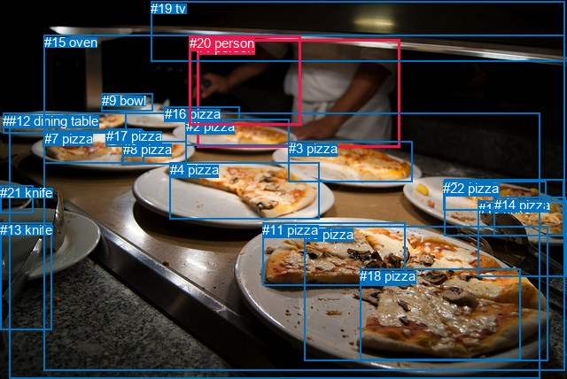
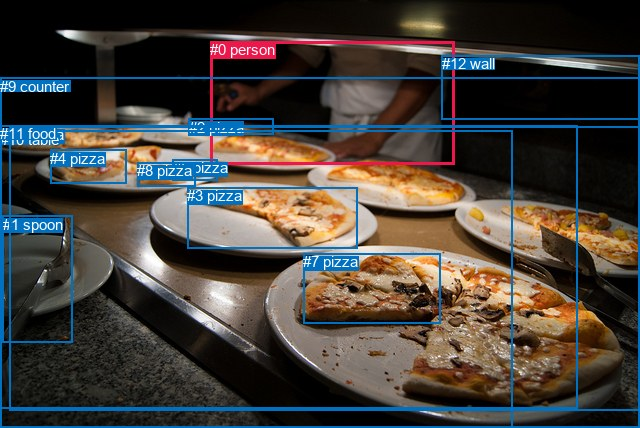

# 图片 0892：2355904.jpg

随机样本序号：26。图片 SHA256：`90b1984f9771dc61a7f6156627232383b9065a578185c5d510ca39c252c7a527`。

红色框表示人，蓝色框表示其他物体。两个模式分别保留自身框编号，可依据位置比较对应对象。

## 自动检测框与输出

人的框编号：`[1, 20]`。状态：`ok`。

### 自动检测全部物体框

| 编号 | 类别 | 是否为人 | 检测分数 | 像素坐标 xyxy |
|---|---|---|---|---|
| 0 | pizza | False | 0.9961 | 3.4, 127.8, 142.9, 150.9 |
| 1 | person | True | 0.9934 | 222.2, 44.6, 451.2, 166.0 |
| 2 | pizza | False | 0.9916 | 209.8, 134.4, 326.7, 164.3 |
| 3 | pizza | False | 0.9854 | 325.6, 159.4, 466.0, 205.1 |
| 4 | pizza | False | 0.9825 | 191.5, 183.4, 360.3, 247.1 |
| 5 | pizza | False | 0.9726 | 501.4, 202.7, 636.1, 266.1 |
| 6 | pizza | False | 0.9670 | 343.9, 255.9, 618.4, 407.8 |
| 7 | pizza | False | 0.9548 | 49.6, 147.9, 162.1, 184.1 |
| 8 | pizza | False | 0.8995 | 138.7, 159.6, 210.2, 186.0 |
| 9 | bowl | False | 0.8748 | 114.9, 105.1, 172.1, 125.7 |
| 10 | knife | False | 0.8540 | 539.7, 226.7, 639.8, 312.1 |
| 11 | pizza | False | 0.8470 | 296.3, 251.0, 457.4, 322.9 |
| 12 | dining table | False | 0.8022 | 10.1, 127.7, 609.9, 428.0 |
| 13 | knife | False | 0.6861 | 0.0, 251.5, 58.7, 372.7 |
| 14 | pizza | False | 0.6676 | 557.7, 222.8, 638.9, 266.3 |
| 15 | oven | False | 0.6190 | 49.5, 39.1, 637.2, 418.8 |
| 16 | pizza | False | 0.5842 | 185.9, 120.4, 270.6, 135.2 |
| 17 | pizza | False | 0.5655 | 119.6, 145.3, 160.8, 165.3 |
| 18 | pizza | False | 0.4955 | 406.1, 303.0, 587.3, 406.0 |
| 19 | tv | False | 0.4391 | 170.1, 1.2, 637.6, 69.3 |
| 20 | person | True | 0.4177 | 213.7, 40.0, 339.2, 141.2 |
| 21 | knife | False | 0.4054 | 0.0, 209.1, 37.5, 240.7 |
| 22 | pizza | False | 0.3708 | 500.1, 204.3, 616.5, 237.7 |

### 自动检测 Top50 人相关候选

评分物体对：506；人相关物体对：86；输出关系：50。

| 排名 | 主语编号与类别 | 关系 | 宾语编号与类别 | 类型 | 人与人 | 排序分数 | 原始融合 logit |
|---|---|---|---|---|---|---|---|
| 1 | #20 person | holding | #16 pizza | semantic | False | 0.97215 | 3.5527 |
| 2 | #1 person | holding | #16 pizza | semantic | False | 0.95715 | 3.1062 |
| 3 | #1 person | in | #15 oven | spatial | False | 0.92651 | 2.5343 |
| 4 | #20 person | in | #15 oven | spatial | False | 0.92055 | 2.4498 |
| 5 | #1 person | in | #20 person | spatial | True | 0.89098 | 2.1008 |
| 6 | #1 person | standing on | #12 dining table | semantic | False | 0.86213 | 1.8331 |
| 7 | #1 person | cooking | #2 pizza | semantic | False | 0.85089 | 1.7416 |
| 8 | #1 person | holding | #20 person | semantic | True | 0.83839 | 1.6463 |
| 9 | #20 person | slicing | #2 pizza | semantic | False | 0.82534 | 1.5530 |
| 10 | #1 person | on | #12 dining table | spatial | False | 0.82161 | 1.5273 |
| 11 | #20 person | on | #12 dining table | spatial | False | 0.81363 | 1.4737 |
| 12 | #20 person | attached to | #1 person | spatial | True | 0.77492 | 1.2363 |
| 13 | #1 person | standing on | #15 oven | semantic | False | 0.76099 | 1.1581 |
| 14 | #20 person | standing on | #12 dining table | semantic | False | 0.74146 | 1.0535 |
| 15 | #20 person | standing on | #15 oven | semantic | False | 0.64142 | 0.5815 |
| 16 | #20 person | on | #16 pizza | spatial | False | 0.59359 | 0.3788 |
| 17 | #1 person | slicing | #3 pizza | semantic | False | 0.58616 | 0.3481 |
| 18 | #20 person | holding | #1 person | semantic | True | 0.51953 | 0.0782 |
| 19 | #1 person | in | #19 tv | spatial | False | 0.50713 | 0.0285 |
| 20 | #1 person | on | #16 pizza | spatial | False | 0.48106 | -0.0758 |
| 21 | #19 tv | over | #1 person | spatial | False | 0.38657 | -0.4617 |
| 22 | #20 person | holding | #19 tv | semantic | False | 0.38301 | -0.4768 |
| 23 | #16 pizza | in | #20 person | spatial | False | 0.37824 | -0.4970 |
| 24 | #1 person | on | #2 pizza | spatial | False | 0.37720 | -0.5014 |
| 25 | #20 person | on | #2 pizza | spatial | False | 0.37537 | -0.5092 |
| 26 | #1 person | holding | #19 tv | semantic | False | 0.29312 | -0.8803 |
| 27 | #20 person | on | #19 tv | spatial | False | 0.27939 | -0.9475 |
| 28 | #19 tv | over | #20 person | spatial | False | 0.21359 | -1.3034 |
| 29 | #20 person | picking | #3 pizza | semantic | False | 0.18648 | -1.4730 |
| 30 | #1 person | holding | #9 bowl | semantic | False | 0.14586 | -1.7675 |
| 31 | #1 person | on | #3 pizza | spatial | False | 0.14490 | -1.7751 |
| 32 | #9 bowl | beside | #20 person | spatial | False | 0.13637 | -1.8458 |
| 33 | #1 person | holding | #0 pizza | semantic | False | 0.12108 | -1.9822 |
| 34 | #20 person | holding | #9 bowl | semantic | False | 0.10833 | -2.1080 |
| 35 | #1 person | cooking | #4 pizza | semantic | False | 0.10055 | -2.1911 |
| 36 | #16 pizza | holding | #20 person | semantic | False | 0.09652 | -2.2366 |
| 37 | #1 person | cooking | #6 pizza | semantic | False | 0.09085 | -2.3033 |
| 38 | #20 person | holding | #0 pizza | semantic | False | 0.07203 | -2.5559 |
| 39 | #1 person | cooking | #11 pizza | semantic | False | 0.06760 | -2.6242 |
| 40 | #9 bowl | holding | #20 person | semantic | False | 0.06550 | -2.6579 |
| 41 | #9 bowl | beside | #1 person | spatial | False | 0.06516 | -2.6635 |
| 42 | #1 person | slicing | #7 pizza | semantic | False | 0.05965 | -2.7577 |
| 43 | #20 person | picking | #6 pizza | semantic | False | 0.05399 | -2.8634 |
| 44 | #1 person | holding | #5 pizza | semantic | False | 0.05302 | -2.8825 |
| 45 | #20 person | picking | #4 pizza | semantic | False | 0.04480 | -3.0597 |
| 46 | #16 pizza | in | #1 person | spatial | False | 0.04334 | -3.0944 |
| 47 | #20 person | on | #3 pizza | spatial | False | 0.04329 | -3.0955 |
| 48 | #1 person | picking | #17 pizza | semantic | False | 0.04283 | -3.1068 |
| 49 | #19 tv | holding | #1 person | semantic | False | 0.04162 | -3.1366 |
| 50 | #20 person | picking | #17 pizza | semantic | False | 0.04142 | -3.1417 |

### 自动检测逐条人相关 GT 核验

R@50：0.00%；命中 0/1。

| GT 主语编号 | GT 关系 | GT 宾语编号 | 结果阶段 | 匹配预测主语编号 | 匹配预测宾语编号 |
|---|---|---|---|---|---|
| 0 | touching | 10 | endpoint_missing_or_wrong_class | [1] | [] |

## 真实框与输出

人的框编号：`[0]`。

### 真实框全部物体框

| 编号 | 类别 | 是否为人 | 检测分数 | 像素坐标 xyxy |
|---|---|---|---|---|
| 0 | person | True | GT | 210.0, 41.0, 454.0, 165.0 |
| 1 | spoon | False | GT | 3.0, 216.0, 73.0, 343.0 |
| 2 | pizza | False | GT | 189.0, 119.0, 274.0, 135.0 |
| 3 | pizza | False | GT | 187.0, 187.0, 357.0, 248.0 |
| 4 | pizza | False | GT | 50.0, 150.0, 126.0, 184.0 |
| 5 | pizza | False | GT | 173.0, 159.0, 218.0, 180.0 |
| 6 | pizza | False | GT | 9.0, 126.0, 640.0, 410.0 |
| 7 | pizza | False | GT | 303.0, 253.0, 440.0, 323.0 |
| 8 | pizza | False | GT | 137.0, 162.0, 195.0, 186.0 |
| 9 | counter | False | GT | 0.0, 78.0, 640.0, 428.0 |
| 10 | table | False | GT | 0.0, 131.0, 512.0, 428.0 |
| 11 | food | False | GT | 0.0, 125.0, 577.0, 408.0 |
| 12 | wall | False | GT | 442.0, 55.0, 640.0, 119.0 |

### 真实框 Top50 人相关候选

评分物体对：156；人相关物体对：24；输出关系：48。

| 排名 | 主语编号与类别 | 关系 | 宾语编号与类别 | 类型 | 人与人 | 排序分数 | 原始融合 logit |
|---|---|---|---|---|---|---|---|
| 1 | #0 person | holding | #2 pizza | semantic | False | 0.97313 | 3.5894 |
| 2 | #0 person | in | #9 counter | spatial | False | 0.91699 | 2.4021 |
| 3 | #0 person | cooking | #9 counter | semantic | False | 0.90988 | 2.3122 |
| 4 | #0 person | cooking | #11 food | semantic | False | 0.86564 | 1.8630 |
| 5 | #0 person | cooking | #6 pizza | semantic | False | 0.86094 | 1.8231 |
| 6 | #0 person | in | #12 wall | spatial | False | 0.83322 | 1.6086 |
| 7 | #0 person | in | #6 pizza | spatial | False | 0.82695 | 1.5642 |
| 8 | #0 person | cooking | #10 table | semantic | False | 0.80777 | 1.4356 |
| 9 | #0 person | in | #10 table | spatial | False | 0.80556 | 1.4214 |
| 10 | #0 person | in | #11 food | spatial | False | 0.80488 | 1.4171 |
| 11 | #0 person | on | #2 pizza | spatial | False | 0.64072 | 0.5785 |
| 12 | #0 person | looking at | #12 wall | semantic | False | 0.53174 | 0.1271 |
| 13 | #12 wall | beside | #0 person | spatial | False | 0.48232 | -0.0707 |
| 14 | #0 person | slicing | #4 pizza | semantic | False | 0.19698 | -1.4053 |
| 15 | #0 person | slicing | #3 pizza | semantic | False | 0.13907 | -1.8230 |
| 16 | #2 pizza | beside | #0 person | spatial | False | 0.13491 | -1.8583 |
| 17 | #12 wall | looking at | #0 person | semantic | False | 0.12411 | -1.9541 |
| 18 | #0 person | slicing | #5 pizza | semantic | False | 0.08926 | -2.3227 |
| 19 | #0 person | slicing | #7 pizza | semantic | False | 0.08665 | -2.3553 |
| 20 | #0 person | picking | #8 pizza | semantic | False | 0.07207 | -2.5552 |
| 21 | #0 person | on | #3 pizza | spatial | False | 0.04052 | -3.1645 |
| 22 | #2 pizza | holding | #0 person | semantic | False | 0.03819 | -3.2262 |
| 23 | #0 person | on | #4 pizza | spatial | False | 0.02797 | -3.5484 |
| 24 | #9 counter | in | #0 person | spatial | False | 0.02603 | -3.6220 |
| 25 | #6 pizza | in | #0 person | spatial | False | 0.01359 | -4.2850 |
| 26 | #0 person | on | #5 pizza | spatial | False | 0.01347 | -4.2938 |
| 27 | #11 food | in | #0 person | spatial | False | 0.01346 | -4.2947 |
| 28 | #0 person | on | #8 pizza | spatial | False | 0.00986 | -4.6096 |
| 29 | #10 table | in | #0 person | spatial | False | 0.00945 | -4.6520 |
| 30 | #0 person | on | #7 pizza | spatial | False | 0.00912 | -4.6882 |
| 31 | #0 person | holding | #1 spoon | semantic | False | 0.00855 | -4.7536 |
| 32 | #3 pizza | in front of | #0 person | spatial | False | 0.00741 | -4.8969 |
| 33 | #9 counter | holding | #0 person | semantic | False | 0.00700 | -4.9551 |
| 34 | #4 pizza | in front of | #0 person | spatial | False | 0.00333 | -5.7006 |
| 35 | #5 pizza | in front of | #0 person | spatial | False | 0.00288 | -5.8484 |
| 36 | #11 food | holding | #0 person | semantic | False | 0.00227 | -6.0861 |
| 37 | #6 pizza | holding | #0 person | semantic | False | 0.00225 | -6.0924 |
| 38 | #8 pizza | in front of | #0 person | spatial | False | 0.00213 | -6.1479 |
| 39 | #1 spoon | in | #0 person | spatial | False | 0.00174 | -6.3548 |
| 40 | #10 table | holding | #0 person | semantic | False | 0.00170 | -6.3734 |
| 41 | #0 person | on | #1 spoon | spatial | False | 0.00151 | -6.4971 |
| 42 | #7 pizza | in | #0 person | spatial | False | 0.00118 | -6.7420 |
| 43 | #3 pizza | looking at | #0 person | semantic | False | 0.00096 | -6.9473 |
| 44 | #1 spoon | holding | #0 person | semantic | False | 0.00092 | -6.9929 |
| 45 | #5 pizza | looking at | #0 person | semantic | False | 0.00086 | -7.0545 |
| 46 | #8 pizza | looking at | #0 person | semantic | False | 0.00071 | -7.2523 |
| 47 | #4 pizza | eating | #0 person | semantic | False | 0.00066 | -7.3163 |
| 48 | #7 pizza | wearing | #0 person | semantic | False | 0.00023 | -8.3829 |

### 真实框逐条人相关 GT 核验

R@50：0.00%；命中 0/1。

| GT 主语编号 | GT 关系 | GT 宾语编号 | 结果阶段 | 匹配预测主语编号 | 匹配预测宾语编号 |
|---|---|---|---|---|---|
| 0 | touching | 10 | wrong_predicate | [0] | [10] |

## 全部人相关 GT

| 主语编号与类别 | 关系 | 宾语编号与类别 |
|---|---|---|
| #0 person | touching | #10 table |

原始记录、全部人相关物体对的两项预测与分项分数见 [逐图证据 JSON](../evidence/cases/0892.json)。全部56类 logits 保留于本机 HOR/output/random500/logits/。

<!-- HOR_COMPLETE_RESULTS -->

## 六组条件的完整输出对照

以下保留同一图片三种框与候选模式、两种谓词输出规则的全部 Top50。框编号各自在所属模式内解释。

### 自动检测框完整枚举：空间与语义各保留一个谓词

| 排名 | 主语编号与类别 | 谓词 | 宾语编号与类别 | 分组 | 排序分数 | predicate logit | pair logit |
|---|---|---|---|---|---|---|---|
| 1 | #20 person | holding | #16 pizza | semantic | 0.9721506 | 3.4690871 | 0.0836135 |
| 2 | #1 person | holding | #16 pizza | semantic | 0.9571487 | 3.1316261 | -0.0254035 |
| 3 | #1 person | in | #15 oven | spatial | 0.9265137 | 3.1134000 | -0.5790695 |
| 4 | #20 person | in | #15 oven | spatial | 0.9205484 | 3.1483688 | -0.6985469 |
| 5 | #1 person | in | #20 person | spatial | 0.8909763 | 1.7827282 | 0.3180242 |
| 6 | #1 person | standing on | #12 dining table | semantic | 0.8621297 | 2.2832851 | -0.4501919 |
| 7 | #1 person | cooking | #2 pizza | semantic | 0.8508851 | 2.1023154 | -0.3607556 |
| 8 | #1 person | holding | #20 person | semantic | 0.8383932 | 1.3282967 | 0.3180242 |
| 9 | #20 person | slicing | #2 pizza | semantic | 0.8253449 | 1.8026199 | -0.2496319 |
| 10 | #1 person | on | #12 dining table | spatial | 0.8216106 | 1.9774899 | -0.4501919 |
| 11 | #20 person | on | #12 dining table | spatial | 0.8136257 | 2.1202135 | -0.6464702 |
| 12 | #20 person | attached to | #1 person | spatial | 0.7749218 | 1.0931869 | 0.1431271 |
| 13 | #1 person | standing on | #15 oven | semantic | 0.7609850 | 1.7371569 | -0.5790695 |
| 14 | #20 person | standing on | #12 dining table | semantic | 0.7414559 | 1.7000194 | -0.6464702 |
| 15 | #20 person | standing on | #15 oven | semantic | 0.6414182 | 1.2800717 | -0.6985469 |
| 16 | #20 person | on | #16 pizza | spatial | 0.5935915 | 0.2952189 | 0.0836135 |
| 17 | #1 person | slicing | #3 pizza | semantic | 0.5861626 | 0.9901562 | -0.6420323 |
| 18 | #20 person | holding | #1 person | semantic | 0.5195285 | -0.0649734 | 0.1431271 |
| 19 | #1 person | in | #19 tv | spatial | 0.5071316 | 1.0561266 | -1.0275983 |
| 20 | #1 person | on | #16 pizza | spatial | 0.4810556 | -0.0504103 | -0.0254035 |
| 21 | #19 tv | over | #1 person | spatial | 0.3865732 | 0.5533729 | -1.0151129 |
| 22 | #20 person | holding | #19 tv | semantic | 0.3830116 | 0.5739493 | -1.0507342 |
| 23 | #16 pizza | in | #20 person | spatial | 0.3782389 | 0.3998656 | -0.8968955 |
| 24 | #1 person | on | #2 pizza | spatial | 0.3772024 | -0.1406841 | -0.3607556 |
| 25 | #20 person | on | #2 pizza | spatial | 0.3753734 | -0.2596011 | -0.2496319 |
| 26 | #1 person | holding | #19 tv | semantic | 0.2931185 | 0.1473122 | -1.0275983 |
| 27 | #20 person | on | #19 tv | spatial | 0.2793930 | 0.1032596 | -1.0507342 |
| 28 | #19 tv | over | #20 person | spatial | 0.2135937 | -0.2326503 | -1.0707476 |
| 29 | #20 person | picking | #3 pizza | semantic | 0.1864801 | -0.5449281 | -0.9281179 |
| 30 | #1 person | holding | #9 bowl | semantic | 0.1458577 | -0.1857572 | -1.5817091 |
| 31 | #1 person | on | #3 pizza | spatial | 0.1449033 | -1.1331160 | -0.6420323 |
| 32 | #9 bowl | beside | #20 person | spatial | 0.1363687 | -0.9438949 | -0.9018886 |
| 33 | #1 person | holding | #0 pizza | semantic | 0.1210822 | -0.8643525 | -1.1178694 |
| 34 | #20 person | holding | #9 bowl | semantic | 0.1083258 | -0.6906762 | -1.4172816 |
| 35 | #1 person | cooking | #4 pizza | semantic | 0.1005507 | -0.9815173 | -1.2096039 |
| 36 | #16 pizza | holding | #20 person | semantic | 0.0965159 | -1.3396547 | -0.8968955 |
| 37 | #1 person | cooking | #6 pizza | semantic | 0.0908519 | -0.6357636 | -1.6675136 |
| 38 | #20 person | holding | #0 pizza | semantic | 0.0720326 | -1.5878298 | -0.9680476 |
| 39 | #1 person | cooking | #11 pizza | semantic | 0.0675962 | -0.7258754 | -1.8983384 |
| 40 | #9 bowl | holding | #20 person | semantic | 0.0655050 | -1.7559915 | -0.9018886 |
| 41 | #9 bowl | beside | #1 person | spatial | 0.0651591 | -1.3650856 | -1.2984594 |
| 42 | #1 person | slicing | #7 pizza | semantic | 0.0596535 | -1.4321892 | -1.3255060 |
| 43 | #20 person | picking | #6 pizza | semantic | 0.0539927 | -1.1765811 | -1.6868196 |
| 44 | #1 person | holding | #5 pizza | semantic | 0.0530247 | -1.4053159 | -1.4771997 |
| 45 | #20 person | picking | #4 pizza | semantic | 0.0447997 | -1.8381817 | -1.2215372 |
| 46 | #16 pizza | in | #1 person | spatial | 0.0433405 | -1.6114922 | -1.4828686 |
| 47 | #20 person | on | #3 pizza | spatial | 0.0432932 | -2.1673837 | -0.9281179 |
| 48 | #1 person | picking | #17 pizza | semantic | 0.0428295 | -1.7632287 | -1.3435265 |
| 49 | #19 tv | holding | #1 person | semantic | 0.0416229 | -2.1214781 | -1.0151129 |
| 50 | #20 person | picking | #17 pizza | semantic | 0.0414202 | -1.8837736 | -1.2579110 |

GT 命中：0/1，R@50=0.00%。

| GT主语 | GT谓词 | GT宾语 | 结果阶段 | 匹配主语框 | 匹配宾语框 |
|---|---|---|---|---|---|
| 0 | touching | 10 | endpoint_missing_or_wrong_class | [1] | [] |

### 自动检测框完整枚举：每对只保留一个谓词

| 排名 | 主语编号与类别 | 谓词 | 宾语编号与类别 | 分组 | 排序分数 | predicate logit | pair logit |
|---|---|---|---|---|---|---|---|
| 1 | #20 person | holding | #16 pizza | single | 0.9721506 | 3.4690871 | 0.0836135 |
| 2 | #1 person | holding | #16 pizza | single | 0.9571487 | 3.1316261 | -0.0254035 |
| 3 | #1 person | in | #15 oven | single | 0.9265137 | 3.1134000 | -0.5790695 |
| 4 | #20 person | in | #15 oven | single | 0.9205484 | 3.1483688 | -0.6985469 |
| 5 | #1 person | in | #20 person | single | 0.8909763 | 1.7827282 | 0.3180242 |
| 6 | #1 person | standing on | #12 dining table | single | 0.8621297 | 2.2832851 | -0.4501919 |
| 7 | #1 person | cooking | #2 pizza | single | 0.8508851 | 2.1023154 | -0.3607556 |
| 8 | #20 person | slicing | #2 pizza | single | 0.8253449 | 1.8026199 | -0.2496319 |
| 9 | #20 person | on | #12 dining table | single | 0.8136257 | 2.1202135 | -0.6464702 |
| 10 | #20 person | attached to | #1 person | single | 0.7749218 | 1.0931869 | 0.1431271 |
| 11 | #1 person | slicing | #3 pizza | single | 0.5861626 | 0.9901562 | -0.6420323 |
| 12 | #1 person | in | #19 tv | single | 0.5071316 | 1.0561266 | -1.0275983 |
| 13 | #19 tv | over | #1 person | single | 0.3865732 | 0.5533729 | -1.0151129 |
| 14 | #20 person | holding | #19 tv | single | 0.3830116 | 0.5739493 | -1.0507342 |
| 15 | #16 pizza | in | #20 person | single | 0.3782389 | 0.3998656 | -0.8968955 |
| 16 | #19 tv | over | #20 person | single | 0.2135937 | -0.2326503 | -1.0707476 |
| 17 | #20 person | picking | #3 pizza | single | 0.1864801 | -0.5449281 | -0.9281179 |
| 18 | #1 person | holding | #9 bowl | single | 0.1458577 | -0.1857572 | -1.5817091 |
| 19 | #9 bowl | beside | #20 person | single | 0.1363687 | -0.9438949 | -0.9018886 |
| 20 | #1 person | holding | #0 pizza | single | 0.1210822 | -0.8643525 | -1.1178694 |
| 21 | #20 person | holding | #9 bowl | single | 0.1083258 | -0.6906762 | -1.4172816 |
| 22 | #1 person | cooking | #4 pizza | single | 0.1005507 | -0.9815173 | -1.2096039 |
| 23 | #1 person | cooking | #6 pizza | single | 0.0908519 | -0.6357636 | -1.6675136 |
| 24 | #20 person | holding | #0 pizza | single | 0.0720326 | -1.5878298 | -0.9680476 |
| 25 | #1 person | cooking | #11 pizza | single | 0.0675962 | -0.7258754 | -1.8983384 |
| 26 | #9 bowl | beside | #1 person | single | 0.0651591 | -1.3650856 | -1.2984594 |
| 27 | #1 person | slicing | #7 pizza | single | 0.0596535 | -1.4321892 | -1.3255060 |
| 28 | #20 person | picking | #6 pizza | single | 0.0539927 | -1.1765811 | -1.6868196 |
| 29 | #1 person | holding | #5 pizza | single | 0.0530247 | -1.4053159 | -1.4771997 |
| 30 | #20 person | picking | #4 pizza | single | 0.0447997 | -1.8381817 | -1.2215372 |
| 31 | #16 pizza | in | #1 person | single | 0.0433405 | -1.6114922 | -1.4828686 |
| 32 | #1 person | picking | #17 pizza | single | 0.0428295 | -1.7632287 | -1.3435265 |
| 33 | #20 person | picking | #17 pizza | single | 0.0414202 | -1.8837736 | -1.2579110 |
| 34 | #2 pizza | in | #20 person | single | 0.0394498 | -1.7389903 | -1.4534873 |
| 35 | #20 person | picking | #11 pizza | single | 0.0382628 | -1.3273726 | -1.8968893 |
| 36 | #15 oven | in | #20 person | single | 0.0366862 | -1.6628313 | -1.6051484 |
| 37 | #15 oven | in | #1 person | single | 0.0366163 | -1.5872693 | -1.6826898 |
| 38 | #2 pizza | in front of | #1 person | single | 0.0345545 | -1.4214621 | -1.9085903 |
| 39 | #1 person | holding | #22 pizza | single | 0.0291007 | -2.3225951 | -1.1848655 |
| 40 | #20 person | picking | #7 pizza | single | 0.0285756 | -2.1391897 | -1.3870218 |
| 41 | #1 person | holding | #10 knife | single | 0.0264660 | -1.7346725 | -1.8704008 |
| 42 | #20 person | picking | #18 pizza | single | 0.0254470 | -1.5830164 | -2.0623660 |
| 43 | #1 person | holding | #14 pizza | single | 0.0241395 | -2.0141473 | -1.6853241 |
| 44 | #3 pizza | in | #20 person | single | 0.0227472 | -1.7828524 | -1.9774504 |
| 45 | #1 person | holding | #18 pizza | single | 0.0221211 | -1.6649141 | -2.1239398 |
| 46 | #20 person | holding | #10 knife | single | 0.0201807 | -1.9093115 | -1.9733299 |
| 47 | #0 pizza | in | #20 person | single | 0.0182336 | -2.4189169 | -1.5671725 |
| 48 | #20 person | holding | #5 pizza | single | 0.0177864 | -2.3454254 | -1.6659466 |
| 49 | #12 dining table | in | #1 person | single | 0.0174503 | -1.9921150 | -2.0386777 |
| 50 | #1 person | picking | #8 pizza | single | 0.0150078 | -2.6805210 | -1.5035425 |

GT 命中：0/1，R@50=0.00%。

| GT主语 | GT谓词 | GT宾语 | 结果阶段 | 匹配主语框 | 匹配宾语框 |
|---|---|---|---|---|---|
| 0 | touching | 10 | endpoint_missing_or_wrong_class | [1] | [] |

### 真实框完整枚举：空间与语义各保留一个谓词

| 排名 | 主语编号与类别 | 谓词 | 宾语编号与类别 | 分组 | 排序分数 | predicate logit | pair logit |
|---|---|---|---|---|---|---|---|
| 1 | #0 person | holding | #2 pizza | semantic | 0.9731265 | 3.5846410 | 0.0047297 |
| 2 | #0 person | in | #9 counter | spatial | 0.9169878 | 2.6129189 | -0.2108130 |
| 3 | #0 person | cooking | #9 counter | semantic | 0.9098810 | 2.5229955 | -0.2108130 |
| 4 | #0 person | cooking | #11 food | semantic | 0.8656445 | 2.4025679 | -0.5395827 |
| 5 | #0 person | cooking | #6 pizza | semantic | 0.8609415 | 2.2822084 | -0.4590763 |
| 6 | #0 person | in | #12 wall | spatial | 0.8332152 | 2.7677660 | -1.1591785 |
| 7 | #0 person | in | #6 pizza | spatial | 0.8269522 | 2.0232553 | -0.4590763 |
| 8 | #0 person | cooking | #10 table | semantic | 0.8077684 | 1.9513297 | -0.5157553 |
| 9 | #0 person | in | #10 table | spatial | 0.8055634 | 1.9371915 | -0.5157553 |
| 10 | #0 person | in | #11 food | spatial | 0.8048795 | 1.9566579 | -0.5395827 |
| 11 | #0 person | on | #2 pizza | spatial | 0.6407228 | 0.5737729 | 0.0047297 |
| 12 | #0 person | looking at | #12 wall | semantic | 0.5317368 | 1.2862964 | -1.1591785 |
| 13 | #12 wall | beside | #0 person | spatial | 0.4823212 | 1.0604653 | -1.1312101 |
| 14 | #0 person | slicing | #4 pizza | semantic | 0.1969756 | -0.0329461 | -1.3723593 |
| 15 | #0 person | slicing | #3 pizza | semantic | 0.1390743 | -0.5745888 | -1.2484112 |
| 16 | #2 pizza | beside | #0 person | spatial | 0.1349050 | -0.4042187 | -1.4540497 |
| 17 | #12 wall | looking at | #0 person | semantic | 0.1241080 | -0.8228800 | -1.1312101 |
| 18 | #0 person | slicing | #5 pizza | semantic | 0.0892643 | -0.9055924 | -1.4170587 |
| 19 | #0 person | slicing | #7 pizza | semantic | 0.0866489 | -0.3940411 | -1.9612149 |
| 20 | #0 person | picking | #8 pizza | semantic | 0.0720750 | -1.0715010 | -1.4837432 |
| 21 | #0 person | on | #3 pizza | spatial | 0.0405245 | -1.9160678 | -1.2484112 |
| 22 | #2 pizza | holding | #0 person | semantic | 0.0381898 | -1.7722001 | -1.4540497 |
| 23 | #0 person | on | #4 pizza | spatial | 0.0279672 | -2.1759994 | -1.3723593 |
| 24 | #9 counter | in | #0 person | spatial | 0.0260341 | -1.7952471 | -1.8267236 |
| 25 | #6 pizza | in | #0 person | spatial | 0.0135867 | -2.2670848 | -2.0178957 |
| 26 | #0 person | on | #5 pizza | spatial | 0.0134686 | -2.8767791 | -1.4170587 |
| 27 | #11 food | in | #0 person | spatial | 0.0134571 | -2.2698774 | -2.0248206 |
| 28 | #0 person | on | #8 pizza | spatial | 0.0098574 | -3.1258864 | -1.4837432 |
| 29 | #10 table | in | #0 person | spatial | 0.0094522 | -2.6036963 | -2.0483115 |
| 30 | #0 person | on | #7 pizza | spatial | 0.0091195 | -2.7269673 | -1.9612149 |
| 31 | #0 person | holding | #1 spoon | semantic | 0.0085471 | -2.3115563 | -2.4420242 |
| 32 | #3 pizza | in front of | #0 person | spatial | 0.0074146 | -2.6399496 | -2.2569084 |
| 33 | #9 counter | holding | #0 person | semantic | 0.0069981 | -3.1283722 | -1.8267236 |
| 34 | #4 pizza | in front of | #0 person | spatial | 0.0033328 | -3.0827231 | -2.6178675 |
| 35 | #5 pizza | in front of | #0 person | spatial | 0.0028762 | -3.3472826 | -2.5011258 |
| 36 | #11 food | holding | #0 person | semantic | 0.0022692 | -4.0612335 | -2.0248206 |
| 37 | #6 pizza | holding | #0 person | semantic | 0.0022548 | -4.0745273 | -2.0178957 |
| 38 | #8 pizza | in front of | #0 person | spatial | 0.0021333 | -3.5046313 | -2.6433182 |
| 39 | #1 spoon | in | #0 person | spatial | 0.0017354 | -3.4681849 | -2.8865852 |
| 40 | #10 table | holding | #0 person | semantic | 0.0017035 | -4.3250809 | -2.0483115 |
| 41 | #0 person | on | #1 spoon | spatial | 0.0015055 | -4.0551028 | -2.4420242 |
| 42 | #7 pizza | in | #0 person | spatial | 0.0011789 | -3.9264138 | -2.8155656 |
| 43 | #3 pizza | looking at | #0 person | semantic | 0.0009603 | -4.6903830 | -2.2569084 |
| 44 | #1 spoon | holding | #0 person | semantic | 0.0009175 | -4.1063375 | -2.8865852 |
| 45 | #5 pizza | looking at | #0 person | semantic | 0.0008627 | -4.5534163 | -2.5011258 |
| 46 | #8 pizza | looking at | #0 person | semantic | 0.0007081 | -4.6089392 | -2.6433182 |
| 47 | #4 pizza | eating | #0 person | semantic | 0.0006641 | -4.6984773 | -2.6178675 |
| 48 | #7 pizza | wearing | #0 person | semantic | 0.0002287 | -5.5673785 | -2.8155656 |

GT 命中：0/1，R@50=0.00%。

| GT主语 | GT谓词 | GT宾语 | 结果阶段 | 匹配主语框 | 匹配宾语框 |
|---|---|---|---|---|---|
| 0 | touching | 10 | wrong_predicate | [0] | [10] |

### 真实框完整枚举：每对只保留一个谓词

| 排名 | 主语编号与类别 | 谓词 | 宾语编号与类别 | 分组 | 排序分数 | predicate logit | pair logit |
|---|---|---|---|---|---|---|---|
| 1 | #0 person | holding | #2 pizza | single | 0.9731265 | 3.5846410 | 0.0047297 |
| 2 | #0 person | in | #9 counter | single | 0.9169878 | 2.6129189 | -0.2108130 |
| 3 | #0 person | cooking | #11 food | single | 0.8656445 | 2.4025679 | -0.5395827 |
| 4 | #0 person | cooking | #6 pizza | single | 0.8609415 | 2.2822084 | -0.4590763 |
| 5 | #0 person | in | #12 wall | single | 0.8332152 | 2.7677660 | -1.1591785 |
| 6 | #0 person | cooking | #10 table | single | 0.8077684 | 1.9513297 | -0.5157553 |
| 7 | #12 wall | beside | #0 person | single | 0.4823212 | 1.0604653 | -1.1312101 |
| 8 | #0 person | slicing | #4 pizza | single | 0.1969756 | -0.0329461 | -1.3723593 |
| 9 | #0 person | slicing | #3 pizza | single | 0.1390743 | -0.5745888 | -1.2484112 |
| 10 | #2 pizza | beside | #0 person | single | 0.1349050 | -0.4042187 | -1.4540497 |
| 11 | #0 person | slicing | #5 pizza | single | 0.0892643 | -0.9055924 | -1.4170587 |
| 12 | #0 person | slicing | #7 pizza | single | 0.0866489 | -0.3940411 | -1.9612149 |
| 13 | #0 person | picking | #8 pizza | single | 0.0720750 | -1.0715010 | -1.4837432 |
| 14 | #9 counter | in | #0 person | single | 0.0260341 | -1.7952471 | -1.8267236 |
| 15 | #6 pizza | in | #0 person | single | 0.0135867 | -2.2670848 | -2.0178957 |
| 16 | #11 food | in | #0 person | single | 0.0134571 | -2.2698774 | -2.0248206 |
| 17 | #10 table | in | #0 person | single | 0.0094522 | -2.6036963 | -2.0483115 |
| 18 | #0 person | holding | #1 spoon | single | 0.0085471 | -2.3115563 | -2.4420242 |
| 19 | #3 pizza | in front of | #0 person | single | 0.0074146 | -2.6399496 | -2.2569084 |
| 20 | #4 pizza | in front of | #0 person | single | 0.0033328 | -3.0827231 | -2.6178675 |
| 21 | #5 pizza | in front of | #0 person | single | 0.0028762 | -3.3472826 | -2.5011258 |
| 22 | #8 pizza | in front of | #0 person | single | 0.0021333 | -3.5046313 | -2.6433182 |
| 23 | #1 spoon | in | #0 person | single | 0.0017354 | -3.4681849 | -2.8865852 |
| 24 | #7 pizza | in | #0 person | single | 0.0011789 | -3.9264138 | -2.8155656 |

GT 命中：0/1，R@50=0.00%。

| GT主语 | GT谓词 | GT宾语 | 结果阶段 | 匹配主语框 | 匹配宾语框 |
|---|---|---|---|---|---|
| 0 | touching | 10 | wrong_predicate | [0] | [10] |

### 真实框400候选：空间与语义各保留一个谓词

| 排名 | 主语编号与类别 | 谓词 | 宾语编号与类别 | 分组 | 排序分数 | predicate logit | pair logit |
|---|---|---|---|---|---|---|---|
| 1 | #0 person | holding | #2 pizza | semantic | 0.9731265 | 3.5846410 | 0.0047297 |
| 2 | #0 person | in | #9 counter | spatial | 0.9169878 | 2.6129189 | -0.2108130 |
| 3 | #0 person | cooking | #9 counter | semantic | 0.9098814 | 2.5230007 | -0.2108130 |
| 4 | #0 person | cooking | #11 food | semantic | 0.8656445 | 2.4025679 | -0.5395827 |
| 5 | #0 person | cooking | #6 pizza | semantic | 0.8609415 | 2.2822084 | -0.4590763 |
| 6 | #0 person | in | #12 wall | spatial | 0.8332152 | 2.7677660 | -1.1591785 |
| 7 | #0 person | in | #6 pizza | spatial | 0.8269522 | 2.0232553 | -0.4590763 |
| 8 | #0 person | cooking | #10 table | semantic | 0.8123951 | 1.9814038 | -0.5157553 |
| 9 | #0 person | on | #10 table | spatial | 0.8053249 | 1.9356689 | -0.5157553 |
| 10 | #0 person | in | #11 food | spatial | 0.8043577 | 1.9533391 | -0.5395827 |
| 11 | #0 person | on | #2 pizza | spatial | 0.6407228 | 0.5737729 | 0.0047297 |
| 12 | #0 person | looking at | #12 wall | semantic | 0.5317368 | 1.2862964 | -1.1591785 |
| 13 | #12 wall | beside | #0 person | spatial | 0.4823176 | 1.0604510 | -1.1312101 |
| 14 | #0 person | slicing | #4 pizza | semantic | 0.1969756 | -0.0329461 | -1.3723593 |
| 15 | #0 person | slicing | #3 pizza | semantic | 0.1390743 | -0.5745888 | -1.2484112 |
| 16 | #2 pizza | beside | #0 person | spatial | 0.1348949 | -0.4043055 | -1.4540497 |
| 17 | #12 wall | looking at | #0 person | semantic | 0.1241460 | -0.8225315 | -1.1312101 |
| 18 | #0 person | slicing | #7 pizza | semantic | 0.0866489 | -0.3940411 | -1.9612149 |
| 19 | #0 person | slicing | #5 pizza | semantic | 0.0844911 | -0.9657748 | -1.4170587 |
| 20 | #0 person | picking | #8 pizza | semantic | 0.0720742 | -1.0715132 | -1.4837432 |
| 21 | #0 person | on | #3 pizza | spatial | 0.0408995 | -1.9064670 | -1.2484112 |
| 22 | #2 pizza | holding | #0 person | semantic | 0.0380814 | -1.7751544 | -1.4540497 |
| 23 | #0 person | on | #4 pizza | spatial | 0.0278544 | -2.1801553 | -1.3723593 |
| 24 | #9 counter | in | #0 person | spatial | 0.0256553 | -1.8102927 | -1.8267236 |
| 25 | #6 pizza | in | #0 person | spatial | 0.0135313 | -2.2712331 | -2.0178957 |
| 26 | #11 food | in | #0 person | spatial | 0.0134571 | -2.2698774 | -2.0248206 |
| 27 | #0 person | on | #5 pizza | spatial | 0.0130745 | -2.9068704 | -1.4170587 |
| 28 | #0 person | on | #8 pizza | spatial | 0.0096916 | -3.1430101 | -1.4837432 |
| 29 | #10 table | in | #0 person | spatial | 0.0094309 | -2.6059780 | -2.0483115 |
| 30 | #0 person | on | #7 pizza | spatial | 0.0091195 | -2.7269673 | -1.9612149 |
| 31 | #0 person | holding | #1 spoon | semantic | 0.0084576 | -2.3221707 | -2.4420242 |
| 32 | #3 pizza | in front of | #0 person | spatial | 0.0074158 | -2.6397965 | -2.2569084 |
| 33 | #9 counter | holding | #0 person | semantic | 0.0068994 | -3.1426792 | -1.8267236 |
| 34 | #4 pizza | in front of | #0 person | spatial | 0.0033339 | -3.0824170 | -2.6178675 |
| 35 | #5 pizza | in front of | #0 person | spatial | 0.0028974 | -3.3399129 | -2.5011258 |
| 36 | #11 food | holding | #0 person | semantic | 0.0022522 | -4.0687561 | -2.0248206 |
| 37 | #6 pizza | holding | #0 person | semantic | 0.0022482 | -4.0774813 | -2.0178957 |
| 38 | #8 pizza | in front of | #0 person | spatial | 0.0021164 | -3.5126135 | -2.6433182 |
| 39 | #1 spoon | in | #0 person | spatial | 0.0017139 | -3.4806857 | -2.8865852 |
| 40 | #10 table | holding | #0 person | semantic | 0.0016907 | -4.3326035 | -2.0483115 |
| 41 | #0 person | on | #1 spoon | spatial | 0.0014963 | -4.0612645 | -2.4420242 |
| 42 | #7 pizza | in | #0 person | spatial | 0.0011701 | -3.9339366 | -2.8155656 |
| 43 | #3 pizza | looking at | #0 person | semantic | 0.0009609 | -4.6897497 | -2.2569084 |
| 44 | #1 spoon | holding | #0 person | semantic | 0.0009106 | -4.1138606 | -2.8865852 |
| 45 | #5 pizza | looking at | #0 person | semantic | 0.0008694 | -4.5457191 | -2.5011258 |
| 46 | #8 pizza | looking at | #0 person | semantic | 0.0006927 | -4.6308737 | -2.6433182 |
| 47 | #4 pizza | eating | #0 person | semantic | 0.0006618 | -4.7019973 | -2.6178675 |
| 48 | #7 pizza | wearing | #0 person | semantic | 0.0002282 | -5.5695786 | -2.8155656 |

GT 命中：0/1，R@50=0.00%。

| GT主语 | GT谓词 | GT宾语 | 结果阶段 | 匹配主语框 | 匹配宾语框 |
|---|---|---|---|---|---|
| 0 | touching | 10 | wrong_predicate | [0] | [10] |

### 真实框400候选：每对只保留一个谓词

| 排名 | 主语编号与类别 | 谓词 | 宾语编号与类别 | 分组 | 排序分数 | predicate logit | pair logit |
|---|---|---|---|---|---|---|---|
| 1 | #0 person | holding | #2 pizza | single | 0.9731265 | 3.5846410 | 0.0047297 |
| 2 | #0 person | in | #9 counter | single | 0.9169878 | 2.6129189 | -0.2108130 |
| 3 | #0 person | cooking | #11 food | single | 0.8656445 | 2.4025679 | -0.5395827 |
| 4 | #0 person | cooking | #6 pizza | single | 0.8609415 | 2.2822084 | -0.4590763 |
| 5 | #0 person | in | #12 wall | single | 0.8332152 | 2.7677660 | -1.1591785 |
| 6 | #0 person | cooking | #10 table | single | 0.8123951 | 1.9814038 | -0.5157553 |
| 7 | #12 wall | beside | #0 person | single | 0.4823176 | 1.0604510 | -1.1312101 |
| 8 | #0 person | slicing | #4 pizza | single | 0.1969756 | -0.0329461 | -1.3723593 |
| 9 | #0 person | slicing | #3 pizza | single | 0.1390743 | -0.5745888 | -1.2484112 |
| 10 | #2 pizza | beside | #0 person | single | 0.1348949 | -0.4043055 | -1.4540497 |
| 11 | #0 person | slicing | #7 pizza | single | 0.0866489 | -0.3940411 | -1.9612149 |
| 12 | #0 person | slicing | #5 pizza | single | 0.0844911 | -0.9657748 | -1.4170587 |
| 13 | #0 person | picking | #8 pizza | single | 0.0720742 | -1.0715132 | -1.4837432 |
| 14 | #9 counter | in | #0 person | single | 0.0256553 | -1.8102927 | -1.8267236 |
| 15 | #6 pizza | in | #0 person | single | 0.0135313 | -2.2712331 | -2.0178957 |
| 16 | #11 food | in | #0 person | single | 0.0134571 | -2.2698774 | -2.0248206 |
| 17 | #10 table | in | #0 person | single | 0.0094309 | -2.6059780 | -2.0483115 |
| 18 | #0 person | holding | #1 spoon | single | 0.0084576 | -2.3221707 | -2.4420242 |
| 19 | #3 pizza | in front of | #0 person | single | 0.0074158 | -2.6397965 | -2.2569084 |
| 20 | #4 pizza | in front of | #0 person | single | 0.0033339 | -3.0824170 | -2.6178675 |
| 21 | #5 pizza | in front of | #0 person | single | 0.0028974 | -3.3399129 | -2.5011258 |
| 22 | #8 pizza | in front of | #0 person | single | 0.0021164 | -3.5126135 | -2.6433182 |
| 23 | #1 spoon | in | #0 person | single | 0.0017139 | -3.4806857 | -2.8865852 |
| 24 | #7 pizza | in | #0 person | single | 0.0011701 | -3.9339366 | -2.8155656 |

GT 命中：0/1，R@50=0.00%。

| GT主语 | GT谓词 | GT宾语 | 结果阶段 | 匹配主语框 | 匹配宾语框 |
|---|---|---|---|---|---|
| 0 | touching | 10 | wrong_predicate | [0] | [10] |
