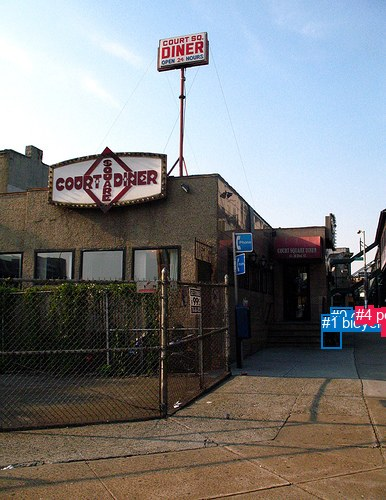
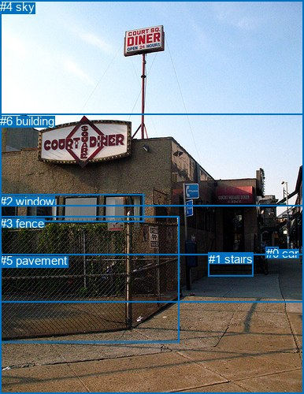

# 图片 0895：2355957.jpg

随机样本序号：313。图片 SHA256：`10dd63528dc2ad9eeaa468423d8ba9be46193ba14cef8ebf1839b9c26e59d5dc`。

红色框表示人，蓝色框表示其他物体。两个模式分别保留自身框编号，可依据位置比较对应对象。

## 自动检测框与输出

人的框编号：`[2, 3, 4]`。状态：`ok`。

### 自动检测全部物体框

| 编号 | 类别 | 是否为人 | 检测分数 | 像素坐标 xyxy |
|---|---|---|---|---|
| 0 | car | False | 0.9480 | 330.9, 307.2, 352.1, 324.9 |
| 1 | bicycle | False | 0.9306 | 321.8, 314.2, 341.6, 349.0 |
| 2 | person | True | 0.9203 | 381.3, 307.7, 386.0, 336.4 |
| 3 | person | True | 0.5427 | 368.7, 305.8, 373.4, 325.4 |
| 4 | person | True | 0.3790 | 355.7, 306.0, 363.5, 324.1 |

### 自动检测 Top50 人相关候选

评分物体对：20；人相关物体对：18；输出关系：36。

| 排名 | 主语编号与类别 | 关系 | 宾语编号与类别 | 类型 | 人与人 | 排序分数 | 原始融合 logit |
|---|---|---|---|---|---|---|---|
| 1 | #4 person | walking on | #0 car | semantic | False | 0.94450 | 2.8342 |
| 2 | #3 person | walking on | #0 car | semantic | False | 0.91970 | 2.4382 |
| 3 | #4 person | beside | #0 car | spatial | False | 0.86728 | 1.8771 |
| 4 | #2 person | walking on | #0 car | semantic | False | 0.86537 | 1.8606 |
| 5 | #3 person | walking on | #4 person | semantic | True | 0.85096 | 1.7422 |
| 6 | #4 person | walking on | #1 bicycle | semantic | False | 0.83354 | 1.6109 |
| 7 | #3 person | walking on | #2 person | semantic | True | 0.83247 | 1.6032 |
| 8 | #3 person | walking on | #1 bicycle | semantic | False | 0.82162 | 1.5274 |
| 9 | #2 person | walking on | #1 bicycle | semantic | False | 0.79486 | 1.3544 |
| 10 | #0 car | parked on | #4 person | semantic | False | 0.78983 | 1.3239 |
| 11 | #2 person | walking on | #3 person | semantic | True | 0.78103 | 1.2717 |
| 12 | #2 person | walking on | #4 person | semantic | True | 0.75562 | 1.1288 |
| 13 | #4 person | walking on | #3 person | semantic | True | 0.75375 | 1.1187 |
| 14 | #0 car | beside | #4 person | spatial | False | 0.70792 | 0.8853 |
| 15 | #1 bicycle | parked on | #4 person | semantic | False | 0.68026 | 0.7550 |
| 16 | #3 person | beside | #4 person | spatial | True | 0.65922 | 0.6598 |
| 17 | #3 person | beside | #0 car | spatial | False | 0.65784 | 0.6537 |
| 18 | #4 person | walking on | #2 person | semantic | True | 0.65416 | 0.6374 |
| 19 | #0 car | parked on | #3 person | semantic | False | 0.64337 | 0.5900 |
| 20 | #0 car | parked on | #2 person | semantic | False | 0.60090 | 0.4092 |
| 21 | #4 person | beside | #1 bicycle | spatial | False | 0.58980 | 0.3631 |
| 22 | #3 person | beside | #2 person | spatial | True | 0.56423 | 0.2584 |
| 23 | #4 person | beside | #3 person | spatial | True | 0.55525 | 0.2219 |
| 24 | #1 bicycle | parked on | #3 person | semantic | False | 0.52804 | 0.1123 |
| 25 | #1 bicycle | parked on | #2 person | semantic | False | 0.48991 | -0.0404 |
| 26 | #2 person | beside | #3 person | spatial | True | 0.44531 | -0.2196 |
| 27 | #1 bicycle | beside | #4 person | spatial | False | 0.43742 | -0.2516 |
| 28 | #2 person | beside | #4 person | spatial | True | 0.32522 | -0.7299 |
| 29 | #3 person | beside | #1 bicycle | spatial | False | 0.32202 | -0.7445 |
| 30 | #2 person | beside | #0 car | spatial | False | 0.28701 | -0.9100 |
| 31 | #0 car | beside | #3 person | spatial | False | 0.22145 | -1.2572 |
| 32 | #2 person | beside | #1 bicycle | spatial | False | 0.18376 | -1.4911 |
| 33 | #4 person | beside | #2 person | spatial | True | 0.17396 | -1.5578 |
| 34 | #1 bicycle | beside | #3 person | spatial | False | 0.09470 | -2.2575 |
| 35 | #0 car | beside | #2 person | spatial | False | 0.05802 | -2.7872 |
| 36 | #1 bicycle | beside | #2 person | spatial | False | 0.02448 | -3.6849 |

### 自动检测逐条人相关 GT 核验

本图没有人相关 GT，R@50 无分母；预测候选继续展示。

## 真实框与输出

人的框编号：`[]`。

### 真实框全部物体框

| 编号 | 类别 | 是否为人 | 检测分数 | 像素坐标 xyxy |
|---|---|---|---|---|
| 0 | car | False | GT | 338.0, 313.0, 354.0, 324.0 |
| 1 | stairs | False | GT | 265.0, 320.0, 322.0, 350.0 |
| 2 | window | False | GT | 0.0, 247.0, 183.0, 282.0 |
| 3 | fence | False | GT | 0.0, 275.0, 227.0, 435.0 |
| 4 | sky | False | GT | 0.0, 0.0, 386.0, 261.0 |
| 5 | pavement | False | GT | 0.0, 322.0, 386.0, 500.0 |
| 6 | building | False | GT | 0.0, 145.0, 386.0, 383.0 |

### 真实框 Top50 人相关候选

评分物体对：0；人相关物体对：0；输出关系：0。

| 排名 | 主语编号与类别 | 关系 | 宾语编号与类别 | 类型 | 人与人 | 排序分数 | 原始融合 logit |
|---|---|---|---|---|---|---|---|

### 真实框逐条人相关 GT 核验

本图没有人相关 GT，R@50 无分母；预测候选继续展示。

## 全部人相关 GT

| 主语编号与类别 | 关系 | 宾语编号与类别 |
|---|---|---|

原始记录、全部人相关物体对的两项预测与分项分数见 [逐图证据 JSON](../evidence/cases/0895.json)。全部56类 logits 保留于本机 HOR/output/random500/logits/。

<!-- HOR_COMPLETE_RESULTS -->

## 六组条件的完整输出对照

以下保留同一图片三种框与候选模式、两种谓词输出规则的全部 Top50。框编号各自在所属模式内解释。

### 自动检测框完整枚举：空间与语义各保留一个谓词

| 排名 | 主语编号与类别 | 谓词 | 宾语编号与类别 | 分组 | 排序分数 | predicate logit | pair logit |
|---|---|---|---|---|---|---|---|
| 1 | #4 person | walking on | #0 car | semantic | 0.9444968 | 3.4003129 | -0.5661006 |
| 2 | #3 person | walking on | #0 car | semantic | 0.9196955 | 3.0843759 | -0.6461582 |
| 3 | #4 person | beside | #0 car | spatial | 0.8672780 | 2.4432034 | -0.5661006 |
| 4 | #2 person | walking on | #0 car | semantic | 0.8653656 | 2.5697865 | -0.7091968 |
| 5 | #3 person | walking on | #4 person | semantic | 0.8509614 | 2.1093998 | -0.3672385 |
| 6 | #4 person | walking on | #1 bicycle | semantic | 0.8335367 | 2.3681931 | -0.7572899 |
| 7 | #3 person | walking on | #2 person | semantic | 0.8324678 | 1.9212985 | -0.3180798 |
| 8 | #3 person | walking on | #1 bicycle | semantic | 0.8216199 | 2.3712039 | -0.8438424 |
| 9 | #2 person | walking on | #1 bicycle | semantic | 0.7948552 | 2.2553267 | -0.9008828 |
| 10 | #0 car | parked on | #4 person | semantic | 0.7898273 | 1.7074661 | -0.3835811 |
| 11 | #2 person | walking on | #3 person | semantic | 0.7810315 | 1.5873122 | -0.3156245 |
| 12 | #2 person | walking on | #4 person | semantic | 0.7556151 | 1.5045366 | -0.3757488 |
| 13 | #4 person | walking on | #3 person | semantic | 0.7537503 | 1.5030174 | -0.3843021 |
| 14 | #0 car | beside | #4 person | spatial | 0.7079232 | 1.2688999 | -0.3835811 |
| 15 | #1 bicycle | parked on | #4 person | semantic | 0.6802577 | 1.3768363 | -0.6218797 |
| 16 | #3 person | beside | #4 person | spatial | 0.6592180 | 1.0270495 | -0.3672385 |
| 17 | #3 person | beside | #0 car | spatial | 0.6578389 | 1.2998366 | -0.6461582 |
| 18 | #4 person | walking on | #2 person | semantic | 0.6541613 | 1.0305610 | -0.3931794 |
| 19 | #0 car | parked on | #3 person | semantic | 0.6433657 | 1.0443325 | -0.4543297 |
| 20 | #0 car | parked on | #2 person | semantic | 0.6009020 | 0.8930593 | -0.4838346 |
| 21 | #4 person | beside | #1 bicycle | spatial | 0.5898007 | 1.1204314 | -0.7572899 |
| 22 | #3 person | beside | #2 person | spatial | 0.5642312 | 0.5764322 | -0.3180798 |
| 23 | #4 person | beside | #3 person | spatial | 0.5552493 | 0.6062055 | -0.3843021 |
| 24 | #1 bicycle | parked on | #3 person | semantic | 0.5280412 | 0.8036981 | -0.6914155 |
| 25 | #1 bicycle | parked on | #2 person | semantic | 0.4899125 | 0.6826634 | -0.7230186 |
| 26 | #2 person | beside | #3 person | spatial | 0.4453132 | 0.0959988 | -0.3156245 |
| 27 | #1 bicycle | beside | #4 person | spatial | 0.4374214 | 0.3702459 | -0.6218797 |
| 28 | #2 person | beside | #4 person | spatial | 0.3252158 | -0.3541551 | -0.3757488 |
| 29 | #3 person | beside | #1 bicycle | spatial | 0.3220208 | 0.0993419 | -0.8438424 |
| 30 | #2 person | beside | #0 car | spatial | 0.2870081 | -0.2007627 | -0.7091968 |
| 31 | #0 car | beside | #3 person | spatial | 0.2214548 | -0.8028786 | -0.4543297 |
| 32 | #2 person | beside | #1 bicycle | spatial | 0.1837599 | -0.5901957 | -0.9008828 |
| 33 | #4 person | beside | #2 person | spatial | 0.1739621 | -1.1646240 | -0.3931794 |
| 34 | #1 bicycle | beside | #3 person | spatial | 0.0947025 | -1.5661070 | -0.6914155 |
| 35 | #0 car | beside | #2 person | spatial | 0.0580206 | -2.3033500 | -0.4838346 |
| 36 | #1 bicycle | beside | #2 person | spatial | 0.0244843 | -2.9619169 | -0.7230186 |

没有人相关 GT，本条件的召回率无分母。

### 自动检测框完整枚举：每对只保留一个谓词

| 排名 | 主语编号与类别 | 谓词 | 宾语编号与类别 | 分组 | 排序分数 | predicate logit | pair logit |
|---|---|---|---|---|---|---|---|
| 1 | #4 person | walking on | #0 car | single | 0.9444968 | 3.4003129 | -0.5661006 |
| 2 | #3 person | walking on | #0 car | single | 0.9196955 | 3.0843759 | -0.6461582 |
| 3 | #2 person | walking on | #0 car | single | 0.8653656 | 2.5697865 | -0.7091968 |
| 4 | #3 person | walking on | #4 person | single | 0.8509614 | 2.1093998 | -0.3672385 |
| 5 | #4 person | walking on | #1 bicycle | single | 0.8335367 | 2.3681931 | -0.7572899 |
| 6 | #3 person | walking on | #2 person | single | 0.8324678 | 1.9212985 | -0.3180798 |
| 7 | #3 person | walking on | #1 bicycle | single | 0.8216199 | 2.3712039 | -0.8438424 |
| 8 | #2 person | walking on | #1 bicycle | single | 0.7948552 | 2.2553267 | -0.9008828 |
| 9 | #0 car | parked on | #4 person | single | 0.7898273 | 1.7074661 | -0.3835811 |
| 10 | #2 person | walking on | #3 person | single | 0.7810315 | 1.5873122 | -0.3156245 |
| 11 | #2 person | walking on | #4 person | single | 0.7556151 | 1.5045366 | -0.3757488 |
| 12 | #4 person | walking on | #3 person | single | 0.7537503 | 1.5030174 | -0.3843021 |
| 13 | #1 bicycle | parked on | #4 person | single | 0.6802577 | 1.3768363 | -0.6218797 |
| 14 | #4 person | walking on | #2 person | single | 0.6541613 | 1.0305610 | -0.3931794 |
| 15 | #0 car | parked on | #3 person | single | 0.6433657 | 1.0443325 | -0.4543297 |
| 16 | #0 car | parked on | #2 person | single | 0.6009020 | 0.8930593 | -0.4838346 |
| 17 | #1 bicycle | parked on | #3 person | single | 0.5280412 | 0.8036981 | -0.6914155 |
| 18 | #1 bicycle | parked on | #2 person | single | 0.4899125 | 0.6826634 | -0.7230186 |

没有人相关 GT，本条件的召回率无分母。

### 真实框完整枚举：空间与语义各保留一个谓词

| 排名 | 主语编号与类别 | 谓词 | 宾语编号与类别 | 分组 | 排序分数 | predicate logit | pair logit |
|---|---|---|---|---|---|---|---|

没有人相关 GT，本条件的召回率无分母。

### 真实框完整枚举：每对只保留一个谓词

| 排名 | 主语编号与类别 | 谓词 | 宾语编号与类别 | 分组 | 排序分数 | predicate logit | pair logit |
|---|---|---|---|---|---|---|---|

没有人相关 GT，本条件的召回率无分母。

### 真实框400候选：空间与语义各保留一个谓词

| 排名 | 主语编号与类别 | 谓词 | 宾语编号与类别 | 分组 | 排序分数 | predicate logit | pair logit |
|---|---|---|---|---|---|---|---|

没有人相关 GT，本条件的召回率无分母。

### 真实框400候选：每对只保留一个谓词

| 排名 | 主语编号与类别 | 谓词 | 宾语编号与类别 | 分组 | 排序分数 | predicate logit | pair logit |
|---|---|---|---|---|---|---|---|

没有人相关 GT，本条件的召回率无分母。
