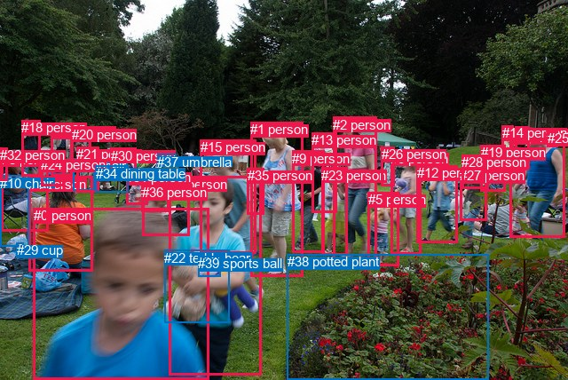
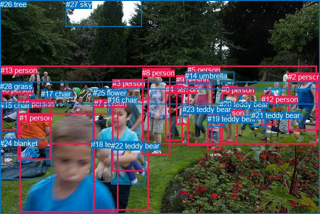

# 图片 0896：2356062.jpg

随机样本序号：254。图片 SHA256：`b8fa3629ce43fe555c0b1d2721279125e61876c1297359ed570d2275610ab89e`。

红色框表示人，蓝色框表示其他物体。两个模式分别保留自身框编号，可依据位置比较对应对象。

## 自动检测框与输出

人的框编号：`[0, 1, 2, 3, 4, 5, 6, 7, 8, 9, 11, 12, 13, 14, 15, 16, 18, 19, 20, 21, 23, 24, 25, 26, 27, 28, 30, 31, 32, 33, 35, 36]`。状态：`ok`。

### 自动检测全部物体框

| 编号 | 类别 | 是否为人 | 检测分数 | 像素坐标 xyxy |
|---|---|---|---|---|
| 0 | person | True | 0.9928 | 37.5, 234.4, 235.9, 427.1 |
| 1 | person | True | 0.9923 | 282.2, 137.2, 341.6, 311.1 |
| 2 | person | True | 0.9922 | 375.2, 131.8, 424.4, 293.8 |
| 3 | person | True | 0.9884 | 574.6, 145.3, 636.7, 267.3 |
| 4 | person | True | 0.9824 | 32.3, 198.6, 104.5, 305.8 |
| 5 | person | True | 0.9803 | 414.9, 216.4, 449.4, 299.8 |
| 6 | person | True | 0.9762 | 440.4, 170.0, 474.8, 286.3 |
| 7 | person | True | 0.9754 | 190.7, 199.0, 295.0, 422.4 |
| 8 | person | True | 0.9503 | 1.5, 170.9, 54.4, 260.3 |
| 9 | person | True | 0.9471 | 329.2, 169.7, 365.6, 284.9 |
| 10 | chair | False | 0.9462 | 0.2, 197.9, 32.9, 277.1 |
| 11 | person | True | 0.9365 | 580.3, 142.8, 596.2, 190.8 |
| 12 | person | True | 0.9185 | 469.8, 186.3, 515.3, 273.9 |
| 13 | person | True | 0.9171 | 351.4, 149.4, 379.8, 240.0 |
| 14 | person | True | 0.9148 | 565.9, 141.1, 578.2, 189.8 |
| 15 | person | True | 0.8955 | 225.6, 157.4, 288.6, 285.8 |
| 16 | person | True | 0.8885 | 57.7, 139.3, 81.2, 197.1 |
| 17 | chair | False | 0.8458 | 82.2, 178.4, 106.1, 214.8 |
| 18 | person | True | 0.8439 | 24.2, 135.5, 45.8, 198.2 |
| 19 | person | True | 0.8290 | 541.8, 163.1, 569.4, 215.9 |
| 20 | person | True | 0.8173 | 81.0, 142.9, 103.0, 181.0 |
| 21 | person | True | 0.7601 | 86.4, 165.3, 111.7, 216.2 |
| 22 | teddy bear | False | 0.7529 | 185.4, 281.5, 258.1, 363.8 |
| 23 | person | True | 0.6797 | 362.1, 188.9, 391.1, 287.1 |
| 24 | person | True | 0.6752 | 46.2, 176.7, 72.6, 209.5 |
| 25 | person | True | 0.6519 | 616.7, 147.4, 628.8, 165.9 |
| 26 | person | True | 0.6221 | 429.6, 165.3, 444.9, 209.2 |
| 27 | person | True | 0.6154 | 518.0, 189.4, 548.8, 248.2 |
| 28 | person | True | 0.6112 | 520.4, 174.4, 550.3, 212.5 |
| 29 | cup | False | 0.5906 | 18.8, 273.0, 26.4, 285.6 |
| 30 | person | True | 0.5839 | 124.7, 166.8, 153.4, 201.4 |
| 31 | person | True | 0.5833 | 142.2, 191.2, 166.2, 230.4 |
| 32 | person | True | 0.5126 | 0.0, 166.3, 8.3, 203.6 |
| 33 | person | True | 0.4999 | 159.4, 208.2, 191.0, 238.9 |
| 34 | dining table | False | 0.4818 | 107.8, 186.9, 144.4, 216.3 |
| 35 | person | True | 0.4483 | 278.7, 189.3, 297.1, 241.3 |
| 36 | person | True | 0.4445 | 160.1, 208.5, 213.8, 265.1 |
| 37 | umbrella | False | 0.4228 | 177.4, 174.0, 198.7, 185.8 |
| 38 | potted plant | False | 0.3553 | 323.8, 286.1, 550.4, 427.6 |
| 39 | sports ball | False | 0.3531 | 223.1, 288.2, 248.3, 311.1 |

### 自动检测 Top50 人相关候选

评分物体对：1560；人相关物体对：1504；输出关系：50。

| 排名 | 主语编号与类别 | 关系 | 宾语编号与类别 | 类型 | 人与人 | 排序分数 | 原始融合 logit |
|---|---|---|---|---|---|---|---|
| 1 | #7 person | holding | #22 teddy bear | semantic | False | 0.98832 | 4.4384 |
| 2 | #8 person | sitting on | #10 chair | semantic | False | 0.98828 | 4.4346 |
| 3 | #4 person | sitting on | #10 chair | semantic | False | 0.97458 | 3.6467 |
| 4 | #7 person | holding | #39 sports ball | semantic | False | 0.97315 | 3.5903 |
| 5 | #0 person | holding | #22 teddy bear | semantic | False | 0.97215 | 3.5529 |
| 6 | #32 person | sitting on | #10 chair | semantic | False | 0.97005 | 3.4779 |
| 7 | #30 person | pushing | #34 dining table | semantic | False | 0.95957 | 3.1670 |
| 8 | #27 person | holding | #28 person | semantic | True | 0.95925 | 3.1586 |
| 9 | #3 person | wearing | #25 person | semantic | True | 0.94956 | 2.9352 |
| 10 | #32 person | on | #10 chair | spatial | False | 0.94507 | 2.8451 |
| 11 | #8 person | on | #10 chair | spatial | False | 0.93932 | 2.7395 |
| 12 | #1 person | wearing | #35 person | semantic | True | 0.93784 | 2.7139 |
| 13 | #21 person | wearing | #17 chair | semantic | False | 0.93144 | 2.6090 |
| 14 | #21 person | in | #17 chair | spatial | False | 0.92886 | 2.5693 |
| 15 | #30 person | on | #34 dining table | spatial | False | 0.92416 | 2.5003 |
| 16 | #21 person | pushing | #34 dining table | semantic | False | 0.90619 | 2.2679 |
| 17 | #15 person | wearing | #35 person | semantic | True | 0.90431 | 2.2461 |
| 18 | #31 person | pushing | #34 dining table | semantic | False | 0.89646 | 2.1585 |
| 19 | #36 person | in | #33 person | spatial | True | 0.89291 | 2.1208 |
| 20 | #8 person | holding | #24 person | semantic | True | 0.89183 | 2.1096 |
| 21 | #4 person | holding | #24 person | semantic | True | 0.87885 | 1.9816 |
| 22 | #0 person | holding | #39 sports ball | semantic | False | 0.87778 | 1.9715 |
| 23 | #3 person | in | #25 person | spatial | True | 0.87453 | 1.9416 |
| 24 | #36 person | wearing | #33 person | semantic | True | 0.86566 | 1.8631 |
| 25 | #4 person | on | #10 chair | spatial | False | 0.86355 | 1.8451 |
| 26 | #16 person | standing on | #24 person | semantic | True | 0.86143 | 1.8272 |
| 27 | #1 person | in | #35 person | spatial | True | 0.85546 | 1.7781 |
| 28 | #7 person | in | #22 teddy bear | spatial | False | 0.83283 | 1.6058 |
| 29 | #16 person | on | #24 person | spatial | True | 0.81971 | 1.5144 |
| 30 | #7 person | in | #39 sports ball | spatial | False | 0.81858 | 1.5068 |
| 31 | #33 person | in | #36 person | spatial | True | 0.80435 | 1.4137 |
| 32 | #16 person | holding | #20 person | semantic | True | 0.78050 | 1.2686 |
| 33 | #18 person | holding | #24 person | semantic | True | 0.76163 | 1.1616 |
| 34 | #21 person | holding | #20 person | semantic | True | 0.76148 | 1.1608 |
| 35 | #0 person | in | #22 teddy bear | spatial | False | 0.75718 | 1.1373 |
| 36 | #30 person | pushing | #31 person | semantic | True | 0.75476 | 1.1242 |
| 37 | #32 person | on | #8 person | spatial | True | 0.75052 | 1.1014 |
| 38 | #4 person | sitting on | #17 chair | semantic | False | 0.74929 | 1.0948 |
| 39 | #15 person | in | #35 person | spatial | True | 0.74764 | 1.0861 |
| 40 | #27 person | in | #28 person | spatial | True | 0.74188 | 1.0557 |
| 41 | #4 person | sitting on | #8 person | semantic | True | 0.73940 | 1.0429 |
| 42 | #15 person | holding | #22 teddy bear | semantic | False | 0.72965 | 0.9929 |
| 43 | #6 person | holding | #26 person | semantic | True | 0.72907 | 0.9899 |
| 44 | #21 person | on | #34 dining table | spatial | False | 0.71168 | 0.9036 |
| 45 | #33 person | pushing | #31 person | semantic | True | 0.70959 | 0.8934 |
| 46 | #8 person | on | #24 person | spatial | True | 0.69556 | 0.8262 |
| 47 | #19 person | holding | #28 person | semantic | True | 0.69121 | 0.8058 |
| 48 | #3 person | in | #11 person | spatial | True | 0.68875 | 0.7943 |
| 49 | #20 person | standing on | #17 chair | semantic | False | 0.68709 | 0.7865 |
| 50 | #2 person | holding | #5 person | semantic | True | 0.67882 | 0.7484 |

### 自动检测逐条人相关 GT 核验

R@50：14.29%；命中 1/7。

| GT 主语编号 | GT 关系 | GT 宾语编号 | 结果阶段 | 匹配预测主语编号 | 匹配预测宾语编号 |
|---|---|---|---|---|---|
| 1 | beside | 25 | endpoint_missing_or_wrong_class | [0] | [] |
| 1 | in front of | 26 | endpoint_missing_or_wrong_class | [0] | [] |
| 5 | walking on | 28 | endpoint_missing_or_wrong_class | [2] | [] |
| 7 | holding | 18 | hit50 | [7] | [22] |
| 7 | holding | 22 | endpoint_missing_or_wrong_class | [7] | [] |
| 8 | walking on | 28 | endpoint_missing_or_wrong_class | [1] | [] |
| 10 | sitting on | 24 | endpoint_missing_or_wrong_class | [4] | [] |

## 真实框与输出

人的框编号：`[0, 1, 2, 3, 4, 5, 6, 7, 8, 9, 10, 11, 12, 13]`。

### 真实框全部物体框

| 编号 | 类别 | 是否为人 | 检测分数 | 像素坐标 xyxy |
|---|---|---|---|---|
| 0 | person | True | GT | 443.0, 171.0, 475.0, 284.0 |
| 1 | person | True | GT | 39.0, 227.0, 237.0, 424.0 |
| 2 | person | True | GT | 576.0, 145.0, 637.0, 260.0 |
| 3 | person | True | GT | 225.0, 158.0, 298.0, 342.0 |
| 4 | person | True | GT | 331.0, 170.0, 366.0, 281.0 |
| 5 | person | True | GT | 375.0, 131.0, 424.0, 292.0 |
| 6 | person | True | GT | 2.0, 171.0, 58.0, 260.0 |
| 7 | person | True | GT | 188.0, 198.0, 298.0, 420.0 |
| 8 | person | True | GT | 284.0, 137.0, 341.0, 310.0 |
| 9 | person | True | GT | 352.0, 151.0, 378.0, 250.0 |
| 10 | person | True | GT | 35.0, 199.0, 102.0, 320.0 |
| 11 | person | True | GT | 415.0, 217.0, 442.0, 300.0 |
| 12 | person | True | GT | 523.0, 190.0, 549.0, 251.0 |
| 13 | person | True | GT | 1.0, 132.0, 634.0, 289.0 |
| 14 | umbrella | False | GT | 370.0, 143.0, 468.0, 168.0 |
| 15 | chair | False | GT | 0.0, 202.0, 34.0, 265.0 |
| 16 | chair | False | GT | 215.0, 191.0, 223.0, 230.0 |
| 17 | chair | False | GT | 82.0, 179.0, 95.0, 215.0 |
| 18 | teddy bear | False | GT | 182.0, 280.0, 235.0, 364.0 |
| 19 | teddy bear | False | GT | 415.0, 229.0, 451.0, 253.0 |
| 20 | teddy bear | False | GT | 439.0, 200.0, 459.0, 229.0 |
| 21 | teddy bear | False | GT | 503.0, 222.0, 530.0, 254.0 |
| 22 | teddy bear | False | GT | 222.0, 283.0, 290.0, 368.0 |
| 23 | teddy bear | False | GT | 365.0, 210.0, 377.0, 234.0 |
| 24 | blanket | False | GT | 0.0, 278.0, 104.0, 359.0 |
| 25 | flower | False | GT | 186.0, 177.0, 640.0, 428.0 |
| 26 | tree | False | GT | 0.0, 0.0, 640.0, 208.0 |
| 27 | sky | False | GT | 132.0, 0.0, 283.0, 53.0 |
| 28 | grass | False | GT | 0.0, 164.0, 640.0, 428.0 |

### 真实框 Top50 人相关候选

评分物体对：812；人相关物体对：602；输出关系：50。

| 排名 | 主语编号与类别 | 关系 | 宾语编号与类别 | 类型 | 人与人 | 排序分数 | 原始融合 logit |
|---|---|---|---|---|---|---|---|
| 1 | #7 person | holding | #22 teddy bear | semantic | False | 0.99224 | 4.8512 |
| 2 | #0 person | holding | #20 teddy bear | semantic | False | 0.99078 | 4.6768 |
| 3 | #6 person | sitting on | #15 chair | semantic | False | 0.99020 | 4.6160 |
| 4 | #7 person | holding | #18 teddy bear | semantic | False | 0.98965 | 4.5605 |
| 5 | #1 person | holding | #18 teddy bear | semantic | False | 0.98287 | 4.0498 |
| 6 | #10 person | sitting on | #24 blanket | semantic | False | 0.97760 | 3.7762 |
| 7 | #3 person | holding | #22 teddy bear | semantic | False | 0.97681 | 3.7406 |
| 8 | #9 person | holding | #23 teddy bear | semantic | False | 0.97609 | 3.7094 |
| 9 | #11 person | holding | #19 teddy bear | semantic | False | 0.96639 | 3.3588 |
| 10 | #11 person | holding | #20 teddy bear | semantic | False | 0.95641 | 3.0884 |
| 11 | #13 person | standing on | #28 grass | semantic | False | 0.95523 | 3.0604 |
| 12 | #8 person | standing on | #28 grass | semantic | False | 0.95433 | 3.0395 |
| 13 | #5 person | standing on | #28 grass | semantic | False | 0.95389 | 3.0296 |
| 14 | #10 person | sitting on | #15 chair | semantic | False | 0.95210 | 2.9895 |
| 15 | #11 person | in | #19 teddy bear | spatial | False | 0.95025 | 2.9497 |
| 16 | #11 person | standing on | #28 grass | semantic | False | 0.94931 | 2.9300 |
| 17 | #0 person | holding | #19 teddy bear | semantic | False | 0.94693 | 2.8816 |
| 18 | #0 person | walking on | #28 grass | semantic | False | 0.94475 | 2.8390 |
| 19 | #3 person | standing on | #28 grass | semantic | False | 0.94284 | 2.8031 |
| 20 | #13 person | in | #28 grass | spatial | False | 0.93560 | 2.6761 |
| 21 | #6 person | on | #15 chair | spatial | False | 0.93270 | 2.6289 |
| 22 | #12 person | standing on | #28 grass | semantic | False | 0.93240 | 2.6241 |
| 23 | #7 person | standing on | #28 grass | semantic | False | 0.93151 | 2.6101 |
| 24 | #4 person | standing on | #28 grass | semantic | False | 0.92609 | 2.5281 |
| 25 | #10 person | sitting on | #28 grass | semantic | False | 0.91911 | 2.4303 |
| 26 | #5 person | holding | #19 teddy bear | semantic | False | 0.91787 | 2.4138 |
| 27 | #10 person | on | #24 blanket | spatial | False | 0.91583 | 2.3870 |
| 28 | #10 person | holding | #17 chair | semantic | False | 0.90970 | 2.3099 |
| 29 | #5 person | holding | #23 teddy bear | semantic | False | 0.90377 | 2.2398 |
| 30 | #6 person | sitting on | #28 grass | semantic | False | 0.90233 | 2.2234 |
| 31 | #4 person | holding | #23 teddy bear | semantic | False | 0.90089 | 2.2071 |
| 32 | #2 person | standing on | #28 grass | semantic | False | 0.89443 | 2.1368 |
| 33 | #0 person | in | #20 teddy bear | spatial | False | 0.88627 | 2.0532 |
| 34 | #9 person | in | #23 teddy bear | spatial | False | 0.87815 | 1.9750 |
| 35 | #10 person | on | #28 grass | spatial | False | 0.87391 | 1.9360 |
| 36 | #12 person | on | #28 grass | spatial | False | 0.87307 | 1.9284 |
| 37 | #5 person | in | #25 flower | spatial | False | 0.87096 | 1.9095 |
| 38 | #13 person | in | #25 flower | spatial | False | 0.86284 | 1.8391 |
| 39 | #11 person | in | #25 flower | spatial | False | 0.86158 | 1.8285 |
| 40 | #8 person | in | #25 flower | spatial | False | 0.85420 | 1.7679 |
| 41 | #5 person | standing on | #25 flower | semantic | False | 0.85315 | 1.7596 |
| 42 | #0 person | in | #25 flower | spatial | False | 0.84751 | 1.7152 |
| 43 | #8 person | on | #28 grass | spatial | False | 0.84738 | 1.7142 |
| 44 | #3 person | holding | #18 teddy bear | semantic | False | 0.84518 | 1.6973 |
| 45 | #7 person | on | #28 grass | spatial | False | 0.84300 | 1.6807 |
| 46 | #3 person | on | #28 grass | spatial | False | 0.84095 | 1.6653 |
| 47 | #7 person | in | #25 flower | spatial | False | 0.83188 | 1.5990 |
| 48 | #0 person | walking on | #25 flower | semantic | False | 0.82992 | 1.5851 |
| 49 | #9 person | standing on | #28 grass | semantic | False | 0.82870 | 1.5765 |
| 50 | #11 person | standing on | #25 flower | semantic | False | 0.82852 | 1.5752 |

### 真实框逐条人相关 GT 核验

R@50：42.86%；命中 3/7。

| GT 主语编号 | GT 关系 | GT 宾语编号 | 结果阶段 | 匹配预测主语编号 | 匹配预测宾语编号 |
|---|---|---|---|---|---|
| 1 | beside | 25 | wrong_predicate | [1] | [25] |
| 1 | in front of | 26 | wrong_predicate | [1] | [26] |
| 5 | walking on | 28 | wrong_predicate | [5] | [28] |
| 7 | holding | 18 | hit50 | [7] | [18] |
| 7 | holding | 22 | hit50 | [7] | [22] |
| 8 | walking on | 28 | wrong_predicate | [8] | [28] |
| 10 | sitting on | 24 | hit50 | [10] | [24] |

## 全部人相关 GT

| 主语编号与类别 | 关系 | 宾语编号与类别 |
|---|---|---|
| #1 person | beside | #25 flower |
| #1 person | in front of | #26 tree |
| #5 person | walking on | #28 grass |
| #7 person | holding | #18 teddy bear |
| #7 person | holding | #22 teddy bear |
| #8 person | walking on | #28 grass |
| #10 person | sitting on | #24 blanket |

原始记录、全部人相关物体对的两项预测与分项分数见 [逐图证据 JSON](../evidence/cases/0896.json)。全部56类 logits 保留于本机 HOR/output/random500/logits/。

<!-- HOR_COMPLETE_RESULTS -->

## 六组条件的完整输出对照

以下保留同一图片三种框与候选模式、两种谓词输出规则的全部 Top50。框编号各自在所属模式内解释。

### 自动检测框完整枚举：空间与语义各保留一个谓词

| 排名 | 主语编号与类别 | 谓词 | 宾语编号与类别 | 分组 | 排序分数 | predicate logit | pair logit |
|---|---|---|---|---|---|---|---|
| 1 | #7 person | holding | #22 teddy bear | semantic | 0.9883232 | 4.1510959 | 0.2872989 |
| 2 | #8 person | sitting on | #10 chair | semantic | 0.9882793 | 4.0807652 | 0.3538527 |
| 3 | #4 person | sitting on | #10 chair | semantic | 0.9745850 | 3.5722022 | 0.0744715 |
| 4 | #7 person | holding | #39 sports ball | semantic | 0.9731507 | 3.0737190 | 0.5165820 |
| 5 | #0 person | holding | #22 teddy bear | semantic | 0.9721547 | 3.4831796 | 0.0696712 |
| 6 | #32 person | sitting on | #10 chair | semantic | 0.9700510 | 3.1719556 | 0.3058960 |
| 7 | #30 person | pushing | #34 dining table | semantic | 0.9595748 | 3.3663983 | -0.1993604 |
| 8 | #27 person | holding | #28 person | semantic | 0.9592476 | 3.3842530 | -0.2256191 |
| 9 | #3 person | wearing | #25 person | semantic | 0.9495608 | 2.8803291 | 0.0549009 |
| 10 | #32 person | on | #10 chair | spatial | 0.9450663 | 2.5392313 | 0.3058960 |
| 11 | #8 person | on | #10 chair | spatial | 0.9393159 | 2.3856187 | 0.3538527 |
| 12 | #1 person | wearing | #35 person | semantic | 0.9378412 | 2.5795622 | 0.1343262 |
| 13 | #21 person | wearing | #17 chair | semantic | 0.9314407 | 2.7716994 | -0.1626657 |
| 14 | #21 person | in | #17 chair | spatial | 0.9288582 | 2.7319479 | -0.1626657 |
| 15 | #30 person | on | #34 dining table | spatial | 0.9241642 | 2.6996799 | -0.1993604 |
| 16 | #21 person | pushing | #34 dining table | semantic | 0.9061859 | 2.5239244 | -0.2559957 |
| 17 | #15 person | wearing | #35 person | semantic | 0.9043145 | 2.2661619 | -0.0200509 |
| 18 | #31 person | pushing | #34 dining table | semantic | 0.8964591 | 2.4636369 | -0.3051510 |
| 19 | #36 person | in | #33 person | spatial | 0.8929082 | 2.2146292 | -0.0938320 |
| 20 | #8 person | holding | #24 person | semantic | 0.8918343 | 2.1465893 | -0.0369737 |
| 21 | #4 person | holding | #24 person | semantic | 0.8788503 | 2.1586151 | -0.1770275 |
| 22 | #0 person | holding | #39 sports ball | semantic | 0.8777758 | 1.7973113 | 0.1742225 |
| 23 | #3 person | in | #25 person | spatial | 0.8745303 | 1.8867216 | 0.0549009 |
| 24 | #36 person | wearing | #33 person | semantic | 0.8656636 | 1.9569807 | -0.0938320 |
| 25 | #4 person | on | #10 chair | spatial | 0.8635460 | 1.7705874 | 0.0744715 |
| 26 | #16 person | standing on | #24 person | semantic | 0.8614334 | 1.6297340 | 0.1975126 |
| 27 | #1 person | in | #35 person | spatial | 0.8554636 | 1.6437860 | 0.1343262 |
| 28 | #7 person | in | #22 teddy bear | spatial | 0.8328313 | 1.3185291 | 0.2872989 |
| 29 | #16 person | on | #24 person | spatial | 0.8197145 | 1.3169017 | 0.1975126 |
| 30 | #7 person | in | #39 sports ball | spatial | 0.8185803 | 0.9901767 | 0.5165820 |
| 31 | #33 person | in | #36 person | spatial | 0.8043484 | 1.5269618 | -0.1132648 |
| 32 | #16 person | holding | #20 person | semantic | 0.7804955 | 1.5148826 | -0.2463266 |
| 33 | #18 person | holding | #24 person | semantic | 0.7616308 | 1.0184417 | 0.1431997 |
| 34 | #21 person | holding | #20 person | semantic | 0.7614762 | 1.5403719 | -0.3795818 |
| 35 | #0 person | in | #22 teddy bear | spatial | 0.7571821 | 1.0676208 | 0.0696712 |
| 36 | #30 person | pushing | #31 person | semantic | 0.7547633 | 1.2902417 | -0.1660612 |
| 37 | #32 person | on | #8 person | spatial | 0.7505236 | 1.4037576 | -0.3023505 |
| 38 | #4 person | sitting on | #17 chair | semantic | 0.7492865 | 1.6100550 | -0.5152448 |
| 39 | #15 person | in | #35 person | spatial | 0.7476427 | 1.1061301 | -0.0200509 |
| 40 | #27 person | in | #28 person | spatial | 0.7418751 | 1.2813559 | -0.2256191 |
| 41 | #4 person | sitting on | #8 person | semantic | 0.7394019 | 1.7936549 | -0.7507927 |
| 42 | #15 person | holding | #22 teddy bear | semantic | 0.7296512 | 1.5619407 | -0.5690870 |
| 43 | #6 person | holding | #26 person | semantic | 0.7290652 | 0.8394108 | 0.1504742 |
| 44 | #21 person | on | #34 dining table | spatial | 0.7116800 | 1.1595531 | -0.2559957 |
| 45 | #33 person | pushing | #31 person | semantic | 0.7095881 | 1.0193968 | -0.1260123 |
| 46 | #8 person | on | #24 person | spatial | 0.6955599 | 0.8632164 | -0.0369737 |
| 47 | #19 person | holding | #28 person | semantic | 0.6912097 | 0.9664426 | -0.1606615 |
| 48 | #3 person | in | #11 person | spatial | 0.6887490 | 0.9804435 | -0.1861663 |
| 49 | #20 person | standing on | #17 chair | semantic | 0.6870878 | 1.0417833 | -0.2552439 |
| 50 | #2 person | holding | #5 person | semantic | 0.6788223 | 1.1244550 | -0.3760900 |

GT 命中：1/7，R@50=14.29%。

| GT主语 | GT谓词 | GT宾语 | 结果阶段 | 匹配主语框 | 匹配宾语框 |
|---|---|---|---|---|---|
| 1 | beside | 25 | endpoint_missing_or_wrong_class | [0] | [] |
| 1 | in front of | 26 | endpoint_missing_or_wrong_class | [0] | [] |
| 5 | walking on | 28 | endpoint_missing_or_wrong_class | [2] | [] |
| 7 | holding | 18 | hit50 | [7] | [22] |
| 7 | holding | 22 | endpoint_missing_or_wrong_class | [7] | [] |
| 8 | walking on | 28 | endpoint_missing_or_wrong_class | [1] | [] |
| 10 | sitting on | 24 | endpoint_missing_or_wrong_class | [4] | [] |

### 自动检测框完整枚举：每对只保留一个谓词

| 排名 | 主语编号与类别 | 谓词 | 宾语编号与类别 | 分组 | 排序分数 | predicate logit | pair logit |
|---|---|---|---|---|---|---|---|
| 1 | #7 person | holding | #22 teddy bear | single | 0.9883232 | 4.1510959 | 0.2872989 |
| 2 | #8 person | sitting on | #10 chair | single | 0.9882793 | 4.0807652 | 0.3538527 |
| 3 | #4 person | sitting on | #10 chair | single | 0.9745850 | 3.5722022 | 0.0744715 |
| 4 | #7 person | holding | #39 sports ball | single | 0.9731507 | 3.0737190 | 0.5165820 |
| 5 | #0 person | holding | #22 teddy bear | single | 0.9721547 | 3.4831796 | 0.0696712 |
| 6 | #32 person | sitting on | #10 chair | single | 0.9700510 | 3.1719556 | 0.3058960 |
| 7 | #30 person | pushing | #34 dining table | single | 0.9595748 | 3.3663983 | -0.1993604 |
| 8 | #27 person | holding | #28 person | single | 0.9592476 | 3.3842530 | -0.2256191 |
| 9 | #3 person | wearing | #25 person | single | 0.9495608 | 2.8803291 | 0.0549009 |
| 10 | #1 person | wearing | #35 person | single | 0.9378412 | 2.5795622 | 0.1343262 |
| 11 | #21 person | wearing | #17 chair | single | 0.9314407 | 2.7716994 | -0.1626657 |
| 12 | #21 person | pushing | #34 dining table | single | 0.9061859 | 2.5239244 | -0.2559957 |
| 13 | #15 person | wearing | #35 person | single | 0.9043145 | 2.2661619 | -0.0200509 |
| 14 | #31 person | pushing | #34 dining table | single | 0.8964591 | 2.4636369 | -0.3051510 |
| 15 | #36 person | in | #33 person | single | 0.8929082 | 2.2146292 | -0.0938320 |
| 16 | #8 person | holding | #24 person | single | 0.8918343 | 2.1465893 | -0.0369737 |
| 17 | #4 person | holding | #24 person | single | 0.8788503 | 2.1586151 | -0.1770275 |
| 18 | #0 person | holding | #39 sports ball | single | 0.8777758 | 1.7973113 | 0.1742225 |
| 19 | #16 person | standing on | #24 person | single | 0.8614334 | 1.6297340 | 0.1975126 |
| 20 | #33 person | in | #36 person | single | 0.8043484 | 1.5269618 | -0.1132648 |
| 21 | #16 person | holding | #20 person | single | 0.7804955 | 1.5148826 | -0.2463266 |
| 22 | #18 person | holding | #24 person | single | 0.7616308 | 1.0184417 | 0.1431997 |
| 23 | #21 person | holding | #20 person | single | 0.7614762 | 1.5403719 | -0.3795818 |
| 24 | #30 person | pushing | #31 person | single | 0.7547633 | 1.2902417 | -0.1660612 |
| 25 | #32 person | on | #8 person | single | 0.7505236 | 1.4037576 | -0.3023505 |
| 26 | #4 person | sitting on | #17 chair | single | 0.7492865 | 1.6100550 | -0.5152448 |
| 27 | #4 person | sitting on | #8 person | single | 0.7394019 | 1.7936549 | -0.7507927 |
| 28 | #15 person | holding | #22 teddy bear | single | 0.7296512 | 1.5619407 | -0.5690870 |
| 29 | #6 person | holding | #26 person | single | 0.7290652 | 0.8394108 | 0.1504742 |
| 30 | #33 person | pushing | #31 person | single | 0.7095881 | 1.0193968 | -0.1260123 |
| 31 | #19 person | holding | #28 person | single | 0.6912097 | 0.9664426 | -0.1606615 |
| 32 | #3 person | in | #11 person | single | 0.6887490 | 0.9804435 | -0.1861663 |
| 33 | #20 person | standing on | #17 chair | single | 0.6870878 | 1.0417833 | -0.2552439 |
| 34 | #2 person | holding | #5 person | single | 0.6788223 | 1.1244550 | -0.3760900 |
| 35 | #36 person | holding | #31 person | single | 0.6773606 | 0.9339466 | -0.1922784 |
| 36 | #18 person | looking at | #16 person | single | 0.6769723 | 0.9441795 | -0.2042871 |
| 37 | #27 person | holding | #19 person | single | 0.6516492 | 1.1322198 | -0.5059234 |
| 38 | #7 person | wearing | #35 person | single | 0.6499603 | 0.9699831 | -0.3511186 |
| 39 | #19 person | holding | #14 person | single | 0.6466599 | 0.7812943 | -0.1769049 |
| 40 | #28 person | pushing | #27 person | single | 0.6453492 | 1.1397266 | -0.5410687 |
| 41 | #8 person | holding | #32 person | single | 0.6260722 | 0.9673314 | -0.4519284 |
| 42 | #20 person | standing on | #21 person | single | 0.6235682 | 0.8011527 | -0.2964313 |
| 43 | #9 person | holding | #13 person | single | 0.6128849 | 1.0495009 | -0.5900460 |
| 44 | #20 person | looking at | #16 person | single | 0.6013165 | 0.5904059 | -0.1794525 |
| 45 | #7 person | playing with | #0 person | single | 0.5943987 | 0.9260044 | -0.5438250 |
| 46 | #14 person | standing on | #19 person | single | 0.5931693 | 0.6947613 | -0.3176788 |
| 47 | #28 person | pushing | #19 person | single | 0.5685461 | 0.8087411 | -0.5328194 |
| 48 | #2 person | holding | #13 person | single | 0.5626633 | 0.5556750 | -0.3036969 |
| 49 | #18 person | sitting on | #10 chair | single | 0.5554194 | 0.4155455 | -0.1929533 |
| 50 | #17 chair | in | #21 person | single | 0.5386347 | 0.5410337 | -0.3861864 |

GT 命中：1/7，R@50=14.29%。

| GT主语 | GT谓词 | GT宾语 | 结果阶段 | 匹配主语框 | 匹配宾语框 |
|---|---|---|---|---|---|
| 1 | beside | 25 | endpoint_missing_or_wrong_class | [0] | [] |
| 1 | in front of | 26 | endpoint_missing_or_wrong_class | [0] | [] |
| 5 | walking on | 28 | endpoint_missing_or_wrong_class | [2] | [] |
| 7 | holding | 18 | hit50 | [7] | [22] |
| 7 | holding | 22 | endpoint_missing_or_wrong_class | [7] | [] |
| 8 | walking on | 28 | endpoint_missing_or_wrong_class | [1] | [] |
| 10 | sitting on | 24 | endpoint_missing_or_wrong_class | [4] | [] |

### 真实框完整枚举：空间与语义各保留一个谓词

| 排名 | 主语编号与类别 | 谓词 | 宾语编号与类别 | 分组 | 排序分数 | predicate logit | pair logit |
|---|---|---|---|---|---|---|---|
| 1 | #7 person | holding | #22 teddy bear | semantic | 0.9922417 | 4.4601121 | 0.3910898 |
| 2 | #0 person | holding | #20 teddy bear | semantic | 0.9907774 | 4.2762704 | 0.4005631 |
| 3 | #6 person | sitting on | #15 chair | semantic | 0.9902045 | 4.2402511 | 0.3757281 |
| 4 | #7 person | holding | #18 teddy bear | semantic | 0.9896513 | 4.2891860 | 0.2713097 |
| 5 | #1 person | holding | #18 teddy bear | semantic | 0.9828722 | 3.8313594 | 0.2184170 |
| 6 | #10 person | sitting on | #24 blanket | semantic | 0.9776039 | 3.7226100 | 0.0536091 |
| 7 | #3 person | holding | #22 teddy bear | semantic | 0.9768111 | 3.7272029 | 0.0134137 |
| 8 | #9 person | holding | #23 teddy bear | semantic | 0.9760943 | 3.5906291 | 0.1188112 |
| 9 | #11 person | holding | #19 teddy bear | semantic | 0.9663908 | 3.0113406 | 0.3474295 |
| 10 | #11 person | holding | #20 teddy bear | semantic | 0.9564122 | 3.0135365 | 0.0748758 |
| 11 | #13 person | standing on | #28 grass | semantic | 0.9552310 | 3.1423545 | -0.0819180 |
| 12 | #8 person | standing on | #28 grass | semantic | 0.9543291 | 3.4212346 | -0.3816882 |
| 13 | #5 person | standing on | #28 grass | semantic | 0.9538915 | 3.3830848 | -0.3535309 |
| 14 | #10 person | sitting on | #15 chair | semantic | 0.9520976 | 2.6694331 | 0.3200675 |
| 15 | #11 person | in | #19 teddy bear | spatial | 0.9502494 | 2.6022739 | 0.3474295 |
| 16 | #11 person | standing on | #28 grass | semantic | 0.9493084 | 3.3169875 | -0.3870146 |
| 17 | #0 person | holding | #19 teddy bear | semantic | 0.9469270 | 2.5815401 | 0.3000137 |
| 18 | #0 person | walking on | #28 grass | semantic | 0.9447471 | 3.0333085 | -0.1943128 |
| 19 | #3 person | standing on | #28 grass | semantic | 0.9428414 | 3.2714930 | -0.4684246 |
| 20 | #13 person | in | #28 grass | spatial | 0.9356036 | 2.7580523 | -0.0819180 |
| 21 | #6 person | on | #15 chair | spatial | 0.9327006 | 2.2532053 | 0.3757281 |
| 22 | #12 person | standing on | #28 grass | semantic | 0.9323986 | 2.8561311 | -0.2320002 |
| 23 | #7 person | standing on | #28 grass | semantic | 0.9315100 | 3.0307631 | -0.4206435 |
| 24 | #4 person | standing on | #28 grass | semantic | 0.9260865 | 3.0587111 | -0.5306389 |
| 25 | #10 person | sitting on | #28 grass | semantic | 0.9191061 | 2.6603880 | -0.2301240 |
| 26 | #5 person | holding | #19 teddy bear | semantic | 0.9178750 | 2.3201308 | 0.0936872 |
| 27 | #10 person | on | #24 blanket | spatial | 0.9158336 | 2.3334298 | 0.0536091 |
| 28 | #10 person | holding | #17 chair | semantic | 0.9096975 | 2.5863500 | -0.2764037 |
| 29 | #5 person | holding | #23 teddy bear | semantic | 0.9037691 | 2.2975941 | -0.0577703 |
| 30 | #6 person | sitting on | #28 grass | semantic | 0.9023330 | 2.6814504 | -0.4580306 |
| 31 | #4 person | holding | #23 teddy bear | semantic | 0.9008886 | 2.0869555 | 0.1201810 |
| 32 | #2 person | standing on | #28 grass | semantic | 0.8944281 | 2.7724872 | -0.6356949 |
| 33 | #0 person | in | #20 teddy bear | spatial | 0.8862697 | 1.6526294 | 0.4005631 |
| 34 | #9 person | in | #23 teddy bear | spatial | 0.8781467 | 1.8561850 | 0.1188112 |
| 35 | #10 person | on | #28 grass | spatial | 0.8739082 | 2.1660886 | -0.2301240 |
| 36 | #12 person | on | #28 grass | spatial | 0.8730671 | 2.1603541 | -0.2320002 |
| 37 | #5 person | in | #25 flower | spatial | 0.8709596 | 2.5921159 | -0.6826459 |
| 38 | #13 person | in | #25 flower | spatial | 0.8628420 | 2.3628798 | -0.5237820 |
| 39 | #11 person | in | #25 flower | spatial | 0.8615788 | 2.4708605 | -0.6423957 |
| 40 | #8 person | in | #25 flower | spatial | 0.8541979 | 2.4845805 | -0.7166681 |
| 41 | #5 person | standing on | #25 flower | semantic | 0.8531535 | 2.4421978 | -0.6826459 |
| 42 | #0 person | in | #25 flower | spatial | 0.8475066 | 2.3148799 | -0.5997025 |
| 43 | #8 person | on | #28 grass | spatial | 0.8473799 | 2.0958853 | -0.3816882 |
| 44 | #3 person | holding | #18 teddy bear | semantic | 0.8451772 | 2.0829034 | -0.3856381 |
| 45 | #7 person | on | #28 grass | spatial | 0.8429953 | 2.1013298 | -0.4206435 |
| 46 | #3 person | on | #28 grass | spatial | 0.8409461 | 2.1337090 | -0.4684246 |
| 47 | #7 person | in | #25 flower | spatial | 0.8318778 | 2.1907511 | -0.5917571 |
| 48 | #0 person | walking on | #25 flower | semantic | 0.8299198 | 2.1847610 | -0.5997025 |
| 49 | #9 person | standing on | #28 grass | semantic | 0.8287035 | 2.1728053 | -0.5963393 |
| 50 | #11 person | standing on | #25 flower | semantic | 0.8285221 | 2.2175851 | -0.6423957 |

GT 命中：3/7，R@50=42.86%。

| GT主语 | GT谓词 | GT宾语 | 结果阶段 | 匹配主语框 | 匹配宾语框 |
|---|---|---|---|---|---|
| 1 | beside | 25 | wrong_predicate | [1] | [25] |
| 1 | in front of | 26 | wrong_predicate | [1] | [26] |
| 5 | walking on | 28 | wrong_predicate | [5] | [28] |
| 7 | holding | 18 | hit50 | [7] | [18] |
| 7 | holding | 22 | hit50 | [7] | [22] |
| 8 | walking on | 28 | wrong_predicate | [8] | [28] |
| 10 | sitting on | 24 | hit50 | [10] | [24] |

### 真实框完整枚举：每对只保留一个谓词

| 排名 | 主语编号与类别 | 谓词 | 宾语编号与类别 | 分组 | 排序分数 | predicate logit | pair logit |
|---|---|---|---|---|---|---|---|
| 1 | #7 person | holding | #22 teddy bear | single | 0.9922417 | 4.4601121 | 0.3910898 |
| 2 | #0 person | holding | #20 teddy bear | single | 0.9907774 | 4.2762704 | 0.4005631 |
| 3 | #6 person | sitting on | #15 chair | single | 0.9902045 | 4.2402511 | 0.3757281 |
| 4 | #7 person | holding | #18 teddy bear | single | 0.9896513 | 4.2891860 | 0.2713097 |
| 5 | #1 person | holding | #18 teddy bear | single | 0.9828722 | 3.8313594 | 0.2184170 |
| 6 | #10 person | sitting on | #24 blanket | single | 0.9776039 | 3.7226100 | 0.0536091 |
| 7 | #3 person | holding | #22 teddy bear | single | 0.9768111 | 3.7272029 | 0.0134137 |
| 8 | #9 person | holding | #23 teddy bear | single | 0.9760943 | 3.5906291 | 0.1188112 |
| 9 | #11 person | holding | #19 teddy bear | single | 0.9663908 | 3.0113406 | 0.3474295 |
| 10 | #11 person | holding | #20 teddy bear | single | 0.9564122 | 3.0135365 | 0.0748758 |
| 11 | #13 person | standing on | #28 grass | single | 0.9552310 | 3.1423545 | -0.0819180 |
| 12 | #8 person | standing on | #28 grass | single | 0.9543291 | 3.4212346 | -0.3816882 |
| 13 | #5 person | standing on | #28 grass | single | 0.9538915 | 3.3830848 | -0.3535309 |
| 14 | #10 person | sitting on | #15 chair | single | 0.9520976 | 2.6694331 | 0.3200675 |
| 15 | #11 person | standing on | #28 grass | single | 0.9493084 | 3.3169875 | -0.3870146 |
| 16 | #0 person | holding | #19 teddy bear | single | 0.9469270 | 2.5815401 | 0.3000137 |
| 17 | #0 person | walking on | #28 grass | single | 0.9447471 | 3.0333085 | -0.1943128 |
| 18 | #3 person | standing on | #28 grass | single | 0.9428414 | 3.2714930 | -0.4684246 |
| 19 | #12 person | standing on | #28 grass | single | 0.9323986 | 2.8561311 | -0.2320002 |
| 20 | #7 person | standing on | #28 grass | single | 0.9315100 | 3.0307631 | -0.4206435 |
| 21 | #4 person | standing on | #28 grass | single | 0.9260865 | 3.0587111 | -0.5306389 |
| 22 | #10 person | sitting on | #28 grass | single | 0.9191061 | 2.6603880 | -0.2301240 |
| 23 | #5 person | holding | #19 teddy bear | single | 0.9178750 | 2.3201308 | 0.0936872 |
| 24 | #10 person | holding | #17 chair | single | 0.9096975 | 2.5863500 | -0.2764037 |
| 25 | #5 person | holding | #23 teddy bear | single | 0.9037691 | 2.2975941 | -0.0577703 |
| 26 | #6 person | sitting on | #28 grass | single | 0.9023330 | 2.6814504 | -0.4580306 |
| 27 | #4 person | holding | #23 teddy bear | single | 0.9008886 | 2.0869555 | 0.1201810 |
| 28 | #2 person | standing on | #28 grass | single | 0.8944281 | 2.7724872 | -0.6356949 |
| 29 | #5 person | in | #25 flower | single | 0.8709596 | 2.5921159 | -0.6826459 |
| 30 | #13 person | in | #25 flower | single | 0.8628420 | 2.3628798 | -0.5237820 |
| 31 | #11 person | in | #25 flower | single | 0.8615788 | 2.4708605 | -0.6423957 |
| 32 | #8 person | in | #25 flower | single | 0.8541979 | 2.4845805 | -0.7166681 |
| 33 | #0 person | in | #25 flower | single | 0.8475066 | 2.3148799 | -0.5997025 |
| 34 | #3 person | holding | #18 teddy bear | single | 0.8451772 | 2.0829034 | -0.3856381 |
| 35 | #7 person | in | #25 flower | single | 0.8318778 | 2.1907511 | -0.5917571 |
| 36 | #9 person | standing on | #28 grass | single | 0.8287035 | 2.1728053 | -0.5963393 |
| 37 | #7 person | holding | #16 chair | single | 0.8278286 | 1.6007648 | -0.0304487 |
| 38 | #12 person | holding | #21 teddy bear | single | 0.8254371 | 1.7641354 | -0.2105078 |
| 39 | #1 person | standing on | #28 grass | single | 0.8112953 | 1.9702253 | -0.5117764 |
| 40 | #5 person | standing on | #14 umbrella | single | 0.7834808 | 1.5991268 | -0.3130597 |
| 41 | #10 person | sitting on | #6 person | single | 0.7779663 | 1.9109993 | -0.6571453 |
| 42 | #3 person | in | #25 flower | single | 0.7734023 | 2.0099802 | -0.7823570 |
| 43 | #7 person | playing with | #1 person | single | 0.7649484 | 1.6853223 | -0.5053191 |
| 44 | #12 person | in | #25 flower | single | 0.7645286 | 1.9995790 | -0.8219088 |
| 45 | #5 person | holding | #11 person | single | 0.7636309 | 1.5368690 | -0.3641794 |
| 46 | #2 person | in | #25 flower | single | 0.7513589 | 2.0608745 | -0.9550014 |
| 47 | #18 teddy bear | holding | #1 person | single | 0.7279807 | 1.0192795 | -0.0348778 |
| 48 | #1 person | holding | #22 teddy bear | single | 0.7042986 | 1.1041141 | -0.2362620 |
| 49 | #13 person | playing | #22 teddy bear | single | 0.6339451 | 1.3742042 | -0.8250249 |
| 50 | #7 person | holding | #3 person | single | 0.6245287 | 1.3326879 | -0.8238726 |

GT 命中：3/7，R@50=42.86%。

| GT主语 | GT谓词 | GT宾语 | 结果阶段 | 匹配主语框 | 匹配宾语框 |
|---|---|---|---|---|---|
| 1 | beside | 25 | wrong_predicate | [1] | [25] |
| 1 | in front of | 26 | wrong_predicate | [1] | [26] |
| 5 | walking on | 28 | wrong_predicate | [5] | [28] |
| 7 | holding | 18 | hit50 | [7] | [18] |
| 7 | holding | 22 | hit50 | [7] | [22] |
| 8 | walking on | 28 | wrong_predicate | [8] | [28] |
| 10 | sitting on | 24 | hit50 | [10] | [24] |

### 真实框400候选：空间与语义各保留一个谓词

| 排名 | 主语编号与类别 | 谓词 | 宾语编号与类别 | 分组 | 排序分数 | predicate logit | pair logit |
|---|---|---|---|---|---|---|---|
| 1 | #7 person | holding | #22 teddy bear | semantic | 0.9917644 | 4.3999295 | 0.3910898 |
| 2 | #0 person | holding | #20 teddy bear | semantic | 0.9909379 | 4.2939963 | 0.4005631 |
| 3 | #6 person | sitting on | #15 chair | semantic | 0.9901460 | 4.2342420 | 0.3757281 |
| 4 | #7 person | holding | #18 teddy bear | semantic | 0.9892074 | 4.2467284 | 0.2713097 |
| 5 | #1 person | holding | #18 teddy bear | semantic | 0.9834590 | 3.8668113 | 0.2184170 |
| 6 | #10 person | sitting on | #24 blanket | semantic | 0.9806722 | 3.8730826 | 0.0536091 |
| 7 | #9 person | holding | #23 teddy bear | semantic | 0.9745026 | 3.5245385 | 0.1188112 |
| 8 | #3 person | holding | #22 teddy bear | semantic | 0.9706845 | 3.4864726 | 0.0134137 |
| 9 | #11 person | holding | #19 teddy bear | semantic | 0.9702592 | 3.1376143 | 0.3474295 |
| 10 | #11 person | standing on | #28 grass | semantic | 0.9585088 | 3.5269113 | -0.3870146 |
| 11 | #5 person | standing on | #28 grass | semantic | 0.9561605 | 3.4359231 | -0.3535309 |
| 12 | #13 person | walking on | #28 grass | semantic | 0.9545527 | 3.1266074 | -0.0819180 |
| 13 | #8 person | standing on | #28 grass | semantic | 0.9543291 | 3.4212346 | -0.3816882 |
| 14 | #0 person | walking on | #28 grass | semantic | 0.9533155 | 3.2108459 | -0.1943128 |
| 15 | #10 person | sitting on | #28 grass | semantic | 0.9521188 | 3.2200890 | -0.2301240 |
| 16 | #3 person | standing on | #28 grass | semantic | 0.9471142 | 3.3537087 | -0.4684246 |
| 17 | #11 person | in | #19 teddy bear | spatial | 0.9459626 | 2.5150967 | 0.3474295 |
| 18 | #12 person | standing on | #28 grass | semantic | 0.9383392 | 2.9544635 | -0.2320002 |
| 19 | #6 person | sitting on | #28 grass | semantic | 0.9347928 | 3.1207862 | -0.4580306 |
| 20 | #4 person | standing on | #28 grass | semantic | 0.9343664 | 3.1864200 | -0.5306389 |
| 21 | #7 person | standing on | #28 grass | semantic | 0.9342685 | 3.0748281 | -0.4206435 |
| 22 | #13 person | in | #28 grass | spatial | 0.9301475 | 2.6708751 | -0.0819180 |
| 23 | #2 person | standing on | #28 grass | semantic | 0.9138364 | 2.9970994 | -0.6356949 |
| 24 | #0 person | holding | #19 teddy bear | semantic | 0.9112216 | 2.0286293 | 0.3000137 |
| 25 | #11 person | holding | #20 teddy bear | semantic | 0.9107646 | 2.2481308 | 0.0748758 |
| 26 | #10 person | sitting on | #15 chair | semantic | 0.9084133 | 1.9743462 | 0.3200675 |
| 27 | #6 person | on | #15 chair | spatial | 0.9042600 | 1.8697524 | 0.3757281 |
| 28 | #10 person | holding | #17 chair | semantic | 0.9041192 | 2.5202594 | -0.2764037 |
| 29 | #10 person | on | #28 grass | spatial | 0.8950548 | 2.3735704 | -0.2301240 |
| 30 | #10 person | on | #24 blanket | spatial | 0.8894905 | 2.0319381 | 0.0536091 |
| 31 | #13 person | in | #25 flower | spatial | 0.8869010 | 2.5832524 | -0.5237820 |
| 32 | #5 person | in | #25 flower | spatial | 0.8824787 | 2.6987610 | -0.6826459 |
| 33 | #8 person | in | #25 flower | spatial | 0.8816550 | 2.7248650 | -0.7166681 |
| 34 | #13 person | playing | #25 flower | semantic | 0.8722493 | 2.4447765 | -0.5237820 |
| 35 | #9 person | standing on | #28 grass | semantic | 0.8697439 | 2.4950356 | -0.5963393 |
| 36 | #0 person | in | #25 flower | spatial | 0.8682213 | 2.4850259 | -0.5997025 |
| 37 | #12 person | on | #28 grass | spatial | 0.8636348 | 2.0778131 | -0.2320002 |
| 38 | #0 person | in | #20 teddy bear | spatial | 0.8600323 | 1.4149952 | 0.4005631 |
| 39 | #9 person | in | #23 teddy bear | spatial | 0.8598881 | 1.6955504 | 0.1188112 |
| 40 | #5 person | standing on | #25 flower | semantic | 0.8558924 | 2.4642301 | -0.6826459 |
| 41 | #1 person | standing on | #28 grass | semantic | 0.8557807 | 2.2924557 | -0.5117764 |
| 42 | #11 person | in | #25 flower | spatial | 0.8550684 | 2.4173150 | -0.6423957 |
| 43 | #0 person | walking on | #25 flower | semantic | 0.8535344 | 2.3622975 | -0.5997025 |
| 44 | #7 person | in | #25 flower | spatial | 0.8497490 | 2.3243904 | -0.5917571 |
| 45 | #4 person | holding | #23 teddy bear | semantic | 0.8463292 | 1.5859141 | 0.1201810 |
| 46 | #3 person | in | #28 grass | spatial | 0.8404061 | 2.1296778 | -0.4684246 |
| 47 | #7 person | on | #28 grass | spatial | 0.8393586 | 2.0741062 | -0.4206435 |
| 48 | #8 person | in | #28 grass | spatial | 0.8367831 | 2.0161729 | -0.3816882 |
| 49 | #8 person | standing on | #25 flower | semantic | 0.8328385 | 2.3225470 | -0.7166681 |
| 50 | #6 person | on | #28 grass | spatial | 0.8326208 | 2.0623469 | -0.4580306 |

GT 命中：3/7，R@50=42.86%。

| GT主语 | GT谓词 | GT宾语 | 结果阶段 | 匹配主语框 | 匹配宾语框 |
|---|---|---|---|---|---|
| 1 | beside | 25 | wrong_predicate | [1] | [25] |
| 1 | in front of | 26 | wrong_predicate | [1] | [26] |
| 5 | walking on | 28 | wrong_predicate | [5] | [28] |
| 7 | holding | 18 | hit50 | [7] | [18] |
| 7 | holding | 22 | hit50 | [7] | [22] |
| 8 | walking on | 28 | wrong_predicate | [8] | [28] |
| 10 | sitting on | 24 | hit50 | [10] | [24] |

### 真实框400候选：每对只保留一个谓词

| 排名 | 主语编号与类别 | 谓词 | 宾语编号与类别 | 分组 | 排序分数 | predicate logit | pair logit |
|---|---|---|---|---|---|---|---|
| 1 | #7 person | holding | #22 teddy bear | single | 0.9917644 | 4.3999295 | 0.3910898 |
| 2 | #0 person | holding | #20 teddy bear | single | 0.9909379 | 4.2939963 | 0.4005631 |
| 3 | #6 person | sitting on | #15 chair | single | 0.9901460 | 4.2342420 | 0.3757281 |
| 4 | #7 person | holding | #18 teddy bear | single | 0.9892074 | 4.2467284 | 0.2713097 |
| 5 | #1 person | holding | #18 teddy bear | single | 0.9834590 | 3.8668113 | 0.2184170 |
| 6 | #10 person | sitting on | #24 blanket | single | 0.9806722 | 3.8730826 | 0.0536091 |
| 7 | #9 person | holding | #23 teddy bear | single | 0.9745026 | 3.5245385 | 0.1188112 |
| 8 | #3 person | holding | #22 teddy bear | single | 0.9706845 | 3.4864726 | 0.0134137 |
| 9 | #11 person | holding | #19 teddy bear | single | 0.9702592 | 3.1376143 | 0.3474295 |
| 10 | #11 person | standing on | #28 grass | single | 0.9585088 | 3.5269113 | -0.3870146 |
| 11 | #5 person | standing on | #28 grass | single | 0.9561605 | 3.4359231 | -0.3535309 |
| 12 | #13 person | walking on | #28 grass | single | 0.9545527 | 3.1266074 | -0.0819180 |
| 13 | #8 person | standing on | #28 grass | single | 0.9543291 | 3.4212346 | -0.3816882 |
| 14 | #0 person | walking on | #28 grass | single | 0.9533155 | 3.2108459 | -0.1943128 |
| 15 | #10 person | sitting on | #28 grass | single | 0.9521188 | 3.2200890 | -0.2301240 |
| 16 | #3 person | standing on | #28 grass | single | 0.9471142 | 3.3537087 | -0.4684246 |
| 17 | #12 person | standing on | #28 grass | single | 0.9383392 | 2.9544635 | -0.2320002 |
| 18 | #6 person | sitting on | #28 grass | single | 0.9347928 | 3.1207862 | -0.4580306 |
| 19 | #4 person | standing on | #28 grass | single | 0.9343664 | 3.1864200 | -0.5306389 |
| 20 | #7 person | standing on | #28 grass | single | 0.9342685 | 3.0748281 | -0.4206435 |
| 21 | #2 person | standing on | #28 grass | single | 0.9138364 | 2.9970994 | -0.6356949 |
| 22 | #0 person | holding | #19 teddy bear | single | 0.9112216 | 2.0286293 | 0.3000137 |
| 23 | #11 person | holding | #20 teddy bear | single | 0.9107646 | 2.2481308 | 0.0748758 |
| 24 | #10 person | sitting on | #15 chair | single | 0.9084133 | 1.9743462 | 0.3200675 |
| 25 | #10 person | holding | #17 chair | single | 0.9041192 | 2.5202594 | -0.2764037 |
| 26 | #13 person | in | #25 flower | single | 0.8869010 | 2.5832524 | -0.5237820 |
| 27 | #5 person | in | #25 flower | single | 0.8824787 | 2.6987610 | -0.6826459 |
| 28 | #8 person | in | #25 flower | single | 0.8816550 | 2.7248650 | -0.7166681 |
| 29 | #9 person | standing on | #28 grass | single | 0.8697439 | 2.4950356 | -0.5963393 |
| 30 | #0 person | in | #25 flower | single | 0.8682213 | 2.4850259 | -0.5997025 |
| 31 | #1 person | standing on | #28 grass | single | 0.8557807 | 2.2924557 | -0.5117764 |
| 32 | #11 person | in | #25 flower | single | 0.8550684 | 2.4173150 | -0.6423957 |
| 33 | #7 person | in | #25 flower | single | 0.8497490 | 2.3243904 | -0.5917571 |
| 34 | #4 person | holding | #23 teddy bear | single | 0.8463292 | 1.5859141 | 0.1201810 |
| 35 | #3 person | in | #25 flower | single | 0.8227295 | 2.3173079 | -0.7823570 |
| 36 | #7 person | holding | #16 chair | single | 0.8072478 | 1.4626741 | -0.0304487 |
| 37 | #5 person | holding | #19 teddy bear | single | 0.8023782 | 1.3075376 | 0.0936872 |
| 38 | #2 person | in | #25 flower | single | 0.7999501 | 2.3409839 | -0.9550014 |
| 39 | #7 person | playing with | #1 person | single | 0.7960120 | 1.8668723 | -0.5053191 |
| 40 | #5 person | holding | #23 teddy bear | single | 0.7922816 | 1.3965039 | -0.0577703 |
| 41 | #12 person | in | #25 flower | single | 0.7739534 | 2.0526791 | -0.8219088 |
| 42 | #3 person | holding | #18 teddy bear | single | 0.7692336 | 1.5896268 | -0.3856381 |
| 43 | #10 person | sitting on | #6 person | single | 0.7289050 | 1.6462193 | -0.6571453 |
| 44 | #12 person | holding | #21 teddy bear | single | 0.7177906 | 1.1440363 | -0.2105078 |
| 45 | #1 person | playing with | #22 teddy bear | single | 0.6936255 | 1.0533862 | -0.2362620 |
| 46 | #5 person | standing on | #14 umbrella | single | 0.6614032 | 0.9826131 | -0.3130597 |
| 47 | #18 teddy bear | holding | #1 person | single | 0.6479051 | 0.6447210 | -0.0348778 |
| 48 | #5 person | holding | #11 person | single | 0.6244024 | 0.8724561 | -0.3641794 |
| 49 | #2 person | in | #13 person | single | 0.5768910 | 1.2172065 | -0.9071828 |
| 50 | #7 person | holding | #3 person | single | 0.5583557 | 1.0583639 | -0.8238726 |

GT 命中：3/7，R@50=42.86%。

| GT主语 | GT谓词 | GT宾语 | 结果阶段 | 匹配主语框 | 匹配宾语框 |
|---|---|---|---|---|---|
| 1 | beside | 25 | wrong_predicate | [1] | [25] |
| 1 | in front of | 26 | wrong_predicate | [1] | [26] |
| 5 | walking on | 28 | wrong_predicate | [5] | [28] |
| 7 | holding | 18 | hit50 | [7] | [18] |
| 7 | holding | 22 | hit50 | [7] | [22] |
| 8 | walking on | 28 | wrong_predicate | [8] | [28] |
| 10 | sitting on | 24 | hit50 | [10] | [24] |
