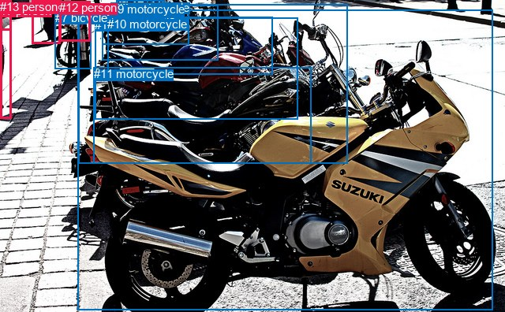
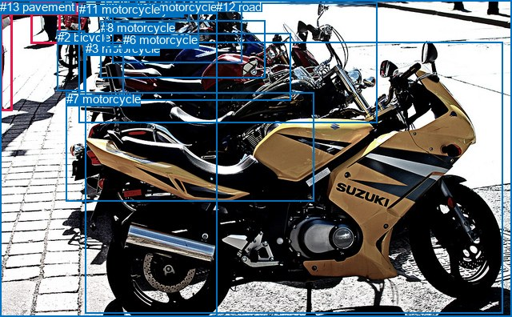

# 图片 0910：2356736.jpg

随机样本序号：78。图片 SHA256：`96c4c369549f98c34723996b2874808c49a1837c2dba321f64a1448387699ecd`。

红色框表示人，蓝色框表示其他物体。两个模式分别保留自身框编号，可依据位置比较对应对象。

## 自动检测框与输出

人的框编号：`[2, 6, 12, 13]`。状态：`ok`。

### 自动检测全部物体框

| 编号 | 类别 | 是否为人 | 检测分数 | 像素坐标 xyxy |
|---|---|---|---|---|
| 0 | motorcycle | False | 0.9988 | 98.5, 12.5, 624.2, 393.5 |
| 1 | motorcycle | False | 0.9809 | 120.3, 22.7, 377.1, 151.6 |
| 2 | person | True | 0.9647 | 40.3, 0.9, 76.7, 56.0 |
| 3 | motorcycle | False | 0.9605 | 129.5, 6.8, 276.3, 76.9 |
| 4 | motorcycle | False | 0.9394 | 129.4, 9.8, 239.9, 56.1 |
| 5 | motorcycle | False | 0.9389 | 99.4, 5.7, 440.3, 207.2 |
| 6 | person | True | 0.9212 | 0.0, 4.7, 14.5, 150.3 |
| 7 | bicycle | False | 0.9200 | 69.7, 13.5, 115.9, 87.9 |
| 8 | motorcycle | False | 0.7881 | 147.0, 0.9, 208.5, 23.3 |
| 9 | motorcycle | False | 0.7498 | 140.5, 3.0, 225.3, 38.0 |
| 10 | motorcycle | False | 0.6884 | 136.1, 21.8, 345.0, 94.6 |
| 11 | motorcycle | False | 0.5035 | 118.6, 85.4, 394.4, 207.1 |
| 12 | person | True | 0.4501 | 75.0, 1.4, 114.5, 52.2 |
| 13 | person | True | 0.4055 | 0.0, 0.1, 14.1, 38.8 |

### 自动检测 Top50 人相关候选

评分物体对：182；人相关物体对：92；输出关系：50。

| 排名 | 主语编号与类别 | 关系 | 宾语编号与类别 | 类型 | 人与人 | 排序分数 | 原始融合 logit |
|---|---|---|---|---|---|---|---|
| 1 | #6 person | wearing | #13 person | semantic | True | 0.98481 | 4.1720 |
| 2 | #13 person | walking on | #6 person | semantic | True | 0.96830 | 3.4192 |
| 3 | #2 person | walking on | #7 bicycle | semantic | False | 0.96509 | 3.3194 |
| 4 | #12 person | attached to | #7 bicycle | spatial | False | 0.95949 | 3.1649 |
| 5 | #6 person | walking on | #0 motorcycle | semantic | False | 0.94355 | 2.8163 |
| 6 | #12 person | riding | #7 bicycle | semantic | False | 0.93878 | 2.7300 |
| 7 | #2 person | pushing | #12 person | semantic | True | 0.93555 | 2.6752 |
| 8 | #2 person | beside | #7 bicycle | spatial | False | 0.92270 | 2.4797 |
| 9 | #13 person | beside | #6 person | spatial | True | 0.91221 | 2.3409 |
| 10 | #13 person | walking on | #0 motorcycle | semantic | False | 0.87599 | 1.9550 |
| 11 | #2 person | walking on | #0 motorcycle | semantic | False | 0.87570 | 1.9523 |
| 12 | #13 person | walking on | #2 person | semantic | True | 0.87500 | 1.9459 |
| 13 | #2 person | beside | #12 person | spatial | True | 0.86368 | 1.8462 |
| 14 | #7 bicycle | carrying | #12 person | semantic | False | 0.86295 | 1.8400 |
| 15 | #6 person | in | #13 person | spatial | True | 0.80834 | 1.4393 |
| 16 | #12 person | attached to | #0 motorcycle | spatial | False | 0.79081 | 1.3298 |
| 17 | #7 bicycle | parked on | #2 person | semantic | False | 0.76780 | 1.1959 |
| 18 | #12 person | attached to | #5 motorcycle | spatial | False | 0.76318 | 1.1702 |
| 19 | #12 person | beside | #2 person | spatial | True | 0.73941 | 1.0429 |
| 20 | #6 person | walking on | #2 person | semantic | True | 0.73038 | 0.9965 |
| 21 | #6 person | beside | #0 motorcycle | spatial | False | 0.72672 | 0.9780 |
| 22 | #2 person | beside | #13 person | spatial | True | 0.69871 | 0.8412 |
| 23 | #13 person | beside | #2 person | spatial | True | 0.69646 | 0.8305 |
| 24 | #13 person | walking on | #7 bicycle | semantic | False | 0.68107 | 0.7587 |
| 25 | #6 person | walking on | #7 bicycle | semantic | False | 0.67811 | 0.7451 |
| 26 | #12 person | parked on | #0 motorcycle | semantic | False | 0.64470 | 0.5958 |
| 27 | #7 bicycle | beside | #2 person | spatial | False | 0.63441 | 0.5512 |
| 28 | #2 person | walking on | #6 person | semantic | True | 0.61410 | 0.4646 |
| 29 | #2 person | walking on | #5 motorcycle | semantic | False | 0.61093 | 0.4512 |
| 30 | #7 bicycle | beside | #12 person | spatial | False | 0.60505 | 0.4265 |
| 31 | #6 person | walking on | #5 motorcycle | semantic | False | 0.60442 | 0.4239 |
| 32 | #2 person | walking on | #13 person | semantic | True | 0.57557 | 0.3046 |
| 33 | #2 person | beside | #6 person | spatial | True | 0.55019 | 0.2014 |
| 34 | #2 person | beside | #0 motorcycle | spatial | False | 0.52971 | 0.1190 |
| 35 | #13 person | walking on | #5 motorcycle | semantic | False | 0.51627 | 0.0651 |
| 36 | #13 person | walking on | #12 person | semantic | True | 0.47988 | -0.0805 |
| 37 | #0 motorcycle | parked on | #12 person | semantic | False | 0.44222 | -0.2322 |
| 38 | #6 person | beside | #2 person | spatial | True | 0.43405 | -0.2653 |
| 39 | #13 person | walking on | #1 motorcycle | semantic | False | 0.42422 | -0.3055 |
| 40 | #2 person | walking on | #1 motorcycle | semantic | False | 0.42160 | -0.3162 |
| 41 | #12 person | parked on | #5 motorcycle | semantic | False | 0.42071 | -0.3199 |
| 42 | #2 person | walking on | #3 motorcycle | semantic | False | 0.39662 | -0.4196 |
| 43 | #2 person | walking on | #10 motorcycle | semantic | False | 0.39649 | -0.4201 |
| 44 | #2 person | walking on | #8 motorcycle | semantic | False | 0.39270 | -0.4360 |
| 45 | #6 person | walking on | #1 motorcycle | semantic | False | 0.38597 | -0.4643 |
| 46 | #13 person | walking on | #10 motorcycle | semantic | False | 0.38332 | -0.4755 |
| 47 | #0 motorcycle | parked on | #6 person | semantic | False | 0.38157 | -0.4829 |
| 48 | #13 person | beside | #0 motorcycle | spatial | False | 0.38056 | -0.4872 |
| 49 | #12 person | beside | #9 motorcycle | spatial | False | 0.37767 | -0.4995 |
| 50 | #12 person | beside | #8 motorcycle | spatial | False | 0.37532 | -0.5095 |

### 自动检测逐条人相关 GT 核验

R@50：0.00%；命中 0/1。

| GT 主语编号 | GT 关系 | GT 宾语编号 | 结果阶段 | 匹配预测主语编号 | 匹配预测宾语编号 |
|---|---|---|---|---|---|
| 0 | walking on | 13 | endpoint_missing_or_wrong_class | [2] | [] |

## 真实框与输出

人的框编号：`[0, 1]`。

### 真实框全部物体框

| 编号 | 类别 | 是否为人 | 检测分数 | 像素坐标 xyxy |
|---|---|---|---|---|
| 0 | person | True | GT | 38.0, 1.0, 75.0, 54.0 |
| 1 | person | True | GT | 0.0, 1.0, 15.0, 139.0 |
| 2 | bicycle | False | GT | 72.0, 38.0, 106.0, 113.0 |
| 3 | motorcycle | False | GT | 107.0, 52.0, 629.0, 391.0 |
| 4 | motorcycle | False | GT | 136.0, 4.0, 236.0, 26.0 |
| 5 | motorcycle | False | GT | 140.0, 0.0, 302.0, 78.0 |
| 6 | motorcycle | False | GT | 154.0, 41.0, 364.0, 126.0 |
| 7 | motorcycle | False | GT | 83.0, 115.0, 393.0, 251.0 |
| 8 | motorcycle | False | GT | 126.0, 26.0, 332.0, 97.0 |
| 9 | motorcycle | False | GT | 131.0, 1.0, 248.0, 61.0 |
| 10 | motorcycle | False | GT | 170.0, 0.0, 218.0, 16.0 |
| 11 | motorcycle | False | GT | 99.0, 3.0, 472.0, 153.0 |
| 12 | road | False | GT | 270.0, 0.0, 640.0, 396.0 |
| 13 | pavement | False | GT | 0.0, 0.0, 640.0, 396.0 |

### 真实框 Top50 人相关候选

评分物体对：182；人相关物体对：50；输出关系：50。

| 排名 | 主语编号与类别 | 关系 | 宾语编号与类别 | 类型 | 人与人 | 排序分数 | 原始融合 logit |
|---|---|---|---|---|---|---|---|
| 1 | #0 person | walking on | #13 pavement | semantic | False | 0.99063 | 4.6614 |
| 2 | #1 person | walking on | #13 pavement | semantic | False | 0.98876 | 4.4768 |
| 3 | #1 person | walking on | #12 road | semantic | False | 0.94363 | 2.8177 |
| 4 | #1 person | on | #13 pavement | spatial | False | 0.87547 | 1.9502 |
| 5 | #1 person | walking on | #3 motorcycle | semantic | False | 0.86280 | 1.8387 |
| 6 | #0 person | in | #13 pavement | spatial | False | 0.83441 | 1.6172 |
| 7 | #1 person | walking on | #0 person | semantic | True | 0.82015 | 1.5174 |
| 8 | #0 person | walking on | #12 road | semantic | False | 0.81011 | 1.4508 |
| 9 | #1 person | walking on | #11 motorcycle | semantic | False | 0.69916 | 0.8433 |
| 10 | #0 person | walking on | #11 motorcycle | semantic | False | 0.69772 | 0.8365 |
| 11 | #1 person | beside | #3 motorcycle | spatial | False | 0.61473 | 0.4673 |
| 12 | #1 person | in | #12 road | spatial | False | 0.56410 | 0.2578 |
| 13 | #0 person | walking on | #3 motorcycle | semantic | False | 0.48725 | -0.0510 |
| 14 | #1 person | beside | #0 person | spatial | True | 0.43365 | -0.2670 |
| 15 | #0 person | walking on | #1 person | semantic | True | 0.36085 | -0.5717 |
| 16 | #1 person | beside | #11 motorcycle | spatial | False | 0.34082 | -0.6596 |
| 17 | #0 person | walking on | #5 motorcycle | semantic | False | 0.26995 | -0.9949 |
| 18 | #0 person | beside | #11 motorcycle | spatial | False | 0.24567 | -1.1218 |
| 19 | #0 person | beside | #2 bicycle | spatial | False | 0.24379 | -1.1320 |
| 20 | #0 person | in | #12 road | spatial | False | 0.23545 | -1.1778 |
| 21 | #0 person | walking on | #9 motorcycle | semantic | False | 0.23419 | -1.1848 |
| 22 | #1 person | walking on | #5 motorcycle | semantic | False | 0.21513 | -1.2943 |
| 23 | #0 person | walking on | #2 bicycle | semantic | False | 0.20550 | -1.3522 |
| 24 | #0 person | walking on | #4 motorcycle | semantic | False | 0.19936 | -1.3903 |
| 25 | #0 person | walking on | #8 motorcycle | semantic | False | 0.18141 | -1.5068 |
| 26 | #1 person | walking on | #9 motorcycle | semantic | False | 0.13615 | -1.8477 |
| 27 | #0 person | beside | #9 motorcycle | spatial | False | 0.13332 | -1.8719 |
| 28 | #0 person | beside | #4 motorcycle | spatial | False | 0.11881 | -2.0037 |
| 29 | #1 person | walking on | #8 motorcycle | semantic | False | 0.11784 | -2.0130 |
| 30 | #0 person | beside | #3 motorcycle | spatial | False | 0.11606 | -2.0303 |
| 31 | #0 person | beside | #5 motorcycle | spatial | False | 0.11148 | -2.0757 |
| 32 | #1 person | walking on | #4 motorcycle | semantic | False | 0.11031 | -2.0876 |
| 33 | #1 person | walking on | #10 motorcycle | semantic | False | 0.10963 | -2.0946 |
| 34 | #1 person | walking on | #6 motorcycle | semantic | False | 0.09294 | -2.2782 |
| 35 | #0 person | beside | #1 person | spatial | True | 0.08815 | -2.3365 |
| 36 | #2 bicycle | on | #0 person | spatial | False | 0.08533 | -2.3720 |
| 37 | #1 person | walking on | #2 bicycle | semantic | False | 0.06520 | -2.6628 |
| 38 | #0 person | beside | #8 motorcycle | spatial | False | 0.06415 | -2.6802 |
| 39 | #1 person | beside | #5 motorcycle | spatial | False | 0.06001 | -2.7514 |
| 40 | #0 person | walking on | #6 motorcycle | semantic | False | 0.05426 | -2.8583 |
| 41 | #1 person | walking on | #7 motorcycle | semantic | False | 0.05190 | -2.9051 |
| 42 | #1 person | beside | #9 motorcycle | spatial | False | 0.04521 | -3.0502 |
| 43 | #0 person | walking on | #10 motorcycle | semantic | False | 0.04138 | -3.1428 |
| 44 | #1 person | beside | #4 motorcycle | spatial | False | 0.03597 | -3.2885 |
| 45 | #1 person | beside | #8 motorcycle | spatial | False | 0.03547 | -3.3030 |
| 46 | #1 person | beside | #2 bicycle | spatial | False | 0.03111 | -3.4387 |
| 47 | #1 person | beside | #10 motorcycle | spatial | False | 0.02893 | -3.5135 |
| 48 | #0 person | beside | #10 motorcycle | spatial | False | 0.02701 | -3.5841 |
| 49 | #1 person | beside | #6 motorcycle | spatial | False | 0.02440 | -3.6884 |
| 50 | #3 motorcycle | parked on | #1 person | semantic | False | 0.02067 | -3.8583 |

### 真实框逐条人相关 GT 核验

R@50：100.00%；命中 1/1。

| GT 主语编号 | GT 关系 | GT 宾语编号 | 结果阶段 | 匹配预测主语编号 | 匹配预测宾语编号 |
|---|---|---|---|---|---|
| 0 | walking on | 13 | hit50 | [0] | [13] |

## 全部人相关 GT

| 主语编号与类别 | 关系 | 宾语编号与类别 |
|---|---|---|
| #0 person | walking on | #13 pavement |

原始记录、全部人相关物体对的两项预测与分项分数见 [逐图证据 JSON](../evidence/cases/0910.json)。全部56类 logits 保留于本机 HOR/output/random500/logits/。

<!-- HOR_COMPLETE_RESULTS -->

## 六组条件的完整输出对照

以下保留同一图片三种框与候选模式、两种谓词输出规则的全部 Top50。框编号各自在所属模式内解释。

### 自动检测框完整枚举：空间与语义各保留一个谓词

| 排名 | 主语编号与类别 | 谓词 | 宾语编号与类别 | 分组 | 排序分数 | predicate logit | pair logit |
|---|---|---|---|---|---|---|---|
| 1 | #6 person | wearing | #13 person | semantic | 0.9848123 | 3.9565339 | 0.2154234 |
| 2 | #13 person | walking on | #6 person | semantic | 0.9683000 | 3.3355317 | 0.0836947 |
| 3 | #2 person | walking on | #7 bicycle | semantic | 0.9650871 | 3.7643905 | -0.4450291 |
| 4 | #12 person | attached to | #7 bicycle | spatial | 0.9594935 | 3.6048608 | -0.4399189 |
| 5 | #6 person | walking on | #0 motorcycle | semantic | 0.9435487 | 3.3160472 | -0.4997776 |
| 6 | #12 person | riding | #7 bicycle | semantic | 0.9387761 | 3.1699572 | -0.4399189 |
| 7 | #2 person | pushing | #12 person | semantic | 0.9355455 | 3.1848598 | -0.5096892 |
| 8 | #2 person | beside | #7 bicycle | spatial | 0.9227037 | 2.9246922 | -0.4450291 |
| 9 | #13 person | beside | #6 person | spatial | 0.9122060 | 2.2571783 | 0.0836947 |
| 10 | #13 person | walking on | #0 motorcycle | semantic | 0.8759889 | 2.8105302 | -0.8555478 |
| 11 | #2 person | walking on | #0 motorcycle | semantic | 0.8756990 | 2.8014989 | -0.8491821 |
| 12 | #13 person | walking on | #2 person | semantic | 0.8750038 | 2.1138883 | -0.1679431 |
| 13 | #2 person | beside | #12 person | spatial | 0.8636824 | 2.3559070 | -0.5096892 |
| 14 | #7 bicycle | carrying | #12 person | semantic | 0.8629471 | 2.4793038 | -0.6393172 |
| 15 | #6 person | in | #13 person | spatial | 0.8083411 | 1.2238441 | 0.2154234 |
| 16 | #12 person | attached to | #0 motorcycle | spatial | 0.7908142 | 2.0222511 | -0.6924109 |
| 17 | #7 bicycle | parked on | #2 person | semantic | 0.7677970 | 2.2192469 | -1.0233337 |
| 18 | #12 person | attached to | #5 motorcycle | spatial | 0.7631824 | 1.9364109 | -0.7662039 |
| 19 | #12 person | beside | #2 person | spatial | 0.7394062 | 1.9919496 | -0.9490651 |
| 20 | #6 person | walking on | #2 person | semantic | 0.7303759 | 1.1178803 | -0.1213500 |
| 21 | #6 person | beside | #0 motorcycle | spatial | 0.7267208 | 1.4778256 | -0.4997776 |
| 22 | #2 person | beside | #13 person | spatial | 0.6987125 | 1.1729808 | -0.3318062 |
| 23 | #13 person | beside | #2 person | spatial | 0.6964585 | 0.9984326 | -0.1679431 |
| 24 | #13 person | walking on | #7 bicycle | semantic | 0.6810674 | 1.3556280 | -0.5969464 |
| 25 | #6 person | walking on | #7 bicycle | semantic | 0.6781085 | 1.2247257 | -0.4796328 |
| 26 | #12 person | parked on | #0 motorcycle | semantic | 0.6446963 | 1.2882175 | -0.6924109 |
| 27 | #7 bicycle | beside | #2 person | spatial | 0.6344103 | 1.5745177 | -1.0233337 |
| 28 | #2 person | walking on | #6 person | semantic | 0.6141041 | 0.7748065 | -0.3102097 |
| 29 | #2 person | walking on | #5 motorcycle | semantic | 0.6109335 | 1.3767014 | -0.9254637 |
| 30 | #7 bicycle | beside | #12 person | spatial | 0.6050473 | 1.0658579 | -0.6393172 |
| 31 | #6 person | walking on | #5 motorcycle | semantic | 0.6044210 | 1.4158244 | -0.9919041 |
| 32 | #2 person | walking on | #13 person | semantic | 0.5755702 | 0.6364207 | -0.3318062 |
| 33 | #2 person | beside | #6 person | spatial | 0.5501875 | 0.5116382 | -0.3102097 |
| 34 | #2 person | beside | #0 motorcycle | spatial | 0.5297067 | 0.9681487 | -0.8491821 |
| 35 | #13 person | walking on | #5 motorcycle | semantic | 0.5162694 | 1.1720834 | -1.1069829 |
| 36 | #13 person | walking on | #12 person | semantic | 0.4798804 | 0.4739776 | -0.5544996 |
| 37 | #0 motorcycle | parked on | #12 person | semantic | 0.4422180 | 0.9846244 | -1.2167895 |
| 38 | #6 person | beside | #2 person | spatial | 0.4340540 | -0.1439795 | -0.1213500 |
| 39 | #13 person | walking on | #1 motorcycle | semantic | 0.4242231 | 0.9208307 | -1.2262917 |
| 40 | #2 person | walking on | #1 motorcycle | semantic | 0.4215966 | 0.7026653 | -1.0188880 |
| 41 | #12 person | parked on | #5 motorcycle | semantic | 0.4207110 | 0.4463487 | -0.7662039 |
| 42 | #2 person | walking on | #3 motorcycle | semantic | 0.3966239 | 0.5326552 | -0.9522074 |
| 43 | #2 person | walking on | #10 motorcycle | semantic | 0.3964937 | 0.5326552 | -0.9527516 |
| 44 | #2 person | walking on | #8 motorcycle | semantic | 0.3926966 | 0.3927355 | -0.8287265 |
| 45 | #6 person | walking on | #1 motorcycle | semantic | 0.3859699 | 0.6936479 | -1.1579324 |
| 46 | #13 person | walking on | #10 motorcycle | semantic | 0.3833168 | 0.6530337 | -1.1285272 |
| 47 | #0 motorcycle | parked on | #6 person | semantic | 0.3815741 | 0.4427876 | -0.9256601 |
| 48 | #13 person | beside | #0 motorcycle | spatial | 0.3805592 | 0.3683724 | -0.8555478 |
| 49 | #12 person | beside | #9 motorcycle | spatial | 0.3776650 | 0.1568751 | -0.6563460 |
| 50 | #12 person | beside | #8 motorcycle | spatial | 0.3753171 | 0.0961576 | -0.6056306 |

GT 命中：0/1，R@50=0.00%。

| GT主语 | GT谓词 | GT宾语 | 结果阶段 | 匹配主语框 | 匹配宾语框 |
|---|---|---|---|---|---|
| 0 | walking on | 13 | endpoint_missing_or_wrong_class | [2] | [] |

### 自动检测框完整枚举：每对只保留一个谓词

| 排名 | 主语编号与类别 | 谓词 | 宾语编号与类别 | 分组 | 排序分数 | predicate logit | pair logit |
|---|---|---|---|---|---|---|---|
| 1 | #6 person | wearing | #13 person | single | 0.9848123 | 3.9565339 | 0.2154234 |
| 2 | #13 person | walking on | #6 person | single | 0.9683000 | 3.3355317 | 0.0836947 |
| 3 | #2 person | walking on | #7 bicycle | single | 0.9650871 | 3.7643905 | -0.4450291 |
| 4 | #12 person | attached to | #7 bicycle | single | 0.9594935 | 3.6048608 | -0.4399189 |
| 5 | #6 person | walking on | #0 motorcycle | single | 0.9435487 | 3.3160472 | -0.4997776 |
| 6 | #2 person | pushing | #12 person | single | 0.9355455 | 3.1848598 | -0.5096892 |
| 7 | #13 person | walking on | #0 motorcycle | single | 0.8759889 | 2.8105302 | -0.8555478 |
| 8 | #2 person | walking on | #0 motorcycle | single | 0.8756990 | 2.8014989 | -0.8491821 |
| 9 | #13 person | walking on | #2 person | single | 0.8750038 | 2.1138883 | -0.1679431 |
| 10 | #7 bicycle | carrying | #12 person | single | 0.8629471 | 2.4793038 | -0.6393172 |
| 11 | #12 person | attached to | #0 motorcycle | single | 0.7908142 | 2.0222511 | -0.6924109 |
| 12 | #7 bicycle | parked on | #2 person | single | 0.7677970 | 2.2192469 | -1.0233337 |
| 13 | #12 person | attached to | #5 motorcycle | single | 0.7631824 | 1.9364109 | -0.7662039 |
| 14 | #12 person | beside | #2 person | single | 0.7394062 | 1.9919496 | -0.9490651 |
| 15 | #6 person | walking on | #2 person | single | 0.7303759 | 1.1178803 | -0.1213500 |
| 16 | #2 person | beside | #13 person | single | 0.6987125 | 1.1729808 | -0.3318062 |
| 17 | #13 person | walking on | #7 bicycle | single | 0.6810674 | 1.3556280 | -0.5969464 |
| 18 | #6 person | walking on | #7 bicycle | single | 0.6781085 | 1.2247257 | -0.4796328 |
| 19 | #2 person | walking on | #6 person | single | 0.6141041 | 0.7748065 | -0.3102097 |
| 20 | #2 person | walking on | #5 motorcycle | single | 0.6109335 | 1.3767014 | -0.9254637 |
| 21 | #6 person | walking on | #5 motorcycle | single | 0.6044210 | 1.4158244 | -0.9919041 |
| 22 | #13 person | walking on | #5 motorcycle | single | 0.5162694 | 1.1720834 | -1.1069829 |
| 23 | #13 person | walking on | #12 person | single | 0.4798804 | 0.4739776 | -0.5544996 |
| 24 | #0 motorcycle | parked on | #12 person | single | 0.4422180 | 0.9846244 | -1.2167895 |
| 25 | #13 person | walking on | #1 motorcycle | single | 0.4242231 | 0.9208307 | -1.2262917 |
| 26 | #2 person | walking on | #1 motorcycle | single | 0.4215966 | 0.7026653 | -1.0188880 |
| 27 | #2 person | walking on | #3 motorcycle | single | 0.3966239 | 0.5326552 | -0.9522074 |
| 28 | #2 person | walking on | #10 motorcycle | single | 0.3964937 | 0.5326552 | -0.9527516 |
| 29 | #2 person | walking on | #8 motorcycle | single | 0.3926966 | 0.3927355 | -0.8287265 |
| 30 | #6 person | walking on | #1 motorcycle | single | 0.3859699 | 0.6936479 | -1.1579324 |
| 31 | #13 person | walking on | #10 motorcycle | single | 0.3833168 | 0.6530337 | -1.1285272 |
| 32 | #0 motorcycle | parked on | #6 person | single | 0.3815741 | 0.4427876 | -0.9256601 |
| 33 | #12 person | beside | #9 motorcycle | single | 0.3776650 | 0.1568751 | -0.6563460 |
| 34 | #12 person | beside | #8 motorcycle | single | 0.3753171 | 0.0961576 | -0.6056306 |
| 35 | #2 person | walking on | #9 motorcycle | single | 0.3752100 | 0.3912301 | -0.9011596 |
| 36 | #6 person | walking on | #12 person | single | 0.3607005 | -0.0601382 | -0.5121869 |
| 37 | #12 person | beside | #3 motorcycle | single | 0.3510502 | 0.0695977 | -0.6840239 |
| 38 | #13 person | walking on | #3 motorcycle | single | 0.3405946 | 0.4845285 | -1.1451743 |
| 39 | #12 person | beside | #4 motorcycle | single | 0.3249274 | -0.0219879 | -0.7092307 |
| 40 | #13 person | walking on | #8 motorcycle | single | 0.3233044 | 0.3069777 | -1.0456051 |
| 41 | #2 person | walking on | #4 motorcycle | single | 0.3228012 | 0.2498055 | -0.9907337 |
| 42 | #0 motorcycle | parked on | #2 person | single | 0.3163894 | 0.5936089 | -1.3640238 |
| 43 | #6 person | walking on | #10 motorcycle | single | 0.2952748 | 0.3190336 | -1.1889350 |
| 44 | #6 person | walking on | #3 motorcycle | single | 0.2889515 | 0.3069916 | -1.2074734 |
| 45 | #13 person | walking on | #9 motorcycle | single | 0.2850330 | 0.1851211 | -1.1047527 |
| 46 | #12 person | beside | #1 motorcycle | single | 0.2727378 | -0.1710892 | -0.8096871 |
| 47 | #12 person | beside | #10 motorcycle | single | 0.2571491 | -0.3210950 | -0.7397442 |
| 48 | #6 person | walking on | #8 motorcycle | single | 0.2525461 | 0.0075707 | -1.0926495 |
| 49 | #7 bicycle | parked on | #6 person | single | 0.2416938 | -0.2794709 | -0.8639446 |
| 50 | #13 person | walking on | #4 motorcycle | single | 0.2401464 | 0.0196261 | -1.1715032 |

GT 命中：0/1，R@50=0.00%。

| GT主语 | GT谓词 | GT宾语 | 结果阶段 | 匹配主语框 | 匹配宾语框 |
|---|---|---|---|---|---|
| 0 | walking on | 13 | endpoint_missing_or_wrong_class | [2] | [] |

### 真实框完整枚举：空间与语义各保留一个谓词

| 排名 | 主语编号与类别 | 谓词 | 宾语编号与类别 | 分组 | 排序分数 | predicate logit | pair logit |
|---|---|---|---|---|---|---|---|
| 1 | #0 person | walking on | #13 pavement | semantic | 0.9906349 | 4.9018941 | -0.2405365 |
| 2 | #1 person | walking on | #13 pavement | semantic | 0.9887586 | 4.4866652 | -0.0098163 |
| 3 | #1 person | walking on | #12 road | semantic | 0.9436266 | 3.2559757 | -0.4382406 |
| 4 | #1 person | on | #13 pavement | spatial | 0.8754725 | 1.9600539 | -0.0098163 |
| 5 | #1 person | walking on | #3 motorcycle | semantic | 0.8627999 | 2.2839961 | -0.4452544 |
| 6 | #0 person | in | #13 pavement | spatial | 0.8344124 | 1.8577638 | -0.2405365 |
| 7 | #1 person | walking on | #0 person | semantic | 0.8201537 | 1.5873265 | -0.0699376 |
| 8 | #0 person | walking on | #12 road | semantic | 0.8101144 | 2.1576242 | -0.7068702 |
| 9 | #1 person | walking on | #11 motorcycle | semantic | 0.6991596 | 1.6039252 | -0.7606260 |
| 10 | #0 person | walking on | #11 motorcycle | semantic | 0.6977171 | 1.6083999 | -0.7719495 |
| 11 | #1 person | beside | #3 motorcycle | spatial | 0.6147342 | 0.9125109 | -0.4452544 |
| 12 | #1 person | in | #12 road | spatial | 0.5640961 | 0.6960435 | -0.4382406 |
| 13 | #0 person | walking on | #3 motorcycle | semantic | 0.4872497 | 0.8937640 | -0.9447763 |
| 14 | #1 person | beside | #0 person | spatial | 0.4336469 | -0.1970496 | -0.0699376 |
| 15 | #0 person | walking on | #1 person | semantic | 0.3608470 | -0.1489630 | -0.4227268 |
| 16 | #1 person | beside | #11 motorcycle | spatial | 0.3408238 | 0.1010008 | -0.7606260 |
| 17 | #0 person | walking on | #5 motorcycle | semantic | 0.2699539 | -0.1112752 | -0.8835811 |
| 18 | #0 person | beside | #11 motorcycle | spatial | 0.2456688 | -0.3498979 | -0.7719495 |
| 19 | #0 person | beside | #2 bicycle | spatial | 0.2437903 | -0.1407957 | -0.9912148 |
| 20 | #0 person | in | #12 road | spatial | 0.2354464 | -0.4709387 | -0.7068702 |
| 21 | #0 person | walking on | #9 motorcycle | semantic | 0.2341875 | -0.2797809 | -0.9050345 |
| 22 | #1 person | walking on | #5 motorcycle | semantic | 0.2151329 | -0.2601843 | -1.0340742 |
| 23 | #0 person | walking on | #2 bicycle | semantic | 0.2055047 | -0.3610234 | -0.9912148 |
| 24 | #0 person | walking on | #4 motorcycle | semantic | 0.1993646 | -0.5189919 | -0.8712782 |
| 25 | #0 person | walking on | #8 motorcycle | semantic | 0.1814140 | -0.4843984 | -1.0223982 |
| 26 | #1 person | walking on | #9 motorcycle | semantic | 0.1361474 | -0.7852693 | -1.0623947 |
| 27 | #0 person | beside | #9 motorcycle | spatial | 0.1333223 | -0.9668627 | -0.9050345 |
| 28 | #0 person | beside | #4 motorcycle | spatial | 0.1188119 | -1.1324513 | -0.8712782 |
| 29 | #1 person | walking on | #8 motorcycle | semantic | 0.1178400 | -0.8785536 | -1.1344919 |
| 30 | #0 person | beside | #3 motorcycle | spatial | 0.1160591 | -1.0855145 | -0.9447763 |
| 31 | #0 person | beside | #5 motorcycle | spatial | 0.1114817 | -1.1921134 | -0.8835811 |
| 32 | #1 person | walking on | #4 motorcycle | semantic | 0.1103105 | -1.0575819 | -1.0299911 |
| 33 | #1 person | walking on | #10 motorcycle | semantic | 0.1096265 | -1.1102309 | -0.9843308 |
| 34 | #1 person | walking on | #6 motorcycle | semantic | 0.0929419 | -0.9086447 | -1.3695867 |
| 35 | #0 person | beside | #1 person | spatial | 0.0881464 | -1.9137540 | -0.4227268 |
| 36 | #2 bicycle | on | #0 person | spatial | 0.0853346 | -1.0091317 | -1.3628464 |
| 37 | #1 person | walking on | #2 bicycle | semantic | 0.0652014 | -1.8294315 | -0.8334183 |
| 38 | #0 person | beside | #8 motorcycle | spatial | 0.0641500 | -1.6578336 | -1.0223982 |
| 39 | #1 person | beside | #5 motorcycle | spatial | 0.0600078 | -1.7173223 | -1.0340742 |
| 40 | #0 person | walking on | #6 motorcycle | semantic | 0.0542553 | -1.4713607 | -1.3869104 |
| 41 | #1 person | walking on | #7 motorcycle | semantic | 0.0519022 | -1.3795750 | -1.5255222 |
| 42 | #1 person | beside | #9 motorcycle | spatial | 0.0452080 | -1.9878256 | -1.0623947 |
| 43 | #0 person | walking on | #10 motorcycle | semantic | 0.0413754 | -2.3153791 | -0.8274329 |
| 44 | #1 person | beside | #4 motorcycle | spatial | 0.0359681 | -2.2585022 | -1.0299911 |
| 45 | #1 person | beside | #8 motorcycle | spatial | 0.0354691 | -2.1684887 | -1.1344919 |
| 46 | #1 person | beside | #2 bicycle | spatial | 0.0311070 | -2.6053033 | -0.8334183 |
| 47 | #1 person | beside | #10 motorcycle | spatial | 0.0289311 | -2.5291500 | -0.9843308 |
| 48 | #0 person | beside | #10 motorcycle | spatial | 0.0270121 | -2.7566557 | -0.8274329 |
| 49 | #1 person | beside | #6 motorcycle | spatial | 0.0244026 | -2.3187716 | -1.3695867 |
| 50 | #3 motorcycle | parked on | #1 person | semantic | 0.0206678 | -2.8275540 | -1.0307412 |

GT 命中：1/1，R@50=100.00%。

| GT主语 | GT谓词 | GT宾语 | 结果阶段 | 匹配主语框 | 匹配宾语框 |
|---|---|---|---|---|---|
| 0 | walking on | 13 | hit50 | [0] | [13] |

### 真实框完整枚举：每对只保留一个谓词

| 排名 | 主语编号与类别 | 谓词 | 宾语编号与类别 | 分组 | 排序分数 | predicate logit | pair logit |
|---|---|---|---|---|---|---|---|
| 1 | #0 person | walking on | #13 pavement | single | 0.9906349 | 4.9018941 | -0.2405365 |
| 2 | #1 person | walking on | #13 pavement | single | 0.9887586 | 4.4866652 | -0.0098163 |
| 3 | #1 person | walking on | #12 road | single | 0.9436266 | 3.2559757 | -0.4382406 |
| 4 | #1 person | walking on | #3 motorcycle | single | 0.8627999 | 2.2839961 | -0.4452544 |
| 5 | #1 person | walking on | #0 person | single | 0.8201537 | 1.5873265 | -0.0699376 |
| 6 | #0 person | walking on | #12 road | single | 0.8101144 | 2.1576242 | -0.7068702 |
| 7 | #1 person | walking on | #11 motorcycle | single | 0.6991596 | 1.6039252 | -0.7606260 |
| 8 | #0 person | walking on | #11 motorcycle | single | 0.6977171 | 1.6083999 | -0.7719495 |
| 9 | #0 person | walking on | #3 motorcycle | single | 0.4872497 | 0.8937640 | -0.9447763 |
| 10 | #0 person | walking on | #1 person | single | 0.3608470 | -0.1489630 | -0.4227268 |
| 11 | #0 person | walking on | #5 motorcycle | single | 0.2699539 | -0.1112752 | -0.8835811 |
| 12 | #0 person | beside | #2 bicycle | single | 0.2437903 | -0.1407957 | -0.9912148 |
| 13 | #0 person | walking on | #9 motorcycle | single | 0.2341875 | -0.2797809 | -0.9050345 |
| 14 | #1 person | walking on | #5 motorcycle | single | 0.2151329 | -0.2601843 | -1.0340742 |
| 15 | #0 person | walking on | #4 motorcycle | single | 0.1993646 | -0.5189919 | -0.8712782 |
| 16 | #0 person | walking on | #8 motorcycle | single | 0.1814140 | -0.4843984 | -1.0223982 |
| 17 | #1 person | walking on | #9 motorcycle | single | 0.1361474 | -0.7852693 | -1.0623947 |
| 18 | #1 person | walking on | #8 motorcycle | single | 0.1178400 | -0.8785536 | -1.1344919 |
| 19 | #1 person | walking on | #4 motorcycle | single | 0.1103105 | -1.0575819 | -1.0299911 |
| 20 | #1 person | walking on | #10 motorcycle | single | 0.1096265 | -1.1102309 | -0.9843308 |
| 21 | #1 person | walking on | #6 motorcycle | single | 0.0929419 | -0.9086447 | -1.3695867 |
| 22 | #2 bicycle | on | #0 person | single | 0.0853346 | -1.0091317 | -1.3628464 |
| 23 | #1 person | walking on | #2 bicycle | single | 0.0652014 | -1.8294315 | -0.8334183 |
| 24 | #0 person | walking on | #6 motorcycle | single | 0.0542553 | -1.4713607 | -1.3869104 |
| 25 | #1 person | walking on | #7 motorcycle | single | 0.0519022 | -1.3795750 | -1.5255222 |
| 26 | #0 person | walking on | #10 motorcycle | single | 0.0413754 | -2.3153791 | -0.8274329 |
| 27 | #3 motorcycle | parked on | #1 person | single | 0.0206678 | -2.8275540 | -1.0307412 |
| 28 | #0 person | walking on | #7 motorcycle | single | 0.0193058 | -2.1897669 | -1.7380903 |
| 29 | #13 pavement | beside | #1 person | single | 0.0168807 | -2.8450212 | -1.2195404 |
| 30 | #3 motorcycle | beside | #0 person | single | 0.0130373 | -2.8765004 | -1.4503154 |
| 31 | #4 motorcycle | beside | #0 person | single | 0.0102598 | -2.9828606 | -1.5863509 |
| 32 | #11 motorcycle | beside | #0 person | single | 0.0088897 | -3.2448001 | -1.4691339 |
| 33 | #9 motorcycle | beside | #0 person | single | 0.0080853 | -3.1785116 | -1.6310767 |
| 34 | #12 road | beside | #1 person | single | 0.0073534 | -3.5611053 | -1.3441072 |
| 35 | #2 bicycle | beside | #1 person | single | 0.0068907 | -3.8457117 | -1.1249601 |
| 36 | #5 motorcycle | beside | #0 person | single | 0.0067870 | -3.3208957 | -1.6650358 |
| 37 | #13 pavement | in | #0 person | single | 0.0064119 | -3.4696267 | -1.5735443 |
| 38 | #12 road | beside | #0 person | single | 0.0061110 | -3.3330500 | -1.7584863 |
| 39 | #8 motorcycle | beside | #0 person | single | 0.0051962 | -3.4113429 | -1.8432763 |
| 40 | #10 motorcycle | beside | #0 person | single | 0.0045230 | -3.8390734 | -1.5549774 |
| 41 | #11 motorcycle | parked on | #1 person | single | 0.0038786 | -4.2558131 | -1.2925839 |
| 42 | #7 motorcycle | on | #0 person | single | 0.0038475 | -3.1024861 | -2.4539936 |
| 43 | #4 motorcycle | parked on | #1 person | single | 0.0031556 | -4.2112408 | -1.5441619 |
| 44 | #6 motorcycle | in front of | #0 person | single | 0.0029961 | -3.6934137 | -2.1140447 |
| 45 | #10 motorcycle | parked on | #1 person | single | 0.0021461 | -4.6249113 | -1.5170326 |
| 46 | #9 motorcycle | beside | #1 person | single | 0.0021237 | -4.5707464 | -1.5817306 |
| 47 | #5 motorcycle | parked on | #1 person | single | 0.0020455 | -4.5698161 | -1.6202278 |
| 48 | #7 motorcycle | on | #1 person | single | 0.0016330 | -4.2438970 | -2.1718030 |
| 49 | #8 motorcycle | beside | #1 person | single | 0.0012855 | -4.8831539 | -1.7721643 |
| 50 | #6 motorcycle | parked on | #1 person | single | 0.0012296 | -4.6987906 | -2.0010414 |

GT 命中：1/1，R@50=100.00%。

| GT主语 | GT谓词 | GT宾语 | 结果阶段 | 匹配主语框 | 匹配宾语框 |
|---|---|---|---|---|---|
| 0 | walking on | 13 | hit50 | [0] | [13] |

### 真实框400候选：空间与语义各保留一个谓词

| 排名 | 主语编号与类别 | 谓词 | 宾语编号与类别 | 分组 | 排序分数 | predicate logit | pair logit |
|---|---|---|---|---|---|---|---|
| 1 | #0 person | walking on | #13 pavement | semantic | 0.9911243 | 4.9560552 | -0.2405365 |
| 2 | #1 person | walking on | #13 pavement | semantic | 0.9887586 | 4.4866652 | -0.0098163 |
| 3 | #1 person | walking on | #12 road | semantic | 0.9406754 | 3.2018142 | -0.4382406 |
| 4 | #1 person | on | #13 pavement | spatial | 0.8754725 | 1.9600539 | -0.0098163 |
| 5 | #1 person | walking on | #3 motorcycle | semantic | 0.8627999 | 2.2839961 | -0.4452544 |
| 6 | #0 person | in | #13 pavement | spatial | 0.8344124 | 1.8577638 | -0.2405365 |
| 7 | #1 person | walking on | #0 person | semantic | 0.8243315 | 1.6159120 | -0.0699376 |
| 8 | #0 person | walking on | #12 road | semantic | 0.8101144 | 2.1576242 | -0.7068702 |
| 9 | #1 person | walking on | #11 motorcycle | semantic | 0.7054508 | 1.6340170 | -0.7606260 |
| 10 | #0 person | walking on | #11 motorcycle | semantic | 0.6977171 | 1.6083999 | -0.7719495 |
| 11 | #1 person | beside | #3 motorcycle | spatial | 0.6076109 | 0.8825350 | -0.4452544 |
| 12 | #1 person | in | #12 road | spatial | 0.5636880 | 0.6943841 | -0.4382406 |
| 13 | #0 person | walking on | #3 motorcycle | semantic | 0.5086855 | 0.9795218 | -0.9447763 |
| 14 | #1 person | beside | #0 person | spatial | 0.4336682 | -0.1969628 | -0.0699376 |
| 15 | #0 person | walking on | #1 person | semantic | 0.3674659 | -0.1203766 | -0.4227268 |
| 16 | #1 person | beside | #11 motorcycle | spatial | 0.3408400 | 0.1010728 | -0.7606260 |
| 17 | #0 person | walking on | #5 motorcycle | semantic | 0.2756245 | -0.0826893 | -0.8835811 |
| 18 | #0 person | beside | #11 motorcycle | spatial | 0.2512904 | -0.3197923 | -0.7719495 |
| 19 | #0 person | beside | #2 bicycle | spatial | 0.2493838 | -0.1106868 | -0.9912148 |
| 20 | #0 person | walking on | #9 motorcycle | semantic | 0.2390792 | -0.2526999 | -0.9050345 |
| 21 | #0 person | in | #12 road | spatial | 0.2354464 | -0.4709387 | -0.7068702 |
| 22 | #1 person | walking on | #5 motorcycle | semantic | 0.2151329 | -0.2601843 | -1.0340742 |
| 23 | #0 person | walking on | #2 bicycle | semantic | 0.2102114 | -0.3324370 | -0.9912148 |
| 24 | #0 person | walking on | #4 motorcycle | semantic | 0.1993646 | -0.5189919 | -0.8712782 |
| 25 | #0 person | walking on | #8 motorcycle | semantic | 0.1816376 | -0.4828935 | -1.0223982 |
| 26 | #1 person | walking on | #9 motorcycle | semantic | 0.1363245 | -0.7837641 | -1.0623947 |
| 27 | #0 person | beside | #9 motorcycle | spatial | 0.1333290 | -0.9668047 | -0.9050345 |
| 28 | #0 person | beside | #3 motorcycle | spatial | 0.1272950 | -0.9803145 | -0.9447763 |
| 29 | #0 person | beside | #4 motorcycle | spatial | 0.1188089 | -1.1324801 | -0.8712782 |
| 30 | #1 person | walking on | #8 motorcycle | semantic | 0.1178400 | -0.8785536 | -1.1344919 |
| 31 | #0 person | beside | #5 motorcycle | spatial | 0.1144959 | -1.1620364 | -0.8835811 |
| 32 | #1 person | walking on | #4 motorcycle | semantic | 0.1114973 | -1.0455465 | -1.0299911 |
| 33 | #1 person | walking on | #10 motorcycle | semantic | 0.1081665 | -1.1252768 | -0.9843308 |
| 34 | #1 person | walking on | #6 motorcycle | semantic | 0.0930689 | -0.9071395 | -1.3695867 |
| 35 | #0 person | beside | #1 person | spatial | 0.0905856 | -1.8837783 | -0.4227268 |
| 36 | #2 bicycle | on | #0 person | spatial | 0.0901508 | -0.9489491 | -1.3628464 |
| 37 | #0 person | beside | #8 motorcycle | spatial | 0.0650548 | -1.6428604 | -1.0223982 |
| 38 | #1 person | walking on | #2 bicycle | semantic | 0.0643810 | -1.8429718 | -0.8334183 |
| 39 | #1 person | beside | #5 motorcycle | spatial | 0.0591680 | -1.7323101 | -1.0340742 |
| 40 | #0 person | walking on | #6 motorcycle | semantic | 0.0542553 | -1.4713607 | -1.3869104 |
| 41 | #1 person | walking on | #7 motorcycle | semantic | 0.0518281 | -1.3810804 | -1.5255222 |
| 42 | #1 person | beside | #9 motorcycle | spatial | 0.0458612 | -1.9727945 | -1.0623947 |
| 43 | #0 person | walking on | #10 motorcycle | semantic | 0.0424630 | -2.2882984 | -0.8274329 |
| 44 | #1 person | beside | #4 motorcycle | spatial | 0.0359681 | -2.2585022 | -1.0299911 |
| 45 | #1 person | beside | #8 motorcycle | spatial | 0.0354711 | -2.1684310 | -1.1344919 |
| 46 | #1 person | beside | #2 bicycle | spatial | 0.0306576 | -2.6203198 | -0.8334183 |
| 47 | #1 person | beside | #10 motorcycle | spatial | 0.0289303 | -2.5291789 | -0.9843308 |
| 48 | #0 person | beside | #10 motorcycle | spatial | 0.0270136 | -2.7565980 | -0.8274329 |
| 49 | #1 person | beside | #6 motorcycle | spatial | 0.0244033 | -2.3187425 | -1.3695867 |
| 50 | #3 motorcycle | parked on | #1 person | semantic | 0.0212852 | -2.7974856 | -1.0307412 |

GT 命中：1/1，R@50=100.00%。

| GT主语 | GT谓词 | GT宾语 | 结果阶段 | 匹配主语框 | 匹配宾语框 |
|---|---|---|---|---|---|
| 0 | walking on | 13 | hit50 | [0] | [13] |

### 真实框400候选：每对只保留一个谓词

| 排名 | 主语编号与类别 | 谓词 | 宾语编号与类别 | 分组 | 排序分数 | predicate logit | pair logit |
|---|---|---|---|---|---|---|---|
| 1 | #0 person | walking on | #13 pavement | single | 0.9911243 | 4.9560552 | -0.2405365 |
| 2 | #1 person | walking on | #13 pavement | single | 0.9887586 | 4.4866652 | -0.0098163 |
| 3 | #1 person | walking on | #12 road | single | 0.9406754 | 3.2018142 | -0.4382406 |
| 4 | #1 person | walking on | #3 motorcycle | single | 0.8627999 | 2.2839961 | -0.4452544 |
| 5 | #1 person | walking on | #0 person | single | 0.8243315 | 1.6159120 | -0.0699376 |
| 6 | #0 person | walking on | #12 road | single | 0.8101144 | 2.1576242 | -0.7068702 |
| 7 | #1 person | walking on | #11 motorcycle | single | 0.7054508 | 1.6340170 | -0.7606260 |
| 8 | #0 person | walking on | #11 motorcycle | single | 0.6977171 | 1.6083999 | -0.7719495 |
| 9 | #0 person | walking on | #3 motorcycle | single | 0.5086855 | 0.9795218 | -0.9447763 |
| 10 | #0 person | walking on | #1 person | single | 0.3674659 | -0.1203766 | -0.4227268 |
| 11 | #0 person | walking on | #5 motorcycle | single | 0.2756245 | -0.0826893 | -0.8835811 |
| 12 | #0 person | beside | #2 bicycle | single | 0.2493838 | -0.1106868 | -0.9912148 |
| 13 | #0 person | walking on | #9 motorcycle | single | 0.2390792 | -0.2526999 | -0.9050345 |
| 14 | #1 person | walking on | #5 motorcycle | single | 0.2151329 | -0.2601843 | -1.0340742 |
| 15 | #0 person | walking on | #4 motorcycle | single | 0.1993646 | -0.5189919 | -0.8712782 |
| 16 | #0 person | walking on | #8 motorcycle | single | 0.1816376 | -0.4828935 | -1.0223982 |
| 17 | #1 person | walking on | #9 motorcycle | single | 0.1363245 | -0.7837641 | -1.0623947 |
| 18 | #1 person | walking on | #8 motorcycle | single | 0.1178400 | -0.8785536 | -1.1344919 |
| 19 | #1 person | walking on | #4 motorcycle | single | 0.1114973 | -1.0455465 | -1.0299911 |
| 20 | #1 person | walking on | #10 motorcycle | single | 0.1081665 | -1.1252768 | -0.9843308 |
| 21 | #1 person | walking on | #6 motorcycle | single | 0.0930689 | -0.9071395 | -1.3695867 |
| 22 | #2 bicycle | on | #0 person | single | 0.0901508 | -0.9489491 | -1.3628464 |
| 23 | #1 person | walking on | #2 bicycle | single | 0.0643810 | -1.8429718 | -0.8334183 |
| 24 | #0 person | walking on | #6 motorcycle | single | 0.0542553 | -1.4713607 | -1.3869104 |
| 25 | #1 person | walking on | #7 motorcycle | single | 0.0518281 | -1.3810804 | -1.5255222 |
| 26 | #0 person | walking on | #10 motorcycle | single | 0.0424630 | -2.2882984 | -0.8274329 |
| 27 | #3 motorcycle | parked on | #1 person | single | 0.0212852 | -2.7974856 | -1.0307412 |
| 28 | #0 person | walking on | #7 motorcycle | single | 0.0187858 | -2.2176001 | -1.7380903 |
| 29 | #13 pavement | beside | #1 person | single | 0.0167567 | -2.8525152 | -1.2195404 |
| 30 | #3 motorcycle | beside | #0 person | single | 0.0129405 | -2.8840523 | -1.4503154 |
| 31 | #4 motorcycle | beside | #0 person | single | 0.0102592 | -2.9829185 | -1.5863509 |
| 32 | #11 motorcycle | beside | #0 person | single | 0.0087586 | -3.2597880 | -1.4691339 |
| 33 | #9 motorcycle | beside | #0 person | single | 0.0082681 | -3.1559720 | -1.6310767 |
| 34 | #12 road | beside | #1 person | single | 0.0074087 | -3.5535536 | -1.3441072 |
| 35 | #5 motorcycle | beside | #0 person | single | 0.0068381 | -3.3133440 | -1.6650358 |
| 36 | #2 bicycle | beside | #1 person | single | 0.0067881 | -3.8608150 | -1.1249601 |
| 37 | #13 pavement | in | #0 person | single | 0.0064600 | -3.4621038 | -1.5735443 |
| 38 | #12 road | beside | #0 person | single | 0.0060205 | -3.3480668 | -1.7584863 |
| 39 | #8 motorcycle | beside | #0 person | single | 0.0051576 | -3.4188366 | -1.8432763 |
| 40 | #10 motorcycle | beside | #0 person | single | 0.0044894 | -3.8465674 | -1.5549774 |
| 41 | #7 motorcycle | on | #0 person | single | 0.0039378 | -3.0792007 | -2.4539936 |
| 42 | #11 motorcycle | parked on | #1 person | single | 0.0039004 | -4.2501769 | -1.2925839 |
| 43 | #4 motorcycle | parked on | #1 person | single | 0.0031675 | -4.2074828 | -1.5441619 |
| 44 | #6 motorcycle | in front of | #0 person | single | 0.0029325 | -3.7149103 | -2.1140447 |
| 45 | #10 motorcycle | parked on | #1 person | single | 0.0021613 | -4.6178660 | -1.5170326 |
| 46 | #9 motorcycle | beside | #1 person | single | 0.0020979 | -4.5829816 | -1.5817306 |
| 47 | #5 motorcycle | parked on | #1 person | single | 0.0020571 | -4.5641799 | -1.6202278 |
| 48 | #7 motorcycle | on | #1 person | single | 0.0015955 | -4.2671824 | -2.1718030 |
| 49 | #8 motorcycle | beside | #1 person | single | 0.0012476 | -4.9131298 | -1.7721643 |
| 50 | #6 motorcycle | parked on | #1 person | single | 0.0012058 | -4.7183237 | -2.0010414 |

GT 命中：1/1，R@50=100.00%。

| GT主语 | GT谓词 | GT宾语 | 结果阶段 | 匹配主语框 | 匹配宾语框 |
|---|---|---|---|---|---|
| 0 | walking on | 13 | hit50 | [0] | [13] |
