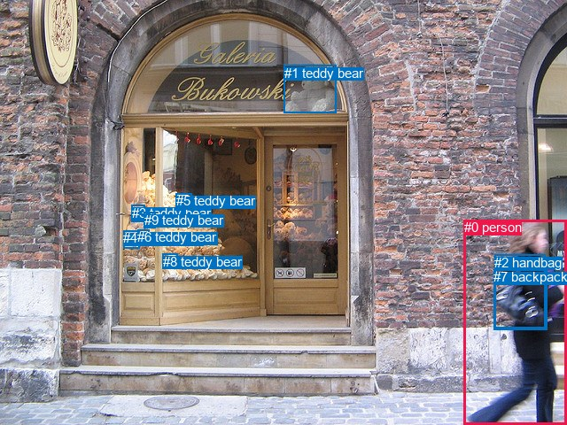
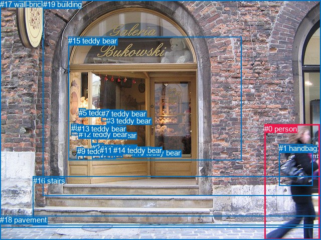

# 图片 0915：2356824.jpg

随机样本序号：65。图片 SHA256：`8ee36d978a81e41dde25a575cf485490eb5ecd64eb166a0a1c1a306209c80b64`。

红色框表示人，蓝色框表示其他物体。两个模式分别保留自身框编号，可依据位置比较对应对象。

## 自动检测框与输出

人的框编号：`[0]`。状态：`ok`。

### 自动检测全部物体框

| 编号 | 类别 | 是否为人 | 检测分数 | 像素坐标 xyxy |
|---|---|---|---|---|
| 0 | person | True | 0.9993 | 523.6, 248.3, 640.0, 480.0 |
| 1 | teddy bear | False | 0.9527 | 321.0, 73.5, 380.0, 127.2 |
| 2 | handbag | False | 0.8914 | 558.4, 287.8, 615.3, 370.6 |
| 3 | teddy bear | False | 0.6350 | 148.8, 232.0, 163.3, 250.6 |
| 4 | teddy bear | False | 0.5909 | 139.2, 260.3, 157.6, 280.7 |
| 5 | teddy bear | False | 0.5863 | 198.9, 218.4, 217.0, 236.1 |
| 6 | teddy bear | False | 0.5427 | 155.2, 259.2, 168.7, 274.2 |
| 7 | backpack | False | 0.5291 | 557.4, 304.1, 617.7, 372.7 |
| 8 | teddy bear | False | 0.4138 | 183.8, 286.7, 200.7, 303.6 |
| 9 | teddy bear | False | 0.3660 | 162.7, 239.9, 175.5, 257.1 |

### 自动检测 Top50 人相关候选

评分物体对：90；人相关物体对：18；输出关系：36。

| 排名 | 主语编号与类别 | 关系 | 宾语编号与类别 | 类型 | 人与人 | 排序分数 | 原始融合 logit |
|---|---|---|---|---|---|---|---|
| 1 | #0 person | carrying | #7 backpack | semantic | False | 0.99146 | 4.7546 |
| 2 | #0 person | carrying | #2 handbag | semantic | False | 0.98812 | 4.4211 |
| 3 | #0 person | in | #2 handbag | spatial | False | 0.93317 | 2.6364 |
| 4 | #0 person | in | #7 backpack | spatial | False | 0.91801 | 2.4156 |
| 5 | #2 handbag | on | #0 person | spatial | False | 0.87130 | 1.9125 |
| 6 | #7 backpack | on | #0 person | spatial | False | 0.86066 | 1.8207 |
| 7 | #0 person | walking on | #9 teddy bear | semantic | False | 0.80271 | 1.4033 |
| 8 | #0 person | walking on | #5 teddy bear | semantic | False | 0.76795 | 1.1968 |
| 9 | #0 person | walking on | #4 teddy bear | semantic | False | 0.75419 | 1.1211 |
| 10 | #0 person | walking on | #6 teddy bear | semantic | False | 0.74028 | 1.0474 |
| 11 | #0 person | walking on | #3 teddy bear | semantic | False | 0.69572 | 0.8270 |
| 12 | #0 person | walking on | #8 teddy bear | semantic | False | 0.68999 | 0.8001 |
| 13 | #7 backpack | carrying | #0 person | semantic | False | 0.59993 | 0.4052 |
| 14 | #2 handbag | carrying | #0 person | semantic | False | 0.55916 | 0.2378 |
| 15 | #0 person | walking on | #1 teddy bear | semantic | False | 0.54291 | 0.1721 |
| 16 | #0 person | in | #9 teddy bear | spatial | False | 0.42105 | -0.3184 |
| 17 | #0 person | in | #5 teddy bear | spatial | False | 0.39837 | -0.4122 |
| 18 | #0 person | in | #4 teddy bear | spatial | False | 0.38211 | -0.4806 |
| 19 | #0 person | in | #3 teddy bear | spatial | False | 0.37243 | -0.5218 |
| 20 | #0 person | in | #6 teddy bear | spatial | False | 0.37183 | -0.5244 |
| 21 | #0 person | on | #8 teddy bear | spatial | False | 0.30866 | -0.8064 |
| 22 | #0 person | in | #1 teddy bear | spatial | False | 0.16159 | -1.6464 |
| 23 | #1 teddy bear | beside | #0 person | spatial | False | 0.05222 | -2.8986 |
| 24 | #1 teddy bear | looking at | #0 person | semantic | False | 0.02368 | -3.7190 |
| 25 | #9 teddy bear | in | #0 person | spatial | False | 0.01379 | -4.2702 |
| 26 | #5 teddy bear | in | #0 person | spatial | False | 0.01378 | -4.2708 |
| 27 | #3 teddy bear | in | #0 person | spatial | False | 0.01309 | -4.3224 |
| 28 | #6 teddy bear | in | #0 person | spatial | False | 0.01130 | -4.4718 |
| 29 | #4 teddy bear | in | #0 person | spatial | False | 0.01110 | -4.4896 |
| 30 | #3 teddy bear | looking at | #0 person | semantic | False | 0.00762 | -4.8692 |
| 31 | #8 teddy bear | in | #0 person | spatial | False | 0.00711 | -4.9385 |
| 32 | #5 teddy bear | looking at | #0 person | semantic | False | 0.00646 | -5.0352 |
| 33 | #9 teddy bear | holding | #0 person | semantic | False | 0.00395 | -5.5289 |
| 34 | #4 teddy bear | holding | #0 person | semantic | False | 0.00373 | -5.5869 |
| 35 | #6 teddy bear | holding | #0 person | semantic | False | 0.00348 | -5.6564 |
| 36 | #8 teddy bear | holding | #0 person | semantic | False | 0.00234 | -6.0557 |

### 自动检测逐条人相关 GT 核验

R@50：50.00%；命中 1/2。

| GT 主语编号 | GT 关系 | GT 宾语编号 | 结果阶段 | 匹配预测主语编号 | 匹配预测宾语编号 |
|---|---|---|---|---|---|
| 0 | carrying | 1 | hit50 | [0] | [2] |
| 0 | walking on | 18 | endpoint_missing_or_wrong_class | [0] | [] |

## 真实框与输出

人的框编号：`[0]`。

### 真实框全部物体框

| 编号 | 类别 | 是否为人 | 检测分数 | 像素坐标 xyxy |
|---|---|---|---|---|
| 0 | person | True | GT | 527.0, 249.0, 637.0, 480.0 |
| 1 | handbag | False | GT | 556.0, 288.0, 623.0, 372.0 |
| 2 | teddy bear | False | GT | 183.0, 287.0, 206.0, 318.0 |
| 3 | teddy bear | False | GT | 212.0, 233.0, 233.0, 251.0 |
| 4 | teddy bear | False | GT | 183.0, 262.0, 195.0, 290.0 |
| 5 | teddy bear | False | GT | 157.0, 217.0, 170.0, 235.0 |
| 6 | teddy bear | False | GT | 212.0, 290.0, 231.0, 317.0 |
| 7 | teddy bear | False | GT | 202.0, 219.0, 217.0, 243.0 |
| 8 | teddy bear | False | GT | 142.0, 248.0, 157.0, 271.0 |
| 9 | teddy bear | False | GT | 154.0, 294.0, 167.0, 320.0 |
| 10 | teddy bear | False | GT | 263.0, 297.0, 291.0, 313.0 |
| 11 | teddy bear | False | GT | 199.0, 292.0, 220.0, 317.0 |
| 12 | teddy bear | False | GT | 157.0, 260.0, 171.0, 276.0 |
| 13 | teddy bear | False | GT | 154.0, 249.0, 166.0, 261.0 |
| 14 | teddy bear | False | GT | 226.0, 292.0, 245.0, 316.0 |
| 15 | teddy bear | False | GT | 136.0, 73.0, 482.0, 320.0 |
| 16 | stairs | False | GT | 66.0, 353.0, 640.0, 451.0 |
| 17 | wall-brick | False | GT | 0.0, 0.0, 640.0, 456.0 |
| 18 | pavement | False | GT | 0.0, 431.0, 640.0, 480.0 |
| 19 | building | False | GT | 86.0, 0.0, 640.0, 391.0 |

### 真实框 Top50 人相关候选

评分物体对：380；人相关物体对：38；输出关系：50。

| 排名 | 主语编号与类别 | 关系 | 宾语编号与类别 | 类型 | 人与人 | 排序分数 | 原始融合 logit |
|---|---|---|---|---|---|---|---|
| 1 | #0 person | carrying | #1 handbag | semantic | False | 0.99085 | 4.6844 |
| 2 | #0 person | walking on | #18 pavement | semantic | False | 0.99061 | 4.6587 |
| 3 | #0 person | walking on | #16 stairs | semantic | False | 0.98484 | 4.1736 |
| 4 | #0 person | walking on | #17 wall-brick | semantic | False | 0.96664 | 3.3665 |
| 5 | #0 person | walking on | #19 building | semantic | False | 0.92655 | 2.5349 |
| 6 | #0 person | on | #18 pavement | spatial | False | 0.91848 | 2.4219 |
| 7 | #0 person | in | #1 handbag | spatial | False | 0.90765 | 2.2853 |
| 8 | #0 person | on | #16 stairs | spatial | False | 0.87253 | 1.9235 |
| 9 | #1 handbag | on | #0 person | spatial | False | 0.86622 | 1.8679 |
| 10 | #0 person | in | #17 wall-brick | spatial | False | 0.77097 | 1.2138 |
| 11 | #0 person | beside | #19 building | spatial | False | 0.68307 | 0.7679 |
| 12 | #0 person | walking on | #15 teddy bear | semantic | False | 0.64180 | 0.5832 |
| 13 | #1 handbag | carrying | #0 person | semantic | False | 0.57327 | 0.2952 |
| 14 | #0 person | in | #15 teddy bear | spatial | False | 0.21909 | -1.2710 |
| 15 | #18 pavement | beside | #0 person | spatial | False | 0.08718 | -2.3486 |
| 16 | #17 wall-brick | beside | #0 person | spatial | False | 0.07135 | -2.5661 |
| 17 | #16 stairs | beside | #0 person | spatial | False | 0.06980 | -2.5897 |
| 18 | #19 building | beside | #0 person | spatial | False | 0.06123 | -2.7300 |
| 19 | #0 person | walking on | #3 teddy bear | semantic | False | 0.05334 | -2.8763 |
| 20 | #0 person | walking on | #7 teddy bear | semantic | False | 0.05188 | -2.9055 |
| 21 | #0 person | picking | #6 teddy bear | semantic | False | 0.03685 | -3.2632 |
| 22 | #0 person | walking on | #4 teddy bear | semantic | False | 0.03584 | -3.2922 |
| 23 | #0 person | picking | #14 teddy bear | semantic | False | 0.03422 | -3.3400 |
| 24 | #0 person | walking on | #2 teddy bear | semantic | False | 0.03358 | -3.3597 |
| 25 | #0 person | walking on | #13 teddy bear | semantic | False | 0.03264 | -3.3889 |
| 26 | #0 person | walking on | #11 teddy bear | semantic | False | 0.03229 | -3.4002 |
| 27 | #0 person | walking on | #8 teddy bear | semantic | False | 0.03167 | -3.4202 |
| 28 | #0 person | walking on | #12 teddy bear | semantic | False | 0.03038 | -3.4632 |
| 29 | #0 person | walking on | #10 teddy bear | semantic | False | 0.03030 | -3.4658 |
| 30 | #18 pavement | holding | #0 person | semantic | False | 0.02935 | -3.4986 |
| 31 | #0 person | walking on | #5 teddy bear | semantic | False | 0.02603 | -3.6220 |
| 32 | #16 stairs | holding | #0 person | semantic | False | 0.01930 | -3.9281 |
| 33 | #15 teddy bear | beside | #0 person | spatial | False | 0.01602 | -4.1180 |
| 34 | #0 person | on | #7 teddy bear | spatial | False | 0.01147 | -4.4564 |
| 35 | #0 person | on | #3 teddy bear | spatial | False | 0.01144 | -4.4591 |
| 36 | #0 person | in | #5 teddy bear | spatial | False | 0.01028 | -4.5674 |
| 37 | #0 person | in | #8 teddy bear | spatial | False | 0.00983 | -4.6125 |
| 38 | #0 person | in | #13 teddy bear | spatial | False | 0.00912 | -4.6880 |
| 39 | #0 person | walking on | #9 teddy bear | semantic | False | 0.00904 | -4.6974 |
| 40 | #0 person | on | #6 teddy bear | spatial | False | 0.00901 | -4.7005 |
| 41 | #17 wall-brick | holding | #0 person | semantic | False | 0.00894 | -4.7077 |
| 42 | #0 person | on | #14 teddy bear | spatial | False | 0.00892 | -4.7102 |
| 43 | #0 person | on | #11 teddy bear | spatial | False | 0.00844 | -4.7661 |
| 44 | #0 person | on | #4 teddy bear | spatial | False | 0.00837 | -4.7749 |
| 45 | #0 person | in | #12 teddy bear | spatial | False | 0.00816 | -4.8007 |
| 46 | #0 person | on | #2 teddy bear | spatial | False | 0.00802 | -4.8179 |
| 47 | #0 person | on | #10 teddy bear | spatial | False | 0.00767 | -4.8630 |
| 48 | #19 building | holding | #0 person | semantic | False | 0.00574 | -5.1548 |
| 49 | #5 teddy bear | beside | #0 person | spatial | False | 0.00534 | -5.2269 |
| 50 | #5 teddy bear | looking at | #0 person | semantic | False | 0.00419 | -5.4701 |

### 真实框逐条人相关 GT 核验

R@50：100.00%；命中 2/2。

| GT 主语编号 | GT 关系 | GT 宾语编号 | 结果阶段 | 匹配预测主语编号 | 匹配预测宾语编号 |
|---|---|---|---|---|---|
| 0 | carrying | 1 | hit50 | [0] | [1] |
| 0 | walking on | 18 | hit50 | [0] | [18] |

## 全部人相关 GT

| 主语编号与类别 | 关系 | 宾语编号与类别 |
|---|---|---|
| #0 person | carrying | #1 handbag |
| #0 person | walking on | #18 pavement |

原始记录、全部人相关物体对的两项预测与分项分数见 [逐图证据 JSON](../evidence/cases/0915.json)。全部56类 logits 保留于本机 HOR/output/random500/logits/。

<!-- HOR_COMPLETE_RESULTS -->

## 六组条件的完整输出对照

以下保留同一图片三种框与候选模式、两种谓词输出规则的全部 Top50。框编号各自在所属模式内解释。

### 自动检测框完整枚举：空间与语义各保留一个谓词

| 排名 | 主语编号与类别 | 谓词 | 宾语编号与类别 | 分组 | 排序分数 | predicate logit | pair logit |
|---|---|---|---|---|---|---|---|
| 1 | #0 person | carrying | #7 backpack | semantic | 0.9914616 | 4.2467322 | 0.5078783 |
| 2 | #0 person | carrying | #2 handbag | semantic | 0.9881220 | 3.8394351 | 0.5816803 |
| 3 | #0 person | in | #2 handbag | spatial | 0.9331655 | 2.0546823 | 0.5816803 |
| 4 | #0 person | in | #7 backpack | spatial | 0.9180127 | 1.9077678 | 0.5078783 |
| 5 | #2 handbag | on | #0 person | spatial | 0.8712986 | 2.3581047 | -0.4456145 |
| 6 | #7 backpack | on | #0 person | spatial | 0.8606552 | 2.2377391 | -0.4169968 |
| 7 | #0 person | walking on | #9 teddy bear | semantic | 0.8027050 | 1.7032175 | -0.2999301 |
| 8 | #0 person | walking on | #5 teddy bear | semantic | 0.7679519 | 1.4203677 | -0.2235855 |
| 9 | #0 person | walking on | #4 teddy bear | semantic | 0.7541927 | 1.6159678 | -0.4948678 |
| 10 | #0 person | walking on | #6 teddy bear | semantic | 0.7402837 | 1.4715328 | -0.4240893 |
| 11 | #0 person | walking on | #3 teddy bear | semantic | 0.6957243 | 1.2157502 | -0.3887311 |
| 12 | #0 person | walking on | #8 teddy bear | semantic | 0.6899930 | 1.3451462 | -0.5450598 |
| 13 | #7 backpack | carrying | #0 person | semantic | 0.5999347 | 0.8221898 | -0.4169968 |
| 14 | #2 handbag | carrying | #0 person | semantic | 0.5591639 | 0.6833839 | -0.4456145 |
| 15 | #0 person | walking on | #1 teddy bear | semantic | 0.5429114 | 2.0311823 | -1.8591133 |
| 16 | #0 person | in | #9 teddy bear | spatial | 0.4210542 | -0.0185175 | -0.2999301 |
| 17 | #0 person | in | #5 teddy bear | spatial | 0.3983729 | -0.1886640 | -0.2235855 |
| 18 | #0 person | in | #4 teddy bear | spatial | 0.3821146 | 0.0142851 | -0.4948678 |
| 19 | #0 person | in | #3 teddy bear | spatial | 0.3724301 | -0.1330748 | -0.3887311 |
| 20 | #0 person | in | #6 teddy bear | spatial | 0.3718331 | -0.1002717 | -0.4240893 |
| 21 | #0 person | on | #8 teddy bear | spatial | 0.3086646 | -0.2613101 | -0.5450598 |
| 22 | #0 person | in | #1 teddy bear | spatial | 0.1615945 | 0.2127013 | -1.8591133 |
| 23 | #1 teddy bear | beside | #0 person | spatial | 0.0522207 | -1.1479015 | -1.7507415 |
| 24 | #1 teddy bear | looking at | #0 person | semantic | 0.0236835 | -1.9682648 | -1.7507415 |
| 25 | #9 teddy bear | in | #0 person | spatial | 0.0137863 | -2.8302889 | -1.4399123 |
| 26 | #5 teddy bear | in | #0 person | spatial | 0.0137785 | -2.9103837 | -1.3603911 |
| 27 | #3 teddy bear | in | #0 person | spatial | 0.0130938 | -2.9020870 | -1.4203498 |
| 28 | #6 teddy bear | in | #0 person | spatial | 0.0112981 | -2.9930282 | -1.4787322 |
| 29 | #4 teddy bear | in | #0 person | spatial | 0.0111005 | -2.9895983 | -1.5000015 |
| 30 | #3 teddy bear | looking at | #0 person | semantic | 0.0076208 | -3.4488752 | -1.4203498 |
| 31 | #8 teddy bear | in | #0 person | spatial | 0.0071143 | -3.3386326 | -1.5998743 |
| 32 | #5 teddy bear | looking at | #0 person | semantic | 0.0064627 | -3.6748319 | -1.3603911 |
| 33 | #9 teddy bear | holding | #0 person | semantic | 0.0039548 | -4.0889516 | -1.4399123 |
| 34 | #4 teddy bear | holding | #0 person | semantic | 0.0037327 | -4.0868731 | -1.5000015 |
| 35 | #6 teddy bear | holding | #0 person | semantic | 0.0034829 | -4.1776800 | -1.4787322 |
| 36 | #8 teddy bear | holding | #0 person | semantic | 0.0023390 | -4.4558182 | -1.5998743 |

GT 命中：1/2，R@50=50.00%。

| GT主语 | GT谓词 | GT宾语 | 结果阶段 | 匹配主语框 | 匹配宾语框 |
|---|---|---|---|---|---|
| 0 | carrying | 1 | hit50 | [0] | [2] |
| 0 | walking on | 18 | endpoint_missing_or_wrong_class | [0] | [] |

### 自动检测框完整枚举：每对只保留一个谓词

| 排名 | 主语编号与类别 | 谓词 | 宾语编号与类别 | 分组 | 排序分数 | predicate logit | pair logit |
|---|---|---|---|---|---|---|---|
| 1 | #0 person | carrying | #7 backpack | single | 0.9914616 | 4.2467322 | 0.5078783 |
| 2 | #0 person | carrying | #2 handbag | single | 0.9881220 | 3.8394351 | 0.5816803 |
| 3 | #2 handbag | on | #0 person | single | 0.8712986 | 2.3581047 | -0.4456145 |
| 4 | #7 backpack | on | #0 person | single | 0.8606552 | 2.2377391 | -0.4169968 |
| 5 | #0 person | walking on | #9 teddy bear | single | 0.8027050 | 1.7032175 | -0.2999301 |
| 6 | #0 person | walking on | #5 teddy bear | single | 0.7679519 | 1.4203677 | -0.2235855 |
| 7 | #0 person | walking on | #4 teddy bear | single | 0.7541927 | 1.6159678 | -0.4948678 |
| 8 | #0 person | walking on | #6 teddy bear | single | 0.7402837 | 1.4715328 | -0.4240893 |
| 9 | #0 person | walking on | #3 teddy bear | single | 0.6957243 | 1.2157502 | -0.3887311 |
| 10 | #0 person | walking on | #8 teddy bear | single | 0.6899930 | 1.3451462 | -0.5450598 |
| 11 | #0 person | walking on | #1 teddy bear | single | 0.5429114 | 2.0311823 | -1.8591133 |
| 12 | #1 teddy bear | beside | #0 person | single | 0.0522207 | -1.1479015 | -1.7507415 |
| 13 | #9 teddy bear | in | #0 person | single | 0.0137863 | -2.8302889 | -1.4399123 |
| 14 | #5 teddy bear | in | #0 person | single | 0.0137785 | -2.9103837 | -1.3603911 |
| 15 | #3 teddy bear | in | #0 person | single | 0.0130938 | -2.9020870 | -1.4203498 |
| 16 | #6 teddy bear | in | #0 person | single | 0.0112981 | -2.9930282 | -1.4787322 |
| 17 | #4 teddy bear | in | #0 person | single | 0.0111005 | -2.9895983 | -1.5000015 |
| 18 | #8 teddy bear | in | #0 person | single | 0.0071143 | -3.3386326 | -1.5998743 |

GT 命中：1/2，R@50=50.00%。

| GT主语 | GT谓词 | GT宾语 | 结果阶段 | 匹配主语框 | 匹配宾语框 |
|---|---|---|---|---|---|
| 0 | carrying | 1 | hit50 | [0] | [2] |
| 0 | walking on | 18 | endpoint_missing_or_wrong_class | [0] | [] |

### 真实框完整枚举：空间与语义各保留一个谓词

| 排名 | 主语编号与类别 | 谓词 | 宾语编号与类别 | 分组 | 排序分数 | predicate logit | pair logit |
|---|---|---|---|---|---|---|---|
| 1 | #0 person | carrying | #1 handbag | semantic | 0.9908465 | 4.1123872 | 0.5720308 |
| 2 | #0 person | walking on | #18 pavement | semantic | 0.9906107 | 4.4745946 | 0.1841477 |
| 3 | #0 person | walking on | #16 stairs | semantic | 0.9848374 | 4.5738578 | -0.4002212 |
| 4 | #0 person | walking on | #17 wall-brick | semantic | 0.9666394 | 3.4575124 | -0.0910608 |
| 5 | #0 person | walking on | #19 building | semantic | 0.9265499 | 2.9911060 | -0.4562455 |
| 6 | #0 person | on | #18 pavement | spatial | 0.9184811 | 2.2377391 | 0.1841477 |
| 7 | #0 person | in | #1 handbag | spatial | 0.9076529 | 1.7132769 | 0.5720308 |
| 8 | #0 person | on | #16 stairs | spatial | 0.8725256 | 2.3236980 | -0.4002212 |
| 9 | #1 handbag | on | #0 person | spatial | 0.8662196 | 2.3151255 | -0.4471858 |
| 10 | #0 person | in | #17 wall-brick | spatial | 0.7709652 | 1.3048296 | -0.0910608 |
| 11 | #0 person | beside | #19 building | spatial | 0.6830736 | 1.2241783 | -0.4562455 |
| 12 | #0 person | walking on | #15 teddy bear | semantic | 0.6417961 | 1.6490421 | -1.0658736 |
| 13 | #1 handbag | carrying | #0 person | semantic | 0.5732725 | 0.7424011 | -0.4471858 |
| 14 | #0 person | in | #15 teddy bear | spatial | 0.2190914 | -0.2050953 | -1.0658736 |
| 15 | #18 pavement | beside | #0 person | spatial | 0.0871796 | -1.2962112 | -1.0523578 |
| 16 | #17 wall-brick | beside | #0 person | spatial | 0.0713535 | -1.3732970 | -1.1927847 |
| 17 | #16 stairs | beside | #0 person | spatial | 0.0698034 | -1.2203813 | -1.3693321 |
| 18 | #19 building | beside | #0 person | spatial | 0.0612262 | -1.3445647 | -1.3854352 |
| 19 | #0 person | walking on | #3 teddy bear | semantic | 0.0533373 | -2.7020915 | -0.1742159 |
| 20 | #0 person | walking on | #7 teddy bear | semantic | 0.0518842 | -2.7366915 | -0.1687711 |
| 21 | #0 person | picking | #6 teddy bear | semantic | 0.0368550 | -2.7115221 | -0.5516918 |
| 22 | #0 person | walking on | #4 teddy bear | semantic | 0.0358404 | -2.9262533 | -0.3659275 |
| 23 | #0 person | picking | #14 teddy bear | semantic | 0.0342230 | -2.7565994 | -0.5834340 |
| 24 | #0 person | walking on | #2 teddy bear | semantic | 0.0335795 | -2.7630129 | -0.5966690 |
| 25 | #0 person | walking on | #13 teddy bear | semantic | 0.0326441 | -2.9826689 | -0.4062323 |
| 26 | #0 person | walking on | #11 teddy bear | semantic | 0.0322885 | -2.8119128 | -0.5883107 |
| 27 | #0 person | walking on | #8 teddy bear | semantic | 0.0316693 | -2.9585884 | -0.4616375 |
| 28 | #0 person | walking on | #12 teddy bear | semantic | 0.0303771 | -3.0428481 | -0.4203694 |
| 29 | #0 person | walking on | #10 teddy bear | semantic | 0.0303005 | -2.6012738 | -0.8645476 |
| 30 | #18 pavement | holding | #0 person | semantic | 0.0293534 | -2.4461975 | -1.0523578 |
| 31 | #0 person | walking on | #5 teddy bear | semantic | 0.0260327 | -3.1519306 | -0.4700932 |
| 32 | #16 stairs | holding | #0 person | semantic | 0.0193014 | -2.5587542 | -1.3693321 |
| 33 | #15 teddy bear | beside | #0 person | spatial | 0.0160160 | -2.4734490 | -1.6445713 |
| 34 | #0 person | on | #7 teddy bear | spatial | 0.0114705 | -4.2876725 | -0.1687711 |
| 35 | #0 person | on | #3 teddy bear | spatial | 0.0114402 | -4.2848992 | -0.1742159 |
| 36 | #0 person | in | #5 teddy bear | spatial | 0.0102779 | -4.0973339 | -0.4700932 |
| 37 | #0 person | in | #8 teddy bear | spatial | 0.0098292 | -4.1508789 | -0.4616375 |
| 38 | #0 person | in | #13 teddy bear | spatial | 0.0091212 | -4.2817564 | -0.4062323 |
| 39 | #0 person | walking on | #9 teddy bear | semantic | 0.0090370 | -3.4667633 | -1.2305911 |
| 40 | #0 person | on | #6 teddy bear | spatial | 0.0090088 | -4.1488152 | -0.5516918 |
| 41 | #17 wall-brick | holding | #0 person | semantic | 0.0089444 | -3.5149598 | -1.1927847 |
| 42 | #0 person | on | #14 teddy bear | spatial | 0.0089227 | -4.1267571 | -0.5834340 |
| 43 | #0 person | on | #11 teddy bear | spatial | 0.0084415 | -4.1778069 | -0.5883107 |
| 44 | #0 person | on | #4 teddy bear | spatial | 0.0083679 | -4.4090219 | -0.3659275 |
| 45 | #0 person | in | #12 teddy bear | spatial | 0.0081569 | -4.3803272 | -0.4203694 |
| 46 | #0 person | on | #2 teddy bear | spatial | 0.0080193 | -4.2211833 | -0.5966690 |
| 47 | #0 person | on | #10 teddy bear | spatial | 0.0076684 | -3.9984062 | -0.8645476 |
| 48 | #19 building | holding | #0 person | semantic | 0.0057386 | -3.7693532 | -1.3854352 |
| 49 | #5 teddy bear | beside | #0 person | spatial | 0.0053414 | -3.8537722 | -1.3731356 |
| 50 | #5 teddy bear | looking at | #0 person | semantic | 0.0041931 | -4.0969729 | -1.3731356 |

GT 命中：2/2，R@50=100.00%。

| GT主语 | GT谓词 | GT宾语 | 结果阶段 | 匹配主语框 | 匹配宾语框 |
|---|---|---|---|---|---|
| 0 | carrying | 1 | hit50 | [0] | [1] |
| 0 | walking on | 18 | hit50 | [0] | [18] |

### 真实框完整枚举：每对只保留一个谓词

| 排名 | 主语编号与类别 | 谓词 | 宾语编号与类别 | 分组 | 排序分数 | predicate logit | pair logit |
|---|---|---|---|---|---|---|---|
| 1 | #0 person | carrying | #1 handbag | single | 0.9908465 | 4.1123872 | 0.5720308 |
| 2 | #0 person | walking on | #18 pavement | single | 0.9906107 | 4.4745946 | 0.1841477 |
| 3 | #0 person | walking on | #16 stairs | single | 0.9848374 | 4.5738578 | -0.4002212 |
| 4 | #0 person | walking on | #17 wall-brick | single | 0.9666394 | 3.4575124 | -0.0910608 |
| 5 | #0 person | walking on | #19 building | single | 0.9265499 | 2.9911060 | -0.4562455 |
| 6 | #1 handbag | on | #0 person | single | 0.8662196 | 2.3151255 | -0.4471858 |
| 7 | #0 person | walking on | #15 teddy bear | single | 0.6417961 | 1.6490421 | -1.0658736 |
| 8 | #18 pavement | beside | #0 person | single | 0.0871796 | -1.2962112 | -1.0523578 |
| 9 | #17 wall-brick | beside | #0 person | single | 0.0713535 | -1.3732970 | -1.1927847 |
| 10 | #16 stairs | beside | #0 person | single | 0.0698034 | -1.2203813 | -1.3693321 |
| 11 | #19 building | beside | #0 person | single | 0.0612262 | -1.3445647 | -1.3854352 |
| 12 | #0 person | walking on | #3 teddy bear | single | 0.0533373 | -2.7020915 | -0.1742159 |
| 13 | #0 person | walking on | #7 teddy bear | single | 0.0518842 | -2.7366915 | -0.1687711 |
| 14 | #0 person | picking | #6 teddy bear | single | 0.0368550 | -2.7115221 | -0.5516918 |
| 15 | #0 person | walking on | #4 teddy bear | single | 0.0358404 | -2.9262533 | -0.3659275 |
| 16 | #0 person | picking | #14 teddy bear | single | 0.0342230 | -2.7565994 | -0.5834340 |
| 17 | #0 person | walking on | #2 teddy bear | single | 0.0335795 | -2.7630129 | -0.5966690 |
| 18 | #0 person | walking on | #13 teddy bear | single | 0.0326441 | -2.9826689 | -0.4062323 |
| 19 | #0 person | walking on | #11 teddy bear | single | 0.0322885 | -2.8119128 | -0.5883107 |
| 20 | #0 person | walking on | #8 teddy bear | single | 0.0316693 | -2.9585884 | -0.4616375 |
| 21 | #0 person | walking on | #12 teddy bear | single | 0.0303771 | -3.0428481 | -0.4203694 |
| 22 | #0 person | walking on | #10 teddy bear | single | 0.0303005 | -2.6012738 | -0.8645476 |
| 23 | #0 person | walking on | #5 teddy bear | single | 0.0260327 | -3.1519306 | -0.4700932 |
| 24 | #15 teddy bear | beside | #0 person | single | 0.0160160 | -2.4734490 | -1.6445713 |
| 25 | #0 person | walking on | #9 teddy bear | single | 0.0090370 | -3.4667633 | -1.2305911 |
| 26 | #5 teddy bear | beside | #0 person | single | 0.0053414 | -3.8537722 | -1.3731356 |
| 27 | #13 teddy bear | holding | #0 person | single | 0.0034693 | -4.1998367 | -1.4604775 |
| 28 | #8 teddy bear | beside | #0 person | single | 0.0033940 | -4.1955538 | -1.4867924 |
| 29 | #7 teddy bear | beside | #0 person | single | 0.0032424 | -4.3533888 | -1.3748169 |
| 30 | #3 teddy bear | beside | #0 person | single | 0.0030177 | -4.3985252 | -1.4017087 |
| 31 | #12 teddy bear | in | #0 person | single | 0.0029389 | -4.3491230 | -1.4776394 |
| 32 | #10 teddy bear | beside | #0 person | single | 0.0025437 | -4.3397536 | -1.6318476 |
| 33 | #9 teddy bear | beside | #0 person | single | 0.0024194 | -4.1630459 | -1.8587539 |
| 34 | #4 teddy bear | beside | #0 person | single | 0.0021973 | -4.6160164 | -1.5023030 |
| 35 | #11 teddy bear | beside | #0 person | single | 0.0020175 | -4.5750370 | -1.6288337 |
| 36 | #2 teddy bear | beside | #0 person | single | 0.0019875 | -4.6141429 | -1.6047518 |
| 37 | #6 teddy bear | beside | #0 person | single | 0.0019262 | -4.6108065 | -1.6394892 |
| 38 | #14 teddy bear | in | #0 person | single | 0.0019033 | -4.6232047 | -1.6390554 |

GT 命中：2/2，R@50=100.00%。

| GT主语 | GT谓词 | GT宾语 | 结果阶段 | 匹配主语框 | 匹配宾语框 |
|---|---|---|---|---|---|
| 0 | carrying | 1 | hit50 | [0] | [1] |
| 0 | walking on | 18 | hit50 | [0] | [18] |

### 真实框400候选：空间与语义各保留一个谓词

| 排名 | 主语编号与类别 | 谓词 | 宾语编号与类别 | 分组 | 排序分数 | predicate logit | pair logit |
|---|---|---|---|---|---|---|---|
| 1 | #0 person | carrying | #1 handbag | semantic | 0.9908465 | 4.1123872 | 0.5720308 |
| 2 | #0 person | walking on | #18 pavement | semantic | 0.9906107 | 4.4745946 | 0.1841477 |
| 3 | #0 person | walking on | #16 stairs | semantic | 0.9848374 | 4.5738578 | -0.4002212 |
| 4 | #0 person | walking on | #17 wall-brick | semantic | 0.9666394 | 3.4575124 | -0.0910608 |
| 5 | #0 person | walking on | #19 building | semantic | 0.9265499 | 2.9911060 | -0.4562455 |
| 6 | #0 person | on | #18 pavement | spatial | 0.9184811 | 2.2377391 | 0.1841477 |
| 7 | #0 person | in | #1 handbag | spatial | 0.9076529 | 1.7132769 | 0.5720308 |
| 8 | #0 person | on | #16 stairs | spatial | 0.8725256 | 2.3236980 | -0.4002212 |
| 9 | #1 handbag | on | #0 person | spatial | 0.8662196 | 2.3151255 | -0.4471858 |
| 10 | #0 person | in | #17 wall-brick | spatial | 0.7709652 | 1.3048296 | -0.0910608 |
| 11 | #0 person | beside | #19 building | spatial | 0.6830736 | 1.2241783 | -0.4562455 |
| 12 | #0 person | walking on | #15 teddy bear | semantic | 0.6417961 | 1.6490421 | -1.0658736 |
| 13 | #1 handbag | carrying | #0 person | semantic | 0.5732725 | 0.7424011 | -0.4471858 |
| 14 | #0 person | in | #15 teddy bear | spatial | 0.2190914 | -0.2050953 | -1.0658736 |
| 15 | #18 pavement | beside | #0 person | spatial | 0.0871796 | -1.2962112 | -1.0523578 |
| 16 | #17 wall-brick | beside | #0 person | spatial | 0.0713535 | -1.3732970 | -1.1927847 |
| 17 | #16 stairs | beside | #0 person | spatial | 0.0698034 | -1.2203813 | -1.3693321 |
| 18 | #19 building | beside | #0 person | spatial | 0.0612262 | -1.3445647 | -1.3854352 |
| 19 | #0 person | walking on | #3 teddy bear | semantic | 0.0533373 | -2.7020915 | -0.1742159 |
| 20 | #0 person | walking on | #7 teddy bear | semantic | 0.0518842 | -2.7366915 | -0.1687711 |
| 21 | #0 person | picking | #6 teddy bear | semantic | 0.0368550 | -2.7115221 | -0.5516918 |
| 22 | #0 person | walking on | #4 teddy bear | semantic | 0.0358404 | -2.9262533 | -0.3659275 |
| 23 | #0 person | picking | #14 teddy bear | semantic | 0.0342230 | -2.7565994 | -0.5834340 |
| 24 | #0 person | walking on | #2 teddy bear | semantic | 0.0335795 | -2.7630129 | -0.5966690 |
| 25 | #0 person | walking on | #13 teddy bear | semantic | 0.0326441 | -2.9826689 | -0.4062323 |
| 26 | #0 person | walking on | #11 teddy bear | semantic | 0.0322885 | -2.8119128 | -0.5883107 |
| 27 | #0 person | walking on | #8 teddy bear | semantic | 0.0316693 | -2.9585884 | -0.4616375 |
| 28 | #0 person | walking on | #12 teddy bear | semantic | 0.0303771 | -3.0428481 | -0.4203694 |
| 29 | #0 person | walking on | #10 teddy bear | semantic | 0.0303005 | -2.6012738 | -0.8645476 |
| 30 | #18 pavement | holding | #0 person | semantic | 0.0293534 | -2.4461975 | -1.0523578 |
| 31 | #0 person | walking on | #5 teddy bear | semantic | 0.0260327 | -3.1519306 | -0.4700932 |
| 32 | #16 stairs | holding | #0 person | semantic | 0.0193014 | -2.5587542 | -1.3693321 |
| 33 | #15 teddy bear | beside | #0 person | spatial | 0.0160160 | -2.4734490 | -1.6445713 |
| 34 | #0 person | on | #7 teddy bear | spatial | 0.0114705 | -4.2876725 | -0.1687711 |
| 35 | #0 person | on | #3 teddy bear | spatial | 0.0114402 | -4.2848992 | -0.1742159 |
| 36 | #0 person | in | #5 teddy bear | spatial | 0.0102779 | -4.0973339 | -0.4700932 |
| 37 | #0 person | in | #8 teddy bear | spatial | 0.0098292 | -4.1508789 | -0.4616375 |
| 38 | #0 person | in | #13 teddy bear | spatial | 0.0091212 | -4.2817564 | -0.4062323 |
| 39 | #0 person | walking on | #9 teddy bear | semantic | 0.0090370 | -3.4667633 | -1.2305911 |
| 40 | #0 person | on | #6 teddy bear | spatial | 0.0090088 | -4.1488152 | -0.5516918 |
| 41 | #17 wall-brick | holding | #0 person | semantic | 0.0089444 | -3.5149598 | -1.1927847 |
| 42 | #0 person | on | #14 teddy bear | spatial | 0.0089227 | -4.1267571 | -0.5834340 |
| 43 | #0 person | on | #11 teddy bear | spatial | 0.0084415 | -4.1778069 | -0.5883107 |
| 44 | #0 person | on | #4 teddy bear | spatial | 0.0083679 | -4.4090219 | -0.3659275 |
| 45 | #0 person | in | #12 teddy bear | spatial | 0.0081569 | -4.3803272 | -0.4203694 |
| 46 | #0 person | on | #2 teddy bear | spatial | 0.0080193 | -4.2211833 | -0.5966690 |
| 47 | #0 person | on | #10 teddy bear | spatial | 0.0076684 | -3.9984062 | -0.8645476 |
| 48 | #19 building | holding | #0 person | semantic | 0.0057386 | -3.7693532 | -1.3854352 |
| 49 | #5 teddy bear | beside | #0 person | spatial | 0.0053414 | -3.8537722 | -1.3731356 |
| 50 | #5 teddy bear | looking at | #0 person | semantic | 0.0041931 | -4.0969729 | -1.3731356 |

GT 命中：2/2，R@50=100.00%。

| GT主语 | GT谓词 | GT宾语 | 结果阶段 | 匹配主语框 | 匹配宾语框 |
|---|---|---|---|---|---|
| 0 | carrying | 1 | hit50 | [0] | [1] |
| 0 | walking on | 18 | hit50 | [0] | [18] |

### 真实框400候选：每对只保留一个谓词

| 排名 | 主语编号与类别 | 谓词 | 宾语编号与类别 | 分组 | 排序分数 | predicate logit | pair logit |
|---|---|---|---|---|---|---|---|
| 1 | #0 person | carrying | #1 handbag | single | 0.9908465 | 4.1123872 | 0.5720308 |
| 2 | #0 person | walking on | #18 pavement | single | 0.9906107 | 4.4745946 | 0.1841477 |
| 3 | #0 person | walking on | #16 stairs | single | 0.9848374 | 4.5738578 | -0.4002212 |
| 4 | #0 person | walking on | #17 wall-brick | single | 0.9666394 | 3.4575124 | -0.0910608 |
| 5 | #0 person | walking on | #19 building | single | 0.9265499 | 2.9911060 | -0.4562455 |
| 6 | #1 handbag | on | #0 person | single | 0.8662196 | 2.3151255 | -0.4471858 |
| 7 | #0 person | walking on | #15 teddy bear | single | 0.6417961 | 1.6490421 | -1.0658736 |
| 8 | #18 pavement | beside | #0 person | single | 0.0871796 | -1.2962112 | -1.0523578 |
| 9 | #17 wall-brick | beside | #0 person | single | 0.0713535 | -1.3732970 | -1.1927847 |
| 10 | #16 stairs | beside | #0 person | single | 0.0698034 | -1.2203813 | -1.3693321 |
| 11 | #19 building | beside | #0 person | single | 0.0612262 | -1.3445647 | -1.3854352 |
| 12 | #0 person | walking on | #3 teddy bear | single | 0.0533373 | -2.7020915 | -0.1742159 |
| 13 | #0 person | walking on | #7 teddy bear | single | 0.0518842 | -2.7366915 | -0.1687711 |
| 14 | #0 person | picking | #6 teddy bear | single | 0.0368550 | -2.7115221 | -0.5516918 |
| 15 | #0 person | walking on | #4 teddy bear | single | 0.0358404 | -2.9262533 | -0.3659275 |
| 16 | #0 person | picking | #14 teddy bear | single | 0.0342230 | -2.7565994 | -0.5834340 |
| 17 | #0 person | walking on | #2 teddy bear | single | 0.0335795 | -2.7630129 | -0.5966690 |
| 18 | #0 person | walking on | #13 teddy bear | single | 0.0326441 | -2.9826689 | -0.4062323 |
| 19 | #0 person | walking on | #11 teddy bear | single | 0.0322885 | -2.8119128 | -0.5883107 |
| 20 | #0 person | walking on | #8 teddy bear | single | 0.0316693 | -2.9585884 | -0.4616375 |
| 21 | #0 person | walking on | #12 teddy bear | single | 0.0303771 | -3.0428481 | -0.4203694 |
| 22 | #0 person | walking on | #10 teddy bear | single | 0.0303005 | -2.6012738 | -0.8645476 |
| 23 | #0 person | walking on | #5 teddy bear | single | 0.0260327 | -3.1519306 | -0.4700932 |
| 24 | #15 teddy bear | beside | #0 person | single | 0.0160160 | -2.4734490 | -1.6445713 |
| 25 | #0 person | walking on | #9 teddy bear | single | 0.0090370 | -3.4667633 | -1.2305911 |
| 26 | #5 teddy bear | beside | #0 person | single | 0.0053414 | -3.8537722 | -1.3731356 |
| 27 | #13 teddy bear | holding | #0 person | single | 0.0034693 | -4.1998367 | -1.4604775 |
| 28 | #8 teddy bear | beside | #0 person | single | 0.0033940 | -4.1955538 | -1.4867924 |
| 29 | #7 teddy bear | beside | #0 person | single | 0.0032424 | -4.3533888 | -1.3748169 |
| 30 | #3 teddy bear | beside | #0 person | single | 0.0030177 | -4.3985252 | -1.4017087 |
| 31 | #12 teddy bear | in | #0 person | single | 0.0029389 | -4.3491230 | -1.4776394 |
| 32 | #10 teddy bear | beside | #0 person | single | 0.0025437 | -4.3397536 | -1.6318476 |
| 33 | #9 teddy bear | beside | #0 person | single | 0.0024194 | -4.1630459 | -1.8587539 |
| 34 | #4 teddy bear | beside | #0 person | single | 0.0021973 | -4.6160164 | -1.5023030 |
| 35 | #11 teddy bear | beside | #0 person | single | 0.0020175 | -4.5750370 | -1.6288337 |
| 36 | #2 teddy bear | beside | #0 person | single | 0.0019875 | -4.6141429 | -1.6047518 |
| 37 | #6 teddy bear | beside | #0 person | single | 0.0019262 | -4.6108065 | -1.6394892 |
| 38 | #14 teddy bear | in | #0 person | single | 0.0019033 | -4.6232047 | -1.6390554 |

GT 命中：2/2，R@50=100.00%。

| GT主语 | GT谓词 | GT宾语 | 结果阶段 | 匹配主语框 | 匹配宾语框 |
|---|---|---|---|---|---|
| 0 | carrying | 1 | hit50 | [0] | [1] |
| 0 | walking on | 18 | hit50 | [0] | [18] |
