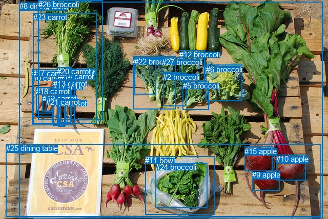
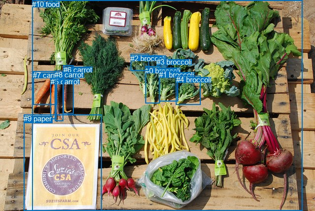

# 图片 0917：2356914.jpg

随机样本序号：476。图片 SHA256：`c107dea74d7019734fd0738ded9e86797f30ce0aa754f7c410490d719c2d37ef`。

红色框表示人，蓝色框表示其他物体。两个模式分别保留自身框编号，可依据位置比较对应对象。

## 自动检测框与输出

人的框编号：`[]`。状态：`no_person`。

### 自动检测全部物体框

| 编号 | 类别 | 是否为人 | 检测分数 | 像素坐标 xyxy |
|---|---|---|---|---|
| 0 | carrot | False | 0.9792 | 64.5, 144.0, 114.4, 227.4 |
| 1 | carrot | False | 0.9531 | 127.0, 132.8, 140.7, 229.7 |
| 2 | broccoli | False | 0.9411 | 318.3, 141.9, 363.4, 207.6 |
| 3 | carrot | False | 0.9403 | 102.5, 161.1, 115.2, 242.4 |
| 4 | carrot | False | 0.9289 | 113.2, 140.7, 126.3, 247.2 |
| 5 | broccoli | False | 0.9176 | 356.7, 159.1, 407.7, 214.3 |
| 6 | broccoli | False | 0.9099 | 401.8, 126.9, 472.0, 197.9 |
| 7 | broccoli | False | 0.8900 | 259.0, 109.4, 343.0, 213.0 |
| 8 | dining table | False | 0.8739 | 37.7, 3.3, 629.4, 426.1 |
| 9 | apple | False | 0.8390 | 491.7, 333.1, 545.4, 372.1 |
| 10 | apple | False | 0.7501 | 539.3, 302.4, 596.4, 352.1 |
| 11 | bowl | False | 0.7208 | 283.0, 305.0, 418.9, 419.5 |
| 12 | broccoli | False | 0.6912 | 350.2, 98.2, 399.8, 158.4 |
| 13 | carrot | False | 0.6649 | 103.8, 154.7, 128.0, 245.3 |
| 14 | carrot | False | 0.6350 | 117.3, 141.3, 132.0, 241.5 |
| 15 | apple | False | 0.6122 | 477.3, 286.7, 531.4, 335.0 |
| 16 | carrot | False | 0.5985 | 102.9, 193.8, 113.4, 241.3 |
| 17 | carrot | False | 0.5582 | 62.5, 135.0, 145.7, 244.8 |
| 18 | carrot | False | 0.5558 | 70.2, 170.3, 104.6, 221.9 |
| 19 | carrot | False | 0.5522 | 82.5, 183.5, 105.1, 217.7 |
| 20 | carrot | False | 0.5332 | 111.1, 131.4, 138.2, 239.9 |
| 21 | carrot | False | 0.5143 | 89.9, 190.8, 103.9, 218.7 |
| 22 | broccoli | False | 0.4871 | 262.2, 112.1, 304.6, 184.1 |
| 23 | carrot | False | 0.4474 | 64.7, 25.3, 188.5, 241.7 |
| 24 | broccoli | False | 0.3965 | 303.5, 318.5, 404.8, 406.2 |
| 25 | dining table | False | 0.3529 | 12.0, 281.3, 626.8, 423.4 |
| 26 | broccoli | False | 0.3524 | 74.7, 0.0, 200.2, 234.7 |
| 27 | broccoli | False | 0.3506 | 315.5, 112.7, 351.8, 144.9 |

### 自动检测 Top50 人相关候选

评分物体对：0；人相关物体对：0；输出关系：0。

| 排名 | 主语编号与类别 | 关系 | 宾语编号与类别 | 类型 | 人与人 | 排序分数 | 原始融合 logit |
|---|---|---|---|---|---|---|---|

### 自动检测逐条人相关 GT 核验

本图没有人相关 GT，R@50 无分母；预测候选继续展示。

## 真实框与输出

人的框编号：`[]`。

### 真实框全部物体框

| 编号 | 类别 | 是否为人 | 检测分数 | 像素坐标 xyxy |
|---|---|---|---|---|
| 0 | broccoli | False | GT | 295.0, 135.0, 324.0, 210.0 |
| 1 | broccoli | False | GT | 323.0, 143.0, 361.0, 205.0 |
| 2 | broccoli | False | GT | 265.0, 110.0, 302.0, 144.0 |
| 3 | broccoli | False | GT | 318.0, 117.0, 340.0, 134.0 |
| 4 | broccoli | False | GT | 358.0, 153.0, 408.0, 212.0 |
| 5 | carrot | False | GT | 103.0, 157.0, 115.0, 242.0 |
| 6 | carrot | False | GT | 129.0, 133.0, 150.0, 231.0 |
| 7 | carrot | False | GT | 67.0, 144.0, 115.0, 212.0 |
| 8 | carrot | False | GT | 111.0, 143.0, 129.0, 246.0 |
| 9 | paper | False | GT | 48.0, 232.0, 207.0, 428.0 |
| 10 | food | False | GT | 65.0, 0.0, 614.0, 428.0 |

### 真实框 Top50 人相关候选

评分物体对：0；人相关物体对：0；输出关系：0。

| 排名 | 主语编号与类别 | 关系 | 宾语编号与类别 | 类型 | 人与人 | 排序分数 | 原始融合 logit |
|---|---|---|---|---|---|---|---|

### 真实框逐条人相关 GT 核验

本图没有人相关 GT，R@50 无分母；预测候选继续展示。

## 全部人相关 GT

| 主语编号与类别 | 关系 | 宾语编号与类别 |
|---|---|---|

原始记录、全部人相关物体对的两项预测与分项分数见 [逐图证据 JSON](../evidence/cases/0917.json)。全部56类 logits 保留于本机 HOR/output/random500/logits/。

<!-- HOR_COMPLETE_RESULTS -->

## 六组条件的完整输出对照

以下保留同一图片三种框与候选模式、两种谓词输出规则的全部 Top50。框编号各自在所属模式内解释。

### 自动检测框完整枚举：空间与语义各保留一个谓词

| 排名 | 主语编号与类别 | 谓词 | 宾语编号与类别 | 分组 | 排序分数 | predicate logit | pair logit |
|---|---|---|---|---|---|---|---|

没有人相关 GT，本条件的召回率无分母。

### 自动检测框完整枚举：每对只保留一个谓词

| 排名 | 主语编号与类别 | 谓词 | 宾语编号与类别 | 分组 | 排序分数 | predicate logit | pair logit |
|---|---|---|---|---|---|---|---|

没有人相关 GT，本条件的召回率无分母。

### 真实框完整枚举：空间与语义各保留一个谓词

| 排名 | 主语编号与类别 | 谓词 | 宾语编号与类别 | 分组 | 排序分数 | predicate logit | pair logit |
|---|---|---|---|---|---|---|---|

没有人相关 GT，本条件的召回率无分母。

### 真实框完整枚举：每对只保留一个谓词

| 排名 | 主语编号与类别 | 谓词 | 宾语编号与类别 | 分组 | 排序分数 | predicate logit | pair logit |
|---|---|---|---|---|---|---|---|

没有人相关 GT，本条件的召回率无分母。

### 真实框400候选：空间与语义各保留一个谓词

| 排名 | 主语编号与类别 | 谓词 | 宾语编号与类别 | 分组 | 排序分数 | predicate logit | pair logit |
|---|---|---|---|---|---|---|---|

没有人相关 GT，本条件的召回率无分母。

### 真实框400候选：每对只保留一个谓词

| 排名 | 主语编号与类别 | 谓词 | 宾语编号与类别 | 分组 | 排序分数 | predicate logit | pair logit |
|---|---|---|---|---|---|---|---|

没有人相关 GT，本条件的召回率无分母。
