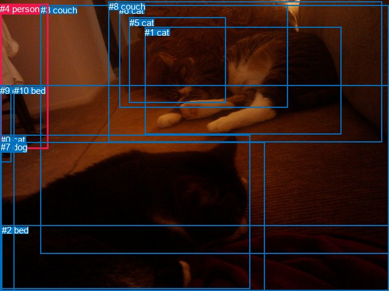
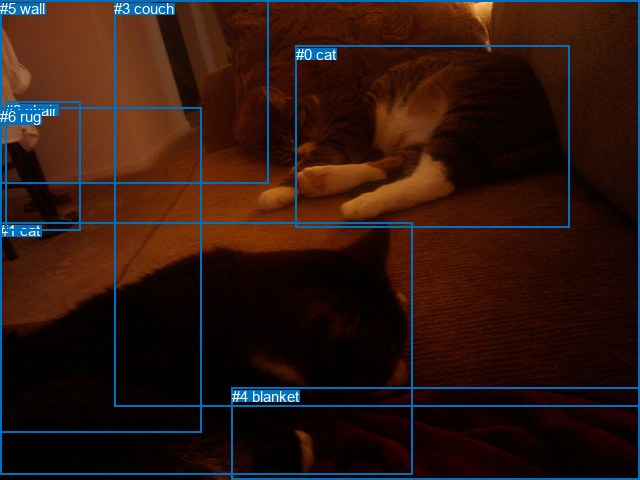

# 图片 0921：2357033.jpg

随机样本序号：3。图片 SHA256：`543862a94b3b567ad38d1ee56271634e07849bb42609d7d5adfd4b3d23c9acb2`。

红色框表示人，蓝色框表示其他物体。两个模式分别保留自身框编号，可依据位置比较对应对象。

## 自动检测框与输出

人的框编号：`[4]`。状态：`ok`。

### 自动检测全部物体框

| 编号 | 类别 | 是否为人 | 检测分数 | 像素坐标 xyxy |
|---|---|---|---|---|
| 0 | cat | False | 0.9935 | 1.5, 222.3, 411.5, 476.8 |
| 1 | cat | False | 0.9929 | 238.5, 44.9, 561.3, 221.5 |
| 2 | bed | False | 0.8895 | 2.9, 371.3, 640.0, 479.2 |
| 3 | couch | False | 0.7431 | 66.7, 8.1, 640.0, 418.5 |
| 4 | person | True | 0.6117 | 0.1, 6.4, 79.9, 245.5 |
| 5 | cat | False | 0.6109 | 212.8, 29.0, 371.8, 169.7 |
| 6 | cat | False | 0.5861 | 196.4, 8.7, 473.4, 177.6 |
| 7 | dog | False | 0.5749 | 0.5, 234.3, 435.8, 480.0 |
| 8 | couch | False | 0.5620 | 178.6, 2.4, 628.6, 234.5 |
| 9 | chair | False | 0.5473 | 0.1, 140.7, 18.2, 267.5 |
| 10 | bed | False | 0.5165 | 22.7, 140.8, 640.0, 480.0 |

### 自动检测 Top50 人相关候选

评分物体对：110；人相关物体对：20；输出关系：40。

| 排名 | 主语编号与类别 | 关系 | 宾语编号与类别 | 类型 | 人与人 | 排序分数 | 原始融合 logit |
|---|---|---|---|---|---|---|---|
| 1 | #4 person | on | #9 chair | spatial | False | 0.88946 | 2.0853 |
| 2 | #4 person | sitting on | #9 chair | semantic | False | 0.79969 | 1.3843 |
| 3 | #9 chair | on | #4 person | spatial | False | 0.78489 | 1.2944 |
| 4 | #4 person | beside | #3 couch | spatial | False | 0.76428 | 1.1763 |
| 5 | #4 person | beside | #8 couch | spatial | False | 0.52558 | 0.1024 |
| 6 | #4 person | standing on | #10 bed | semantic | False | 0.41240 | -0.3541 |
| 7 | #9 chair | holding | #4 person | semantic | False | 0.40608 | -0.3802 |
| 8 | #4 person | beside | #10 bed | spatial | False | 0.30740 | -0.8123 |
| 9 | #4 person | beside | #1 cat | spatial | False | 0.23390 | -1.1864 |
| 10 | #4 person | standing on | #3 couch | semantic | False | 0.21137 | -1.3167 |
| 11 | #0 cat | beside | #4 person | spatial | False | 0.17199 | -1.5716 |
| 12 | #4 person | beside | #0 cat | spatial | False | 0.16798 | -1.6000 |
| 13 | #7 dog | beside | #4 person | spatial | False | 0.16418 | -1.6274 |
| 14 | #4 person | beside | #7 dog | spatial | False | 0.15573 | -1.6903 |
| 15 | #4 person | beside | #6 cat | spatial | False | 0.13675 | -1.8425 |
| 16 | #8 couch | beside | #4 person | spatial | False | 0.11761 | -2.0152 |
| 17 | #7 dog | looking at | #4 person | semantic | False | 0.10904 | -2.1006 |
| 18 | #0 cat | looking at | #4 person | semantic | False | 0.09887 | -2.2098 |
| 19 | #3 couch | beside | #4 person | spatial | False | 0.09537 | -2.2498 |
| 20 | #1 cat | beside | #4 person | spatial | False | 0.09452 | -2.2597 |
| 21 | #1 cat | looking at | #4 person | semantic | False | 0.06323 | -2.6957 |
| 22 | #4 person | holding | #8 couch | semantic | False | 0.05714 | -2.8034 |
| 23 | #4 person | beside | #5 cat | spatial | False | 0.03542 | -3.3043 |
| 24 | #4 person | holding | #1 cat | semantic | False | 0.03463 | -3.3277 |
| 25 | #6 cat | beside | #4 person | spatial | False | 0.02817 | -3.5409 |
| 26 | #10 bed | beside | #4 person | spatial | False | 0.02414 | -3.6993 |
| 27 | #4 person | holding | #0 cat | semantic | False | 0.02270 | -3.7626 |
| 28 | #4 person | holding | #7 dog | semantic | False | 0.02071 | -3.8560 |
| 29 | #4 person | holding | #6 cat | semantic | False | 0.01225 | -4.3901 |
| 30 | #3 couch | holding | #4 person | semantic | False | 0.00878 | -4.7260 |
| 31 | #4 person | holding | #5 cat | semantic | False | 0.00570 | -5.1614 |
| 32 | #8 couch | holding | #4 person | semantic | False | 0.00533 | -5.2282 |
| 33 | #4 person | beside | #2 bed | spatial | False | 0.00515 | -5.2635 |
| 34 | #5 cat | beside | #4 person | spatial | False | 0.00513 | -5.2673 |
| 35 | #2 bed | beside | #4 person | spatial | False | 0.00288 | -5.8467 |
| 36 | #10 bed | holding | #4 person | semantic | False | 0.00280 | -5.8742 |
| 37 | #4 person | standing on | #2 bed | semantic | False | 0.00233 | -6.0605 |
| 38 | #6 cat | holding | #4 person | semantic | False | 0.00156 | -6.4621 |
| 39 | #2 bed | lying on | #4 person | semantic | False | 0.00081 | -7.1197 |
| 40 | #5 cat | sitting on | #4 person | semantic | False | 0.00061 | -7.3962 |

### 自动检测逐条人相关 GT 核验

本图没有人相关 GT，R@50 无分母；预测候选继续展示。

## 真实框与输出

人的框编号：`[]`。

### 真实框全部物体框

| 编号 | 类别 | 是否为人 | 检测分数 | 像素坐标 xyxy |
|---|---|---|---|---|
| 0 | cat | False | GT | 296.0, 46.0, 570.0, 228.0 |
| 1 | cat | False | GT | 0.0, 222.0, 412.0, 474.0 |
| 2 | chair | False | GT | 5.0, 102.0, 80.0, 230.0 |
| 3 | couch | False | GT | 114.0, 0.0, 640.0, 407.0 |
| 4 | blanket | False | GT | 232.0, 388.0, 640.0, 480.0 |
| 5 | wall | False | GT | 0.0, 0.0, 269.0, 184.0 |
| 6 | rug | False | GT | 0.0, 108.0, 201.0, 432.0 |

### 真实框 Top50 人相关候选

评分物体对：0；人相关物体对：0；输出关系：0。

| 排名 | 主语编号与类别 | 关系 | 宾语编号与类别 | 类型 | 人与人 | 排序分数 | 原始融合 logit |
|---|---|---|---|---|---|---|---|

### 真实框逐条人相关 GT 核验

本图没有人相关 GT，R@50 无分母；预测候选继续展示。

## 全部人相关 GT

| 主语编号与类别 | 关系 | 宾语编号与类别 |
|---|---|---|

原始记录、全部人相关物体对的两项预测与分项分数见 [逐图证据 JSON](../evidence/cases/0921.json)。全部56类 logits 保留于本机 HOR/output/random500/logits/。

<!-- HOR_COMPLETE_RESULTS -->

## 六组条件的完整输出对照

以下保留同一图片三种框与候选模式、两种谓词输出规则的全部 Top50。框编号各自在所属模式内解释。

### 自动检测框完整枚举：空间与语义各保留一个谓词

| 排名 | 主语编号与类别 | 谓词 | 宾语编号与类别 | 分组 | 排序分数 | predicate logit | pair logit |
|---|---|---|---|---|---|---|---|
| 1 | #4 person | on | #9 chair | spatial | 0.8894619 | 2.1153188 | -0.0300618 |
| 2 | #4 person | sitting on | #9 chair | semantic | 0.7996878 | 1.4144058 | -0.0300618 |
| 3 | #9 chair | on | #4 person | spatial | 0.7848945 | 1.3779817 | -0.0835609 |
| 4 | #4 person | beside | #3 couch | spatial | 0.7642815 | 1.8773966 | -0.7010990 |
| 5 | #4 person | beside | #8 couch | spatial | 0.5255766 | 0.9087915 | -0.8063958 |
| 6 | #4 person | standing on | #10 bed | semantic | 0.4123971 | 0.4107804 | -0.7648451 |
| 7 | #9 chair | holding | #4 person | semantic | 0.4060807 | -0.2966309 | -0.0835609 |
| 8 | #4 person | beside | #10 bed | spatial | 0.3073963 | -0.0474749 | -0.7648451 |
| 9 | #4 person | beside | #1 cat | spatial | 0.2339025 | -0.3899717 | -0.7964334 |
| 10 | #4 person | standing on | #3 couch | semantic | 0.2113685 | -0.6155968 | -0.7010990 |
| 11 | #0 cat | beside | #4 person | spatial | 0.1719895 | -0.7120123 | -0.8595801 |
| 12 | #4 person | beside | #0 cat | spatial | 0.1679786 | -0.9694071 | -0.6306145 |
| 13 | #7 dog | beside | #4 person | spatial | 0.1641805 | -0.7723682 | -0.8550777 |
| 14 | #4 person | beside | #7 dog | spatial | 0.1557326 | -1.0453579 | -0.6449705 |
| 15 | #4 person | beside | #6 cat | spatial | 0.1367545 | -0.8823137 | -0.9601978 |
| 16 | #8 couch | beside | #4 person | spatial | 0.1176124 | -0.6594629 | -1.3557739 |
| 17 | #7 dog | looking at | #4 person | semantic | 0.1090377 | -1.2455306 | -0.8550777 |
| 18 | #0 cat | looking at | #4 person | semantic | 0.0988721 | -1.3502400 | -0.8595801 |
| 19 | #3 couch | beside | #4 person | spatial | 0.0953677 | -0.6910000 | -1.5587888 |
| 20 | #1 cat | beside | #4 person | spatial | 0.0945190 | -1.3422804 | -0.9173856 |
| 21 | #1 cat | looking at | #4 person | semantic | 0.0632294 | -1.7782831 | -0.9173856 |
| 22 | #4 person | holding | #8 couch | semantic | 0.0571412 | -1.9969959 | -0.8063958 |
| 23 | #4 person | beside | #5 cat | spatial | 0.0354239 | -2.1585317 | -1.1457689 |
| 24 | #4 person | holding | #1 cat | semantic | 0.0346343 | -2.5312278 | -0.7964334 |
| 25 | #6 cat | beside | #4 person | spatial | 0.0281704 | -2.1316209 | -1.4092860 |
| 26 | #10 bed | beside | #4 person | spatial | 0.0241434 | -2.4744899 | -1.2248150 |
| 27 | #4 person | holding | #0 cat | semantic | 0.0226968 | -3.1319602 | -0.6306145 |
| 28 | #4 person | holding | #7 dog | semantic | 0.0207135 | -3.2110705 | -0.6449705 |
| 29 | #4 person | holding | #6 cat | semantic | 0.0122474 | -3.4299183 | -0.9601978 |
| 30 | #3 couch | holding | #4 person | semantic | 0.0087836 | -3.1672611 | -1.5587888 |
| 31 | #4 person | holding | #5 cat | semantic | 0.0057008 | -4.0156651 | -1.1457689 |
| 32 | #8 couch | holding | #4 person | semantic | 0.0053345 | -3.8724442 | -1.3557739 |
| 33 | #4 person | beside | #2 bed | spatial | 0.0051507 | -3.7533679 | -1.5100937 |
| 34 | #5 cat | beside | #4 person | spatial | 0.0051313 | -3.5110767 | -1.7561828 |
| 35 | #2 bed | beside | #4 person | spatial | 0.0028812 | -4.3518043 | -1.4948754 |
| 36 | #10 bed | holding | #4 person | semantic | 0.0028033 | -4.6493526 | -1.2248150 |
| 37 | #4 person | standing on | #2 bed | semantic | 0.0023277 | -4.5504546 | -1.5100937 |
| 38 | #6 cat | holding | #4 person | semantic | 0.0015590 | -5.0528331 | -1.4092860 |
| 39 | #2 bed | lying on | #4 person | semantic | 0.0008083 | -5.6248579 | -1.4948754 |
| 40 | #5 cat | sitting on | #4 person | semantic | 0.0006132 | -5.6400599 | -1.7561828 |

没有人相关 GT，本条件的召回率无分母。

### 自动检测框完整枚举：每对只保留一个谓词

| 排名 | 主语编号与类别 | 谓词 | 宾语编号与类别 | 分组 | 排序分数 | predicate logit | pair logit |
|---|---|---|---|---|---|---|---|
| 1 | #4 person | on | #9 chair | single | 0.8894619 | 2.1153188 | -0.0300618 |
| 2 | #9 chair | on | #4 person | single | 0.7848945 | 1.3779817 | -0.0835609 |
| 3 | #4 person | beside | #3 couch | single | 0.7642815 | 1.8773966 | -0.7010990 |
| 4 | #4 person | beside | #8 couch | single | 0.5255766 | 0.9087915 | -0.8063958 |
| 5 | #4 person | standing on | #10 bed | single | 0.4123971 | 0.4107804 | -0.7648451 |
| 6 | #4 person | beside | #1 cat | single | 0.2339025 | -0.3899717 | -0.7964334 |
| 7 | #0 cat | beside | #4 person | single | 0.1719895 | -0.7120123 | -0.8595801 |
| 8 | #4 person | beside | #0 cat | single | 0.1679786 | -0.9694071 | -0.6306145 |
| 9 | #7 dog | beside | #4 person | single | 0.1641805 | -0.7723682 | -0.8550777 |
| 10 | #4 person | beside | #7 dog | single | 0.1557326 | -1.0453579 | -0.6449705 |
| 11 | #4 person | beside | #6 cat | single | 0.1367545 | -0.8823137 | -0.9601978 |
| 12 | #8 couch | beside | #4 person | single | 0.1176124 | -0.6594629 | -1.3557739 |
| 13 | #3 couch | beside | #4 person | single | 0.0953677 | -0.6910000 | -1.5587888 |
| 14 | #1 cat | beside | #4 person | single | 0.0945190 | -1.3422804 | -0.9173856 |
| 15 | #4 person | beside | #5 cat | single | 0.0354239 | -2.1585317 | -1.1457689 |
| 16 | #6 cat | beside | #4 person | single | 0.0281704 | -2.1316209 | -1.4092860 |
| 17 | #10 bed | beside | #4 person | single | 0.0241434 | -2.4744899 | -1.2248150 |
| 18 | #4 person | beside | #2 bed | single | 0.0051507 | -3.7533679 | -1.5100937 |
| 19 | #5 cat | beside | #4 person | single | 0.0051313 | -3.5110767 | -1.7561828 |
| 20 | #2 bed | beside | #4 person | single | 0.0028812 | -4.3518043 | -1.4948754 |

没有人相关 GT，本条件的召回率无分母。

### 真实框完整枚举：空间与语义各保留一个谓词

| 排名 | 主语编号与类别 | 谓词 | 宾语编号与类别 | 分组 | 排序分数 | predicate logit | pair logit |
|---|---|---|---|---|---|---|---|

没有人相关 GT，本条件的召回率无分母。

### 真实框完整枚举：每对只保留一个谓词

| 排名 | 主语编号与类别 | 谓词 | 宾语编号与类别 | 分组 | 排序分数 | predicate logit | pair logit |
|---|---|---|---|---|---|---|---|

没有人相关 GT，本条件的召回率无分母。

### 真实框400候选：空间与语义各保留一个谓词

| 排名 | 主语编号与类别 | 谓词 | 宾语编号与类别 | 分组 | 排序分数 | predicate logit | pair logit |
|---|---|---|---|---|---|---|---|

没有人相关 GT，本条件的召回率无分母。

### 真实框400候选：每对只保留一个谓词

| 排名 | 主语编号与类别 | 谓词 | 宾语编号与类别 | 分组 | 排序分数 | predicate logit | pair logit |
|---|---|---|---|---|---|---|---|

没有人相关 GT，本条件的召回率无分母。
