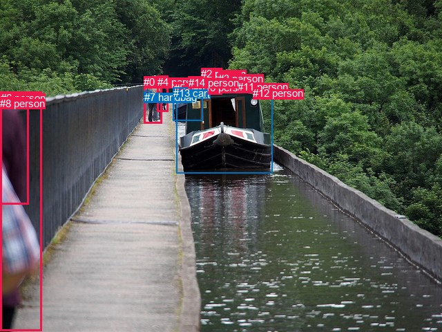
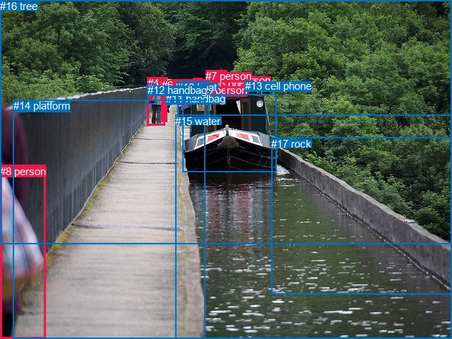

# 图片 0922：2357107.jpg

随机样本序号：36。图片 SHA256：`c5c99da77c25fab2d20117f4cce7734825deb80d0e38385d6d6623bd86377c98`。

红色框表示人，蓝色框表示其他物体。两个模式分别保留自身框编号，可依据位置比较对应对象。

## 自动检测框与输出

人的框编号：`[0, 2, 3, 4, 5, 6, 8, 9, 10, 11, 12, 14]`。状态：`ok`。

### 自动检测全部物体框

| 编号 | 类别 | 是否为人 | 检测分数 | 像素坐标 xyxy |
|---|---|---|---|---|
| 0 | person | True | 0.9972 | 208.2, 110.4, 234.9, 178.0 |
| 1 | boat | False | 0.9933 | 255.6, 128.2, 394.7, 250.6 |
| 2 | person | True | 0.9798 | 291.4, 98.2, 321.2, 136.2 |
| 3 | person | True | 0.9676 | 316.3, 104.5, 349.9, 132.6 |
| 4 | person | True | 0.9630 | 227.6, 109.8, 243.1, 161.2 |
| 5 | person | True | 0.9510 | 252.0, 118.6, 264.3, 147.9 |
| 6 | person | True | 0.9135 | 0.6, 132.6, 60.5, 478.2 |
| 7 | handbag | False | 0.8248 | 208.7, 131.6, 220.0, 148.0 |
| 8 | person | True | 0.8236 | 0.2, 140.9, 41.9, 295.9 |
| 9 | person | True | 0.7718 | 273.5, 110.9, 292.7, 127.9 |
| 10 | person | True | 0.5795 | 287.6, 117.7, 296.1, 126.8 |
| 11 | person | True | 0.5622 | 344.3, 117.1, 358.9, 133.6 |
| 12 | person | True | 0.5199 | 366.2, 126.3, 375.0, 135.7 |
| 13 | car | False | 0.4365 | 250.9, 126.4, 293.0, 174.5 |
| 14 | person | True | 0.3831 | 272.6, 110.8, 283.2, 126.1 |

### 自动检测 Top50 人相关候选

评分物体对：210；人相关物体对：204；输出关系：50。

| 排名 | 主语编号与类别 | 关系 | 宾语编号与类别 | 类型 | 人与人 | 排序分数 | 原始融合 logit |
|---|---|---|---|---|---|---|---|
| 1 | #2 person | driving on | #1 boat | semantic | False | 0.98521 | 4.1989 |
| 2 | #6 person | wearing | #8 person | semantic | True | 0.98480 | 4.1714 |
| 3 | #0 person | carrying | #7 handbag | semantic | False | 0.97929 | 3.8564 |
| 4 | #3 person | driving on | #1 boat | semantic | False | 0.97634 | 3.7201 |
| 5 | #11 person | driving on | #1 boat | semantic | False | 0.97136 | 3.5240 |
| 6 | #0 person | pushing | #13 car | semantic | False | 0.96178 | 3.2255 |
| 7 | #5 person | pushing | #13 car | semantic | False | 0.96089 | 3.2015 |
| 8 | #12 person | attached to | #1 boat | spatial | False | 0.95710 | 3.1051 |
| 9 | #2 person | pushing | #13 car | semantic | False | 0.95395 | 3.0308 |
| 10 | #9 person | pushing | #13 car | semantic | False | 0.94736 | 2.8901 |
| 11 | #3 person | on | #1 boat | spatial | False | 0.94512 | 2.8462 |
| 12 | #6 person | in | #8 person | spatial | True | 0.93933 | 2.7397 |
| 13 | #2 person | on | #1 boat | spatial | False | 0.93516 | 2.6688 |
| 14 | #11 person | on | #1 boat | spatial | False | 0.92308 | 2.4850 |
| 15 | #4 person | pushing | #13 car | semantic | False | 0.92142 | 2.4618 |
| 16 | #14 person | pushing | #13 car | semantic | False | 0.91006 | 2.3144 |
| 17 | #9 person | on | #13 car | spatial | False | 0.87198 | 1.9186 |
| 18 | #5 person | standing on | #1 boat | semantic | False | 0.86054 | 1.8198 |
| 19 | #0 person | walking on | #1 boat | semantic | False | 0.84788 | 1.7180 |
| 20 | #9 person | standing on | #1 boat | semantic | False | 0.84263 | 1.6779 |
| 21 | #2 person | on | #13 car | spatial | False | 0.82738 | 1.5671 |
| 22 | #8 person | on | #6 person | spatial | True | 0.81262 | 1.4671 |
| 23 | #14 person | standing on | #1 boat | semantic | False | 0.79882 | 1.3789 |
| 24 | #5 person | on | #13 car | spatial | False | 0.79872 | 1.3783 |
| 25 | #4 person | standing on | #1 boat | semantic | False | 0.77750 | 1.2512 |
| 26 | #0 person | in | #7 handbag | spatial | False | 0.77421 | 1.2322 |
| 27 | #9 person | on | #1 boat | spatial | False | 0.72637 | 0.9763 |
| 28 | #14 person | on | #13 car | spatial | False | 0.72564 | 0.9726 |
| 29 | #3 person | pushing | #13 car | semantic | False | 0.68544 | 0.7789 |
| 30 | #0 person | on | #1 boat | spatial | False | 0.68432 | 0.7737 |
| 31 | #5 person | on | #1 boat | spatial | False | 0.67482 | 0.7301 |
| 32 | #12 person | standing on | #1 boat | semantic | False | 0.64731 | 0.6072 |
| 33 | #10 person | standing on | #1 boat | semantic | False | 0.62155 | 0.4961 |
| 34 | #14 person | on | #1 boat | spatial | False | 0.60044 | 0.4073 |
| 35 | #8 person | carrying | #6 person | semantic | True | 0.56716 | 0.2703 |
| 36 | #0 person | on | #13 car | spatial | False | 0.56545 | 0.2633 |
| 37 | #0 person | walking on | #4 person | semantic | True | 0.55213 | 0.2093 |
| 38 | #9 person | wearing | #14 person | semantic | True | 0.54525 | 0.1815 |
| 39 | #4 person | walking on | #0 person | semantic | True | 0.53360 | 0.1346 |
| 40 | #4 person | on | #1 boat | spatial | False | 0.50320 | 0.0128 |
| 41 | #10 person | on | #1 boat | spatial | False | 0.50014 | 0.0006 |
| 42 | #10 person | pushing | #13 car | semantic | False | 0.48578 | -0.0569 |
| 43 | #12 person | on | #13 car | spatial | False | 0.48247 | -0.0701 |
| 44 | #2 person | wearing | #10 person | semantic | True | 0.44385 | -0.2256 |
| 45 | #4 person | on | #13 car | spatial | False | 0.41211 | -0.3553 |
| 46 | #14 person | in | #9 person | spatial | True | 0.41110 | -0.3594 |
| 47 | #14 person | riding | #9 person | semantic | True | 0.35087 | -0.6152 |
| 48 | #10 person | on | #13 car | spatial | False | 0.34886 | -0.6241 |
| 49 | #7 handbag | on | #0 person | spatial | False | 0.33454 | -0.6877 |
| 50 | #4 person | carrying | #7 handbag | semantic | False | 0.29333 | -0.8793 |

### 自动检测逐条人相关 GT 核验

R@50：0.00%；命中 0/2。

| GT 主语编号 | GT 关系 | GT 宾语编号 | 结果阶段 | 匹配预测主语编号 | 匹配预测宾语编号 |
|---|---|---|---|---|---|
| 1 | in | 9 | wrong_predicate | [3] | [1] |
| 4 | walking on | 14 | endpoint_missing_or_wrong_class | [0] | [] |

## 真实框与输出

人的框编号：`[0, 1, 2, 3, 4, 5, 6, 7, 8]`。

### 真实框全部物体框

| 编号 | 类别 | 是否为人 | 检测分数 | 像素坐标 xyxy |
|---|---|---|---|---|
| 0 | person | True | GT | 252.0, 118.0, 265.0, 149.0 |
| 1 | person | True | GT | 318.0, 105.0, 351.0, 131.0 |
| 2 | person | True | GT | 274.0, 110.0, 287.0, 128.0 |
| 3 | person | True | GT | 285.0, 119.0, 296.0, 128.0 |
| 4 | person | True | GT | 209.0, 109.0, 234.0, 177.0 |
| 5 | person | True | GT | 227.0, 109.0, 237.0, 140.0 |
| 6 | person | True | GT | 229.0, 112.0, 237.0, 173.0 |
| 7 | person | True | GT | 291.0, 99.0, 321.0, 136.0 |
| 8 | person | True | GT | 0.0, 234.0, 64.0, 480.0 |
| 9 | boat | False | GT | 258.0, 134.0, 391.0, 243.0 |
| 10 | boat | False | GT | 251.0, 115.0, 296.0, 174.0 |
| 11 | handbag | False | GT | 235.0, 131.0, 242.0, 149.0 |
| 12 | handbag | False | GT | 209.0, 119.0, 221.0, 148.0 |
| 13 | cell phone | False | GT | 347.0, 113.0, 350.0, 117.0 |
| 14 | platform | False | GT | 19.0, 141.0, 290.0, 480.0 |
| 15 | water | False | GT | 248.0, 163.0, 640.0, 480.0 |
| 16 | tree | False | GT | 0.0, 0.0, 640.0, 345.0 |
| 17 | rock | False | GT | 384.0, 195.0, 640.0, 417.0 |

### 真实框 Top50 人相关候选

评分物体对：306；人相关物体对：234；输出关系：50。

| 排名 | 主语编号与类别 | 关系 | 宾语编号与类别 | 类型 | 人与人 | 排序分数 | 原始融合 logit |
|---|---|---|---|---|---|---|---|
| 1 | #6 person | wearing | #5 person | semantic | True | 0.98544 | 4.2150 |
| 2 | #8 person | walking on | #14 platform | semantic | False | 0.98451 | 4.1521 |
| 3 | #7 person | driving on | #9 boat | semantic | False | 0.98150 | 3.9715 |
| 4 | #4 person | standing on | #14 platform | semantic | False | 0.97942 | 3.8626 |
| 5 | #4 person | carrying | #12 handbag | semantic | False | 0.97716 | 3.7563 |
| 6 | #6 person | standing on | #14 platform | semantic | False | 0.97298 | 3.5838 |
| 7 | #2 person | riding | #10 boat | semantic | False | 0.96995 | 3.4744 |
| 8 | #0 person | pushing | #10 boat | semantic | False | 0.96646 | 3.3608 |
| 9 | #8 person | on | #14 platform | spatial | False | 0.95601 | 3.0788 |
| 10 | #1 person | pushing | #9 boat | semantic | False | 0.94821 | 2.9073 |
| 11 | #7 person | riding | #10 boat | semantic | False | 0.94738 | 2.8907 |
| 12 | #4 person | carrying | #5 person | semantic | True | 0.94695 | 2.8821 |
| 13 | #7 person | on | #9 boat | spatial | False | 0.93942 | 2.7414 |
| 14 | #0 person | standing on | #14 platform | semantic | False | 0.93709 | 2.7010 |
| 15 | #4 person | on | #14 platform | spatial | False | 0.93371 | 2.6452 |
| 16 | #1 person | wearing | #13 cell phone | semantic | False | 0.92913 | 2.5734 |
| 17 | #4 person | pushing | #10 boat | semantic | False | 0.92745 | 2.5482 |
| 18 | #1 person | on | #9 boat | spatial | False | 0.91820 | 2.4182 |
| 19 | #6 person | carrying | #11 handbag | semantic | False | 0.91625 | 2.3925 |
| 20 | #2 person | on | #10 boat | spatial | False | 0.91552 | 2.3830 |
| 21 | #6 person | on | #14 platform | spatial | False | 0.90111 | 2.2097 |
| 22 | #0 person | on | #10 boat | spatial | False | 0.90054 | 2.2032 |
| 23 | #7 person | on | #10 boat | spatial | False | 0.89319 | 2.1238 |
| 24 | #6 person | in | #5 person | spatial | True | 0.88758 | 2.0663 |
| 25 | #4 person | walking on | #15 water | semantic | False | 0.87364 | 1.9336 |
| 26 | #3 person | pushing | #10 boat | semantic | False | 0.87050 | 1.9053 |
| 27 | #2 person | pushing | #9 boat | semantic | False | 0.85629 | 1.7848 |
| 28 | #2 person | walking on | #14 platform | semantic | False | 0.85369 | 1.7638 |
| 29 | #6 person | walking on | #15 water | semantic | False | 0.84515 | 1.6971 |
| 30 | #4 person | walking on | #9 boat | semantic | False | 0.83114 | 1.5937 |
| 31 | #0 person | standing on | #9 boat | semantic | False | 0.83007 | 1.5861 |
| 32 | #4 person | in | #12 handbag | spatial | False | 0.82033 | 1.5186 |
| 33 | #3 person | on | #10 boat | spatial | False | 0.80676 | 1.4291 |
| 34 | #0 person | on | #14 platform | spatial | False | 0.78928 | 1.3206 |
| 35 | #4 person | walking on | #17 rock | semantic | False | 0.78660 | 1.3046 |
| 36 | #6 person | walking on | #9 boat | semantic | False | 0.77347 | 1.2280 |
| 37 | #8 person | looking at | #15 water | semantic | False | 0.76075 | 1.1568 |
| 38 | #6 person | walking on | #4 person | semantic | True | 0.75943 | 1.1496 |
| 39 | #4 person | beside | #15 water | spatial | False | 0.73758 | 1.0334 |
| 40 | #4 person | holding | #6 person | semantic | True | 0.72743 | 0.9816 |
| 41 | #7 person | standing on | #14 platform | semantic | False | 0.72689 | 0.9789 |
| 42 | #6 person | walking on | #17 rock | semantic | False | 0.71776 | 0.9334 |
| 43 | #2 person | on | #9 boat | spatial | False | 0.71077 | 0.8991 |
| 44 | #4 person | beside | #9 boat | spatial | False | 0.70901 | 0.8906 |
| 45 | #0 person | on | #9 boat | spatial | False | 0.70766 | 0.8841 |
| 46 | #0 person | walking on | #15 water | semantic | False | 0.68911 | 0.7960 |
| 47 | #5 person | on | #6 person | spatial | True | 0.68093 | 0.7581 |
| 48 | #5 person | walking on | #14 platform | semantic | False | 0.67220 | 0.7182 |
| 49 | #12 handbag | on | #4 person | spatial | False | 0.66384 | 0.6805 |
| 50 | #6 person | pushing | #10 boat | semantic | False | 0.64441 | 0.5945 |

### 真实框逐条人相关 GT 核验

R@50：0.00%；命中 0/2。

| GT 主语编号 | GT 关系 | GT 宾语编号 | 结果阶段 | 匹配预测主语编号 | 匹配预测宾语编号 |
|---|---|---|---|---|---|
| 1 | in | 9 | wrong_predicate | [1] | [9] |
| 4 | walking on | 14 | wrong_predicate | [4] | [14] |

## 全部人相关 GT

| 主语编号与类别 | 关系 | 宾语编号与类别 |
|---|---|---|
| #1 person | in | #9 boat |
| #4 person | walking on | #14 platform |

原始记录、全部人相关物体对的两项预测与分项分数见 [逐图证据 JSON](../evidence/cases/0922.json)。全部56类 logits 保留于本机 HOR/output/random500/logits/。

<!-- HOR_COMPLETE_RESULTS -->

## 六组条件的完整输出对照

以下保留同一图片三种框与候选模式、两种谓词输出规则的全部 Top50。框编号各自在所属模式内解释。

### 自动检测框完整枚举：空间与语义各保留一个谓词

| 排名 | 主语编号与类别 | 谓词 | 宾语编号与类别 | 分组 | 排序分数 | predicate logit | pair logit |
|---|---|---|---|---|---|---|---|
| 1 | #2 person | driving on | #1 boat | semantic | 0.9852106 | 4.2665792 | -0.0676385 |
| 2 | #6 person | wearing | #8 person | semantic | 0.9848039 | 4.1428037 | 0.0285987 |
| 3 | #0 person | carrying | #7 handbag | semantic | 0.9792946 | 3.8444953 | 0.0119420 |
| 4 | #3 person | driving on | #1 boat | semantic | 0.9763411 | 3.9060798 | -0.1860049 |
| 5 | #11 person | driving on | #1 boat | semantic | 0.9713633 | 3.5449758 | -0.0209661 |
| 6 | #0 person | pushing | #13 car | semantic | 0.9617826 | 3.6663890 | -0.4408925 |
| 7 | #5 person | pushing | #13 car | semantic | 0.9608923 | 3.5465255 | -0.3449814 |
| 8 | #12 person | attached to | #1 boat | spatial | 0.9571019 | 2.8705850 | 0.2344991 |
| 9 | #2 person | pushing | #13 car | semantic | 0.9539475 | 3.4262891 | -0.3954620 |
| 10 | #9 person | pushing | #13 car | semantic | 0.9473562 | 3.0052099 | -0.1150829 |
| 11 | #3 person | on | #1 boat | spatial | 0.9451196 | 3.0321598 | -0.1860049 |
| 12 | #6 person | in | #8 person | spatial | 0.9393315 | 2.7111449 | 0.0285987 |
| 13 | #2 person | on | #1 boat | spatial | 0.9351581 | 2.7364030 | -0.0676385 |
| 14 | #11 person | on | #1 boat | spatial | 0.9230848 | 2.5059834 | -0.0209661 |
| 15 | #4 person | pushing | #13 car | semantic | 0.9214185 | 3.1248875 | -0.6631098 |
| 16 | #14 person | pushing | #13 car | semantic | 0.9100601 | 2.4334059 | -0.1190374 |
| 17 | #9 person | on | #13 car | spatial | 0.8719814 | 2.0336757 | -0.1150829 |
| 18 | #5 person | standing on | #1 boat | semantic | 0.8605364 | 2.5945988 | -0.7748461 |
| 19 | #0 person | walking on | #1 boat | semantic | 0.8478772 | 2.4134483 | -0.6954007 |
| 20 | #9 person | standing on | #1 boat | semantic | 0.8426309 | 1.8019247 | -0.1239893 |
| 21 | #2 person | on | #13 car | spatial | 0.8273758 | 1.9626036 | -0.3954620 |
| 22 | #8 person | on | #6 person | spatial | 0.8126192 | 1.8691730 | -0.4020535 |
| 23 | #14 person | standing on | #1 boat | semantic | 0.7988180 | 1.5898566 | -0.2109338 |
| 24 | #5 person | on | #13 car | spatial | 0.7987195 | 1.7232924 | -0.3449814 |
| 25 | #4 person | standing on | #1 boat | semantic | 0.7774994 | 2.2036109 | -0.9524577 |
| 26 | #0 person | in | #7 handbag | spatial | 0.7742112 | 1.2203026 | 0.0119420 |
| 27 | #9 person | on | #1 boat | spatial | 0.7263691 | 1.1002679 | -0.1239893 |
| 28 | #14 person | on | #13 car | spatial | 0.7256433 | 1.0916667 | -0.1190374 |
| 29 | #3 person | pushing | #13 car | semantic | 0.6854421 | 1.3501329 | -0.5712371 |
| 30 | #0 person | on | #1 boat | spatial | 0.6843197 | 1.4690957 | -0.6954007 |
| 31 | #5 person | on | #1 boat | spatial | 0.6748217 | 1.5049210 | -0.7748461 |
| 32 | #12 person | standing on | #1 boat | semantic | 0.6473085 | 0.3727303 | 0.2344991 |
| 33 | #10 person | standing on | #1 boat | semantic | 0.6215479 | 0.5403347 | -0.0442114 |
| 34 | #14 person | on | #1 boat | spatial | 0.6004391 | 0.6182289 | -0.2109338 |
| 35 | #8 person | carrying | #6 person | semantic | 0.5671617 | 0.6723337 | -0.4020535 |
| 36 | #0 person | on | #13 car | spatial | 0.5654460 | 0.7041874 | -0.4408925 |
| 37 | #0 person | walking on | #4 person | semantic | 0.5521311 | 0.4634547 | -0.2541698 |
| 38 | #9 person | wearing | #14 person | semantic | 0.5452457 | 0.7843194 | -0.6028401 |
| 39 | #4 person | walking on | #0 person | semantic | 0.5335995 | 0.8440905 | -0.7094896 |
| 40 | #4 person | on | #1 boat | spatial | 0.5032048 | 0.9652772 | -0.9524577 |
| 41 | #10 person | on | #1 boat | spatial | 0.5001435 | 0.0447855 | -0.0442114 |
| 42 | #10 person | pushing | #13 car | semantic | 0.4857848 | 0.1169100 | -0.1737859 |
| 43 | #12 person | on | #13 car | spatial | 0.4824730 | 0.3739643 | -0.4441011 |
| 44 | #2 person | wearing | #10 person | semantic | 0.4438482 | 0.3240757 | -0.5496345 |
| 45 | #4 person | on | #13 car | spatial | 0.4121065 | 0.3078461 | -0.6631098 |
| 46 | #14 person | in | #9 person | spatial | 0.4111027 | 0.2527285 | -0.6121374 |
| 47 | #14 person | riding | #9 person | semantic | 0.3508656 | -0.0030990 | -0.6121374 |
| 48 | #10 person | on | #13 car | spatial | 0.3488559 | -0.4502859 | -0.1737859 |
| 49 | #7 handbag | on | #0 person | spatial | 0.3345377 | 0.2978535 | -0.9855857 |
| 50 | #4 person | carrying | #7 handbag | semantic | 0.2933278 | -0.5200663 | -0.3592099 |

GT 命中：0/2，R@50=0.00%。

| GT主语 | GT谓词 | GT宾语 | 结果阶段 | 匹配主语框 | 匹配宾语框 |
|---|---|---|---|---|---|
| 1 | in | 9 | wrong_predicate | [3] | [1] |
| 4 | walking on | 14 | endpoint_missing_or_wrong_class | [0] | [] |

### 自动检测框完整枚举：每对只保留一个谓词

| 排名 | 主语编号与类别 | 谓词 | 宾语编号与类别 | 分组 | 排序分数 | predicate logit | pair logit |
|---|---|---|---|---|---|---|---|
| 1 | #2 person | driving on | #1 boat | single | 0.9852106 | 4.2665792 | -0.0676385 |
| 2 | #6 person | wearing | #8 person | single | 0.9848039 | 4.1428037 | 0.0285987 |
| 3 | #0 person | carrying | #7 handbag | single | 0.9792946 | 3.8444953 | 0.0119420 |
| 4 | #3 person | driving on | #1 boat | single | 0.9763411 | 3.9060798 | -0.1860049 |
| 5 | #11 person | driving on | #1 boat | single | 0.9713633 | 3.5449758 | -0.0209661 |
| 6 | #0 person | pushing | #13 car | single | 0.9617826 | 3.6663890 | -0.4408925 |
| 7 | #5 person | pushing | #13 car | single | 0.9608923 | 3.5465255 | -0.3449814 |
| 8 | #12 person | attached to | #1 boat | single | 0.9571019 | 2.8705850 | 0.2344991 |
| 9 | #2 person | pushing | #13 car | single | 0.9539475 | 3.4262891 | -0.3954620 |
| 10 | #9 person | pushing | #13 car | single | 0.9473562 | 3.0052099 | -0.1150829 |
| 11 | #4 person | pushing | #13 car | single | 0.9214185 | 3.1248875 | -0.6631098 |
| 12 | #14 person | pushing | #13 car | single | 0.9100601 | 2.4334059 | -0.1190374 |
| 13 | #5 person | standing on | #1 boat | single | 0.8605364 | 2.5945988 | -0.7748461 |
| 14 | #0 person | walking on | #1 boat | single | 0.8478772 | 2.4134483 | -0.6954007 |
| 15 | #9 person | standing on | #1 boat | single | 0.8426309 | 1.8019247 | -0.1239893 |
| 16 | #8 person | on | #6 person | single | 0.8126192 | 1.8691730 | -0.4020535 |
| 17 | #14 person | standing on | #1 boat | single | 0.7988180 | 1.5898566 | -0.2109338 |
| 18 | #4 person | standing on | #1 boat | single | 0.7774994 | 2.2036109 | -0.9524577 |
| 19 | #3 person | pushing | #13 car | single | 0.6854421 | 1.3501329 | -0.5712371 |
| 20 | #10 person | standing on | #1 boat | single | 0.6215479 | 0.5403347 | -0.0442114 |
| 21 | #0 person | walking on | #4 person | single | 0.5521311 | 0.4634547 | -0.2541698 |
| 22 | #9 person | wearing | #14 person | single | 0.5452457 | 0.7843194 | -0.6028401 |
| 23 | #4 person | walking on | #0 person | single | 0.5335995 | 0.8440905 | -0.7094896 |
| 24 | #10 person | pushing | #13 car | single | 0.4857848 | 0.1169100 | -0.1737859 |
| 25 | #12 person | on | #13 car | single | 0.4824730 | 0.3739643 | -0.4441011 |
| 26 | #2 person | wearing | #10 person | single | 0.4438482 | 0.3240757 | -0.5496345 |
| 27 | #14 person | in | #9 person | single | 0.4111027 | 0.2527285 | -0.6121374 |
| 28 | #7 handbag | on | #0 person | single | 0.3345377 | 0.2978535 | -0.9855857 |
| 29 | #4 person | carrying | #7 handbag | single | 0.2933278 | -0.5200663 | -0.3592099 |
| 30 | #6 person | walking on | #1 boat | single | 0.2869754 | -0.5354795 | -0.3746401 |
| 31 | #9 person | wearing | #10 person | single | 0.2843091 | -0.3659134 | -0.5572727 |
| 32 | #2 person | talking to | #3 person | single | 0.2806031 | -0.4856114 | -0.4558608 |
| 33 | #3 person | talking to | #2 person | single | 0.2432576 | -0.6042256 | -0.5306761 |
| 34 | #3 person | talking to | #11 person | single | 0.1937215 | -0.8732650 | -0.5527426 |
| 35 | #4 person | walking on | #5 person | single | 0.1926052 | -0.8785675 | -0.5546028 |
| 36 | #11 person | holding | #12 person | single | 0.1852247 | -1.0161159 | -0.4652271 |
| 37 | #9 person | talking to | #2 person | single | 0.1848894 | -0.9221790 | -0.5613869 |
| 38 | #2 person | talking to | #9 person | single | 0.1779492 | -0.8738589 | -0.6564449 |
| 39 | #0 person | walking on | #5 person | single | 0.1758075 | -1.1599185 | -0.3850961 |
| 40 | #11 person | pushing | #13 car | single | 0.1489298 | -1.2820361 | -0.4609838 |
| 41 | #14 person | wearing | #7 handbag | single | 0.1093319 | -1.4890914 | -0.6084921 |
| 42 | #5 person | wearing | #7 handbag | single | 0.1057194 | -1.4072437 | -0.7279873 |
| 43 | #14 person | wearing | #10 person | single | 0.1051061 | -1.5280757 | -0.6136589 |
| 44 | #8 person | looking at | #1 boat | single | 0.0973147 | -1.3483007 | -0.8791228 |
| 45 | #12 person | on | #11 person | single | 0.0930341 | -1.2876141 | -0.9895240 |
| 46 | #2 person | wearing | #11 person | single | 0.0925530 | -1.6966209 | -0.5862330 |
| 47 | #9 person | wearing | #7 handbag | single | 0.0887651 | -1.7294457 | -0.5993617 |
| 48 | #3 person | holding | #12 person | single | 0.0875575 | -1.7009041 | -0.6429245 |
| 49 | #10 person | on | #9 person | single | 0.0855330 | -1.7543175 | -0.6151212 |
| 50 | #3 person | wearing | #10 person | single | 0.0834914 | -1.7112179 | -0.6846103 |

GT 命中：0/2，R@50=0.00%。

| GT主语 | GT谓词 | GT宾语 | 结果阶段 | 匹配主语框 | 匹配宾语框 |
|---|---|---|---|---|---|
| 1 | in | 9 | wrong_predicate | [3] | [1] |
| 4 | walking on | 14 | endpoint_missing_or_wrong_class | [0] | [] |

### 真实框完整枚举：空间与语义各保留一个谓词

| 排名 | 主语编号与类别 | 谓词 | 宾语编号与类别 | 分组 | 排序分数 | predicate logit | pair logit |
|---|---|---|---|---|---|---|---|
| 1 | #6 person | wearing | #5 person | semantic | 0.9854434 | 4.3030324 | -0.0879902 |
| 2 | #8 person | walking on | #14 platform | semantic | 0.9845126 | 4.2459064 | -0.0937847 |
| 3 | #7 person | driving on | #9 boat | semantic | 0.9815029 | 4.0261283 | -0.0546555 |
| 4 | #4 person | standing on | #14 platform | semantic | 0.9794201 | 4.1069026 | -0.2442530 |
| 5 | #4 person | carrying | #12 handbag | semantic | 0.9771632 | 3.7932334 | -0.0369544 |
| 6 | #6 person | standing on | #14 platform | semantic | 0.9729801 | 3.9351287 | -0.3513417 |
| 7 | #2 person | riding | #10 boat | semantic | 0.9699507 | 3.5905023 | -0.1160947 |
| 8 | #0 person | pushing | #10 boat | semantic | 0.9664582 | 3.7272124 | -0.3663675 |
| 9 | #8 person | on | #14 platform | spatial | 0.9560090 | 3.1725669 | -0.0937847 |
| 10 | #1 person | pushing | #9 boat | semantic | 0.9482053 | 3.1257615 | -0.2184789 |
| 11 | #7 person | riding | #10 boat | semantic | 0.9473834 | 3.2934985 | -0.4028262 |
| 12 | #4 person | carrying | #5 person | semantic | 0.9469550 | 2.8978863 | -0.0157759 |
| 13 | #7 person | on | #9 boat | spatial | 0.9394230 | 2.7960057 | -0.0546555 |
| 14 | #0 person | standing on | #14 platform | semantic | 0.9370870 | 3.2525172 | -0.5514936 |
| 15 | #4 person | on | #14 platform | spatial | 0.9337135 | 2.8894367 | -0.2442530 |
| 16 | #1 person | wearing | #13 cell phone | semantic | 0.9291285 | 3.0742617 | -0.5008833 |
| 17 | #4 person | pushing | #10 boat | semantic | 0.9274526 | 3.0645065 | -0.5163065 |
| 18 | #1 person | on | #9 boat | spatial | 0.9182031 | 2.6366587 | -0.2184789 |
| 19 | #6 person | carrying | #11 handbag | semantic | 0.9162521 | 2.5068998 | -0.1144195 |
| 20 | #2 person | on | #10 boat | spatial | 0.9155214 | 2.4990902 | -0.1160947 |
| 21 | #6 person | on | #14 platform | spatial | 0.9011145 | 2.5610108 | -0.3513417 |
| 22 | #0 person | on | #10 boat | spatial | 0.9005379 | 2.5695834 | -0.3663675 |
| 23 | #7 person | on | #10 boat | spatial | 0.8931929 | 2.5266042 | -0.4028262 |
| 24 | #6 person | in | #5 person | spatial | 0.8875798 | 2.1542449 | -0.0879902 |
| 25 | #4 person | walking on | #15 water | semantic | 0.8736449 | 2.8136382 | -0.8800599 |
| 26 | #3 person | pushing | #10 boat | semantic | 0.8704953 | 2.0726137 | -0.1672689 |
| 27 | #2 person | pushing | #9 boat | semantic | 0.8562922 | 1.9822121 | -0.1973824 |
| 28 | #2 person | walking on | #14 platform | semantic | 0.8536888 | 2.3472309 | -0.5833993 |
| 29 | #6 person | walking on | #15 water | semantic | 0.8451532 | 2.6120315 | -0.9149502 |
| 30 | #4 person | walking on | #9 boat | semantic | 0.8311419 | 2.3773222 | -0.7835804 |
| 31 | #0 person | standing on | #9 boat | semantic | 0.8300674 | 2.4067073 | -0.8206025 |
| 32 | #4 person | in | #12 handbag | spatial | 0.8203265 | 1.5555158 | -0.0369544 |
| 33 | #3 person | on | #10 boat | spatial | 0.8067586 | 1.5963535 | -0.1672689 |
| 34 | #0 person | on | #14 platform | spatial | 0.7892773 | 1.8720684 | -0.5514936 |
| 35 | #4 person | walking on | #17 rock | semantic | 0.7866042 | 2.2960100 | -0.9914336 |
| 36 | #6 person | walking on | #9 boat | semantic | 0.7734675 | 2.0673642 | -0.8393692 |
| 37 | #8 person | looking at | #15 water | semantic | 0.7607461 | 1.6670237 | -0.5102493 |
| 38 | #6 person | walking on | #4 person | semantic | 0.7594321 | 1.6821017 | -0.5325333 |
| 39 | #4 person | beside | #15 water | spatial | 0.7375826 | 1.9135017 | -0.8800599 |
| 40 | #4 person | holding | #6 person | semantic | 0.7274255 | 1.4312758 | -0.4496765 |
| 41 | #7 person | standing on | #14 platform | semantic | 0.7268902 | 2.0261207 | -1.0472193 |
| 42 | #6 person | walking on | #17 rock | semantic | 0.7177615 | 1.9920874 | -1.0587027 |
| 43 | #2 person | on | #9 boat | spatial | 0.7107747 | 1.0965319 | -0.1973824 |
| 44 | #4 person | beside | #9 boat | spatial | 0.7090096 | 1.6741595 | -0.7835804 |
| 45 | #0 person | on | #9 boat | spatial | 0.7076644 | 1.7046700 | -0.8206025 |
| 46 | #0 person | walking on | #15 water | semantic | 0.6891096 | 1.4325075 | -0.6365478 |
| 47 | #5 person | on | #6 person | spatial | 0.6809302 | 1.6691628 | -0.9111127 |
| 48 | #5 person | walking on | #14 platform | semantic | 0.6722006 | 2.0041709 | -1.2860161 |
| 49 | #12 handbag | on | #4 person | spatial | 0.6638432 | 1.6138458 | -0.9333777 |
| 50 | #6 person | pushing | #10 boat | semantic | 0.6444061 | 1.1090093 | -0.5144693 |

GT 命中：0/2，R@50=0.00%。

| GT主语 | GT谓词 | GT宾语 | 结果阶段 | 匹配主语框 | 匹配宾语框 |
|---|---|---|---|---|---|
| 1 | in | 9 | wrong_predicate | [1] | [9] |
| 4 | walking on | 14 | wrong_predicate | [4] | [14] |

### 真实框完整枚举：每对只保留一个谓词

| 排名 | 主语编号与类别 | 谓词 | 宾语编号与类别 | 分组 | 排序分数 | predicate logit | pair logit |
|---|---|---|---|---|---|---|---|
| 1 | #6 person | wearing | #5 person | single | 0.9854434 | 4.3030324 | -0.0879902 |
| 2 | #8 person | walking on | #14 platform | single | 0.9845126 | 4.2459064 | -0.0937847 |
| 3 | #7 person | driving on | #9 boat | single | 0.9815029 | 4.0261283 | -0.0546555 |
| 4 | #4 person | standing on | #14 platform | single | 0.9794201 | 4.1069026 | -0.2442530 |
| 5 | #4 person | carrying | #12 handbag | single | 0.9771632 | 3.7932334 | -0.0369544 |
| 6 | #6 person | standing on | #14 platform | single | 0.9729801 | 3.9351287 | -0.3513417 |
| 7 | #2 person | riding | #10 boat | single | 0.9699507 | 3.5905023 | -0.1160947 |
| 8 | #0 person | pushing | #10 boat | single | 0.9664582 | 3.7272124 | -0.3663675 |
| 9 | #1 person | pushing | #9 boat | single | 0.9482053 | 3.1257615 | -0.2184789 |
| 10 | #7 person | riding | #10 boat | single | 0.9473834 | 3.2934985 | -0.4028262 |
| 11 | #4 person | carrying | #5 person | single | 0.9469550 | 2.8978863 | -0.0157759 |
| 12 | #0 person | standing on | #14 platform | single | 0.9370870 | 3.2525172 | -0.5514936 |
| 13 | #1 person | wearing | #13 cell phone | single | 0.9291285 | 3.0742617 | -0.5008833 |
| 14 | #4 person | pushing | #10 boat | single | 0.9274526 | 3.0645065 | -0.5163065 |
| 15 | #6 person | carrying | #11 handbag | single | 0.9162521 | 2.5068998 | -0.1144195 |
| 16 | #4 person | walking on | #15 water | single | 0.8736449 | 2.8136382 | -0.8800599 |
| 17 | #3 person | pushing | #10 boat | single | 0.8704953 | 2.0726137 | -0.1672689 |
| 18 | #2 person | pushing | #9 boat | single | 0.8562922 | 1.9822121 | -0.1973824 |
| 19 | #2 person | walking on | #14 platform | single | 0.8536888 | 2.3472309 | -0.5833993 |
| 20 | #6 person | walking on | #15 water | single | 0.8451532 | 2.6120315 | -0.9149502 |
| 21 | #4 person | walking on | #9 boat | single | 0.8311419 | 2.3773222 | -0.7835804 |
| 22 | #0 person | standing on | #9 boat | single | 0.8300674 | 2.4067073 | -0.8206025 |
| 23 | #4 person | walking on | #17 rock | single | 0.7866042 | 2.2960100 | -0.9914336 |
| 24 | #6 person | walking on | #9 boat | single | 0.7734675 | 2.0673642 | -0.8393692 |
| 25 | #8 person | looking at | #15 water | single | 0.7607461 | 1.6670237 | -0.5102493 |
| 26 | #6 person | walking on | #4 person | single | 0.7594321 | 1.6821017 | -0.5325333 |
| 27 | #4 person | holding | #6 person | single | 0.7274255 | 1.4312758 | -0.4496765 |
| 28 | #7 person | standing on | #14 platform | single | 0.7268902 | 2.0261207 | -1.0472193 |
| 29 | #6 person | walking on | #17 rock | single | 0.7177615 | 1.9920874 | -1.0587027 |
| 30 | #0 person | walking on | #15 water | single | 0.6891096 | 1.4325075 | -0.6365478 |
| 31 | #5 person | on | #6 person | single | 0.6809302 | 1.6691628 | -0.9111127 |
| 32 | #5 person | walking on | #14 platform | single | 0.6722006 | 2.0041709 | -1.2860161 |
| 33 | #12 handbag | on | #4 person | single | 0.6638432 | 1.6138458 | -0.9333777 |
| 34 | #6 person | pushing | #10 boat | single | 0.6444061 | 1.1090093 | -0.5144693 |
| 35 | #3 person | pushing | #9 boat | single | 0.6383825 | 0.6282921 | -0.0599414 |
| 36 | #10 boat | carrying | #0 person | single | 0.6356926 | 1.8130188 | -1.2563016 |
| 37 | #1 person | standing on | #14 platform | single | 0.5959061 | 1.6202459 | -1.2318102 |
| 38 | #5 person | carrying | #11 handbag | single | 0.5777810 | 1.1368828 | -0.8232120 |
| 39 | #7 person | wearing | #3 person | single | 0.5695421 | 0.8554859 | -0.5755029 |
| 40 | #5 person | on | #4 person | single | 0.5508197 | 1.0985589 | -0.8945758 |
| 41 | #2 person | walking on | #17 rock | single | 0.5424181 | 1.1375604 | -0.9674793 |
| 42 | #7 person | on | #17 rock | single | 0.5387232 | 1.3673534 | -1.2121499 |
| 43 | #0 person | walking on | #17 rock | single | 0.5372849 | 1.1495605 | -1.0001435 |
| 44 | #8 person | looking at | #17 rock | single | 0.5306228 | 1.2975616 | -1.1749170 |
| 45 | #4 person | walking on | #16 tree | single | 0.4894224 | 1.1706476 | -1.2129644 |
| 46 | #14 platform | beside | #8 person | single | 0.4838102 | 1.2797351 | -1.3445169 |
| 47 | #10 boat | carrying | #3 person | single | 0.4682927 | 1.4230151 | -1.5500147 |
| 48 | #6 person | walking on | #16 tree | single | 0.4680051 | 1.1194830 | -1.2476375 |
| 49 | #2 person | walking on | #15 water | single | 0.4596394 | 0.4274960 | -0.5892904 |
| 50 | #3 person | standing on | #14 platform | single | 0.4571297 | 0.5464492 | -0.7183522 |

GT 命中：0/2，R@50=0.00%。

| GT主语 | GT谓词 | GT宾语 | 结果阶段 | 匹配主语框 | 匹配宾语框 |
|---|---|---|---|---|---|
| 1 | in | 9 | wrong_predicate | [1] | [9] |
| 4 | walking on | 14 | wrong_predicate | [4] | [14] |

### 真实框400候选：空间与语义各保留一个谓词

| 排名 | 主语编号与类别 | 谓词 | 宾语编号与类别 | 分组 | 排序分数 | predicate logit | pair logit |
|---|---|---|---|---|---|---|---|
| 1 | #6 person | wearing | #5 person | semantic | 0.9854434 | 4.3030324 | -0.0879902 |
| 2 | #8 person | walking on | #14 platform | semantic | 0.9845126 | 4.2459064 | -0.0937847 |
| 3 | #7 person | driving on | #9 boat | semantic | 0.9815028 | 4.0261188 | -0.0546555 |
| 4 | #4 person | standing on | #14 platform | semantic | 0.9794201 | 4.1069026 | -0.2442530 |
| 5 | #4 person | carrying | #12 handbag | semantic | 0.9783699 | 3.8487554 | -0.0369544 |
| 6 | #6 person | standing on | #14 platform | semantic | 0.9729801 | 3.9351287 | -0.3513417 |
| 7 | #2 person | riding | #10 boat | semantic | 0.9699507 | 3.5905023 | -0.1160947 |
| 8 | #0 person | pushing | #10 boat | semantic | 0.9664582 | 3.7272124 | -0.3663675 |
| 9 | #8 person | on | #14 platform | spatial | 0.9560090 | 3.1725669 | -0.0937847 |
| 10 | #1 person | pushing | #9 boat | semantic | 0.9482053 | 3.1257615 | -0.2184789 |
| 11 | #7 person | riding | #10 boat | semantic | 0.9473834 | 3.2934985 | -0.4028262 |
| 12 | #4 person | carrying | #5 person | semantic | 0.9468378 | 2.8955560 | -0.0157759 |
| 13 | #7 person | on | #9 boat | spatial | 0.9394230 | 2.7960057 | -0.0546555 |
| 14 | #0 person | standing on | #14 platform | semantic | 0.9370870 | 3.2525172 | -0.5514936 |
| 15 | #4 person | on | #14 platform | spatial | 0.9337135 | 2.8894367 | -0.2442530 |
| 16 | #1 person | wearing | #13 cell phone | semantic | 0.9322531 | 3.1227083 | -0.5008833 |
| 17 | #4 person | pushing | #10 boat | semantic | 0.9274529 | 3.0645123 | -0.5163065 |
| 18 | #1 person | on | #9 boat | spatial | 0.9190173 | 2.6475482 | -0.2184789 |
| 19 | #6 person | carrying | #11 handbag | semantic | 0.9183578 | 2.5346608 | -0.1144195 |
| 20 | #2 person | on | #10 boat | spatial | 0.9155214 | 2.4990902 | -0.1160947 |
| 21 | #6 person | on | #14 platform | spatial | 0.9011145 | 2.5610108 | -0.3513417 |
| 22 | #0 person | on | #10 boat | spatial | 0.9005379 | 2.5695834 | -0.3663675 |
| 23 | #7 person | on | #10 boat | spatial | 0.8931929 | 2.5266042 | -0.4028262 |
| 24 | #6 person | in | #5 person | spatial | 0.8875798 | 2.1542449 | -0.0879902 |
| 25 | #4 person | walking on | #15 water | semantic | 0.8736449 | 2.8136382 | -0.8800599 |
| 26 | #3 person | pushing | #10 boat | semantic | 0.8704953 | 2.0726137 | -0.1672689 |
| 27 | #2 person | walking on | #14 platform | semantic | 0.8540645 | 2.3502417 | -0.5833993 |
| 28 | #2 person | pushing | #9 boat | semantic | 0.8525509 | 1.9521322 | -0.1973824 |
| 29 | #6 person | walking on | #15 water | semantic | 0.8451532 | 2.6120315 | -0.9149502 |
| 30 | #0 person | standing on | #9 boat | semantic | 0.8300674 | 2.4067073 | -0.8206025 |
| 31 | #4 person | walking on | #9 boat | semantic | 0.8277369 | 2.3532524 | -0.7835804 |
| 32 | #4 person | in | #12 handbag | spatial | 0.8198369 | 1.5521975 | -0.0369544 |
| 33 | #3 person | on | #10 boat | spatial | 0.8067586 | 1.5963535 | -0.1672689 |
| 34 | #0 person | on | #14 platform | spatial | 0.7901815 | 1.8775134 | -0.5514936 |
| 35 | #4 person | walking on | #17 rock | semantic | 0.7866042 | 2.2960100 | -0.9914336 |
| 36 | #6 person | walking on | #9 boat | semantic | 0.7686874 | 2.0402837 | -0.8393692 |
| 37 | #8 person | looking at | #15 water | semantic | 0.7608730 | 1.6677208 | -0.5102493 |
| 38 | #6 person | walking on | #4 person | semantic | 0.7594321 | 1.6821017 | -0.5325333 |
| 39 | #4 person | beside | #15 water | spatial | 0.7433652 | 1.9435930 | -0.8800599 |
| 40 | #7 person | standing on | #14 platform | semantic | 0.7328230 | 2.0562119 | -1.0472193 |
| 41 | #4 person | holding | #6 person | semantic | 0.7280108 | 1.4342299 | -0.4496765 |
| 42 | #6 person | walking on | #17 rock | semantic | 0.7177615 | 1.9920874 | -1.0587027 |
| 43 | #4 person | beside | #9 boat | spatial | 0.7089859 | 1.6740441 | -0.7835804 |
| 44 | #0 person | on | #9 boat | spatial | 0.7076644 | 1.7046700 | -0.8206025 |
| 45 | #2 person | on | #9 boat | spatial | 0.7045497 | 1.0664406 | -0.1973824 |
| 46 | #0 person | walking on | #15 water | semantic | 0.6891096 | 1.4325075 | -0.6365478 |
| 47 | #5 person | on | #6 person | spatial | 0.6821120 | 1.6746073 | -0.9111127 |
| 48 | #5 person | walking on | #14 platform | semantic | 0.6722006 | 2.0041709 | -1.2860161 |
| 49 | #12 handbag | on | #4 person | spatial | 0.6638432 | 1.6138458 | -0.9333777 |
| 50 | #6 person | pushing | #10 boat | semantic | 0.6444069 | 1.1090126 | -0.5144693 |

GT 命中：0/2，R@50=0.00%。

| GT主语 | GT谓词 | GT宾语 | 结果阶段 | 匹配主语框 | 匹配宾语框 |
|---|---|---|---|---|---|
| 1 | in | 9 | wrong_predicate | [1] | [9] |
| 4 | walking on | 14 | wrong_predicate | [4] | [14] |

### 真实框400候选：每对只保留一个谓词

| 排名 | 主语编号与类别 | 谓词 | 宾语编号与类别 | 分组 | 排序分数 | predicate logit | pair logit |
|---|---|---|---|---|---|---|---|
| 1 | #6 person | wearing | #5 person | single | 0.9854434 | 4.3030324 | -0.0879902 |
| 2 | #8 person | walking on | #14 platform | single | 0.9845126 | 4.2459064 | -0.0937847 |
| 3 | #7 person | driving on | #9 boat | single | 0.9815028 | 4.0261188 | -0.0546555 |
| 4 | #4 person | standing on | #14 platform | single | 0.9794201 | 4.1069026 | -0.2442530 |
| 5 | #4 person | carrying | #12 handbag | single | 0.9783699 | 3.8487554 | -0.0369544 |
| 6 | #6 person | standing on | #14 platform | single | 0.9729801 | 3.9351287 | -0.3513417 |
| 7 | #2 person | riding | #10 boat | single | 0.9699507 | 3.5905023 | -0.1160947 |
| 8 | #0 person | pushing | #10 boat | single | 0.9664582 | 3.7272124 | -0.3663675 |
| 9 | #1 person | pushing | #9 boat | single | 0.9482053 | 3.1257615 | -0.2184789 |
| 10 | #7 person | riding | #10 boat | single | 0.9473834 | 3.2934985 | -0.4028262 |
| 11 | #4 person | carrying | #5 person | single | 0.9468378 | 2.8955560 | -0.0157759 |
| 12 | #0 person | standing on | #14 platform | single | 0.9370870 | 3.2525172 | -0.5514936 |
| 13 | #1 person | wearing | #13 cell phone | single | 0.9322531 | 3.1227083 | -0.5008833 |
| 14 | #4 person | pushing | #10 boat | single | 0.9274529 | 3.0645123 | -0.5163065 |
| 15 | #6 person | carrying | #11 handbag | single | 0.9183578 | 2.5346608 | -0.1144195 |
| 16 | #4 person | walking on | #15 water | single | 0.8736449 | 2.8136382 | -0.8800599 |
| 17 | #3 person | pushing | #10 boat | single | 0.8704953 | 2.0726137 | -0.1672689 |
| 18 | #2 person | walking on | #14 platform | single | 0.8540645 | 2.3502417 | -0.5833993 |
| 19 | #2 person | pushing | #9 boat | single | 0.8525509 | 1.9521322 | -0.1973824 |
| 20 | #6 person | walking on | #15 water | single | 0.8451532 | 2.6120315 | -0.9149502 |
| 21 | #0 person | standing on | #9 boat | single | 0.8300674 | 2.4067073 | -0.8206025 |
| 22 | #4 person | walking on | #9 boat | single | 0.8277369 | 2.3532524 | -0.7835804 |
| 23 | #4 person | walking on | #17 rock | single | 0.7866042 | 2.2960100 | -0.9914336 |
| 24 | #6 person | walking on | #9 boat | single | 0.7686874 | 2.0402837 | -0.8393692 |
| 25 | #8 person | looking at | #15 water | single | 0.7608730 | 1.6677208 | -0.5102493 |
| 26 | #6 person | walking on | #4 person | single | 0.7594321 | 1.6821017 | -0.5325333 |
| 27 | #7 person | standing on | #14 platform | single | 0.7328230 | 2.0562119 | -1.0472193 |
| 28 | #4 person | holding | #6 person | single | 0.7280108 | 1.4342299 | -0.4496765 |
| 29 | #6 person | walking on | #17 rock | single | 0.7177615 | 1.9920874 | -1.0587027 |
| 30 | #0 person | walking on | #15 water | single | 0.6891096 | 1.4325075 | -0.6365478 |
| 31 | #5 person | on | #6 person | single | 0.6821120 | 1.6746073 | -0.9111127 |
| 32 | #5 person | walking on | #14 platform | single | 0.6722006 | 2.0041709 | -1.2860161 |
| 33 | #12 handbag | on | #4 person | single | 0.6638432 | 1.6138458 | -0.9333777 |
| 34 | #6 person | pushing | #10 boat | single | 0.6444069 | 1.1090126 | -0.5144693 |
| 35 | #10 boat | carrying | #0 person | single | 0.6355577 | 1.8124361 | -1.2563016 |
| 36 | #3 person | pushing | #9 boat | single | 0.6314074 | 0.5982008 | -0.0599414 |
| 37 | #1 person | standing on | #14 platform | single | 0.6013716 | 1.6429935 | -1.2318102 |
| 38 | #5 person | carrying | #11 handbag | single | 0.5921084 | 1.1959004 | -0.8232120 |
| 39 | #7 person | wearing | #3 person | single | 0.5702612 | 0.8584199 | -0.5755029 |
| 40 | #2 person | walking on | #17 rock | single | 0.5558268 | 1.1917214 | -0.9674793 |
| 41 | #7 person | on | #17 rock | single | 0.5509465 | 1.4166455 | -1.2121499 |
| 42 | #5 person | on | #4 person | single | 0.5460643 | 1.0793571 | -0.8945758 |
| 43 | #0 person | walking on | #17 rock | single | 0.5372849 | 1.1495605 | -1.0001435 |
| 44 | #8 person | looking at | #17 rock | single | 0.5306228 | 1.2975616 | -1.1749170 |
| 45 | #14 platform | beside | #8 person | single | 0.4837957 | 1.2796769 | -1.3445169 |
| 46 | #4 person | walking on | #16 tree | single | 0.4826576 | 1.1435671 | -1.2129644 |
| 47 | #6 person | walking on | #16 tree | single | 0.4680051 | 1.1194830 | -1.2476375 |
| 48 | #3 person | standing on | #14 platform | single | 0.4655198 | 0.5802121 | -0.7183522 |
| 49 | #10 boat | carrying | #3 person | single | 0.4610974 | 1.3940892 | -1.5500147 |
| 50 | #2 person | walking on | #15 water | single | 0.4596394 | 0.4274960 | -0.5892904 |

GT 命中：0/2，R@50=0.00%。

| GT主语 | GT谓词 | GT宾语 | 结果阶段 | 匹配主语框 | 匹配宾语框 |
|---|---|---|---|---|---|
| 1 | in | 9 | wrong_predicate | [1] | [9] |
| 4 | walking on | 14 | wrong_predicate | [4] | [14] |
