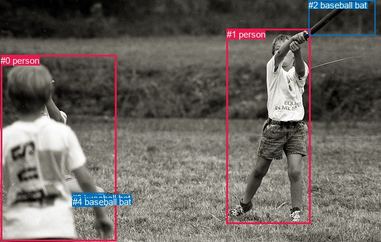
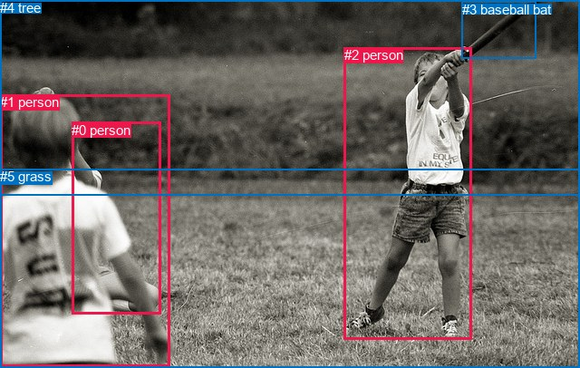

# 图片 0926：2357328.jpg

随机样本序号：91。图片 SHA256：`6ea86200037b2147bcd782185ae893fc9b6a9e43c454bdef19fec8431469d81a`。

红色框表示人，蓝色框表示其他物体。两个模式分别保留自身框编号，可依据位置比较对应对象。

## 自动检测框与输出

人的框编号：`[0, 1]`。状态：`ok`。

### 自动检测全部物体框

| 编号 | 类别 | 是否为人 | 检测分数 | 像素坐标 xyxy |
|---|---|---|---|---|
| 0 | person | True | 0.9997 | 1.1, 92.7, 195.3, 404.9 |
| 1 | person | True | 0.9995 | 380.9, 48.6, 521.9, 375.9 |
| 2 | baseball bat | False | 0.7526 | 518.1, 0.1, 630.7, 59.9 |
| 3 | baseball bat | False | 0.5570 | 121.5, 323.8, 176.3, 346.0 |
| 4 | baseball bat | False | 0.4484 | 122.3, 329.6, 153.5, 345.4 |

### 自动检测 Top50 人相关候选

评分物体对：20；人相关物体对：14；输出关系：28。

| 排名 | 主语编号与类别 | 关系 | 宾语编号与类别 | 类型 | 人与人 | 排序分数 | 原始融合 logit |
|---|---|---|---|---|---|---|---|
| 1 | #1 person | swinging | #2 baseball bat | semantic | False | 0.99824 | 6.3416 |
| 2 | #0 person | holding | #3 baseball bat | semantic | False | 0.96074 | 3.1975 |
| 3 | #0 person | throwing | #4 baseball bat | semantic | False | 0.95219 | 2.9914 |
| 4 | #0 person | looking at | #1 person | semantic | True | 0.93457 | 2.6591 |
| 5 | #0 person | in front of | #1 person | spatial | True | 0.87217 | 1.9203 |
| 6 | #1 person | swinging | #3 baseball bat | semantic | False | 0.85550 | 1.7784 |
| 7 | #2 baseball bat | over | #1 person | spatial | False | 0.79600 | 1.3615 |
| 8 | #1 person | playing | #0 person | semantic | True | 0.77918 | 1.2609 |
| 9 | #1 person | swinging | #4 baseball bat | semantic | False | 0.77412 | 1.2317 |
| 10 | #1 person | beside | #2 baseball bat | spatial | False | 0.77001 | 1.2084 |
| 11 | #0 person | swinging | #2 baseball bat | semantic | False | 0.69511 | 0.8241 |
| 12 | #1 person | beside | #0 person | spatial | True | 0.69456 | 0.8215 |
| 13 | #2 baseball bat | swinging | #1 person | semantic | False | 0.52054 | 0.0822 |
| 14 | #3 baseball bat | beside | #0 person | spatial | False | 0.42807 | -0.2897 |
| 15 | #4 baseball bat | beside | #0 person | spatial | False | 0.28656 | -0.9122 |
| 16 | #0 person | beside | #3 baseball bat | spatial | False | 0.25757 | -1.0587 |
| 17 | #0 person | over | #4 baseball bat | spatial | False | 0.25535 | -1.0703 |
| 18 | #3 baseball bat | looking at | #0 person | semantic | False | 0.23346 | -1.1889 |
| 19 | #1 person | beside | #3 baseball bat | spatial | False | 0.22354 | -1.2451 |
| 20 | #1 person | beside | #4 baseball bat | spatial | False | 0.17075 | -1.5803 |
| 21 | #3 baseball bat | looking at | #1 person | semantic | False | 0.15899 | -1.6657 |
| 22 | #4 baseball bat | looking at | #0 person | semantic | False | 0.14812 | -1.7494 |
| 23 | #3 baseball bat | beside | #1 person | spatial | False | 0.09406 | -2.2651 |
| 24 | #4 baseball bat | looking at | #1 person | semantic | False | 0.07195 | -2.5571 |
| 25 | #4 baseball bat | beside | #1 person | spatial | False | 0.05384 | -2.8664 |
| 26 | #0 person | in front of | #2 baseball bat | spatial | False | 0.04669 | -3.0164 |
| 27 | #2 baseball bat | over | #0 person | spatial | False | 0.01337 | -4.3012 |
| 28 | #2 baseball bat | flying over | #0 person | semantic | False | 0.01187 | -4.4218 |

### 自动检测逐条人相关 GT 核验

R@50：20.00%；命中 1/5。

| GT 主语编号 | GT 关系 | GT 宾语编号 | 结果阶段 | 匹配预测主语编号 | 匹配预测宾语编号 |
|---|---|---|---|---|---|
| 0 | standing on | 5 | endpoint_missing_or_wrong_class | [] | [] |
| 1 | standing on | 5 | endpoint_missing_or_wrong_class | [0] | [] |
| 2 | holding | 3 | wrong_predicate | [1] | [2] |
| 2 | swinging | 3 | hit50 | [1] | [2] |
| 2 | standing on | 5 | endpoint_missing_or_wrong_class | [1] | [] |

## 真实框与输出

人的框编号：`[0, 1, 2]`。

### 真实框全部物体框

| 编号 | 类别 | 是否为人 | 检测分数 | 像素坐标 xyxy |
|---|---|---|---|---|
| 0 | person | True | GT | 79.0, 135.0, 177.0, 347.0 |
| 1 | person | True | GT | 0.0, 104.0, 188.0, 404.0 |
| 2 | person | True | GT | 380.0, 52.0, 521.0, 374.0 |
| 3 | baseball bat | False | GT | 510.0, 2.0, 592.0, 64.0 |
| 4 | tree | False | GT | 0.0, 0.0, 640.0, 216.0 |
| 5 | grass | False | GT | 0.0, 186.0, 640.0, 406.0 |

### 真实框 Top50 人相关候选

评分物体对：30；人相关物体对：24；输出关系：48。

| 排名 | 主语编号与类别 | 关系 | 宾语编号与类别 | 类型 | 人与人 | 排序分数 | 原始融合 logit |
|---|---|---|---|---|---|---|---|
| 1 | #2 person | swinging | #3 baseball bat | semantic | False | 0.99822 | 6.3305 |
| 2 | #2 person | standing on | #5 grass | semantic | False | 0.96712 | 3.3815 |
| 3 | #2 person | on | #5 grass | spatial | False | 0.95738 | 3.1119 |
| 4 | #1 person | looking at | #2 person | semantic | True | 0.95084 | 2.9624 |
| 5 | #2 person | playing | #4 tree | semantic | False | 0.94375 | 2.8201 |
| 6 | #0 person | looking at | #2 person | semantic | True | 0.94238 | 2.7946 |
| 7 | #1 person | on | #5 grass | spatial | False | 0.93669 | 2.6943 |
| 8 | #1 person | standing on | #5 grass | semantic | False | 0.93475 | 2.6620 |
| 9 | #0 person | beside | #1 person | spatial | True | 0.92346 | 2.4904 |
| 10 | #1 person | holding | #0 person | semantic | True | 0.91680 | 2.3996 |
| 11 | #2 person | playing | #1 person | semantic | True | 0.91116 | 2.3278 |
| 12 | #0 person | on | #5 grass | spatial | False | 0.89737 | 2.1684 |
| 13 | #0 person | standing on | #5 grass | semantic | False | 0.89404 | 2.1327 |
| 14 | #2 person | playing | #0 person | semantic | True | 0.87352 | 1.9325 |
| 15 | #2 person | in | #4 tree | spatial | False | 0.86722 | 1.8766 |
| 16 | #2 person | in | #3 baseball bat | spatial | False | 0.81103 | 1.4567 |
| 17 | #3 baseball bat | swinging | #2 person | semantic | False | 0.79616 | 1.3625 |
| 18 | #1 person | in | #0 person | spatial | True | 0.78185 | 1.2765 |
| 19 | #1 person | playing | #3 baseball bat | semantic | False | 0.77711 | 1.2489 |
| 20 | #0 person | looking at | #1 person | semantic | True | 0.73327 | 1.0113 |
| 21 | #1 person | playing | #4 tree | semantic | False | 0.68045 | 0.7558 |
| 22 | #4 tree | beside | #2 person | spatial | False | 0.60745 | 0.4366 |
| 23 | #3 baseball bat | over | #2 person | spatial | False | 0.59962 | 0.4039 |
| 24 | #0 person | catching | #3 baseball bat | semantic | False | 0.58380 | 0.3384 |
| 25 | #2 person | beside | #1 person | spatial | True | 0.54497 | 0.1804 |
| 26 | #0 person | in | #4 tree | spatial | False | 0.52198 | 0.0880 |
| 27 | #1 person | in front of | #2 person | spatial | True | 0.50437 | 0.0175 |
| 28 | #1 person | in | #4 tree | spatial | False | 0.48281 | -0.0688 |
| 29 | #0 person | looking at | #4 tree | semantic | False | 0.37761 | -0.4997 |
| 30 | #2 person | beside | #0 person | spatial | True | 0.37499 | -0.5109 |
| 31 | #0 person | beside | #2 person | spatial | True | 0.35941 | -0.5779 |
| 32 | #4 tree | looking at | #2 person | semantic | False | 0.24630 | -1.1184 |
| 33 | #5 grass | beside | #2 person | spatial | False | 0.22265 | -1.2503 |
| 34 | #4 tree | beside | #1 person | spatial | False | 0.18835 | -1.4608 |
| 35 | #3 baseball bat | swinging | #1 person | semantic | False | 0.17195 | -1.5719 |
| 36 | #3 baseball bat | swinging | #0 person | semantic | False | 0.10690 | -2.1228 |
| 37 | #5 grass | holding | #2 person | semantic | False | 0.10466 | -2.1465 |
| 38 | #5 grass | beside | #1 person | spatial | False | 0.09201 | -2.2893 |
| 39 | #1 person | in | #3 baseball bat | spatial | False | 0.06156 | -2.7243 |
| 40 | #5 grass | in | #0 person | spatial | False | 0.05038 | -2.9365 |
| 41 | #4 tree | looking at | #1 person | semantic | False | 0.04932 | -2.9589 |
| 42 | #5 grass | holding | #1 person | semantic | False | 0.03959 | -3.1888 |
| 43 | #0 person | in | #3 baseball bat | spatial | False | 0.03858 | -3.2156 |
| 44 | #4 tree | beside | #0 person | spatial | False | 0.03388 | -3.3503 |
| 45 | #3 baseball bat | over | #1 person | spatial | False | 0.02405 | -3.7034 |
| 46 | #3 baseball bat | in | #0 person | spatial | False | 0.02073 | -3.8551 |
| 47 | #5 grass | holding | #0 person | semantic | False | 0.01726 | -4.0419 |
| 48 | #4 tree | looking at | #0 person | semantic | False | 0.00449 | -5.4006 |

### 真实框逐条人相关 GT 核验

R@50：80.00%；命中 4/5。

| GT 主语编号 | GT 关系 | GT 宾语编号 | 结果阶段 | 匹配预测主语编号 | 匹配预测宾语编号 |
|---|---|---|---|---|---|
| 0 | standing on | 5 | hit50 | [0] | [5] |
| 1 | standing on | 5 | hit50 | [1] | [5] |
| 2 | holding | 3 | wrong_predicate | [2] | [3] |
| 2 | swinging | 3 | hit50 | [2] | [3] |
| 2 | standing on | 5 | hit50 | [2] | [5] |

## 全部人相关 GT

| 主语编号与类别 | 关系 | 宾语编号与类别 |
|---|---|---|
| #0 person | standing on | #5 grass |
| #1 person | standing on | #5 grass |
| #2 person | holding | #3 baseball bat |
| #2 person | swinging | #3 baseball bat |
| #2 person | standing on | #5 grass |

原始记录、全部人相关物体对的两项预测与分项分数见 [逐图证据 JSON](../evidence/cases/0926.json)。全部56类 logits 保留于本机 HOR/output/random500/logits/。

<!-- HOR_COMPLETE_RESULTS -->

## 六组条件的完整输出对照

以下保留同一图片三种框与候选模式、两种谓词输出规则的全部 Top50。框编号各自在所属模式内解释。

### 自动检测框完整枚举：空间与语义各保留一个谓词

| 排名 | 主语编号与类别 | 谓词 | 宾语编号与类别 | 分组 | 排序分数 | predicate logit | pair logit |
|---|---|---|---|---|---|---|---|
| 1 | #1 person | swinging | #2 baseball bat | semantic | 0.9982417 | 5.8345246 | 0.5071105 |
| 2 | #0 person | holding | #3 baseball bat | semantic | 0.9607416 | 3.4886689 | -0.2911288 |
| 3 | #0 person | throwing | #4 baseball bat | semantic | 0.9521862 | 3.2878051 | -0.2963597 |
| 4 | #0 person | looking at | #1 person | semantic | 0.9345688 | 3.0350757 | -0.3759903 |
| 5 | #0 person | in front of | #1 person | spatial | 0.8721737 | 2.2963066 | -0.3759903 |
| 6 | #1 person | swinging | #3 baseball bat | semantic | 0.8555001 | 2.3440247 | -0.5656168 |
| 7 | #2 baseball bat | over | #1 person | spatial | 0.7960048 | 2.0284753 | -0.6669665 |
| 8 | #1 person | playing | #0 person | semantic | 0.7791798 | 2.0449009 | -0.7840075 |
| 9 | #1 person | swinging | #4 baseball bat | semantic | 0.7741180 | 1.8625851 | -0.6308734 |
| 10 | #1 person | beside | #2 baseball bat | spatial | 0.7700087 | 0.7012501 | 0.5071105 |
| 11 | #0 person | swinging | #2 baseball bat | semantic | 0.6951103 | 1.0200520 | -0.1959317 |
| 12 | #1 person | beside | #0 person | spatial | 0.6945603 | 1.6055341 | -0.7840075 |
| 13 | #2 baseball bat | swinging | #1 person | semantic | 0.5205377 | 0.7491636 | -0.6669665 |
| 14 | #3 baseball bat | beside | #0 person | spatial | 0.4280683 | 0.3466749 | -0.6364119 |
| 15 | #4 baseball bat | beside | #0 person | spatial | 0.2865568 | -0.2546296 | -0.6575363 |
| 16 | #0 person | beside | #3 baseball bat | spatial | 0.2575668 | -0.7675250 | -0.2911288 |
| 17 | #0 person | over | #4 baseball bat | spatial | 0.2553536 | -0.7739005 | -0.2963597 |
| 18 | #3 baseball bat | looking at | #0 person | semantic | 0.2334584 | -0.5524731 | -0.6364119 |
| 19 | #1 person | beside | #3 baseball bat | spatial | 0.2235435 | -0.6795177 | -0.5656168 |
| 20 | #1 person | beside | #4 baseball bat | spatial | 0.1707471 | -0.9494679 | -0.6308734 |
| 21 | #3 baseball bat | looking at | #1 person | semantic | 0.1589918 | -0.7976270 | -0.8681217 |
| 22 | #4 baseball bat | looking at | #0 person | semantic | 0.1481247 | -1.0918496 | -0.6575363 |
| 23 | #3 baseball bat | beside | #1 person | spatial | 0.0940581 | -1.3969405 | -0.8681217 |
| 24 | #4 baseball bat | looking at | #1 person | semantic | 0.0719517 | -1.6288512 | -0.9282382 |
| 25 | #4 baseball bat | beside | #1 person | spatial | 0.0538400 | -1.9381566 | -0.9282382 |
| 26 | #0 person | in front of | #2 baseball bat | spatial | 0.0466923 | -2.8204257 | -0.1959317 |
| 27 | #2 baseball bat | over | #0 person | spatial | 0.0133711 | -2.9091337 | -1.3920662 |
| 28 | #2 baseball bat | flying over | #0 person | semantic | 0.0118694 | -3.0297821 | -1.3920662 |

GT 命中：1/5，R@50=20.00%。

| GT主语 | GT谓词 | GT宾语 | 结果阶段 | 匹配主语框 | 匹配宾语框 |
|---|---|---|---|---|---|
| 0 | standing on | 5 | endpoint_missing_or_wrong_class | [] | [] |
| 1 | standing on | 5 | endpoint_missing_or_wrong_class | [0] | [] |
| 2 | holding | 3 | wrong_predicate | [1] | [2] |
| 2 | swinging | 3 | hit50 | [1] | [2] |
| 2 | standing on | 5 | endpoint_missing_or_wrong_class | [1] | [] |

### 自动检测框完整枚举：每对只保留一个谓词

| 排名 | 主语编号与类别 | 谓词 | 宾语编号与类别 | 分组 | 排序分数 | predicate logit | pair logit |
|---|---|---|---|---|---|---|---|
| 1 | #1 person | swinging | #2 baseball bat | single | 0.9982417 | 5.8345246 | 0.5071105 |
| 2 | #0 person | holding | #3 baseball bat | single | 0.9607416 | 3.4886689 | -0.2911288 |
| 3 | #0 person | throwing | #4 baseball bat | single | 0.9521862 | 3.2878051 | -0.2963597 |
| 4 | #0 person | looking at | #1 person | single | 0.9345688 | 3.0350757 | -0.3759903 |
| 5 | #1 person | swinging | #3 baseball bat | single | 0.8555001 | 2.3440247 | -0.5656168 |
| 6 | #2 baseball bat | over | #1 person | single | 0.7960048 | 2.0284753 | -0.6669665 |
| 7 | #1 person | playing | #0 person | single | 0.7791798 | 2.0449009 | -0.7840075 |
| 8 | #1 person | swinging | #4 baseball bat | single | 0.7741180 | 1.8625851 | -0.6308734 |
| 9 | #0 person | swinging | #2 baseball bat | single | 0.6951103 | 1.0200520 | -0.1959317 |
| 10 | #3 baseball bat | beside | #0 person | single | 0.4280683 | 0.3466749 | -0.6364119 |
| 11 | #4 baseball bat | beside | #0 person | single | 0.2865568 | -0.2546296 | -0.6575363 |
| 12 | #3 baseball bat | looking at | #1 person | single | 0.1589918 | -0.7976270 | -0.8681217 |
| 13 | #4 baseball bat | looking at | #1 person | single | 0.0719517 | -1.6288512 | -0.9282382 |
| 14 | #2 baseball bat | over | #0 person | single | 0.0133711 | -2.9091337 | -1.3920662 |

GT 命中：1/5，R@50=20.00%。

| GT主语 | GT谓词 | GT宾语 | 结果阶段 | 匹配主语框 | 匹配宾语框 |
|---|---|---|---|---|---|
| 0 | standing on | 5 | endpoint_missing_or_wrong_class | [] | [] |
| 1 | standing on | 5 | endpoint_missing_or_wrong_class | [0] | [] |
| 2 | holding | 3 | wrong_predicate | [1] | [2] |
| 2 | swinging | 3 | hit50 | [1] | [2] |
| 2 | standing on | 5 | endpoint_missing_or_wrong_class | [1] | [] |

### 真实框完整枚举：空间与语义各保留一个谓词

| 排名 | 主语编号与类别 | 谓词 | 宾语编号与类别 | 分组 | 排序分数 | predicate logit | pair logit |
|---|---|---|---|---|---|---|---|
| 1 | #2 person | swinging | #3 baseball bat | semantic | 0.9982221 | 5.8345256 | 0.4959794 |
| 2 | #2 person | standing on | #5 grass | semantic | 0.9671215 | 3.4106345 | -0.0291280 |
| 3 | #2 person | on | #5 grass | spatial | 0.9573821 | 3.1410561 | -0.0291280 |
| 4 | #1 person | looking at | #2 person | semantic | 0.9508446 | 3.3485389 | -0.3861749 |
| 5 | #2 person | playing | #4 tree | semantic | 0.9437532 | 3.2311721 | -0.4110568 |
| 6 | #0 person | looking at | #2 person | semantic | 0.9423841 | 3.3919864 | -0.5973735 |
| 7 | #1 person | on | #5 grass | spatial | 0.9366902 | 2.8676577 | -0.1733452 |
| 8 | #1 person | standing on | #5 grass | semantic | 0.9347458 | 2.8353291 | -0.1733452 |
| 9 | #0 person | beside | #1 person | spatial | 0.9234635 | 3.1068592 | -0.6164962 |
| 10 | #1 person | holding | #0 person | semantic | 0.9167990 | 2.8415117 | -0.4418834 |
| 11 | #2 person | playing | #1 person | semantic | 0.9111552 | 3.0954399 | -0.7676175 |
| 12 | #0 person | on | #5 grass | spatial | 0.8973727 | 2.4572697 | -0.2889016 |
| 13 | #0 person | standing on | #5 grass | semantic | 0.8940403 | 2.4215941 | -0.2889016 |
| 14 | #2 person | playing | #0 person | semantic | 0.8735230 | 2.6390424 | -0.7065682 |
| 15 | #2 person | in | #4 tree | spatial | 0.8672184 | 2.2876420 | -0.4110568 |
| 16 | #2 person | in | #3 baseball bat | spatial | 0.8110325 | 0.9607534 | 0.4959794 |
| 17 | #3 baseball bat | swinging | #2 person | semantic | 0.7961637 | 2.0430484 | -0.6805605 |
| 18 | #1 person | in | #0 person | spatial | 0.7818488 | 1.7183566 | -0.4418834 |
| 19 | #1 person | playing | #3 baseball bat | semantic | 0.7771142 | 1.5283203 | -0.2793927 |
| 20 | #0 person | looking at | #1 person | semantic | 0.7332673 | 1.6277595 | -0.6164962 |
| 21 | #1 person | playing | #4 tree | semantic | 0.6804472 | 1.6030455 | -0.8472174 |
| 22 | #4 tree | beside | #2 person | spatial | 0.6074540 | 0.8269782 | -0.3903556 |
| 23 | #3 baseball bat | over | #2 person | spatial | 0.5996192 | 1.0844393 | -0.6805605 |
| 24 | #0 person | catching | #3 baseball bat | semantic | 0.5838032 | 0.9602957 | -0.6218899 |
| 25 | #2 person | beside | #1 person | spatial | 0.5449687 | 0.9479795 | -0.7676175 |
| 26 | #0 person | in | #4 tree | spatial | 0.5219759 | 0.9397483 | -0.8517879 |
| 27 | #1 person | in front of | #2 person | spatial | 0.5043651 | 0.4036360 | -0.3861749 |
| 28 | #1 person | in | #4 tree | spatial | 0.4828136 | 0.7784448 | -0.8472174 |
| 29 | #0 person | looking at | #4 tree | semantic | 0.3776077 | 0.3520732 | -0.8517879 |
| 30 | #2 person | beside | #0 person | spatial | 0.3749896 | 0.1956983 | -0.7065682 |
| 31 | #0 person | beside | #2 person | spatial | 0.3594059 | 0.0194297 | -0.5973735 |
| 32 | #4 tree | looking at | #2 person | semantic | 0.2463027 | -0.7280738 | -0.3903556 |
| 33 | #5 grass | beside | #2 person | spatial | 0.2226544 | -0.4931045 | -0.7571598 |
| 34 | #4 tree | beside | #1 person | spatial | 0.1883450 | -0.6159854 | -0.8448146 |
| 35 | #3 baseball bat | swinging | #1 person | semantic | 0.1719482 | -0.1836686 | -1.3882135 |
| 36 | #3 baseball bat | swinging | #0 person | semantic | 0.1068980 | -0.5748267 | -1.5479994 |
| 37 | #5 grass | holding | #2 person | semantic | 0.1046562 | -1.3893671 | -0.7571598 |
| 38 | #5 grass | beside | #1 person | spatial | 0.0920110 | -1.2917082 | -0.9976158 |
| 39 | #1 person | in | #3 baseball bat | spatial | 0.0615562 | -2.4448800 | -0.2793927 |
| 40 | #5 grass | in | #0 person | spatial | 0.0503802 | -1.7678673 | -1.1685957 |
| 41 | #4 tree | looking at | #1 person | semantic | 0.0493183 | -2.1140690 | -0.8448146 |
| 42 | #5 grass | holding | #1 person | semantic | 0.0395889 | -2.1911969 | -0.9976158 |
| 43 | #0 person | in | #3 baseball bat | spatial | 0.0385822 | -2.5937274 | -0.6218899 |
| 44 | #4 tree | beside | #0 person | spatial | 0.0338846 | -2.3323426 | -1.0179816 |
| 45 | #3 baseball bat | over | #1 person | spatial | 0.0240479 | -2.3151503 | -1.3882135 |
| 46 | #3 baseball bat | in | #0 person | spatial | 0.0207321 | -2.3071220 | -1.5479994 |
| 47 | #5 grass | holding | #0 person | semantic | 0.0172610 | -2.8732972 | -1.1685957 |
| 48 | #4 tree | looking at | #0 person | semantic | 0.0044937 | -4.3825941 | -1.0179816 |

GT 命中：4/5，R@50=80.00%。

| GT主语 | GT谓词 | GT宾语 | 结果阶段 | 匹配主语框 | 匹配宾语框 |
|---|---|---|---|---|---|
| 0 | standing on | 5 | hit50 | [0] | [5] |
| 1 | standing on | 5 | hit50 | [1] | [5] |
| 2 | holding | 3 | wrong_predicate | [2] | [3] |
| 2 | swinging | 3 | hit50 | [2] | [3] |
| 2 | standing on | 5 | hit50 | [2] | [5] |

### 真实框完整枚举：每对只保留一个谓词

| 排名 | 主语编号与类别 | 谓词 | 宾语编号与类别 | 分组 | 排序分数 | predicate logit | pair logit |
|---|---|---|---|---|---|---|---|
| 1 | #2 person | swinging | #3 baseball bat | single | 0.9982221 | 5.8345256 | 0.4959794 |
| 2 | #2 person | standing on | #5 grass | single | 0.9671215 | 3.4106345 | -0.0291280 |
| 3 | #1 person | looking at | #2 person | single | 0.9508446 | 3.3485389 | -0.3861749 |
| 4 | #2 person | playing | #4 tree | single | 0.9437532 | 3.2311721 | -0.4110568 |
| 5 | #0 person | looking at | #2 person | single | 0.9423841 | 3.3919864 | -0.5973735 |
| 6 | #1 person | on | #5 grass | single | 0.9366902 | 2.8676577 | -0.1733452 |
| 7 | #0 person | beside | #1 person | single | 0.9234635 | 3.1068592 | -0.6164962 |
| 8 | #1 person | holding | #0 person | single | 0.9167990 | 2.8415117 | -0.4418834 |
| 9 | #2 person | playing | #1 person | single | 0.9111552 | 3.0954399 | -0.7676175 |
| 10 | #0 person | on | #5 grass | single | 0.8973727 | 2.4572697 | -0.2889016 |
| 11 | #2 person | playing | #0 person | single | 0.8735230 | 2.6390424 | -0.7065682 |
| 12 | #3 baseball bat | swinging | #2 person | single | 0.7961637 | 2.0430484 | -0.6805605 |
| 13 | #1 person | playing | #3 baseball bat | single | 0.7771142 | 1.5283203 | -0.2793927 |
| 14 | #1 person | playing | #4 tree | single | 0.6804472 | 1.6030455 | -0.8472174 |
| 15 | #4 tree | beside | #2 person | single | 0.6074540 | 0.8269782 | -0.3903556 |
| 16 | #0 person | catching | #3 baseball bat | single | 0.5838032 | 0.9602957 | -0.6218899 |
| 17 | #0 person | in | #4 tree | single | 0.5219759 | 0.9397483 | -0.8517879 |
| 18 | #5 grass | beside | #2 person | single | 0.2226544 | -0.4931045 | -0.7571598 |
| 19 | #4 tree | beside | #1 person | single | 0.1883450 | -0.6159854 | -0.8448146 |
| 20 | #3 baseball bat | swinging | #1 person | single | 0.1719482 | -0.1836686 | -1.3882135 |
| 21 | #3 baseball bat | swinging | #0 person | single | 0.1068980 | -0.5748267 | -1.5479994 |
| 22 | #5 grass | beside | #1 person | single | 0.0920110 | -1.2917082 | -0.9976158 |
| 23 | #5 grass | in | #0 person | single | 0.0503802 | -1.7678673 | -1.1685957 |
| 24 | #4 tree | beside | #0 person | single | 0.0338846 | -2.3323426 | -1.0179816 |

GT 命中：2/5，R@50=40.00%。

| GT主语 | GT谓词 | GT宾语 | 结果阶段 | 匹配主语框 | 匹配宾语框 |
|---|---|---|---|---|---|
| 0 | standing on | 5 | wrong_predicate | [0] | [5] |
| 1 | standing on | 5 | wrong_predicate | [1] | [5] |
| 2 | holding | 3 | wrong_predicate | [2] | [3] |
| 2 | swinging | 3 | hit50 | [2] | [3] |
| 2 | standing on | 5 | hit50 | [2] | [5] |

### 真实框400候选：空间与语义各保留一个谓词

| 排名 | 主语编号与类别 | 谓词 | 宾语编号与类别 | 分组 | 排序分数 | predicate logit | pair logit |
|---|---|---|---|---|---|---|---|
| 1 | #2 person | swinging | #3 baseball bat | semantic | 0.9982221 | 5.8345256 | 0.4959794 |
| 2 | #2 person | standing on | #5 grass | semantic | 0.9671215 | 3.4106345 | -0.0291280 |
| 3 | #2 person | on | #5 grass | spatial | 0.9573821 | 3.1410561 | -0.0291280 |
| 4 | #1 person | looking at | #2 person | semantic | 0.9508446 | 3.3485389 | -0.3861749 |
| 5 | #2 person | playing | #4 tree | semantic | 0.9463740 | 3.2816596 | -0.4110568 |
| 6 | #0 person | looking at | #2 person | semantic | 0.9454942 | 3.4507747 | -0.5973735 |
| 7 | #1 person | on | #5 grass | spatial | 0.9366902 | 2.8676577 | -0.1733452 |
| 8 | #1 person | standing on | #5 grass | semantic | 0.9347458 | 2.8353291 | -0.1733452 |
| 9 | #0 person | beside | #1 person | spatial | 0.9234594 | 3.1068010 | -0.6164962 |
| 10 | #1 person | holding | #0 person | semantic | 0.9172485 | 2.8474202 | -0.4418834 |
| 11 | #2 person | playing | #1 person | semantic | 0.9111552 | 3.0954399 | -0.7676175 |
| 12 | #0 person | on | #5 grass | spatial | 0.8937816 | 2.4188662 | -0.2889016 |
| 13 | #0 person | standing on | #5 grass | semantic | 0.8896527 | 2.3761001 | -0.2889016 |
| 14 | #2 person | playing | #0 person | semantic | 0.8735230 | 2.6390424 | -0.7065682 |
| 15 | #2 person | in | #4 tree | spatial | 0.8691429 | 2.3044581 | -0.4110568 |
| 16 | #2 person | in | #3 baseball bat | spatial | 0.8115404 | 0.9640718 | 0.4959794 |
| 17 | #3 baseball bat | swinging | #2 person | semantic | 0.7961636 | 2.0430474 | -0.6805605 |
| 18 | #1 person | in | #0 person | spatial | 0.7824144 | 1.7216754 | -0.4418834 |
| 19 | #1 person | playing | #3 baseball bat | semantic | 0.7771142 | 1.5283203 | -0.2793927 |
| 20 | #0 person | looking at | #1 person | semantic | 0.7332673 | 1.6277595 | -0.6164962 |
| 21 | #1 person | playing | #4 tree | semantic | 0.6913238 | 1.6535330 | -0.8472174 |
| 22 | #4 tree | beside | #2 person | spatial | 0.6074677 | 0.8270359 | -0.3903556 |
| 23 | #3 baseball bat | over | #2 person | spatial | 0.6002538 | 1.0870833 | -0.6805605 |
| 24 | #0 person | catching | #3 baseball bat | semantic | 0.5831627 | 0.9576602 | -0.6218899 |
| 25 | #2 person | beside | #1 person | spatial | 0.5523915 | 0.9779553 | -0.7676175 |
| 26 | #0 person | in | #4 tree | spatial | 0.5219759 | 0.9397483 | -0.8517879 |
| 27 | #1 person | in front of | #2 person | spatial | 0.5044010 | 0.4037795 | -0.3861749 |
| 28 | #1 person | in | #4 tree | spatial | 0.4895015 | 0.8052173 | -0.8472174 |
| 29 | #0 person | looking at | #4 tree | semantic | 0.3776897 | 0.3524222 | -0.8517879 |
| 30 | #2 person | beside | #0 person | spatial | 0.3749964 | 0.1957273 | -0.7065682 |
| 31 | #0 person | beside | #2 person | spatial | 0.3663494 | 0.0494633 | -0.5973735 |
| 32 | #4 tree | looking at | #2 person | semantic | 0.2463674 | -0.7277255 | -0.3903556 |
| 33 | #5 grass | beside | #2 person | spatial | 0.2278856 | -0.4631290 | -0.7571598 |
| 34 | #4 tree | beside | #1 person | spatial | 0.1883450 | -0.6159854 | -0.8448146 |
| 35 | #3 baseball bat | swinging | #1 person | semantic | 0.1719480 | -0.1836700 | -1.3882135 |
| 36 | #3 baseball bat | swinging | #0 person | semantic | 0.1098049 | -0.5447364 | -1.5479994 |
| 37 | #5 grass | holding | #2 person | semantic | 0.1045179 | -1.3908443 | -0.7571598 |
| 38 | #5 grass | beside | #1 person | spatial | 0.0920134 | -1.2916791 | -0.9976158 |
| 39 | #1 person | in | #3 baseball bat | spatial | 0.0630230 | -2.4197667 | -0.2793927 |
| 40 | #5 grass | in | #0 person | spatial | 0.0503802 | -1.7678673 | -1.1685957 |
| 41 | #4 tree | looking at | #1 person | semantic | 0.0486257 | -2.1289401 | -0.8448146 |
| 42 | #5 grass | holding | #1 person | semantic | 0.0397014 | -2.1882427 | -0.9976158 |
| 43 | #0 person | in | #3 baseball bat | spatial | 0.0377216 | -2.6171813 | -0.6218899 |
| 44 | #4 tree | beside | #0 person | spatial | 0.0338869 | -2.3322701 | -1.0179816 |
| 45 | #3 baseball bat | over | #1 person | spatial | 0.0233819 | -2.3439195 | -1.3882135 |
| 46 | #3 baseball bat | in | #0 person | spatial | 0.0206313 | -2.3121002 | -1.5479994 |
| 47 | #5 grass | holding | #0 person | semantic | 0.0170828 | -2.8838565 | -1.1685957 |
| 48 | #4 tree | looking at | #0 person | semantic | 0.0045198 | -4.3767781 | -1.0179816 |

GT 命中：4/5，R@50=80.00%。

| GT主语 | GT谓词 | GT宾语 | 结果阶段 | 匹配主语框 | 匹配宾语框 |
|---|---|---|---|---|---|
| 0 | standing on | 5 | hit50 | [0] | [5] |
| 1 | standing on | 5 | hit50 | [1] | [5] |
| 2 | holding | 3 | wrong_predicate | [2] | [3] |
| 2 | swinging | 3 | hit50 | [2] | [3] |
| 2 | standing on | 5 | hit50 | [2] | [5] |

### 真实框400候选：每对只保留一个谓词

| 排名 | 主语编号与类别 | 谓词 | 宾语编号与类别 | 分组 | 排序分数 | predicate logit | pair logit |
|---|---|---|---|---|---|---|---|
| 1 | #2 person | swinging | #3 baseball bat | single | 0.9982221 | 5.8345256 | 0.4959794 |
| 2 | #2 person | standing on | #5 grass | single | 0.9671215 | 3.4106345 | -0.0291280 |
| 3 | #1 person | looking at | #2 person | single | 0.9508446 | 3.3485389 | -0.3861749 |
| 4 | #2 person | playing | #4 tree | single | 0.9463740 | 3.2816596 | -0.4110568 |
| 5 | #0 person | looking at | #2 person | single | 0.9454942 | 3.4507747 | -0.5973735 |
| 6 | #1 person | on | #5 grass | single | 0.9366902 | 2.8676577 | -0.1733452 |
| 7 | #0 person | beside | #1 person | single | 0.9234594 | 3.1068010 | -0.6164962 |
| 8 | #1 person | holding | #0 person | single | 0.9172485 | 2.8474202 | -0.4418834 |
| 9 | #2 person | playing | #1 person | single | 0.9111552 | 3.0954399 | -0.7676175 |
| 10 | #0 person | on | #5 grass | single | 0.8937816 | 2.4188662 | -0.2889016 |
| 11 | #2 person | playing | #0 person | single | 0.8735230 | 2.6390424 | -0.7065682 |
| 12 | #3 baseball bat | swinging | #2 person | single | 0.7961636 | 2.0430474 | -0.6805605 |
| 13 | #1 person | playing | #3 baseball bat | single | 0.7771142 | 1.5283203 | -0.2793927 |
| 14 | #1 person | playing | #4 tree | single | 0.6913238 | 1.6535330 | -0.8472174 |
| 15 | #4 tree | beside | #2 person | single | 0.6074677 | 0.8270359 | -0.3903556 |
| 16 | #0 person | catching | #3 baseball bat | single | 0.5831627 | 0.9576602 | -0.6218899 |
| 17 | #0 person | in | #4 tree | single | 0.5219759 | 0.9397483 | -0.8517879 |
| 18 | #5 grass | beside | #2 person | single | 0.2278856 | -0.4631290 | -0.7571598 |
| 19 | #4 tree | beside | #1 person | single | 0.1883450 | -0.6159854 | -0.8448146 |
| 20 | #3 baseball bat | swinging | #1 person | single | 0.1719480 | -0.1836700 | -1.3882135 |
| 21 | #3 baseball bat | swinging | #0 person | single | 0.1098049 | -0.5447364 | -1.5479994 |
| 22 | #5 grass | beside | #1 person | single | 0.0920134 | -1.2916791 | -0.9976158 |
| 23 | #5 grass | in | #0 person | single | 0.0503802 | -1.7678673 | -1.1685957 |
| 24 | #4 tree | beside | #0 person | single | 0.0338869 | -2.3322701 | -1.0179816 |

GT 命中：2/5，R@50=40.00%。

| GT主语 | GT谓词 | GT宾语 | 结果阶段 | 匹配主语框 | 匹配宾语框 |
|---|---|---|---|---|---|
| 0 | standing on | 5 | wrong_predicate | [0] | [5] |
| 1 | standing on | 5 | wrong_predicate | [1] | [5] |
| 2 | holding | 3 | wrong_predicate | [2] | [3] |
| 2 | swinging | 3 | hit50 | [2] | [3] |
| 2 | standing on | 5 | hit50 | [2] | [5] |
