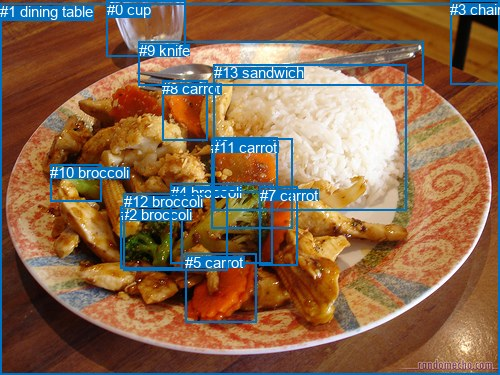
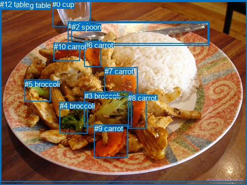

# 图片 0939：2358136.jpg

随机样本序号：43。图片 SHA256：`d5c4394c712e5c24586f2531e2adf25d14e398993cc12af561ca760f20881df0`。

红色框表示人，蓝色框表示其他物体。两个模式分别保留自身框编号，可依据位置比较对应对象。

## 自动检测框与输出

人的框编号：`[]`。状态：`no_person`。

### 自动检测全部物体框

| 编号 | 类别 | 是否为人 | 检测分数 | 像素坐标 xyxy |
|---|---|---|---|---|
| 0 | cup | False | 0.9936 | 106.6, 0.6, 185.2, 56.5 |
| 1 | dining table | False | 0.9741 | 0.0, 3.1, 500.0, 375.0 |
| 2 | broccoli | False | 0.9727 | 120.9, 206.3, 182.0, 269.0 |
| 3 | chair | False | 0.9642 | 450.1, 0.8, 500.0, 84.2 |
| 4 | broccoli | False | 0.9628 | 170.9, 183.9, 272.3, 263.7 |
| 5 | carrot | False | 0.9417 | 185.4, 253.7, 256.8, 323.0 |
| 6 | carrot | False | 0.9226 | 213.0, 137.0, 277.6, 192.8 |
| 7 | carrot | False | 0.8642 | 259.8, 186.9, 297.6, 265.9 |
| 8 | carrot | False | 0.8557 | 162.5, 80.3, 207.4, 140.1 |
| 9 | knife | False | 0.8551 | 138.8, 41.7, 423.8, 85.5 |
| 10 | broccoli | False | 0.6395 | 50.1, 164.1, 101.1, 201.5 |
| 11 | carrot | False | 0.5848 | 211.2, 138.5, 292.7, 228.1 |
| 12 | broccoli | False | 0.4244 | 123.5, 193.1, 227.4, 270.5 |
| 13 | sandwich | False | 0.3650 | 213.5, 64.2, 406.5, 211.0 |

### 自动检测 Top50 人相关候选

评分物体对：0；人相关物体对：0；输出关系：0。

| 排名 | 主语编号与类别 | 关系 | 宾语编号与类别 | 类型 | 人与人 | 排序分数 | 原始融合 logit |
|---|---|---|---|---|---|---|---|

### 自动检测逐条人相关 GT 核验

本图没有人相关 GT，R@50 无分母；预测候选继续展示。

## 真实框与输出

人的框编号：`[]`。

### 真实框全部物体框

| 编号 | 类别 | 是否为人 | 检测分数 | 像素坐标 xyxy |
|---|---|---|---|---|
| 0 | cup | False | GT | 106.0, 0.0, 183.0, 55.0 |
| 1 | fork | False | GT | 138.0, 44.0, 424.0, 93.0 |
| 2 | spoon | False | GT | 145.0, 46.0, 422.0, 88.0 |
| 3 | broccoli | False | GT | 171.0, 186.0, 267.0, 257.0 |
| 4 | broccoli | False | GT | 121.0, 206.0, 178.0, 270.0 |
| 5 | broccoli | False | GT | 50.0, 162.0, 103.0, 206.0 |
| 6 | carrot | False | GT | 171.0, 83.0, 205.0, 136.0 |
| 7 | carrot | False | GT | 212.0, 136.0, 279.0, 196.0 |
| 8 | carrot | False | GT | 259.0, 190.0, 296.0, 261.0 |
| 9 | carrot | False | GT | 191.0, 252.0, 259.0, 319.0 |
| 10 | carrot | False | GT | 109.0, 86.0, 162.0, 123.0 |
| 11 | dining table | False | GT | 2.0, 2.0, 500.0, 368.0 |
| 12 | table | False | GT | 0.0, 0.0, 500.0, 375.0 |

### 真实框 Top50 人相关候选

评分物体对：0；人相关物体对：0；输出关系：0。

| 排名 | 主语编号与类别 | 关系 | 宾语编号与类别 | 类型 | 人与人 | 排序分数 | 原始融合 logit |
|---|---|---|---|---|---|---|---|

### 真实框逐条人相关 GT 核验

本图没有人相关 GT，R@50 无分母；预测候选继续展示。

## 全部人相关 GT

| 主语编号与类别 | 关系 | 宾语编号与类别 |
|---|---|---|

原始记录、全部人相关物体对的两项预测与分项分数见 [逐图证据 JSON](../evidence/cases/0939.json)。全部56类 logits 保留于本机 HOR/output/random500/logits/。

<!-- HOR_COMPLETE_RESULTS -->

## 六组条件的完整输出对照

以下保留同一图片三种框与候选模式、两种谓词输出规则的全部 Top50。框编号各自在所属模式内解释。

### 自动检测框完整枚举：空间与语义各保留一个谓词

| 排名 | 主语编号与类别 | 谓词 | 宾语编号与类别 | 分组 | 排序分数 | predicate logit | pair logit |
|---|---|---|---|---|---|---|---|

没有人相关 GT，本条件的召回率无分母。

### 自动检测框完整枚举：每对只保留一个谓词

| 排名 | 主语编号与类别 | 谓词 | 宾语编号与类别 | 分组 | 排序分数 | predicate logit | pair logit |
|---|---|---|---|---|---|---|---|

没有人相关 GT，本条件的召回率无分母。

### 真实框完整枚举：空间与语义各保留一个谓词

| 排名 | 主语编号与类别 | 谓词 | 宾语编号与类别 | 分组 | 排序分数 | predicate logit | pair logit |
|---|---|---|---|---|---|---|---|

没有人相关 GT，本条件的召回率无分母。

### 真实框完整枚举：每对只保留一个谓词

| 排名 | 主语编号与类别 | 谓词 | 宾语编号与类别 | 分组 | 排序分数 | predicate logit | pair logit |
|---|---|---|---|---|---|---|---|

没有人相关 GT，本条件的召回率无分母。

### 真实框400候选：空间与语义各保留一个谓词

| 排名 | 主语编号与类别 | 谓词 | 宾语编号与类别 | 分组 | 排序分数 | predicate logit | pair logit |
|---|---|---|---|---|---|---|---|

没有人相关 GT，本条件的召回率无分母。

### 真实框400候选：每对只保留一个谓词

| 排名 | 主语编号与类别 | 谓词 | 宾语编号与类别 | 分组 | 排序分数 | predicate logit | pair logit |
|---|---|---|---|---|---|---|---|

没有人相关 GT，本条件的召回率无分母。
