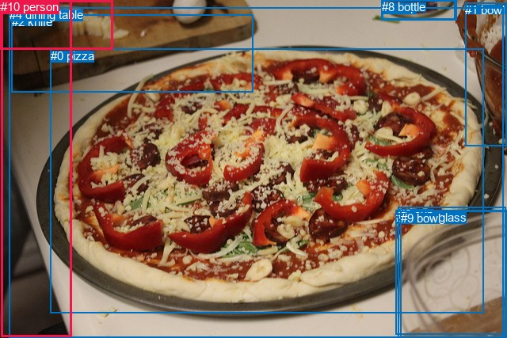
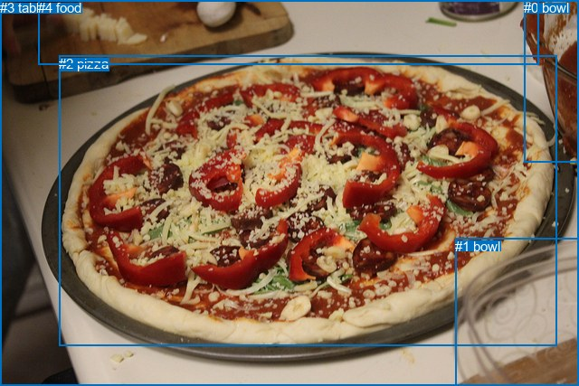

# 图片 0941：2358216.jpg

随机样本序号：426。图片 SHA256：`00723fd47795b91bf6fc2fbdc35982cddf3b7150eee9366ce944527181ed74ee`。

红色框表示人，蓝色框表示其他物体。两个模式分别保留自身框编号，可依据位置比较对应对象。

## 自动检测框与输出

人的框编号：`[5, 10]`。状态：`ok`。

### 自动检测全部物体框

| 编号 | 类别 | 是否为人 | 检测分数 | 像素坐标 xyxy |
|---|---|---|---|---|
| 0 | pizza | False | 0.9976 | 63.9, 61.9, 610.6, 395.5 |
| 1 | bowl | False | 0.9325 | 587.2, 3.8, 639.2, 184.3 |
| 2 | knife | False | 0.7656 | 15.0, 18.8, 319.4, 116.6 |
| 3 | wine glass | False | 0.6830 | 499.9, 265.6, 639.7, 423.0 |
| 4 | dining table | False | 0.6782 | 11.9, 9.8, 635.3, 427.0 |
| 5 | person | True | 0.6445 | 0.0, 0.2, 142.5, 62.3 |
| 6 | cup | False | 0.6277 | 502.7, 261.8, 638.5, 427.0 |
| 7 | cup | False | 0.5851 | 481.8, 0.0, 576.3, 25.0 |
| 8 | bottle | False | 0.5666 | 482.1, 0.0, 574.3, 24.5 |
| 9 | bowl | False | 0.4695 | 506.0, 266.8, 639.1, 427.0 |
| 10 | person | True | 0.4459 | 1.4, 0.0, 90.0, 425.6 |

### 自动检测 Top50 人相关候选

评分物体对：110；人相关物体对：38；输出关系：50。

| 排名 | 主语编号与类别 | 关系 | 宾语编号与类别 | 类型 | 人与人 | 排序分数 | 原始融合 logit |
|---|---|---|---|---|---|---|---|
| 1 | #5 person | on | #2 knife | spatial | False | 0.95384 | 3.0283 |
| 2 | #10 person | holding | #5 person | semantic | True | 0.95106 | 2.9670 |
| 3 | #10 person | beside | #4 dining table | spatial | False | 0.94810 | 2.9051 |
| 4 | #10 person | sitting on | #4 dining table | semantic | False | 0.76180 | 1.1626 |
| 5 | #5 person | slicing | #2 knife | semantic | False | 0.75977 | 1.1514 |
| 6 | #10 person | beside | #0 pizza | spatial | False | 0.70586 | 0.8754 |
| 7 | #5 person | on | #10 person | spatial | True | 0.69006 | 0.8004 |
| 8 | #5 person | slicing | #0 pizza | semantic | False | 0.68663 | 0.7844 |
| 9 | #5 person | on | #0 pizza | spatial | False | 0.60258 | 0.4162 |
| 10 | #10 person | holding | #0 pizza | semantic | False | 0.51615 | 0.0646 |
| 11 | #5 person | on | #4 dining table | spatial | False | 0.51553 | 0.0622 |
| 12 | #10 person | on | #5 person | spatial | True | 0.49072 | -0.0371 |
| 13 | #2 knife | on | #10 person | spatial | False | 0.43312 | -0.2691 |
| 14 | #0 pizza | on | #10 person | spatial | False | 0.40857 | -0.3699 |
| 15 | #10 person | beside | #2 knife | spatial | False | 0.27170 | -0.9860 |
| 16 | #5 person | touching | #10 person | semantic | True | 0.26144 | -1.0385 |
| 17 | #10 person | holding | #2 knife | semantic | False | 0.25384 | -1.0782 |
| 18 | #2 knife | in | #5 person | spatial | False | 0.17840 | -1.5272 |
| 19 | #2 knife | holding | #5 person | semantic | False | 0.12962 | -1.9043 |
| 20 | #2 knife | sitting on | #10 person | semantic | False | 0.10300 | -2.1643 |
| 21 | #4 dining table | in | #10 person | spatial | False | 0.07713 | -2.4820 |
| 22 | #5 person | slicing | #4 dining table | semantic | False | 0.07647 | -2.4912 |
| 23 | #0 pizza | sitting on | #10 person | semantic | False | 0.05536 | -2.8370 |
| 24 | #5 person | in | #1 bowl | spatial | False | 0.03397 | -3.3478 |
| 25 | #3 wine glass | on | #10 person | spatial | False | 0.02598 | -3.6240 |
| 26 | #9 bowl | on | #10 person | spatial | False | 0.02427 | -3.6938 |
| 27 | #6 cup | on | #10 person | spatial | False | 0.02368 | -3.7190 |
| 28 | #8 bottle | on | #10 person | spatial | False | 0.02354 | -3.7251 |
| 29 | #7 cup | on | #10 person | spatial | False | 0.02303 | -3.7477 |
| 30 | #5 person | in | #3 wine glass | spatial | False | 0.02032 | -3.8755 |
| 31 | #5 person | in | #6 cup | spatial | False | 0.01993 | -3.8955 |
| 32 | #5 person | in | #9 bowl | spatial | False | 0.01991 | -3.8962 |
| 33 | #0 pizza | in | #5 person | spatial | False | 0.01881 | -3.9543 |
| 34 | #5 person | picking | #1 bowl | semantic | False | 0.01768 | -4.0175 |
| 35 | #4 dining table | holding | #10 person | semantic | False | 0.01709 | -4.0520 |
| 36 | #1 bowl | in | #5 person | spatial | False | 0.01645 | -4.0907 |
| 37 | #1 bowl | on | #10 person | spatial | False | 0.01554 | -4.1484 |
| 38 | #8 bottle | in | #5 person | spatial | False | 0.01109 | -4.4901 |
| 39 | #7 cup | in | #5 person | spatial | False | 0.01105 | -4.4943 |
| 40 | #5 person | in | #7 cup | spatial | False | 0.00964 | -4.6326 |
| 41 | #5 person | in | #8 bottle | spatial | False | 0.00932 | -4.6658 |
| 42 | #3 wine glass | holding | #10 person | semantic | False | 0.00786 | -4.8384 |
| 43 | #1 bowl | holding | #5 person | semantic | False | 0.00781 | -4.8447 |
| 44 | #9 bowl | holding | #10 person | semantic | False | 0.00770 | -4.8593 |
| 45 | #6 cup | holding | #10 person | semantic | False | 0.00734 | -4.9074 |
| 46 | #3 wine glass | in | #5 person | spatial | False | 0.00692 | -4.9659 |
| 47 | #6 cup | in | #5 person | spatial | False | 0.00660 | -5.0137 |
| 48 | #10 person | picking | #1 bowl | semantic | False | 0.00657 | -5.0189 |
| 49 | #9 bowl | in | #5 person | spatial | False | 0.00651 | -5.0273 |
| 50 | #8 bottle | sitting on | #10 person | semantic | False | 0.00587 | -5.1312 |

### 自动检测逐条人相关 GT 核验

本图没有人相关 GT，R@50 无分母；预测候选继续展示。

## 真实框与输出

人的框编号：`[]`。

### 真实框全部物体框

| 编号 | 类别 | 是否为人 | 检测分数 | 像素坐标 xyxy |
|---|---|---|---|---|
| 0 | bowl | False | GT | 579.0, 0.0, 640.0, 180.0 |
| 1 | bowl | False | GT | 503.0, 264.0, 640.0, 427.0 |
| 2 | pizza | False | GT | 65.0, 62.0, 615.0, 383.0 |
| 3 | table | False | GT | 0.0, 0.0, 640.0, 427.0 |
| 4 | food | False | GT | 42.0, 0.0, 595.0, 72.0 |

### 真实框 Top50 人相关候选

评分物体对：0；人相关物体对：0；输出关系：0。

| 排名 | 主语编号与类别 | 关系 | 宾语编号与类别 | 类型 | 人与人 | 排序分数 | 原始融合 logit |
|---|---|---|---|---|---|---|---|

### 真实框逐条人相关 GT 核验

本图没有人相关 GT，R@50 无分母；预测候选继续展示。

## 全部人相关 GT

| 主语编号与类别 | 关系 | 宾语编号与类别 |
|---|---|---|

原始记录、全部人相关物体对的两项预测与分项分数见 [逐图证据 JSON](../evidence/cases/0941.json)。全部56类 logits 保留于本机 HOR/output/random500/logits/。

<!-- HOR_COMPLETE_RESULTS -->

## 六组条件的完整输出对照

以下保留同一图片三种框与候选模式、两种谓词输出规则的全部 Top50。框编号各自在所属模式内解释。

### 自动检测框完整枚举：空间与语义各保留一个谓词

| 排名 | 主语编号与类别 | 谓词 | 宾语编号与类别 | 分组 | 排序分数 | predicate logit | pair logit |
|---|---|---|---|---|---|---|---|
| 1 | #5 person | on | #2 knife | spatial | 0.9538373 | 3.4689040 | -0.4405828 |
| 2 | #10 person | holding | #5 person | semantic | 0.9510615 | 3.2947879 | -0.3277740 |
| 3 | #10 person | beside | #4 dining table | spatial | 0.9480972 | 3.1088829 | -0.2037984 |
| 4 | #10 person | sitting on | #4 dining table | semantic | 0.7617965 | 1.3663526 | -0.2037984 |
| 5 | #5 person | slicing | #2 knife | semantic | 0.7597663 | 1.5919814 | -0.4405828 |
| 6 | #10 person | beside | #0 pizza | spatial | 0.7058638 | 1.5419402 | -0.6665610 |
| 7 | #5 person | on | #10 person | spatial | 0.6900648 | 1.3235335 | -0.5231109 |
| 8 | #5 person | slicing | #0 pizza | semantic | 0.6866322 | 1.5618901 | -0.7774688 |
| 9 | #5 person | on | #0 pizza | spatial | 0.6025807 | 1.1936984 | -0.7774688 |
| 10 | #10 person | holding | #0 pizza | semantic | 0.5161548 | 0.7312026 | -0.6665610 |
| 11 | #5 person | on | #4 dining table | spatial | 0.5155349 | 0.7601118 | -0.6979522 |
| 12 | #10 person | on | #5 person | spatial | 0.4907183 | 0.2906427 | -0.3277740 |
| 13 | #2 knife | on | #10 person | spatial | 0.4331236 | 0.5699778 | -0.8390958 |
| 14 | #0 pizza | on | #10 person | spatial | 0.4085682 | 0.5867181 | -0.9566057 |
| 15 | #10 person | beside | #2 knife | spatial | 0.2717011 | 0.3718653 | -1.3578744 |
| 16 | #5 person | touching | #10 person | semantic | 0.2614367 | -0.5154037 | -0.5231109 |
| 17 | #10 person | holding | #2 knife | semantic | 0.2538373 | 0.2796245 | -1.3578744 |
| 18 | #2 knife | in | #5 person | spatial | 0.1783997 | -0.3268571 | -1.2003701 |
| 19 | #2 knife | holding | #5 person | semantic | 0.1296197 | -0.7039554 | -1.2003701 |
| 20 | #2 knife | sitting on | #10 person | semantic | 0.1030021 | -1.3252082 | -0.8390958 |
| 21 | #4 dining table | in | #10 person | spatial | 0.0771270 | -1.7132905 | -0.7687480 |
| 22 | #5 person | slicing | #4 dining table | semantic | 0.0764748 | -1.7932842 | -0.6979522 |
| 23 | #0 pizza | sitting on | #10 person | semantic | 0.0553568 | -1.8804016 | -0.9566057 |
| 24 | #5 person | in | #1 bowl | spatial | 0.0339683 | -2.4331229 | -0.9146464 |
| 25 | #3 wine glass | on | #10 person | spatial | 0.0259815 | -2.6798189 | -0.9442250 |
| 26 | #9 bowl | on | #10 person | spatial | 0.0242739 | -2.7618532 | -0.9319268 |
| 27 | #6 cup | on | #10 person | spatial | 0.0236848 | -2.7946668 | -0.9242834 |
| 28 | #8 bottle | on | #10 person | spatial | 0.0235434 | -2.8336349 | -0.8914497 |
| 29 | #7 cup | on | #10 person | spatial | 0.0230301 | -2.8514028 | -0.8962492 |
| 30 | #5 person | in | #3 wine glass | spatial | 0.0203216 | -2.1819913 | -1.6935469 |
| 31 | #5 person | in | #6 cup | spatial | 0.0199275 | -2.2003555 | -1.6951697 |
| 32 | #5 person | in | #9 bowl | spatial | 0.0199149 | -2.1986961 | -1.6974733 |
| 33 | #0 pizza | in | #5 person | spatial | 0.0188117 | -2.4560301 | -1.4982579 |
| 34 | #5 person | picking | #1 bowl | semantic | 0.0176793 | -3.1028759 | -0.9146464 |
| 35 | #4 dining table | holding | #10 person | semantic | 0.0170897 | -3.2832921 | -0.7687480 |
| 36 | #1 bowl | in | #5 person | spatial | 0.0164528 | -2.7478161 | -1.3428562 |
| 37 | #1 bowl | on | #10 person | spatial | 0.0155435 | -3.3298652 | -0.8185831 |
| 38 | #8 bottle | in | #5 person | spatial | 0.0110948 | -2.9746540 | -1.5154654 |
| 39 | #7 cup | in | #5 person | spatial | 0.0110496 | -2.9796321 | -1.5146217 |
| 40 | #5 person | in | #7 cup | spatial | 0.0096358 | -2.9983306 | -1.6342576 |
| 41 | #5 person | in | #8 bottle | spatial | 0.0093236 | -3.0201247 | -1.6457198 |
| 42 | #3 wine glass | holding | #10 person | semantic | 0.0078574 | -3.8941894 | -0.9442250 |
| 43 | #1 bowl | holding | #5 person | semantic | 0.0078083 | -3.5018725 | -1.3428562 |
| 44 | #9 bowl | holding | #10 person | semantic | 0.0076962 | -3.9273720 | -0.9319268 |
| 45 | #6 cup | holding | #10 person | semantic | 0.0073374 | -3.9831231 | -0.9242834 |
| 46 | #3 wine glass | in | #5 person | spatial | 0.0069234 | -3.1199093 | -1.8459924 |
| 47 | #6 cup | in | #5 person | spatial | 0.0066021 | -3.1767731 | -1.8369707 |
| 48 | #10 person | picking | #1 bowl | semantic | 0.0065684 | -3.6664224 | -1.3524790 |
| 49 | #9 bowl | in | #5 person | spatial | 0.0065137 | -3.1918187 | -1.8354975 |
| 50 | #8 bottle | sitting on | #10 person | semantic | 0.0058748 | -4.2397461 | -0.8914497 |

没有人相关 GT，本条件的召回率无分母。

### 自动检测框完整枚举：每对只保留一个谓词

| 排名 | 主语编号与类别 | 谓词 | 宾语编号与类别 | 分组 | 排序分数 | predicate logit | pair logit |
|---|---|---|---|---|---|---|---|
| 1 | #5 person | on | #2 knife | single | 0.9538373 | 3.4689040 | -0.4405828 |
| 2 | #10 person | holding | #5 person | single | 0.9510615 | 3.2947879 | -0.3277740 |
| 3 | #10 person | beside | #4 dining table | single | 0.9480972 | 3.1088829 | -0.2037984 |
| 4 | #10 person | beside | #0 pizza | single | 0.7058638 | 1.5419402 | -0.6665610 |
| 5 | #5 person | on | #10 person | single | 0.6900648 | 1.3235335 | -0.5231109 |
| 6 | #5 person | slicing | #0 pizza | single | 0.6866322 | 1.5618901 | -0.7774688 |
| 7 | #5 person | on | #4 dining table | single | 0.5155349 | 0.7601118 | -0.6979522 |
| 8 | #2 knife | on | #10 person | single | 0.4331236 | 0.5699778 | -0.8390958 |
| 9 | #0 pizza | on | #10 person | single | 0.4085682 | 0.5867181 | -0.9566057 |
| 10 | #10 person | beside | #2 knife | single | 0.2717011 | 0.3718653 | -1.3578744 |
| 11 | #2 knife | in | #5 person | single | 0.1783997 | -0.3268571 | -1.2003701 |
| 12 | #4 dining table | in | #10 person | single | 0.0771270 | -1.7132905 | -0.7687480 |
| 13 | #5 person | in | #1 bowl | single | 0.0339683 | -2.4331229 | -0.9146464 |
| 14 | #3 wine glass | on | #10 person | single | 0.0259815 | -2.6798189 | -0.9442250 |
| 15 | #9 bowl | on | #10 person | single | 0.0242739 | -2.7618532 | -0.9319268 |
| 16 | #6 cup | on | #10 person | single | 0.0236848 | -2.7946668 | -0.9242834 |
| 17 | #8 bottle | on | #10 person | single | 0.0235434 | -2.8336349 | -0.8914497 |
| 18 | #7 cup | on | #10 person | single | 0.0230301 | -2.8514028 | -0.8962492 |
| 19 | #5 person | in | #3 wine glass | single | 0.0203216 | -2.1819913 | -1.6935469 |
| 20 | #5 person | in | #6 cup | single | 0.0199275 | -2.2003555 | -1.6951697 |
| 21 | #5 person | in | #9 bowl | single | 0.0199149 | -2.1986961 | -1.6974733 |
| 22 | #0 pizza | in | #5 person | single | 0.0188117 | -2.4560301 | -1.4982579 |
| 23 | #1 bowl | in | #5 person | single | 0.0164528 | -2.7478161 | -1.3428562 |
| 24 | #1 bowl | on | #10 person | single | 0.0155435 | -3.3298652 | -0.8185831 |
| 25 | #8 bottle | in | #5 person | single | 0.0110948 | -2.9746540 | -1.5154654 |
| 26 | #7 cup | in | #5 person | single | 0.0110496 | -2.9796321 | -1.5146217 |
| 27 | #5 person | in | #7 cup | single | 0.0096358 | -2.9983306 | -1.6342576 |
| 28 | #5 person | in | #8 bottle | single | 0.0093236 | -3.0201247 | -1.6457198 |
| 29 | #3 wine glass | in | #5 person | single | 0.0069234 | -3.1199093 | -1.8459924 |
| 30 | #6 cup | in | #5 person | single | 0.0066021 | -3.1767731 | -1.8369707 |
| 31 | #10 person | picking | #1 bowl | single | 0.0065684 | -3.6664224 | -1.3524790 |
| 32 | #9 bowl | in | #5 person | single | 0.0065137 | -3.1918187 | -1.8354975 |
| 33 | #4 dining table | in | #5 person | single | 0.0046615 | -3.6354473 | -1.7283015 |
| 34 | #10 person | in | #3 wine glass | single | 0.0038432 | -3.9176767 | -1.6399198 |
| 35 | #10 person | in | #9 bowl | single | 0.0036359 | -3.9761999 | -1.6370486 |
| 36 | #10 person | in | #6 cup | single | 0.0036354 | -3.9804039 | -1.6329778 |
| 37 | #10 person | in | #8 bottle | single | 0.0021683 | -4.4417920 | -1.6898501 |
| 38 | #10 person | in | #7 cup | single | 0.0021570 | -4.4518595 | -1.6850402 |

没有人相关 GT，本条件的召回率无分母。

### 真实框完整枚举：空间与语义各保留一个谓词

| 排名 | 主语编号与类别 | 谓词 | 宾语编号与类别 | 分组 | 排序分数 | predicate logit | pair logit |
|---|---|---|---|---|---|---|---|

没有人相关 GT，本条件的召回率无分母。

### 真实框完整枚举：每对只保留一个谓词

| 排名 | 主语编号与类别 | 谓词 | 宾语编号与类别 | 分组 | 排序分数 | predicate logit | pair logit |
|---|---|---|---|---|---|---|---|

没有人相关 GT，本条件的召回率无分母。

### 真实框400候选：空间与语义各保留一个谓词

| 排名 | 主语编号与类别 | 谓词 | 宾语编号与类别 | 分组 | 排序分数 | predicate logit | pair logit |
|---|---|---|---|---|---|---|---|

没有人相关 GT，本条件的召回率无分母。

### 真实框400候选：每对只保留一个谓词

| 排名 | 主语编号与类别 | 谓词 | 宾语编号与类别 | 分组 | 排序分数 | predicate logit | pair logit |
|---|---|---|---|---|---|---|---|

没有人相关 GT，本条件的召回率无分母。
